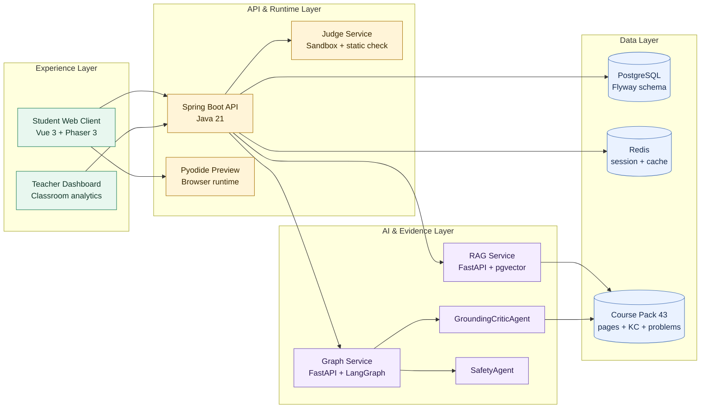
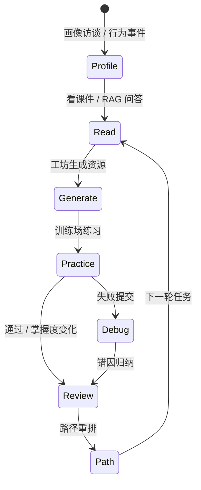

<div align="center">

# Pythontopia

**面向高校 Python 初学者的 AI 像素学习小镇**

从一门真实课程出发，把「看课件、问资料、生成资源、提交练习、调试错误、复盘提升」收束为一个可追踪、可评价、可演示的学习闭环。


**当前仓库不是开源授权版本**：仅供评审、演示、课程验收与团队协作查看；未经项目维护者书面许可，不得复用、再发布、商用、部署或二次创作。第三方依赖与素材仍按各自上游 license 执行。

[快速体验](#快速体验) · [项目亮点](#项目亮点) · [三大 AI 创新点](#三大-ai-创新点) · [系统架构](#系统架构) · [Qwen 微调](#qwen-微调) · [最小版说明](#最小版说明) · [验证命令](#验证命令)

</div>

---

## 一句话

Pythontopia 是一个以《Python 语言基础》为唯一课程底座的网页版像素学习小镇：学生在中央小镇 `town_hub` 中完成画像访谈、课件 RAG、资源工坊、训练场判题、Bug 矿洞调试和复盘大厅评估；教师通过轻量班级看板追踪 KC 掌握、任务完成和高频误区。

它不是纯游戏皮肤，也不是纯聊天助手。每一次对话、生成、阅读、练习和任务完成都落到学习证据上，用多智能体与防幻觉审查服务真实教学目标。

## 项目亮点

| 维度 | 能力 | 交互体验 |
| --- | --- | --- |
| 像素学习小镇 | R-14 收敛为单一中央 hub，减少地图奔波 | 建筑入口、NPC 对话、任务板、复盘大厅一屏串起学习路径 |
| 课程知识底座 | `packId=43`《Python 语言基础》：7 文档 / 561 页 / 7 章 / 65 KC / 46 示例 / 39 题 | RAG 回答必须带证据页；低置信度时拒绝编造 |
| 多智能体资源生成 | Profile / CurriculumMapper / ResourceDesigner / MindMap / Practice / CodeLab / Storyboard / PathPlanner / Debug / GroundingCritic / Safety | 工坊生成资源时记录 run id、agent、证据页、安全与接地结果 |
| 真实练习评估 | Pyodide 即时预览 + 服务端正式判题 | 前端可试跑，正式提交入库并驱动画像、任务和班级统计 |
| 个性化画像 | 8 维统一画像：背景、基础、目标、认知、偏好、易错、实践、坚持度 | 学生自评 + 行为事件被动更新，不靠一次问卷定终身 |
| 教师班级 | 创建班级、发布任务、看 KC 热力图与高频误区 | 轻量但完整，适合课程演示与教学闭环证明 |

## 三大 AI 创新点

这三点是保研面试、课程答辩和 GitHub 评审时最值得先讲的部分。完整抗问材料见 [`docs/presentations/2026-07-06-ai-innovation-defense.md`](./docs/presentations/2026-07-06-ai-innovation-defense.md)。

| 创新点 | 解决的问题 | 可被追问时的证据 |
| --- | --- | --- |
| 证据闭环型多智能体导学 | 不让 AI 停留在聊天层，而是把画像、课程证据、资源生成、判题、错因和路径重规划串成“看-学-练-测-复盘”闭环。 | `services/pythontopia-graph/` 的 Agent runtime、`backend/` 的学习事件与任务 evidence、课程包 `packId=43`。 |
| 本地 Qwen3.5/vLLM/QLoRA 结构化 Agent 微调 | 解决本地模型在教学 Agent JSON、证据页、拒答边界上的不稳定，使其更适合 Pythontopia 的资源工坊和导学调用。 | 1000 case baseline JSON `0.686` -> E1 `0.980`；QLoRA + 新手噪声 JSON `0.990`；guard 后 JSON/grounding/leak 达到 `1.000/1.000/0.000`。 |
| 多模态学习资源编排 | 面向不同学生偏好，不只给文字答案，而是组织代码练习、Mermaid/思维导图、真实视频速览、图像提示词和引导截图等学习媒介。 | `schemas/resource.py`、`schemas/tutor.py`、B 站视频速览路由、`frontend/public/guide/screenshots/`、`data/course-pack-43/generated-media/` 的本地生成策略。 |

<details open>
<summary><strong>30 秒导览</strong></summary>

1. 学生进入 `town_hub`，先通过导学助手和 NPC 形成初始画像。
2. 在图书馆阅读课程页或向 RAG 提问，回答必须引用课程证据。
3. 到资源工坊生成讲义、练习、思维导图或故事化学习材料。
4. 进入训练场提交 Python 题目，正式结果由后端判题并写入学习事件。
5. 失败提交进入 Bug 矿洞，DebugAgent 引导定位错误而不是直接给答案。
6. 复盘大厅把掌握度、错因、资源使用和情绪坚持度汇总为下一轮路径。

</details>

<details>
<summary><strong>面向评审的展示路线</strong></summary>

| 时间 | 看什么 | 证明什么 |
| --- | --- | --- |
| 0:00 - 1:00 | 小镇首页 + 学习入口 | 游戏承载教学，不做无教育目的装饰 |
| 1:00 - 2:30 | 课件 RAG 问答 | 课程证据、拒绝幻觉、页码可追溯 |
| 2:30 - 4:00 | 百晓工坊资源生成 | 多智能体协作、结构化产物、安全审查 |
| 4:00 - 5:30 | 训练场提交 + 判题 | 正式评估入库，Pyodide 不冒充正式判题 |
| 5:30 - 6:30 | Bug 矿洞 / 复盘大厅 | 错因诊断、画像更新、路径重排 |
| 6:30 - 7:00 | 教师班级看板 | 班级任务、KC 热力图、高频误区 |

</details>

## 系统架构



<details open>
<summary><strong>交互式架构入口</strong></summary>

| 入口 | 适合场景 | 说明 |
| --- | --- | --- |
| [`docs/architecture/architecture-overview.html`](./docs/architecture/architecture-overview.html) | GitHub Pages / 本地演示 | 响应式架构看板，支持角色视角、模块聚焦和证据链切换 |
| 上方 Mermaid 节点 | GitHub README 快速跳转 | 点击 Web / Backend / Graph / RAG / Course 节点可直达对应目录 |
| [`docs/architecture/system_design.md`](./docs/architecture/system_design.md) | 技术评审 | 更完整的服务边界、数据流和时序说明 |

</details>

### 核心目录

```text
backend/                    Spring Boot 后端：账号、画像、课程、任务、工坊、判题、班级
frontend/                   Vue 3 + Phaser 3 网页端：小镇、学习页、工坊、训练场、看板
services/pythontopia-graph  多智能体资源生成与路径规划
services/pythontopia-rag    课件 RAG、证据检索与安全过滤
data/course-pack-43/        Python 语言基础课程种子数据
deploy/                     Docker Compose、本地演示脚本、生产部署参考
clients/                    非 Web 客户端：原生 Android/Windows、轻壳端、微信端
research/                   隔离研究实验：本地 Qwen3.5/vLLM 微调与可靠性评测
docs/                       文档总目录：架构、测试、报告、演示、合规、参考资料
```

## 快速体验

> 本地全栈开发优先使用根目录 `./dev.sh`，它会一起处理前端、后端、Graph/RAG 服务和 Docker 依赖，避免只启动单个后端造成链路缺失。

```bash
cd /home/cypress/Pythontopia
./dev.sh
```

健康检查：

```bash
curl http://127.0.0.1:5173/healthz
curl http://127.0.0.1:18080/api/health
```

Docker 演示链路：

```bash
cd deploy
cp .env.example .env
docker compose up -d --build
bash scripts/init_rag_index.sh
bash scripts/seed_demo_classroom.sh
bash scripts/demo_smoke.sh
```

打开：

```text
Web:     http://localhost:8080
Backend: http://localhost:18080/api
```

<details>
<summary><strong>开发者分层启动</strong></summary>

```bash
cd backend
mvn clean compile -DskipTests
mvn test
mvn spring-boot:run

cd frontend
npm ci
npm run dev
npm run typecheck
npm run lint
npm run test

cd services/pythontopia-graph
python -m pip install -e ".[dev]"
python -m pytest -q

cd services/pythontopia-rag
python -m pip install -e ".[dev]"
python -m pytest -q
```

</details>

## Qwen 微调

本仓库包含 Qwen3.5/vLLM 微调实验的可复现代码、case、测试、训练计划、SFT 数据摘要和结果报告；不直接上传本地 `.venv`、Qwen/AWQ 基座权重、LoRA adapter 权重和长跑缓存。这样既能让读者看懂“怎么微调、效果如何、如何复现”，又不会把 GitHub 仓库变成多 GB 模型仓库。

| 入口 | 内容 |
| --- | --- |
| [`research/README.md`](./research/README.md) | 研究目录总入口与 artifact policy。 |
| [`research/vllm-agent-ft-lab/README.md`](./research/vllm-agent-ft-lab/README.md) | 从环境、vLLM 服务、case 生成、SFT、QLoRA、LoRA serving 到 Web A/B 的完整命令。 |
| [`research/vllm-agent-ft-lab/MODEL_ARTIFACTS.md`](./research/vllm-agent-ft-lab/MODEL_ARTIFACTS.md) | GitHub 包含/排除哪些微调产物，以及如何重建 adapter。 |
| [`docs/reports/2026-07-03-qwen-vllm-finetuning-method-report.md`](./docs/reports/2026-07-03-qwen-vllm-finetuning-method-report.md) | 微调方法、数据来源、训练参数和 heldout 效果。 |
| [`docs/reports/2026-07-03-vllm-1000-beginner-noise-multifold-eval.md`](./docs/reports/2026-07-03-vllm-1000-beginner-noise-multifold-eval.md) | 1000 条新手表达增强、5-fold vLLM LoRA 可靠性评测。 |
| [`docs/reports/2026-07-03-vllm-safety-debug-guard-fix.md`](./docs/reports/2026-07-03-vllm-safety-debug-guard-fix.md) | SafetyAgent / DebugAgent 的确定性 guard、repair 和 fallback 验证。 |

## 教学闭环



| 学习动作 | 系统落点 | 可验证证据 |
| --- | --- | --- |
| 看 | 课程页、视频、PPT、RAG 问答 | `page_read_id` / evidence page ids |
| 学 | 工坊资源、思维导图、故事化材料 | agent run id / artifact / grounding result |
| 练 | 训练场提交真实题目 | `submission_id` / verdict / test summary |
| 测 | 章节测试与掌握度阈值 | KC mastery delta / quest evidence |
| 复盘 | 错因、画像、路径调整 | reflection / profile dimensions / path nodes |

## 最小版说明

这个 GitHub 版本作为 **Source-Available Preview Snapshot** 发布：保留可运行源码、课程结构化种子、核心文档和部署脚本，便于评审与协作查看；它不是 MIT / Apache / GPL 等开源授权版本，也不授权外部复用 Pythontopia 的代码、品牌、原创美术、课程集成或演示材料。

| 保留 | 原因 |
| --- | --- |
| `backend/`, `frontend/`, `services/`, `deploy/` | 可运行主链路 |
| `data/course-pack-43/json/`, `derived/`, `export/` | 课程包结构化种子与可追溯来源 |
| `research/vllm-agent-ft-lab/` 的源码、测试、case 与说明文档 | Qwen3.5/vLLM 微调实验的可复现部分 |
| `docs/`, `AGENTS.md`, `LICENSE*` | 架构、测试、合规、协作边界 |
| `.github/workflows/`, `.gitignore`, `.gitattributes` | GitHub 工程化入口 |

| 不随最小版上传 | 原因 |
| --- | --- |
| `data/course-pack-43/videos/`、`pdfs/`、`generated-media/` | 文件过大，且部分内容需要单独授权或本地缓存 |
| `assets/inbox/`、`output/`、`qa-screens/` | 素材收集/发布包/浏览器截图，可重生或仅本地使用 |
| `node_modules/`、`target/`、`dist/`、`.pytest_cache/`、`.venv/` | 构建与依赖缓存 |
| `research/**/models/`、`research/**/outputs/adapters/`、`research/**/runs/` | Qwen 基座权重、LoRA adapter 权重和长跑缓存，体积过大且应通过模型仓库/本地重建管理 |
| `.env`、`deploy/.env`、`secrets/`、`*.pem` | 本地凭据，禁止入库 |
| `docs/presentations/` 中的大体积演示 PPT/PDF | 展示物料，不属于最小源码交付 |

## 验证命令

按影响范围选择命令。README 或文档变更至少运行 Markdown/空白检查；代码变更按对应层级补充测试。

```bash
git diff --check
```

```bash
cd frontend
npm run typecheck
npm run lint
npm run test
```

```bash
cd backend
mvn test
```

```bash
cd services/pythontopia-graph
python -m pytest -q

cd ../pythontopia-rag
python -m pytest -q
```

历史全量回归基线记录在 [`docs/testing/test_report.md`](./docs/testing/test_report.md) 与 [`docs/release/regression_report.md`](./docs/release/regression_report.md)。新的成功结论请以本地新跑命令为准。

## 文档入口

| 文档 | 适合谁看 | 内容 |
| --- | --- | --- |
| [`AGENTS.md`](./AGENTS.md) | 开发者 / Agent | 项目硬约束、目录约定、防幻觉规则 |
| [`docs/architecture/system_design.md`](./docs/architecture/system_design.md) | 架构评审 | 总体架构、时序、核心服务边界 |
| [`docs/presentations/demo_script.md`](./docs/presentations/demo_script.md) | 演示负责人 | 7 分钟展示路线、备用方案 |
| [`docs/testing/test_report.md`](./docs/testing/test_report.md) | 测试评审 | 测试矩阵、覆盖范围、剩余风险 |
| [`docs/clients/api-contract.md`](./docs/clients/api-contract.md) | 多端开发 | Web / Android / Windows / 微信共用 API 契约 |
| [`docs/legal/open_source.md`](./docs/legal/open_source.md) | 合规审查 | 第三方依赖、素材、字体 license |
| [`docs/project/ai_coding_disclosure.md`](./docs/project/ai_coding_disclosure.md) | 比赛/课程评审 | AI 协作披露与人工责任边界 |
| [`research/vllm-agent-ft-lab/MODEL_ARTIFACTS.md`](./research/vllm-agent-ft-lab/MODEL_ARTIFACTS.md) | AI 研究复现 | Qwen3.5 微调代码、数据、权重和排除策略 |

## 合规底线

- 不复制任何商业像素游戏官方素材。
- 不伪造课件页码、章节、题目、作者或教材内容。
- 不把 Pyodide 预览结果当作正式判题结果。
- 不输出隐藏测试。
- 不启用 ReAct 循环，除非用户明确要求。
- 不用纯前端假数据冒充真实业务数据。
- 不把学生真实 PII、LLM 密钥、服务器私钥提交到 GitHub。

## 当前节奏

| 节奏 | 状态 | 说明 |
| --- | --- | --- |
| R-12 | 已完成 | Web 解冻并完成星露谷式教学小镇改造 |
| R-14 | 进行中 | 世界收缩为单一中央 `town_hub`，移除农场/作物/货币/商店主线残留 |
| 多端共用后端 | 进行中 | Web 为主演示端，Android / Windows / 微信按端目录独立演进 |
| GitHub Preview Snapshot | 已发布 | 仅发布最小源码与专业 README，不携带大体积本地物料；公开可见不等于开放复用 |

## License

当前阶段采用 **Source-Available / All rights reserved** 口径：Pythontopia 原创代码、文档、产品设计、品牌、原创美术、截图、生成媒体、课程集成与演示材料默认保留所有权利，不开放外部复用。第三方依赖、字体、音效与像素素材仍遵循其各自上游 license；完整边界见 [`LICENSE`](./LICENSE)、[`LICENSE-ART.md`](./LICENSE-ART.md) 与 [`docs/legal/open_source.md`](./docs/legal/open_source.md)。

---

<div align="center">

**Pythontopia: Learn Python by walking through a town that remembers how you learn.**

</div>
