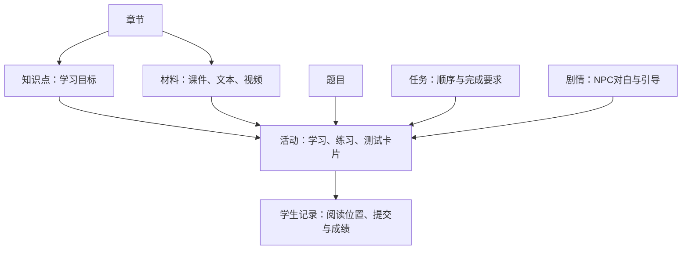

# 系统边界与数据流

`frontend` 使用 Vue 3、Pinia、TypeScript 和 Phaser 3。`game/adapters/world.ts` 是世界渲染边界；Vue 的 WorldCanvas、GameHUD、DialogueLayer 和 OverlayHost 管理画布、任务信息、脚本对白和唯一工作区。阅读器和编辑器延迟加载。API 契约见 api-contract.md。

学生界面由app/gameUi.css、features/learningUi.css与features/townWorkspaces.css提供响应式布局，HUD在安全视口内按三行容器流动，不根据每帧世界状态轮询。shared/modalFocus.ts统一学习弹层的初始焦点、可见控件Tab边界、Esc与调用入口恢复；地图仅保留Esc关闭，不增加WASD/方向键选择或自动聚焦目标，关闭后回到世界焦点。背后的HUD为inert，窄屏的非当前学习视图同时hidden/inert。session.navigate/back保留最多6项返回历史，open作为新的顶层入口会清空历史，关闭/退出不保留旧路径。uiPreferences仅保存设备上的字号、动效和音乐音量选择，不产生模型请求。

OverlayHost为日志、图书馆、地图、班级、设置、资料阅读与练习提供同一页头与近满屏透明外壳。gameDesign.css只在.game-workspace内定义令牌、图标标题、返回按钮、滚动条及原生单选/多选/下拉/开关/滑块的共同样式；各页不再覆写外壳尺寸和页头主题。townWorkspaces.css、learningUi.css和页面局部样式负责独立纸面卡片与透明间隙，教师主题保持独立。设计入口为design/README.md。LibraryWorkspace基于已授权/library响应，在客户端按章节分组并搜索/筛选；视图状态与滚动位置使用用户/班级隔离的sessionStorage键，阅读返回后恢复。筛选不改变服务端发布或授权。

ClassroomPanel从当前session.classes和world展示教师姓名与服务器任务状态，不增加进度写入接口。session.switchClassroom先等待阅读保存并读取目标world，确认账号、令牌、原班级和请求代次仍一致后才整体切换；失败保留原班级，成功清除旧故事/导航/追踪状态和返回历史，工作区仍停留在我的班级。本机已按用户和班级隔离的阅读、编辑草稿不被删除。加入操作复用现有接口并刷新成员班级列表，不自动强切班级。

SettingsPanel使用账户、界面、音乐、操作、关于的可键盘导航标签页。字号和动效复用uiPreferences，musicVolume经有效数值检查并限制在0到1，直接传给当前世界的环境音频对象；没有为设置创建另一套Phaser.Game或轮询。播放开关属于当前会话，音量属于本机偏好。关于页复用LicenseContent承载许可与来源，设置内不再提供班级或资料库跳转。

`backend/app` 是一个 FastAPI 项目：auth、courses、curriculum、classrooms、quests、practice、assistant、storage 共用 SQLAlchemy 模型、数据库会话和鉴权。无旧 Java 服务和业务兼容层。PostgreSQL 是正式状态源，Alembic 是唯一迁移机制。SQLite 只用于轻量测试。登录使用随机不透明 bearer 会话令牌，数据库只存摘要；密码采用独立盐的 scrypt。

当前内置主线仅为arrival“初来小镇：第一堂 Python 课”。任务引擎仍支持通用分支与依赖，课程资源的章节数不等于已编写的主线数量。旧共享任务从当前配置退出，学生历史与当前任务定义分开保存。

## 核心流

登录标识为 `users.student_id`（String(32)，唯一索引），登录/注册/CLI共享数字校验并保留前导零；内部用户主键和所有学习证据的外键保持不变。迁移 `a91c7d20e648` 删除旧邮箱字段并撤销旧会话，不猜测学号、不删除用户或成绩。仅历史未分配账号允许该列为空，鉴权拒绝这些账号；运维按用户ID分配真实学号后可继续使用原记录。新账号必填学号，唯一索引与事务处理并发重复注册。迁移不支持从学号反推邮箱，恢复使用升级前备份。

YAML描述当前任务、剧情和活动，导入时按ID更新数据库。课件文本、当前文件引用和教学配置存在PostgreSQL，实际上传文件存在私有存储；学生记录存于独立表。没有每学生复制教材或按内容版本选择的流程。

地图交互的权威配置为 `data/world/world.json`：地图尺寸/出生点、建筑名称/用途/门前锚点、普通交互点与portal源/目标/门禁。前端在构建时导入，后端加载同一文件；建筑交互点从建筑anchor派生，避免两处维护坐标。小镇和图书馆均由Tiled图层与素材对象渲染，建筑通过object_name关联。房屋贴图和仅含中文名称的名牌均可点击导航，门口显示小型透明素材箭头。

map工作区复用静态地图资源绘制预览，不创建额外Phaser.Game；固定当前玩家地图，筛选只改变标记，前往操作交给同一世界导航。paintMapPreview可接收逻辑裁剪范围，地图工作区仅画逻辑地图，登录背景默认仍画全render_bounds。walk_bounds限制客户端寻路和服务端位置校验，render_bounds控制外景与有界镜头范围；centered相机不在小地图边缘夹紧，bounded相机在外景边缘夹紧。逻辑地图尺寸与旧存档坐标保持一致。

玩家地图标记读取session.mapPosition：独立内存快照可保存Sprite当前浮点位置，打开地图通过WorldHandle.getMapPosition同步抓取，运动完成与暂停时刷新；不等待位置PUT成功，也不改变原1.5秒持久保存节流。world.player仍是整数服务器快照，浮点显示坐标不作为事件证据或保存payload。账号、班级、世界切换清空旧live位置并隔离旧回调，跨图仍由服务器destination决定。玩家标记始终显示，窄屏仅滚动map-stage使其可见，不移动页面焦点或重置用户筛选。

交互可用points声明同一语义的多处真实位置。library_shelf保留旧ID，绑定10组书架；地图右侧只呈现一个语义项，运行场景展开各物理锚点，点击指定书柜或导航时选择相应可达位置。服务端物件证据在任一真实锚点半径2内才接受；历史脚本与事件不改写，旧任务及对白中“西侧书架”只在显示层改称。场景每帧按实际插值位置更新附近提示，暂停、编辑输入或离开半径时清除；关闭建筑不进入E候选。

跨图通过POST /world/transition；服务端校验当前图、入口距离和required_flags，成功后返回配置落点与世界状态。普通PUT /world/position只允许同图更新，防止绕过入口。前端保存源位置后请求传送，收到权威落点才切图；网络结果不确定时读取世界对账，不盲目重复传送。旧室内存档可原位继续并出馆。

1. 学生携带会话和明确 classroom_id 请求世界。服务端检查成员、发布、开放时间和前置，为当前用户创建引用当前定义的任务实例。
2. Vue 发送带 event_id 的交互证据；任务引擎验证当前可执行节点、人物/地点或学习记录/正式提交，事务保存事件、节点状态和世界标记。唯一约束处理重复请求；ALL/ANY 和分支由白名单解释器计算。
3. 教学资料保留 material_id/page_id。上传进入私有存储与可恢复处理状态；文件流再次鉴权。阅读参与单独入库，不冒充掌握度。
4. 概念题在服务端比对私有答案。编程提交先入库，私有用例留在后端，再由 JudgeAdapter 发送 Judge0；后台轮询独立于浏览器。送交结果不确定时保留待对账状态，禁止盲目重送。基础设施故障与错误答案分开。
5. 主动助教消息进入活动范围隔离的会话。统一 create_agent 根据角色配置和授权真实内容构造上下文，只提供受限只读工具。词法检索返回当前资料/页码引用并再验证。凭据只存在服务端。

## 持久化

图书馆直接阅读使用资料级助教会话：`assistant_sessions.activity_id` 可空，`material_id` 指向当前授权资料；不创建虚拟Activity或任务。活动会话保持原有assistant_allowed策略，资料会话始终为图书管理员，仅提供该资料的当前真实页面，不读取题目答案、提交或其他活动上下文。恢复历史及每次提问重新检查用户归属、班级/章节授权、资料归属和ready状态。客户端恢复键按用户、班级和活动或资料区分；翻页、切换标签与布局不创建模型请求。迁移 `b2076e4ca193` 只放宽活动外键的空值限制，保留旧会话和调用审计。

章节YAML经校验后按稳定ID写入StoryDefinition、QuestDefinition和Activity，已有ID原位更新。不存在内容快照或多版选择。Material直接保存当前正文、文件引用与处理状态；Activity直接保存题集、KC和完成规则。学生任务、节点、ActivityProgress、Submission和LearningRecord独立保存，不被导入重建或清空。剧情会话保存对白位置和等待活动，event_id去重、revision拒绝过期推进，每用户/班级仅一个active或waiting演出。失效节点在导入时结束会话，下次交互重新选入口，不删除学习历史。

Vue会话协调对话、唯一工作区和Phaser导航。新任务的navigation_target先带玩家走到NPC，通过对话选择打开活动；小镇进入图书馆后继续走到馆员，离馆后也能续走到目标。读页请求串行落库，返回剧情前等待保存完成。阅读位置、参与页、代码草稿和成绩各自保存；普通演出与页码保存均不调用模型。已完成章节演出在另一章有可执行NPC目标时交还该章交互，避免章节总结挡住后续任务。

用户/会话、班级/成员、章节/KC、当前材料、当前活动、NPC、当前任务定义/实例/节点、世界位置/标记、题目/私有用例/提交、学习事件/参与记录、章节发布、助教会话/调用记录分别建模。JSON 保存受校验的任务脚本和内容，不承载全部业务状态。

AssessmentAttempt按用户、班级、测验活动唯一保存答题草稿、题目ID和真实提交凭据。草稿revision只防并发覆盖；整卷交卷先事务锁定答案并创建各题Submission，再沿用现有判题通道。它不复制教材或题目正文，不引入内容快照或版本管理。完整旧成绩首次打开时绑定为只读历史试卷，原Submission保持不变；部分旧作答可带入草稿，未知判题状态保持锁定并等待对账。进度与剧情统一使用整卷已判定证据，全部答对另以passed表示。

成绩在公开payload中按 `correct_count * 100 // total` 派生为0–100整数，未判完为null，不改写既有逐题判定。剧情受限条件解释器读取授权的目标/任务/章节状态与该真实分数；branch选择首个命中路由，random只在自动推进时选择一次并把最终对白位置落在StorySession中。选项when在显示和提交时均由服务端验证，不能通过手工choice绕过。

日常YAML存入同一个StoryDefinition，quest_id为null、chapter_id继续用于班级发布鉴权，不创建QuestDefinition或PlayerQuest。它复用原会话/修订/幂等机制，但禁止活动绑定、任务检查点与效果。日常响应不初始化任务，只保存对白游标和请求凭据；当前NPC的可执行教学与等待活动优先。world.story_available独立报告授权演出存在性，前端即使没有任务故事也能进入/恢复日常。新迁移只允许StoryDefinition.quest_id为空，没有新增内容快照、聊天历史版本或独立闲聊引擎。

## 环境隔离

Reborn Compose 项目、数据库、卷、对象存储前缀和端口独立。主栈只有 db/api/web；Judge0 是可选独立隔离栈。默认数据库不对外发布，开发覆盖文件也只绑定 loopback。现有线上数据库、生产服务和 main 不参与迁移。CI 只检查 reborn，不发布生产。

教师后台 /teacher 使用独立的管理布局与本地 shadcn-vue 组件源码，组件仅由教师路由引用。Tailwind 不加载 Preflight，工具类使用 CSS @scope 限定在 .teacher-page / .teacher-dialog；弹窗门户同样携带主题类，避免导航离开后台后影响学生/登录界面。TeacherContent 与课程编辑用 KeepAlive 保留未提交草稿，退出后台账号后随路由卸载。表单、筛选与分页为本地界面状态，权限、发布与成绩仍由原有服务端接口判定。

课程媒体通过维护CLI导入当前Material：PDF保留原材料ID及content.pages，视频按来源ID新增/复用，均只引用私有存储中的文件。显式发布的可信课程资料可以在章节开放后直接进入资料库，无需创建虚拟Activity或Quest；普通上传仍按原绑定与归属规则授权。补充视频不进入任务完成条件。阅读卡片继续使用原活动、必读页面ID和进度；机器字幕不会因媒体接入自动加入助教上下文。
