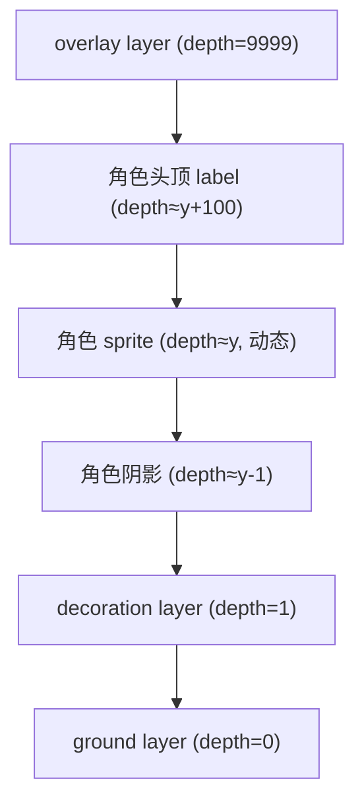
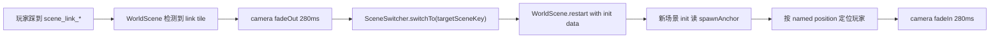

# Pythontopia Tilemap 与 Z 轴规范

> 版本：v1.0  ·  生效日期：2026-05-22  ·  适用版本：R-12 起  ·  状态：Draft（待 W1 验收后转 Active）

## 1. 目的与适用范围

Pythontopia 在 R-12 启动星露谷化改造，把过去三个独立 Phaser Scene（`TownScene` / `FieldScene` / `WorldScene`）合并为以 `WorldScene` 为主、按 `mapKey` 切换 5 张大地图（`town_hub` / `farm_north` / `mine_south` / `campus_east` / `port_west`）的分块大世界。在合并过程中暴露出以下不一致：

- **layer 命名混乱**：旧 `TownScene` 通过 `loadTownMap` 手撸 `ground` + `buildings` 两层；新 `WorldScene` 直接读 Tiled JSON 用 `ground` + `buildings` + `decoration` 三层；`FieldScene` 用 `tileSprite + grid` 两个原生图形对象冒充图层；五张地图的 Tiled JSON 还没有统一的 `collision` 与 `overlay` 层。
- **Z 轴/depth 互相打架**：`ground=0`、`buildings=2 或 5`、`decoration=4`、玩家头顶提示 `12`、NPC sprite `10` 等数字散落在多个文件，无统一规则，玩家偶尔被屋顶切到上方或被墙遮住视野。
- **碰撞策略不统一**：`TownScene` 用 `collisions: boolean[][]` 内存数组；`WorldScene` 遍历 `collision` + `buildings` 两个 layer 的 `tile.index >= 0` 来构建碰撞网格，没用 Tiled 内置 tile properties。
- **Object layer 命名/字段不规范**：`town_hub.json` exit object 用 `target`+`side` 属性，而 `WorldScene.parseObjects` 读 `toMap`/`toTileX`/`toTileY`；NPC object 用 `key`，代码读 `npcKey`。两边对不上时静默 fallback 到 `obj.name`，让 NPC 看似生效实则丢字段。

本规范覆盖：

- 所有 `frontend/public/assets/maps/*.json`（Tiled 1.10+ 导出）
- `WorldScene`、`BootScene`、（如保留则含）`TownScene`、`FieldScene`
- `frontend/src/game/adapters/tilemap.ts` 及未来从中拆分出的 `mapLoader / objectParser / depthSort` 子模块

不在范围内：UI 层（Vue 组件）、HUD（背包/技能/对话框），它们使用 DOM 层叠，不参与 Phaser depth。

---

## 2. Tilemap layer 四层标准

每张地图 JSON **必须**包含四个 `tilelayer` 以及若干 `objectgroup`，名字严格小写蛇形（snake_case），按下表顺序在 JSON 中出现：

| layer 名 | 类型 | 用途 | 阻挡 | 渲染 depth |
|----------|------|------|------|------|
| `ground` | tilelayer | 地面铺底：草地、砖路、沙、地砖 | 否 | `0` |
| `decoration` | tilelayer | 装饰：花、灌木、小石头、围栏、地毯 | 否 | `1` |
| `collision` | tilelayer | 物理碰撞：房屋墙体、水池边、树干、桥栏 | 是 | 不渲染 |
| `overlay` | tilelayer | 玩家上方覆盖：树冠、屋顶遮挡、阴影、灯光 | 否 | `9999` |

> **为什么**：分四层后，"哪些 tile 阻挡走路"、"哪些 tile 会盖到玩家头上"、"哪些 tile 仅装饰"在文件层就能区分清楚，工具脚本与单元测试可直接按层名做断言；同时为后续 Tiled 编辑器内的多人协作给出可执行的硬约束。

> **反例**：当前 `town_hub.json` 把房屋墙体放在 `buildings`，又用 `decoration` 装围栏，碰撞既靠 buildings 也靠未来的 `collision`。改造后必须重命名 `buildings → collision`（用于碰撞）或拆出 `decoration`（用于纯装饰），让"碰撞"语义独立于"画哪种贴图"，并新增 `overlay` 装树冠/屋檐前沿。

### 2.1 layer 内部约定

- `ground` 必须**全格覆盖**，不允许有 tile index 为 0 的空洞（约定 `1` = 第一帧草地为默认）。空洞会让玩家走到地图边缘时露出黑色 canvas 背景。
- `decoration` 可稀疏分布，**禁止**放置任何会阻挡走路的元素。
- `collision` 默认全部为 0，仅在阻挡格子上放 collision tile。运行时 `setVisible(false)`，**不渲染**。
- `overlay` 仅放需要遮挡角色头顶的部分（如树冠上半、屋檐前沿）；玩家走到下方应被"半遮"。

---

## 3. Z 轴排序规则

Phaser 中 `depth` 越大越靠前显示。Pythontopia 的 Z 轴排序遵循下表，**禁止**在业务代码里出现未列入下表的随手 `setDepth(数字)`：

| 元素 | depth 取值 | 说明 |
|------|-----------|------|
| `ground` layer | `0` | 固定常量 |
| `decoration` layer | `1` | 固定常量 |
| `collision` layer | — | `setVisible(false)`，不参与渲染 |
| 角色脚下阴影 ellipse | `y - 1` | 浅椭圆，紧贴角色脚跟下方 |
| 角色（玩家 + NPC sprite） | `y`（动态） | 等于角色像素 `y`，y 大的盖住 y 小的 |
| 角色头顶 label / hint | `y + 100` | 与角色一起排序，但永远盖在自己头顶 |
| `overlay` layer | `9999` | 固定常量，比任何角色都高 |
| 屏幕 UI（Fade / Loading） | `100000+` | 通过 `cameras.main.fadeOut` 或独立 Scene 处理 |



> **为什么**：角色 depth 用 y 坐标动态排序，是星露谷/Pokemon 风像素游戏的通行做法——玩家从 NPC 身后走过会被遮挡、从身前走过会盖住 NPC，制造空间感；overlay 用一个超高常量 `9999` 一刀切，是为了让"树冠永远盖在玩家头上"这种语义无歧义。

> **反例**：旧 `TownScene` 用 `buildingLayer.setDepth(5)` 一刀切，结果玩家走到房屋下沿时整个 sprite 都被建筑吃掉；`WorldScene` 又改成 `2`，问题没解决只是换了边界。新规范下，墙体本体（不阻挡视线的部分）走 `decoration`，屋顶/檐口走 `overlay`，碰撞仅靠 `collision` layer 表达，三者各管一摊。

### 3.1 动态 depth 的实现位置

动态 depth 由 `createPlayerSprite` / `drawNpcSprite` 在 `update` 阶段统一更新（推荐放进新模块 `frontend/src/game/adapters/depthSort.ts`）；业务 scene 严禁直接 `player.setDepth(...)`。

---

## 4. 碰撞标签规范

碰撞信息来自 Tiled tile 的 `tile properties`，**不再**靠"哪一层就是阻挡"的隐式约定。

### 4.1 必备属性

每个会阻挡玩家的 tile（在 tileset 中点选）必须包含：

```json
{
  "id": 17,
  "properties": [
    { "name": "collides", "type": "bool", "value": true }
  ]
}
```

### 4.2 可选类型标签

需要进一步区分阻挡来源时，追加 `type` 属性：

```json
{
  "id": 42,
  "properties": [
    { "name": "collides", "type": "bool",   "value": true },
    { "name": "type",     "type": "string", "value": "water" }
  ]
}
```

`type` 当前枚举：

- `"wall"`：墙体（房屋外墙、围栏）
- `"water"`：水域（喷泉、池塘、河流）
- `"edge"`：地图边缘（防止走出 canvas）
- `"ice"`：冰面（碰撞 + 后续可叠加滑行特效）

> **为什么**：tile 自身携带 `collides`，意味着同一张 tileset 在不同地图复用时**碰撞行为保持一致**；`type` 给后续天气/事件系统留口子（雨天 ice 变滑、矿洞 water 变熔岩）。

> **反例**：当前 `WorldScene.buildCollisions` 把 `buildings` 层所有非 0 tile 都视作阻挡，导致"地上画一块地毯也走不过去"，需要靠改贴图绕过。新规范允许装饰 tile 不打 `collides`，碰撞由 `collision` layer 上 `collides=true` 的 tile 明确指定。

### 4.3 运行时读取

```ts
const tile = map.getTileAt(x, y, false, 'collision');
const collides = Boolean(tile?.properties?.collides);
const collisionType = tile?.properties?.type as
  | 'water' | 'wall' | 'edge' | 'ice' | undefined;
```

---

## 5. 锚点（Trigger / NPC / KC）命名规范

Tiled `objectgroup` 在 Pythontopia 中承担"语义锚点"职责。每张地图建议至少包含以下四个 object layer（无对象的 layer 可省略）：

| object layer 名 | 用途 | 典型 object name |
|----------------|------|------------------|
| `triggers` | 通用触发器：公告板、矿洞入口、剧情触发 | `trigger_bulletin_board` |
| `npc_spawn` | NPC 出生点 | `npc_teacher_a01` |
| `kc_anchor` | KC 知识种子在地图上的位置（知识田） | `kc_anchor_for_loop` |
| `scene_link` | 场景跳转门 | `scene_link_to_field` |

### 5.1 object name 命名

统一使用 `snake_case`，按"语义前缀_主键"格式：

- `trigger_*`：通用触发器
- `npc_*`：NPC
- `kc_anchor_*`：KC 锚点（`*` 为 KC code）
- `scene_link_*`：场景跳转（`*` 为目标 mapKey 或路由名）
- `from_*`：跨场景跳转的目标落点（`*` 为来源 mapKey）
- `spawn`：单地图默认 spawn 点（每张地图最多一个，无前缀）

### 5.2 object properties 字段约定

所有 object 通过 `properties` 字段携带结构化数据。**禁止**用顶层 `type` 字段同时表达"对象语义类型"与"业务参数"。约定 properties：

```json
{
  "properties": [
    { "name": "targetSceneKey", "type": "string", "value": "field" },
    { "name": "npcId",          "type": "string", "value": "teacher_a01" },
    { "name": "kcCode",         "type": "string", "value": "for_loop" },
    { "name": "dialogId",       "type": "string", "value": "intro_for_loop_01" }
  ]
}
```

| key | 出现场景 | 必填 | 说明 |
|-----|---------|------|------|
| `targetSceneKey` | `scene_link_*` | 是 | 目标场景 `mapKey` |
| `npcId` | `npc_*` | 是 | 业务层 NPC 唯一 ID（与 `data/npcs/<key>/` 对齐） |
| `kcCode` | `kc_anchor_*` / `npc_*`（可选） | `kc_anchor` 必填 | KC 编码 |
| `dialogId` | `npc_*` / `trigger_*` | 否 | 触发对话起始节点 |

> **为什么**：properties 化让 `WorldScene.parseObjects` 不用为每种 object 类型写不同字段读取逻辑，所有锚点共用 `collectProperties` 工具函数。

> **反例**：当前 `town_hub.json` 中 `npc_mayor_py` 用 `key` 字段存 NPC id，而代码 `parseObjects` 读 `props['npcKey']`，两边对不上时静默 fallback 到 `obj.name`。规范统一为 `npcId`，并写单测扫描所有 map JSON 强制断言（见 §8）。

---

## 6. 场景间跳转契约

### 6.1 触发流程



### 6.2 init data 约定

`SceneSwitcher.switchTo` 透传 `{ data: { mapKey, spawnAnchor: 'from_<sourceMap>' } }`：

```ts
this.scene.restart({
  mapKey: 'farm_north',
  spawnAnchor: 'from_town_hub',
});
```

目标场景在 `init(data)` 中读取 `data.spawnAnchor`，到本地 `scene_link` / `triggers` object layer 中找 `name === data.spawnAnchor` 的 object，将玩家落点对齐其 `(x, y)`：

```ts
init(this: Phaser.Scene, data?: { mapKey?: string; spawnAnchor?: string }) {
  state.spawnAnchor = data?.spawnAnchor ?? null;
}
```

若 `spawnAnchor` 不存在，回退到 `objectgroup.objects` 中名为 `spawn` 的对象；再失败回退到 `index.json` 内 `spawn.{tileX, tileY}`。

> **为什么**：spawnAnchor 用"来自哪张地图"做 key，让一张地图可承接多个入口（北门进 `from_farm_north`、南门进 `from_mine_south`），避免每条路重复写跳转坐标。

> **反例**：现 `WorldScene.triggerSceneTransition` 把 `toTileX/toTileY` 写死在 source exit 的 properties 里，跨地图改一处坐标要改两边。新规范让坐标只存在于"目标地图自己"的 `from_*` 锚点。

---

## 7. 现有场景迁移计划

下表列出五张地图与三个 scene 文件需要的命名迁移。所有迁移由 `scripts/generate-maps.mjs` 程序化重生成 + 手工修补。

### 7.1 五张地图 JSON 改动

| 文件 | 当前 tilelayer | 目标 tilelayer | 当前 object 字段 | 目标 object 字段 |
|------|----------------|----------------|------------------|------------------|
| `town_hub.json` | `ground` / `buildings` / `decoration` | `ground` / `decoration` / `collision` / `overlay` | exit: `target`+`side`；npc: `key`+`label`+`sprite`；building: `route`+`label` | `scene_link_*`: `targetSceneKey`；`npc_*`: `npcId`+`label`+`sprite`+`dialogId`；建筑改为 `trigger_*` + `route` |
| `farm_north.json` | 同上 | 同上 + 新增 `kc_anchor` objectgroup（覆盖 65 KC） | 同上 | 同上 |
| `mine_south.json` | 同上 | 同上 + `collision.type=water` 用于地下水 | 同上 | 同上 |
| `campus_east.json` | 同上 | 同上 | 同上 | 同上 |
| `port_west.json` | 同上 + 海岸 | 同上 + `collision.type=water` 大面积 | 同上 | 同上 |

### 7.2 Scene 文件改动

- **`BootScene`**：保留现有 `tilemapTiledJSON` 预加载；额外读取 `index.json` 的 `mapKey → expectedLayers` 字段，启动时跳过缺层地图并打印 warning（防止线上空白屏）。
- **`TownScene` / `FieldScene`**：在 R-12 完成 `WorldScene` 适配后标记为 deprecated，仅保留 single-scene 单测，禁止业务代码继续 import 旧 `loadTownMap`。新业务一律走 `WorldScene` + `mapKey` 切换。
- **`WorldScene`**：
  - `create()` 按 `ground → decoration → overlay` 顺序 `createLayer` 并 `setDepth(0 / 1 / 9999)`；
  - 新增 `collision` layer 解析路径，`setVisible(false)` 并按 tile 的 `properties.collides` 构建碰撞网格；
  - `parseObjects` 改为按 object layer 名（`triggers / npc_spawn / kc_anchor / scene_link`）分发，而非按 `object.type`；
  - 玩家与 NPC `update` 时统一调用 `obj.setDepth(obj.y)`。

### 7.3 兼容期

R-12 内允许 `WorldScene` 在缺 `overlay` 或 `collision` 层时 fallback 到旧 `buildings` 层，并向 console 输出 `[tilemap] deprecated layer 'buildings'`；R-13 起强制要求四层齐全，否则 `BootScene` 进入"地图损坏"占位界面（避免线上静默错误）。

---

## 8. 校验脚本预留

为防止规范落地后又被悄悄破坏，预留 vitest 单测 `frontend/tests/game/tilemap-conventions.spec.ts`，规则如下（**本任务不实现，仅描述**）：

1. **扫描所有地图**：从 `frontend/public/assets/maps/` 读取除 `index.json` 外的全部 `*.json`。
2. **layer 命名断言**：
   - 必须存在名为 `ground / decoration / collision / overlay` 的 tilelayer 各 1 个；
   - 不允许出现旧名 `buildings`；
   - 不允许重复命名同一 layer。
3. **layer 顺序断言**：四个 tilelayer 在 JSON 中的索引顺序固定 `ground < decoration < collision < overlay`，与渲染顺序一致。
4. **object layer 断言**：
   - object layer 名只能取 `triggers / npc_spawn / kc_anchor / scene_link` 四者之一；
   - object `name` 必须以对应前缀开头（`trigger_*` / `npc_*` / `kc_anchor_*` / `scene_link_*` / `from_*` / `spawn`）；
   - object `properties` 必须包含对应必填 key（见 §5.2）。
5. **scene_link 闭环断言**：每个 `scene_link_to_<targetMap>` 必须能在 `<targetMap>.json` 中找到 `from_<currentMap>` 命名的对象，反之亦然，防止"单向门"。
6. **collision tile 断言**：`collision` layer 中每个非 0 的 tile 都需在 tileset 的 tile properties 中标 `collides=true`。
7. **map_index 一致性**：`index.json` 中的 `maps[].key` 与文件名一一对应，`spawn.{tileX,tileY}` 不超出 `width/height`。

> **为什么**：tilemap 是"游戏世界的合同"，比 TypeScript 类型还容易腐烂——美术拉一根树枝、策划改一个 NPC ID 就可能让代码静默走 fallback 分支。把校验写进 CI 单测，是从"靠人盯"到"靠测"的必经之路。

> **反例**：若不加这类单测，预计 R-12 验收前会出现至少 1 次"地图加载成功但 NPC 没出现"的演示翻车（已在 Alethicode 老项目里发生过 2 次）。

---

## 附录 A：合规 tilemap JSON 骨架

```json
{
  "width": 50, "height": 40,
  "tilewidth": 16, "tileheight": 16,
  "tilesets": [{ "name": "kenney_tiny_town", "firstgid": 1 }],
  "layers": [
    { "name": "ground",     "type": "tilelayer",  "data": [/* 全格覆盖 */] },
    { "name": "decoration", "type": "tilelayer",  "data": [/* 稀疏装饰 */] },
    { "name": "collision",  "type": "tilelayer",  "visible": false, "data": [/* collides tile */] },
    { "name": "overlay",    "type": "tilelayer",  "data": [/* 树冠、屋顶 */] },
    { "name": "triggers",   "type": "objectgroup", "objects": [
        { "name": "trigger_bulletin_board", "x": 384, "y": 240,
          "properties": [{ "name": "dialogId", "value": "board_intro" }] }
    ] },
    { "name": "npc_spawn",  "type": "objectgroup", "objects": [
        { "name": "npc_teacher_a01", "x": 400, "y": 160,
          "properties": [
            { "name": "npcId",    "value": "teacher_a01" },
            { "name": "dialogId", "value": "teacher_a01_intro" }
          ] }
    ] },
    { "name": "kc_anchor",  "type": "objectgroup", "objects": [
        { "name": "kc_anchor_for_loop", "x": 320, "y": 480,
          "properties": [{ "name": "kcCode", "value": "for_loop" }] }
    ] },
    { "name": "scene_link", "type": "objectgroup", "objects": [
        { "name": "scene_link_to_farm_north", "x": 368, "y": 0,
          "width": 64, "height": 16,
          "properties": [{ "name": "targetSceneKey", "value": "farm_north" }] },
        { "name": "from_farm_north", "x": 400, "y": 32 }
    ] }
  ]
}
```

## 附录 B：术语表

- **tilemap**：基于矩形网格的二维地图数据，Pythontopia 使用 Tiled 编辑器导出的 JSON。
- **layer**：tilemap 内的图层，分 `tilelayer`（瓦片层）与 `objectgroup`（对象层）。
- **depth**：Phaser 中物体的 Z 轴值，越大越靠前；本规范禁止散布魔术数字。
- **KC（Knowledge Component）**：知识种子，Pythontopia 知识田中每株作物对应一个 KC。
- **spawnAnchor**：玩家在目标场景的命名落点，由跨场景跳转契约驱动。
- **mapKey**：5 张大地图的唯一 key，取值 `town_hub / farm_north / mine_south / campus_east / port_west`。
