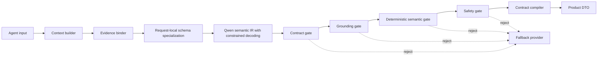

# Qwen contract runtime architecture

## Decision

Qwen is a bounded semantic decision component, not a producer of final product DTOs.
Production calls remain behind `FineTunedFallbackProvider`; direct adapter access is not a
supported integration path.

The order is intentional: malformed structure is rejected before evidence and safety checks;
only a valid, grounded, semantically executable and safe IR reaches the deterministic compiler.

For the local fine-tuned vLLM path, `FineTunedFallbackProvider` specializes the exported IR
schema per request. Evidence arrays are constrained to the live allowlist, and become required
with `minItems=1` when evidence exists. The fallback provider still receives its original
`json_object` request, so a vLLM-specific constraint cannot break the external fallback path.
Unconstrained generation remains an offline regression sentinel and is reported separately.

## Contract ownership

- Product Pydantic models are the runtime source of truth.
- `GuideCoachSemanticIR` excludes tool names and UI follow-up buttons. The compiler derives
  those fields from the workflow allowlist.
- `PracticeSemanticIR` excludes KC assignment and difficulty. The compiler derives both from
  the request and learner profile.
- `EvidenceBinder` creates opaque `page-{page_id}` references. A model cannot cite any other
  identifier.
- The lab's `agent-schema-v1` is frozen for historical benchmark comparability.
- Product IR schemas are exported as `agent-schema-v2`; they must not rewrite v1 results.
- Historical CodeLab free-code IR remains frozen in `agent-schema-v2`. `agent-schema-v2.1`
  introduces CodePlan: Qwen selects one of eight pedagogical example patterns and states an
  observation goal, while the compiler owns executable Python and expected output. Extra
  `code` or `expected_output` fields are rejected rather than silently ignored.
- GuideCoach predicts one of seven teaching intents (`READ / REVIEW / TRACE / SCAFFOLD /
  PRACTICE / ASK / CHECK`). `ContractCompiler` maps that ontology to the live
  `WorkflowEvent` allowlist; unknown and currently disallowed actions fail fast.

## Runtime routing

The default remains one promoted adapter. When independently evaluated adapters exist,
`PYT_FINE_TUNED_CONTRACT_MODEL` routes GuideCoach, Practice and Debug requests to a
contract-focused adapter, while `PYT_FINE_TUNED_GROUNDING_MODEL` handles the remaining Agent
family. Missing specialized models fall back to `PYT_FINE_TUNED_MODEL`. Routing changes are
quality variables and require the same golden, stratified, full and blind-review gates.

## Observability and promotion

`GuardMetrics.snapshot()` exposes stage pass/reject counts plus `guard_repair_rate`,
`fallback_rate`, `schema_constrained_rate` and `evidence_bound_rate`. Guard/fallback or
constrained-decoding success must never be attributed to the unconstrained raw model.

The model registry permits only this state sequence:

`trained -> golden_passed -> stratified_passed -> full_eval_passed -> blind_review_passed -> champion`

Any failed gate moves the candidate to terminal `rejected`. The current champion must be
retired before another model can become champion.

`contract_pass_rate` remains the production transport contract requested by the quality
protocol. Research promotion additionally requires `semantic_valid_rate` and
`promotion_pass_rate = contract_pass && semantic_valid`; this prevents a schema-perfect but
pedagogically wrong action from advancing.

## Training implication

New preference data should target semantic IR failures rather than unstable downstream DTO
fields. For v2, prioritize wrong event selection, unbound evidence references, answer leakage,
and poor problem semantics. Deterministic product fields are compiler responsibilities and
must not consume model capacity or preference examples.

## SAGE-IR research contribution

For the research/graduate-recommendation project, this architecture is evaluated as
**SAGE-IR (Semantic Action Grid with Evidence-bound IR)**:

1. **Ontology bottleneck** — the model chooses a small pedagogical action and writes semantic
   content; workflow constants, tools, UI actions and DTO assembly stay deterministic.
2. **Evidence namespace** — EvidenceBinder exposes only auditable opaque IDs, so preference
   optimization cannot reward invented page references.
3. **Two-dimensional preference grid** — examples are balanced jointly by semantic action and
   failure axis (legacy contract, schema constraint, wrong decision, weak semantics, unbound
   evidence and safety leak), rather than only balancing agents or rejected types.
4. **Evidence-preserving counterfactual augmentation** — when protected-data exclusion leaves
   an ontology cell empty, a non-protected case keeps its chapter/KC/profile/evidence/safety
   context while only the task focus is changed; lineage and the base case ID remain logged.
5. **Layered truth metrics** — raw contract, semantic validity, compile validity, guard repair
   and final fallback are reported separately. A guard/fallback 100% is never a model claim.
6. **EBCD inference layer** — Evidence-Bound Contract Decoding specializes only evidence value
   domains and requiredness at request time. It leaves event, problem and evidence selection to
   the model while preventing invalid identifiers and fixed DTO syntax from consuming training
   capacity.
7. **CodePlan semantic compiler** — executable code is an architecture-owned artifact, not a
   language-model string. Promotion therefore measures pattern selection separately from
   syntax safety; the compiler's eight templates remain AST-checked and deterministic.

The required ablation compares: product enum labels vs open event strings vs semantic ontology;
one-dimensional rejected-axis balancing vs the two-dimensional grid; and a single adapter vs
agent routing only after both individual adapters pass the same protected suites.

## Research basis and local innovation

SAGE-IR + EBCD combines ideas rather than claiming a new optimizer. Recent work on
[disentangled preference optimization dynamics](https://arxiv.org/abs/2604.18239),
[DPO-Shift](https://arxiv.org/abs/2502.07599) and the
[role of rejected responses](https://arxiv.org/abs/2506.12725) motivates tracking chosen
likelihood and avoiding repeated training when preference accuracy does not transfer to
generation. Work on
[draft-conditioned constrained decoding](https://openreview.net/forum?id=hWDUpdwRZp)
motivates separating structural validity from semantic generation. Findings on
[LoRA interference](https://aclanthology.org/2025.acl-long.1284/) motivate keeping dual-adapter
routing disabled until independently promoted adapters pass the same protected suites.

The project-specific contribution is the composition: product DTOs and executable teaching
examples are compiled from a small
pedagogical IR; evidence IDs are request-local grammar terminals; deterministic compiler
failures are promotion failures and counted fallbacks; unconstrained, constrained, guard and
final layers remain separately observable. The 20-case result is an ablation signal, not a
claim of general 100% quality.
