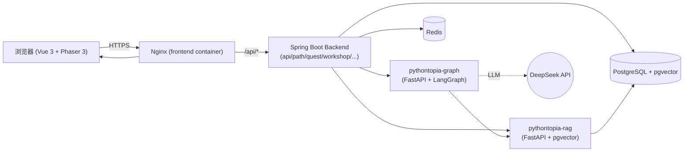
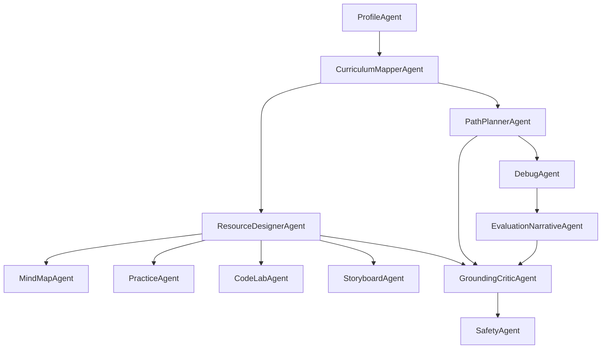
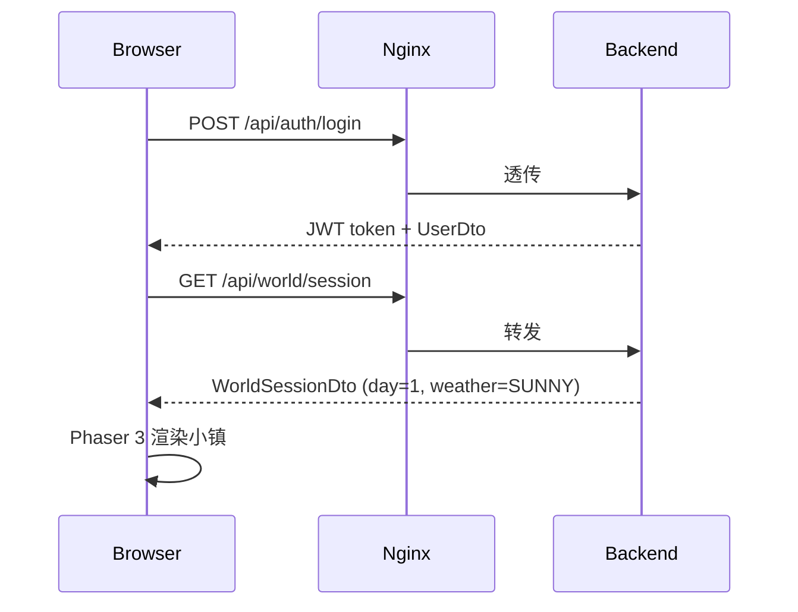
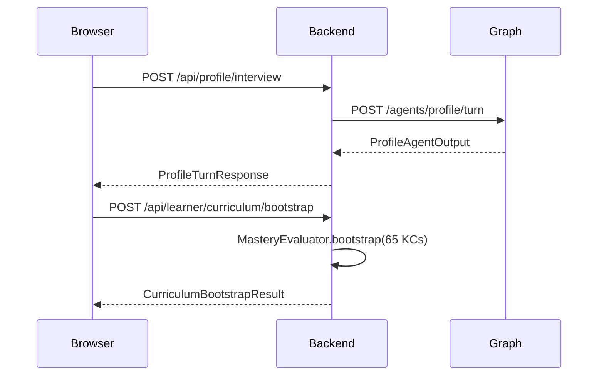
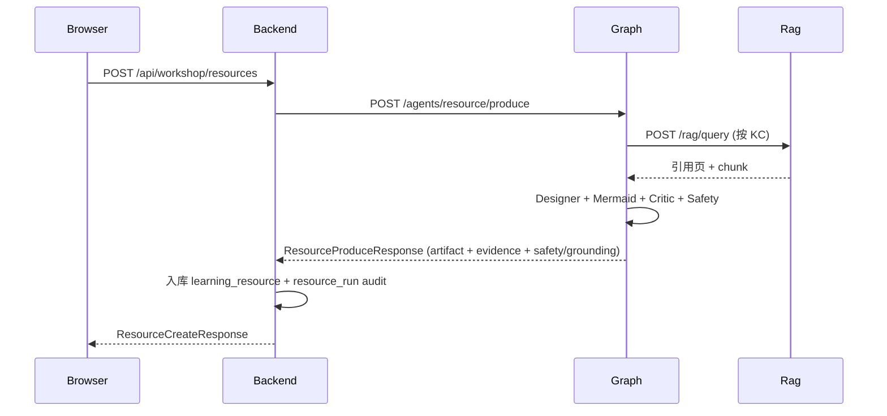
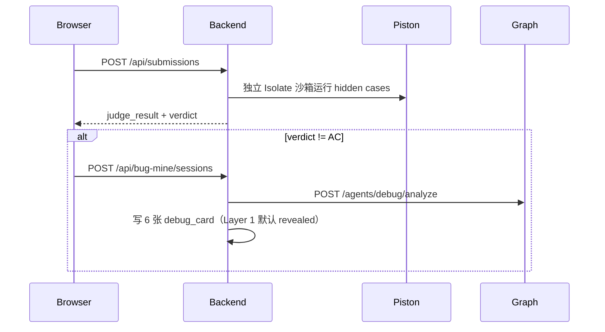
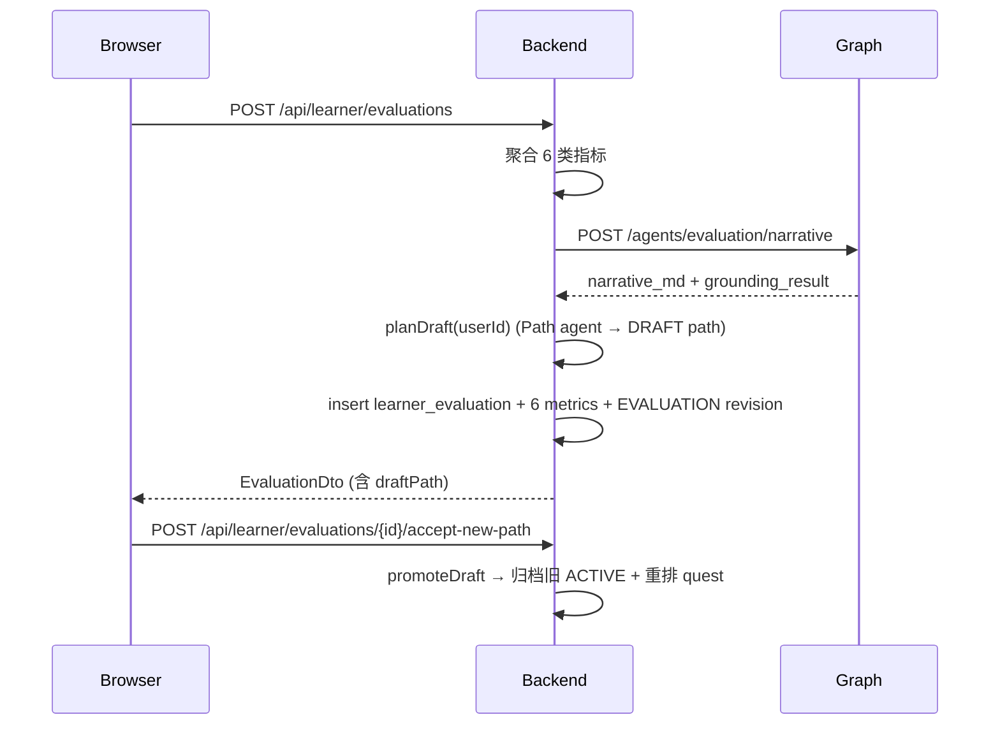

# Pythontopia 系统设计（R-14 文档）

> 面向比赛评审与新成员入职。R-14 当前版本以单一中央小镇 `town_hub` 为主线，历史 R-12 的 5 图大世界与农场/作物隐喻不再代表当前主线。

## 1. 项目定位

Pythontopia 是面向高校 Python 初学者的网页版像素学习小镇。它把 `packId=43`《Python语言基础》课程包
作为唯一知识底座，通过多智能体协作 + 课件 RAG + 像素小镇游戏化承载，提供：

- 8 维学生画像。
- 65 个 KC 的看 → 学 → 练 → 测主线任务与掌握度。
- R-14 单一中央 `town_hub` 主玩图，`mine_south` 仅作为 Bug 矿洞支线。
- 6 类个性化学习资源（讲义 / 思维导图 / 练习题 / 代码案例 / 拓展阅读 / 动画脚本）。
- Pyodide 即时预览 + 服务端正式判题双轨练习。
- Bug 矿洞失败提交修复流程。
- 学习路径规划与复盘大厅评估。
- 轻量班级与教师看板。

## 2. 总体架构



## 3. 模块映射

| 目录 | 职责 | 阶段 |
| --- | --- | --- |
| `backend/` | Spring Boot 后端，REST API + Flyway 迁移 + DTO 契约 | 全阶段 |
| `frontend/` | Vue 3 + Phaser 3 网页端 | 阶段 03+ |
| `services/pythontopia-graph/` | LangGraph 多智能体（11 agent + 4 节点） | 阶段 04+ |
| `services/pythontopia-rag/` | 课件向量检索 + 防幻觉 | 阶段 06 |
| `data/course-pack-43/` | `packId=43` 课程包种子（7 doc / 561 page / 7 chapter / 65 KC / 46 example / 39 problem） | 阶段 01 |
| `data/demo/` | 演示账号 / 班级 / 任务 + seed.py | 阶段 14 |
| `deploy/` | Docker Compose + 演示脚手架 + initdb | 阶段 00 / 14 |
| `docs/` | 设计 / 测试 / AI 披露 / 评估公式 / 演示脚本 | 阶段 14 |

## 4. Agent 设计



所有 agent 输出必须结构化 (Pydantic schemas)。`ResourceGraph`、`PathGraph`、`ResourceDesigner` 等都在
`pythontopia-graph` 内 LangGraph 串联。`GroundingCriticAgent`、`SafetyAgent` 在每个 graph 末端拦截。
不启用 ReAct 循环（AGENTS.md 硬要求）。

## 5. 关键时序

### 5.1 学生登录 → 进入小镇



### 5.2 画像访谈 → KC 解锁



### 5.3 资源生成 → 防幻觉



### 5.4 训练场判题 → 失败进入 Bug 矿洞



### 5.5 复盘评估 → 路径重排



## 6. 数据模型

核心表清单：

```text
users, roles, classrooms, classroom_members, classroom_quest, classroom_kc_snapshot
course_pack, course_document, course_page, course_chapter, course_kc, course_example, course_problem
learner_profile, profile_interview, profile_revision
world_session, player_state, npc_state, weather_state, crop_tile_state
kc_mastery, kc_mastery_event
learning_path, learning_path_node
quest, quest_progress
resource_run, learning_resource, agent_event
practice_submission, judge_result, debug_case
bug_mine_session, bug_mine_card
learner_evaluation, learner_evaluation_metric
```

种子数据验收（必须满足）：

- `course_pack.id = 43`、7 文档、561 页、7 章、65 KC、46 示例、39 题。

## 7. 安全与防幻觉

- 资源生成、画像、路径规划、debug、evaluation narrative 均必须经过 GroundingCritic + SafetyAgent。
- 数字与 KC 必须出现在输入 metrics / 课件引用中，否则节点 fail fast。
- 教师生成资源被禁止；学生角色才能 POST `/api/workshop/resources`。
- `practice_submission` 与 `judge_result` 真实落库；前端的 Pyodide 预览只是开发体验。
- 服务端生成模型只允许 `openai_compat` 指向 `https://api.deepseek.com`；模型 ID 限制为 `deepseek-v4-pro` 与 `deepseek-flash`，其中仅 `deepseek-flash` 接受图片输入。讯飞生成、识图、ASR 与 TTS 固定关闭；CI 可使用本地 `dryrun`。

## 8. 部署

详见 `deploy/README.md` 与本目录的 `ai_coding_disclosure.md`。最小一键启动：

```bash
cp .env.example .env
docker compose up -d --build
bash scripts/init_rag_index.sh
bash scripts/seed_demo_classroom.sh
bash scripts/demo_smoke.sh
```

6 个 service 全部 healthy 后访问 <http://localhost:8080>。

## 9. 未来工作

- 多 pack 支持（解耦 `pack_id=43` 硬编码）。
- 移动端布局适配。
- 真实长视频生成（StoryboardAgent 当前仅生成脚本）。
- 教师维度更深的学情对比与诊断报告。
