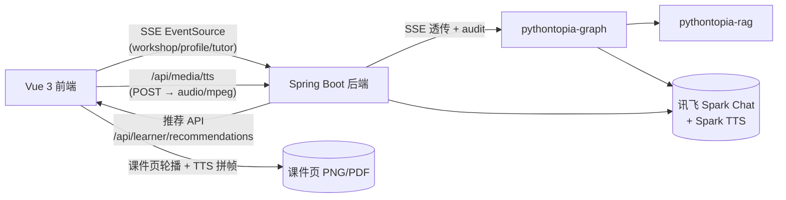
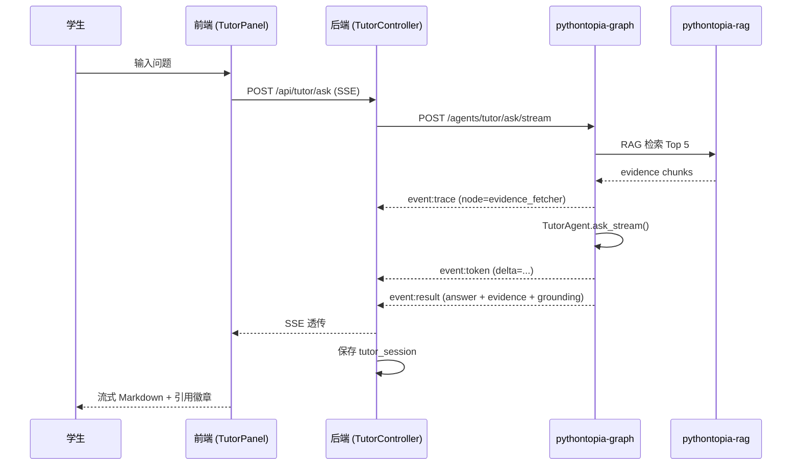

# Pythontopia 赛题符合度自检文档

> 自动生成于 2026-05-28，覆盖赛题要求的 5 大功能 + 2 加分项。

## 表 1：核心功能对齐

| # | 赛题要求 | 实现方案 | 代码位置 | 演示路径 |
|---|---------|---------|---------|---------|
| 1 | **个性化学习资源生成** | 11 Agent 多智能体协作 + 6 类资源 + RAG 课件引用 + 防幻觉链 | `services/pythontopia-graph/pythontopia_graph/agents/` | /workshop → 选 KC + 类型 → 生成（SSE 流式进度） |
| 2 | **学生画像与个性推荐** | 8 维画像 + 对话访谈 + 被动事件更新 + 推荐 API | `backend/.../learner/profile/`, `backend/.../recommendation/` | /profile → 访谈 → /home 今日推荐卡片 |
| 3 | **AI 答疑导师** | TutorAgent + RAG Top 5 chunks + 流式回答 + 引用标注 | `services/.../agents/tutor_agent.py`, `backend/.../tutor/` | /tutor → 提问 → 流式 Markdown 回答 + 页码徽章 |
| 4 | **学习路径规划** | PathPlannerAgent + KC 依赖图 + 每日任务生成 | `services/.../agents/path_planner_agent.py` | /review-hall → 规划路径 → /home 今日任务 |
| 5 | **练习与判题** | 双轨执行 Pyodide + 服务端 + Bug 矿洞 | `backend/.../submission/`, `/bug-mine` | /problems → 编码 → 提交 → 失败触发 Bug 矿洞 |

## 表 2：加分项对齐

| # | 加分项 | 实现方案 | 代码位置 | 演示路径 |
|---|-------|---------|---------|---------|
| A1 | **PPT 生成** | Reveal.js 幻灯片 + Marp MD 导出 | `frontend/.../workshop/PptView.vue` | /workshop → 讲义详情 → "查看 PPT" |
| A2 | **多模态视频** | StoryboardAgent + 讯飞 TTS + 课件页缩略图 + 自动播放 + 录屏导出 | `frontend/.../workshop/StoryboardView.vue`, `backend/.../media/`, `frontend/.../composables/useScreenRecorder.ts` | /workshop → 动画脚本详情 → 播放 → 录屏导出 webm |

## 表 3：非功能性要求

| # | 要求 | 实现 | 验证 |
|---|-----|------|------|
| 1 | SSE 流式交互 | fetch + ReadableStream POST SSE，后端 SseEmitter 中继 | `useSseStream.ts`, `SseRelayExecutor.java` |
| 2 | 统一 Markdown 渲染 | marked + DOMPurify + XSS 白名单 | `MarkdownView.vue` |
| 3 | 防幻觉 | grounding_critic + hallucination_detector + safety_critic 三重审查 | `services/.../nodes/` |
| 4 | 开源合规 | CC0/CC-BY 3.0/4.0/CC-BY-SA 3.0/OFL-1.1 + MIT 代码层 | `LICENSE-ART.md` |

## 表 4：新增开源依赖

| 依赖 | 版本 | License | 用途 |
|------|------|---------|------|
| reveal.js | 5.x | MIT | PPT 幻灯片渲染 |
| marked | 14.1.4 | MIT | Markdown 解析 |
| DOMPurify | 3.4.5 | Apache-2.0 | HTML 清洗 XSS 防护 |
| 讯飞 Spark TTS | API | 商用服务 | 语音合成（降级 speechSynthesis） |

## 流式架构图

## Tutor 数据流图

## 演示脚本（8 分钟）

| 时间 | 内容 | 演示操作 |
|------|------|---------|
| 0:00-0:30 | 系统介绍 | PPT 首页 |
| 0:30-1:30 | 画像访谈 | /profile → 对话 3 轮 → 看 8 维雷达 |
| 1:30-2:30 | 小镇探索 | /world → 走动 + NPC 对话 + 进建筑 |
| 2:30-3:30 | 资源生成（SSE 流式） | /workshop → 选 KC → 看 stepper 进度 → 完成 |
| 3:30-4:00 | PPT 查看 | 讲义详情 → "查看 PPT" → 翻页 |
| 4:00-5:00 | AI 答疑 | /tutor → 提问 → 流式回答 + 引用页码 |
| 5:00-5:30 | 动画脚本播放 | 动画脚本详情 → 自动播放 + 字幕 + TTS |
| 5:30-6:30 | 练习判题 | /problems → 编码 → 提交 → Bug 矿洞 |
| 6:30-7:30 | 复盘评估 | /review-hall → 运行评估 → KC 成长 |
| 7:30-8:00 | 总结 | 回 /home → 看仪表盘 + 推荐 |
