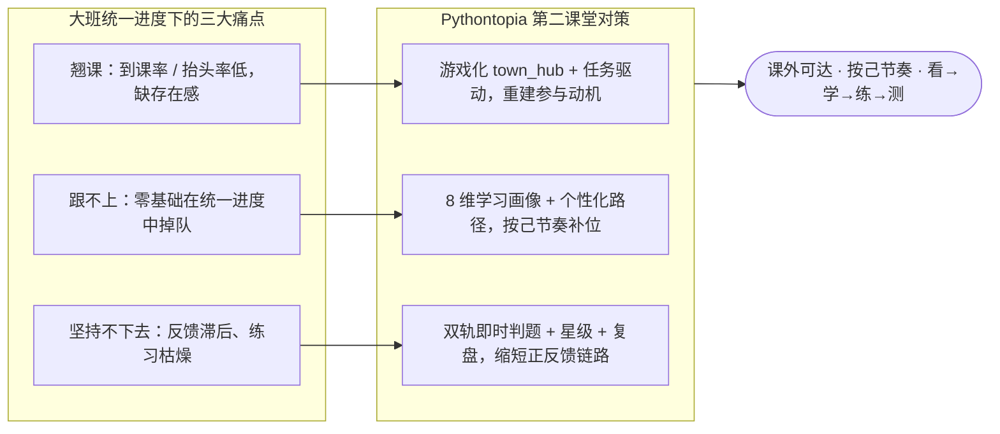
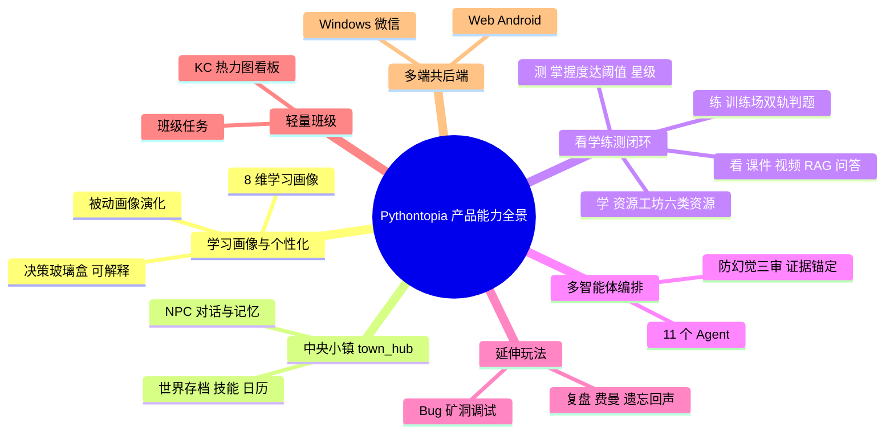
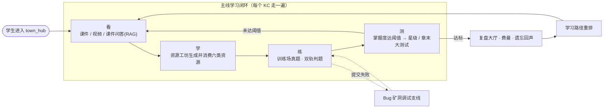
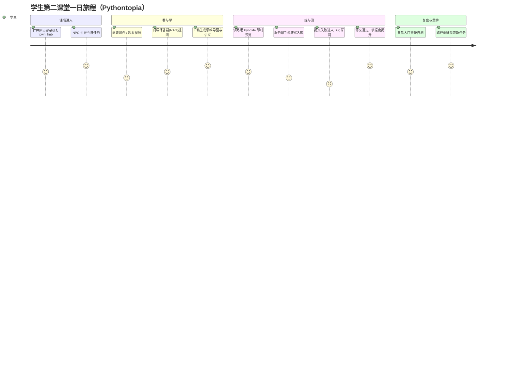

# 1 项目概述

> 文档编号：PYT-CR-01 ｜ filecode：C01 ｜ 报告日期：2026-06
> 本章给出 **Pythontopia** 的项目背景、定位、总体方案、目标与价值，是全报告的总入口。涉及的数据库表只列名引用、字段字典统一「见 §6 数据库设计」，技术细节与可行性论证「见 §3 可行性分析」。

**表 C01-1　项目基本信息卡**

| 项 | 内容 |
| --- | --- |
| 项目名 | Pythontopia |
| 一句话定位 | 面向高校 Python 初学者的**多端像素学习小镇「第二课堂」** |
| 课程知识底座 | Alethicode `packId=43`《Python 语言基础》 |
| 课程包规模 | 7 份文档 · 561 页 · 7 章 · 65 个 KC · 46 个示例 · 39 道题 |
| 用户角色 | 学生 student / 教师 teacher / 管理员 admin |
| 形态 | Web / Android / Windows / 微信小程序 / 微信小游戏，**共用同一套后端** |
| 鉴权 / 接口前缀 | JWT Bearer ｜ REST `/api` |
| 当前版本节奏 | R-14「世界收缩方案 A」：主线收敛为单一中央小镇 `town_hub` |
| 自动化测试基线 | 后端 464 + Graph 380 + RAG 21 + 前端 1514 = **2379 / 2379 全绿** |

---

## 1.1 项目背景

Python 已经成为绝大多数高校面向**非计算机专业**学生的第一门编程通识课。它语法门槛低、应用面广，被广泛用作数据处理、人工智能、自动化办公等后续课程的前置基础。然而，把一门「上手容易」的语言教好，与让「零基础的大班学生真正学会」之间，存在一道现实鸿沟。Pythontopia 正是为弥合这道鸿沟而立项。

在真实的高校大班公共课场景里，一名教师往往同时面对一两百名背景参差的学生，授课只能按**统一进度**推进。统一进度叠加零基础生源，催生出三个长期得不到根治的痛点，它们彼此咬合、互相放大：

- **翘课**——到课率与抬头率走低。大班讲授是单向广播，学生缺乏被「点名」的存在感；一旦某节课没跟上，后续课堂对他而言就成了「听不懂的背景音」，逃避便从偶尔变成习惯。
- **跟不上**——统一进度碾过个体差异。有人此前接触过编程，几分钟就懂的内容，对真正的零基础学生可能是一道无法逾越的坎。课堂不会为某一个人停下，掉队者越积越多，最终在期中前后集中「劝退」。
- **坚持不下去**——缺乏即时正反馈，练习枯燥。编程能力靠「写」出来，而传统作业批改滞后、反馈稀薄；学生写完代码常常要等数天才知道对错，正反馈链路过长，学习动机被慢慢耗尽。

这三个痛点的共同根源，是**课堂内的资源与节奏无法个性化**：课堂时间固定、师生比悬殊、反馈链路长。仅靠「把课件 PDF 发到群里」「布置更多作业」这类传统手段，并不能让掉队的学生重新跟上——他们缺的不是材料，而是一个**课外可达、按自己节奏、有人（或有「智能体」）陪着一步步走**的学习场。

与此同时，两股技术力量已经成熟到足以支撑一种新的解法：其一是**大语言模型（LLM）与多智能体编排**，使「为每个学生即时生成个性化学习资源、并对其代码给出即时反馈」在工程上可行；其二是**浏览器内 Python 运行时（Pyodide）与游戏引擎（Phaser）**，使「把枯燥的练习包装进一个有沉浸感、有正反馈的像素世界」成为可能。Pythontopia 抓住的，正是「大班统一进度的结构性痛点」与「个性化 + 游戏化技术成熟」两者交汇的时间窗口。

需要强调的是，Pythontopia 并不试图取代课堂或现有的慕课平台，而是定位为课堂之外的**「第二课堂」补位学习场**：为那些在大班统一进度下「翘课 / 跟不上 / 坚持不下去」的学生，提供一个课外可达、按自己节奏「看→学→练→测」的去处。

**图 C01-1　高校 Python 大班教学痛点 → Pythontopia 第二课堂对策**

**表 C01-2　痛点 → Pythontopia 对策映射**

| 痛点 | 直接成因 | Pythontopia 对策 | 承载模块（见 §4/§8） |
| --- | --- | --- | --- |
| 翘课 | 单向广播、缺存在感 | 像素小镇 `town_hub` + NPC 引导 + 任务公告板 | M03 世界 / M04 NPC / M12 任务 |
| 跟不上 | 统一进度碾过个体差异 | 8 维学习画像 + 个性化学习路径重排 | M02 画像 / M12 路径 |
| 坚持不下去 | 反馈滞后、练习枯燥 | 双轨判题即时反馈 + 星级激励 + 复盘巩固 | M09 判题 / M05 主线 / M11 复盘 |

---

## 1.2 项目定位

Pythontopia 的一句话定位是：**面向高校 Python 初学者的多端像素学习小镇「第二课堂」**。它以一门完整真实的《Python 语言基础》课程（`packId=43`）为知识底座，用「像素小镇 + 多智能体 + 学习画像」把抽象的学习过程，转译成学生愿意主动停留、反复进入的游戏化体验。下面从应用场景与目标人群两个维度收敛定位边界。

### 1.2.1 应用场景

Pythontopia 的核心应用场景是高校 Python 公共课的**「第二课堂」**——即课堂教学之外，学生自主进行补位学习的时间与空间。它**不是**用来替代课堂直播或线下讲授的「主课堂」，而是承接课堂之后「学生一个人面对代码」那一段最容易掉队、最缺陪伴的时刻。具体而言，典型使用场景包括：

1. **课后补位**：学生当天某个知识点（KC）没跟上，课后进入 `town_hub`，沿着「看→学→练→测」把这个 KC 单独补齐，而不必等待全班统一进度。
2. **课前预习**：学生在新章节开课前，先在主线冒险里把对应 Stage 的「看 / 学 / 练」走一遍，带着问题进课堂。
3. **作业与练习**：训练场承接真实习题判题，提交结果正式入库，可作为课程平时练习的载体；失败提交会触发 Bug 矿洞调试支线，把「改错」也变成可玩的环节。
4. **教师轻量教学辅助**：教师创建班级、发布班级任务，并通过 KC 热力图、任务完成率、高频误区与资源使用看板，掌握「全班到底卡在哪」，从而反哺主课堂的讲解重点。

与「主课堂」相比，第二课堂场景的本质特征是**异步、自主、可重复**：没有统一的上课铃，学生可以在任何课余时间进入，按自己的掌握度选择从哪里开始、重复练几遍。Pythontopia 的全部设计——单一中央小镇的低迷路成本、任务驱动的明确目标、即时判题的快反馈——都是围绕「让自主学习这件反人性的事变得可持续」而展开的。

### 1.2.2 目标人群

Pythontopia 的第一目标人群是**高校非计算机专业、零基础或弱基础的 Python 初学者**。这一人群的画像具有高度共性，也直接决定了产品的设计取舍：

- **零基础 / 弱基础**：多数没有任何编程前置经验，对「报错」「调试」「环境配置」天然恐惧。因此 Pythontopia 选择 Pyodide 在浏览器内即时运行代码，**免去本地安装 Python 环境**的劝退门槛，打开网页即可写代码。
- **非计算机专业**：编程只是其专业的工具课而非主业，学习动机外在、易被其它课程挤占。因此产品用游戏化的正反馈（星级、任务、NPC 陪伴）来**外部锚定学习动机**，降低坚持成本。
- **大班、背景参差**：同一个班里既有「一点就通」的，也有「怎么讲都卡住」的。因此产品坚持 8 维学习画像驱动的**个性化路径**，让快的人不被拖、慢的人不被甩。

除核心学生人群外，系统还服务两类辅助角色：**教师**（创建班级、发布任务、查看班级学情看板）与**管理员**（平台与课程包治理）。三类角色在统一鉴权（JWT Bearer）下各司其职，但产品的设计重心始终是「让那个最容易放弃的零基础学生坚持学完一门课」。

---

## 1.3 项目方案

针对 §1.1 的痛点与 §1.2 的定位，Pythontopia 给出的总体方案，可概括为**「一座小镇 + 一条闭环 + 一份画像 + 一群智能体 + 一座知识底座 + 一套真实判题」**六位一体。图 C01-2 为产品能力全景。

**图 C01-2　Pythontopia 产品能力全景（mindmap）**

**（1）一座小镇——单一中央小镇 `town_hub`。** 自 R-14「世界收缩方案 A」起，Pythontopia 摒弃早期的多图大世界与农场/作物隐喻，收敛为一座单一中央小镇（最大 50×40）。所有学习入口与 NPC 收进这座 hub，学生不必在多张地图间奔波，**主线清晰、引导易懂**。小镇用 Phaser 3 渲染像素世界，承载世界存档、技能、日历、NPC 对话与记忆等 RPG 元素——但每个玩法都对应教育闭环里的一个动作，**没有纯装饰系统**。

**（2）一条闭环——看→学→练→测。** 这是 Pythontopia 的主线学习闭环，也是把「游戏」与「教学」焊死在一起的关键设计（图 C01-3）。它把一门课拆成 65 个最小学习单元（KC），每个 KC 都要走完「看课件/视频/RAG 问答 → 在工坊生成并消费学习资源 → 在训练场提交真题判题 → 掌握度达阈值」四步；失败提交触发 Bug 矿洞调试支线，掌握度达标后进入复盘大厅再巩固，并据此重排后续学习路径。

**图 C01-3　看→学→练→测 学习闭环（flowchart）**

**（3）一份画像——8 维学习画像。** 系统为每个学生维护一份 8 维学习画像（`learner_profile.dimensions`，JSONB；表字典见 §6）：专业背景 / 知识基础 / 学习目标 / 认知风格 / 学习偏好 / 易错模式 / 实践能力 / 情绪与坚持度。画像并非一次问卷定终身，而是由对话访谈、练习提交、判题结果、Bug 调试、资源反馈、任务完成与班级表现**持续被动演化**（`PassiveProfileService` 监听学习事件自动更新），学生亦可对 4 个主观维度自评。画像是个性化资源生成与路径规划的输入。

**（4）一群智能体——多智能体编排。** 资源工坊与答疑背后是 11 个结构化输出的 Agent：Profile / CurriculumMapper / ResourceDesigner / MindMap / Practice / CodeLab / Storyboard / PathPlanner / Debug / GroundingCritic / Safety。它们由 `pythontopia-graph`（FastAPI + LangGraph）编排，**不启用 ReAct 循环**，全部产出结构化结果，并在末端经「防幻觉三审」（GroundingCritic / Hallucination / Safety）与证据锚定校验后才呈现给学生——保证生成的学习资源**有据可查、不编造课件引用**。

**（5）一座知识底座 + RAG。** 全平台共用唯一课程底座：Alethicode `packId=43`《Python 语言基础》，含 7 份文档 / 561 页 / 7 章 / 65 个 KC / 46 个示例 / 39 道题，完整内置于 `data/course-pack-43/`。课件问答由 `pythontopia-rag`（FastAPI + 向量检索 + pgvector）支撑，回答**必须带课件页码出处**；命中分数过低或触发敏感词时统一返回「无证据」，绝不编造引用。

**（6）一套真实判题——双轨执行。** 训练场采用双轨执行：Pyodide 在前端做即时预览，服务端沙箱做正式判题（subprocess 隔离 + 静态检查 + 限频 + 隐藏用例不下发）。**预览结果不计入正式判分**，正式提交结果入库并驱动统计、班级分析与 Bug 矿洞。这保证了「即时手感」与「判分严肃性」兼得。

**表 C01-3　游戏元素 → 教育语义映射**

| 游戏元素 | 教育语义 | 说明 |
| --- | --- | --- |
| KC 任务 | Knowledge Component 学习目标 | 课程包 65 个 KC，学习/掌握度/出题最小单元 |
| 看 | 课程视频 / PPT / 课件问答（RAG） | 证据锚定，必带页码出处 |
| 学 | 资源工坊生成并消费学习资源 | 思维导图/PPT/代码实验/分镜/讲义/练习 六类 |
| 练 | 训练场提交真实题目判题 | 双轨执行，正式提交入库 |
| 测 | 掌握度达到阈值 | 章末大测试产出分数与星级 |
| Bug 矿洞 | 提交失败 → 分层调试支线 | 把「改错」变成可玩环节 |
| 复盘大厅 | 周期评估 → 路径重排 | 费曼自测 + 遗忘回声再巩固 |

这套方案最终以**多端**形态触达学生：Web（Vue 3 + Phaser 3，主线演示端）、Android（Kotlin + Compose + LibGDX）、Windows（.NET 8 + WinUI 3 + MonoGame）、微信小程序（学习陪伴）与微信小游戏（像素小镇），五个客户端共用同一套 Spring Boot 后端。下面用一段学生第二课堂旅程把上述能力串起来（图 C01-4），并给出中央小镇首页的界面占位（截图 SC-C01-1）。

**图 C01-4　学生第二课堂一日旅程（journey）**

> 【截图占位 SC-C01-1】
> - 访问：http://localhost:5173/world（容器态 http://localhost:8080/world）
> - 登录角色：学生（`demo-` 前缀演示账号；除 /login 外均需登录）
> - 操作步骤：1. 在 /login 登录演示学生账号 2. 跳转 /world 进入中央小镇 `town_hub` 3. 等待 Phaser 地图与顶部 HUD 加载完成
> - 截取对象：中央小镇首页（`WorldCanvas` + `HudShell`）
> - 期望画面：像素风中央小镇全景、玩家角色、若干 NPC 与建筑入口、顶部能量/任务 HUD

---

## 1.4 项目目标

Pythontopia 的目标分为教育、产品与工程三层，并尽量落到可验证的指标上（表 C01-4）。

**（1）教育目标。** 让一名零基础学生能够脱离课堂统一进度，在第二课堂里**按自己的节奏走完一门完整的《Python 语言基础》课**：覆盖全部 7 章、65 个 KC，每个 KC 都经历「看→学→练→测」并使掌握度达标，从而把「翘课/跟不上/坚持不下去」逆转为「可达/可控/可坚持」。

**（2）产品目标。** 交付一个**教育优先、游戏承载**的像素学习小镇：以单一中央小镇 `town_hub` 为主玩图，集成画像、世界存档、NPC、主线冒险、资源工坊、训练场、Bug 矿洞、复盘大厅、任务路径与轻量班级十大能力，且每个玩法都对应教育闭环动作，无纯装饰系统；并以 Web 为主、Android/Windows/微信多端共后端覆盖更广使用场景。

**（3）工程目标。** 建成一套**真实数据驱动、防幻觉、可复现**的全栈系统：前后端与 AI 微服务边界清晰、DTO 严格分离、迁移可重入、演示一键启动；所有 AI 生成内容经证据审查，绝不伪造课件引用；以完整的自动化测试基线兜住质量底线。

**表 C01-4　项目目标与可验证指标**

| 维度 | 目标 | 可验证指标（现状） |
| --- | --- | --- |
| 课程覆盖 | 走完一门完整课程 | 课程包 7 文档 / 561 页 / 7 章 / 65 KC / 46 示例 / 39 题，内置 `data/course-pack-43/` |
| 个性化 | 画像驱动而非静态推荐 | 8 维画像 + 被动演化 + 路径重排 |
| 资源生成可信 | 生成内容有据可查 | 11 Agent 结构化输出 + 防幻觉三审 + 证据锚定 |
| 练习真实性 | 真实判题而非假数据 | 双轨执行，正式提交服务端沙箱判题入库 |
| 多端覆盖 | 一套后端多端复用 | Web/Android/Windows/微信 5 客户端 + 统一 `/api` |
| 工程质量 | 测试兜底、可复现 | 自动化测试 **2379 / 2379 全绿**；Docker Compose 6 服务一键起 |

---

## 1.5 项目价值

**对学生——把「最容易放弃的那段」变得可坚持。** Pythontopia 直击大班统一进度的结构性痛点，为掉队者提供课外可达、按己节奏、有智能体陪伴的补位学习场。免环境（Pyodide 浏览器内运行）、快反馈（双轨即时判题）、强动机（游戏化星级与任务）三管齐下，显著降低零基础学生「坚持学完一门课」的门槛。

**对教师——把「全班卡在哪」变得可见。** 轻量班级能力让教师以极低成本创建班级、发布任务，并通过 KC 热力图、任务完成率、高频误区与资源使用看板掌握真实学情，从而把主课堂有限的讲解时间，精准投放到全班最卡的知识点上，实现「第二课堂数据反哺主课堂」。

**对教学方法——一种「教育优先、游戏承载」的范式样本。** Pythontopia 证明了游戏化并不等于「为了好玩牺牲教育」：通过把每个玩法严格映射到教育闭环动作、并用 8 维画像与多智能体支撑个性化与可信生成，游戏机制可以成为教育目标的忠实载体而非干扰项。

**对工程与开源——一套可复现、防幻觉、合规的全栈实践。** 项目坚持真实数据驱动、DTO 严格分离、迁移可重入、生成内容证据审查，并以 2379 项全绿测试与一键 Docker 演示兜住可复现性；像素素材全部采用 CC0 / CC-BY 等已审计开源条目并逐目录登记 License，最终成果可作为合规的开源教学游戏样本对外发布（许可详见 §3.2 与 `LICENSE-ART.md`）。

**对课程实训与比赛——一个完整度高、叙事清晰的作品。** 从课程底座、画像、闭环、多智能体到多端覆盖，Pythontopia 形成了一条「痛点—定位—方案—验证」自洽的叙事链，既有真实可运行的系统，也有可量化的质量基线，适合作为软件工程实训与相关比赛的综合作品。

---

> 执笔人：成员 A ｜ 完成人（签名）：成员 A ｜ 审查人：成员 B / 成员 C ｜ 完成日期：2026-06-20
