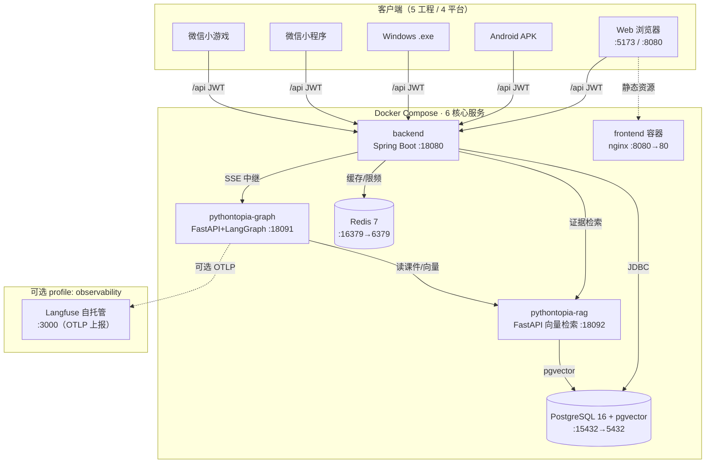
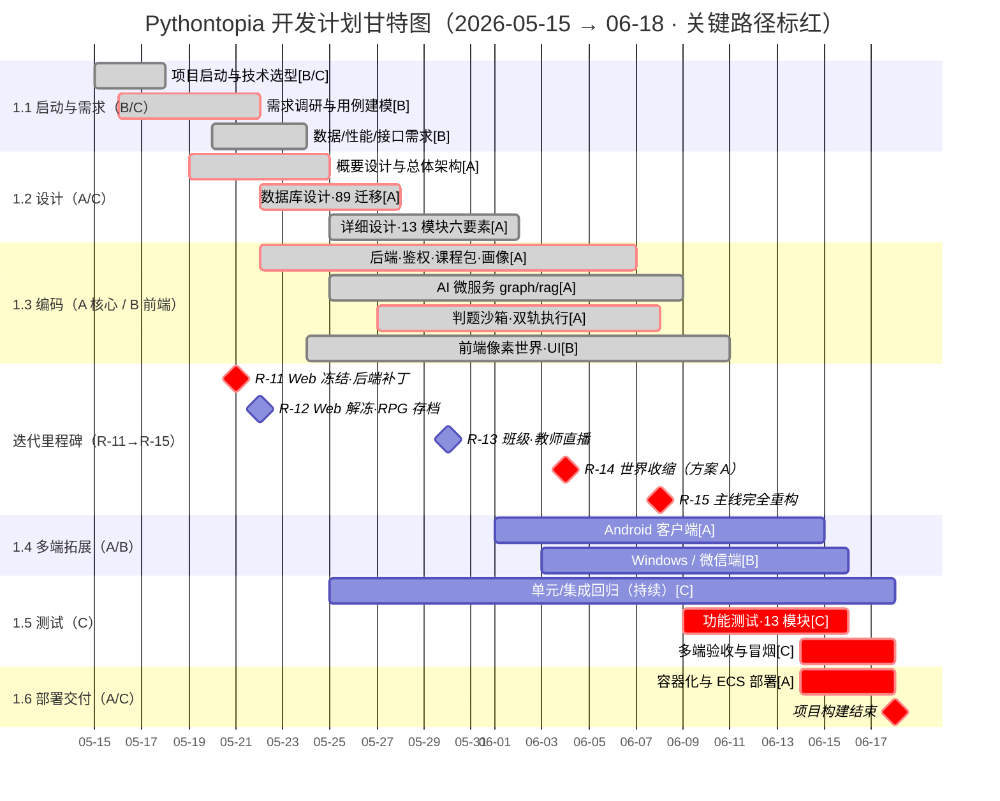
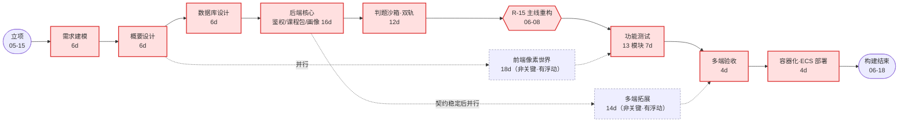
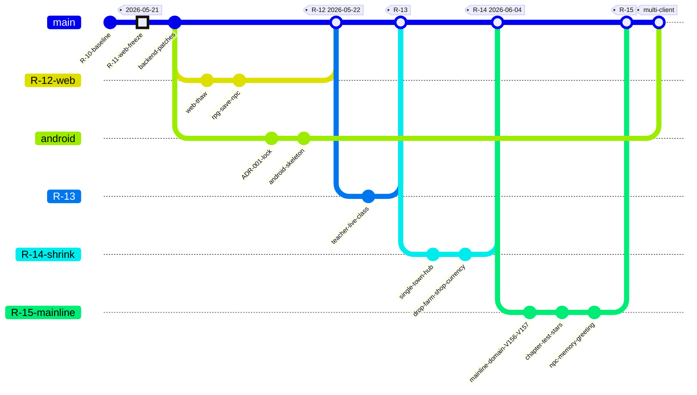
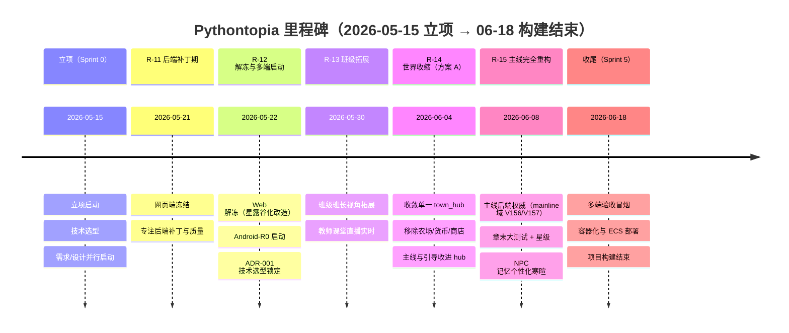
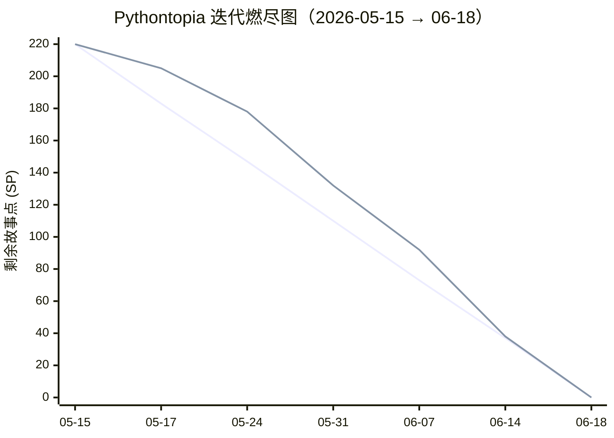

# 2 开发计划

> 文档编号：`PYT-CR` · 文件代号（filecode）：**C02** · 对应实训报告第 2 章
> 本章图表统一以 `C02-` 前缀编号；事实/术语/端口一律采用《写作总纲》§1 项目事实卡与 §2 术语表。

本章给出 Pythontopia 的整体开发计划：先界定项目的**最终呈现形式**（多端产品 + 共享后端）与**主要功能**（13 个业务模块），再说明**运行环境**（端口与容器拓扑）、**验收标准**（课程包初始化验证 + 回归基线 + 模块功能验收），随后梳理研发过程中的**关键问题与对策**，最后给出**进度安排**（含甘特图、版本迭代分支图、里程碑时间线）与**开发预算**。开发计划的目标是：在 3 人 + AI 协作、迭代节奏 R-11→R-15 的约束下，按「需求 → 设计 → 编码 → 测试 → 部署」五个阶段把一个面向高校 Python 初学者的**多端像素学习小镇「第二课堂」**交付到可演示、可验收的状态。

---

## 2.1 最终呈现形式（多端 + 共享后端）

Pythontopia 的最终形态是**一套后端 + 五个客户端工程**：所有客户端共用同一套 Spring Boot 后端（`:18080`，统一前缀 `/api`，JWT Bearer 鉴权），客户端之间不互相依赖，接入后端的**唯一权威契约**是 `docs/clients/api-contract.md`（base URL/端口、JWT、错误信封、端点表、SSE、CORS、不存在的能力都以它为准）。因为「四类平台」中微信端拆成**小程序**（学习陪伴）与**小游戏**（像素小镇）两个独立工程，所以物理上是 5 个客户端目录。

| 序号 | 平台 | 目录 | 技术栈 | 范围 / 像素小镇 | 交付物形态 |
| --- | --- | --- | --- | --- | --- |
| 1 | Web | `frontend/` | Vue 3 + Vite + TypeScript strict + Pinia + Phaser 3 | 全功能学习闭环 · **有**像素小镇 | 浏览器访问（开发 `:5173` / 容器 `:8080` / 线上 ECS） |
| 2 | Android | `clients/native/android/` | Kotlin + Jetpack Compose + LibGDX + Hilt | 全功能学习闭环 · **有**像素小镇 | debug APK（GitHub Releases pre-release） |
| 3 | Windows | `clients/native/windows/` | .NET 8 + WinUI 3 + MonoGame（DesktopGL） | 桌面端学习闭环 · **有**像素小镇 | 自包含 `.exe`（单文件 ~64 MB / 目录 zip ~74 MB） |
| 4 | 微信小程序 | `clients/wechat/miniprogram/` | 原生小程序（TypeScript + WXML/WXSS） | **学习陪伴**（画像/课程/答疑/任务/班级）· **无**像素小镇 | 微信开发者工具导入 → 体验版/正式版 |
| 5 | 微信小游戏 | `clients/wechat/minigame/` | 原生小游戏（TypeScript + canvas2d） | 像素小镇玩法 · **有**像素小镇 | 微信开发者工具（小游戏）导入 |

**为什么是「多端 + 共享后端」**：项目要解决的是大班统一进度下「翘课 / 跟不上 / 坚持不下去」的学生缺少课外补位学习场的问题，定位为**第二课堂**。学生用的设备与场景各不相同——有人习惯电脑浏览器、有人只带手机、有人活跃在微信生态——若每端各做一套后端与判题，既无法保证学习数据（画像、掌握度、主线进度）跨端连续，也会让防幻觉审查、判题安全等核心逻辑出现多份实现而漂移。因此计划阶段就确定：**后端是唯一真理源**，所有客户端只做表现层与交互层，把画像演化、判题沙箱、多智能体编排、证据审查全部收在服务端。这样学生在任一端登录都能续上同一份学习态，团队也只需维护一套业务规则。

呈现形式上有三点是计划阶段就锁定的原则：

1. **教育优先、游戏承载**。无论哪个客户端，落地的都是「看 → 学 → 练 → 测」学习闭环（看课件/视频/RAG → 资源工坊生成并消费资源 → 训练场真题判题 → 掌握度达阈值），Bug 矿洞为支线。像素小镇只是承载学习入口的空间隐喻，不做与教育目的无关的装饰系统。
2. **能力收敛后多端一致**。自 R-14「世界收缩方案 A」起，全项目**没有**背包 / 货币 / 商店三类能力，任何客户端都不得为其建 UI 或调端点（详见 §2.5 与第 7 章）。这保证五端在功能边界上完全对齐，避免某一端「自创」后端不支持的玩法。
3. **像素素材合规可发布**。所有客户端复用同一批 CC0 / CC-BY / CC-BY-SA / OFL 审计资产（如 Kenney Tiny Town 瓦片），地图统一来自前端程序化生成的 Tiled JSON（`town_hub.json`，50×40），不复制任何商业像素游戏官方素材。

线上演示形态：后端与依赖部署在阿里云 ECS（公网 `47.120.29.62`，经 Nginx `:80` 反代内部 `:18080`）。Windows 自包含产物与说明已上传 ECS 的 Nginx 直出目录供下载；微信端默认请求该公网后端（本机联调改回 `http://localhost:18080`）。多端部署细节见**第 7 章「多端部署设计」**，本章只界定「交付什么、由谁交付、何时交付」。

---

## 2.2 主要功能描述（13 模块概览）

系统功能按业务边界切分为 **13 个模块（M01–M13）**，每个模块对应后端一个或一组 `com.pythontopia.*` 包、若干前端页面/组件，以及（如涉及生成式能力）`pythontopia-graph` 中的 Agent 工位。下表给出每个模块的一句话职责与主责人（A/B/C 分工见《写作总纲》§1.1）。各模块的需求用例、详细设计、功能测试分别在第 4、8、9 章展开，本章不重复。

| 模块 | 名称 | 一句话职责 | 主责 |
| --- | --- | --- | --- |
| M01 | 账号认证与权限 | 学生/教师/管理员三角色注册登录与 JWT 签发校验，学习端点多数仅 `STUDENT` 可访问 | A |
| M02 | 学习画像与个性化 | 维护 8 维学习画像（被动演化 + 4 维主观自评），驱动资源生成与路径规划 | A |
| M03 | 中央小镇世界与存档 | 单一 `town_hub` 世界状态、能量/日历/技能与 RPG 存档槽的加载与持久化 | B |
| M04 | NPC 对话与记忆 | NPC 脚本对话 + 记忆/画像感知的个性化寒暄（失败安静降级，不伪造内容） | B |
| M05 | 主线冒险·看学练测 | 后端权威的主线关卡（看/学/练三件套）、章末大测试与星级评定 | A |
| M06 | 课程包与课件资产 | `packId=43`《Python 语言基础》课件页/示例/题目/媒体资产的装载与分发 | A |
| M07 | 课件问答与导师答疑（RAG） | 基于课件检索的证据锚定答疑，末端经防幻觉/安全审查 | A |
| M08 | 资源工坊与多智能体编排 | 意图路由 + 六类资源生成 + 学习总管 SSE 流式编排 | A |
| M09 | 训练场与判题·双轨 | Pyodide 即时预览 + 服务端沙箱正式判题（隐藏用例不下发，预览不入正式判分） | A |
| M10 | Bug 矿洞·无尽·Boss | 失败提交触发的分层调试支线、无尽闯关与 Boss 副本 | A |
| M11 | 复盘·费曼·学习评估 | 复盘大厅、费曼讲解自测、FSRS-lite 复习状态与学习评估叙述 | A |
| M12 | 任务公告板与学习路径 | 今日任务/任务领取（强证据校验）与个性化学习路径规划与重排 | A |
| M13 | 轻量班级与教师看板 | 教师建班/发任务、班级 KC 热力图与主线星级/章测/无尽看板 | A |

> 一句话职责均取自真实端点与代码语义（如 M09 的「双轨执行」、M12 的「证据校验」、M07 的「证据锚定 + 防幻觉三审」），用于在开发计划阶段对齐工作量与责任，不作为最终功能说明书；完整字段/端点见各模块第 4、8 章。

13 个模块不是平铺的功能堆叠，而是围绕主线学习闭环「看 → 学 → 练 → 测」组织起来的：M06 课程包提供「看」的素材底座（课件页/示例/题目/媒体），M07 用 RAG 支撑「看」过程中的课件问答与导师答疑，M08 资源工坊把「学」具象成思维导图/讲义/代码实验等六类资源，M09 训练场承担「练」并以双轨判题给出真实反馈，M05 主线冒险把「看/学/练」三件套编排成关卡、再以章末大测试完成「测」并评定星级。围绕这条主线，M02 画像与 M12 学习路径据学习行为做个性化推荐与重排，M10 Bug 矿洞与 M11 复盘大厅在「失败」和「遗忘」两处提供调试与巩固支线，M01 账号、M03 世界承载、M04 NPC 陪伴、M13 班级教学则分别提供身份、空间、情感与组织层面的支撑。计划阶段据此判断：核心工作量集中在 M05–M12（学习闭环 + AI 能力），由 A 主导编码，B 负责把这套能力在像素世界里可玩化呈现。

---

## 2.3 运行环境（端口与容器拓扑）

### 2.3.1 端口与服务清单

开发态与容器态共用一套端口口径（与 `deploy/docker-compose.yml`、《写作总纲》§1 一致）：

| 服务 | 技术 | 开发态端口 | 容器态映射 | 说明 |
| --- | --- | --- | --- | --- |
| 前端 Web | Vue 3 + Vite | `http://localhost:5173` | `8080:80` → `http://localhost:8080` | 浏览器入口；CORS 仅放行本机 Web 源 |
| 后端 API | Java 21 + Spring Boot 3.3.6 | `:18080` | `127.0.0.1:18080:18080` | 唯一真理源；前缀 `/api`，JWT Bearer |
| 多智能体 graph | FastAPI + LangGraph（Py 3.11） | `:18091` | `network_mode: host`（直出 `:18091`） | SSE 事件源；需访问宿主代理检索外网 |
| 课件 RAG | FastAPI + 向量检索（Py 3.11） | `:18092` | `127.0.0.1:18092:18092` | `X-Internal-Token` 保护重建端点 |
| 数据库 | PostgreSQL 16 + pgvector | `5432` | `15432:5432` | 库名 `pythontopia`，镜像 `pgvector/pgvector:pg16` |
| 缓存 | Redis 7 | `6379` | `16379:6379` | 会话/限频/缓存 |
| 可观测性（可选） | Langfuse（自托管） | — | `127.0.0.1:3000:3000` | 仅 `--profile observability` 时拉起，缺它核心 6 服务照常起停 |

容器层共 **6 个核心服务**（postgres / redis / backend / graph / rag / frontend）随 `docker compose up -d` 一并启动；Langfuse 全家桶（`langfuse-*` 6 个容器）挂在可选 `observability` profile，默认不启动，且全部加 `langfuse-` 前缀与业务服务隔离（不抢 postgres/redis 名字与数据卷）。

### 2.3.2 容器拓扑

> 图 C02-1　Pythontopia 容器拓扑与请求流向（6 核心服务 + 可选 Langfuse profile）

外部依赖：LLM Provider 可插拔（dryrun / OpenAI 兼容 / 讯飞 Spark），演示默认单 worker；缺密钥时自动降级 golden 兜底，不阻塞主链路。graph 容器走 host 网络以便经宿主代理（默认 `7892`）访问外网检索（如 B 站精选视频）；后端访问讯飞多模态时经 `host.docker.internal` 代理并以 `nonProxyHosts` 排除容器内服务名直连。

### 2.3.3 开发态启动

本地全栈开发（含 graph/rag 微服务）优先用根目录 `./dev.sh` 一键拉起，避免「只起 backend 而漏 Docker 依赖」。一键演示链路为：`docker compose up -d --build`（6 服务）→ `scripts/init_rag_index.sh`（课件向量索引一次性构建）→ `scripts/seed_demo_classroom.sh`（创建 demo 教师 + 3 学生 + 班级任务，幂等）→ `scripts/demo_smoke.sh`（4 项健康检查 + 课程包可读性验证）。其中一个已知踩坑必须在计划阶段提示团队：**Postgres 数据卷密码与 `deploy/.env` 不一致会导致 Flyway 启动失败**，处置方式以 `docs/operations/dev-startup.md` 备忘为准（核对密码或清空数据卷重建）。

---

## 2.4 验收标准

验收分三层：**课程底座初始化验证**（硬指标）、**自动化回归基线**（质量门）、**模块功能验收**（业务可用）。

### 2.4.1 课程底座初始化验证（硬指标）

空库初始化并导入 `data/course-pack-43/` 种子后，必须满足以下计数，缺一不可（可经 `GET /api/course/pack` 复核，或 `deploy/scripts/demo_smoke.sh` 的课程包可读性验证）：

| 项 | 期望值 | 验证途径 |
| --- | --- | --- |
| 文档数 | **7 份** | `GET /api/course/pack` 元信息计数 |
| 页数 | **561 页** | 课件页总数；证据页可经 `/api/course/pages/{id}/image` 渲染 |
| 章数 | **7 章** | `GET /api/course/chapters` |
| 知识点（KC） | **65 个** | `GET /api/course/kcs`，`kcCode` 形如 `PY43-KC-001` |
| 示例 | **46 个** | 课程示例库 |
| 题目 | **39 道** | `GET /api/course/problems` |

> 该 6 项是项目「唯一课程知识底座」`packId=43`《Python 语言基础》的硬约束；任何迁移/重置后必须重新跑通空库初始化并核对计数。

### 2.4.2 自动化回归基线（质量门）

按修改影响范围执行对应测试命令（命令矩阵见第 12 章附录与 `README` §5）。当前回归基线（2026-06-09「Infinity Living World」验收口径）：

| 套件 | 通过 / 总数 | 验证命令（节选） |
| --- | --- | --- |
| Backend（Spring Boot） | 464 / 464 | `mvn test`（含 Testcontainers 端到端 acceptance） |
| Graph（FastAPI + LangGraph） | 380 / 380 | `python -m pytest -q`（含 11 Agent 单测 + 编排接力 + 语义接地） |
| RAG（FastAPI + 向量） | 21 / 21 | `python -m pytest -q`（chunker / embedder / 索引重建 / 安全词） |
| Frontend（Vue + Vitest） | 1514 / 1514 | `npm run typecheck && npm run lint && npm run test` |
| **合计** | **2379 / 2379** | 0 失败 / 0 错误（typecheck 0 / lint 0 error） |

> 质量门：合并前四套件全绿、typecheck 0、lint 0 error；多端各自维护独立测试（如 Windows `Pythontopia.Core.Tests` 133 个 xUnit）。基线数会随迭代演进，以仓库测试命令实跑结果为准。

### 2.4.3 模块功能与防幻觉/安全验收

- **功能可用**：13 模块每个至少覆盖一条学生侧端到端链路（详见各 09-MXX 功能测试），如 M09 须验证「通过 / 失败 / 运行错误」三类提交、M07 须验证 RAG 命中引用页、M05 须验证章末测试判分与星级。
- **判题安全**：隐藏测试用例不下发前端 DTO；判题失败统一脱敏宿主路径；Pyodide 预览结果**不入**正式判分。
- **防幻觉三审**：生成资源末端经 GroundingCritic / Hallucination / Safety 校验；RAG 命中分低于阈值或触发敏感词统一返回 `no_evidence_found=true, hits=[]`，绝不编造课件引用。
- **合规**：演示账号统一 `demo-` 前缀虚构身份，提交包不含真实学生 PII 与真实 LLM 密钥（`.env` 已 gitignore）；像素素材授权与 `LICENSE-ART.md` 一致。

### 2.4.4 按影响范围验证（交付门）

每次修改按影响范围选取验证手段，作为「改完即验」的交付纪律：前端类型改动跑 `npm run typecheck`；前端组件改动跑 `npm run test`；后端 API 改动跑 `mvn test`；Python Agent 改动跑 `python -m pytest -q`；数据库迁移改动须**空库初始化并导入 seed**；RAG 改动须以「`input` 函数 / `for` 循环 / 列表」三类查询检查返回的引用页；判题改动须覆盖「通过 / 失败 / 运行错误」三类提交。每份交付说明须写清：做了什么、验证了什么、哪些未验证、剩余风险、是否影响比赛演示链路。

---

## 2.5 关键问题与对策

研发与多端拓展中识别出的主要风险及已落地的对策：

| # | 关键问题 | 影响 | 对策（已落地或在建） |
| --- | --- | --- | --- |
| 1 | **多端 DTO 漂移**：5 端各自手写 DTO 易与后端不一致 | 字段错配、运行期解析失败 | 以后端 springdoc `/v3/api-docs` 为单一真理源；Android 规划用 OpenAPI Generator 7.22 生成 Kotlin client + CI `openapi-diff` 检测 schema drift（当前 Android DTO 仍为手写，生成器待引入，见第 7 章） |
| 2 | **SSE 事件协议迁移**：线上已迁至 AG-UI 语义事件，历史名 `plan/trace/token/result/error` 不再准确 | 客户端拼答案/终态判断出错 | 客户端做「双语归一」：`TEXT_MESSAGE_CONTENT.delta` 拼答案、`STEP_*` 当思考链、`RUN_FINISHED` 为终态、`RUN_ERROR` 为错误；参考实现 `frontend/src/composables/agui.ts`、`clients/wechat/miniprogram/.../agui.ts` |
| 3 | **网络代理/讯飞连接超时**：宿主 fake-ip DNS 致 Java HttpClient 文生图/TTS connect timeout | 多模态恒走降级 | `JAVA_OPTS` 注入 `http(s).proxyHost/Port`（默认 `7892`）+ `nonProxyHosts` 排除内部服务名；缺密钥/超时自动降级本地占位，不阻塞链路 |
| 4 | **LLM 不可控 / 缺密钥**：演示环境可能无可用 LLM | 生成链路中断 | Provider 可插拔（dryrun / OpenAI-Compat / 讯飞 Spark），缺密钥自动降级 golden 兜底；Agent 故障 fail fast，不静默降级成普通聊天 |
| 5 | **判题安全与双轨**：前端预览可能被误当正式结果 | 判分失真、用例泄露 | 服务端 subprocess 沙箱 + 静态检查 + 限频 + 隐藏用例不下发；前端 Pyodide 仅即时预览，正式提交一律入库 |
| 6 | **世界收缩（R-14）残留**：农场/作物/货币/商店旧玩法残留 | 多端误建无后端支撑的 UI | 收敛为单一 `town_hub`，残留表按版本 DROP；客户端契约 §7 明确「背包/货币/商店」不存在能力 |
| 7 | **主线存档权威迁移（R-15）**：旧前端权威 `mainQuest` 存档废弃 | 进度计算口径不一 | 主线进度改为后端权威 mainline 域（`mainline_stage_progress`/`chapter_star`/`chapter_test`，迁移 V156/V157）；客户端只读 `overview` 渲染并打点 |
| 8 | **Flyway 启动踩坑**：Postgres 数据卷密码与 `deploy/.env` 不一致 | 后端启动失败 | 以 `docs/operations/dev-startup.md` 备忘为准核对密码/清卷；优先用根 `./dev.sh` 起全栈含依赖 |
| 9 | **Android 凭据安全**：JWT 明文落盘风险 | 令牌泄露 | `EncryptedSharedPreferences` + Keystore + BiometricPrompt（OWASP MASVS-L1）；Windows 用 DPAPI 加密落盘 |
| 10 | **Web 冻结基线保护**：多端拓展不得破坏 Web 回归 | 引入回归 | Android/Windows/微信各自独立目录与 CI，不复用 Web Phaser/`tilemap.ts`/`api/*.ts`；Web 基线单独守护 |

---

## 2.6 进度安排

项目周期为 **2026-05-15（周五·立项）至 2026-06-18（周四·项目构建结束）**，约 5 周，按 Scrum 划为 Sprint 0–5。进度安排覆盖「需求 → 设计 → 编码 → 多端拓展 → 测试 → 部署」六段，任务到人（A 设计主笔与核心编码、B 需求主笔与前端/游戏编码、C 测试与多端质量主笔），并与迭代节奏 R-11→R-15 对齐（窗口内真实里程碑：R-11 冻结 05-21、R-12 解冻 05-22、R-13 班级 ≈05-30、R-14 世界收缩 06-04、R-15 主线重构 06-08）。下面依次给出 **① 工作分解结构（WBS）→ ② 阶段甘特图（关键路径标记）→ ③ 关键路径网络图 → ④ 版本迭代分支图 → ⑤ 里程碑时间线 → ⑥ 迭代燃尽图** 六幅计划图，并附阶段责任对照表。

研发方法上采用**小步迭代**：每个版本（R-xx）聚焦一个明确目标（如 R-14 收缩世界、R-15 重构主线），每次改动尽量单一职责、单独提交、跑全量测试通过再合入；版本升级遵循「小步迭代 + 单独 PR」原则（每次只升 1–2 个依赖版本）。开发以 3 人 + AI 协作推进，所有 AI 生成代码与文档均经人工审阅并对最终质量负责。每个任务都要求有可验证结果——修 bug 先复现，做功能先定义验收——以契合「目标驱动」的项目准则。

### 2.6.1 工作分解结构（WBS）

先把项目自顶向下分解为 6 个一级工作包（WP1–WP6）与其下二级活动，作为甘特排期与责任分配的依据。WBS 编号 `1.x.y` 与后续甘特任务一一对应。

```mermaid
flowchart TD
    P["1 Pythontopia 课程设计项目<br/>2026-05-15 → 06-18"]

    P --> W1["1.1 启动与需求<br/>（B 主笔 / C 协同）"]
    P --> W2["1.2 设计<br/>（A 主笔 / C 协同）"]
    P --> W3["1.3 编码<br/>（A 核心 / B 前端游戏）"]
    P --> W4["1.4 多端拓展<br/>（A / B）"]
    P --> W5["1.5 测试<br/>（C 主笔 / A 协同）"]
    P --> W6["1.6 部署与交付<br/>（A / C）"]

    W1 --> W11["1.1.1 需求调研与访谈"]
    W1 --> W12["1.1.2 用例建模（13 模块）"]
    W1 --> W13["1.1.3 数据/性能/接口需求"]

    W2 --> W21["1.2.1 概要设计与总体架构"]
    W2 --> W22["1.2.2 数据库设计（89 迁移）"]
    W2 --> W23["1.2.3 详细设计（13 模块六要素）"]

    W3 --> W31["1.3.1 后端·鉴权·课程包·画像"]
    W3 --> W32["1.3.2 AI 微服务 graph/rag"]
    W3 --> W33["1.3.3 判题沙箱·双轨执行"]
    W3 --> W34["1.3.4 前端像素世界·UI"]

    W4 --> W41["1.4.1 Android 客户端"]
    W4 --> W42["1.4.2 Windows 客户端"]
    W4 --> W43["1.4.3 微信小程序/小游戏"]

    W5 --> W51["1.5.1 单元/集成回归"]
    W5 --> W52["1.5.2 功能测试（13 模块）"]
    W5 --> W53["1.5.3 多端验收与冒烟"]

    W6 --> W61["1.6.1 容器化与 ECS 部署"]
    W6 --> W62["1.6.2 文档与演示收尾"]

    classDef cp fill:#ffe0e0,stroke:#d33,stroke-width:2px;
    class W12,W21,W22,W31,W33,W52,W53,W61 cp;
```

> 图 C02-2　工作分解结构（WBS）；**红色**节点为落在关键路径上的工作包（见 §2.6.3）。

### 2.6.2 阶段甘特图（2026-05-15 → 06-18，关键路径标记）

甘特按 WBS 排期，任务方括号内为责任人，标 `crit`（红条）者为关键路径任务，`milestone` 为迭代/交付里程碑。各阶段按 Scrum 重叠推进（设计未完即启动核心编码），与真实 R-11→R-15 节点对齐。

> 图 C02-3　开发计划甘特图（2026-05-15 立项 → 06-18 构建结束；红条/红钻为关键路径任务与里程碑）

### 2.6.3 关键路径网络图（确认关键路径）

把活动按依赖画成「活动节点（AON）」网络，标注各活动工期（d）。从立项到构建结束的**最长依赖链即关键路径**：任一关键活动延期都会顺延 06-18 的构建结束节点；非关键链（前端像素世界、多端拓展、文档）存在浮动时差。**经核算确认的关键路径**为：

> 需求建模(6d) → 概要设计(6d) → 数据库设计(6d) → 后端核心(16d) → 判题沙箱·双轨(12d) → R-15 主线重构 → 功能测试(7d) → 多端验收(4d) → 容器化与 ECS 部署(4d) → 构建结束。

> 图 C02-4　关键路径网络图（红色实线为关键路径，蓝色虚线为有浮动时差的非关键活动）

### 2.6.4 版本迭代分支图（R-11→R-15）

> 图 C02-5　迭代分支图：主干 + R-12 Web 解冻 / Android 并行 / R-13 班级 / R-14 世界收缩 / R-15 主线重构

### 2.6.5 里程碑时间线

> 图 C02-6　里程碑时间线（与图 C02-5 分支节点一一对应，覆盖立项→构建结束全窗口）

### 2.6.6 迭代燃尽图（剩余故事点）

按 Sprint 0–5 跟踪剩余故事点（Story Point，全项目约 220 SP）。**理想线**为匀速燃尽，**实际线**反映 R-14 世界收缩、R-15 主线重构在中后期引入返工导致燃尽一度滞后于理想，最终在收尾 Sprint 收敛归零、按期完成构建。

> 图 C02-7　迭代燃尽图（上方折线＝实际剩余、下方折线＝理想匀速燃尽；横轴为各 Sprint 收点日期）

### 2.6.7 阶段责任与产出对照

| 阶段 | 主责 | 协同 | 主要产出 | 对齐迭代 |
| --- | --- | --- | --- | --- |
| 需求分析 | B | C | 需求总览、13 模块用例（第 4 章） | 项目早期 |
| 概要/详细设计 | A | C | 概要设计、数据库设计、多端部署设计（第 5/6/7 章） | 项目早期 |
| 编码 | A（核心）/B（前端游戏） | — | 后端·AI·判题·数据库·主线 + 前端像素世界 | R-11 前完成主体 |
| 多端拓展 | A/B | C | Android / Windows / 微信小程序 / 小游戏 | R-12 → R-15 |
| 测试 | C | A | 功能测试、回归基线、审查问题清单（第 9/10 章） | 全程持续 |
| 部署 | A | C | 容器化、ECS 上线、演示与文档收尾（第 12 章） | R-15 收尾 |

> 分工满足课程约束：**需求主笔 B ≠ 设计主笔 A**；**编码者 A/B ≠ 测试/审查主笔 C**。

---

## 2.7 开发预算

项目以「3 人 + AI 协作」推进，技术栈与像素素材全部为开源/免费授权，故预算集中在**人力（折算人·天）**、**云服务器**与**可选 LLM 调用**三项；软件工具、字体与像素素材均为 0 直接成本。下表为估算口径，用于课程交付的成本说明，非实际财务支出。

| 类别 | 明细 | 估算用量 | 估算成本 | 说明 |
| --- | --- | --- | --- | --- |
| 人力 | A（架构/后端/AI/判题/数据库，核心） | ≈ 60 人·天 | 折算工时 | 工作量最大、负责最核心部分 |
| 人力 | B（前端/游戏/像素世界/UI/交互） | ≈ 40 人·天 | 折算工时 | 需求主笔 + Web/游戏编码 |
| 人力 | C（测试/质量/多端/数据字典） | ≈ 30 人·天 | 折算工时 | 测试与审查主笔 |
| 云服务器 | 阿里云 ECS `ecs.e-c1m2.large`（2C4G/40G，Ubuntu 22.04） | 演示期约 1–2 月 | 约 ¥100–200/月 | 公网 `47.120.29.62`，Nginx 反代 `:80→:18080` |
| LLM 调用 | 讯飞 Spark / OpenAI 兼容（文生图/TTS/答疑/出题） | 演示默认 dryrun/golden 兜底 | ≈ ¥0（演示）；按量计费（接真密钥时） | 缺密钥自动降级，不阻塞链路 |
| 软件/工具 | JDK 21 / Node / Python / Docker / IDE / CI | 全程 | ¥0 | 开源或免费额度（GitHub Actions） |
| 像素素材/字体 | Kenney 等 CC0 / CC-BY / CC-BY-SA / OFL | 全程 | ¥0 | 见 `LICENSE-ART.md`，不购买商业素材 |
| 域名/备案（可选） | 微信线上需已备案 HTTPS 域名 | 上架时 | 按实际备案/证书费用 | 仅微信端正式上线需要；演示走开发者工具 |

> 预算结论：核心成本为人力（约 130 人·天）与一台 2C4G ECS；LLM 在演示态可零成本运行（dryrun + golden 兜底），接入真实密钥后按量计费。开源技术栈与免费素材使非人力的现金支出维持在很低水平。

---

## 附：本章图表索引

| 编号 | 名称 | 类型 |
| --- | --- | --- |
| 图 C02-1 | 容器拓扑与请求流向 | flowchart |
| 图 C02-2 | 工作分解结构（WBS） | flowchart |
| 图 C02-3 | 开发计划甘特图（05-15→06-18，关键路径标记） | gantt |
| 图 C02-4 | 关键路径网络图 | flowchart |
| 图 C02-5 | 版本迭代分支图（R-11→R-15） | gitGraph |
| 图 C02-6 | 里程碑时间线 | timeline |
| 图 C02-7 | 迭代燃尽图（剩余故事点） | xychart-beta |
| 表 C02-1 | 五客户端最终呈现形式 | 表 |
| 表 C02-2 | 13 模块职责与主责 | 表 |
| 表 C02-3 | 端口与服务清单 | 表 |
| 表 C02-4 | 课程底座初始化验证硬指标 | 表 |
| 表 C02-5 | 自动化回归基线 | 表 |
| 表 C02-6 | 关键问题与对策 | 表 |
| 表 C02-7 | 阶段责任与产出对照 | 表 |
| 表 C02-8 | 开发预算估算 | 表 |

---

> 执笔人：成员 A ｜ 完成人（签名）：成员 A ｜ 审查人：成员 C ｜ 完成日期：2026-06-20
