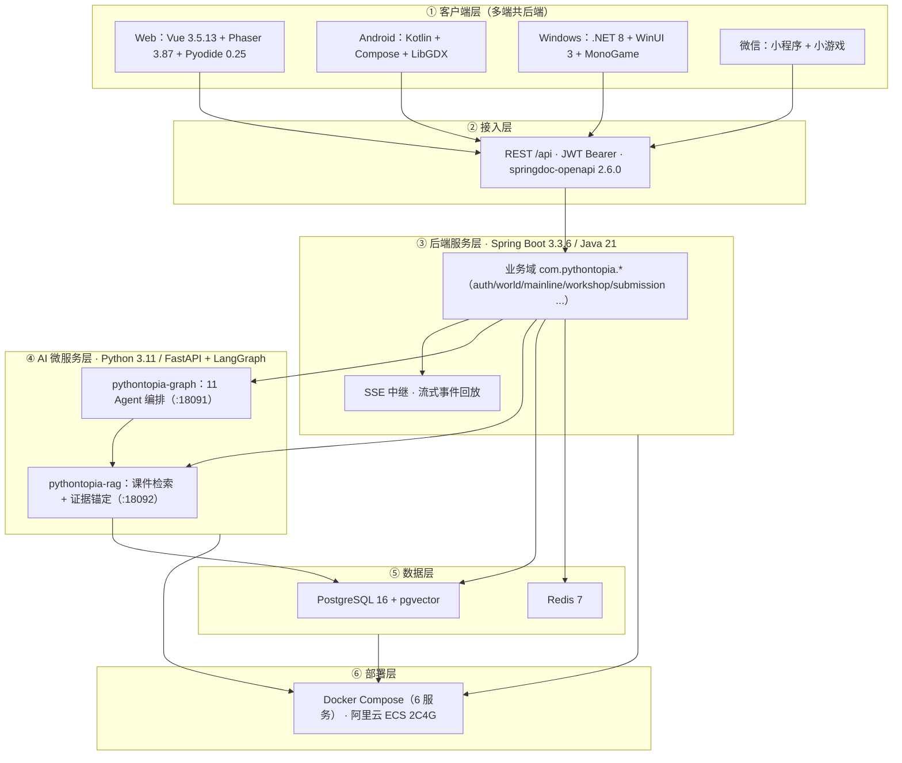
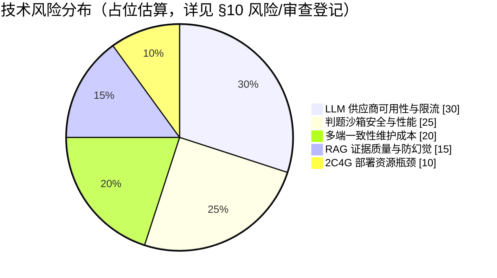
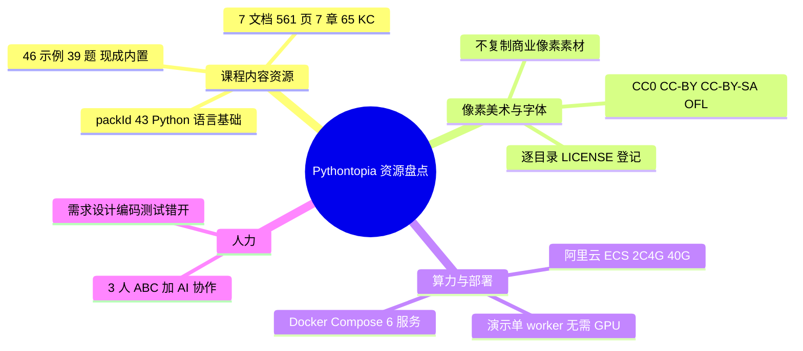
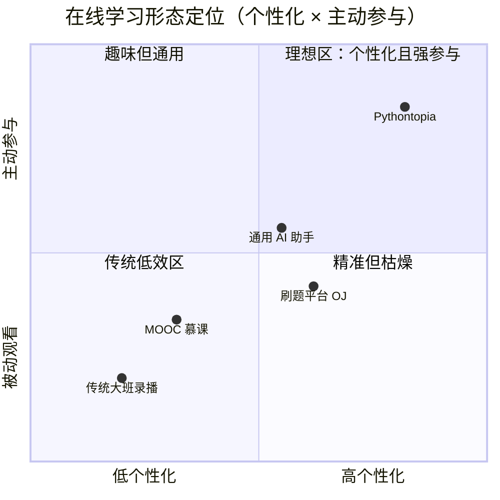

# 3 可行性分析

> 文档编号：PYT-CR-03 ｜ filecode：C03 ｜ 报告日期：2026-06
> 本章从**技术、资源、市场**三个维度论证 Pythontopia 的可行性。论证以仓库真实依赖与产物为据：后端 `backend/pom.xml`、前端 `frontend/package.json`、AI 微服务 `services/*/pyproject.toml`、部署 `deploy/docker-compose.yml`。涉及的数据库表只列名引用、字段字典「见 §6 数据库设计」；总体架构与处理流程「见 §5 概要设计」。

可行性总览：项目所有关键技术均为**已发布的稳定版本**、且在本仓库中**已有可运行实现与全绿测试**佐证；课程底座与像素素材为**现成且合规**的资源；目标市场为**基数庞大、刚需明确**的高校 Python 公共课。三个维度均成立，项目可行。

---

## 3.1 技术可行性分析

技术可行性的核心结论是：**Pythontopia 选用的每一层技术都是成熟稳定、社区活跃、与需求强匹配的主流方案，且在本仓库中已有真实落地实现并被自动化测试覆盖**——可行性不是「理论上能做」，而是「已经做出来并跑绿了」。系统总体分为客户端层、接入层、后端服务层、AI 微服务层、数据层、部署层六层（图 C03-1）。

**图 C03-1　技术栈分层架构（flowchart）**

**（1）后端：Java 21 + Spring Boot 3.3.6。** Spring Boot 是 Java 生态事实标准的企业级框架，Java 21 为 LTS 长期支持版本，二者均为成熟稳定的工业级选型。项目以 Spring Web 提供 REST、Spring Security 承载 JWT 鉴权、Spring Data JPA 做持久化、Flyway 管理可重入数据库迁移、springdoc-openapi 2.6.0 自动产出 OpenAPI 文档（供多端 DTO 生成）。课件证据「页面图片」用 PDFBox 3.0.4 服务端渲染并磁盘缓存，资源工坊上传解析用 Apache POI 5.5.1 抽取 `.docx`/PDFBox 抽取 `.pdf` 文本。质量侧由 Testcontainers 1.21.4 做端到端集成测试、Spotless 统一 Google Java 格式、JaCoCo 出覆盖率报告。可行性证据：后端 **464 / 464** 测试全绿（含 Testcontainers acceptance）。

**（2）前端：Vue 3.5 + Phaser 3.87 + Pyodide。** 前端用 Vue 3.5.13 + Vite 5.4.21 + TypeScript 5.7（strict）+ Pinia 2.3 + Vue-Router 4.5，类型严格、业务层禁 `any`。像素世界用 Phaser 3.87 渲染，并严格隔离在 adapter 层、全局单 `Phaser.Game` 实例，避免与 Vue 响应式互相污染。关键可行性支点是 **Pyodide 0.25**：它把 CPython 编译为 WebAssembly，使学生**无需本地安装环境**即可在浏览器内即时运行 Python（双轨执行的预览轨）。配套组件成熟：CodeMirror 6 做代码编辑、Mermaid 11.15 渲染思维导图、pdfjs-dist 4.10 渲染课件、reveal.js 放映 PPT、Marked + DOMPurify 安全渲染 Markdown。质量侧 Vitest 2.1 + Playwright。可行性证据：前端 **1514 / 1514** 测试全绿、typecheck 0 / lint 0 error。

**（3）AI 微服务：FastAPI + LangGraph（Python 3.11）。** 多智能体编排用 LangGraph（`>=1,<2`），它把 Agent 编排建模为可检查点（checkpointer）的有向图，天然契合「11 Agent 结构化接力 + 防幻觉三审」的需求；FastAPI 提供高性能异步 HTTP，pydantic 强制结构化输出（**不启用 ReAct 循环**）。`pythontopia-graph` 承载 11 个 Agent 编排与 SSE 流式事件，`pythontopia-rag` 承载课件分块、向量检索与证据锚定（psycopg 3 直连 PostgreSQL、pyarrow 处理向量、可选 networkx 做 KC 图扩展）。可观测性（OpenTelemetry → Langfuse）与记忆/评测等重依赖**全部 optional + 缺包降级**，不拖垮主链路。可行性证据：Graph **380 / 380**、RAG **21 / 21** 测试全绿。

**（4）数据层：PostgreSQL 16 + pgvector + Redis 7。** 选用官方镜像 `pgvector/pgvector:pg16`，一套数据库同时承担**关系型业务数据**（用户/世界/主线/判题等，表字典见 §6）、**JSONB 半结构化画像**（`learner_profile.dimensions` 8 维聚合，见 §6）与**向量检索**（pgvector 支撑 RAG 证据召回）三类负载，避免引入额外向量数据库，显著降低运维复杂度。Redis 7 承担缓存与限频。表结构演进由 Flyway 迁移脚本管理、可重入。

**（5）部署层：Docker Compose 一键编排。** `deploy/docker-compose.yml` 将 postgres / redis / backend / graph / rag / frontend **6 个核心服务**编排为一键启动，含健康检查与依赖顺序；可观测性 Langfuse 栈以 `--profile observability` 可选拉起，默认不影响 6 个核心服务。配合 `init_rag_index.sh` / `seed_demo_classroom.sh` / `demo_smoke.sh` 等脚本，做到**演示数据自带、幂等可重入**。LLM Provider 可插拔（dryrun / OpenAI 兼容 / 讯飞 Spark），**缺密钥自动降级 golden 兜底**——这意味着即便无外网、无密钥，演示链路仍可运行，从工程上消除了「依赖第三方在线服务」的单点风险。

**表 C03-1　技术栈逐层选型与可行性论证**

| 层 | 技术 / 版本 | 选型理由 | 可行性证据 |
| --- | --- | --- | --- |
| 后端 | Java 21 · Spring Boot 3.3.6 · Flyway · Security(JWT) · springdoc 2.6.0 · PDFBox 3.0.4 · POI 5.5.1 | 工业级标准、LTS、生态完整 | 后端 464/464 测试绿（含 Testcontainers） |
| 前端 | Vue 3.5.13 · Vite 5.4.21 · TS 5.7 · Pinia 2.3 · Phaser 3.87 | 类型严格、游戏渲染成熟 | 前端 1514/1514 绿、typecheck/lint 0 错 |
| 浏览器内运行时 | Pyodide 0.25（CPython→WASM） | 免本地环境，即时预览 | 双轨执行预览轨已落地 |
| AI 编排 | FastAPI · LangGraph(>=1,<2) · pydantic | 结构化输出、可检查点、非 ReAct | Graph 380/380 测试绿 |
| RAG | FastAPI · pgvector · psycopg3 · pyarrow | 证据锚定、与主库同源 | RAG 21/21 测试绿 |
| 数据库 | PostgreSQL 16 + pgvector · Redis 7 | 关系/JSONB/向量三合一 | 镜像 `pgvector/pgvector:pg16` 已用于全部迁移 |
| 部署 | Docker Compose（6 服务）+ 5 脚本 | 一键、幂等、可重入 | `docker compose up -d` 起 6 服务 |
| LLM | 可插拔 dryrun / OpenAI 兼容 / 讯飞 Spark | 缺密钥自动降级 golden | 演示无外网仍可跑 |

技术风险方面，主要集中在「外部 LLM 可用性、判题沙箱安全与性能、多端一致性、RAG 证据质量、2C4G 资源瓶颈」五处（占位估算见图 C03-2，逐条登记与应对见 §10 审查/风险清单）。这些风险**均已有现成的工程缓解手段**（LLM 降级兜底、沙箱隔离 + 隐藏用例不下发、OpenAPI 统一 DTO 契约、证据阈值 + 防幻觉三审、单 worker + 可选组件降级），故不构成可行性障碍。

**图 C03-2　技术风险分布（pie，占位估算）**

**表 C03-2　技术风险与应对**

| 风险 | 等级 | 应对手段 | 是否已落地 |
| --- | --- | --- | --- |
| 外部 LLM 不可用 / 限流 | 中 | Provider 可插拔 + 缺密钥降级 golden 兜底 | 是 |
| 判题沙箱被攻破 / 超时 | 高 | subprocess 沙箱 + 静态检查 + 限频 + 隐藏用例不下发 | 是 |
| 多端 DTO 漂移 | 中 | springdoc OpenAPI 自动生成 DTO，统一契约 | 是 |
| RAG 编造课件引用 | 高 | 证据阈值 + 无证据返回空 + 防幻觉三审 | 是 |
| 2C4G 资源不足 | 中 | 演示单 worker + 可选重依赖降级 + RAG hash embedder | 是 |

---

## 3.2 资源可行性分析

资源可行性的结论是：**Pythontopia 所需的课程内容、美术素材与算力均已现成、合规、低成本可得**，不存在「需要额外采购或重新生产关键资源」的障碍。资源盘点见图 C03-3。

**图 C03-3　资源盘点全景（mindmap）**

**（1）课程内容资源——现成且唯一权威。** 全平台唯一课程底座是 Alethicode `packId=43`《Python 语言基础》，规模为 7 份文档 / 561 页 / 7 章 / 65 个 KC / 46 个示例 / 39 道题，且**已完整内置于 `data/course-pack-43/`**（含 `json/` 下 `course_pack`、`course_document`、`course_chapter`、`course_page`、`course_kc`、`course_example`、`course_problem` 七类种子，以及 `derived/` 派生练习与 OJ 目录、`video_manifest.json` 视频清单）。这意味着项目**无需从零建课**，初始化后即可验证「7 文档 / 561 页 / 7 章 / 65 KC / 46 例 / 39 题」全部就位（对应表的字段字典见 §6）。内容资源就绪度最高。

**（2）像素美术与字体——全部合规开源。** 项目画风参考星露谷式像素小镇，但**不复制任何商业像素游戏的官方素材**，仅采用 CC0 / CC-BY 3.0·4.0 / CC-BY-SA 3.0 / OFL-1.1 等**已审计**的开源资产。每个素材目录配 `LICENSE.md`，全局在 `LICENSE-ART.md` 详尽登记；已接受 LPC 的 CC-BY-SA 3.0 传染：最终二进制包以 CC-BY-SA 3.0+ 发布，代码层保持 MIT 分层授权。版权链条清晰、可对外发布，无侵权风险。

**（3）算力与部署——低配可承载，无需 GPU。** 演示部署目标机为阿里云 ECS `ecs.e-c1m2.large`（2 核 4G / 40G 系统盘 / Ubuntu 22.04）。该规格足以承载 Docker Compose 的 6 个核心服务：演示默认单 worker、避免进程内状态错乱；RAG 默认 `hash` embedder（不依赖外部 embedding API）；LLM 可走 dryrun/降级（不依赖 GPU 与在线大模型）。因此在 **2C4G 无 GPU** 的低成本机器上即可完成完整演示，算力资源可行。

**（4）人力——3 人 + AI 协作，分工满足课程约束。** 团队为 3 人（A/B/C）+ AI 协作开发：A 负责架构/后端/AI·Agent·RAG/数据库/主线判题核心，B 负责前端/游戏/像素世界，C 负责测试/质量/多端/数据字典。分工刻意错开「需求主笔 ≠ 设计主笔」「编码者 ≠ 测试/审查主笔」，既满足课程实训约束，也保证质量交叉校验。

**表 C03-3　资源可行性清单与就绪状态**

| 资源类型 | 内容 | 来源 / 位置 | 就绪状态 |
| --- | --- | --- | --- |
| 课程内容 | packId=43《Python 语言基础》7/561/7/65/46/39 | `data/course-pack-43/` | ✅ 现成内置 |
| 像素素材 | 角色/建筑/地图 tile | CC0/CC-BY/CC-BY-SA 已审计 + `LICENSE-ART.md` | ✅ 合规可发布 |
| 字体 | 像素/中文字体 | OFL-1.1 | ✅ 合规 |
| 算力 | 2C4G/40G ECS（无 GPU） | 阿里云 Ubuntu 22.04 | ✅ 可承载演示 |
| LLM | 讯飞 Spark / OpenAI 兼容 / dryrun | 可插拔 + 降级兜底 | ✅ 无密钥可跑 |
| 人力 | 3 人 A/B/C + AI 协作 | 团队 | ✅ 分工就位 |

---

## 3.3 市场可行性分析

市场可行性的结论是：**目标市场基数庞大、需求刚性，且 Pythontopia 的「第二课堂」定位与现有产品形成清晰差异化**，存在真实的、未被充分满足的需求空间。

**（1）市场规模——高校 Python 公共课覆盖面广、用户基数大。** Python 长期位居最流行编程语言前列，是高校面向**非计算机专业**开设的编程通识课的首选语言之一；几乎所有设有理工、经管、人文社科相关专业的高校，都开设面向大班的 Python 公共课。这类课程「每年都开、每届都教、人数众多」，且其学生正是 §1 所述「零基础、易掉队」的核心人群。因此 Pythontopia 面对的是一个**稳定、可持续、刚需明确**的市场（以上为对高校课程格局的通识性判断，不引用具体统计数字）。

**（2）竞品格局与差异化——与 MOOC/网课的本质区别。** 现有在线学习产品大致分三类，各有结构性短板，恰好留出 Pythontopia 的差异化空间（图 C03-4、表 C03-4）：

- **MOOC / 录播网课**：以视频单向讲授为主，学生**被动观看**、缺即时判题与个性化陪伴，自主学习场景下坚持率偏低——正是「坚持不下去」痛点的放大器。
- **刷题 / OJ 平台**：有真实判题，但**缺引导、缺画像、体验枯燥**，对零基础学生不友好。
- **通用 AI 聊天助手**：能答疑，但**易幻觉、无课程结构、无证据锚定、无坚持机制**，难以承担「系统学完一门课」的职责。

Pythontopia 的差异化定位是**「第二课堂」**：它不与「主课堂/MOOC」争夺「讲授」，而是补位「课后一个人面对代码」的薄弱环节，叠加**个性化画像 + 游戏化坚持 + 真实判题 + 防幻觉证据锚定 + 教师班级反哺**五重能力，落在「高个性化 × 高主动参与」的理想象限（图 C03-4）。

**图 C03-4　在线学习形态定位（quadrantChart）**

**表 C03-4　与 MOOC / 传统网课 / OJ 的差异对比**

| 维度 | MOOC / 录播网课 | 刷题 / OJ 平台 | 通用 AI 助手 | **Pythontopia** |
| --- | --- | --- | --- | --- |
| 学习形态 | 被动看视频 | 刷题 | 问答 | 游戏化「看→学→练→测」闭环 |
| 个性化 | 弱（统一课程） | 弱 | 中（无结构） | 强（8 维画像 + 路径重排） |
| 即时反馈 | 弱 | 强（判题） | 中 | 强（双轨即时判题） |
| 内容可信 | 高（人工） | 高 | 低（易幻觉） | 高（证据锚定 + 防幻觉三审） |
| 坚持机制 | 弱 | 弱 | 无 | 强（星级 / 任务 / NPC 陪伴） |
| 教师视角 | 有限 | 有限 | 无 | 有（班级 KC 热力图看板） |
| 定位 | 主课堂替代 | 练习工具 | 通用助手 | **课后第二课堂补位** |

**（3）落地路径与可持续性。** 项目以单校 Python 公共课为切入点，先在「第二课堂」场景验证学习闭环与教师班级反哺价值；技术上 5 端共用一套后端、内容上复用现成课程包、资源上全部合规开源，**复制到其它高校/其它课程包的边际成本低**。综合规模、刚需与差异化，市场可行性成立。

---

> 执笔人：成员 A ｜ 完成人（签名）：成员 A ｜ 审查人：成员 B / 成员 C ｜ 完成日期：2026-06-20
