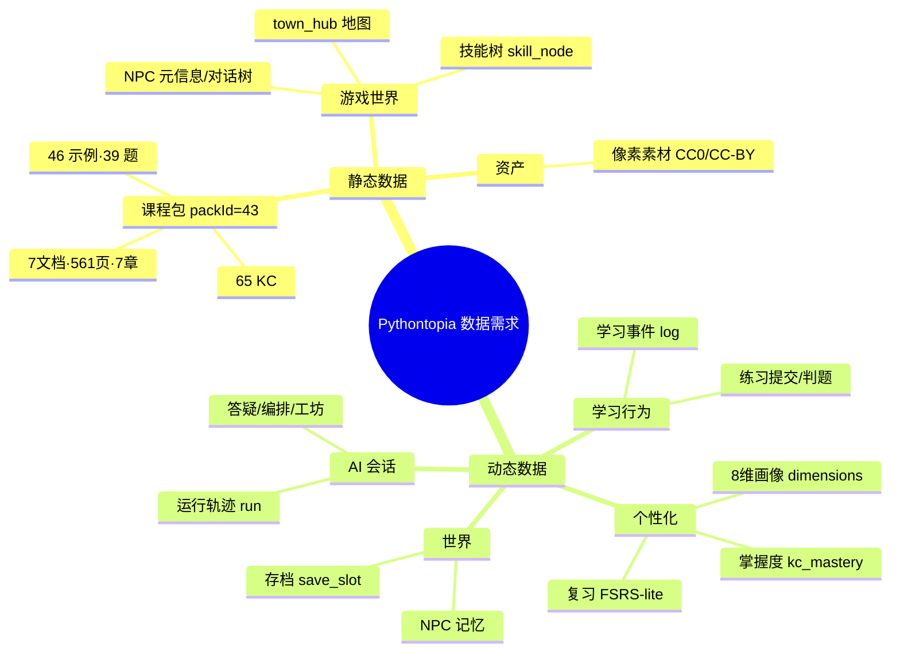
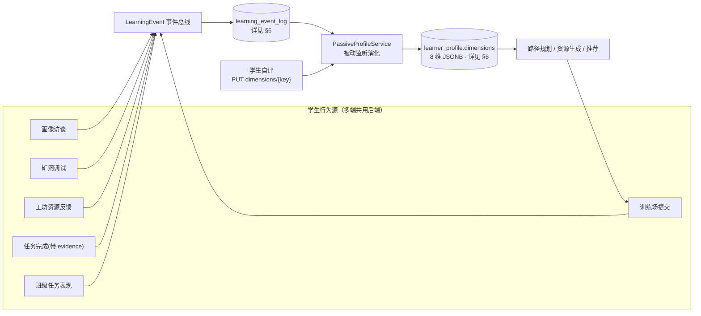
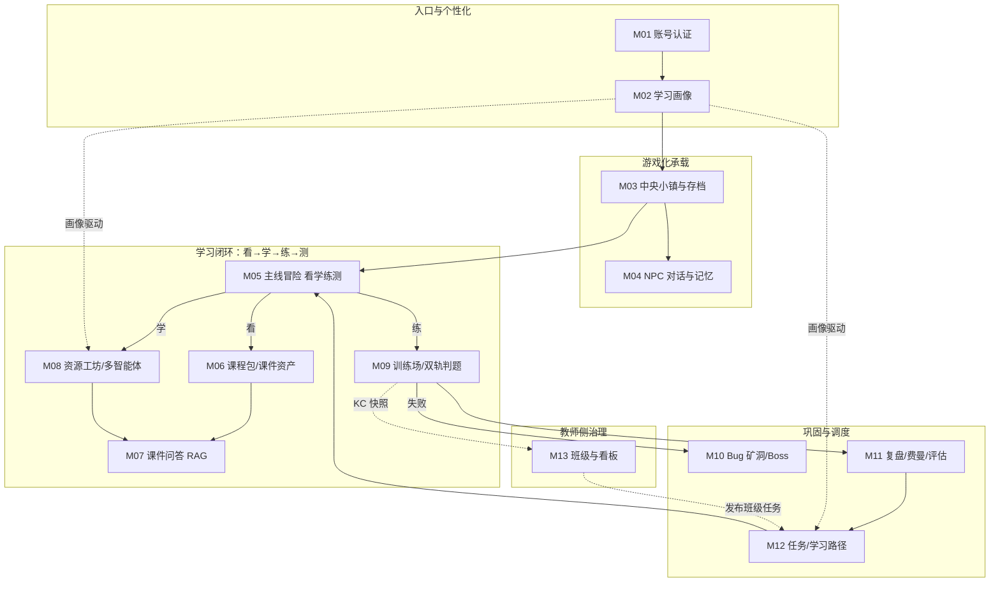
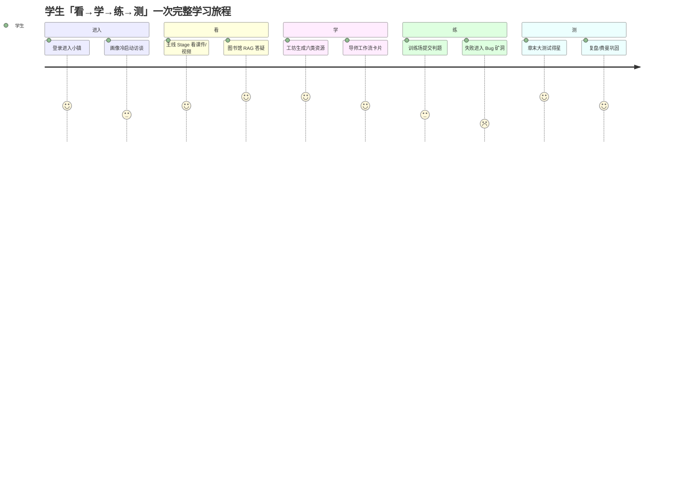
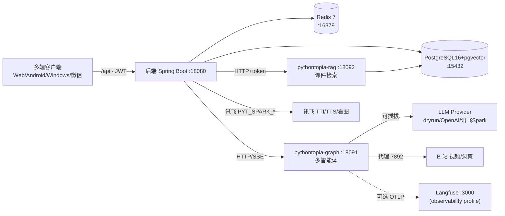

# 4 需求总览与数据需求

> 本章 filecode：**C04**。本文件对应 PDF 报告第 4 章的总览部分，覆盖 **4.1 数据需求、4.2 总体功能模块框架、4.3 性能需求、4.4 界面需求、4.5 接口需求、4.6 其他需求**。
> 说明：**4.2 各功能模块的详细用例（用例图、基本/扩展路径、字段列表等）拆分在 `04-MXX` 系列文件**（R01–R13），本文件只做「13 模块总览 + 用例索引 + 阅读引导」，不重复展开单模块用例。
> 数据表的**完整字段字典统一在第 6 章（D1–D4）出现一次**，本章引用表名时一律写「详见 §6」，不再罗列字段。

---

## 4.0 引言

Pythontopia 是一款**面向高校 Python 初学者的多端像素学习小镇「第二课堂」**。它要解决的核心问题是：在大班统一进度教学下，那些「翘课 / 跟不上 / 坚持不下去」的学生，缺少一个课外可达、能按自己节奏「看→学→练→测」的补位学习场。系统以 Alethicode `packId=43`《Python 语言基础》为唯一课程知识底座（7 份文档、561 页、7 章、65 个 KC、46 个示例、39 道题），通过 8 维学习画像、多智能体资源生成、课件 RAG 答疑、游戏化主线任务和真实判题，为每个学生生成个性化学习资源并规划学习路径。

需求分析以「教育优先、游戏承载」为基本立场：所有玩法都必须服务画像建模、路径规划、资源生成、练习评估与班级教学，不引入与教育目的无关的装饰系统。本章从**数据**与**功能**两个维度给出系统级需求总览，并约束性能、界面、接口与其他非功能需求，为后续概要设计（第 5 章）与详细设计（第 8 章）提供输入。

需求边界遵循 R-14「世界收缩方案 A」：废弃早期「5 图分块大世界 + 农场 / 作物 / 货币 / 商店」设定，收敛为**单一中央小镇 `town_hub`**，主线与所有学习入口收进 hub；与之相关的农场、播种、浇水、经济、商店等表与玩法已在数据库中 DROP（详见 §6 附录「已弃用 / 历史遗留表」），本章需求不再覆盖这些被移除的能力。

---

## 4.1 数据需求

Pythontopia 的数据可分为两大类：一类是**静态数据**（系统出厂即内置、运行期基本只读的课程与世界配置），另一类是**动态数据**（伴随学生学习行为持续产生、累积与演化的业务数据）。二者共同沉淀进 PostgreSQL 16 + pgvector（库名 `pythontopia`），向量数据用于课件检索与记忆召回，Redis 7 承担缓存与限流。

### 4.1.1 静态数据（课程包 / NPC / 地图 / 技能）

静态数据是系统运行的「知识与世界底座」，在初始化阶段由种子脚本一次性导入，运行期对学生只读。其核心是课程包 `packId=43`，配套世界 NPC、地图与技能树等游戏化承载层。

**表 C04-1 静态数据清单**

| 数据域 | 内容 | 规模 / 关键约束 | 来源载体 | 落库（详见 §6） |
| --- | --- | --- | --- | --- |
| 课程包元信息 | 《Python 语言基础》课程包 | `packId=43`、`primary_language=Python3`、`status=published` | `data/course-pack-43/json/course_pack.json` | `course_pack` |
| 课件文档 | 7 份章节 PPTX→PDF 预览 | 7 份、合计 561 页（45/73/98/74/105/50/116） | `json/course_document.json` | `course_document` |
| 章节 | 课程 7 章结构 | 7 章 | `json/course_chapter.json` | `course_chapter` |
| 课件页 | 文档逐页内容/页码 | 561 页 | `json/course_page.json` | `course_page` |
| 知识点 KC | 学习/掌握/出题最小单元 | 65 个 KC（含前置依赖关系） | `json/course_kc.json` | `course_kc` |
| 示例 | 课件配套代码示例 | 46 个 | `json/course_example.json` | `course_example` |
| 题目 | 课程题库 | 39 道 | `json/course_problem.json` | `course_problem` |
| 主线练习/OJ | 主线派生的练习题与 OJ 目录 | 派生数据 | `derived/practice_questions.json`、`derived/oj_catalog.json` | `mainline_practice_question`、`mainline_oj_catalog` |
| 教学视频清单 | 章节配套视频（含时长/章号） | `video_manifest.json` 多条 | `data/course-pack-43/video_manifest.json` | `media_asset` / 静态清单 |
| NPC 静态数据 | NPC 元信息与对话树 | `data/npcs/<key>/{meta,dialog}.json`，构建期同步到前端 | `frontend/public/data/npcs/` | `npc_persona`（人设落库） |
| 地图 | 单一中央小镇 `town_hub` Tiled JSON | 程序化生成，单图 ≤ 50×40 | `frontend/public/assets/maps/`（`scripts/generate-maps.mjs`） | 前端静态资源（不入业务库） |
| 技能树 | 学习技能节点定义 | 程序化/迁移种子 | DB 迁移 | `skill_node`、`learner_skill` |
| 像素素材 | CC0/CC-BY/CC-BY-SA/OFL 审计资产 | 见 `LICENSE-ART.md` | `frontend/public/assets/pixel/` | 前端静态资源 |

> **课程包验收口径（强制）**：初始化后必须可验证「7 份文档、561 页、7 章、65 个 KC、46 个示例、39 道题」，其中文档页数分布为 45 + 73 + 98 + 74 + 105 + 50 + 116 = 561。该口径来自 `data/course-pack-43/json/course_pack.json` 真实字段，是全报告统一引用的课程规模事实。

【配图检索 IMG-C04-1】
> - 搜索关键词：「pixel town map top-down」「stardew-style tileset CC0」「pixel village asset」
> - 用途：放在 4.1.1 地图小节，示意 `town_hub` 单一中央小镇的俯视像素地图风格
> - 授权要求：CC0 / CC-BY / 可商用（与 `LICENSE-ART.md` 一致）

### 4.1.2 动态数据（提交 / 事件 / 画像 / 会话 / 存档）

动态数据由学生的真实学习行为驱动产生，是个性化（画像演化、路径重排、资源生成、掌握度更新）的事实来源。这类数据强调**可追溯、可复算、防幻觉**：所有 AI 生成资源必须保存运行轨迹（run id、agent name、输入摘要、输出制品、证据页码、安全与 grounding 结果、创建时间），任务完成必须携带 evidence（submission_id / resource_id / page_read_id / kc_mastery_delta）。

**表 C04-2 动态数据清单**

| 数据域 | 触发动作 | 关键内容 | 落库（详见 §6） |
| --- | --- | --- | --- |
| 练习提交与判题 | 学生在训练场/主线练习正式提交代码 | 源码、语言、判题状态（AC/WA/TLE/RE/CE…）、用例结果 | `practice_submission`、`judge_result`、`debug_case`、`pyodide_execution` |
| 学习事件 | 看课件/答题/对话/调试等行为 | 事件类型、载荷、时间，驱动被动画像演化 | `learning_event_log` |
| 学习画像 | 访谈 + 被动事件聚合 | 8 维 `dimensions`(JSONB)、访谈、修订历史 | `learner_profile`、`profile_interview`、`profile_revision` |
| 掌握度 | 判题/复习反馈 | 每 KC 掌握度与变更事件 | `kc_mastery`、`kc_mastery_event` |
| 复习状态 | FSRS-lite 调度 | 每 KC 复习节奏、到期 | `kc_review_state` |
| 会话（AI） | 答疑/编排/工坊对话 | 会话/卡片/动作事件/工具调用 | `tutor_session`、`tutor_workflow_session/card`、`workshop_chat_turn`、`loop_run`、`browse_run/step` |
| 世界存档 | 移动/能量/日历/技能 | 玩家状态、世界会话、能量、日历、技能进度、主线存档 | `player_state`、`world_session`、`world_session_energy`、`world_calendar`、`save_slot`、`main_quest_save_state` |
| NPC 记忆 | 与 NPC 多轮对话 | 对话状态、记忆、亲密度 | `npc_dialog_state`、`npc_memory`、`npc_affinity` |
| 资源工坊 | 生成六类学习资源 | 资源制品、运行轨迹、反馈、预防包、上传分块 | `learning_resource`、`resource_run`、`resource_feedback`、`prevention_pack`、`workshop_upload(_chunk)` |
| 矿洞 / 远征 / Boss | 失败提交触发调试支线 | 矿洞会话/卡片、远征运行、Boss 尝试 | `bug_mine_session/card`、`expedition_run`、`boss_attempt` |
| 复盘 / 费曼 / 评估 | 费曼自测、周度评估 | 复盘会话/轮次、学习者评估与指标 | `feynman_session/turn`、`learner_evaluation(_metric)` |
| 任务 / 路径 | 领任务、规划路径 | 任务与进度（带 evidence）、学习路径与节点 | `quest`、`quest_progress`、`learning_path(_node)` |
| 班级 | 建班/发任务/看板 | 班级、成员、班级任务、KC 快照 | `classrooms`、`classroom_members`、`classroom_quest`、`classroom_kc_snapshot` |
| 记忆向量 | 长期记忆嵌入 | 记忆 embedding（pgvector） | `memory_embedding` |
| 多端下载统计 | 客户端下载 | App 下载计数 | `app_download_stat` |

**图 C04-1 静态数据 / 动态数据分类**



### 4.1.3 数据词典

本章不展开字段级数据词典。**所有业务表的字段、类型、约束、PK/FK/索引、来源 migration 详见 §6 数据库设计（D1–D4 分片）**。其中：账号 / 画像 / 世界 / NPC 表见 §6（D1）；课程主线 / 答疑表见 §6（D2）；工坊 / 判题 / 挑战表见 §6（D3）；复盘 / 任务 / 班级及杂项、已弃用表见 §6（D4）。本章及第 5、8、9、10 章引用任一表时，统一以「详见 §6 表 `xxx`」指向，避免重复定义与口径漂移。

### 4.1.4 数据采集来源

个性化要求画像「不得只根据一次问卷做静态推荐」，因此数据采集是**多源、持续、被动为主**的。学生的几乎每一个有意义动作都会以 `LearningEvent` 形式入 `learning_event_log`，由 `PassiveProfileService` 监听并增量更新 8 维画像；学生还可通过 `PUT /api/learner/profile/dimensions/{key}` 主动自评 4 个主观维度。

**表 C04-3 数据采集来源**

| 采集来源 | 触发入口（端点/页面） | 落地数据 | 主要服务于 |
| --- | --- | --- | --- |
| 对话访谈 | 画像访谈 `ProfileInterviewController` / ProfileInterview 页 | `profile_interview` → `learner_profile` | 冷启动画像 |
| 练习提交 | `POST /api/submissions`（训练场） | `practice_submission` | 实践能力、易错模式 |
| 判题结果 | `judge_result`（服务端沙箱） | 掌握度、易错点 | 掌握度演化 |
| Bug 调试 | `BugMineController` / 矿洞 | `bug_mine_session` | 易错模式、坚持度 |
| 资源反馈 | 工坊资源点评 `resource_feedback` | 反馈记录 | 学习偏好 |
| 任务完成 | `QuestController`（带 evidence） | `quest_progress` | 学习目标、坚持度 |
| 班级表现 | 班级任务 / KC 快照 | `classroom_kc_snapshot` | 班级教学诊断 |
| 被动事件 | 各页学习行为 → `LearningEvent` | `learning_event_log` | 全维被动演化 |
| 主观自评 | `PUT /api/learner/profile/dimensions/{key}` | `dimensions` 4 主观维 | 认知风格/偏好/目标/情绪 |

**图 C04-2 数据采集与画像演化流程**



> 设计约束：被动演化与主观自评写入同一 `dimensions` JSONB（8 个英文 snake_case key），由 `PassiveProfileService` 统一聚合，确保画像是「过程证据」而非「一次问卷」。

---

## 4.2 功能需求总览

> 本节为系统功能的**总览与索引**。每个模块的详细功能需求（用例图、用例规约、字段列表）见对应 `04-MXX` 文件（filecode R01–R13）。

Pythontopia 后端按领域包 `com.pythontopia.*` 划分，前端按页面/组件组织，外加两个 Python 微服务（`pythontopia-graph` 多智能体、`pythontopia-rag` 课件检索）。整体功能收敛为 **13 个功能模块**，覆盖「账号→画像→世界→NPC→主线看学练测→课程资产→RAG 答疑→资源工坊→训练判题→矿洞挑战→复盘评估→任务路径→班级看板」的完整学习闭环。

### 十三模块总览

**表 C04-4 功能模块总览（13 模块）**

| 模块 | 名称 | 核心职责 | 后端包 `com.pythontopia.*` | 代表前端页面 | UC 段 / 详见 |
| --- | --- | --- | --- | --- | --- |
| M01 | 账号认证与权限 | 注册/登录/令牌刷新、角色鉴权 | `auth` | LoginPage / RegisterPage | UC-01-xx（R01） |
| M02 | 学习画像与个性化 | 8 维画像、被动演化、决策玻璃盒、推荐 | `learner.profile/decision/oracle/twin/memory/probe/recommendation/event/mastery` | ProfilePage / ProfileRoomPage | UC-02-xx（R02） |
| M03 | 中央小镇世界与存档 | town_hub 加载、移动、能量、日历、技能、存档 | `world(.calendar/.save/.skill)` | WorldPage / WorldCanvas / HudShell | UC-03-xx（R03） |
| M04 | NPC 对话与记忆 | NPC 对话树、人设、记忆、亲密度 | `npc`、`dialog`、`world.npc` | DialogTree / CompanionDock | UC-04-xx（R04） |
| M05 | 主线冒险·看学练测 | 主线 Stage、看/学/练、章末大测试、星级 | `mainline(.practice/.test)` | MainlineMapPage / StageLearnPage / ChapterTestPage | UC-05-xx（R05） |
| M06 | 课程包与课件资产 | 课程包/文档/页/示例、PDF 渲染、视频洞察 | `coursepack`、`courseware`、`video`、`media` | LibraryPage / LecturePage | UC-06-xx（R06） |
| M07 | 课件问答与导师答疑(RAG) | 证据锚定 RAG、导师工作流卡片 | `tutor`、`rag` + `pythontopia-rag` | TutorPanel / CoursewareEvidence | UC-07-xx（R07） |
| M08 | 资源工坊与多智能体编排 | 六类资源生成、SSE 编排、上传检索、闭环 | `workshop`、`orchestrator`、`agent.run`、`browse`、`loop`、`intent` + `pythontopia-graph` | WorkshopPage / WorkshopChat / MindMapView | UC-08-xx（R08） |
| M09 | 训练场与判题·双轨 | Pyodide 预览 + 服务端沙箱判题、提交入库 | `submission`、`mainline.practice` | TrainingPage / PythonCodeEditor / JudgeResultPanel | UC-09-xx（R09） |
| M10 | Bug 矿洞·无尽·Boss | 失败触发调试支线、远征、Boss 出题 | `bugmine`、`world.boss` | BugMinePage / EndlessPage / BossPage | UC-10-xx（R10） |
| M11 | 复盘·费曼·学习评估 | 复盘闭环、费曼自测、周度评估叙事 | `feynman`、`learner.reflection/evaluation` | ReviewHallPage / FeynmanPage | UC-11-xx（R11） |
| M12 | 任务公告板与学习路径 | 任务领取（evidence 校验）、路径规划/重排 | `learner.quest`、`learner.path` | BoardPage / PathTreeTab | UC-12-xx（R12） |
| M13 | 轻量班级与教师看板 | 建班/加入/发任务、KC 热力图、补救 | `classroom(.dashboard/.quest/.remediation/.live)` | TeacherPage / KcHeatmap | UC-13-xx（R13） |

> 全后端共 ~72 个 `*Controller`，统一前缀 `/api`、JWT Bearer 鉴权；上表「后端包」仅列代表包，完整端点以各 `04-MXX` 模块文件中「字段列表 / 接口」一节为准（该节据真实 `@GetMapping/@PostMapping` 路径撰写）。

### 模块关系与分层框架

13 模块并非平级罗列，而是围绕「**看→学→练→测**」主线学习闭环分层协作：账号与画像是入口与个性化底座；世界与 NPC 是游戏化承载；主线、课程资产、RAG、工坊、训练判题构成学习闭环主体；矿洞、复盘、任务路径是巩固与调度支线；班级看板是教师侧治理。

**图 C04-3 总体功能模块框架（分层）**



**图 C04-4 学习闭环主旅程（学生视角）**



### 用例总览与索引

每个模块至少含 2 个用例（学生侧 + 教师/管理员侧；单角色模块亦保证 ≥2 个用例动作），用例编号规则 `UC-<两位模块号>-<两位序号>`。下表为系统级用例索引，完整用例规约（基本/扩展路径、字段列表、设计规则）见各 `04-MXX`。

**表 C04-5 用例总览索引（节选代表用例，完整见各 04-MXX）**

| 用例号 | 用例名 | 执行者 | 模块 | 详见 |
| --- | --- | --- | --- | --- |
| UC-01-01 | 学生注册账号 | 学生 | M01 | R01 |
| UC-01-02 | 登录并签发 JWT | 学生/教师/管理员 | M01 | R01 |
| UC-02-01 | 完成画像访谈 | 学生 | M02 | R02 |
| UC-02-02 | 自评主观画像维度 | 学生 | M02 | R02 |
| UC-03-01 | 进入 town_hub 并加载存档 | 学生 | M03 | R03 |
| UC-04-01 | 与 NPC 多轮对话（记忆召回） | 学生 | M04 | R04 |
| UC-05-01 | 主线 Stage 看学练 | 学生 | M05 | R05 |
| UC-05-02 | 提交章末大测试得星 | 学生 | M05 | R05 |
| UC-06-01 | 浏览课件/视频资产 | 学生 | M06 | R06 |
| UC-07-01 | 课件 RAG 证据问答 | 学生 | M07 | R07 |
| UC-08-01 | 工坊生成学习资源 | 学生 | M08 | R08 |
| UC-09-01 | 训练场双轨判题 | 学生 | M09 | R09 |
| UC-10-01 | 失败提交触发 Bug 矿洞 | 学生 | M10 | R10 |
| UC-11-01 | 费曼自测复盘 | 学生 | M11 | R11 |
| UC-12-01 | 领取任务并提交 evidence | 学生 | M12 | R12 |
| UC-13-01 | 教师建班并发布班级任务 | 教师 | M13 | R13 |
| UC-13-02 | 教师查看 KC 热力图 | 教师 | M13 | R13 |

**图 C04-5 关键需求关系（requirementDiagram）**

```mermaid
requirementDiagram
  requirement REQ_Personalize {
    id: 1
    text: "按 8 维画像生成个性化资源与路径"
    risk: high
    verifymethod: test
  }
  requirement REQ_AntiHallucination {
    id: 2
    text: "生成内容须证据锚定且过三审"
    risk: high
    verifymethod: test
  }
  requirement REQ_RealJudge {
    id: 3
    text: "正式提交走服务端沙箱并入库"
    risk: medium
    verifymethod: test
  }
  functionalRequirement FR_ProfileEvolve {
    id: 1.1
    text: "被动事件驱动 dimensions 更新"
    risk: medium
    verifymethod: test
  }
  functionalRequirement FR_EvidenceRAG {
    id: 2.1
    text: "RAG 回答带课件页码引用"
    risk: high
    verifymethod: test
  }
  element MOD_M02 { type: "module" }
  element MOD_M07 { type: "module" }
  element MOD_M09 { type: "module" }
  REQ_Personalize - contains -> FR_ProfileEvolve
  REQ_AntiHallucination - contains -> FR_EvidenceRAG
  MOD_M02 - satisfies -> FR_ProfileEvolve
  MOD_M07 - satisfies -> FR_EvidenceRAG
  MOD_M09 - satisfies -> REQ_RealJudge
```

> 图例：`REQ_Personalize`=个性化学习、`REQ_AntiHallucination`=防幻觉、`REQ_RealJudge`=真实判题；`FR_ProfileEvolve`=画像演化、`FR_EvidenceRAG`=证据 RAG；`MOD_M02/M07/M09` 分别对应学习画像 / RAG 答疑 / 训练判题模块。

---

## 4.3 性能需求

性能需求服务于「演示稳定可达 + 课外随时可用」，部署基线为阿里云 ECS（2 核 4G / 40G，Ubuntu 22.04），生产与演示默认**单 worker**，避免进程内状态错乱。

### 4.3.1 时间特性需求

**表 C04-6 时间特性需求**

| 场景 | 指标 | 目标值 | 依据 / 备注 |
| --- | --- | --- | --- |
| 普通 REST 接口（鉴权/查询） | P95 响应 | ≤ 1.5 s | 单实例、JPA 直连 |
| 登录/注册 | 响应 | ≤ 2 s | JWT 签发 |
| town_hub 首屏 | 资产加载完成 | ≤ 150 s（2C4G 压测放宽） | 首屏 ~29MB 像素资产，E2E 用 150s 上限并以 retries 兜底 |
| RAG 查询 | 端到端 | ≤ 120 s | E2E `submit` 解禁上限 120 s（含降级回退） |
| AI 编排/工坊单回合 | 流式结束 | ≤ 240–300 s | SSE 流式；E2E 回合上限 240–300 s |
| 训练场正式提交 | 判题返回 | ≤ 90 s | 服务端沙箱；判题面板出现上限 90 s |
| 训练场限流 | 同账号正式提交 | 10 s 内仅 1 次 | 后端按设计限流，超出返回 429 |

> 上述上限取自 E2E 验收脚本（`frontend/e2e/publicAcceptance.spec.ts`）的真实超时阈值，是「可演示」而非「理想态」口径；正常网络下绝大多数交互远快于上限。

### 4.3.2 适应性与可靠性需求

- **降级兜底**：LLM Provider 可插拔（dryrun / OpenAI 兼容 / 讯飞 Spark），缺密钥自动降级 golden 兜底；讯飞文生图/TTS/看图答疑缺密钥时回落本地占位，**不阻塞主链路**（fail-soft）。
- **防幻觉 fail fast**：Agent 输出必须结构化，故障须 fail fast，不静默降级成普通聊天；生成内容末端经 GroundingCritic / Hallucination / Safety 三审。
- **双轨一致性**：Pyodide 前端预览结果**不入正式判分**，正式结论以服务端判题为准。
- **可观测性可选**：Langfuse 自托管为可选 profile，缺省 no-op，对主链路零影响。
- **多端一致**：4 端（Web/Android/Windows/微信）共用同一后端契约，行为一致。

---

## 4.4 界面需求

界面遵循「游戏画布之外的学习内容必须可读、可复制、可引用」的硬约束：像素小镇承载导航与沉浸感，学习正文（课件、资源、答疑、判题反馈）以常规可读 DOM 呈现，便于复制与引用证据页码。前端为 Vue 3 + Vite SPA，游戏渲染 Phaser 3（单 `Phaser.Game` 实例，经 `WorldCanvas.vue` 挂载）。

**表 C04-7 主要界面（页面/路由）清单**

| 路由 | 页面 | 角色 | 关键交互 |
| --- | --- | --- | --- |
| `/login` | 登录页 | 游客 | 登录、快速体验演示学生 |
| `/register` | 注册页 | 游客 | 注册学生/教师（邀请码） |
| `/world` | 中央小镇 | 学生 | Phaser 画布、HUD、伴学向导（G） |
| `/mainline-map` | 主线地图 | 学生 | 章节节点、进入 Stage |
| `/mainline/stage/:id` | Stage 学习页 | 学生 | 看/学/练三件套 |
| `/library` | 图书馆 | 学生 | 课件浏览、RAG 证据问答 |
| `/workshop` | 百晓工坊 | 学生 | 六类资源生成、SSE 流式对话 |
| `/training` | 训练场 | 学生 | CodeMirror 编辑、双轨判题 |
| `/review-hall` | 复盘大厅 | 学生 | 复盘/费曼/评估 |
| `/profile` | 个人画像 | 学生 | 8 维画像、决策玻璃盒、周报 |
| `/guide` | 使用指南 | 学生 | 锚点导航、配图放大 |
| `/teacher` | 教师工作台 | 教师 | 班级、KC 热力图、看板 |

界面需求要点：① 除 `/login`/`/register` 外受保护页未登录访问应被守卫重定向到 `/login`；② 深链直开与刷新不白屏、不 404、会话保持；③ 错误渲染面**不泄密**（不暴露 Java/Python 堆栈、内部主机名、端口、默认口令、JWT）；④ 移动端无横向溢出、核心内容可见；⑤ 像素风首次进镇引导弹层可关闭、不长期遮挡 HUD。

【截图占位 SC-C04-1】
> - 访问：http://localhost:5173/world（容器态 http://localhost:8080）
> - 登录角色：学生（除 /login 外均需登录）
> - 操作步骤：1. 快速体验登录 2. 等待 town_hub 画布与 HUD 加载 3. 按 G 打开伴学向导
> - 截取对象：中央小镇主城画布 + HUD + 伴学向导浮层
> - 期望画面：像素小镇渲染完成，HUD 与 AI 向导入口可见

---

## 4.5 接口需求

### 4.5.1 硬件接口

Pythontopia 是 B/S + 多端原生架构，对硬件的直接依赖通过运行平台抽象：

| 硬件 | 接口形式 | 用途 |
| --- | --- | --- |
| 显示 / GPU | 浏览器 Canvas / WebGL（Phaser 3） | 像素世界渲染 |
| 键盘 / 鼠标 | DOM 事件（8 方向输入，写后端降为 4 向） | 角色移动、交互 |
| 触摸屏 | Touch 事件 / 移动端虚拟摇杆 | 移动端与多端操作 |
| 麦克风 / 扬声器 | 浏览器音频 API + 讯飞 ASR/TTS | 语音输入、朗读（缺密钥降级） |
| 服务器 | 阿里云 ECS 2C4G/40G | 后端 + 微服务 + DB 容器 |
| 多端设备 | Android(LibGDX)/Windows(MonoGame)/微信 | 各端原生渲染，共用后端 |

### 4.5.2 软件接口

后端统一对外 `/api`（`:18080`），对内编排两个 Python 微服务，并集成多家第三方/可选服务。所有第三方接口缺密钥时均有降级策略。

**表 C04-8 软件接口清单**

| 接口 | 形态 / 协议 | 入口 / 配置 | 缺失时行为 |
| --- | --- | --- | --- |
| LLM Provider | 可插拔（dryrun / OpenAI 兼容 / 讯飞 Spark） | `PYT_LLM_PROVIDER`、`OPENAI_*`/`LLM_*`、`PYT_SPARK_*` | 缺密钥降级 golden 兜底 |
| 讯飞 Spark · 文生图 TTI | HTTPS | `PYT_SPARK_IMAGE_URL`（v2.1/tti） | 回落本地占位图 |
| 讯飞 Spark · 看图理解 | WebSocket | `PYT_SPARK_IMAGE_UNDERSTANDING_URL`（imagev3） | 降级跳过 |
| 讯飞 Spark · 语音 ASR/TTS | HTTPS/WS | `MediaAsrController`/`MediaTtsController`、`PYT_SPARK_*` | 回落占位音频 |
| B 站视频 / 洞察 | HTTP（经代理） | `BilibiliVideoController`/`BilibiliInsightController`、`PYT_BILI_PROXY`（默认 `:7892`） | 检索失败降级 |
| graph 多智能体服务 | HTTP / SSE | `PYTHONTOPIA_SERVICES_GRAPHURL`（`:18091`） | 编排 fail fast |
| rag 课件检索服务 | HTTP（admin token） | `PYTHONTOPIA_SERVICES_RAGURL`（`:18092`）、`PYT_RAG_ADMIN_TOKEN` | 回退本地检索 |
| PostgreSQL + pgvector | JDBC / SQL | `PYT_DB_URL`（容器 `postgres:5432`，宿主 `:15432`） | 启动失败（核心依赖） |
| Redis | TCP | `:16379→6379` | 缓存/限流降级 |
| Langfuse 可观测性 | OTLP / REST（可选 profile） | `OTEL_EXPORTER_OTLP_ENDPOINT`、`LANGFUSE_*`（`:3000`） | 缺省 no-op，零影响 |
| 多端客户端契约 | REST / JWT Bearer | `docs/clients/api-contract.md` | — |

**图 C04-6 系统接口与外部依赖**



---

## 4.6 其他需求

- **安全与权限**：JWT Bearer 鉴权；角色分学生/教师/管理员（如训练场提交仅学生可访问，教师邀请码 `PYT_TEACHER_INVITE_CODE`）；错误响应不得泄露堆栈/主机名/口令/令牌。
- **防幻觉与诚信**：不得伪造课件页码、章节、题号、作者、教材内容；通识知识须显式标注「非课件来源」；不输出隐藏测试；不直接给可复制提交的完整答案（除非任务类型明确允许且受教师视角限制）。
- **数据合规**：演示/生产不得用纯前端假数据冒充真实业务数据；正式判题结果必须入库，Pyodide 预览不入正式判分。
- **资产授权**：仅用 CC0 / CC-BY 3.0/4.0 / CC-BY-SA 3.0 / OFL-1.1 已审计资产，不复制任何商业像素游戏官方素材；新增素材须同步 `LICENSE-ART.md` 与 `frontend/public/assets/pixel/LICENSE.md`；包装作品以 CC-BY-SA 3.0+ 发布，代码层 MIT。
- **国际化与语言**：界面与学习内容简体中文；代码、标识符、SQL、英文术语保留原文。
- **可维护性**：前端 TypeScript strict、禁业务层 `any`、Phaser 隔离在 adapter 层；后端 DTO + 校验 + 统一错误返回 + 测试；数据库 snake_case、迁移注明目的与不可逆风险。
- **可移植 / 多端**：4 端共用后端契约，原生端不复用 Web 端 Phaser/`tilemap.ts`/`frontend/src/api/*`；Android Beta 首发仅服务端判题。
- **演示链路稳定**：核心 6 服务 `docker compose up -d` 可一键起停；可观测性等可选能力以 profile 隔离，不影响核心演示。

---

> 本文件为第 4 章总览；4.2 各模块详细用例见 `04-MXX`（R01–R13），数据字典见 §6（D1–D4），概要设计见第 5 章。

---

**执笔人：成员 B ｜ 完成人（签名）：成员 B ｜ 审查人：成员 C ｜ 完成日期：2026-06-14**
