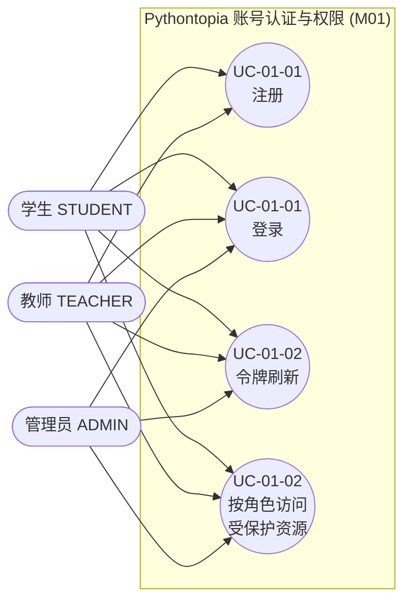
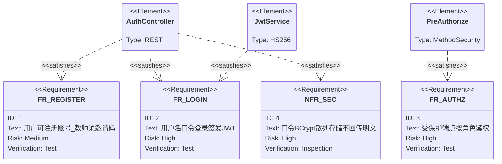

## 4.2.1 账号认证与权限 · 功能需求

M01 是 Pythontopia 的进入闸门：所有居民（学习者）在踏入中央小镇 `town_hub` 之前，必须先在本模块完成**注册**与**登录**，由后端签发 JWT 后才能携带令牌访问其余受保护功能。本模块对外只暴露三个端点，全部挂在 `com.pythontopia.auth.controller.AuthController`（统一前缀 `/api/auth`）之下：`POST /api/auth/register`（注册）、`POST /api/auth/login`（登录）、`POST /api/auth/refresh`（令牌刷新/续期）。系统采用**无状态（STATELESS）JWT Bearer** 鉴权，不维护服务端会话；角色用统一枚举 `Role` 表达，共三种：学生 `STUDENT`、教师 `TEACHER`、管理员 `ADMIN`（见 `auth.security.Role`）。前端对应页面为 `LoginPage.vue` / `RegisterPage.vue` 与表单组件 `LoginForm.vue` / `RegisterForm.vue`，会话状态由 Pinia `stores/session.ts` 持久化到 `localStorage`。账号实体落在数据表 `users`（迁移 `V010__auth_users_roles.sql` 建表，`V112__users_role_admin.sql` 扩展出 `ADMIN` 角色；完整字段字典见 §6 / D1 表 `users`，本节不再展开）。本模块不接入任何 Agent。

### 图 R01-1 模块用例图

> 说明：学生与教师均可经注册表单自助注册（教师须额外提交邀请码）；管理员账号不经公开注册表单创建，由部署/种子侧直接落库（见 §6 表 `users` 的 `role`），故 `ADMIN` 不连向「注册」用例。

### UC-01-01 注册与登录

- 功能简述：新用户提交用户名、口令、显示名、角色（学生/教师）等信息完成账号注册；已注册用户用「用户名 + 口令」登录，成功后获得 JWT 与用户档案，进入小镇。
- 用例编号：UC-01-01
- 执行者：学生 / 教师
- 前置条件：1. 后端 `:18080` 与数据库 `pythontopia` 就绪（前端登录页 `onMounted` 会先探活 `/healthz`）；2. 注册教师角色时已从管理方获得有效邀请码。
- 后置条件：成功：`users` 表新增一行（口令以 BCrypt 散列存储）；登录返回令牌写入 `localStorage`（键 `pythontopia.token` / `pythontopia.expiresAt` / `pythontopia.user`），跳转 `/world`。失败：不落库、不签发令牌，前端以中文 toast 提示。
- 涉众利益：学生：用最低门槛拿到课外学习入口；教师：以可信身份进入教学侧；管理员：通过角色与邀请码约束保证账号体系不被冒名注册。
- 基本路径：
  1. 用户在 `RegisterForm.vue` 填写用户名、显示名、口令、身份（学生/教师），可选填邮箱。
  2. 前端先做轻校验（用户名≥3、口令≥8、显示名非空）后 `POST /api/auth/register`。
  3. `AuthService.register` 校验 Bean Validation 约束；若 `role==TEACHER` 则比对邀请码。
  4. 以 `BCryptPasswordEncoder(10)` 加密口令并 `INSERT INTO users`，返回 `201 Created` + `UserDto`。
  5. 注册成功后前端自动以同一凭证 `POST /api/auth/login`。
  6. `AuthService.login` 按用户名查库、`matches` 校验口令，`JwtService.issue` 签发 HS256 JWT。
  7. 返回 `200` + `LoginResponse`，前端写入会话并 `router.push('/world')`。
- 扩展路径：
  - 2a. 字段不合法（如用户名含非法字符、口令短于 8 位）：返回 `400 VALIDATION_ERROR`，`details` 列出违规字段。
  - 3a. 教师邀请码缺失/不匹配：返回 `403 FORBIDDEN`「Invalid teacher invite code」。
  - 4a. 用户名或邮箱已存在（唯一约束冲突）：捕获 `DuplicateKeyException`，返回 `409 USERNAME_CONFLICT`「Username or email exists」。
  - 6a. 用户不存在或口令错误：返回 `401 BAD_CREDENTIALS`（用户不存在时仍执行一次「占位散列」比对以抵消时序侧信道）。
- 字段列表：注册入参 `username, password, displayName, role, email, teacherInviteCode`（`RegisterRequest`）；注册出参 `id, username, displayName, role`（`UserDto`，刻意不返回 `passwordHash / email`）；登录入参 `username, password`（`LoginRequest`）；登录出参 `token, expiresAt, user`（`LoginResponse`，`user` 为 `UserDto`）。
- 设计规则：用户名 `^[A-Za-z0-9_.-]+$` 且长度 3–64；口令长度 8–72（BCrypt 上限）；显示名禁含 `<`、`>`、`&`、`"`、`'`、反引号 等 HTML 元字符以防跨端 XSS；邮箱格式校验且 ≤128；`users.username` 与 `users.email` 唯一；口令仅存散列，绝不回传明文。
- 未解决的问题：当前未提供「找回口令 / 改密 / 注销账户」端点；注册无图形验证码与频控（演示态可接受，生产需补）。
- 备注：登录页提供固定演示账号 `demo-stu-01 / P@ssw0rd1` 的「快速体验」按钮。

### UC-01-02 令牌刷新与按角色访问受保护资源

- 功能简述：已登录用户用未过期令牌向 `/api/auth/refresh` 换发新令牌实现续期；携带 JWT 访问受保护端点时，`JwtAuthenticationFilter` 解析令牌并注入 `ROLE_<role>` 权限，教师/管理员专属端点由 `@PreAuthorize` 做角色门。
- 用例编号：UC-01-02
- 执行者：学生 / 教师 / 管理员
- 前置条件：1. 已完成 UC-01-01 登录并持有有效 JWT；2. 访问的目标端点不在 `permitAll` 白名单内（`/api/auth/**`、`/api/course/**`、`/api/media/assets/**`、`/api/internal/**`、`/api/downloads/**`、`/healthz` 放行）。
- 后置条件：成功：刷新返回新 `token / expiresAt`，会话续期；受保护请求按角色放行并返回业务数据。失败：刷新/校验不通过返回 `401`，越权返回 `403`，前端 401 时统一 `logout` 并跳登录页。
- 涉众利益：学生：长时停留不被频繁踢下线；教师：仅教师/管理员能进班级看板等管理面；管理员：以最高角色覆盖教师可达的全部管理端点。
- 基本路径：
  1. 页面刷新时 `session.hydrateFromStorage()` 回灌本地令牌；若未过期则后台 `POST /api/auth/refresh` 续期。
  2. `AuthService.refresh` 调 `JwtService.parse` 校验签名与 `exp`，按 `sub/username` 重新查库并 `issue` 新令牌。
  3. 之后每个请求经 axios 拦截器自动附加 `Authorization: Bearer <token>`。
  4. 后端 `JwtAuthenticationFilter` 解析令牌，构造 `UsernamePasswordAuthenticationToken` 并写入 `SecurityContext`，权限为 `ROLE_STUDENT/ROLE_TEACHER/ROLE_ADMIN`。
  5. 命中教师/管理员端点（如 `POST /api/classrooms`、`MainlineDashboardController`）时由 `@PreAuthorize("hasAnyRole('TEACHER','ADMIN')")` 判定。
- 扩展路径：
  - 2a. 令牌过期或被篡改：`JwtService.parse` 抛 `JwtValidationException`，`refresh` 转换为 `401 REFRESH_TOKEN_INVALID`。
  - 3a. 未携带 / 无效令牌访问受保护端点：`authenticationEntryPoint` 返回 `401 UNAUTHORIZED`。
  - 5a. 角色不足（学生访问教师端点）：返回 `403 FORBIDDEN`，服务层另有归属校验（如 `ClassroomGuard`）作第二道防线。
- 字段列表：刷新入参 `token`（`RefreshRequest`）；刷新出参 `token, expiresAt, user`（`LoginResponse`）；JWT 载荷声明 `sub`(userId)、`username`、`role`、`exp`；运行期主体 `userId, username, role`（`CurrentUserPrincipal`）。
- 设计规则：令牌算法 HS256，默认有效期 `ttlMinutes=720`（12 小时）；密钥经 `PYT_JWT_SECRET` 注入、缺失则启动即失败；签名校验用常量时间比较；当前契约把 access token 兼作刷新来源，故须回传**未过期**令牌；前端 `isAuthenticated` 以本地 `expiresAt` 是否晚于当前时刻判定。
- 未解决的问题：无独立 refresh token 与黑名单/吊销机制，登出仅清前端本地态、服务端令牌在 `exp` 前仍有效；无多设备会话管理。
- 备注：SSE 端点（如 `/api/tutor/ask`）在 ASYNC 再分发时需要重新认证，`JwtAuthenticationFilter.shouldNotFilterAsyncDispatch()` 返回 `false` 以恢复上下文。

### 图 R01-2 需求关系（requirementDiagram）

---

执笔人：成员 B ｜ 完成人（签名）：成员 B ｜ 审查人：成员 C ｜ 完成日期：2026-06-08
