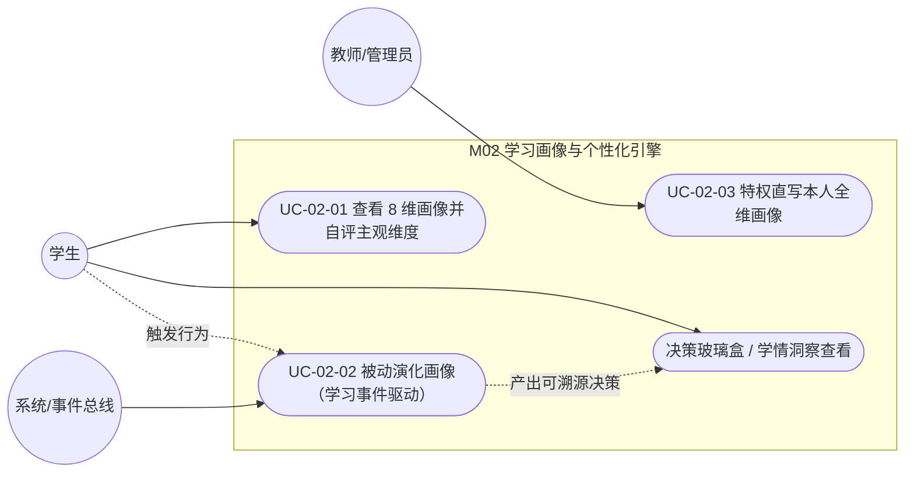

## 4.2.2 学习画像与个性化引擎 · 功能需求

> filecode：R02 ｜ 模块：M02 学习画像与个性化 ｜ 章节：报告 §4.2
> 本文图表编号统一以 `R02-` 前缀；引用数据表只写表名并指向「详见 §6 数据库设计」，不展开字段字典。

### 4.2.2.1 模块概述

M02 是 Pythontopia「个性化」的中枢：它为每名学生维护一份 **8 维学习画像**（`learner_profile.dimensions` JSONB，键为 `professional_background / knowledge_base / learning_goal / cognitive_style / learning_preference / error_pattern / practical_ability / emotion_persistence`），并通过 **被动画像演化**（`PassiveProfileService` 监听 `LearningEvent`）把练习、调试、资源消费、世界探针、答疑采纳等真实学习行为持续折叠进画像。画像不是一次问卷的静态快照：入学时由 `ProfileAgent` 访谈冷启动，之后随学动态更新（闭环），并经 **决策玻璃盒**（`DecisionTraceService`）向学生透明展示「AI 为什么这样推」。模块后端落在 `com.pythontopia.learner` 下的 `profile / decision / oracle / twin / memory / probe / recommendation / event / mastery` 等包；前端入口为 `/profile`（画像页：8 维雷达 + 自评）与 `/profile-room`（画像屋：访谈 + 数字孪生周报）；个性化指令由 Python 微服务 `pythontopia-graph` 的 `profile_agent`、`personalization` 承载。本模块定义 3 个用例，覆盖学生（查看/自评）、系统（被动演化）、教师/管理员（特权直写）三类执行者。

### 4.2.2.2 模块用例图

**图 R02-1　M02 用例图（执行者 × 用例）**



> 说明：Mermaid 无原生 UML 用例符号，本图以圆角节点表示用例、双圆节点表示执行者；虚线为「触发/派生」关系。`决策玻璃盒` 作为 UC-02-01/UC-02-02 的派生读视图，不单列完整用例模板。

### 4.2.2.3 用例规约

#### UC-02-01 学生查看 8 维画像并自评主观维度

- 功能简述：学生在画像页查看 8 维雷达快照，并对「主观维度」自评纠偏；认知风格走专门的三选一纠偏。
- 用例编号：UC-02-01
- 执行者：学生（STUDENT）
- 前置条件：1. 已登录且角色为学生；2. 已存在 `learner_profile` 行（入学访谈或首次学习后生成，否则雷达区为空、展示空状态引导）。
- 后置条件：成功：所选维度的 `score / evidence_count / tags / last_updated` 被更新并落库，返回更新后的维度子对象；失败：画像不变，返回业务错误码。
- 涉众利益：学生：纠正被误判的风格/偏好，让后续推送与资源更贴合自己；教师：获得更可信的学情底座；系统：减少冷启动误差。
- 基本路径：
  1. 学生进入 `/profile`，前端调用 `GET /api/learner/profile/dimensions` 取 8 维快照渲染雷达；
  2. 同时 `GET /api/learner/profile` 取结构化画像渲染维度卡片；
  3. 学生拖动某主观维度滑块（0–100），前端换算为相对当前分的 `scoreDelta`；
  4. 前端 `PUT /api/learner/profile/dimensions/{dimensionKey}` 提交增量（`source=INTERVIEW`）；
  5. 后端 `PassiveProfileService.applyDimensionUpdate` clamp 到 [0,1]、追加 `profile_revision` 审计，返回 `DimensionUpdateResult`；
  6. 前端回读 `/dimensions` 刷新雷达并提示「已更新」。
- 扩展路径：
  - 3a. 认知风格纠偏：学生在卡片选「先看图解/先读推理/先跑例子」→ 提交 `tagsAdd:[visual|logical|trial]`（带小 `scoreDelta/evidenceIncrement`），后端把该 tag 移到数组末尾使其成为主导信号；
  - 4a. 学生尝试写只读维度（`knowledge_base / error_pattern / practical_ability`）→ 返回 403 `PROFILE_DIMENSION_NOT_SELF_EDITABLE`；
  - 4b. 空增量提交（三者皆空）→ 返回 400 `PROFILE_DELTA_EMPTY`；
  - 1a. 画像不存在 → `GET /api/learner/profile` 返回 204，前端展示「画像尚未生成」空状态。
- 字段列表：`ProfileDimensionDto(key, label, score, confidence, evidenceCount, selfEditable, tags)`、`SelfDimensionRequest(scoreDelta, evidenceIncrement, tagsAdd, metadata)`、`DimensionUpdateResult(userId, dimensionKey, finalDimension)`（取自真实 controller/DTO）。
- 设计规则：① 学生只能直写 5 个主观维度 `SELF_EDITABLE_DIMENSIONS`，UI 用滑块呈现其中 4 个（`professional_background / learning_goal / learning_preference / emotion_persistence`），认知风格 `cognitive_style` 单独以三选一纠偏；② `confidence = min(1, evidence_count/8)`；③ 读取时按 14 天半衰期向中性 0.5 轻微回归（raw 分不写库）。
- 未解决的问题：自评滑块与被动信号可能短期相互覆盖，目前以「最近写入优先 + 读时 decay」缓解，未做冲突显式提示。
- 备注：画像页路由 `/profile`，需登录。

#### UC-02-02 系统被动演化画像（学习事件驱动）

- 功能简述：学生的真实学习行为以领域事件形式回流，系统将其映射为某一维度的小步增量，自动演化画像并留审计。
- 用例编号：UC-02-02
- 执行者：系统（进程内事件总线 `ApplicationEventPublisher`），由学生行为间接触发。
- 前置条件：1. 存在 `learner_profile` 行；2. 业务侧产生 `LearningEvent`（练习成功/失败、调试修复、资源/多模态消费、答疑采纳风格、世界探针、重试/放弃/逆袭等）。
- 后置条件：成功：对应维度 `score/tags/evidence_count` 增量更新，写 `profile_revision`（source 合法时）；失败/降级：捕获 `DataAccessException` 仅记 warn 日志，不阻断掌握度等下游链路。
- 涉众利益：学生：画像「越用越准」，无需反复填表；教师：基于行为而非自报的真实学情；系统：驱动推荐、答疑语气、资源因材施教。
- 基本路径：
  1. 学生完成一次行为（如训练场 AC、矿洞修复 Bug、看章节视频、画像屋探针选择）；
  2. 对应后端服务发布领域事件，或前端经 `POST /api/learning/events`（`media_consumed`）/ `POST /api/learner/probe` 触发；
  3. `PassiveProfileRevisionListener` 按事件类型选定维度与 `DimensionDelta(scoreDelta, evidenceIncrement, tagsAdd, metadata, source)`；
  4. `applyDimensionUpdate` 读 `dimensions` JSONB → 应用增量 → 写回 + 追加 `profile_revision`；
  5. 决策类行为同时写 `resource_run`，经 `GET /api/learner/decisions` 在决策玻璃盒可溯源展示。
- 扩展路径：
  - 3a. `source` 不在 `profile_revision` 枚举内 → 跳过审计写入但仍更新维度；
  - 2a. 探针 `(probeKey, choiceId)` 不在服务端 `ProbeCatalog` 内 → 返回 400 `PROBE_INVALID`（防伪造信号）；
  - 4a. `dimensions` 列缺失或读写异常 → 监听器降级，不抛出。
- 字段列表：`LearningEvent.{PracticeSucceeded, PracticeFailed, DebugResolved, ResourceConsumed, MediaConsumed, TutorStyleEngaged, ProbeChoiceMade, PracticeRetried, PracticeAbandoned, ComebackSolved, TaughtAiSucceeded/Failed}`、`DimensionDelta(...)`、`profile_revision(source, diff)`、`learning_event_log(event_type, payload, importance)`（详见 §6）。
- 设计规则：① 事件→维度映射固定（如 PracticeSucceeded→`practical_ability` +0.02、PracticeFailed→`error_pattern` +0.02 且 tag=failureKind、DebugResolved→`error_pattern` −0.02、ComebackSolved→`emotion_persistence` +0.04）；② 探针信号由服务端 `ProbeCatalog` 权威解析，客户端不可篡改；③ 每条更新可溯源（profile_revision.diff / learner_insight.evidence_event_ids）。
- 未解决的问题：增量步长为经验常量，尚未做按学生群体的自适应标定。
- 备注：依赖 `learning_event_log` 与 `resource_run`，详见 §6。

#### UC-02-03 教师 / 管理员直写本人全维画像

- 功能简述：教师或管理员对**本人**画像的全部 8 维做直写（用于教学演示、阈值校准与回归验证），不受学生主观维度白名单限制。
- 用例编号：UC-02-03
- 执行者：教师（TEACHER）/ 管理员（ADMIN）
- 前置条件：1. 已登录且角色为教师或管理员；2. 存在本人 `learner_profile` 行。
- 后置条件：成功：任一指定维度被直写并落审计；失败：返回业务错误码，画像不变。
- 涉众利益：教师：快速构造演示画像、核对因材施教效果；管理员：联调与阈值校准；学生：间接受益于更稳的策略参数。
- 基本路径：
  1. 教师/管理员登录后调用 `PUT /api/learner/profile/dimensions/{dimensionKey}`；
  2. 后端识别特权角色，跳过 `SELF_EDITABLE_DIMENSIONS` 白名单校验；
  3. `applyDimensionUpdate` 对任一合法维度（须属 8 维 key）应用增量并审计；
  4. 返回 `DimensionUpdateResult`。
- 扩展路径：
  - 3a. `dimensionKey` 不在 8 维 key 内 → 返回 400 `PROFILE_DIMENSION_INVALID`；
  - 1a. 角色为学生 → 退化为 UC-02-01 的主观维度白名单约束。
- 字段列表：`SelfDimensionRequest(scoreDelta, evidenceIncrement, tagsAdd, metadata)`、`DimensionUpdateResult(userId, dimensionKey, finalDimension)`、`Role{STUDENT, TEACHER, ADMIN}`。
- 设计规则：① 直写只作用于**调用者本人**画像，不能改他人；② 仍走同一 `applyDimensionUpdate`，clamp/审计一致；③ 教师/管理员不参与被动事件回流（被动演化仅对学生）。
- 未解决的问题：暂无面向教师的批量画像编辑界面，仅提供单维度接口。
- 备注：与 UC-02-01 共用同一端点，差异仅在权限分支。

### 4.2.2.4 非功能与约束需求

**图 R02-2　M02 需求关系图（requirementDiagram）**

```mermaid
requirementDiagram
  requirement 真实性 {
    id: 1
    text: "画像更新必须可溯源（profile_revision / evidence_event_ids），不贴无证据标签"
    risk: high
    verifymethod: test
  }
  requirement 防误判 {
    id: 2
    text: "学生可自评纠偏主观维度；置信度不足不注入下游 prompt"
    risk: medium
    verifymethod: test
  }
  requirement 可用性降级 {
    id: 3
    text: "无信号/冷启动时返回默认 0.5 与晴天，绝不阻塞玩家"
    risk: medium
    verifymethod: test
  }
  functionalRequirement 被动演化 {
    id: 4
    text: "LearningEvent 自动折叠进 8 维画像"
    risk: high
    verifymethod: demonstration
  }
  被动演化 - satisfies -> 真实性
  被动演化 - satisfies -> 可用性降级
  防误判 - satisfies -> 真实性
```

- 性能：`GET /dimensions` 为单行 JSONB 读取 + 内存派生，雷达加载应在常规网络下亚秒级返回；被动更新为单维度局部读改写，避免全画像重算。
- 安全与权限：除 `PUT /dimensions/{key}` 对教师/管理员放权外，画像/访谈/探针/洞察/决策端点均要求登录；学生仅能读写本人数据。
- 防幻觉红线：维度置信度 `<0.3`（情绪维 `<0.25`）不注入 `profile_brief`，洞察必须携带 `evidence_event_ids`，决策玻璃盒结论由 run 状态映射而非自由生成。
- 接口/界面：详见 M02 详细设计（见 S02 §8.5 接口设计与 §8.2–§8.4 图表）。

---

执笔人：成员 B ｜ 完成人（签名）：成员 B ｜ 审查人：成员 C ｜ 完成日期：2026-06-14
