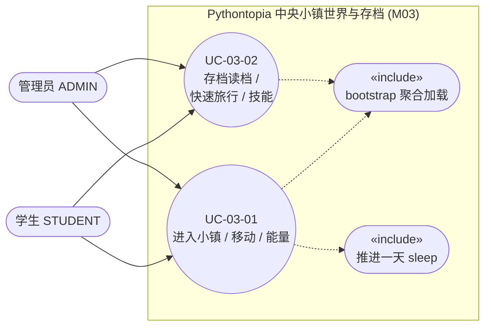
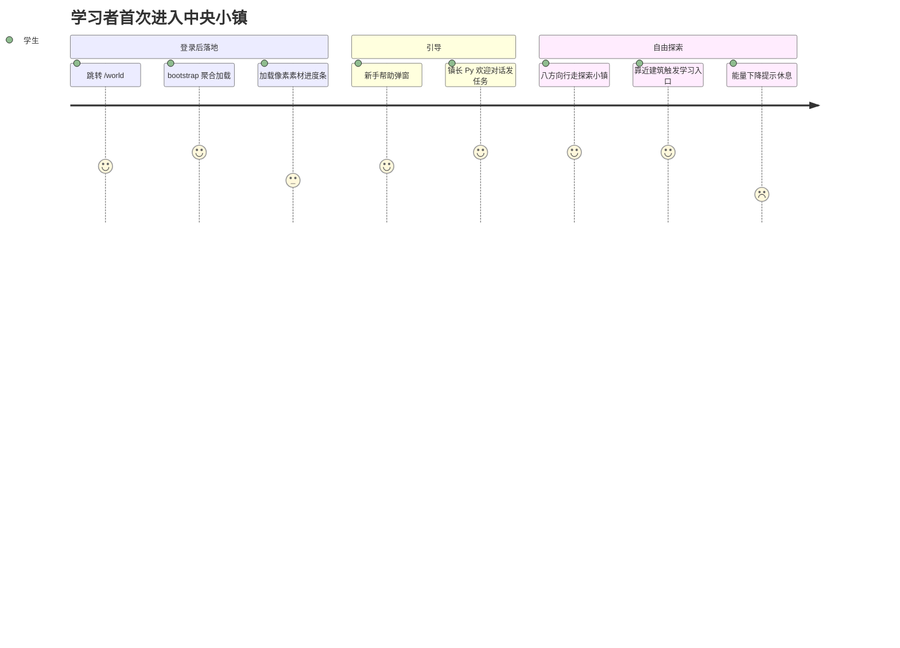

## 4.2.3 中央小镇世界与存档 · 功能需求

M03 是 Pythontopia 的「世界容器」：学习者登录后落地在唯一的中央小镇 `town_hub`（R-14 世界收缩方案 A，五图分块大世界已废弃，外围图保留素材但不作主线场景），在镇内以八方向像素小人行走、靠近 NPC 与建筑触发学习入口，并由后端权威地保存世界时钟、玩家坐标、技能树与存档槽。本模块对外的端点全部挂在 `com.pythontopia.world` 包下：进入小镇的聚合启动 `POST /api/game/bootstrap`（`GameBootstrapController`）；推进游戏内一天 `POST /api/world/sleep`（`WorldAdvanceController`）；会话与移动 `GET /api/world/session`、`PATCH /api/world/player`（`controller/WorldController`）；日历 `GET /api/world/calendar/today`、`GET /api/world/calendar/events`、`POST /api/world/calendar/events/{eventId}/process`（`calendar/CalendarController`）；存档 `GET /api/world/saves`、`POST /api/world/saves/{slotIndex}`、`POST /api/world/saves/{slotIndex}/activate`、`POST /api/world/saves/{slotIndex}/snapshot`（`save/SaveSlotController`）；技能 `GET /api/world/skills`、`POST /api/world/skills/{skillKey}/unlock`（`skill/SkillController`）。前端对应全屏沉浸页 `WorldPage.vue`，承载唯一 `Phaser.Game` 实例的 `WorldCanvas.vue`、HUD 套件 `HudShell.vue` 与 `FastTravelPanel.vue`，状态由 Pinia `stores/world.ts`、`stores/calendar.ts`、`stores/skill.ts` 管理。世界状态落在 `world_session`、`player_state`、`npc_state`、`weather_state`、`save_slot`、`skill_node`、`learner_skill`、`world_event`、`world_festival`、`fast_travel_route` 等表（完整字段字典见 §6 / D1，本节只引用表名不展开）。本模块不直接调用任何 Agent，但通过 `sleep` 触发 `MasteryEvaluator` 遗忘衰减与 `PassiveProfileService` 画像演化，与 M02、M05 联动。

### 图 R03-1 模块用例图



> 说明：M03 是单角色（学习者）模块——`WorldService.requireStudent` 仅放行 `STUDENT` 与 `ADMIN`，`TEACHER` 不持有世界状态，访问返回 `403 FORBIDDEN`「Only students or admins have world state」，故用例图不连教师。两个用例均含「bootstrap 聚合加载」公共子流程，`sleep` 作为 UC-03-01 的可选扩展（玩家主动「睡觉」推进时钟）。

### UC-03-01 进入小镇、移动与能量

- 功能简述：学习者登录后进入 `/world`，前端一次性 `bootstrap` 水合世界、玩家、画像、任务、掌握度、技能与日历；玩家用 WASD/方向键/虚拟摇杆/手柄在 `town_hub` 行走，坐标节流回写后端；行走与各类学习动作按前端能量曲线消耗能量，过劳时触发功能性递降与「回家小睡」保护。
- 用例编号：UC-03-01
- 执行者：学生 / 管理员
- 前置条件：1. 已完成 M01 登录并持有有效 JWT；2. 后端 `:18080` 与数据库 `pythontopia` 就绪；3. `WorldCanvas` 已创建唯一 `Phaser.Game` 实例（`phaserGame.ts` 单例）。
- 后置条件：成功：`world_session` 与 `player_state` 行存在（缺失时由 `GameBootstrapService` 惰性创建，玩家默认 `tile_x=12, tile_y=10, direction=DOWN, map_key=town-beta`），玩家移动后 `player_state` 的坐标/朝向被 UPSERT 更新。失败：bootstrap 抛错时 `world store` 保持 `bootstrapped=false`，UI 显示降级欢迎页并以中文 toast 提示原因。
- 涉众利益：学生：一次往返即可进入可自由探索的学习小镇，不必逐项拉接口；管理员：能以学生视角巡检世界链路；教学侧：能量与过劳保护确保「第二课堂」不诱导通宵刷分，守住教育伦理底线。
- 基本路径：
  1. `WorldCanvas` 挂载时若 `world.bootstrapped===false` 调 `world.bootstrap()` → `POST /api/game/bootstrap`。
  2. `GameBootstrapService.bootstrap` 在单事务内 `ensureWorldSession`/`ensurePlayer` 惰性建行，再读 `game_bootstrap_view` 取 1:1 的 world+player 切片，并分别查 quests、mastery、path、skills、npcStates、activeSlot、pendingEvents 组装 `GameBootstrapResponse`。
  3. 前端 `applyBootstrap` 把 world+player 写入 `world store`，并分发 mastery/profile/path/quests 到 `learning`、skills 到 `skill`、calendar+events 到 `calendar`、npcStates 到 `npc` 各子 store。
  4. 玩家按键，`input.ts` 产出八方向意图（`ExtendedDirection`/`Direction8`），`WorldScene` 计算目标 tile 并以 `toCardinal` 降为四向朝向。
  5. `world.updatePlayerTile` 乐观更新本地 `player` 并按 500ms 节流 `flushPlayerUpdate` → `PATCH /api/world/player`。
  6. `WorldService.patchPlayer` 经 `requireStudent` 后 `WorldRepository.updatePlayer` 以 `ON CONFLICT (user_id) DO UPDATE` 写回坐标/朝向/`updated_at`，返回 `PlayerStateDto`。
  7. 行走/读课件/对话/提交等动作按 `energyTuning.config.ts` 的 `applyDelta` 在前端扣减能量，并据 `getStateForEnergy` 切换 normal/soft/harden/severe/zero 五档表现。
- 扩展路径：
  - 1a. 用户为 `TEACHER`：`requireStudent` 抛 `403 FORBIDDEN`，前端引导回教师工作台。
  - 2a. `game_bootstrap_view` 惰性建行后仍无行：抛 `500 BOOTSTRAP_VIEW_EMPTY`。
  - 5a. 250ms 内多次移动：节流合并，仅以最后一次 `pendingUpdate` 提交，降低写放大。
  - 7a. 能量降到 `severe`（<10）：禁奔跑/禁新对话、移动速度 ×0.7；能量 `zero`（=0）：弹「小睡一下吧」强制模态，引导走 UC-03-01 的 `sleep` 扩展或回家休息。
  - 7b. 单日连续在线超过过劳阈值（warn=120 / capDown=240 / forceQuit=360 真实分钟）：依次软提醒、锁 `energy_cap=80`、自动存档退出。
- 字段列表：bootstrap 出参 `world{worldSessionId,dayIndex,monthIndex,weekday,season,timeOfDay,weather,inGameMinutes}`、`player{playerStateId,avatarKey,mapKey,tileX,tileY,direction}`、`profile`、`quests[]`、`mastery[]`、`path[]`、`skills[]`、`npcStates[]`、`activeSlot`、`pendingEvents[]`（`GameBootstrapResponse`）；移动入参 `tileX, tileY, direction`（`PlayerStatePatch`，`direction` 受 `@Pattern` 约束为 8 向枚举）；能量字段 `energy, energy_cap, overwork_minutes`（`world_session` V115 列，见 §6 / D1）。
- 设计规则：单地图 `town_hub` 上限 50×40；`direction` 接受 `UP/DOWN/LEFT/RIGHT/UP_LEFT/UP_RIGHT/DOWN_LEFT/DOWN_RIGHT`（`player_state.direction` 为 `VARCHAR(16)`，V113），但 `WorldScene` 实际写后端前降为四向；`energy∈[0,100]`、`energy_cap∈[60,110]`、`overwork_minutes≥0`（DB CHECK 约束）；能量为前端权威配置，后端列为骨架，`world_session.energy/energy_cap` 目前仅由 `DialogContextService` 读取喂给 NPC 对话上下文（缺省 100/100），尚无 `consume/restore` 端点。
- 未解决的问题：能量的服务端权威写入端点（`/api/world/energy/*`）与 `EnergyService.applyDelta` 仍为骨架，能量字段未进入 `game_bootstrap_view`，刷新会以前端态为准；`inGameMinutes` 由 `sleep` 重置为 480，但镇内实时分钟推进尚未回写后端。
- 备注：`WorldPage` 首次进入会顺序播放新手帮助弹窗与镇长 `mayor_py` 欢迎对话（受 `onboardingHold` 压制探针卡，避免叠弹）。

### UC-03-02 存档读档、快速旅行与技能解锁

- 功能简述：学习者管理至多 6 个命名存档槽（创建/激活/写快照），由「唯一激活槽」约束保证任意时刻只有一个当前档；通过快速旅行面板在镇内地标间传送；当 KC 掌握度达阈值时在技能树解锁对应技能节点。
- 用例编号：UC-03-02
- 执行者：学生 / 管理员
- 前置条件：1. 已 bootstrap 进入小镇；2. 解锁技能前对应 KC 已通过 M09 训练场积累掌握度（`kc_mastery`）。
- 后置条件：成功：`save_slot` 新增/更新行，激活时分区唯一索引保证全表仅一行 `is_active=true`；快照通过 JSON 校验后落库；满足条件的技能在 `learner_skill` 落一行。失败：不满足解锁条件返回 `409 SKILL_LOCKED`，快照非法返回 `400`，超限返回 `413`。
- 涉众利益：学生：进度可备份/回看，探索路线更顺；管理员：可巡检存档与技能数据一致性；教学侧：技能树把「KC 掌握度」可视化为成长激励，强化看→学→练→测闭环。
- 基本路径：
  1. 玩家在存档界面 `GET /api/world/saves` 列出全部槽位。
  2. 选空槽 `POST /api/world/saves/{slotIndex}`（`slotIndex∈[0,5]`）提交 `displayName` 创建命名档。
  3. `POST /api/world/saves/{slotIndex}/activate` 激活目标槽，`SaveSlotRepository` 在事务内置其余槽 `is_active=false`、目标槽 `true`。
  4. 适时 `POST /api/world/saves/{slotIndex}/snapshot` 写入序列化后的 JSON 文本快照，`SaveSlotService.validateSnapshot` 校验为合法 JSON 对象且 ≤262144 字符。
  5. 玩家按 `T` 或点 minimap 打开 `FastTravelPanel`，选目标地标，前端更新 `world.player.mapKey/tileX/tileY` 并派发场景重建。
  6. 玩家在技能树点未解锁节点 `POST /api/world/skills/{skillKey}/unlock`。
  7. `SkillService.unlock` 取节点 `unlock_condition`（JSONB）与 `MasteryEvaluator.snapshots` 比对，满足则 `learner_skill` 落行并返回 `LearnerSkillDto`。
- 扩展路径：
  - 2a. `slotIndex` 越界（<0 或 >5）：`@Min/@Max` 校验返回 `400`。
  - 4a. 快照非 JSON 对象：返回 `400 SAVE_SLOT_SNAPSHOT_INVALID`；超 256KB：返回 `413 SAVE_SLOT_SNAPSHOT_TOO_LARGE`。
  - 6a. `skillKey` 不存在：返回 `404 SKILL_NOT_FOUND`；已解锁：幂等返回既有 `learner_skill` 行。
  - 7a. 解锁条件（`KC_MASTERY`/`ALL`/`ANY`）不满足：返回 `409 SKILL_LOCKED`。
- 字段列表：存档出参 `slotIndex, displayName, isActive, createdAt, lastPlayedAt, snapshot, sceneName, unlockedBuildings, accumulatedPlaySeconds, inventoryItems`（`SaveSlotDto`，见 §6 / D1 表 `save_slot`）；建档入参 `displayName`（`SaveSlotCreateRequest`，`@NotBlank @Size(max=64)`）；技能出参 `skillKey, unlockedAt, proficiency`（`LearnerSkillDto`）；技能节点 `skillKey, displayName, description, kcCodes, unlockCondition, iconUrl, tier`（`SkillNodeDto`）。
- 设计规则：每用户最多 6 槽（`slot_index∈[0,5]`），分区唯一索引 `uq_save_slot_active` 强制「唯一激活槽」；`proficiency∈[0,100]`、`tier∈[1,5]`（DB CHECK）；解锁条件 schema 支持 `{"type":"KC_MASTERY","kcCode","min"}` 与 `{"type":"ALL|ANY","conditions":[...]}` 递归组合，`ANY_TIME`/空条件恒真。
- 未解决的问题：快速旅行当前为前端静态实现——`FastTravelPanel` 直接改 `world store`、读 `@/data/fastTravel` 的 `FAST_TRAVEL_ROUTES`，**后端 `FastTravelService` 仅做纯校验且无 Controller**，且 `fast_travel_route` 种子在 R-14 收缩中已被 V131/V154 全量删除（单 hub 无外围目的地）；存档槽创建/快照尚无独立 UI 面板，目前主要经 API 与 bootstrap 的 `activeSlot` 自动同步；`save_slot.snapshot.mainQuest`（V120 约定，无独立表）在 R-15 后退役，主线进度改由后端权威 mainline 域承载。
- 备注：写快照的前端必须发送序列化后的 JSON 文本（后端以 `@RequestBody String` 接收并 `::jsonb` 落库）。

### 图 R03-2 首次进入小镇用户旅程（journey）



### 图 R03-3 需求关系（requirementDiagram）

```mermaid
requirementDiagram
  requirement FR_BOOTSTRAP {
    id: R03-FR-1
    text: "一次往返聚合加载世界状态"
    risk: high
    verifymethod: test
  }
  requirement FR_MOVE {
    id: R03-FR-2
    text: "八方向移动节流回写服务端"
    risk: medium
    verifymethod: test
  }
  requirement FR_SAVE {
    id: R03-FR-3
    text: "至多6槽且唯一激活槽"
    risk: high
    verifymethod: test
  }
  requirement FR_SKILL {
    id: R03-FR-4
    text: "按KC掌握度解锁技能"
    risk: medium
    verifymethod: test
  }
  requirement NFR_ETHIC {
    id: R03-NFR-1
    text: "能量与过劳保护守教育伦理"
    risk: high
    verifymethod: inspection
  }
  element GameBootstrap {
    type: "Spring REST 聚合"
  }
  element WorldController {
    type: "会话/移动端点"
  }
  element SaveSlotService {
    type: "存档槽+唯一激活约束"
  }
  element SkillService {
    type: "JSONB 条件求值"
  }
  GameBootstrap - satisfies -> FR_BOOTSTRAP
  WorldController - satisfies -> FR_MOVE
  SaveSlotService - satisfies -> FR_SAVE
  SkillService - satisfies -> FR_SKILL
  WorldController - satisfies -> NFR_ETHIC
```

---

执笔人：成员 B ｜ 完成人（签名）：成员 B ｜ 审查人：成员 C ｜ 完成日期：2026-06-09
