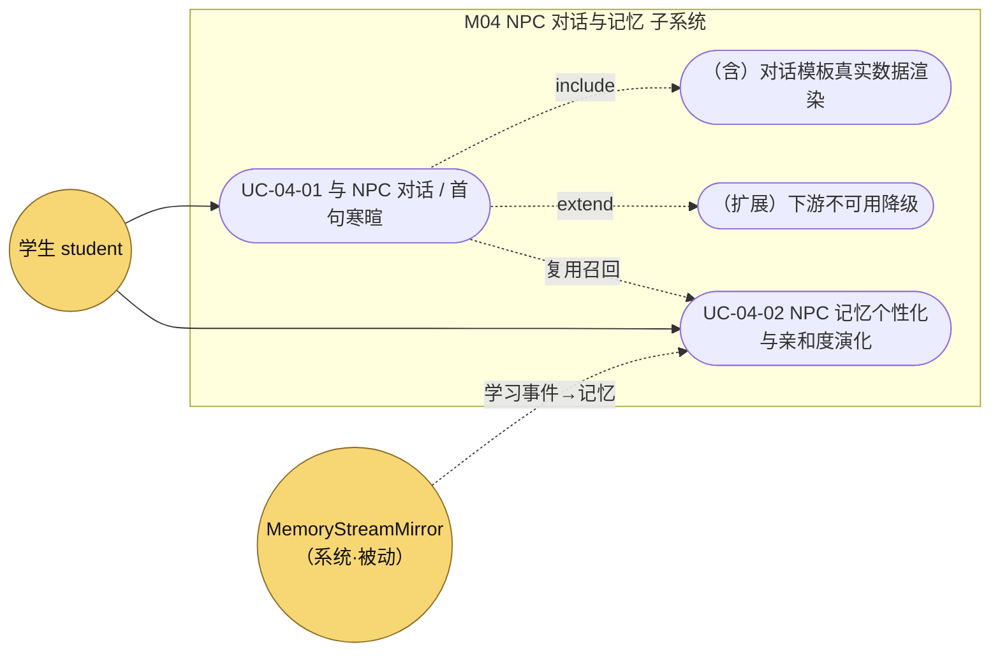
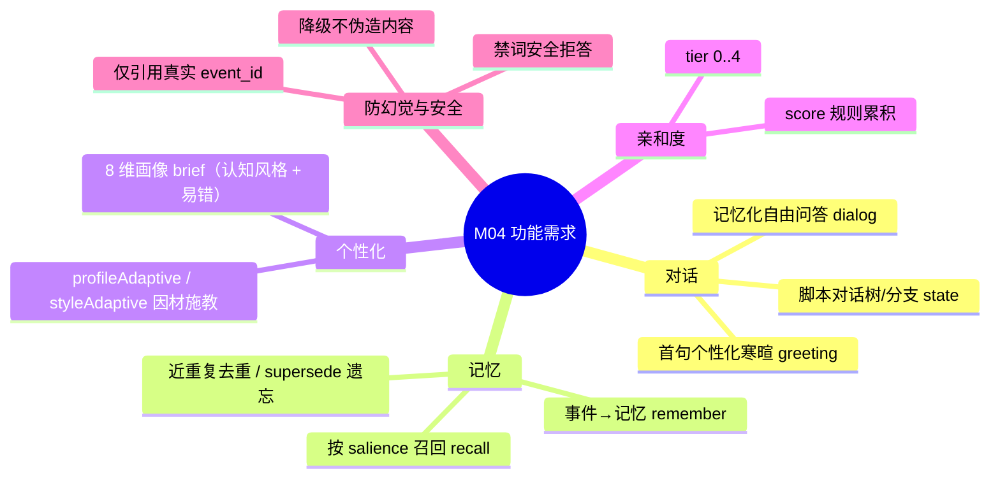

## 4.2.4 NPC 对话与记忆 · 功能需求

> filecode：**R04**　｜　模块：M04 NPC 对话与记忆　｜　对应 PDF 章：4.2 功能需求（用例）
> 关联后端包：`com.pythontopia.npc`、`com.pythontopia.dialog`、`com.pythontopia.world.npc`；关联 Agent：graph `NpcDialogAgent`。
> 数据表只引用、不展开字段，完整数据字典见 §6 数据库设计（分片 D1）。

### 4.2.4.1 模块概述

M04 让 Pythontopia 中央小镇 `town_hub` 的 NPC「认识你、记得你、按你的学情说话」，把像素小镇的社交外壳接回「看→学→练→测」主线。模块由三条相互独立又彼此衔接的链路构成：其一是**脚本对话树**（`com.pythontopia.world.npc`），驱动 NPC 的分支菜单、节点进度与副作用（领任务、开面板、置 flag），数据落在 `npc_dialog_state`；其二是**记忆化 AI 对话与首句寒暄**（`com.pythontopia.npc`），先按 `(user, npc)` 召回长期记忆，再调用 graph `NpcDialogAgent` 生成只引用真实 `event_id` 的 grounded 回复，并演化 `npc_affinity` 亲和度；其三是**对话模板上下文**（`com.pythontopia.dialog`），把脚本里的 `{{playerName}}` / `{{stats.*}}` / `{{profileAdaptive:..}}` / `{{styleAdaptive:..}}` 占位符用 mastery、submission、班级、世界等真实数据实时填充。记忆来源不是问卷，而是学生在练习、学习、调试中产生的 `LearningEvent`，由 `MemoryStreamMirror` 旁路镜像为记忆流。整个模块遵守项目防幻觉红线：NPC 只能依据召回到的记忆说「我记得」，下游不可用时结构化降级而非伪造个性化内容。

### 4.2.4.2 模块用例图

> 图 R04-1　M04 用例图（学生为主执行者，系统旁路被动写入记忆）

> 图 R04-2　M04 需求要点 mindmap（功能需求拆解）

---

### 4.2.4.3 用例规约

### UC-04-01 与 NPC 对话 / 首句寒暄

- **功能简述**：学生走近小镇 NPC 后，先看到一句「记得你近期学情」的个性化寒暄，再通过对话树分支或自由问答与 NPC 交互；自由问答由后端召回长期记忆并经 graph `NpcDialogAgent` 生成只引用真实 `event_id` 的 grounded 回复。
- **用例编号**：UC-04-01
- **执行者**：学生 student
- **前置条件**：1. 已登录且持有效 JWT；2. 角色为 `STUDENT`（教师 / 管理员被 `requireStudent` 拒绝）；3. 目标 `npcKey` 存在于 `data/npcs/index.json`（如 `mayor_py`、`coach_q`）。
- **后置条件**：成功——返回寒暄 / 回复文本，`npc_dialog_state.last_talked_at` 与 `flags` 被更新，`npc_affinity` 因一次对话 `+0.05`；失败——返回结构化降级标志（`degraded=true`）或静态脚本兜底，不写入伪造内容、不抛 5xx 影响其它链路。
- **涉众利益**：学生——获得贴合自己卡点的引导而非千篇一律台词；教师——记忆流沉淀为后续班级洞察的真实证据（见 M13）；管理员——降级路径可观测、可恢复。
- **基本路径**：
  1. 学生在 `WorldCanvas` 走到 NPC，前端 `useDialogStore.openWithTree(npcKey)` 触发；
  2. 前端并行拉取 `meta.json` / `dialog.json`（本地静态）、`GET /api/npc/{npcKey}/greeting`、`GET /api/dialog/context`（后台异步）；
  3. 后端 `NpcGreetingService` 取近期记忆（`MemoryRetrievalService.retrieve`，上限 5 条）+ 8 维画像 brief，调用 graph 生成 1–2 句寒暄，按 `npc×学生` 缓存 26 小时；
  4. 前端 `NpcGreetingBanner` 在脚本首节点之前展示寒暄（带 ✦ 标识）；脚本树由 `pickEntryNodeId` 选「插话节点」或 `rootNodeId`；
  5. 学生发起自由问答，前端 `POST /api/npc/{npcKey}/dialog` 携 `message`；
  6. `NpcDialogService` 召回 `(user, npc)` 记忆 → `NpcDialogGraphClient` 调 `POST /agents/npc/dialog` → `NpcDialogAgent` 生成 `reply_md` / `cited_event_ids` / `grounded`；
  7. 后端 upsert `npc_dialog_state(last_talked_at, flags)`，`NpcAffinityService.bump(+0.05)`，回传 `NpcDialogResponse`。
- **扩展路径**：
  - 2a. 寒暄请求超时 / 5xx / 网络错误：前端落 `fallback` 状态，显示「（记忆服务暂不可用）」并照常走脚本（瞬时故障重试一次）。
  - 3a. 记忆检索失败：返回 `serviceUnavailable()`（`degraded=true`），不写缓存以便恢复。
  - 3b. 学生暂无可引用记忆（新玩家）：返回 `none()`，既不寒暄也不报故障，直接走脚本。
  - 6a. graph 不可达 / 缺 token / 返回空文本：自由问答走 `staticFallback`（读 `dialog.json` 根节点文本，`{{playerName}}`→「同学」）；寒暄走结构化降级。
  - 6b. 用户消息或模型输出命中禁词（`完整答案`、`answer_key`、`hidden_test` 等）：`NpcDialogAgent` 返回安全拒答，给分层提示而非完整答案。
  - 1a. 非学生角色：返回 `403 FORBIDDEN`。
- **字段列表**：`NpcDialogRequest.message`（`@NotBlank`）；`NpcDialogResponse.replyMd / citedEventIds / grounded`；`NpcGreetingResponse.greeting / available / grounded / citedEventIds / degraded / cached`；`DialogContextDto.playerName / profileType / cognitiveStyle / stats`；`npc_dialog_state.current_node_id / completed_node_ids / last_talked_at / flags`（详见 §6 表 `npc_dialog_state`，D1）。
- **设计规则**：业务规则——`grounded=true` 仅当确有 `cited_event_ids` 且其全部属于召回集合；非功能需求——寒暄快档模型实测约 3s，前端寒暄超时 15s、最多 2 次尝试；设计约束——寒暄缓存 26 小时配合每日 03:30 `NpcGreetingPrewarmJob` 预热，玩家白天进对话零等待。
- **未解决的问题**：自由问答暂不回传多轮 `history`（graph schema 已留 `history` 字段，后端当前传单轮 `message`）。
- **备注**：`/api/npc/**` 与 `/api/world/npcs/**` 是两套并存的 NPC 接口，前者承载记忆化 AI 对话与寒暄，后者承载脚本对话树状态机，详见 §8 M04 详细设计 图 S04-3。

### UC-04-02 NPC 记忆个性化与亲和度演化

- **功能简述**：学生在练习 / 学习 / 调试中产生的学习事件被旁路镜像为「记忆流」，按事件类型路由到对应 NPC，写入 `npc_memory` 并演化 `npc_affinity`；后续对话 / 寒暄据此召回，实现「NPC 记住你」的纵向个性化。
- **用例编号**：UC-04-02
- **执行者**：学生 student（直接触发学习事件）；系统 `MemoryStreamMirror`（被动写入）。
- **前置条件**：1. 学生已产生至少一条 `LearningEvent`（如 `practice_failed`、`debug_resolved`）；2. `npc_persona` 已由 `NpcPersonaSeeder` 从 `meta.json` 幂等种子。
- **后置条件**：成功——`npc_memory` 新增或提升对应记忆 `salience`，`npc_affinity.score` 累积、`tier=floor(score)` 限幅 `0..4`；失败——记忆镜像作为旁路被吞掉（仅 warn），绝不影响 mastery 评估与画像回写主链路。
- **涉众利益**：学生——被「记住」的卡点会在下次对话被主动提起，形成陪伴感与复盘提示；教师——高频误区沉淀为可解释证据；管理员——记忆可由 `learning_event_log` 重建，降低数据风险。
- **基本路径**：
  1. 学生触发学习事件（如训练场提交失败发布 `PracticeFailed`）；
  2. `MemoryStreamMirror` 监听事件，落 `learning_event_log` 并写嵌入向量（`MemoryEmbeddingWriter`）；
  3. 按 `npcKeyFor(eventType)` 路由：`practice_*`/`guide_*`/`comeback_solved`→`coach_q`、`debug_resolved`→`foreman_bug`、`resource_consumed`/`media_consumed`→`librarian_doc`、`taught_ai_*`→`student_a`、`profile_bootstrapped`→`mayor_py`；
  4. 调 `NpcMemoryService.remember(userId, npcKey, eventId, 0.5)`；
  5. 去重：若与近 30 条记忆的嵌入余弦相似度 `> 0.92`（`NpcMemoryDedup`），不新增、仅 `salience += 0.1` 并刷新 `last_recalled_at`；否则插入 `npc_memory`（`ON CONFLICT` 提升 `salience`，上限 1.0）；
  6. `NpcAffinityService.bump(+0.05)` 累积 `score`、重算 `tier`；
  7. 后续对话 `recall` 按 `salience DESC, created_at DESC` 召回（排除 `superseded_by` 非空者），投影为 `MemoryItemDto` 供 graph 引用。
- **扩展路径**：
  - 2a. 写表 / 嵌入异常：整段吞异常并 warn，主链路不受影响。
  - 4a. 事件类型无对应 NPC：`npcKeyFor` 返回空，跳过记忆关联（仍入记忆流）。
  - 5a. 嵌入缺失：跳过去重，直接走插入分支。
  - 7a. 记忆被新记忆取代：`supersede(old, new)` 置 `superseded_by`，召回时被过滤。
- **字段列表**：`npc_memory.event_id / salience / superseded_by / last_recalled_at`；`npc_affinity.score / tier`；`learning_event_log.event_type / payload`（见 §6 / M02）；`MemoryItemDto.eventId / eventType / summaryZh / kcCodes / totalScore`；亲和度增量常量 `TALK_AFFINITY_DELTA = REMEMBER_AFFINITY_DELTA = 0.05`（详见 §6 表 `npc_memory` / `npc_affinity`，D1）。
- **设计规则**：业务规则——`tier = LEAST(4, FLOOR(score))`；非功能需求——记忆镜像必须 fail-safe，不得让一次写记忆失败拖垮判题；设计约束——`npc_memory` 以 `(user_id, npc_key, event_id)` 唯一去重，召回 `LIMIT` 限幅 `1..30`。
- **未解决的问题**：`salience` 时间衰减尚未单独调度（当前靠召回排序与去重提升），「遗忘」主要由 `supersede` 与 FSRS-lite（见 M11）侧面承载。
- **备注**：`npc_dialog_state.friendship`（V101，0..100）为早期好感度列，记忆系统引入后亲和度演化改由 `npc_affinity` 承载，`friendship` 保留为历史 / 预留字段。

---

### 4.2.4.4 非功能与接口需求小结

> 表 R04-1　M04 非功能与接口需求小结

| 维度 | 需求 |
| --- | --- |
| 性能 | 寒暄快档模型（graph `model_tier="fast"`）实测约 3s；缓存 26h + 每日预热，命中即 `cached=true` 零等待 |
| 可靠性 | 记忆镜像、寒暄、对话三处全部 fail-fast / fail-safe；下游故障不伪造、不 5xx 扩散 |
| 安全 | 仅 `STUDENT` 可访问 `/api/npc/**`；禁词命中安全拒答；不输出隐藏测试 / 完整答案 |
| 防幻觉 | `grounded` 需有 `cited_event_ids` 且引用合法 `event_id`，越界 id 一律剔除 |
| 接口 | `POST /api/npc/{npcKey}/dialog`、`GET /api/npc/{npcKey}/greeting`、`GET /api/dialog/context`、`GET /api/world/npcs`、`GET /api/world/npcs/{npcKey}/state`、`POST /api/world/npcs/{npcKey}/talk`（路径详见 §8 M04） |

> 关联表：`npc_dialog_state`（V101）、`npc_memory` / `npc_persona` / `npc_affinity`（V151），完整字段字典见 §6 数据字典分片 D1；记忆流底座 `learning_event_log` / `memory_embedding` 见 §6 / M02。

---

执笔人：成员 B ｜ 完成人（签名）：成员 B ｜ 审查人：成员 C ｜ 完成日期：2026-06-12
