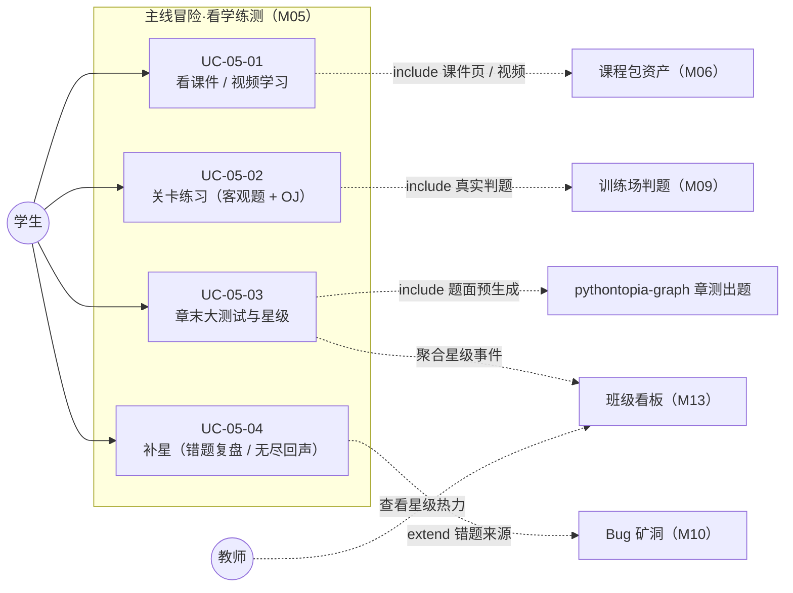
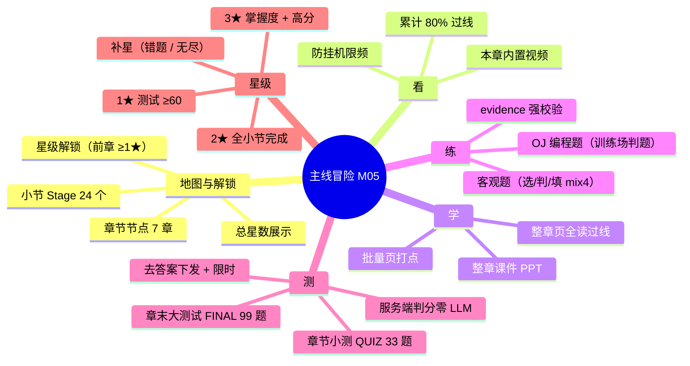
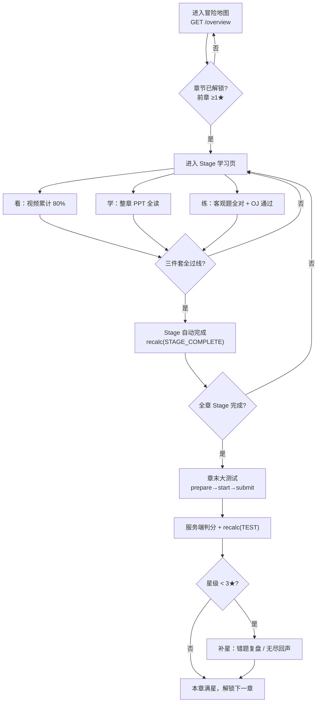
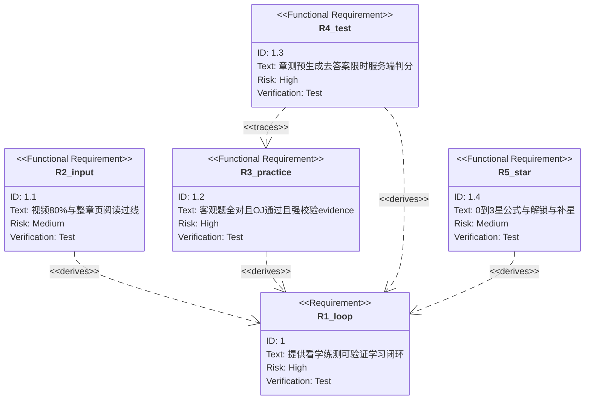

## 4.2.5 主线冒险·看学练测 · 功能需求

> 文档编号前缀：`PYT-CR` ｜ 本文件 filecode：**R05** ｜ 对应《实训总结报告》第 4 章「功能需求（用例）」。
> 本模块为 Pythontopia 的**学习闭环核心**：把课程包 `packId=43`《Python 语言基础》的 65 个 KC 编织进「看课件/视频 → 工坊学 → 训练场练 → 章末测」的可验证主线。
> 数据表完整字段字典见 §6 数据库设计（D2 分片），本文出现表名一律「详见 §6」，不重复展开字段。

### 4.2.5.1 模块概述

主线冒险是学生在 Pythontopia 里**按自己节奏补位学习**的主干道。它解决的核心问题是：在大班统一进度下「翘课 / 跟不上 / 坚持不下去」的学生，缺少一条课外可达、目标清晰、有正反馈的学习路径。R-14「世界收缩」后，主线从早期的「5 图分块大世界 + 农场作物隐喻」收敛为**单一中央小镇 `town_hub` 的冒险地图**：玩家从小镇的「冒险地图」告示牌进入 `/mainline-map`，看到 7 个章节节点（对齐课程 7 章），每章拆成 3–5 个**小节 Stage**（全课程共 **24 个 Stage**，覆盖全部 65 个 KC）。

每个 Stage 是一个标准化的「**三件套**」学习单元——**看**（累计观看本章内置视频达总时长的 80%）、**学**（读完本章课件 PPT 的全部页）、**练**（答对本小节客观题 + 完成本小节 OJ 编程题）。三件套全部过线，Stage 自动判定完成；一章内所有 Stage 完成后解锁**章末大测试**，测试分数与掌握度共同决定该章 **0–3★** 星级；星级又决定下一章是否解锁。整个链路以**后端为唯一权威**（旧前端 `mainQuest` 本地存档已作废重开），前端只做「看→学→练→测」的渲染与打点上报，所有过线判定、星级公式、解锁规则、防作弊与判分都在后端完成。

本模块的执行者以**学生**为主；星级变更事件（`star_award_event`，详见 §6）作为教师端班级看板（M13）的聚合数据源，故教师为间接涉众。

### 4.2.5.2 模块用例图

下图为 M05 的用例总览（图 R05-1）。系统边界内为四个核心用例，学生为主执行者；判题域（M09）、课程包域（M06）、RAG 答疑（M07）、Bug 矿洞（M10）、班级看板（M13）为协作系统。

> 图 R05-1　M05 主线冒险用例图（学生主执行者，虚线为跨模块协作）

### 4.2.5.3 模块功能分解

> 图 R05-2　M05 功能分解 mindmap

### 4.2.5.4 用例规约

#### UC-05-01 看课件/视频学习

- **功能简述**：学生进入某个小节 Stage 的学习页，通过「看」（本章内置课程视频）与「学」（本章课件 PPT 全部页）完成知识输入，系统按真实可见时长 / 已读页并集去重幂等地累积进度，到线即点亮「看」「学」两环。
- **用例编号**：UC-05-01
- **执行者**：学生
- **前置条件**：1. 已登录（JWT Bearer）；2. 该 Stage 所属章节已解锁（首章默认解锁，其余章前一章星级 ≥ 1★）；3. 课程包 `packId=43` 已就绪（7 文档 / 561 页）。
- **后置条件**：成功——`mainline_stage_progress.video_watched_sec` 累加、`pages_read` 并集扩展，「看」「学」两维过线后回流前端目录打勾；失败——上报被限频 / 钳制则静默不计（不报错，不打断学习）。
- **涉众利益**：学生——按自己节奏把课吃透，进度有据可查；教师——学习行为沉淀为可聚合的学情；管理员——/。
- **基本路径**：
  1. 学生在 `/mainline-map` 点击章节牌 → 抽屉列出本章 Stage → 点「进入」跳 `/mainline/stage/{stageId}`。
  2. 学习页 `GET /api/mainline/stages/{stageId}` 拉取详情（看/学/练三件套题面 + 本人已完成 id 集合）。
  3. 默认展示「看」：`StageVideoWatcher` 播放本章内置视频，按可见时长增量 `POST /stages/{stageId}/video-progress`（`deltaSec`）。
  4. 服务端钳制单次 ≤ 120s 且每分钟 ≤ 2 次（防挂机刷时长），累计达「本章视频总时长 × 80%」→「看」过线。
  5. 切到「学」：`StageCoursewareReader` 渲染本章 PPT（`docId = 185 + chapter` 顺位解析），翻页 / 读到末页按批 `POST /stages/{stageId}/pages-read`（`pageIds`）。
  6. 已读页并集覆盖本章全部 `coursewarePageIds` →「学」过线；目录实时回流过线标记。
- **扩展路径**：
  - 3a. 本章无内置视频：学习页降级展示，「看」维度不阻塞（页面侧 B 站精选讲解为外部增强，不计主线进度）。
  - 4a. 上报频率超限：`VideoProgressThrottle` 直接返回当前进度（幂等软节流），不抛错。
  - 5a. 文档顺位未命中（空库 / seed 未完成）：回退魔数映射 `documentId = 185 + chapter` 并告警，seed 完成后自愈。
- **字段列表**：`StageDetailDto`(id, chapter, chapterTitle, index, title, kcCodes, videoKeyword, coursewarePageIds, exampleProblemIds, requiredVideoSec, requiredPages, requiredExamples, requiredQuestions, videos, examples, questions, videoWatchedSec, pagesReadIds, examplesDoneIds, questionsCorrectIds, completed)；`VideoProgressRequest`(deltaSec)；`PagesReadRequest`(pageIds)；`PageReadRequest`(pageId)；`StageProgressDto`(stageId, chapter, stageIndex, videoWatchedSec, requiredVideoSec, videoComplete, pagesRead, requiredPages, pagesComplete, examplesDone, requiredExamples, examplesComplete, completed)。（取自真实 controller/DTO，详见 §6 表 `mainline_stage` / `mainline_stage_progress`。）
- **设计规则**：业务规则——「看」过线口径为本章视频总时长 × 80%（`VIDEO_PASS_RATIO`），动态算，忽略 `mainline_stage.required_video_sec` 占位列；「学」按整章 PPT 全部页（`required_pages=0` 时按 `courseware_page_ids` 全覆盖判定）。非功能——所有打点幂等并集去重，高频写入失败由前端静默兜底。设计约束——`overview` 一次聚合避免 N+1，章级标准（视频时长 / 页数）按章缓存。
- **未解决的问题**：`mainline_stage.courseware_page_ids` seed 期留空，当前由后端按章文档动态解析整章页；待课程策划回填后可逐 Stage 精确到页。
- **备注**：`/lecture/{chapter}` 章节视频讲解页是另一独立入口（含 AI 助教侧栏），R-15 起其媒体消费打点已退役，不写主线进度——主线「看」进度只认 Stage 学习页的 `StageVideoWatcher` 打点。

#### UC-05-02 关卡练习（客观题 + OJ）

- **功能简述**：学生在 Stage 学习页「练」环节完成两类练习——站内**客观题**（选择 / 判断 / 填空，服务端即时判分自检）与 **OJ 编程题**（跳训练场真实判题，通过后回标完成）。两维都达标，「练」过线，触发 Stage 完成重算。
- **用例编号**：UC-05-02
- **执行者**：学生
- **前置条件**：1. 已登录；2. 已进入目标 Stage 学习页；3. 该小节有客观题 / OJ 题（题库 seed 见 §6 表 `mainline_practice_question` / `mainline_oj_catalog`）。
- **后置条件**：成功——客观题答对幂等计入 `questions_correct`，OJ 通过后计入 `examples_done`；两维达标 → 触发 `recheckCompletion` 重算 Stage 完成与星级。失败——OJ 未通过判题而点「标记完成」被 400 拒绝（evidence 强校验）。
- **涉众利益**：学生——通过做真题确认自己真的会了，而非只「看过」；教师——客观题正确率、OJ 通过情况可沉淀为误区分析；管理员——/。
- **基本路径**：
  1. 学习页切到「练」，`StageExamplePractice` 渲染客观题卡片（按 `ordinal`）与 OJ 题清单。
  2. 学生作答某客观题 → `POST /stages/{stageId}/practice/{questionId}/answer`（`answers`）。
  3. 服务端归一化判分（选/判精确比对、填空 NFKC + 去空白 + 大小写不敏感），回传 `correct` + 正确答案 + 讲解供自检。
  4. 答对则幂等并集计入 `questions_correct`；答对题数达本小节要求（mix4 = 4 道全对）→ 客观题维度达标。
  5. OJ 题：点「去训练场 →」在 `/training?problemId=` 真实判题，通过后回学习页点「标记完成」→ `POST /stages/{stageId}/example-done`（`problemId`[, `submissionId`]）。
  6. 服务端校验该生该题存在 PASSED 提交（或所带 submissionId 属本人且 PASSED）→ 计入 `examples_done`；OJ 达标。
  7. 客观题 + OJ 两维均达标 → 「练」过线，连同「看」「学」触发 `maybeComplete`，首次齐全置完成并 `starService.recalc(STAGE_COMPLETE)`。
- **扩展路径**：
  - 2a. 答错：仍回传正确答案与讲解供订正，不计入进度（可重复作答，幂等）。
  - 5a. 未通过判题直接「标记完成」：服务端返回 `EXAMPLE_EVIDENCE_REQUIRED`（400），前端提示先去训练场判题通过。
  - 5b. 带 submissionId 但非本人 / 非 PASSED：返回 `EXAMPLE_SUBMISSION_INVALID` / `EXAMPLE_SUBMISSION_NOT_PASSED`。
  - 3a. 题目不属于该 Stage：返回 `PRACTICE_QUESTION_STAGE_MISMATCH`。
- **字段列表**：`StagePracticeQuestionDto`(id, kcCode, type, ordinal, stem, options, blankCount)；`PracticeAnswerRequest`(answers)；`PracticeAnswerResultDto`(questionId, correct, correctAnswers, explanation)；`StageExampleDto`(id, displayNo, displayName, kcCode)；`ExampleDoneRequest`(problemId, submissionId?)。（详见 §6 表 `mainline_practice_question`、`mainline_oj_catalog`、`mainline_stage_progress.questions_correct/examples_done`。）
- **设计规则**：业务规则——客观题答案不下发题面（防泄题），判分在服务端；OJ 完成必须有通过判题的 evidence（堵住不判题直接打点）。非功能——判分归一化保证全/半角、引号、大小写鲁棒。设计约束——客观题题型枚举仅 `CHOICE/JUDGE/FILL`，OJ 编程题不在此枚举，仍走 `course_problem` + 训练场判题。
- **未解决的问题**：客观题题库为「通识 Python 题」（`source_label` 标注非课件原题），刻意不引用课件页码以避免幻觉；后续可由课程策划替换为课件原题。
- **备注**：`MainlinePracticeService` 经 `ObjectProvider` 惰性获取完成端口，规避与标准聚合的双向构造注入循环。

#### UC-05-03 章末大测试与星级

- **功能简述**：一章所有 Stage 完成后，学生参加**章末大测试**（FINAL，99 题）或学完视频与 PPT 后的**章节小测**（QUIZ，33 题）。题面由 graph 异步**预生成入库**，开考下发**去答案**题面并限时，提交后**服务端零 LLM 判分**得分数，FINAL 分数与掌握度共同重算该章 0–3★ 星级。
- **用例编号**：UC-05-03
- **执行者**：学生
- **前置条件**：1. 已登录；2.（FINAL）本章所有 Stage 三件套已完成；（QUIZ）本章最终小节视频 + PPT 已过线；3. 题面已 `READY`（`prepare` 触发的预生成完成）。
- **后置条件**：成功——`chapter_test` 落 `SUBMITTED` + 分数 + 逐题明细 + 防作弊计数，FINAL 触发星级重算（只升不降）；失败——超时提交被拒收并记 `integrity.overtime`。
- **涉众利益**：学生——用一场综合测验确认整章掌握并拿星；教师——分数 / 星级 / 防作弊计数进班级看板；管理员——/。
- **基本路径**：
  1. 学习页 / 地图进入 `/chapter-test/{chapter}`（FINAL）或 `/chapter-quiz/{chapter}`（QUIZ）。
  2. 进页即 `POST .../{test|quiz}/prepare` 触发异步预生成（幂等，已在生成 / 就绪不重复触发）+ `GET .../latest` 拉历史最佳。
  3. 点「开始考试」→ `POST .../start`：校验门槛后将 `READY` 题面置 `IN_PROGRESS`，下发去答案题面 + `deadlineAt`。
  4. 学生限时作答（FINAL 120 分钟 / QUIZ 60 分钟），编程题禁粘贴并计数、切屏失焦计数，倒计时归零自动交卷。
  5. 点「交卷」→ `POST .../{testId}/submit`（`answers` + `integrity`）：服务端按 deadline 校验未超时 → `ChapterTestJudge` 判分（选/判/填本地比对、编程题走判题沙箱按通过比例给分，归一为百分制）。
  6. 入库 `SUBMITTED`；FINAL 调 `ChapterStarService.recalc(TEST)` 重算星级；返回逐题明细 + 正确答案 + 解析 + 星级。
- **扩展路径**：
  - 3a. 未 `READY`：返回 `CHAPTER_ASSESSMENT_NOT_READY`（题目仍在生成 / 生成失败请重新准备）。
  - 3b.（FINAL）尚有 Stage 未完成：返回 `CHAPTER_FINAL_LOCKED`。
  - 5a. 超过 deadline 提交：落 `EXPIRED` + `integrity.overtime` 并拒收（`CHAPTER_TEST_OVERTIME`）。
  - 5b. 重复提交已 `SUBMITTED` 的同一场：幂等返回既有结果。
- **字段列表**：`TestPrepareResponse`(status)；`ChapterTestPaperDto`(testId, chapter, attemptNo, status, timeLimitSec, deadlineAt, items[QuestionView: qid, type, score, stem, title, statementMarkdown, options, samples])；`ChapterTestSubmitRequest`(answers, integrity[pasteBlocked, blurEvents, overtime])；`ChapterTestResultDto`(testId, chapter, attemptNo, status, score, maxScore, passed, stars, overtime, submittedAt, items[QuestionResultView: qid, type, correct, awardedScore, maxScore, yourAnswer, correctAnswer, explain, passedCases, totalCases], integrity)。（详见 §6 表 `chapter_test`。）
- **设计规则**：业务规则——考试期间零 LLM，题目预生成入库；去答案下发，绝不在提交前透出答案 / 解析 / 隐藏用例。非功能——预生成异步、信号量削峰（默认并发 2）、失败重试 ≤ 2；FINAL 题面排除本章 QUIZ 已出过的题（防重复）。设计约束——星级公式纯函数：1★ 测试 ≥60、2★ 且全小节完成、3★ 且本章 KC 均掌握 ≥0.80 且分数 ≥85，封顶 3★。
- **未解决的问题**：预生成请求的 8 维画像 brief / errorbook 高频错因 brief 暂传空（不伪造画像内容），graph 端对空 brief 兜底出题；待个性化集成后接入真实画像。
- **备注**：QUIZ 不重算星级（仅记录成绩）；星级只由 FINAL 测试与 Stage 完成 / 掌握度驱动。

#### UC-05-04 补星（错题复盘 / 无尽回声）

- **功能简述**：对已通过测试但未满 3★ 的章节，学生可通过**错题复盘**（本章 Bug 矿洞已解决 ≥ 3）或**无尽回声**（单轮答对 ≥ 8 且正确率 ≥ 80%）各补 1★，封顶 3★，作为遗忘巩固的正反馈。
- **用例编号**：UC-05-04
- **执行者**：学生
- **前置条件**：1. 已登录；2. 本章已有星级记录；3. 满足对应补星阈值。
- **后置条件**：成功——`chapter_star.breakdown.recovered` 追加来源标签并加 1★（幂等，每途径仅一次，最多 2 途径），记 `star_award_event`；失败——未达标 / 已发放 / 已封顶返回未发放。
- **涉众利益**：学生——给「学完又忘」的内容一条再巩固拿星的路；教师——补星事件可见，反映复习强度；管理员——/。
- **基本路径**：
  1. 地图抽屉点「错题复盘补星」→ `POST /api/mainline/chapters/{chapter}/recovery/errorbook`。
  2. 服务端统计本章 KC 对应 Bug 矿洞 `RESOLVED` 数 ≥ 3 → `applyRecoveryStar(ERRORBOOK_RECOVERY)`。
  3. 无尽模式一轮结束 → `POST /api/mainline/endless/summary`（chapter, correct, total, streak）。
  4. 达标（答对 ≥ 8 且正确率 ≥ 80%）且当日本章未发放过 → `applyRecoveryStar(ENDLESS_RECOVERY)`。
- **扩展路径**：
  - 2a. 不足 3 个已解决：返回 `starAwarded=false`。
  - 4a. 当日本章已发放无尽补星：防刷拒绝（每日每章至多 1 次）。
  - 4b. 已封顶 3★：加星无效果，幂等返回。
- **字段列表**：`EndlessSummaryRequest`(chapter, correct, total, streak)；`StarAwardResultDto`(starAwarded)；`star_award_event`(source ∈ {ERRORBOOK_RECOVERY, ENDLESS_RECOVERY})。（详见 §6 表 `chapter_star`、`star_award_event`。）
- **设计规则**：业务规则——补星与核心星级解耦，叠加但封顶 3★，最多 2 条补星途径；幂等不重复加。非功能——无尽补星每日每章限 1 次防刷。设计约束——补星只能由 `applyRecoveryStar` 收口，`recalc` 保留既有 recovered 不覆盖。
- **未解决的问题**：/
- **备注**：补星依赖 M10（Bug 矿洞）与无尽模式，跨模块协作。

### 4.2.5.5 看→学→练→测 需求级流程

> 图 R05-3　看→学→练→测 需求级闭环（学生视角）

### 4.2.5.6 需求关系图（requirementDiagram）

> 图 R05-4　M05 需求分解关系图

### 4.2.5.7 接口清单（真实端点，来自 controller 源码）

> 全部端点统一前缀 `/api`，JWT Bearer，角色 STUDENT；鉴权由 `JwtAuthenticationFilter` 强制。

| 端点 | 方法 | 请求体 | 响应 | 用例 |
| --- | --- | --- | --- | --- |
| `/api/mainline/overview` | GET | — | `MainlineOverviewDto` | UC-05-01 |
| `/api/mainline/stages/{stageId}` | GET | — | `StageDetailDto` | UC-05-01/02 |
| `/api/mainline/stages/{stageId}/video-progress` | POST | `VideoProgressRequest` | `StageProgressDto` | UC-05-01 |
| `/api/mainline/stages/{stageId}/page-read` | POST | `PageReadRequest` | `StageProgressDto` | UC-05-01 |
| `/api/mainline/stages/{stageId}/pages-read` | POST | `PagesReadRequest` | `StageProgressDto` | UC-05-01 |
| `/api/mainline/stages/{stageId}/example-done` | POST | `ExampleDoneRequest` | `StageProgressDto` | UC-05-02 |
| `/api/mainline/stages/{stageId}/practice/{questionId}/answer` | POST | `PracticeAnswerRequest` | `PracticeAnswerResultDto` | UC-05-02 |
| `/api/mainline/chapters/{chapter}/test/prepare` | POST | — | `TestPrepareResponse` | UC-05-03 |
| `/api/mainline/chapters/{chapter}/test/start` | POST | — | `ChapterTestPaperDto` | UC-05-03 |
| `/api/mainline/chapters/{chapter}/test/{testId}/submit` | POST | `ChapterTestSubmitRequest` | `ChapterTestResultDto` | UC-05-03 |
| `/api/mainline/chapters/{chapter}/test/latest` | GET | — | `ChapterTestResultDto` | UC-05-03 |
| `/api/mainline/chapters/{chapter}/quiz/{prepare,start,latest}` `/quiz/{testId}/submit` | POST/GET | 同 test | 同 test | UC-05-03 |
| `/api/mainline/endless/summary` | POST | `EndlessSummaryRequest` | `StarAwardResultDto` | UC-05-04 |
| `/api/mainline/chapters/{chapter}/recovery/errorbook` | POST | — | `StarAwardResultDto` | UC-05-04 |

> 表 R05-1　M05 接口清单

### 4.2.5.8 业务规则与非功能需求

| 编号 | 类别 | 规则 |
| --- | --- | --- |
| BR-05-1 | 看 | 过线口径 = 本章内置视频总时长 × 80%（动态算，忽略占位列） |
| BR-05-2 | 看 | 时长上报单次钳制 ≤ 120s，每分钟 ≤ 2 次，超频幂等 no-op |
| BR-05-3 | 学 | 过线 = 已读页并集覆盖本章 PPT 全部页 |
| BR-05-4 | 练 | 客观题全对（mix4=4）且 OJ 完成；OJ 完成必须有 PASSED 提交 evidence |
| BR-05-5 | 测 | 考试期间零 LLM，去答案下发，超时拒收 |
| BR-05-6 | 星级 | 1★≥60 / 2★ 全小节完成 / 3★（掌握度≥0.80 且 ≥85），只升不降，封顶 3★ |
| BR-05-7 | 解锁 | 第 1 章默认解锁，第 N 章需前一章 ≥ 1★ |
| BR-05-8 | 补星 | 错题复盘 / 无尽各 1★，幂等、最多 2 途径，封顶 3★ |
| NFR-05-1 | 性能 | `overview` 一次聚合避免 N+1，章级标准按章缓存 |
| NFR-05-2 | 安全 | 三件套打点幂等并集去重；防泄题；防作弊计数仅供教师参考不自动判零 |
| NFR-05-3 | 可用 | 打点高频写入失败前端静默兜底，不打断学习 |

> 表 R05-2　M05 业务规则与非功能需求

### 4.2.5.9 数据需求（引用 §6）

本模块持久化涉及以下表（完整字段字典见 §6 数据库设计 D2 分片）：`mainline_stage`、`mainline_stage_progress`、`chapter_star`、`star_award_event`（均 V156）、`chapter_test`（V157，+V164 `assessment_kind`）、`mainline_practice_question`（V158，+V159 seed）、`mainline_oj_catalog`（V159）。课程包侧依赖 `course_document` / `course_page` / `course_kc` / `course_problem`（M06，见 §6），判题侧依赖 `practice_submission` / `judge_result`（M09，见 §6）。

---

> 执笔人：成员 B ｜ 完成人（签名）：成员 B ｜ 审查人：成员 C ｜ 完成日期：2026-06-14
