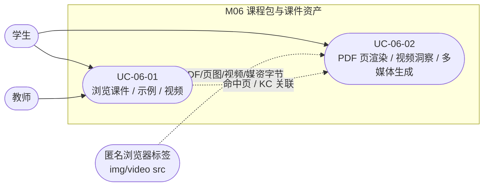
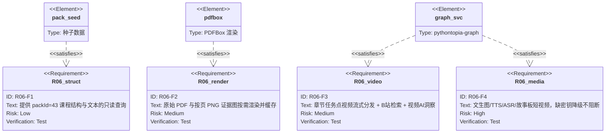

## 4.2.6 课程包与课件资产 · 功能需求

### 模块概述

M06 是 Pythontopia「看→学→练→测」闭环里「看」一环的资产底座，对外封装唯一课程知识底座 Alethicode `packId=43`《Python 语言基础》（7 份文档 · 561 页 · 7 章 · 65 个 KC · 46 个示例 · 39 道题）以及围绕它派生的多模态资产。它向上为图书馆阅读器、示例库、看课页、课件问答（M07）、资源工坊（M08）、训练场（M09）提供统一的课程结构（章 / KC / 页 / 示例 / 题）查询、原始课件 PDF 与按页渲染的证据图、章节任务点视频与「B站精选讲解」检索、视频 AI 概述与关键时间点（VideoInsightAgent），以及文生图 / TTS / ASR / 故事板短视频合成等媒资能力。模块对应后端包 `com.pythontopia.coursepack`、`com.pythontopia.courseware`、`com.pythontopia.video`、`com.pythontopia.media`，代表前端页面为 `LibraryPage.vue`、`ExampleListPage.vue`、`LecturePage.vue`，关联智能体为 `video_insight_agent`（B站视频洞察）与 `media`（ASR/TTS/文生图/短视频）链路。

模块贯彻三条项目红线：其一，课程结构以库内真实种子为唯一事实来源，`CoursePackService.ACTIVE_PACK_ID=43` 固定生效包，统计口径与 `course_pack` 表一致，不得伪造页码 / 题号；其二，所有「重资源」端点（PDF / 页图 / 视频 / 媒资）均做白名单与 path-traversal 防护，原始课件文档 id 仅允许 186～192 这 7 份；其三，所有 AI / 第三方能力（视频洞察、文生图、TTS、ASR）一律 fail-soft，缺密钥或上游不可用时返回 `degraded=true` 占位而非抛错，保证演示与验收链路不被阻塞。

### 模块用例图（图 R06-1）

> 说明：UC-06-01 是登录用户对课程「结构 + 文本」的浏览与检索；UC-06-02 是把课程「重资产 + AI 派生物」按需渲染 / 生成。两者经「当前页 / 当前 KC」串联：例如在阅读器选中某 KC 后，UC-06-02 据 `page_refs` 渲染对应页证据图。匿名标签（``/`<video>` 不带 Authorization 头）仅能命中 UC-06-02 中被 `SecurityConfig` 放行的字节流端点。

### 需求关系图（图 R06-2）

---

#### UC-06-01 浏览课件 / 示例 / 视频

- **功能简述**：登录用户在图书馆阅读器 / 示例库 / 看课页浏览 `packId=43` 的课程结构（章、KC、页、示例、题）与正文文本，按 KC 过滤示例、按章节列任务点视频，并就课件内容向 AI 提问获得带可跳转页码引用的作答。
- **用例编号**：UC-06-01
- **执行者**：学生（主）、教师（备课浏览）
- **前置条件**：1. 用户已登录并持有有效 JWT；2. 数据库已导入 `packId=43` 种子（7 文档 / 561 页 / 7 章 / 65 KC / 46 示例 / 39 题）；3. 后端 `/api/course/**` 与 `/api/courseware/answer` 可用。
- **后置条件**：成功：返回与库内一致的结构 / 文本 / 示例 / 视频清单，课件问答给出 `answerMd` + `citations`；失败：章节索引接口异常时前端切 fixture 兜底并 toast 提示，问答端点不可用时回退到片段检索。
- **涉众利益**：学生：课外可按自己节奏定位并读懂某 KC 的课件、示例与讲解视频；教师：复用同一课程结构备课、核对覆盖；管理员：依赖统计口径校验课程包完整性。
- **基本路径**：
  1. 用户进入图书馆 `/library`，前端并发拉取文档清单、`GET /api/course/chapters`、`GET /api/course/kcs`、全部示例与题目，组装左栏「章 · 页 · KC」目录树。
  2. 用户点选某章 → 选定对应文档（`docId=185+章号`，即 186～192）并加载第 1 页文本（`contentMarkdown`/`excerpt`）。
  3. 用户在该章下拉框选某 KC → 据 KC 的 `page_refs` 跳转到首个关联页，右侧联动展示该 KC 的关联示例与关联题目。
  4. 用户切到「示例库」`/examples`，按 KC chip 过滤示例卡片，可「复制代码」或「看上下文」跳回阅读器对应页。
  5. 用户切到「课件视频」视图或看课页 `/lecture/:chapter`，按章号 `GET /api/course/videos?chapterId=` 列任务点视频，选首个 `available=true` 者播放。
  6. 用户在右栏输入问题 → `POST /api/courseware/answer`，渲染作答与页码引用，点引用页码跳回对应课件页。
- **扩展路径**：
  - 3a. 选中 KC 的 `page_refs` 为空 → toast「KC 暂未关联课件页」，不跳转。
  - 5a. 整章无任务点视频（内置清单为空数组）→ 回退展示当前页文字摘录。
  - 6a. `/api/courseware/answer` 不可用（服务未起 / 鉴权失败）→ 回退 `searchCourseLibrary` 片段卡；仍失败则 toast「检索失败」。
- **字段列表**：CoursePackDto(`id,name,primaryLanguage,documentCount,pageCount,chapterCount,kcCount,exampleCount,problemCount`)、ChapterDto(`chapterId,orderIndex,title,summaryMarkdown`)、KcDto(`kcId,kcCode,kcName,chapterId,chapterOrder,difficulty,summaryMarkdown`)、PageDto(`pageId,documentId,chapterId,pageNo,title,contentMarkdown,excerpt`)、CourseExampleDto(`id,packId,kcCode,title,code,explanationMarkdown,pageRefs`)、CourseVideoDto(`id,chapter,title,durationSec,kcCodes,available`)、CoursewareAnswerRequestDto(`query,kcCodes,topK`)、CoursewareAnswerResponseDto(`answerMd,citations[pageId,pageNo,chapterId,quote],noEvidence`)。表字段字典见 §6（M06 数据字典 D2）。
- **设计规则**：`kcCode` 必须匹配 `^PY43-KC-[0-9]{3}$`，否则 400；查询一律落到 `ACTIVE_PACK_ID=43`；阅读器 URL 与 `?docId=&page=&kcCode=` 双向同步以便分享 / 回链；课件问答仅依据命中课件作答并做页码防幻觉过滤（细节见 M07）。
- **未解决的问题**：KC↔页关联依赖种子 `page_refs`，少量 KC 可能无页（前端以「（无页）」标注）；任务点视频内置清单当前为空，依赖外部整理后落盘。
- **备注**：/

---

#### UC-06-02 课件 PDF 页渲染 / 视频洞察 / 多媒体生成

- **功能简述**：把课程「重资产 + AI 派生物」按需产出——原始课件 PDF 内联流式、指定页 PDFBox 渲染 PNG 证据图（落盘缓存）、章节任务点视频按 Range 流式、B站精选讲解检索与「视频 AI 概述 + 关键时间点」，以及文生图 / TTS / ASR / 故事板短视频合成（含异步作业与 SSE 进度）。
- **用例编号**：UC-06-02
- **执行者**：学生（主，触发生成与播放）、匿名浏览器标签（仅消费被放行的字节流端点）
- **前置条件**：1. 触发生成 / 提交作业类操作需登录持有 JWT；2. 字节流端点（`/api/course/documents/**`、`/api/course/pages/**/image`、`/api/course/videos/**`、`/api/media/assets/**`）在 `SecurityConfig` 匿名放行；3. PDFBox 可读到 `data/course-pack-43/pdfs/{docId}.pdf`；4.（可选）配置讯飞 / LLM 凭据，否则走降级。
- **后置条件**：成功：返回对应字节（200/206）或 `MediaAssetDto`/`BilibiliInsightResponse`/`JobStatusResponse`；失败：资源缺失返回 404，Range 越界返回 416，AI / 媒资不可用返回 `degraded=true` 占位资产。
- **涉众利益**：学生：一页证据无需下载整份 ~80MB PDF；听不懂可听 AI 概述、看关键时间点、用 TTS 朗读、用语音提问；教师 / 评委：演示链路在无外部密钥时仍可跑通（占位降级）。
- **基本路径**：
  1. 阅读器「原 PDF」视图请求 `GET /api/course/documents/{docId}/pdf`（docId∈[186,192]）→ 200 内联 PDF 供 pdfjs 渲染。
  2. 导师证据回链 / KC 直达请求 `GET /api/course/pages/{pageId}/image` → 后端解析 `pageId→(documentId,pageNo)`，命中缓存直回，未命中则 PDFBox 按 120 DPI 渲染该页为 PNG、原子落盘后返回。
  3. 看课页播放视频请求 `GET /api/course/videos/{id}`，带 `Range` 头 → 206 + `Content-Range` 分片回放，支持拖动进度。
  4. 用户在看课页检索「B站精选讲解」`GET /api/videos/bilibili?keyword=&limit=`，得外部视频卡片（封面 + 跳转链接）。
  5. 用户对某视频提问 `POST /api/videos/bilibili/insight`（`bvid,question,kcCodes`）→ VideoInsightAgent 据真实标题 / 简介 / 时间轴产出 `overview` 与候选 `keyPoints`，经 `timeline_grounding` 校验后回前端。
  6. 工坊 / 看课页触发 `POST /api/media/image`（文生图）、`POST /api/media/tts`（朗读）、`POST /api/media/asr`（语音转文本）、`POST /api/media/storyboard/video/jobs`（异步短视频作业）→ 客户端用 `GET /api/media/jobs/{id}` 轮询或 `/stream` SSE 跟进，成片经匿名 `GET /api/media/assets/{assetId}` 播放。
- **扩展路径**：
  - 1a/2a. docId 越界 / PDF 缺失 / `pageId` 不存在 → 404，前端「原 PDF」降级到 Markdown 文字视图。
  - 3a. `Range` 非法 → 回 200 全量；`Range` 越界 → 416 + `Content-Range: bytes */total`。
  - 5a. LLM 超时 / 解析失败 / 无时间轴 → `degraded=true`、中性占位 `overview`、`keyPoints=[]`，绝不编造秒数。
  - 6a. 未配置讯飞 apikey / 上游失败 → 返回 `degraded=true` 的本地占位资产或 `AsrResponse.unavailable()`；短视频作业失败带 `errorCode`（如 `VIDEO_COMPOSE_UNAVAILABLE`）。
- **字段列表**：MediaAssetDto(`id,kind,url,mimeType,degraded,source,prompt,kcCodes`)、ImageGenerationRequest(`prompt,label,kcCodes`)、TtsRequest(`text,voice`)、AsrResponse(`text,degraded`)、StoryboardVideoRequest(`scenes[imagePrompt,narration,voice,durationSeconds,kcCodes]`)、JobSubmitResponse(`jobId,status,cached,assetId`)、JobStatusResponse(`jobId,status,progress,assetId,url,errorCode`)、BilibiliInsightRequest(`bvid,question,kcCodes`)、BilibiliInsightResponse(`bvid,overview,keyPoints,basedOn,degraded`)、BilibiliVideoDto(`bvid,title,author,aiSummary,coverUrl,durationSec,play,danmaku,pubdate,url`)。落库表 `media_asset` / `media_job` 字段字典见 §6（M06 数据字典 D2）。
- **设计规则**：原始文档 id 仅允许 186～192；所有文件解析做 path-traversal 守卫（`candidate.startsWith(baseDir)`）；页图 120 DPI、原子写（temp→ATOMIC_MOVE）、按 `pageId` 串行渲染避免并发重复写；`media_job` 以 `user+fingerprint` 幂等命中已成片；TTS 文本 ≤200、默认发音人 `x4_yezi`；字节流端点显式 `Cache-Control` 与 `Accept-Ranges`。
- **未解决的问题**：页图 / 媒资缓存目录不入 git、首次访问有渲染延迟；短视频合成依赖 ffmpeg 与讯飞路数，演示默认占位。
- **备注**：视频洞察的 `keyPoints` 为空即表示拿不到真实时间轴，仅给 `overview`，前端不得伪造跳转点。

---

> 执笔人：成员 B ｜ 完成人（签名）：成员 B ｜ 审查人：成员 C ｜ 完成日期：2026-06-14
