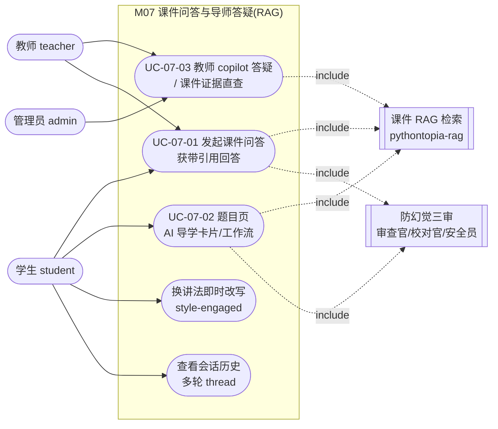

## 4.2.7 课件问答与导师答疑(RAG) · 功能需求

> 模块代号：M07 ｜ filecode：R07 ｜ 对应 PDF 章：4.2 功能需求（用例）
> 后端包：`com.pythontopia.tutor`、`com.pythontopia.rag` + Python 微服务 `pythontopia-graph`（TutorAgent）、`pythontopia-rag`（课件检索）
> 代表前端：`TutorPanel.vue` / `CoursewareEvidence.vue` / `CoursewareMentionMenu.vue` / `TutorVisualAids.vue`

### 4.2.7.1 模块概述

M07 是 Pythontopia「看→学→练→测」闭环中「问」的承载模块，为学生提供**有据可查、随处可达**的 AI 课件答疑与题内导学。它把课程知识底座 Alethicode `packId=43`《Python 语言基础》（7 份文档 · 561 页 · 7 章 · 65 个 KC）作为唯一证据源：学生在百晓工坊、看课页、训练场任意位置发问，系统先经课件 RAG（检索增强生成）检索命中的课件页作为证据，再由导师智能体（TutorAgent）按「证据锚定」规则生成带 `[页 X]` 引用的解答，最后经**防幻觉三审**（引用审查 / 防幻觉核查 / 安全审查）把关后流式回放给学生，并在「课件证据」面板把答案依据的课本原文页**以页面图片**摊给学生核对。模块还在训练场提供 6 阶段卡片式 AI 导学工作流（审题→思路→骨架→编码→错因→复盘→迁移），把答疑从「一问一答」升级为可推进的学习剧情。模块强约束「无证据须标注通识来源、绝不伪造课件页码」，是项目防幻觉红线最集中的落点。

模块服务三类执行者：**学生**是答疑与导学的主体；**教师**可在自己班级页带班级标识发起 copilot 答疑（注入本班只读学情增强作答），并可直接查询课件证据；**管理员**与教师共享课件证据直查权限。下文按「学生侧课件问答（UC-07-01）」「学生侧题内 AI 导学工作流（UC-07-02）」「教师/管理员侧 copilot 答疑与证据直查（UC-07-03）」给出用例。

### 4.2.7.2 模块用例图

图 R07-1 给出 M07 的参与者—用例关系。学生独占答疑与导学主链路；教师额外拥有 copilot 答疑（带班级学情）与课件证据直查；管理员与教师共享证据直查。



> 图 R07-1　M07 参与者—用例图（学生主链路 + 教师 copilot/直查；RAG 检索与三审为公共被包含用例）

### 4.2.7.3 用例规约

### UC-07-01 发起课件问答并获带引用回答

- **功能简述**：学生就当前正在看的视频 / PPT / 题面或任意 Python 知识点提问，系统检索课件证据后流式生成带 `[页 X]` 引用的解答，并展示命中的课件页图片供核对。
- **用例编号**：UC-07-01
- **执行者**：学生（教师带班级标识时复用同一入口，见 UC-07-03）
- **前置条件**：1. 已登录且角色为学生；2. 课件 RAG 索引已构建（`pythontopia-rag` 在线，或失败时自动降级为通识知识作答）。
- **后置条件**：成功：流式回答完成，`event: result` 终态送达，问答连同 `answer_md` / `evidence_page_ids` / `grounding_status` / `conversation_id` 落库到 `tutor_session`（详见 §6 数据字典 D2）；失败：发送一条终止性 `event: error`（错误码 ∈ `AI_SERVICE_UNAVAILABLE` / `AI_SERVICE_TIMEOUT` / `AI_STREAM_INTERRUPTED`），已透传的 token 保留，不落空答案。
- **涉众利益**：学生：随处可问、答案有据、可换讲法、可回看历史；教师：答疑不泄露完整答案，符合教学纪律；管理员：内容经安全审查，无 PII / 危险代码 / 泄答外溢。
- **基本路径**：
  1. 学生在 `TutorPanel` 输入问题（可经 `CoursewareMentionMenu` 以 `@` 引用知识点/章节），可附最多 3 张截图、可选认知风格（视觉/逻辑/试错）；
  2. 前端 `POST /api/tutor/ask`（SSE，`text/event-stream`）提交 `TutorAskRequest`，同一聊天窗口共享 `conversationId`；
  3. 后端 `TutorService` 组装上下文：班级学情（仅教师）→ 个人近期记忆 → 本会话历史 → 视频上下文 → 原始上下文，并取 8 维画像 `profile_brief`；
  4. 经 `TutorGraphClient` 中继到 graph `POST /agents/tutor/ask/stream`，先发 `plan` 工位清单与 `trace`；
  5. 馆员节点调 `pythontopia-rag` 检索课件证据（BM25+向量 RRF 融合，相关度阈值 0.3）；
  6. 导师节点（TutorAgent）按苏格拉底式阶梯逐 token 流式作答，有证据必须用 `[页 X]` 引用；
  7. 引用审查 / 防幻觉核查 / 安全审查依次校验，未过则触发一轮有界修订（critique→revise）；
  8. 发送 `result` 终态（含 `answer_md`、`evidence` 引用卡、`grounding_status`、`visual_aids`、`personalization_note`）；
  9. 前端渲染答案气泡 + `CoursewareEvidence` 课件证据页图（前 3 页内嵌，点图回链图书馆原文）。
- **扩展路径**：
  - 1a. 学生点「换讲法」携带 `style`：后端无视画像置信度门槛，按该风格即时改写当前答案；
  - 5a. RAG 检索超时/熔断（15s + 1 次重试）：回空证据，答案开头标注「基于通识知识」，绝不伪造页码；
  - 6a. 同一 `conversationId` 上一问尚在作答：后端返回 `409 SESSION_BUSY`，提示稍候再试；
  - 7a. 答案出现编造页码或无据统计数字：修订稿重跑三审仍不过则保留原答案并标 `grounding_status=FAILED`（答案优先、不丢弃）；
  - 8a. 学生上传截图：后端逐张经讯飞「图片理解」转客观描述并入上下文，绝不据图直接解题。
- **字段列表**：`question`、`kcCodes`、`context`、`images`、`style(visual|logical|trial)`、`conversationId`、`classroomId`、`videoId`、`videoTimeSec`（取自 `TutorAskRequest`）；响应 `answerMd`、`evidencePageIds`、`groundingStatus`、`evidence[pageId,pageNo,snippet,score]`、`visual_aids`、`personalization_note`、`evidence_note`、`review{grounding,hallucination,safety}`（取自 graph `_build_result`）。
- **设计规则**：业务规则——有证据必须引用、无证据必须标注通识来源、禁止伪造页码、不给完整答案代码（SYSTEM_PROMPT 苏格拉底式阶梯）；非功能需求——SSE 心跳 10s 防断连、`question` ≤2000 字、`images` ≤3 张；设计约束——`conversationId` 仅前端生成 + 后端落库，不下传 graph。
- **未解决的问题**：视频字幕转写 RAG 为占位 seam（`buildVideoBrief` 仅给时间锚点，按 ±30s 窗口检索字幕的真实接入待后续）。
- **备注**：/

### UC-07-02 题目页 AI 导学卡片/工作流

- **功能简述**：学生在训练场就某道题触发分阶段导学，系统按 6 阶段状态机产出结构化导学卡片（审题导读 / 思路分析 / 骨架代码 / 错因诊断 / AC 复盘 / 迁移练习）并推荐下一步动作，全程不给可提交完整答案。
- **用例编号**：UC-07-02
- **执行者**：学生（仅学生；教师视角走班级 copilot）
- **前置条件**：1. 已登录且角色为学生；2. 目标题目存在于 `packId=43` 题库；3. 诊断类事件（错因/复盘）须先有归属本人的判题提交。
- **后置条件**：成功：阶段推进，卡片写入 `tutor_workflow_card`，会话 `phase`/`seq` 更新到 `tutor_workflow_session`，coach 状态投影到 `tutor_workflow_agent_state`（详见 §6 数据字典 D2）；失败：发 `event: error`，错误码 ∈ `TRANSITION_VIOLATION`（非法阶段迁移）/ `SCHEMA_VIOLATION`（卡片不合规）/ `INSUFFICIENT_EVIDENCE`（缺判题证据）/ `GUIDE_GUARDRAIL_FAILED`。
- **涉众利益**：学生：把「不会做」拆成可推进的小步骤、错有所析、对有所结；教师：导学不泄答、可沉淀学习行为；管理员：卡片经 schema 强校验与防泄答 guardrail，无越界内容。
- **基本路径**：
  1. 学生进入 `/training` 训练场，前端 `GET /api/tutor/workflow/sessions/active?problemId=` 取活跃会话快照 + 卡片时间线；
  2. 学生点某动作（如「题目导读」/「思路分析」/「开始编码」），前端 `POST /api/tutor/workflow/runs`（SSE）携带 `problemId` + `event` + `eventData`；
  3. 后端 `TutorWorkflowService` 组装题面上下文、画像 `profile_brief`、（错因/复盘）判题诊断，并随请求下传 `restore_phase`/`restore_seq` 回放；
  4. graph `POST /agents/tutor-workflow/run/stream`：`validate_transition` 校验阶段合法性 → `coach_decide` 给推荐动作 →（READING/AC_REVIEW/KNOWLEDGE_REVIEW）`fetch_evidence` 取课件页 → 生成对应阶段卡片；
  5. 卡片经 pydantic 强校验 + 防泄答 guardrail（最多重试 1 次）；
  6. 发 `result` 终态（`phase` / `card` / `available_actions` / `coach_decision` / `seq`）；
  7. 后端投影落库（更新 `phase`/`seq`，插卡片，写 coach 状态 + 动作事件）；
  8. 前端渲染卡片并高亮 coach 推荐的下一步按钮。
- **扩展路径**：
  - 2a. 学生发起非法迁移（如 READING 直接跳 TRANSFER）：graph 返回 `TRANSITION_VIOLATION`，前端不渲染卡片；
  - 2b. CHAT/SKELETON/VISUALIZE/EXECUTION_TRACE/KNOWLEDGE_REVIEW/PARSONS 为辅助事件，任意阶段可触发且不改变阶段；
  - 4a. 错因/复盘缺 `submission_id` 或提交与题目不匹配 / 判定不符（复盘须 AC、错因须非 AC）：后端 `400` 早退；
  - 5a. 骨架卡 TODO 不足 2 处或疑似完整解 / 跑题：判 schema 违规并重试，仍失败 fail fast；
  - 8a. 学生对卡片/动作给反馈：`POST /api/tutor/workflow/sessions/{sessionKey}/feedback`（`ACTION_CLICKED` / `CHECKPOINT_COMPLETED` / `CARD_HELPFUL` / `CARD_NOT_HELPFUL`）沉淀为学习行为事件。
- **字段列表**：请求 `problemId`、`event(READING|IDEATING|SKELETON|CODING|ERROR_FEEDBACK|AC_REVIEW|TRANSFER|CHAT|KNOWLEDGE_REVIEW|EXECUTION_TRACE|VISUALIZE|PARSONS)`、`eventData{thought_text|message|submission_id|code|intent|sub_skill}`（取自 `TutorWorkflowRunRequest`）；反馈 `eventType`、`actionKey`、`cardKey`、`payload`（取自 `TutorWorkflowFeedbackRequest`）；卡片字段见 §8 详细设计 与 §6 数据字典 D2（`tutor_workflow_card.payload`）。
- **设计规则**：业务规则——阶段迁移由 graph 状态机权威判定、迁移题不物化判题（卡内展示 + 自行到训练场练）；非功能需求——会话级 `(user_id, problem_id)` 唯一活跃约束、SSE 180s 窗口；设计约束——graph 零回调 Java（题面/诊断/画像随请求下传），阶段权威存进程内、Java 投影负责跨重启恢复。
- **未解决的问题**：导学的有界自主多步「episode 计划」（`TutorEpisodePlan`）schema 已就位，端到端编排为渐进增强项。
- **备注**：/

### UC-07-03 教师 copilot 答疑与课件证据直查

- **功能简述**：教师在自己班级页带班级标识发起 copilot 答疑（注入本班只读学情增强作答）；教师/管理员可直接按知识点检索课件证据。
- **用例编号**：UC-07-03
- **执行者**：教师 / 管理员
- **前置条件**：1. 已登录且角色为教师或管理员；2.（copilot）`classroomId` 归属当前教师。
- **后置条件**：成功：copilot 走 UC-07-01 同一 SSE 链路返回答案；证据直查 `POST /api/rag/query` 返回命中页列表。失败：非归属/非授权一律 `403 FORBIDDEN`；学生角色携带 `classroomId` 时该字段被忽略，绝不触达班级聚合（红线）。
- **涉众利益**：教师：备课/批改时一站式取证、看本班最弱 KC 与高频误区；管理员：可审计证据来源；学生：班级聚合数据对其严格不可见。
- **基本路径**：
  1.（copilot）教师在 `/teacher/classroom/:id` 提问，前端 `POST /api/tutor/ask` 带 `classroomId`；后端校验归属后注入只读班级学情 brief，余同 UC-07-01；
  2.（直查）教师/管理员 `POST /api/rag/query` 提交 `query` + `kc_codes`/`chapter_ids` + `top_k`，门面统一用 0.3 阈值检索，返回 `hits[pageId,pageNo,chapterId,kcCodes,text,score]` 与 `no_evidence_found`。
- **扩展路径**：
  - 1a. `classroomId` 非教师归属 / 取数异常：降级为空 brief，不破坏答疑；
  - 2a. 查询命中禁用词或无证据：`no_evidence_found=true`，调用方不得伪造页码引用。
- **字段列表**：`RagQueryRequestDto{query(≤512), top_k(1–20), kc_codes, chapter_ids, min_score}` → `RagQueryResponseDto{hits[], no_evidence_found, rewritten_query}`（取自真实 DTO，snake_case 对齐 `pythontopia-rag`）。
- **设计规则**：业务规则——RAG 直查仅教师/管理员（`@PreAuthorize("hasRole('TEACHER') or hasRole('ADMIN')")` + 服务内二次校验）；非功能需求——证据检索相关度阈值 0.3；设计约束——学生绝不可经任何入口读取班级聚合数据。
- **未解决的问题**：/
- **备注**：班级学情聚合属 M13 能力，本模块仅做只读注入引用。

### 4.2.7.4 模块需求要点（requirementDiagram）

图 R07-2 用需求图固化 M07 的关键约束及其与用例的满足关系，便于在 §10 审查与 §9 测试中追溯。

```mermaid
requirementDiagram

requirement 证据锚定 {
  id: R07_1
  text: "有证据必须[页X]引用，无证据标注通识来源，禁止伪造页码"
  risk: high
  verifymethod: test
}

requirement 防幻觉三审 {
  id: R07_2
  text: "引用审查/防幻觉核查/安全审查通过后才出，未过触发有界修订"
  risk: high
  verifymethod: test
}

requirement 角色边界 {
  id: R07_3
  text: "导学仅学生；RAG直查仅教师/管理员；学生忽略classroomId"
  risk: medium
  verifymethod: inspection
}

requirement 流式韧性 {
  id: R07_4
  text: "SSE终态恰一次/心跳保活/超时熔断/并发SESSION_BUSY"
  risk: medium
  verifymethod: test
}

element 课件问答 {
  type: usecase
}
element 导学工作流 {
  type: usecase
}

课件问答 - satisfies -> 证据锚定
课件问答 - satisfies -> 防幻觉三审
课件问答 - satisfies -> 流式韧性
导学工作流 - satisfies -> 角色边界
导学工作流 - satisfies -> 防幻觉三审
```

> 图 R07-2　M07 关键需求与用例满足关系（证据锚定 / 三审 / 角色边界 / 流式韧性）

### 4.2.7.5 数据与接口需求（摘要）

- **数据需求**：问答历史落 `tutor_session`（含 `evidence_page_ids` 数组、`grounding_status`、`conversation_id`）；导学落 `tutor_workflow_session` / `tutor_workflow_card` / `tutor_workflow_agent_state` / `tutor_workflow_action_event`。字段全字典见 §6 数据库设计（D2 课程主线答疑分片），本节不展开。
- **接口需求**：对外 REST 统一前缀 `/api`、JWT Bearer 鉴权——`POST /api/tutor/ask`、`POST /api/tutor/style-engaged`、`GET /api/tutor/sessions`、`GET /api/tutor/conversations/{conversationId}`、`POST /api/tutor/workflow/runs`、`GET /api/tutor/workflow/sessions/active`、`POST /api/tutor/workflow/sessions/{sessionKey}/feedback`、`POST /api/rag/query`；内部 graph/rag 端点见 §8 详细设计。
- **界面需求**：`TutorPanel`（答疑/换讲法/历史）、`CoursewareEvidence`（课件证据页图）、`CoursewareMentionMenu`（`@` 引用）、`TutorVisualAids`（图解渲染）；答疑入口挂在百晓工坊 `/workshop`、看课页 `/lecture/:chapter`，导学入口在训练场 `/training`。

---

执笔人：成员 B ｜ 完成人（签名）：成员 B ｜ 审查人：成员 C ｜ 完成日期：2026-06-14
