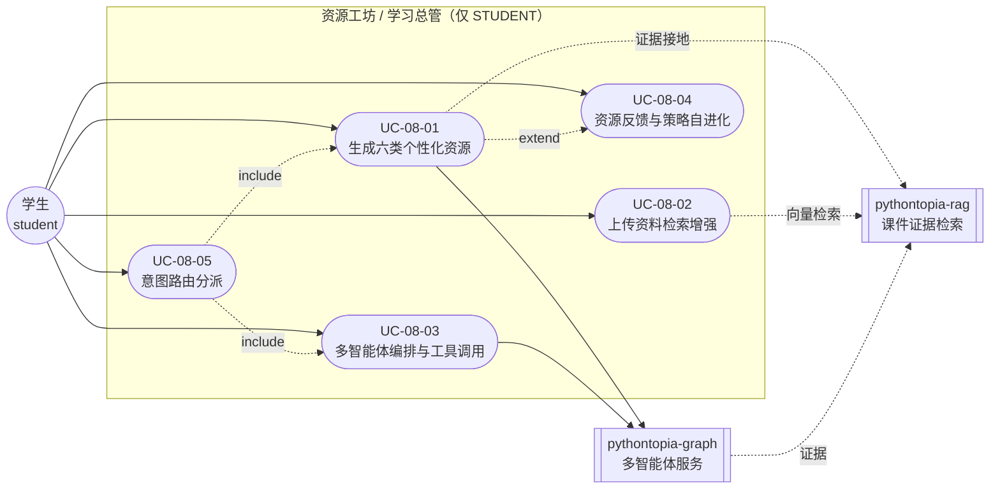
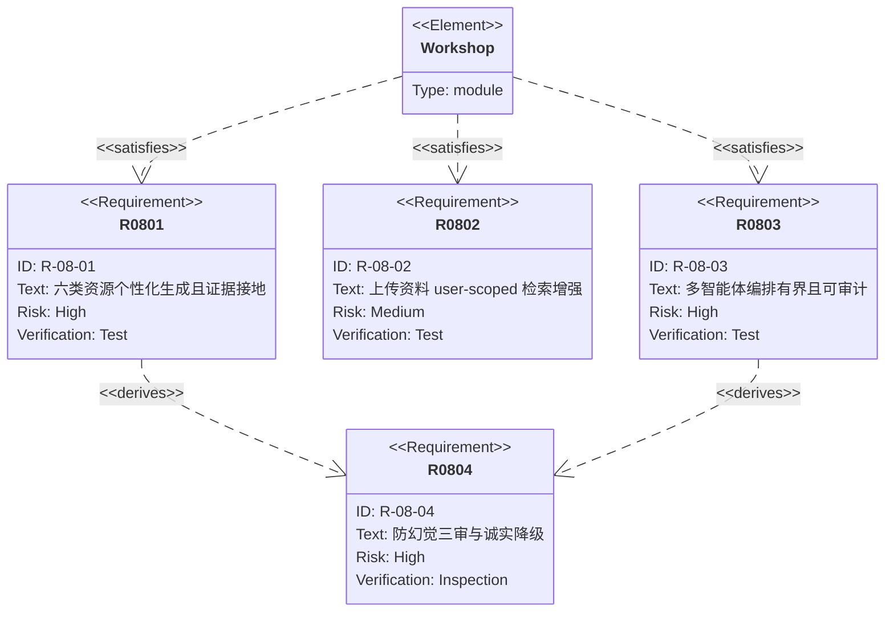

## 4.2.8 资源工坊与多智能体编排 · 功能需求

> 本文 filecode = **R08**；图编号 `图 R08-n`、表编号 `表 R08-n`、用例编号 `UC-08-NN`。
> 数据表只引用名称，完整字段字典见 §6（D3 工坊判题挑战分片）。术语统一见总纲 §2。

### 4.2.8.1 模块概述

资源工坊（前端「百晓工坊」`WorkshopPage`）是 Pythontopia「看→学→练→测」闭环中**「学」**的承载场，也是全系统**多智能体编排（multi-agent orchestration）**的中枢。它把学生一句自然语言诉求，经**意图路由**判别为「答疑 / 6 类资源生成 / 学习规划 / 找视频 / 带路 / 找资料」等 17 种工具之一，再分派到对应的流式管线产出结果：六类个性化学习资源（**思维导图 / PPT 讲义 / 代码实验 / 分镜故事板 / 讲义 / 练习**）、学习总管的「看→学→练→测」计划，或导师答疑。

与单纯「调大模型生成文字」不同，本模块的真实价值在于四条硬约束：

1. **个性化**：每次生成都注入 8 维学习画像快照（专业背景、自评等级、媒介偏好、认知风格、易错点、最新洞察、近期记忆要点）与据掌握度+置信度算出的自适应难度（basic/medium/hard），让产物随真实学情自适应；
2. **证据接地与防幻觉**：生成产物末端经 grounding / safety 审查，引用课件页必须真实存在，不达证据标准则诚实降级，绝不编造课件页码、题号、作者；
3. **有界可问责**：多智能体编排是**有界闭环**（understand→plan→dispatch→reflect→replan→compose，步数与重试有显式上限），非自由 ReAct；每轮以审计记录落库，全链路 SSE 工具调用时间线对学生可见；
4. **资源沉淀与自进化**：生成物落「书房」可复用、可反馈（采纳/弃用），反馈回流驱动 Agent 策略 meta-reflection 进化。

后端涉及包：`com.pythontopia.workshop`（含 `controller` / `history` / `upload`）、`orchestrator`、`agent.run`、`browse`、`loop`、`intent`；Python 微服务 `pythontopia-graph` 承载全部 Agent 与图编排。代表前端组件：`WorkshopChat`、`MindMapView`、`PptView`、`CodeLabView`、`StoryboardView`、`HandoutView`、`PracticeList`、`MarvisPanel`、`ToolCallTimeline`、`PlanCard`、`BrowseTimeline`。

> 执行者口径：资源工坊全部端点**仅学生（STUDENT）可用**（控制器统一 `requireStudent`，非学生 403 FORBIDDEN）。教师视角的资源使用统计归 M13 班级看板，不在本模块。

### 4.2.8.2 模块用例图

> 图 R08-1：M08 用例图（学生为唯一主执行者；Python graph 与课件 RAG 为支撑系统执行者）。



下面逐用例展开（沿用总纲 §7 体例）。

### 4.2.8.3 用例规约

### UC-08-01 生成六类个性化资源

- **功能简述**：学生选定 1 个或多个知识点（KC）与资源类型，工坊调用对应专职 Agent 生成个性化学习资源，经三审后落「书房」可即时查看与复用。
- **用例编号**：UC-08-01
- **执行者**：学生
- **前置条件**：1. 已登录且角色为 STUDENT；2. 课程包 `packId=43` 已就绪（KC 目录可加载）；3. 近 1 小时生成次数未超配额。
- **后置条件**：成功：`learning_resource` 落一条资源（带 `safety_status`/`grounding_status`/`content_format`），`resource_run` 落一条 Agent 运行审计，返回 `{runId, resourceId, status}`；失败：返回结构化错误（如 `RESOURCE_KC_UNKNOWN` / `RESOURCE_THROTTLED` / `RESOURCE_GENERATION_FAILED`），不落脏资源。
- **涉众利益**：学生：拿到贴合自己专业/水平/认知风格的学习材料；教师：资源用量沉淀进班级分析；管理员：生成全程可审计、内容安全合规。
- **基本路径**：
  1. 学生在工坊选 KC（@ 菜单同源课程目录）+ 资源类型（六类之一），可填写 `focusHint`；
  2. 前端 `POST /api/workshop/resources/stream`（流式）或 `POST /api/workshop/resources`（非流式）；
  3. 后端 `requireStudent` 鉴权，`enforceThrottle` 限流，`validateKcCodes` 用课程目录校验 KC（未知即 400）；
  4. 后端组装 `ProfileSnapshot`（画像 8 维折叠）+ `targetDifficulty`（掌握度+置信度算难度档）+ `agentStrategyDirective`（最新策略），调 graph `/agents/resource/produce(/stream)`；
  5. graph 路由到专职 Agent（如 `MindMapAgent`），检索课件证据，生成结构化 `ResourceDraft`，经 grounding/safety 审查；
  6. SSE 把 `trace`/`token`/`result` 帧回放给前端，`ToolCallTimeline` 实时显示链路；
  7. 后端把 `result` 落 `learning_resource` + `resource_run`，回传 `resourceId`；
  8. 前端在书房/对话内渲染对应视图（`MindMapView`/`PptView`/…）。
- **扩展路径**：
  - 3a. KC 未知 → 400 `RESOURCE_KC_UNKNOWN`，提示重选；
  - 3b. 1 小时内超配额 → 429 `RESOURCE_THROTTLED`；
  - 5a. Agent 产物违反安全（含泄答 token）或证据不达标 → `status=FAILED`，422 `RESOURCE_GENERATION_FAILED` 并附原因，不落资源；
  - 5b. LLM provider 不可用 → 各 Agent 走确定性兜底（golden）产出可用产物，`status` 可为 `PARTIAL`；
  - 6a. SSE 流中断 → 后端回退非流式 `produce` 兜底，仍尝试落库。
- **字段列表**：`kcCodes[]`, `type`(HANDOUT/MINDMAP/PRACTICE/CODE_LAB/READING/STORYBOARD), `focusHint`；响应 `runId`, `resourceId`, `status`（取自 `ResourceCreateRequest`/`ResourceCreateResponse` 与 `learning_resource`、`resource_run`，详见 §6）。
- **设计规则**：业务规则——每小时生成次数有上限（`WorkshopProperties.maxResourcesPerHour`，allowlist 豁免）；资源消费奖励的掌握度每 KC 每日封顶。非功能——单次生成 graph 侧超时治理（单步 120s）；产物必须结构化（Pydantic），不返回大段自由文本。设计约束——KC 必须存在于 `packId=43` 目录；练习类禁止 `hidden_test_cases`/`answer_key` 等泄答字段。
- **未解决的问题**：分镜故事板的配图/TTS 仅产出 prompt 与占位 asset id，短视频合成为后续增强；目前生成同步等待，长任务无断点续生成。
- **备注**：六类资源与专职 Agent 的对应见 §4.2.4 表 R08-1。

### UC-08-02 上传资料检索增强

- **功能简述**：学生上传个人文件（讲义/代码/笔记），系统解析为文本并分块向量化，后续答疑/生成可在**本人语料**内做语义检索增强，命中内容以「你上传的《文件名》」带标签注入上下文。
- **用例编号**：UC-08-02
- **执行者**：学生
- **前置条件**：1. 已登录 STUDENT；2. 文件类型 ∈ `.py/.txt/.md/.csv/.pdf/.docx`；3. 文件 ≤ 5MB。
- **后置条件**：成功：`workshop_upload` 落一行（`status=READY` + 解析文本 + 字符/行数），异步分块向量化落 `workshop_upload_chunk`；失败：解析失败 fail-soft 落 `status=FAILED + error`（仍返回 200，前端 pill 可重试）。
- **涉众利益**：学生：把自己的资料纳入个性化检索，问答更贴合手头材料；管理员：上传仅存解析后纯文本不落原件，越权读他人语料被阻断（user-scoped）。
- **基本路径**：
  1. 学生在工坊 `ChatComposer` 选文件上传，`POST /api/workshop/uploads`（multipart）；
  2. 后端校验扩展名（415）、大小（413），用 PDFBox/POI/UTF-8 同步解析为 `ExtractedContent`；
  3. 落 `workshop_upload`（`status=READY`），返回 `UploadDto`；
  4. 若 READY，异步即发即忘 `indexUploadAsync`：切块 → 批量取 512 维向量 → 整体替换 `workshop_upload_chunk`；
  5. 学生提问/生成时，前端取 `extractedText` 带标签注入，或 `POST /api/workshop/uploads/retrieve` 做语义检索；
  6. 检索按登录态 `userId` 强制 scoped，向量命中返回 topK，命中以「外部/上传内容」标签呈现。
- **扩展路径**：
  - 2a. 类型不支持 → 415 `UPLOAD_EXT_NOT_ALLOWED`；
  - 2b. 超 5MB → 413 `UPLOAD_TOO_LARGE`；
  - 2c. 解析失败（损坏 PDF 等）→ `status=FAILED + error`，200 返回，前端可重试；
  - 4a. 向量化服务离线 → chunk 仍入库、embedding 留空，检索回退字面匹配（ILIKE）；
  - 6a. `uploadIds` 指定他人上传 → 因 user-scoped 而无命中（不越权）。
- **字段列表**：上传 `file`(multipart)；检索 `query`, `uploadIds[]`, `topK`；持久化 `filename`,`ext`,`byteSize`,`extractedText`,`charCount`,`lineCount`,`status`,`error`（取自 `workshop_upload`/`workshop_upload_chunk`/`RetrieveRequest`，详见 §6）。
- **设计规则**：业务规则——上传内容是「用户提供内容」，绝不当 `packId=43` 课件 evidence/引用；红线只进带标签 context 通道。非功能——解析同步、向量化异步 fail-soft，分块旁路失败不拖垮上传主链路；检索 topK clamp 到 1..20。设计约束——向量维度固定 512（对齐 `pythontopia-rag /embed`）。
- **未解决的问题**：暂不支持图片/扫描件 OCR；超大文件需用户自行拆分。
- **备注**：解析→分块→检索三段在 §8 详细设计展开（见 M08 详细设计 图 S08-2）。

### UC-08-03 多智能体编排与工具调用

- **功能简述**：学生向「学习总管」描述目标，系统以**有界闭环**理解意图→拆解「看→学→练→测」计划→并发派发到多个专职 Agent 执行→反思补救→（失败时）重排→流式作答，全程工具调用对学生可见。
- **用例编号**：UC-08-03
- **执行者**：学生
- **前置条件**：1. 已登录 STUDENT；2. 同一 `(userId, sessionId)` 上一轮流已结束（一会话一活动流）。
- **后置条件**：成功：返回 `OrchestratorResponse`（含 `plan`、各步 `dispatch_results`、`profile_updates`、`trace`、`safety_result`、`grounding_result`），会话记忆与计划存 graph 侧 `orchestrator_session`，闭环审计组织为记录（镜像 `loop_run`）；失败：单步失败发 `step_error`（非终止），整轮失败发 `error`。
- **涉众利益**：学生：一句话得到可执行的个性化学习路线与配套产物；教师：编排过程可审计，便于教学复盘；管理员：有界非自由 ReAct，杜绝失控调用与成本失控。
- **基本路径**：
  1. 学生在 `WorkshopChat` 输入目标，`POST /api/orchestrator/turn/stream`（SSE）；
  2. 后端 `requireStudent` + 会话在途互斥（重复提交 409 `SESSION_BUSY`），从 `BugMineService` 取到期复习 KC 透传，转发 graph；
  3. graph `understand`：判意图（plan/negotiate/continue/chitchat）与歧义；歧义则 `clarify`（只问一个问题）后结束；
  4. `build_plan`：拆成有序「看→学→练→测」四步，各步绑专职 Agent 与 KC；
  5. `dispatch`：两批有界并发（信号量=3）——watch/learn/assess 先并发，practice 依赖 learn 工件随后执行；逐步发 `plan`/`STATE_DELTA`/`trace`/`CUSTOM(loop_step)`；
  6. `reflect`（N=1 有界反思）：learn 执行类失败则沿 CODE_LAB→HANDOUT→READING 降级仅重派一次；
  7. 若最近有失败 KC 且非 negotiate → `replan` 插入「矿洞补练」DebugAgent 步；
  8. `extract_profile`（对话即画像）→ `compose` 流式回复；
  9. 末端 grounding/safety 审查，不达标则诚实降级回复；前端 `PlanCard` 渲染计划、`ToolCallTimeline` 渲染链路。
- **扩展路径**：
  - 2a. 同会话上一轮未结束 → 409 `SESSION_BUSY`；
  - 3a. 目标模糊 → `clarify` 单问澄清，`needs_user_input=true`；
  - 5a. 某步 Agent 失败 → 发 `step_error`（非终止），其余步继续，不丢整轮计划；
  - 8a. provider 不可用 → `compose` 走确定性教学兜底（结构化 plan 清单），不退化为自由聊天；
  - 9a. 计划含未知 KC → grounding 失败，回诚实「未达证据标准」降级回复。
- **字段列表**：请求 `message`,`sessionId`,`history[]`,`currentChapter`,`recentKcCodes[]`,`recentFailures[]`,`profileBrief`,`courseKcCodes[]`；响应 `reply_md`,`plan[]`,`dispatch_results[]`,`profile_updates[]`,`trace[]`,`safety_result`,`grounding_result`（取自 `OrchestratorTurnRequest`/graph `OrchestratorResponse`）。
- **设计规则**：业务规则——闭环严格有界（`max_loop_steps∈[1,8]`，reflect/replan 各 N=1），越界 fail-fast；非功能——SSE 长任务超时 300s，单会话串行；设计约束——KC 必须锚定课程目录，外部抓取内容（BROWSE）只进带标签通道。
- **未解决的问题**：混合工具循环 `tool-loop` 与 BROWSE 默认 flag-off（演示需显式开启）；跨轮长期记忆 brief 默认 off。
- **备注**：编排 DAG 与 SSE 时序见 M08 详细设计 图 S08-1、图 S08-3。

### UC-08-04 资源反馈与策略自进化

- **功能简述**：学生对生成资源「采纳/弃用」反馈或消费资源，系统据真实反馈归类到生成它的 Agent，沉淀进反馈表驱动 Agent 策略 meta-reflection，并据消费触发掌握度微增与「微检查」提示。
- **用例编号**：UC-08-04
- **执行者**：学生
- **前置条件**：1. 已登录 STUDENT；2. 目标资源存在且属本人。
- **后置条件**：成功：消费 → 发 `ResourceConsumed` 事件触发掌握度封顶微增，返回微检查提示；反馈 → 更新 `learning_resource.feedback_status`，采纳/弃用落 `resource_feedback`（按生成 Agent 归类），并触发画像被动修订；失败：资源不存在 404。
- **涉众利益**：学生：消费有正反馈、采纳意见被系统记住；教师/管理员：反馈数据驱动 Agent 越用越准，资源质量可量化。
- **基本路径**：
  1. 学生在书房查看资源后点「有用/没用」，`POST /api/workshop/resources/{id}/feedback`；
  2. 后端校验归属，更新 `learning_resource.feedback_status`+`feedback_note`；
  3. 非 NONE 反馈 → 查 `resource_feedback` 关联的生成 Agent，落 `resource_feedback`（采纳=rating 5/adopted、弃用=rating 2）；
  4. 触发 `applyPassiveRevision("RESOURCE_FEEDBACK", diff)` 更新画像；
  5. 学生点「学了这份」→ `POST /api/workshop/resources/{id}/consumptions`；
  6. 后端按资源 KC 发 `LearningEvent.ResourceConsumed`（掌握度增量按每日每 KC 封顶），返回 `micro_check` 提示。
- **扩展路径**：
  - 2a. 资源非本人/不存在 → 404 `RESOURCE_NOT_FOUND`；
  - 3a. 资源无生成 Agent 记录 → 跳过 `resource_feedback`（仅更新 feedback_status）；
  - 6a. 当日该 KC 微增已达封顶 → 增量为 0（仍返回微检查提示）。
- **字段列表**：反馈 `status`(NONE/LIKED/DISLIKED),`note`；消费响应 `resourceId`,`kcCodes[]`,`checkType`,`prompt`（取自 `ResourceFeedbackRequest`/`ResourceConsumptionResponse`、`resource_feedback`、`learning_resource`，详见 §6）。
- **设计规则**：业务规则——反馈归类到 canonical Agent 名（如 `MindMapAgent`），供 `/api/internal/agent-strategy/{agentName}` 闭合自进化；非功能——消费掌握度奖励每 KC 每日封顶防刷。设计约束——内部策略端点须 `X-Internal-Token` 校验。
- **未解决的问题**：策略进化目前为离线/异步触发，不在反馈请求同步链路；缺细粒度评分（仅二元采纳）。
- **备注**：`agent_strategy` 版本化策略与 `loop_run` 审计构成自进化与可问责闭环（见 M08 详细设计 §6 与 图 S08-4）。

### UC-08-05 意图路由分派（支撑用例）

- **功能简述**：学生在工坊输入一句话，系统先做一次性意图分类（17 工具 ∪ KC 锚定），据结果分派到答疑 / 六类资源 / 学习总管等既有 SSE 管线，不新建通道。
- **用例编号**：UC-08-05
- **执行者**：学生
- **前置条件**：已登录 STUDENT。
- **后置条件**：成功：返回 `IntentRouteResponse`（`intent`,`kc_codes`,`confidence`,`target`,`secondary_intent`,`needs_clarification` 等），前端据 `render_mode` 分派；失败：低置信触发澄清。
- **涉众利益**：学生：自然语言即可触达全部能力，无需记菜单；管理员：路由确定性预判+关键词兜底，provider 不可用仍可用。
- **基本路径**：
  1. 学生输入文本 → `POST /api/intent/route`；
  2. 后端 `requireStudent` 转发 graph `IntentRouterAgent`；
  3. 确定性预判（贴代码+报错→FIX_BUG；围栏+解释→EXPLAIN_CODE）零成本短路；
  4. 否则受治理 LLM 分类（20s/重试 1 次/熔断），失败降级关键词路由；
  5. 校验 intent ∈ 17 工具、KC 锚定课程目录、按 scope（考核模式）收缩；
  6. 返回 `intent`+元数据，前端分派到对应管线（UC-08-01 / UC-08-03 / 导师答疑）。
- **扩展路径**：
  - 4a. provider 超时 → 关键词兜底（默认 ASK）；
  - 5a. 置信不足/缺上下文 → `needs_clarification=true` 先澄清；
  - 5b. 考核 scope 越界工具 → 回退 ASK。
- **字段列表**：`message`,`manual_kc_codes[]`,`course_kcs[]`,`scope`,`source`,`capability_namespace`,`last_intent`,`last_kc_codes[]`；响应 `intent`,`kc_codes`,`confidence`,`target`,`render_mode`,`reason_code`（取自 `IntentRouteRequest`/`IntentRouteResponse`）。
- **设计规则**：意图名即工具名（注册表为单一事实源）；学生消息内「忽略规则/泄露提示词」一律忽略照常分类。
- **未解决的问题**：近义工具边界仍依赖规则纠偏，长尾口语有误判残余。
- **备注**：17 工具清单见图 R08-3。

### 4.2.8.4 资源类型与工具一览

> 表 R08-1：六类资源 → 专职 Agent → 内容格式（取自 `ResourceType`/`agentName()`/`ResourceDraft`）。

| 资源类型 | 中文 | 专职 Agent | 内容格式 | 前端视图 |
| --- | --- | --- | --- | --- |
| HANDOUT | 讲义 | ResourceDesignerAgent.handout | MARKDOWN | HandoutView / PptView |
| MINDMAP | 思维导图 | MindMapAgent | MERMAID | MindMapView |
| PRACTICE | 练习 | PracticeAgent | STRUCT_JSON | PracticeList |
| CODE_LAB | 代码实验 | CodeLabAgent | STRUCT_JSON | CodeLabView |
| READING | 拓展阅读 | ResourceDesignerAgent.reading | MARKDOWN | ReadingList |
| STORYBOARD | 分镜故事板 | StoryboardAgent | STRUCT_JSON | StoryboardView |

> 图 R08-2：需求关系图（requirementDiagram）——核心功能需求与验证手段。



> 图 R08-3：百晓工坊 17 工具能力地图（mindmap）——意图路由的目标集合（取自 `tools/registry.py`）。

```mermaid
mindmap
  root((百晓工坊 · 17 工具))
    问一问 ask
      ASK 答疑
      EXPLAIN_CODE 讲代码
      FIX_BUG 修报错
    考考我 quiz
      ASKME 考考我
      REVIEW 复习回顾
    生成资料 make
      HANDOUT 讲义
      MINDMAP 思维导图
      READING 拓展阅读
      STORYBOARD 动画脚本
    练一练 practice
      PRACTICE 练习题
      CODE_LAB 代码案例
    规划学习 plan
      PLAN 学习规划
      PROGRESS 学情报告
      MY_STUDY 找资料
    找内容/带路 find
      VIDEO B站视频
      NAVIGATE 带路
      BROWSE 联网查证
```

### 4.2.8.5 接口需求小结

> 表 R08-2：M08 主要 REST 端点（均前缀 `/api`、JWT Bearer、仅 STUDENT，内部端点除外）。

| 方法·路径 | 用例 | 说明 |
| --- | --- | --- |
| POST `/api/workshop/resources` | UC-08-01 | 非流式生成资源 |
| POST `/api/workshop/resources/stream` | UC-08-01 | SSE 流式生成 |
| GET `/api/workshop/resources` | UC-08-01/04 | 列表（按 type/kcCode/分页） |
| GET `/api/workshop/resources/{id}` | UC-08-04 | 资源详情 |
| POST `/api/workshop/resources/{id}/consumptions` | UC-08-04 | 消费触发掌握度微增 |
| POST `/api/workshop/resources/{id}/feedback` | UC-08-04 | 采纳/弃用反馈 |
| POST `/api/workshop/uploads` | UC-08-02 | multipart 上传解析 |
| POST `/api/workshop/uploads/retrieve` | UC-08-02 | 本人语料语义检索 |
| GET/DELETE `/api/workshop/uploads(/{id})` | UC-08-02 | 上传列表/详情/删除 |
| GET/POST `/api/workshop/chat-history/turns` | UC-08-03 | 工坊聊天历史 |
| POST `/api/orchestrator/turn/stream` | UC-08-03 | 学习总管 SSE |
| POST `/api/intent/route` | UC-08-05 | 意图路由分派 |
| POST/GET `/api/loop/runs(/{id})` | UC-08-03 | 闭环 run 审计 |
| POST/GET `/api/browse/runs(/{id})` | UC-08-03 | 联网查证（flag-gated） |
| GET `/api/internal/agent-strategy/{agentName}` | UC-08-04 | 内部：拉最新 Agent 策略 |

---

执笔人：成员 B ｜ 完成人（签名）：成员 B ｜ 审查人：成员 C ｜ 完成日期：2026-06-14
