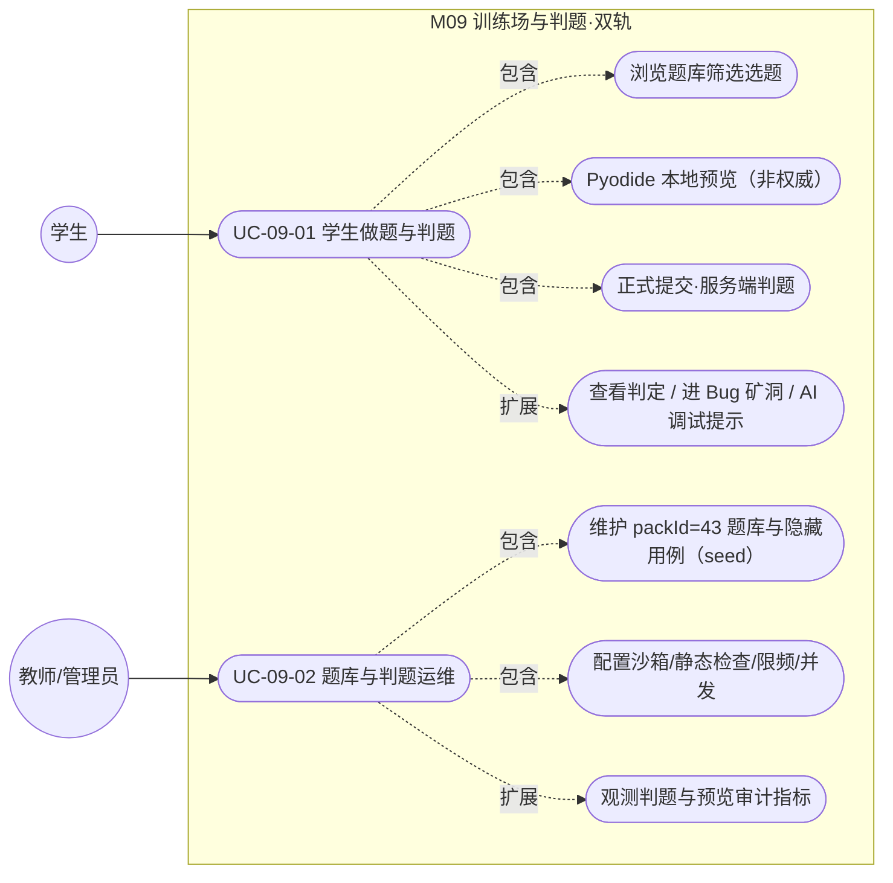
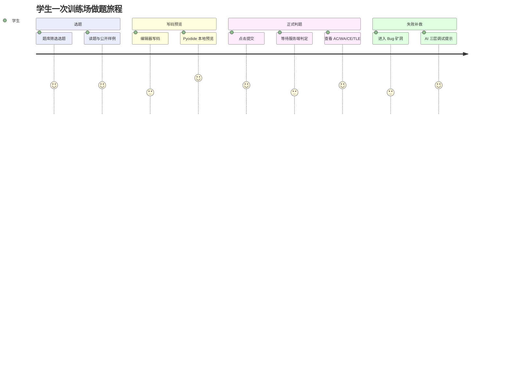

## 4.2.9 训练场与判题·双轨 · 功能需求

> 本文件 filecode：**R09**。图编号 `图 R09-n`、表编号 `表 R09-n`。
> 数据表完整字段字典见 §6（D3 文件），本文引用表名时只标「见 §6 表 xxx」，不再展开字段。

### 4.2.9.1 模块概述

训练场是 Pythontopia「看→学→练→测」闭环中的「练」环，承担**真题判题**这一最核心能力。模块采用**双轨执行**：浏览器端 `Pyodide 0.25` 提供即时**本地预览**（非权威、不入正式判分），服务端 Python 子进程沙箱提供**正式判题**（权威、结果入库）。学生在做题页（`/training`）选题、写码、本地预览，确认后正式提交；后端依次执行**静态安全检查 → 资源受限沙箱跑测试用例 → 判定结论入库 → 联动学习流**（任务证据校验、掌握度刷新、情绪探针、失败可入 Bug 矿洞）。判题结论用统一的 `Verdict` 七态（`AC / WA / RE / TLE / CE / MLE / SYSTEM_ERROR`）表达。整个链路坚持两条防泄题红线：**Pyodide 预览结果绝不写回后端当判分依据**；**隐藏测试用例（`hidden_test_cases`）只在服务端判题内部读取，绝不随题面下发前端**。后端代表包为 `com.pythontopia.submission`（含 `controller` / `service` / `judge` / `repository` / `dto`）与 `com.pythontopia.mainline.practice`；前端代表页面/组件为 `TrainingPage` / `TrainingPanel` / `PythonCodeEditor` / `ProblemListPage` / `JudgeResultPanel` / `DualTrackCard`；关联智能体为 `PracticeAgent`（出题）与 `DebugAgent`（调试提示），二者均内置泄答兜底。

### 4.2.9.2 模块用例图

本模块识别两类执行者：**学生**（做题与判题主用户）、**教师/管理员**（题库与判题运维）。用例总览见 图 R09-1。

### 图 R09-1 用例图（flowchart 形式）



### 4.2.9.3 功能需求清单

### 表 R09-1 功能需求列表

| 编号 | 功能需求 | 关联端点 / 实体 | 优先级 |
| --- | --- | --- | --- |
| FR-09-01 | 学生按 KC / 难度 / 玩家状态筛选题库并进入做题页 | `ProblemListPage` → `/training?problemId=` | 高 |
| FR-09-02 | 拉取题目公开视图（题面 + 公开样例，**不含隐藏用例**） | `GET /api/problems/{id}/public` | 高 |
| FR-09-03 | 浏览器端 Pyodide 即时预览，回显 stdout/stderr/耗时 | `runPyodidePreview`、`game/adapters/pyodide.ts` | 高 |
| FR-09-04 | 正式提交代码，服务端判题并落库返回结论 | `POST /api/submissions` | 高 |
| FR-09-05 | 提交前静态安全检查（禁用 token / 超长 / 空代码）→ CE | `StaticCodeChecker` | 高 |
| FR-09-06 | 资源受限沙箱执行测试用例并判 `AC/WA/RE/TLE` | `PistonPythonSandbox`、`JudgeCaseEvaluator` | 高 |
| FR-09-07 | 查询单次提交详情与历史提交列表 | `GET /api/submissions/{id}`、`GET /api/submissions` | 中 |
| FR-09-08 | 每用户正式提交限频（10 秒内仅一次） | `SubmissionService.enforceRateLimit` | 高 |
| FR-09-09 | 判定结果联动学习流（任务证据、掌握度、情绪探针、矿洞入口） | `QuestService`、`LearningEvent` | 高 |
| FR-09-10 | 主线「练-客观题」服务端判分（防泄题，作答后回讲解） | `POST /api/mainline/stages/{stageId}/practice/{questionId}/answer` | 中 |
| FR-09-11 | 题库与隐藏用例由课程包 seed 维护（packId=43） | `data/course-pack-43/`、见 §6 表 `course_problem` | 中 |
| FR-09-12 | 判题运维参数可配置（解释器/网络隔离/并发/限频） | `pythontopia.judge.*`、`JudgeWorkerPool` | 中 |

### 4.2.9.4 用例描述

### UC-09-01 学生做题与判题

- **功能简述**：学生在训练场选题、写码、本地预览，正式提交后由服务端沙箱判题并入库，依据判定进入后续学习流。
- **用例编号**：UC-09-01
- **执行者**：学生（`Role.STUDENT`）
- **前置条件**：1. 已登录且持有效 JWT；2. 题目存在于课程包 `packId=43`；3. 浏览器可加载 Pyodide 运行时（同源自托管 `/pyodide/` 或 CDN 回退）。
- **后置条件**：成功：`practice_submission` 写入一条记录且 `judge_result` 写入对应判定（一对一），`status ∈ {PASSED, FAILED, ERROR}`；`Verdict.AC` 时发布 `PracticeSucceeded` 事件、可自动完成关联任务、刷新掌握度。失败：返回业务错误码（如 `SUBMISSION_CODE_EMPTY` / `SUBMISSION_THROTTLED` / `PROBLEM_NOT_FOUND`），不产生脏数据。
- **涉众利益**：学生：获得权威、可复现、带反馈的判定，失败时得到不泄答的调试支持；教师：沉淀真实提交与判定数据用于班级分析（见 §6 表 `judge_result`）；管理员：判题在受限沙箱内运行，宿主安全可控。
- **基本路径**：
  1. 学生在 `ProblemListPage` 按 KC / 难度 / 状态筛选，点击「去做」跳转 `/training?problemId=`。
  2. `TrainingPage` 调 `loadTrainingProblem(problemId)`，前端经 `GET /api/problems/{id}/public` 取回 `PublicProblemDto`（题面 + 公开样例）。
  3. 学生在 `PythonCodeEditor`（CodeMirror 6）写码，在调试面板填 Input。
  4. 点「运行」触发 `runPyodidePreview`，本地 Pyodide 执行并回显 stdout/stderr/耗时（**不入库**）。
  5. 点「提交代码」触发 `submitToServer`，前端 `POST /api/submissions`，请求体 `SubmissionCreateRequest`。
  6. 后端取每用户事务咨询锁串行化、校验限频与题目归属，写 `practice_submission(status=PENDING)`。
  7. `JudgeService` 置 `RUNNING` → 静态检查 → 取测试用例 → 工作线程池跑沙箱 → 写 `judge_result` → 置终态。
  8. 前端 `GET /api/submissions/{id}` 取 `SubmissionDetailDto`，在 `JudgeResultPanel` 展示判定（标注「正式判题」）。
- **扩展路径**：
  - 4a. Pyodide 加载失败：自托管资源缺失时回退 CDN，仍失败则在 toast 提示错误，不影响后续正式提交。
  - 5a. 代码为空：前端先行拦截提示「代码不能为空。」；即便绕过，后端返回 `400 SUBMISSION_CODE_EMPTY`。
  - 6a. 10 秒内已有提交：后端返回 `429 SUBMISSION_THROTTLED`，提示稍候。
  - 7a. 静态检查命中禁用 token / 超长：判 `Verdict.CE`，`status=FAILED`，`failureReason` 记规则标签。
  - 7b. 沙箱超时 / 运行时错误 / 输出不符：分别判 `TLE / RE / WA`，遇首个非 `AC` 用例即短路。
  - 8a. 判定为非 CE 的失败：`TrainingPanel` 出现「进入 Bug 矿洞」入口，并可调起 AI 导学（`DebugAgent` 三层提示，不泄答）。
- **字段列表**：`SubmissionCreateRequest{problemId, code(≤8192), questId?, source?}`；返回 `SubmissionDetailDto{submission{id,userId,problemId,questId,source,language,submittedAt,status,runtimeMs,memoryKb}, judgeResult{verdict,passedCases,totalCases,failureReason,trace,createdAt}}`；`PublicProblemDto{id,packId,kcCode,title,statementMarkdown,inputDescription,outputDescription,difficulty,samples}`（取自真实 DTO）。落库表见 §6 表 `practice_submission` / `judge_result`。
- **设计规则**：① 业务规则：正式判定以服务端为唯一权威，Pyodide 预览仅参考；判定遇首个失败用例短路。② 非功能：单用例 CPU 5s（TLE 兜底）、虚拟内存 256MB、判题并发受 `JudgeWorkerPool` 限制；每用户 10s 限一次正式提交。③ 设计约束：`hidden_test_cases` 不出现在 `PublicProblemDto`，仅服务端 `findTestCases` 内部读取。
- **未解决的问题**：当前验证覆盖适配器的 fail-closed 行为，尚未在生产隔离服务上进行真实恶意样本验证。
- **备注**：`source` 默认 `TRAINING`，矿洞变式 / 任务 / 班级提交复用同一判题链路（枚举见 §6 表 `practice_submission.source`）。

### UC-09-02 教师/管理员维护题库与判题运维

- **功能简述**：题库与隐藏用例随课程包 seed 维护，判题链路的安全/性能参数由配置驱动，运维方可观测判题与预览审计指标。
- **用例编号**：UC-09-02
- **执行者**：管理员（运维/配置）、教师（指标查看）
- **前置条件**：1. 已部署后端与 PostgreSQL；2. 课程包 `packId=43` 已初始化（39 道题）；3. 已配置独立 Piston 服务及 Python 运行时，并由部署边界提供操作系统/容器隔离（固定 Piston API v3.1.0 本身不提供该边界）；后端本地 `python3` 仅供受信任的 AST 检查器使用。
- **后置条件**：成功：题库与隐藏用例可被判题正确读取；沙箱/静态检查/限频/并发参数生效；判题与预览审计数据可供教师看板聚合。失败：启动自检日志暴露解释器缺标准库等基础设施问题（不静默）。
- **涉众利益**：教师：基于真实判定与预览审计了解班级易错与练习强度；管理员：以最小配置面控制判题安全边界与吞吐；学生：题库稳定、判题环境一致。
- **基本路径**：
  1. 管理员将题目（题面、公开样例、`hidden_test_cases`、`kc_code`、难度）随课程包 seed 落入见 §6 表 `course_problem`。
  2. 配置 `PYT_PISTON_URL`、`PYT_PISTON_PYTHON_VERSION`（以及需要时的 `PYT_PISTON_AUTH_TOKEN`）；`pythontopia.judge.python` 只用于 AST 白名单检查。
  3. 应用启动：`StaticCodeChecker` 自检 AST 白名单可用性，`PistonPythonSandbox` 检查指定运行时是否可用并写日志。
  4. 按吞吐需要调 `JudgeWorkerPool`（core=2 / max=4 / queue=100）与限频常量（10s）。
  5. 教师/运维查看判定分布（见 §6 表 `judge_result` 的 `verdict` 索引）与 Pyodide 预览审计（见 §6 表 `pyodide_execution`）。
- **扩展路径**：
  - 2a. Piston 不可用或运行时未安装：判题就绪检查失败，提交返回系统错误；绝不在后端或 Graph 进程内执行学生代码。
  - 3a. 本地 AST 检查解释器缺 `ast` 等标准库：自检记 `ERROR` 提示换完整 `python3`，避免全部提交被误判。
  - 5a. 教师看板维度聚合属 M13 班级看板范畴，本模块仅提供判定与审计数据底座。
- **字段列表**：配置键 `PYT_JUDGE_PROVIDER`、`PYT_JUDGE_PYTHON`、`PYT_PISTON_URL`、`PYT_PISTON_PYTHON_VERSION`、`PYT_PISTON_AUTH_TOKEN`；seed 字段见 §6 表 `course_problem`（`samples` / `hidden_test_cases` / `kc_code` / `difficulty`）；审计见 §6 表 `pyodide_execution`（`status`：`OK/TIMEOUT/OOM/WORKER_CRASH/BLOCKED/TRUNCATED/CANCELLED`）。
- **设计规则**：① 业务规则：题库为课程包权威 seed，运行期不提供匿名 CRUD。② 非功能：判题子进程数有界，满载 `CallerRunsPolicy` 回压；静态检查与沙箱故障 fail-closed（拦截而非放行）。③ 设计约束：隐藏用例不下发、不序列化返前端（`PublicProblemRepository.findPublic` 的 SELECT 不含 `hidden_test_cases`）。
- **未解决的问题**：当前模块未提供面向教师/管理员的运行期题库 REST 增删改端点，题库变更须经课程包 seed / 迁移，属已知边界（非缺陷）。
- **备注**：`pregenerated_problem`（见 §6 表）服务于 M10 无尽/Boss 的题目预生成与判题兜底，与本模块共用判题理念但归 M10。

### 4.2.9.5 接口与非功能需求

### 表 R09-2 对外接口清单（取自真实 controller）

| 方法 · 路径 | 角色 | 请求体 / 参数 | 返回 | 错误码 |
| --- | --- | --- | --- | --- |
| `POST /api/submissions` | STUDENT | `SubmissionCreateRequest` | `SubmissionDto` | `SUBMISSION_CODE_EMPTY` / `SUBMISSION_THROTTLED` / `PROBLEM_NOT_FOUND` |
| `GET /api/submissions/{id}` | STUDENT | `id` | `SubmissionDetailDto` | `SUBMISSION_NOT_FOUND` |
| `GET /api/submissions` | STUDENT | `problemId? status? limit=30 offset=0` | `List<SubmissionDto>` | — |
| `GET /api/problems/{id}/public` | STUDENT | `id` | `PublicProblemDto` | `PROBLEM_NOT_FOUND` |
| `POST /api/mainline/stages/{stageId}/practice/{questionId}/answer` | STUDENT | `PracticeAnswerRequest{answers}` | `PracticeAnswerResultDto` | `PRACTICE_QUESTION_STAGE_MISMATCH` |

### 表 R09-3 非功能需求

| 编号 | 类别 | 需求 | 度量 / 取值 |
| --- | --- | --- | --- |
| NFR-09-01 | 安全 | 提交代码先过静态黑名单 + AST 白名单，违规判 CE | 16+ 类禁用 token；代码 ≤ 8192 字符 |
| NFR-09-02 | 安全 | 隔离执行服务强制资源上限与进程隔离 | Piston 请求封顶墙钟/内存；部署边界还须限制 CPU、容器资源、进程与网络 |
| NFR-09-03 | 安全 | 学生代码不在应用进程执行；隔离服务不可用时 fail closed | 禁止本地回退；不可用返回系统错误 |
| NFR-09-04 | 性能 | 判题并发有界、突发回压不拖垮宿主 | core=2 / max=4 / queue=100 |
| NFR-09-05 | 防滥用 | 正式提交限频；Pyodide 预览本地预算 | 10s/次；预览 20 次/分、200 次/日 |
| NFR-09-06 | 可观测 | 判定 trace 入库、预览执行审计入库 | 见 §6 表 `judge_result.trace`、`pyodide_execution` |
| NFR-09-07 | 防泄题 | 隐藏用例不下发；预览不入正式判分 | `PublicProblemDto` 无隐藏用例字段 |
| NFR-09-08 | 可用性 | 判定容器常驻并 `aria-live` 播报 | `JudgeResultPanel role="status"` |

### 图 R09-2 需求追踪图（requirementDiagram）

```mermaid
requirementDiagram
  requirement AntiLeak {
    id: NFR-09-07
    text: 预览不入正式判分且隐藏用例不下发
    risk: high
    verifymethod: test
  }
  requirement SandboxSafety {
    id: NFR-09-02
    text: 资源受限子进程沙箱执行学生代码
    risk: high
    verifymethod: test
  }
  functionalRequirement FormalJudge {
    id: FR-09-04
    text: 提交代码服务端判题并落库
    risk: high
    verifymethod: test
  }
  element SubmitController {
    type: controller
  }
  SubmitController - satisfies -> FormalJudge
  FormalJudge - derives -> AntiLeak
  FormalJudge - derives -> SandboxSafety
```

### 图 R09-3 学生做题旅程（journey）



---

执笔人：成员 B ｜ 完成人（签名）：成员 B ｜ 审查人：成员 C ｜ 完成日期：2026-06-14
