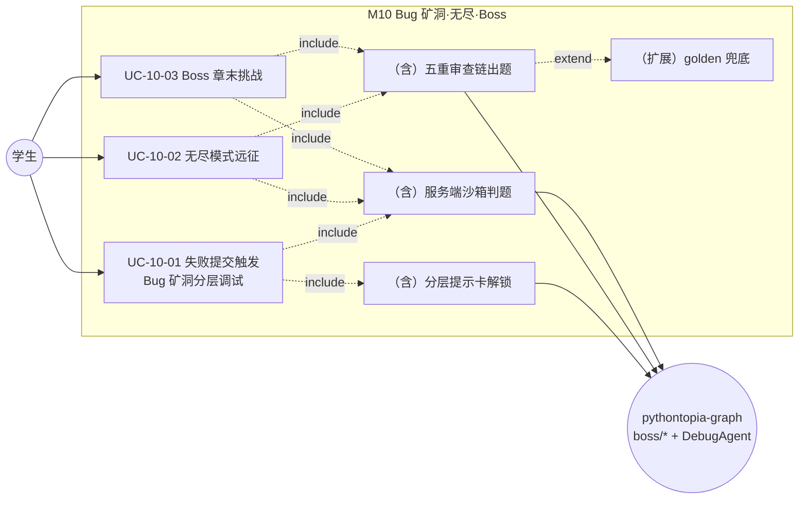
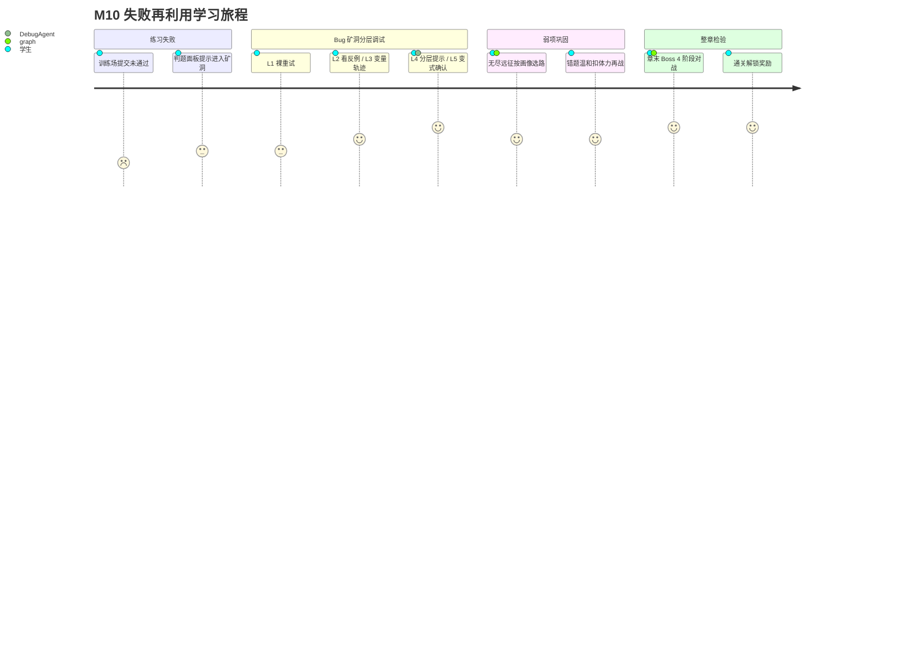

## 4.2.10 Bug 矿洞·无尽·Boss · 功能需求

### 4.2.10.1 模块概述

M10 是 Pythontopia「练→测」闭环的**进阶挑战层**，把一次次真判题的结果转化为三类游戏化学习场景：**Bug 矿洞**（失败提交触发的分层调试支线，后端包 `com.pythontopia.bugmine`）、**无尽模式 / 无尽远征**（连续自适应出题与 Roguelike 分支远征，后端包 `com.pythontopia.world.boss` 的远征 run 持久化）、**章末 Boss 副本**（4 阶段 AI 出题对战，后端包 `com.pythontopia.world.boss`）。三者共用同一套 AI 出题与判题底座：题目由 `pythontopia-graph` 的 `boss/*` 智能体生成并经**五重审查链**（结构校验→自测→KC 接地→难度估计→查重/敏感词）把关，LLM 不可用时回落到内置 28 道 golden 兜底题（7 章 × 4 阶段）；玩家代码统一进服务端沙箱判题，结果通过 `LearningEvent` 回流 KC 掌握度与 8 维学习画像。本模块面向**学生**角色（Bug 矿洞与无尽远征 run 仅学生可用，教师/管理员 403），是把「失败」重新利用为「针对性巩固」的核心教学装置，呼应项目「看→学→练→测」之后的「错题再练、弱项再攻」诉求。

在功能边界上，M10 聚焦「失败再利用」与「自适应挑战」，不重复实现训练场的常规判题（见 M09）与工坊的资源生成（见 M08），而是复用它们的判题底座与画像信号；其教育映射为「Bug = 矿洞调试事件、弱项 = 远征前沿、整章检验 = Boss 副本」。非功能上，本模块须满足三条硬性需求：① 防幻觉（NFR-AIH）——AI 出题须过五重审查、超纲/撞题/缺证据一律拒绝，分层提示不得泄露完整答案；② 高可用降级（NFR-FB）——LLM 或 graph 任一不可用时以 golden 兜底或 Pyodide 降级，绝不阻塞玩家或返回 5xx；③ 学情单一事实源——掌握度只由服务端真判题经 `LearningEvent` 回流，远征过程进度与学情真值物理分离、互不污染。这三条既是设计约束，也是 §9 功能测试的重点验收项。三个用例（UC-10-01~03）分别覆盖失败入矿、弱项远征、整章对战，串起一条「越练越准」的进阶闭环。

### 4.2.10.2 模块用例图（图 R10-1）



### 4.2.10.3 需求关系图（图 R10-2）

```mermaid
requirementDiagram
  requirement R10_FR1 {
    id: R10-FR1
    text: "失败提交可进入 Bug 矿洞并按 L1-L5 分层下探调试"
    risk: Medium
    verifymethod: Test
  }
  requirement R10_FR2 {
    id: R10-FR2
    text: "无尽远征按掌握度+画像生成分支地图并跨会话续局"
    risk: High
    verifymethod: Test
  }
  requirement R10_FR3 {
    id: R10-FR3
    text: "Boss/无尽题目须过五重审查链方可下发"
    risk: High
    verifymethod: Test
  }
  requirement R10_NFR_AIH {
    id: R10-NFR-AIH
    text: "防幻觉：超纲语法/查重命中/缺证据拒绝出题"
    risk: High
    verifymethod: Test
  }
  requirement R10_NFR_FALLBACK {
    id: R10-NFR-FB
    text: "LLM/graph 不可用时 golden 兜底或 Pyodide 降级不阻塞"
    risk: Medium
    verifymethod: Test
  }
  element BossPipeline {
    type: "agents/boss/*"
  }
  element BugMineSvc {
    type: "BugMineService"
  }
  BossPipeline - satisfies -> R10_FR3
  BossPipeline - satisfies -> R10_NFR_AIH
  BossPipeline - satisfies -> R10_NFR_FALLBACK
  BugMineSvc - satisfies -> R10_FR1
```

### 4.2.10.4 用例规约

#### UC-10-01 失败提交触发 Bug 矿洞分层调试

- **功能简述**：训练场/路径任务提交未通过（非 PASSED）后，学生可携该 `submissionId` 进入 Bug 矿洞，系统收集反例与变量轨迹并由 DebugAgent 生成分层提示卡；学生按 L1 裸重试→L2 反例→L3 变量轨迹→L4 分层提示→L5 同 KC 变式逐层下探，修复后会话转 RESOLVED。
- **用例编号**：UC-10-01
- **执行者**：学生
- **前置条件**：1. 已登录且角色为 STUDENT；2. 存在一条属于本人、状态为非 PASSED 的 `practice_submission`；3. `pythontopia-graph` 的 DebugAgent 端点 `/agents/debug/analyze` 可达。
- **后置条件**：成功：新建（或复用）`bug_mine_session`（OPEN），写入反例/变量轨迹/错误假设/三层提示共 6 类卡片；重试通过后会话 RESOLVED 并发布 `DebugResolved` 事件回流掌握度。失败：达单会话重试上限（默认 3）拒绝再提交，或主动 `close` 为 ABANDONED（发布 `PracticeAbandoned`）。
- **涉众利益**：学生：把一次失败变成结构化、不给完整答案的渐进巩固；教师：错题与修复历史沉淀进复盘大厅与班级 KC 视图；管理员：调试审计可追溯。
- **基本路径**：
  1. 学生在判题失败面板点击「进入 Bug 矿洞」，前端经 store 暂存私有 `submissionId` 后跳 `/bug-mine`（id 不入 URL）。
  2. 后端 `POST /api/bug-mine/sessions` 校验提交归属与「非 PASSED」，按掌握度+画像估算 `profileDepthTarget`（L2~L5）。
  3. `CounterExampleSelector` 选首个失败反例，`PythonTraceCollector` 采集变量轨迹，组装 `DebugAgentRequest` 调 DebugAgent。
  4. DebugAgent 返回反例卡、错误假设卡与三层提示，落 `bug_mine_card` 并随会话一次性下发题干。
  5. 学生在 L1 独立重写后 `POST /sessions/{id}/retry-submit`；未过则深度层自增、逐层 `reveal` 解锁深层卡片。
  6. 通过则会话 RESOLVED、出矿；到 L5 可 `variant-submit` 做同 KC 变式题确认迁移（`mastery_confirmed`）。
- **扩展路径**：
  - 3a. DebugAgent 不可达：返回 `BAD_GATEWAY`（`DEBUG_GRAPH_UNAVAILABLE`），提示稍后再试，不写半截会话。
  - 5a. 重试次数达上限：返回 `TOO_MANY_REQUESTS`（`BUG_MINE_RETRY_EXCEEDED`），引导去工坊为该 KC 生成讲义后再战。
  - 6a. 当前深度不足解锁深层卡：返回 `BUG_MINE_DEPTH_LOCKED`，要求先完成上一层。
- **字段列表**：`BugMineOpenRequest{submissionId}`；`BugMineRetryRequest{code}`；`BugMineSessionDto{id, userId, submissionId, problemId, questId, status, retryCount, depthLayer, profileDepthTarget, masteryConfirmed, variantSubmissionId, variantProblem, profileGuidance, depthSteps, cards, problem}`；卡类型 `BugMineCardType{COUNTER_EXAMPLE, VARIABLE_TRACE, WRONG_ASSUMPTION, HINT_LAYER_1/2/3}`（取自 `bugmine/dto`，落表见 §6 表 `bug_mine_session` / `bug_mine_card`）。
- **设计规则**：单会话重试上限 `pythontopia.bugMine.maxRetriesPerSession`（默认 3）；`submission_id` 唯一→一次提交至多一个矿洞会话；分层提示第 3 层经 safety 审查，含可粘贴代码即降级脱敏；状态机不可由 `close` 置回 OPEN。
- **未解决的问题**：变量轨迹采集对超大循环按 200 步截断，长程数值演化的可视化仍有限。
- **备注**：遗忘回声（`/api/bug-mine/echoes`）按 FSRS-lite 到期度复用同一矿洞机制，为 UC-10-01 的复习态变体。

#### UC-10-02 无尽模式远征

- **功能简述**：学生进入无尽远征（`/expedition`），系统按权威掌握度+画像经知识前沿选择器生成分支地图，玩家选路闯关、真判题，答对攒气势、答错温和扣体力，体力归零结束、打通顶层 BOSS 胜利；一局过程进度（HP/气势/得分/地图/节点）后端权威持久化，支持跨设备续局。亦提供简洁的「无尽模式」（`/endless`）连续刷题入口。
- **用例编号**：UC-10-02
- **执行者**：学生
- **前置条件**：1. 已登录且角色为 STUDENT；2. 课程包 `packId=43` 的 KC 与掌握度可读；3. graph 出题端点可达（不可达则前端回退本地前沿）。
- **后置条件**：成功：`expedition_run`（每用户单条活跃 run，`user_id` 主键）UPSERT 保存过程进度；每道战斗题真判题入库并发学习事件，掌握度永久保留。失败/弃局：`DELETE /run` 清除活跃 run，但已入库的判题结果与掌握度不回滚。
- **涉众利益**：学生：以 Roguelike 节奏按弱项自适应巩固，跨设备续局不丢进度；教师：无尽与远征的练习同样回流 KC 热力图；管理员：单活跃 run 约束降低存储与刷分风险。
- **基本路径**：
  1. 学生选「聚焦章节」（或全局自适应）后点「开始远征」；本地无进行中局时先 `GET /api/world/expedition/run` 续局。
  2. 前端调 `POST /api/world/boss/select-frontier`，后端读权威掌握度+`kc_mastery.last_event_at` 间隔重复信号，graph 排序候选 KC 生成分支地图。
  3. 学生在地图选可达节点进入战斗，`POST /api/world/boss/{chapter}/problem` 取题（AI 五重审查 / golden）。
  4. 编辑器作答→`POST /api/world/boss/{chapter}/attempt` 服务端沙箱判题，回放 HP/气势/得分并 `PUT /run` 持久化。
  5. 逐层推进至顶层 BOSS；通关进结算页，展示深度/得分/最高气势与知识星座。
- **扩展路径**：
  - 2a. graph 不可达：`select-frontier` 返回空 picks，前端回退本地 `useKcFrontier`，不阻塞开局。
  - 3a. 命中已预生成 READY 题：原子标 CONSUMED 直接复用，省去现场等 LLM。
  - 4a. 判题缓存过期且无持久化题：返回 Pyodide-only 兜底提示，引导前端本地校验后再提交。
- **字段列表**：`FrontierSelectRequest{profileSignals, recentKcs, focusChapter, exclude, count}`→`FrontierSelectResultDto{picks:[{kcCode, chapter, difficulty, reason}]}`；`ExpeditionRunDto{phase, focusChapter, nodes, layers, currentNodeId, hp, maxHp, momentum, bestMomentum, score, relics, isDaily, history}`（落表见 §6 表 `expedition_run`）。
- **设计规则**：掌握度只由后端权威读取（防刷，单一事实源）；run `status` 仅 `ACTIVE`，单用户单活跃 run；难度由掌握度+成功率推断（低成功率下调、高成功率上调）。
- **未解决的问题**：分支地图 `nodes/relics/history` 以 JSONB 整体存取，后端不解释其结构，节点 schema 演进依赖前端约束。
- **备注**：`/endless` 与 `/expedition` 共用 boss 出题/判题端点，区别在于前者线性连续、后者分支远征。

#### UC-10-03 Boss 章末挑战

- **功能简述**：学生完成某章主线 5 子任务后进入该章 Boss 副本（`/boss/:chapter`），连闯 4 个 stage，每 stage 一道 AI 出题（难度按学情自适应），全部通过则击败 Boss、解锁奖励/故事板，第 7 章通关进入毕业典礼。
- **用例编号**：UC-10-03
- **执行者**：学生
- **前置条件**：1. 已登录；2. `chapter` 为 1..7 且该章 5 子任务全部完成（前端守卫）；3. graph 出题/评测端点可达或具备 golden 兜底。
- **后置条件**：成功：4 stage 全过，记录 `boss_attempt` 提交历史，发布 `PracticeSucceeded` 回流掌握度，章节进度/奖励落主线存档。失败：单 stage 可「再来一次」，提交历史与 `passed=false` 仍入 `boss_attempt` 供教师审核与自适应难度。
- **涉众利益**：学生：以对战仪式感检验整章掌握；教师：`boss_attempt` 是 AI 出题质量审核与班级 KC 热力的数据源；管理员：AI 题与 golden 题以 `ai_generated` 区分，便于重点抽审。
- **基本路径**：
  1. 学生进入 `/boss/:chapter`，页面 `startStage` 拉第 1 阶段题：`POST /api/world/boss/{chapter}/problem`。
  2. 后端 `BossService` 把 chapter+stage 解析为锚定 KC，按该章掌握度+置信度推断难度 1..5。
  3. graph 经五重审查链出题（重试耗尽回落 golden），完整题（含 hidden testCases）入进程缓存（TTL 30min）。
  4. 学生作答后 `POST /api/world/boss/{chapter}/attempt`，服务端沙箱评测，回 `passed/passedTestCases/score/failureFirstHint`。
  5. 通过则 stage++，进入下一阶段（可预取下一题）；4 阶段全胜→victory，回小镇或毕业典礼。
- **扩展路径**：
  - 3a. LLM 余额不足/解析失败：route 以 golden 兜底题返回，前端徽标显示「Golden 兜底」。
  - 4a. graph 评测不可用：返回结构化兜底，提示用前端 Pyodide 校验后再提交，不污染掌握度（未判定不发事件）。
  - 4b. 题目缓存过期且无持久化：返回 Pyodide-only 兜底。
- **字段列表**：`BossProblemRequest{stage, kcCode, difficulty, preferredKc, preferredKind, profileSignals, arenaLevel}`→`BossProblemDto{problemId, chapter, stage, difficulty, kcCode, statement, hints, sampleInput, sampleOutput, totalTestCases, reviewed, aiGenerated}`；`BossAttemptRequest{problemId, chapter, stage, code, elapsedSec}`→`BossAttemptResultDto{problemId, passed, passedTestCases, totalTestCases, failureFirstHint, score, feedback}`（落表见 §6 表 `boss_attempt`）。
- **设计规则**：chapter 1..7、stage 1..4 强校验；分数规则全过取 `max(80, 通过率×100)`、未过取 `通过率×60`；仅服务端沙箱真实判完才发学习事件，单次 attempt 幂等。
- **未解决的问题**：进程内题目缓存随重启失效，靠 `pregenerated_problem` best-effort 回补，跨实例一致性未做。
- **备注**：无尽远征的 boss 节点复用本用例的出题/评测链，差异在于多阶段与奖励演出。

### 4.2.10.5 用户学习旅程（图 R10-3）



---

> 执笔人：成员 B ｜ 完成人（签名）：成员 B ｜ 审查人：成员 C ｜ 完成日期：2026-06-14
