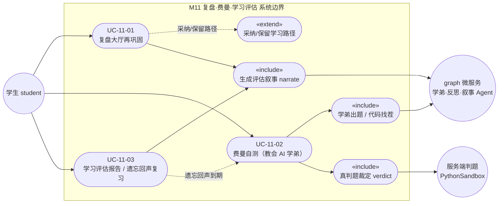
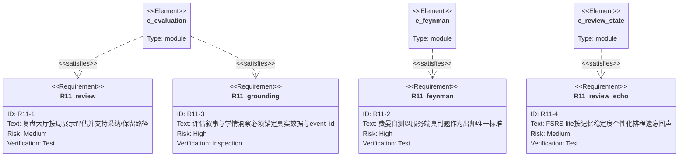
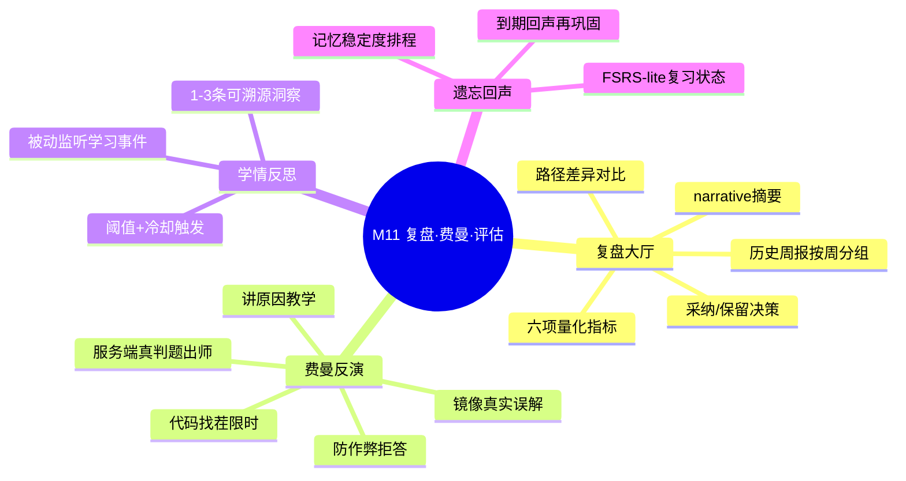

## 4.2.11 复盘·费曼·学习评估 · 功能需求

> 本文 `filecode = R11`。图编号 `图 R11-n`、表编号 `表 R11-n`。涉及的数据表完整字段字典见 §6 数据库设计（D4 分片），本文仅按用例列出引用字段，不展开字典。

### 4.2.11.1 模块概述

M11 是 Pythontopia「看→学→练→测」闭环里的**「测·复盘」收口环节**：当学生在主线、训练场、Bug 矿洞里持续产生学习行为后，本模块负责把这些散落的真实事件**收敛成可读、可信、可行动的复盘结论**，并据此驱动下一轮个性化学习。它由三块互相咬合的能力组成：

- **复盘大厅（Review Hall）**：以「周报」形式呈现学习评估快照——六项量化指标、关键 KC 成长、AI 生成的 narrative 摘要，以及「当前 ACTIVE 路径 vs 新建议 DRAFT 路径」的差异对比，学生在此**一键采纳或保留**学习路径。对应后端 `learner.evaluation` 包、前端 `ReviewHallPage` / `ReviewHallPanel`。
- **费曼反演（Feynman 自测）**：学生面对一个**镜像其真实错误**的 AI 学弟，先在「代码找茬」里限时点出 bug 行，再用「讲原因」的方式教会学弟，最后由**服务端真判题**裁定是否「出师」。这是一种「以教促学」的高阶自测，对应后端 `feynman` 包、前端 `FeynmanPage` / `FeynmanPanel` / `BugHunterGame`。
- **学情反思与遗忘回声**：后台被动监听学习事件，攒够阈值即触发 `ReflectionAgent` 综合 1–3 条**可溯源**的学情洞察；同时 FSRS-lite 复习引擎（`kc_review_state`）按记忆稳定度个性化排程，把「该复习了」的 KC 以**遗忘回声**形式推回练习入口。

三者共享同一条防幻觉红线：**所有结论必须锚定真实数据**——评估 narrative 里的每个数字与 KC 都要能在 metrics / 掌握度表中找到出处，每条学情洞察都要引用真实 `learning_event_log.id`，费曼「出师」必须通过代表题的隐藏用例，否则一律拒绝呈现。涉及核心表：`feynman_session` / `feynman_turn`、`kc_review_state`、`learner_evaluation` / `learner_evaluation_metric`（字段见 §6 D4）。

本模块仅面向**学生**角色（三个 controller 均强制 `requireStudent`），教师视角的班级聚合不在此模块，见 M13。

**数据需求**：M11 几乎不自产原始数据，而是「消费 + 收敛」全站学习数据，因此对上游数据的真实性与可追溯性要求极高。复盘评估读取 `kc_mastery`/`kc_mastery_event`（掌握度与增量）、`practice_submission`/`judge_result`（练习与 AC 率）、`bug_mine_session`（矿洞修复率）、`resource_feedback`（资源消化）、`profile_revision`（画像置信度）；费曼自测读取 `learning_event_log` 的 `practice_failed` 事件还原真实误解、并复用训练场 `course_problem` 的代表题与隐藏用例；学情反思读取 `memory_embedding` 记忆条目；遗忘回声依赖 `kc_review_state` 的到期信号。本模块自身仅新增 `feynman_session`/`feynman_turn`、`kc_review_state`、`learner_evaluation`/`learner_evaluation_metric`、`learner_insight` 五类落库（字段见 §6 D4 / D1）。所有写入都要求带证据指针（误解的 `evidenceEventIds`、洞察的 `evidence_event_ids`、评估的 `narrativeRef`），确保任何结论都能反查到原始事件。

### 4.2.11.2 模块用例图

本模块共识别 3 个主用例（UC-11-01 复盘大厅再巩固、UC-11-02 费曼自测、UC-11-03 学习评估报告/遗忘回声复习），均由学生发起，AI 微服务（graph）与服务端判题作为支撑参与者。



<center>图 R11-1　M11 模块用例图（学生 × 3 主用例 × graph/判题支撑者）</center>

### 4.2.11.3 用例规约

#### UC-11-01 复盘大厅再巩固

- **功能简述**：学生进入复盘大厅，浏览按周分组的历史评估周报，点开某次评估查看六项指标、KC 成长 narrative 与路径差异，对系统建议的新路径做出「采纳 / 保留」决策，完成对一段时期学习的再巩固与方向校准。
- **用例编号**：UC-11-01
- **执行者**：学生
- **前置条件**：1. 已登录且角色为 `STUDENT`；2. 近期已有学习活动（提交练习 / 入矿 / 消化资源 / 解锁 KC 之一），否则评估为「数据不足」占位。
- **后置条件**：成功：渲染评估详情，`actedStatus` 由 `PENDING` 流转为 `ACCEPTED`（新 DRAFT 路径被激活、旧路径归档）或 `KEPT_OLD`（DRAFT 归档、保留原 ACTIVE）。失败：提示错误，评估状态与路径不变。
- **涉众利益**：学生：看清这段时间「进步在哪、薄弱在哪、下一步往哪走」；教师：学生自驱复盘减少课堂答疑压力（间接）；管理员：沉淀可审计的评估快照。
- **基本路径**：
  1. 学生打开 `/review-hall`，前端并行加载 `GET /api/learner/evaluations?limit=20` 与当前激活路径；
  2. 面板按「本周 / 上周 / 日期区间」对历史评估分组展示；
  3. 学生点击某条评估行，触发 `GET /api/learner/evaluations/{evaluationId}`；
  4. 详情弹窗渲染 6 张 `MetricCard`（指标）、`KcGrowthList`（narrative 摘要）、`PathDiffView`（ACTIVE vs DRAFT 节点对比）；
  5. 若该评估 `actedStatus = PENDING` 且存在 `draftPathId`，学生点「接受新路径」→ `POST /{id}/accept-new-path`，DRAFT 被 promote 为 ACTIVE、旧路径归档；
  6. 或学生点「保留当前」→ `POST /{id}/keep-old`，DRAFT 归档、保留原路径；
  7. 列表与详情按返回的新状态刷新徽标。
- **扩展路径**：
  - 5a. 评估无 `draftPathId`（近期数据不足未生成新路径）：「接受新路径」按钮禁用，仅可「保留当前」；
  - 5b. 该评估已被处理（`actedStatus ≠ PENDING`）：再次提交返回 `409 EVALUATION_ALREADY_ACTED`，前端提示「已处理，无法重复操作」；
  - 1a. 尚无任何评估：展示空态引导「先完成画像、解锁 ≥1 个 KC、提交 1 道练习，再点立即评估」。
- **字段列表**：`EvaluationDto`(id, userId, packId, periodStart, periodEnd, narrativeSummary, pathDiffSummary, draftPathId, activePathId, createdAt, actedStatus, metrics[], draftPath)、`EvaluationMetricDto`(metricKey, numerator, denominator, value, displayUnit, notes)（取自 `learner_evaluation` / `learner_evaluation_metric`，字典见 §6 D4）。
- **设计规则**：`actedStatus` 状态机为 `PENDING → ACCEPTED | KEPT_OLD`（`PARTIAL` 为数据不足占位）；接受/保留均为幂等闸门（非 PENDING 即拒）；narrative 经 graph 端 grounding+safety 双审通过才入库，详情页以「AI 生成解释·仅作建议」明示。
- **未解决的问题**：周报详情弹窗当前一次仅展示一条评估，跨周趋势折线（雷达/趋势图）尚未实现，列为后续增强。
- **备注**：复盘大厅顶部提供「测·费曼反演」入口，跳转 UC-11-02。

#### UC-11-02 费曼自测（教会 AI 学弟）

- **功能简述**：学生选定一个知识点，召唤一个**带着自己真实误解**的 AI 学弟；通过「代码找茬」限时定位 bug、再用自然语言「讲清错在哪」教会学弟，学弟据此产出修正代码，最后由服务端沙箱真判题裁定是否「出师」，掌握度随之回流。
- **用例编号**：UC-11-02
- **执行者**：学生（支撑者：graph 费曼学弟 Agent、服务端判题）
- **前置条件**：1. 已登录且为 `STUDENT`；2. 所选 KC 在课程包 `packId=43` 下存在「可用于费曼判题的代表题」（含可运行用例），否则开课即报 `FEYNMAN_PROBLEM_NOT_FOUND`。
- **后置条件**：成功：`feynman_session.status` 流转至 `JUDGED_PASS`，该 KC 掌握度 +0.10（来源 `PRACTICE_PASS`），发布 `TaughtAiSucceeded` 事件。失败：状态 `JUDGED_FAIL`，发布 `TaughtAiFailed`。
- **涉众利益**：学生：用「教别人」检验自己是否真懂，暴露似懂非懂的盲区；教师：高阶自测沉淀真实误解标签，反哺画像；管理员：教学全过程（误解→教学→判题→证据）可溯源。
- **基本路径**：
  1. 学生在 `/feynman` 用 `KcPicker` 搜选知识点（或从复盘大厅 / NPC 携带 `?kc=` 进入）；
  2. 点「开始」→ `POST /api/feynman/sessions`，后端 `MisconceptionExtractor` 从 `learning_event_log` 的 `practice_failed` 事件抽取该生在此 KC 的真实误解集合，落 `feynman_session`，挑选代表题；
  3. 学生点「开始找茬」→ `POST /sessions/{id}/bug-hunt`，学弟产出含 bug 的代码 + 真实 bug 行号；学生 30 秒内点选 bug 行，前端即时判命中/误报/漏判并计分；
  4. 学生在对话框「讲清错在哪」→ `POST /sessions/{id}/teach`，学弟回复并在被正确教导时产出修正代码 `taughtFix`；
  5. 学生点「真判题裁定」→ `POST /sessions/{id}/judge`，服务端取最新 `taughtFix` 代码跑代表题隐藏用例；
  6. 全部用例 AC → `JUDGED_PASS`，掌握度回流并提示「教学成功」。
- **扩展路径**：
  - 4a. 教学内容疑似直接贴答案（含 `answer_key` / ``` 代码围栏 / `def|class|import` 整段程序）：`FeynmanAntiCheat` 命中，学弟拒收、误解不解除、状态保持 `OPEN`；
  - 5a. 尚无可判题代码或代码疑似泄答：返回 `passed=false`「学弟还没有产出可判题代码」；
  - 5b. 代表题无隐藏用例：`JUDGED_FAIL` 并说明「暂不能完成费曼判题」；
  - 2a. graph 学弟不可达：`step` 走离线规则兜底（要求解释足够具体才视为讲清），`bug-hunt` 则返回 `502 FEYNMAN_BUG_EXPOSURE_UNAVAILABLE`。
- **字段列表**：`StartRequest`(kcCode)、`SessionResponse`(id, userId, kcCode, status, tuteeState)、`TeachRequest`(explanation)、`TurnResponse`(id, role, content, taughtFix)、`BugHuntResponse`(source, misconceptionTag, buggyCode, bugLineIndices, hintMd)、`Verdict`(sessionId, passed, message)（取自 `feynman_session` / `feynman_turn`，字典见 §6 D4）。
- **设计规则**：误解只能取自真实错误史（无错误史则空，不合成）；学弟初始暴露阶段不得自我纠错、不得点破 bug 行；`bug_line_indices` 一律由 buggy/fixed 行级 diff 得出（零伪造），且**不下发** `fixed_code`（答案）；「出师」以服务端判题为唯一标准，Pyodide 预览不算数。
- **未解决的问题**：会话历史（往轮对话）当前不在重开会话时回放；多 KC 连讲尚未支持。
- **备注**：状态机 `OPEN →（全部误解解除）TAUGHT`，判题后 `JUDGED_PASS | JUDGED_FAIL`。

#### UC-11-03 学习评估报告生成 / 遗忘回声到期复习

- **功能简述**：学生主动（「立即评估」）或系统每周自动，为其近一段时期的学习生成一份评估报告（指标 + narrative + 路径建议）；同时 FSRS-lite 复习引擎对到期遗忘的 KC 生成「遗忘回声」候选，引导学生回到练习入口再巩固。
- **用例编号**：UC-11-03
- **执行者**：学生（支撑者：`EvaluationNarrativeAgent`、`WeeklyEvaluationScheduler`、FSRS-lite 复习引擎）
- **前置条件**：1. 已登录且为 `STUDENT`；2. `periodDays ∈ [1,30]`（缺省 7）。
- **后置条件**：成功：新增一条 `learner_evaluation` 及其 6 条 `learner_evaluation_metric`，并据掌握度回写一次画像被动修订（来源 `EVALUATION`）；到期 KC 出现在遗忘回声候选列表。失败：narrative 未过安全/锚定审查时返回 `422`，不入库。
- **涉众利益**：学生：定期获得「数据说话」的学习体检与下一步建议；教师：班级层面可见学生自评活跃度；管理员：评估与画像修订留痕可审计。
- **基本路径**：
  1. 学生在复盘大厅点「＋ 立即评估」→ `POST /api/learner/evaluations`（body 可空，默认 7 天）；
  2. 后端汇聚周期内指标：Bug 矿洞修复率、KC 掌握增量/总量、练习 AC 率、画像置信度增量、资源消化数（共 6 项）；
  3. 调 graph `EvaluationNarrativeAgent` 生成 narrative + 关键建议 + 路径差异说明，并过 grounding（数字/KC 白名单）与 safety 审查；
  4. 审查通过则规划新 DRAFT 路径、写库、回写画像修订，返回完整 `EvaluationDto`；
  5. 遗忘回声侧：学生在练习/矿洞入口请求 `GET /api/bug-mine/echoes`，引擎按 `kc_review_state` 的到期信号筛出该复习的 KC（见 M10 矿洞入矿）；
  6. 学生选一个回声 KC `POST /api/bug-mine/echoes` 进入再巩固。
- **扩展路径**：
  - 3a. narrative 含未追踪数字/KC：grounding 失败 → `422 EVALUATION_NARRATIVE_GROUNDING_FAILED`；
  - 3b. 命中安全禁用词：`422 EVALUATION_NARRATIVE_SAFETY_FAILED`；
  - 2a. 周期内零活动：narrative 走 idle 占位（`status=PARTIAL`），提示先去画像/练习；
  - 0a. 每周一 03:00（UTC）`WeeklyEvaluationScheduler` 自动为「近 7 天有活动且近 6 天无评估」的学生各生成一份（幂等去重、单点失败隔离）。
- **字段列表**：`EvaluationRequest`(periodDays)、`EvaluationDto`(…actedStatus, metrics[], draftPath)、`BugMineEchoCandidateDto`(kcCode, problemId, problemTitle, masteryScore, confidence, decayRisk, minePriority, recommendationReason)；复习状态字段 `kc_review_state`(stability, difficulty, reps, lapses, last_review_at, due_at)（字典见 §6 D4）。
- **设计规则**：6 项指标 `metricKey` 固定（`bug_mine_resolve_rate`/`kc_mastery_delta_total`/`kc_mastery_total`/`practice_pass_rate`/`profile_confidence_delta`/`resource_consumption_count`）；FSRS-lite 采用幂律遗忘曲线、目标留存率 0.9，到期 = 可提取性跌破阈值（引擎确定性、不调 LLM、可单测）；评估固定绑定 `packId=43`。
- **未解决的问题**：遗忘回声目前借 Bug 矿洞「回声入口」承载（与 M10 共用），尚无独立「复习卡片」UI；多 worker 部署下反思计数为进程内状态需迁 Redis。
- **备注**：本用例横跨 `learner.evaluation`、`learner.mastery.review`、并以 `bugmine` 为遗忘回声出口。

### 4.2.11.4 需求追踪（requirementDiagram）



<center>图 R11-2　M11 关键需求 → 实现模块 追踪图</center>

### 4.2.11.5 模块能力心智图



<center>图 R11-3　M11 能力心智图</center>

### 4.2.11.6 非功能与约束需求

M11 的非功能需求集中在「可信」与「不打扰主链路」两个方向：作为面向学生的结论性模块，它的输出一旦失真就会误导学习方向，因此把防幻觉、可降级、成本可控、确定性与幂等作为硬约束逐条落地（见下表）。

| 编号 | 类别 | 需求描述 |
| --- | --- | --- |
| NFR-R11-1 | 安全/权限 | 三个 controller 全部 `requireStudent`，非学生访问返回 `403 FORBIDDEN` |
| NFR-R11-2 | 防幻觉 | 评估 narrative 经 grounding+safety 双审，未过即 `422` 拒绝入库；学情洞察证据 id 必须 ⊆ 输入记忆 |
| NFR-R11-3 | 可降级 | graph 学弟/反思不可达时分别走规则兜底 / best-effort 静默跳过，不阻塞主链路 |
| NFR-R11-4 | 成本 | 反思为唯一新增周期性 LLM 调用，靠「8 事件阈值 + 60 分钟冷却」限频 |
| NFR-R11-5 | 确定性 | FSRS-lite 复习引擎为纯函数、可单测、不触库不调 LLM |
| NFR-R11-6 | 幂等 | 每周自动评估按「近 6 天已有评估则跳过」去重；路径采纳/保留对非 PENDING 评估拒绝重复操作 |

<center>表 R11-1　M11 非功能与约束需求</center>

---

执笔人：成员 B ｜ 完成人（签名）：成员 B ｜ 审查人：成员 C ｜ 完成日期：2026-06-14
