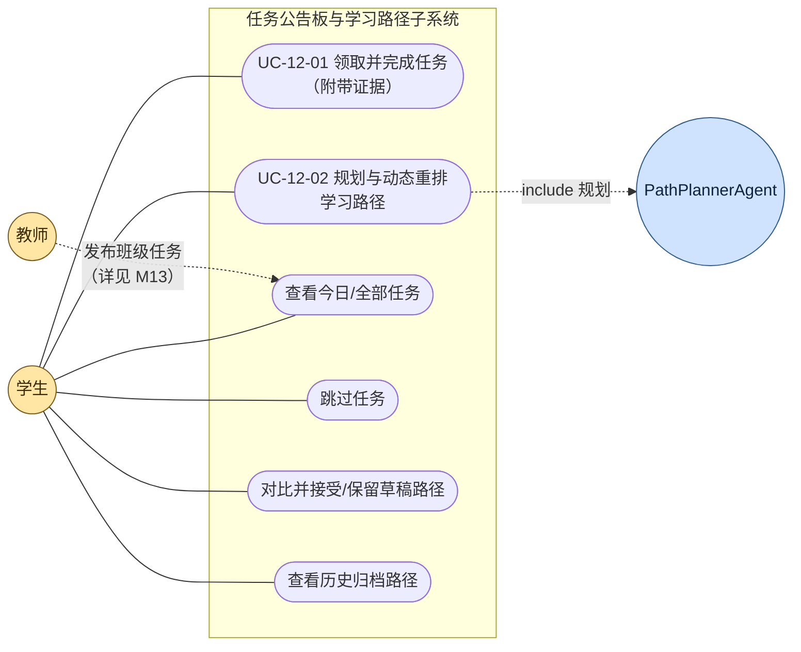
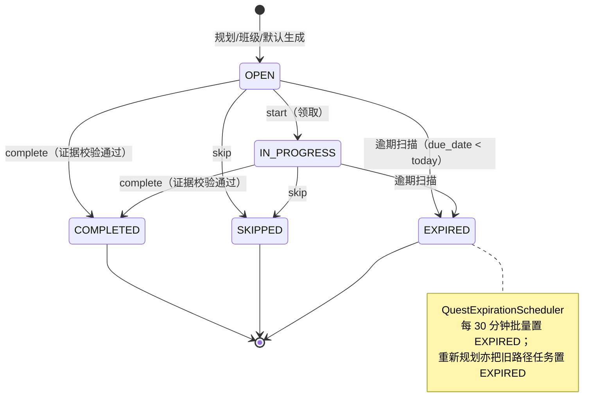
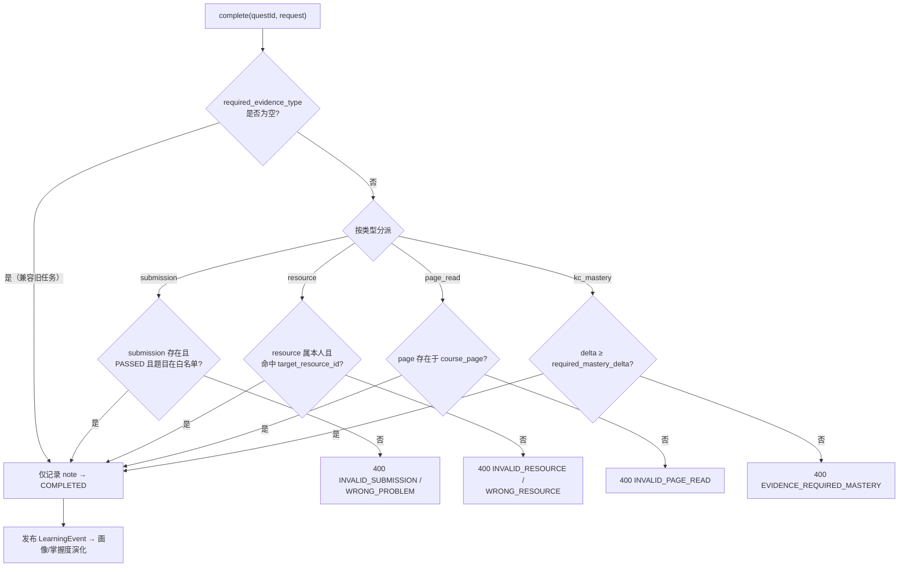

## 4.2.12 任务公告板与学习路径 · 功能需求

> 文档编号：PYT-CR · filecode：**R12** ｜ 模块：M12 任务公告板与学习路径
> 关联后端包：`com.pythontopia.learner.quest`、`com.pythontopia.learner.path`
> 关联前端：`BoardPage` / `BoardPanel` / `TodayQuestsTab` / `PathTreeTab` / `ArchivedPathsTab` / `PathDiffView`
> 关联 Agent：`PathPlannerAgent`（`services/pythontopia-graph`）
> 涉及数据表：`quest`、`quest_progress`、`learning_path`、`learning_path_node`（字段字典详见 §6 数据库设计 D4 分片）

### 4.2.12.1 模块概述

M12 是 Pythontopia「看→学→练→测」主线之外的**调度中枢**：它把学生当前应该做的事收敛成一块**任务公告板**，并由多智能体规划出一条**个性化 7 日学习路径**。公告板上的任务（quest）有三个来源——路径规划器 `PATH_PLANNER`、班级发布 `CLASSROOM`、系统冷启动默认 `SYSTEM_DEFAULT`（见 §2 术语与 `QuestSource` 枚举）。每个任务携带知识点 `kc_code`、节点类型 `node_type`（`READ_RESOURCE` / `SOLVE_PROBLEM` / `FIX_BUG` / `PLANT_KC` / `PROFILE_UPDATE`）与「去做」深链 `deep_link_route`，学生点开即被送往训练场、资源工坊、矿洞或画像屋。

模块最核心的教育约束是**任务完成证据强校验**：当一条任务配置了 `required_evidence_type` 时，学生在公告板点「完成」必须附带匹配的证据——已通过的练习提交（`submission`）、消费过的学习资源（`resource`）、读过的课件页（`page_read`）或达到阈值的掌握度增量（`kc_mastery`），由 `QuestEvidenceVerifier` 在写库前拦截「误点完成」，确保任务的完成事实可追溯、可审计，杜绝刷量。

学习路径由后端 `LearningPathService` 调用 graph 端 `PathPlannerAgent` 生成：以 8 维画像、KC 掌握度快照、最近练习/资源记录、班级任务与高频易错 KC 为输入，确定式地排出每天至多 4 个节点、共 7 天的路径，并把节点物化为公告板上的 `PATH_PLANNER` 任务。重新规划会**归档**旧路径与其未完成任务（版本号自增），从而支撑「动态重排」；复盘大厅还可生成 `DRAFT` 草稿路径，学生在 `PathDiffView` 对比新旧后再决定接受或保留。

### 4.2.12.2 模块用例图

**图 R12-1　M12 任务公告板与学习路径用例图**

> 说明：教师侧「发布班级任务」的完整用例属 M13 轻量班级与教师看板（见 M13 需求 UC-13-xx）；本模块仅承接班级任务在学生公告板上的**呈现与领取**。

### 4.2.12.3 用例规约

#### UC-12-01 公告板领取/完成任务并提交证据

- **功能简述**：学生在公告板查看今日任务，领取（开始）某条任务，按深链跳转完成对应学习动作后，回到公告板提交证据并标记完成。
- **用例编号**：UC-12-01
- **执行者**：学生 student
- **前置条件**：1. 已登录且角色为 `STUDENT`（非学生访问 `/api/quests/*` 返回 403 `FORBIDDEN`）；2. 公告板已有至少一条 `OPEN`/`IN_PROGRESS` 任务（来自路径规划、班级或系统默认）。
- **后置条件**：成功：任务 `status` 由 `OPEN`/`IN_PROGRESS` 置为 `COMPLETED`，写入一条 `quest_progress(event_type='COMPLETED')`，并按节点类型发布 `LearningEvent`（`ResourceConsumed`/`PracticeSucceeded`/`DebugResolved`）驱动被动画像与掌握度。失败：任务状态不变，返回对应错误码。
- **涉众利益**：学生：完成被真实记录、掌握度与画像随之演化；教师：班级任务完成率统计可信；管理员：闭环数据无注水、可审计。
- **基本路径**：
  1. 学生进入 `/board`，前端调用 `GET /api/quests/today` 拉取今日任务（按 `priority DESC, due_date ASC` 排序）。
  2. 选定一条 `OPEN` 任务点「开始」，前端调用 `POST /api/quests/{id}/start`，后端校验状态属于 `STARTABLE={OPEN}` 后置为 `IN_PROGRESS`，记录 `quest_progress('STARTED')`。
  3. 学生点任务卡的「去做」按钮，前端按 `deep_link_route` + `deep_link_params` 跳转（如 `/training?problemId=...`、`/workshop?kcCode=...`）。
  4. 学生在目标页完成动作（如训练场提交并判 `PASSED`），得到证据 id。
  5. 学生回公告板点「完成」，前端调用 `POST /api/quests/{id}/complete`，请求体 `QuestCompleteRequest` 携带证据字段。
  6. 后端校验状态属于 `COMPLETABLE={OPEN, IN_PROGRESS}`，再交 `QuestEvidenceVerifier` 按 `required_evidence_type` 校验证据合法。
  7. 校验通过 → 置 `COMPLETED`、记 `quest_progress('COMPLETED', note)`、发布完成事件，返回最新 `QuestDto`。
- **扩展路径**：
  - 3a. 任务未配置证据类型（`required_evidence_type` 为 NULL，多见于历史 `SYSTEM_DEFAULT`）：第 6 步跳过强校验，仅记录 `note`（兼容路径）。
  - 6a. 证据缺失：返回 400 `EVIDENCE_REQUIRED_SUBMISSION/RESOURCE/PAGE_READ/MASTERY`。
  - 6b. 提交非本人或未通过：返回 400 `INVALID_SUBMISSION`；提交题目不在 `target_problem_ids` 白名单：返回 400 `WRONG_PROBLEM`（伪造证据被拒，见 UC 设计规则）。
  - 6c. 掌握度增量低于 `required_mastery_delta`：返回 400 `EVIDENCE_REQUIRED_MASTERY`。
  - 2a/6d. 状态非法（如已 `COMPLETED`/`EXPIRED`）：返回 400 `QUEST_INVALID_STATE`。
- **字段列表**：请求 `QuestCompleteRequest{note(≤256), submissionId(>0), resourceId(>0), pageReadId(>0), kcMasteryDelta(0.00~1.00)}`、`QuestSkipRequest{reason(≤256)}`；响应 `QuestDto{id, source, sourceRefId, title, description, kcCode, nodeType, payload, dueDate, priority, status, requiredEvidenceType, requiredMasteryDelta, targetProblemIds, targetResourceId, deepLinkRoute, deepLinkParams, createdAt, updatedAt}`（取自真实 `QuestController`/DTO；表字段见 §6 D4）。
- **设计规则**：业务规则——证据类型与字段一一对应（`submission→submissionId` 且需 `PASSED`、`resource→resourceId` 需属本人、`page_read→pageReadId` 需存在于 `course_page`、`kc_mastery→kcMasteryDelta≥required`）；非功能需求——`/today` 查询走索引 `idx_quest_user_status_due`，P95 < 300ms；设计约束——逾期任务由 `QuestExpirationScheduler` 每 30 分钟扫描置 `EXPIRED`，不在 `/today` 出现。
- **未解决的问题**：当前 `complete` 的 `note` 上限 256 字符；证据仅校验「存在且合规」，暂不校验提交与任务的时间先后顺序。
- **备注**：`/`

#### UC-12-02 学习路径规划与动态重排

- **功能简述**：学生在公告板点「规划本周路径」，由多智能体生成 7 日路径并物化为任务；再次规划时旧路径与未完成任务归档、版本自增；复盘大厅可生成草稿路径供对比后接受。
- **用例编号**：UC-12-02
- **执行者**：学生 student（规划逻辑 include `PathPlannerAgent`）
- **前置条件**：1. 已登录且角色为 `STUDENT`；2. 已完成画像访谈（否则 `invokePlanner` 返回 409 `PROFILE_REQUIRED`）；3. 知识田已解锁至少一个 KC（否则 planner 返回 `FAILED`，grounding `NO_UNLOCKED_KC`）。
- **后置条件**：成功：生成一条 `learning_path(status=ACTIVE, version+1)` 及其 `learning_path_node`，旧 `ACTIVE` 路径置 `ARCHIVED` 且其 `PATH_PLANNER` 未完成任务置 `EXPIRED`、`SYSTEM_DEFAULT` 默认任务置 `SKIPPED`，返回 `PlanPathResponse{path, archivedPathIds, generatedQuestCount, runStatus, groundingMessage}`。失败：返回规划错误码、不落库新路径。
- **涉众利益**：学生：始终只有一条"当前应走"的路径，重排不残留旧任务；教师：路径覆盖班级任务 KC；管理员：每次规划留有版本与 grounding 结果可审计。
- **基本路径**：
  1. 学生点「规划本周路径」，前端调用 `POST /api/learner/path/plan`。
  2. `LearningPathService.invokePlanner` 收集画像快照、KC 掌握度快照（含先修关系）、最近 30 条练习/资源、活跃班级任务、`error_pattern` 高频坑 KC。
  3. 调 `PathPlannerGraphClient.plan` → `PathPlannerAgent` 确定式排程：班级任务落第 1 天、聚焦 KC 按先修拓扑排序后每个产「读资源+练习/修 bug」、未解锁 KC 产 `PLANT_KC`、第 7 天产 `PROFILE_UPDATE`，每天至多 4 个节点。
  4. graph 返回 `status=SUCCESS` 且节点非空 → 后端 `archiveActivePaths` 归档旧路径并连带归档其任务。
  5. 写入新路径（`nextVersion`）与节点，`writeNodesAndQuests` 把每个节点物化为一条 `PATH_PLANNER` 任务（含深链与 `due_date = today + (dayIndex-1)`）。
  6. 前端切到「本周路径」页签按天分组渲染（`PathTreeTab`），并刷新今日任务。
- **扩展路径**：
  - 3a. graph 返回空响应：502 `PATH_GRAPH_EMPTY`；`status≠SUCCESS`：422 `PATH_PLANNING_FAILED`（附 grounding/safety 原因）；节点为空：422 `PATH_EMPTY_NODES`。
  - 5a. 自由文本专业名先经 `graphMajor` 归一为 `CS/NON_CS_STEM/NON_CS_HUMANITIES/OTHER`，避免 graph 422。
  - 6a.（复盘大厅动态重排）`LearnerEvaluationService` 调 `planDraft` 生成 `DRAFT` 路径但**不**归档、不发任务；`PathDiffView` 并排展示 `当前 ACTIVE` 与 `新建议 DRAFT`；学生 `POST /api/learner/evaluations/{id}/accept-new-path` → `promoteDraft`（激活并发任务）或 `POST .../keep-old` → `archiveDraft`（弃稿、保留旧路径）。
- **字段列表**：`PlanPathResponse{path:LearningPathDto, archivedPathIds:List<Long>, generatedQuestCount:int, runStatus, groundingMessage}`；`LearningPathDto{id, userId, packId, version, status(ACTIVE/ARCHIVED/DRAFT), goalSummary, generatedAt, nextReviewAt, sourceRunId, nodes}`；`LearningPathNodeDto{id, pathId, dayIndex, orderInDay, kcCode, nodeType, reasonSummary, evidenceSummary, suggestedResourceType, suggestedProblemId, sourceClassroomQuestId}`（取自真实 path DTO；表字段见 §6 D4）。
- **设计规则**：业务规则——同一 `(user_id, pack_id, version)` 唯一、同一时刻仅一条 `ACTIVE`；非功能需求——`PathPlannerAgent` 为确定式（同输入产同 `deterministic_signature`），可复现可审计；设计约束——默认课程包 `pack_id=43`，历史归档列表上限 10（`ARCHIVED_HISTORY_LIMIT`）。
- **未解决的问题**：`next_review_at` 固定为生成后 7 天，尚未与 FSRS-lite 复习状态联动自适应。
- **备注**：路径节点类型与任务节点类型一一对应（`PathNodeType` ↔ `QuestNodeType`）。

### 4.2.12.4 任务状态机（需求视角）

**图 R12-2　quest 生命周期状态图**

### 4.2.12.5 证据门控决策（需求视角）

**图 R12-3　任务完成证据门控判定流**

### 4.2.12.6 需求约束与追溯

| 需求项 | 约束/取值 | 代码实体（追溯） |
| --- | --- | --- |
| 任务来源 | PATH_PLANNER / CLASSROOM / SYSTEM_DEFAULT | `QuestSource` |
| 任务节点类型 | READ_RESOURCE / SOLVE_PROBLEM / FIX_BUG / PLANT_KC / PROFILE_UPDATE | `QuestNodeType`、`quest.node_type` CHECK |
| 任务状态 | OPEN / IN_PROGRESS / COMPLETED / SKIPPED / EXPIRED | `QuestStatus`、`quest.status` CHECK |
| 证据类型 | submission / resource / page_read / kc_mastery / NULL | `QuestEvidenceVerifier`、`quest.required_evidence_type` CHECK |
| 路径规模 | 7 天 × 每天 ≤ 4 节点，聚焦 ≤ 5 个 KC | `PathPlannerAgent`（MAX_DAYS/MAX_NODES_PER_DAY/TARGET_FOCUS_KCS） |
| 路径状态 | ACTIVE / ARCHIVED / DRAFT | `LearningPathStatus`、`learning_path.status` CHECK（见 §6 D4） |
| 权限 | 仅 `STUDENT` 可访问 quest 与 path 端点 | `QuestController`/`LearningPathController.requireStudent` |

> 表 R12-1　M12 需求约束与代码追溯表（数据表字段字典统一见 §6 数据库设计 D4 分片，本处不展开字段）。

---

> 执笔人：成员 B ｜ 完成人（签名）：成员 B ｜ 审查人：成员 C ｜ 完成日期：2026-06-14
