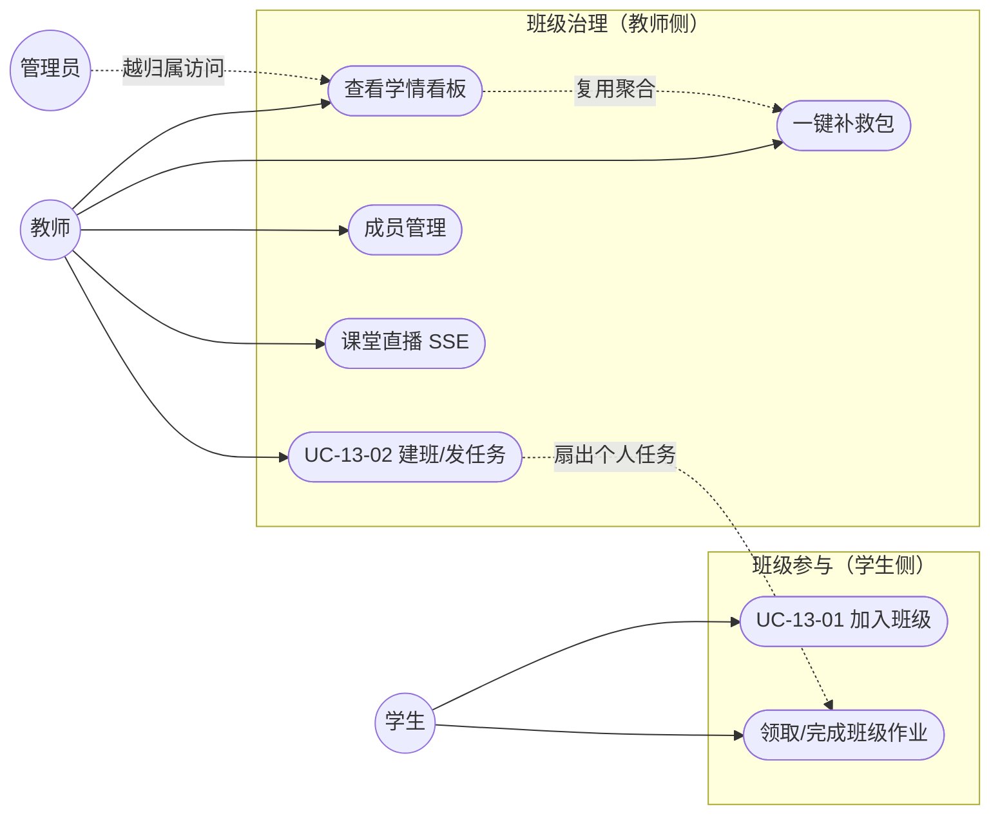
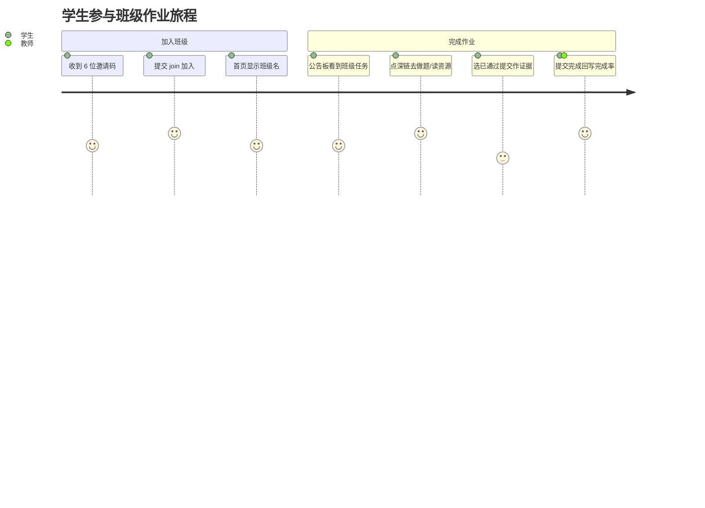
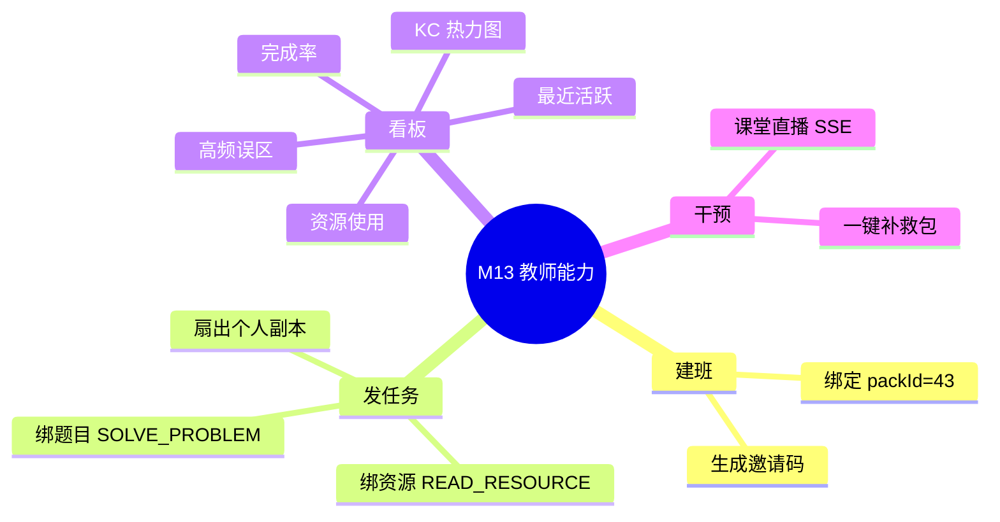

## 4.2.13 轻量班级与教师看板 · 功能需求

> 本文是 Pythontopia 课程报告 §4.2 模块功能需求的 M13 分片，编号前缀 `R13`。术语、角色、版本号统一采用写作总纲 §1 事实卡与 §2 术语表；表名/端点/字段一律以仓库 `backend/` `frontend/` 真实代码为准。数据库字段字典不在此展开，统一「见 §6 数据库设计」。

### 4.2.13.1 模块概述

M13 在 Pythontopia「第二课堂」之上提供**轻量班级**与**教师学情看板**能力，使 Python 课程的任课教师能把分散在小镇里自学的学生重新组织成班级，并以数据驱动的方式观察、干预大班统一进度下「翘课 / 跟不上 / 坚持不下去」的学生。模块定位刻意「轻」：只做*建班、邀请码加入、发布班级任务、看板观测、一键补救*五件事，不做完整课堂协作编码、复杂评分系统与实时监控大屏（写作总纲硬约束）。班级唯一绑定课程包 `packId=43`《Python 语言基础》，由数据库 `CHECK (pack_id = 43)` 强约束，杜绝跨课程误绑。

班级的核心价值在于**复用而非新增**学情：看板的 KC 热力图、高频误区、资源使用、完成率等指标全部从既有事件表（`kc_mastery`、`practice_submission`、`judge_result`、`learning_resource`、`quest`）实时聚合得到，班级自身只维护「谁属于哪个班」「教师发了哪些任务」两类极薄的归属数据，再以 `classroom_kc_snapshot` 缓存热力图加速渲染。教师发布的班级任务通过 M12 任务系统**扇出**为每个学生的个人任务副本（`quest.source = CLASSROOM`），学生在公告板（M12）领取与提交，从而把「班级要求」与「个人学习闭环」无缝打通。所有教师入口都受角色门 + 班级归属门**双重鉴权**保护，越权访问一律拒绝。

### 4.2.13.2 角色与用例总览

M13 涉及三类执行者：**学生 student**（加入班级、领取与完成班级作业）、**教师 teacher**（建班、管理成员、发任务、看板观测、一键补救、直播）、**管理员 admin**（可越过归属校验访问任意班级看板，用于运维与演示）。模块用例总览见图 R13-1，用例清单见表 R13-1。

<small>图 R13-1 M13 班级看板模块用例图（双引号圆为执行者，圆角矩形为用例）</small>

| 用例编号 | 用例名 | 主执行者 | 真实入口（后端端点 / 前端） |
| --- | --- | --- | --- |
| UC-13-01 | 学生加入班级并完成班级作业 | 学生 | `POST /api/classrooms/join`、`GET /api/classroom/quests/mine`；公告板 `ClassroomQuestsTab.vue` |
| UC-13-02 | 教师建班、发任务、看板与补救 | 教师 | `POST /api/classrooms`、`POST /api/teacher/classrooms/{id}/quests`、`.../dashboard/*`、`.../remediation`；`TeacherHome.vue`/`ClassroomDetail.vue` |

<small>表 R13-1 M13 用例清单</small>

为体现学生侧体验闭环，图 R13-2 给出学生从拿到邀请码到完成一次班级作业的用户旅程。

<small>图 R13-2 学生参与班级作业用户旅程（journey）</small>

### 4.2.13.3 功能需求清单

表 R13-2 列出 M13 全部功能需求条目（FR）与其真实承载端点。教师端点均在 `@PreAuthorize("hasAnyRole('TEACHER','ADMIN')")` 或 `ClassroomService` 内 `requireRole` 之下，并经 `ClassroomGuard` 校验班级归属。

| FR 编号 | 功能 | 角色 | 承载端点 / 组件 | 关键规则 |
| --- | --- | --- | --- | --- |
| FR-13-01 | 创建班级 | 教师 | `POST /api/classrooms` | 自动生成 6 位无歧义邀请码；`pack_id` 固定 43 |
| FR-13-02 | 我的班级列表 | 师/生 | `GET /api/classrooms/mine` | 教师按 teacher_id、学生按成员关系 |
| FR-13-03 | 邀请码加入 | 学生 | `POST /api/classrooms/join` | 码格式 `^[A-Z0-9]{6}$`；班级须 ACTIVE |
| FR-13-04 | 成员查询/移除 | 教师 | `GET/DELETE /api/classrooms/{id}/members/**` | 仅归属教师；移除为软状态 REMOVED |
| FR-13-05 | 改名/重置邀请码 | 教师 | `PUT /api/teacher/classrooms/{id}`、`POST .../regenerate-code` | 唯一码冲突自动重试 |
| FR-13-06 | 发布班级任务 | 教师 | `POST /api/teacher/classrooms/{id}/quests` | 必绑题目或资源；KC 校验；扇出个人任务 |
| FR-13-07 | 班级任务列表/归档 | 教师 | `GET`、`POST .../{questId}/archive` | 归档不删个人副本 |
| FR-13-08 | 学生班级任务 | 学生 | `GET /api/classroom/quests/mine` | 仅未过期 ACTIVE 任务 |
| FR-13-09 | KC 热力图 | 教师 | `GET .../dashboard/kc-heatmap` | 读后写 `classroom_kc_snapshot` 缓存 |
| FR-13-10 | 完成率统计 | 教师 | `GET .../dashboard/quest-summary` | 完成数/总数；按截止日倒序 |
| FR-13-11 | 高频误区 | 教师 | `GET .../dashboard/error-hotspots` | 近 7 天非 AC 提交，按 KC 聚合 Top10 |
| FR-13-12 | 资源使用 | 教师 | `GET .../dashboard/resource-usage` | 近 7 天工坊资源按类型/按天 |
| FR-13-13 | 最近活跃流 | 教师 | `GET .../dashboard/recent-activity` | 掌握/提交/资源三类事件并集 |
| FR-13-14 | 一键补救包 | 教师 | `POST .../remediation` | 逐薄弱 KC 生成讲义+练习，带证据页 |
| FR-13-15 | 课堂直播 | 教师 | `GET /api/classroom/{id}/live`（SSE） | 仅教师订阅；学生事件广播 |

<small>表 R13-2 M13 功能需求清单</small>

### 4.2.13.4 用例规约

### UC-13-01 学生加入班级并完成班级作业

- 功能简述：学生凭教师分发的 6 位邀请码加入班级；加入后在公告板看到教师下发的班级任务，按深链完成对应学习动作并以证据提交完成，回写班级完成率。
- 用例编号：UC-13-01
- 执行者：学生（Role.STUDENT）
- 前置条件：1. 学生已注册登录并持有效 JWT；2. 目标班级状态为 ACTIVE 且教师已分发邀请码；3. 学生尚未加入该班。
- 后置条件：成功：`classroom_members` 新增一条 (classroom_id, student_id, ACTIVE)，首页显示班级名，公告板出现班级任务；失败：返回对应错误码，成员关系与任务不变。
- 涉众利益：学生：以自己节奏完成班级要求、获得证据可追溯的进度；教师：掌握学生到位与完成情况；管理员：班级数据可运维。
- 基本路径：
  1. 学生调用 `POST /api/classrooms/join`，请求体 `{ joinCode }`。
  2. 服务校验角色为 STUDENT，按 `joinCode` 查班级。
  3. 校验班级 `status = ACTIVE`，写入成员关系。
  4. 返回 `ClassroomDto`（不含 joinCode），首页 `listMyClassrooms` 渲染班级名。
  5. 学生进入公告板，前端 `GET /api/classroom/quests/mine` 拉取本人班级任务。
  6. 点击任务深链跳转训练馆/工坊完成学习动作。
  7. 若任务要求 `submission` 证据，选择一条已通过提交，点「提交完成」。
  8. 个人任务置 COMPLETED，看板完成率随之更新。
- 扩展路径：
  - 3a. 班级已归档（ARCHIVED）→ 返回 403「Classroom is archived」。
  - 2a. 邀请码不存在 → 返回 404「Classroom not found」。
  - 3b. 学生已在班 → 返回 409「CLASSROOM_ALREADY_JOINED」。
  - 7a. 缺少证据提交 → 前端拦截提示「请先选择一次已通过的提交」。
- 字段列表：`joinCode`（请求）；`classroomId, name, description, teacherId, packId, status`（ClassroomDto）；`id, title, kcCodes, nodeType, dueDate, studentQuestId, studentQuestStatus, requiredEvidenceType, deepLinkRoute`（ClassroomQuestDto）。字段取自 `JoinClassroomRequest`/`ClassroomDto`/`ClassroomQuestDto`，详见 §6。
- 设计规则：邀请码正则 `^[A-Z0-9]{6}$`；成员唯一约束 `UNIQUE(classroom_id, student_id)`；班级任务完成走 M12 证据强校验（submission/resource/page_read）。
- 未解决的问题：当前前端「输入邀请码加入」入口尚未独立成页（`joinClassroom()` API 已就绪），演示期以 API/脚本触发加入。
- 备注：班级任务的领取与完成 UI 复用 M12 公告板 `ClassroomQuestsTab.vue`。

### UC-13-02 教师建班、发任务、看板观测与一键补救

- 功能简述：教师创建绑定 `packId=43` 的班级并获得邀请码，发布绑定题目或资源类型的班级任务（自动扇出到全班），在看板观测 KC 热力图、完成率、高频误区与资源使用，并可对薄弱 KC 一键生成补救包。
- 用例编号：UC-13-02
- 执行者：教师（Role.TEACHER），管理员可越归属访问看板。
- 前置条件：1. 教师登录且角色为 TEACHER；2. 课程包 43 已就绪；3. 看板/任务操作的目标班级归属当前教师。
- 后置条件：成功：班级、任务持久化，看板返回实时聚合，补救包产出资源 id 与证据页 id；失败：返回错误码且不产生脏数据。
- 涉众利益：教师：低成本组织班级、数据驱动干预；学生：获得针对性补救资源；管理员：统一治理。
- 基本路径：
  1. 教师 `POST /api/classrooms` 建班，系统生成唯一 6 位邀请码。
  2. 分发邀请码给学生（线下/IM）。
  3. 教师 `POST /api/teacher/classrooms/{id}/quests` 发布任务（标题、KC、绑定题目或资源类型、截止日）。
  4. 服务经 `ClassroomGuard.requireOwner` 校验归属，再校验任务约束。
  5. 写入 `classroom_quest`，并对每个 ACTIVE 成员扇出个人任务副本。
  6. 教师进入 `ClassroomDetail.vue` 看板，按 Tab 拉取各聚合端点。
  7. 发现薄弱 KC，点「一键生成补救包」`POST .../remediation`。
  8. 系统逐薄弱 KC 生成讲义 + 练习并回显证据页。
- 扩展路径：
  - 4a. 班级非本人 → 403「班级不属于当前教师」。
  - 3a. 既未绑题目也未绑资源 → 400「CLASSROOM_QUEST_ANCHOR_REQUIRED」。
  - 3b. KC 未知/重复 → 400「CLASSROOM_QUEST_KC_UNKNOWN/DUPLICATE」。
  - 3c. 截止日早于今天 → 400「CLASSROOM_QUEST_DUE_DATE_INVALID」。
  - 3d. 标题/描述含疑似手机号或身份证 → 400「CLASSROOM_QUEST_PII_BLOCKED」。
- 字段列表：`name, description`（CreateClassroomRequest）；`title, description, kcCodes, targetProblemId, targetResourceType, dueDate`（ClassroomQuestCreateRequest）；`totalStudents, createdQuests, skippedDuplicates`（PublishResponse）；`kcCode, avgMastery, studentCount, masteredCount, strugglingCount`（KcHeatmapEntryDto）。详见 §6。
- 设计规则：双重鉴权（角色门 + 归属门）；资源类型枚举 HANDOUT/MIND_MAP/PRACTICE/CODE_LAB/READING/STORYBOARD；补救资源归属触发教师账号且携带 `evidence_page_ids` 可溯源；copilot 学情摘要「只读 + 严禁泄题」。
- 未解决的问题：看板各聚合端点目前同步实时计算（仅热力图落快照缓存），超大班级下需关注查询耗时。
- 备注：R-15 在同基址新增主线星级/章测/无尽/进度 4 个看板 Tab（`MainlineDashboardController`），与 M13 复用同一鉴权与缓存约定。

教师侧从发任务到看板观测再到补救的功能分解见图 R13-3。

<small>图 R13-3 M13 教师能力功能分解（mindmap）</small>

### 界面与交互需求

教师端要求「列表—详情」两级导航：班级总览页以卡片列出我的班级、显著展示邀请码与「进入看板」入口，并内联「新建班级」表单（名称 + 说明）；班级详情页以左侧侧边栏多 Tab 组织全部看板视图与成员/任务管理，关键动作（重置邀请码、一键补救）常驻侧边栏底部，补救结果以面板形式回显薄弱 KC 数、各 KC 的补救资源数与证据页。看板图表须可读：KC 热力图按章分组并用红→绿语义色表达掌握度梯度，完成率与资源使用以进度条 / 折线直观呈现，避免只堆数字。学生端不新增页面，班级任务统一落在 M12 公告板的「班级任务」标签页，提供深链直达与证据提交。教师总览界面给出截图占位：

> 【截图占位 SC-R13-1】
> - 访问：http://localhost:5173/teacher （容器态 http://localhost:8080/teacher）
> - 登录角色：教师
> - 操作步骤：1. 教师账号登录；2. 打开「教师屋」；3. 展开「新建班级」表单并观察已建班级卡片。
> - 截取对象：`TeacherHome.vue` 的班级卡片网格与新建表单
> - 期望画面：每个班级卡片显示名称、状态徽标、6 位加入码与「进入看板」按钮。

### 4.2.13.5 性能与非功能需求

| 编号 | 类别 | 需求 | 取值/约束 |
| --- | --- | --- | --- |
| NFR-13-1 | 性能 | 看板各端点演示态响应 | 单班 ≤50 人时目标 < 800ms（热力图走快照缓存） |
| NFR-13-2 | 安全 | 教师入口鉴权 | 角色门 + 归属门双层；admin 可越归属 |
| NFR-13-3 | 隐私 | 任务文本 PII | 拦截疑似手机号 / 身份证号 |
| NFR-13-4 | 一致性 | 邀请码唯一 | `UNIQUE(join_code)`，冲突重试 10 次 |
| NFR-13-5 | 可追溯 | 补救资源 | 每件携带 `evidence_page_ids` |
| NFR-13-6 | 防泄题 | copilot 学情摘要 | 只读，显式禁止输出可提交完整答案 |

<small>表 R13-3 M13 非功能需求</small>

### 4.2.13.6 数据需求

M13 仅维护两类归属数据表与一张缓存表，学情指标实时复用其它模块的事实表，字段字典统一见 §6。

| 表 | 角色 | 说明（字段见 §6） |
| --- | --- | --- |
| `classrooms` | 归属 | 班级主体，`pack_id` CHECK=43、`join_code` 唯一、`status` ACTIVE/ARCHIVED（V011） |
| `classroom_members` | 归属 | 班级成员，`UNIQUE(classroom_id, student_id)`、`status` ACTIVE/REMOVED（V011） |
| `classroom_quest` | 任务 | 班级任务，`kc_codes` 数组、`node_type`、`payload` JSONB（V052） |
| `classroom_kc_snapshot` | 缓存 | KC 掌握快照，`UNIQUE(classroom_id, kc_code)`（V080） |
| `kc_mastery` / `practice_submission` / `judge_result` / `learning_resource` / `quest` | 复用 | 看板聚合来源，详见 M02/M09/M08/M12 与 §6 |

<small>表 R13-4 M13 数据需求（字段字典见 §6）</small>

### 4.2.13.7 验收标准

| 编号 | 验收点 | 期望 |
| --- | --- | --- |
| AC-13-1 | 建班 | 返回 201 与 6 位邀请码，`packId=43` |
| AC-13-2 | 加入 | 有效码加入成功；无效码 404；重复 409；归档 403 |
| AC-13-3 | 发任务 | 校验通过后扇出全班，`createdQuests ≤ totalStudents` |
| AC-13-4 | 热力图 | 返回全 65 KC 行并写入快照表 |
| AC-13-5 | 统计 | 完成率 = 完成数/总数；高频误区 Top10 |
| AC-13-6 | 越权 | 学生或非归属教师访问看板 403 |

<small>表 R13-5 M13 验收标准</small>

### 4.2.13.8 已知局限

- 学生「输入邀请码加入」尚无独立前端页面，演示期经 API 加入（后端能力完整）。
- 看板除热力图外为实时聚合，超大班级需后续引入分页或物化视图。
- 班级仅单课程包（43），暂不支持一班多课。

---

执笔人：成员 B ｜ 完成人（签名）：成员 B ｜ 审查人：成员 C ｜ 完成日期：2026-06-14
