# 5 概要设计

> 文档编号：`PYT-CR` · 文件代号（filecode）：**C05** · 对应实训报告第 5 章
> 本章图表统一以 `C05-` 前缀编号；事实/术语/端口一律采用《写作总纲》§1 项目事实卡与 §2 术语表。
> 本章是「面向实现的总体设计」，只在系统层与子系统层展开；单模块的过程设计（通信图/PDL/NS 盒图/类图）见**第 8 章详细设计**，完整字段字典见**第 6 章（D1–D4）**，多端落地见**第 7 章**，容器拓扑（图 C02-1）见**第 2 章**——本章在其基础上做**设计层展开而非逐字复制**。

概要设计承上启下：把第 4 章「需求分析」给出的 13 个功能模块、数据/性能/接口/安全约束，转化为一套可落地、可演进、可被详细设计直接承接的总体技术方案。Pythontopia 的总体设计目标是：以**一套 Spring Boot 后端为唯一真理源**，对外暴露统一前缀 `/api` 的 REST 接口（JWT Bearer 鉴权、统一错误信封、SSE 中继 AI 流式事件），向内编排 **PostgreSQL + Redis 数据层、FastAPI + LangGraph 双 AI 微服务（graph 多智能体 / rag 课件检索）**，向外服务 Web 与 Android/Windows/微信四类客户端，使学生在任意端登录都能续上同一份学习态（画像、掌握度、主线进度），同时把「教育优先、游戏承载」与「防幻觉、判题安全」两条底线收敛在服务端统一实现。本章依次给出总体处理流程、分层架构、模块划分、数据流转、界面总体、数据结构、接口、异常容错、配置、部署、跨端架构与其他设计考量共 12 节。

---

## 5.1 总体处理流程

系统的核心处理流程围绕主线学习闭环「**看 → 学 → 练 → 测**」组织（见《写作总纲》§2 术语表）。学生登录后进入单一中央小镇 `town_hub`，以像素世界作为学习入口的空间隐喻，再由四个学习动作驱动业务：**看**（课件页/章节视频/课件 RAG 问答）→ **学**（资源工坊生成并消费六类学习资源）→ **练**（训练场双轨执行真题判题）→ **测**（章末大测试与掌握度达阈值评定星级）。围绕这条主链，「失败」处接入 Bug 矿洞调试支线，「遗忘」处接入复盘大厅与 FSRS-lite 间隔复习，学习行为持续回流到 8 维学习画像并驱动学习路径重排，形成长期个性化闭环。

总体处理流程的关键设计原则有三：其一，**所有判定结果以服务端为权威**——主线进度、判题结果、掌握度变更全部入库，前端 Pyodide 预览与游戏内表现只是表现层，绝不入正式判分；其二，**学习行为统一建模为事件**——看/学/练/测/调试/反馈都落为 `LearningEvent`，由 `PassiveProfileService` 被动演化画像、由掌握度服务结算 `kc_mastery`，避免一次问卷式的静态推荐；其三，**生成式能力末端审查**——任何 AI 产出（答疑、资源、出题）都要经证据锚定与防幻觉三审后才出，无证据宁可返回「未命中」也不编造。

从请求视角看，这条看似连续的「长流程」在系统内部被切成若干段**短事务**：每一段都以「当前登录主体 `CurrentUserPrincipal`」为入口，经 `JwtAuthenticationFilter` 鉴权与控制器内的角色校验（绝大多数学习端点经 `requireStudent` 限定为 `STUDENT` 可用，教师/管理员各有专属端点）后，由对应领域 `Service` 在自己的事务边界内完成一次状态变更并落库，再把结果交还表现层渲染。学生进入小镇时不是逐个接口零散拉取，而是由 `GameBootstrapController` 一次性下发「世界存档 + 画像 + 主线进度」的总览（overview），表现层据此渲染并在后续动作中增量打点；这样既减少首屏往返，又保证「玩家看到的态」始终是后端权威态的投影。由于每段都是独立短事务，单个动作失败（如某次判题超时）不会污染整条主线的已落库进度，符合「目标驱动、可验证结果」的项目准则。

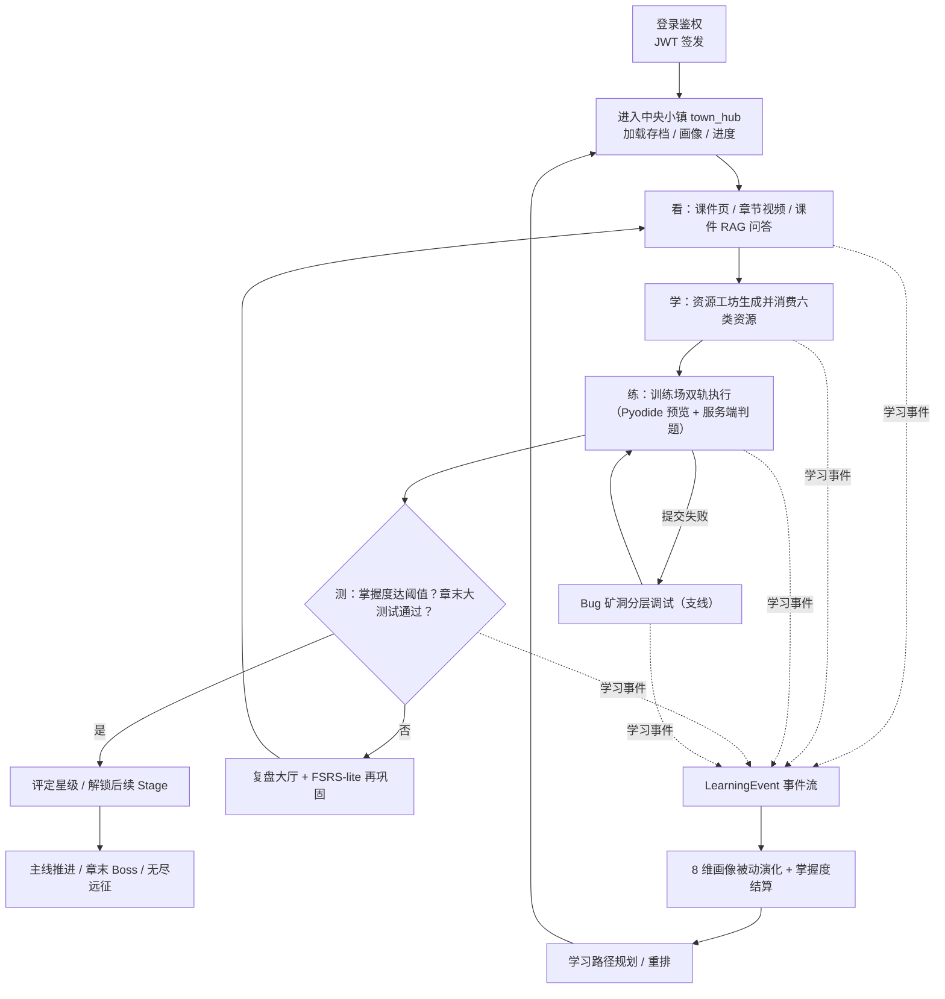

> 图 C05-1　总体处理流程（看→学→练→测主闭环 + 失败/遗忘支线 + 事件回流画像与路径）

为表达「同一学生在一次完整学习中跨多个模块的体验连贯性」，再以用户旅程图刻画典型学生从进入小镇到完成一章的情绪与价值密度（评分 1–5，分越高代表越顺畅/收获越大），用于在设计阶段确认「关键卡点出现在哪、由哪个模块兜底」。

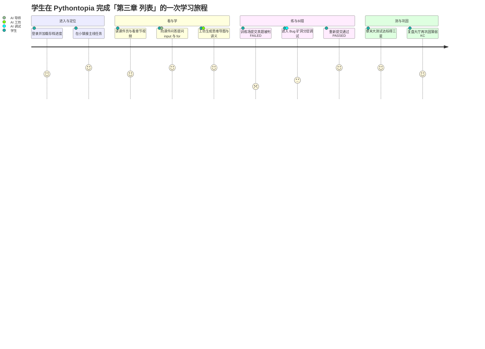

> 图 C05-2　学生学习旅程图（journey）：低分谷（提交失败）由 Bug 矿洞与复盘大厅兜底回升

---

## 5.2 总体结构与分层架构

系统在结构上划分为**五层**：表现层（多端客户端）、接入层（Web 网关与安全/路由切面）、业务层（Spring Boot 领域服务）、AI 微服务层（graph 多智能体 + rag 课件检索）、数据层（PostgreSQL + pgvector / Redis / 本地媒体卷）。分层的核心约束是**依赖单向向下、AI 与外部不可控依赖被收敛在专门层并整体可降级**：表现层只通过接入层访问业务层；业务层是唯一写库方与唯一真理源；AI 微服务层无状态、对业务层只提供「生成/检索」能力且故障 fail-soft；数据层只被业务层与 rag 读写。这样既保证了多端一致（所有端共用业务层规则），又保证了核心链路在 LLM 不可用时仍可运行（缺密钥自动降级 golden 兜底）。

之所以采用五层而非更扁平的三层（前端/后端/库），是因为本项目有两类「天生不可控」的依赖必须被显式隔离：一是**生成式 AI**（LLM 输出不确定、可能不可用），二是**外部多模态/检索服务**（讯飞、B 站受网络与配额制约）。把它们统一收敛进「AI 微服务层」并约定该层无状态、不直接写业务库、故障一律 fail-soft，就把「不确定性」关进了一个可被业务层随时绕过的盒子里——这正是**可降级边界恰好画在 AI 层与业务层之间**的设计意图：业务层调用 AI 失败时，主链路（看课件、提交判题、查进度）仍然成立。需要区分的是，这里的「层」是**逻辑分层**而非「每层一台机器」的物理部署：接入层的 Nginx 与表现层的前端静态资源同容器，业务层与数据层在同一 ECS 上以 Docker 网络互联（物理拓扑见 §5.10 与图 C02-1），逻辑分层约束的是「谁能依赖谁」而不是「谁部署在哪」。

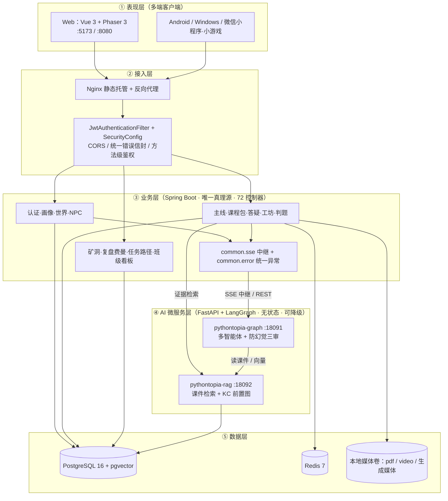

> 图 C05-3　总体五层架构（依赖单向向下；AI 层无状态可降级；业务层为唯一写库真理源）

系统对外部世界的边界与依赖以「系统上下文图（C4-Context 风格）」表达：三类人类角色（学生 / 教师 / 管理员）经客户端使用系统；系统对外依赖三类外部系统——可插拔 LLM Provider（dryrun / OpenAI 兼容 / 讯飞 Spark）、讯飞多模态（文生图 TTI / 语音合成 TTS / 看图答疑 / 语音听写 IAT）、外网检索（B 站精选视频，经宿主代理）；可选依赖自托管 Langfuse 做可观测性对账。所有外部依赖均设计为**缺失即降级、不阻塞主链路**。

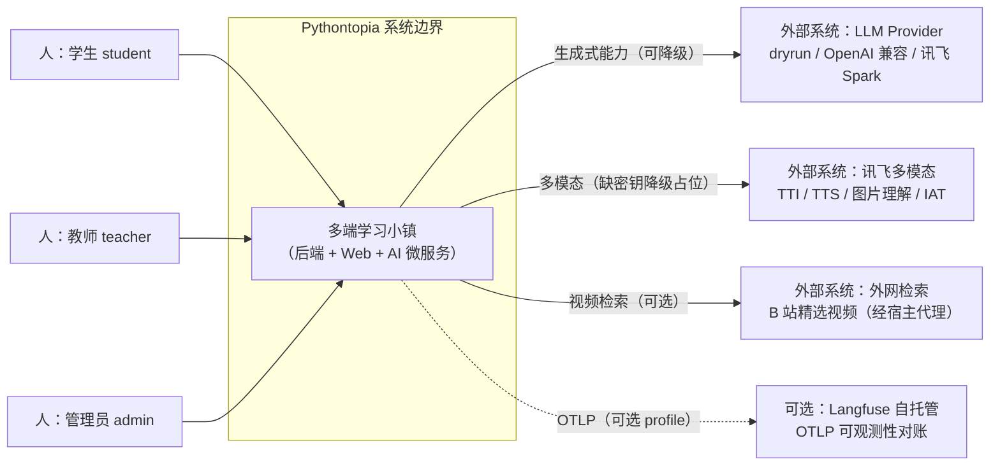

> 图 C05-4　系统上下文图（C4-Context 风格）：系统边界、三类人类角色与四类外部依赖

在跨切面（cross-cutting）结构上，业务层内部统一遵循「Controller → Service → Repository」三段式，并由 `common` 包提供四个横切组件：`JwtAuthenticationFilter`（鉴权）、`GlobalExceptionHandler`（统一异常→错误信封）、`GraphSseConsumer` + `SseRelayExecutor`（AI 流式中继）、`CurrentUser` 参数解析（从 JWT 主体注入当前用户）。下图用类图刻画这套横切协作骨架，第 8 章各模块的类图在此骨架上细化各自领域类。

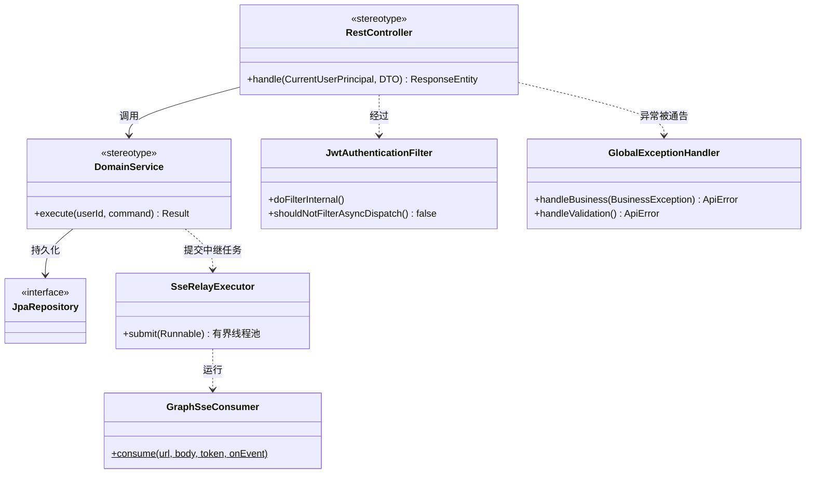

> 图 C05-5　业务层横切协作骨架类图（三段式 + 鉴权/异常/SSE 中继四横切组件）

| 层 | 主要职责 | 代表组件 / 包 | 关键约束 |
| --- | --- | --- | --- |
| ① 表现层 | 渲染像素世界与学习面板、即时预览、交互 | `frontend/`（Vue/Phaser）、Android/Windows/微信端 | 不写业务规则；只读后端权威态并打点 |
| ② 接入层 | 静态托管、反向代理、鉴权/CORS/错误统一 | Nginx、`auth.security.*`、`common.error.*` | STATELESS；`/api` 统一前缀；错误信封统一 |
| ③ 业务层 | 领域逻辑、唯一写库、AI 编排与中继 | `com.pythontopia.*`（72 控制器） | 唯一真理源；Service 持有事务边界 |
| ④ AI 微服务层 | 多智能体生成、课件检索、防幻觉三审 | `pythontopia-graph`、`pythontopia-rag` | 无状态；fail-soft；不直接写业务库 |
| ⑤ 数据层 | 持久化、缓存/限频、媒体落盘 | PostgreSQL+pgvector、Redis、本地卷 | 仅业务层与 rag 访问；snake_case |

> 表 C05-1　五层职责与代表组件（详细字段/端点见第 6/8 章）

---

## 5.3 功能模块划分

系统按业务边界划分为 **13 个功能模块（M01–M13）**，每个模块对应后端一个或一组 `com.pythontopia.*` 包、若干前端页面/组件，以及（如涉及生成式能力）`pythontopia-graph` 的 Agent 工位。模块划分遵循「高内聚、围绕主线闭环组织」原则：M06 课程包提供「看」的素材底座，M07 用 RAG 支撑课件问答，M08 资源工坊把「学」具象成六类资源，M09 训练场承担「练」并以双轨判题给真实反馈，M05 主线把三件套编排为关卡并以章末大测试完成「测」；M02 画像与 M12 路径据行为做个性化，M10 矿洞与 M11 复盘在「失败/遗忘」处兜底，M01/M03/M04/M13 分别提供身份、空间、陪伴与组织支撑。各模块的需求用例见第 4 章、详细设计见第 8 章、功能测试见第 9 章，本节只做总体划分与归属，**不重复展开过程设计**。

在耦合管理上，每个模块被设计为一个**限界上下文（bounded context）**：模块内部「控制器 + 服务 + 仓储 + 自有表」自洽，模块之间**只通过三类窄接口耦合**——统一的 `LearningEvent` 事件流（行为上报）、`kc_mastery` 掌握度（学习成果）与 `learner_profile` 画像（个性化输入）。这种「窄腰」设计的好处是：新增或重构某个模块（如 R-15 对主线 M05 的完全重构）时，只要不改这三类窄接口，就不会牵动其它模块；反过来，画像 M02 想消费更多行为信号，也只需订阅事件流而无需侵入产生行为的模块。72 个控制器据此按域分包（`auth` / `learner.*` / `world.*` / `mainline.*` / `coursepack.*` / `tutor` / `rag` / `workshop.*` / `orchestrator` / `submission.*` / `bugmine.*` / `feynman` / `classroom.*` 等），包结构即模块边界，便于三人小组按模块认领与并行开发。

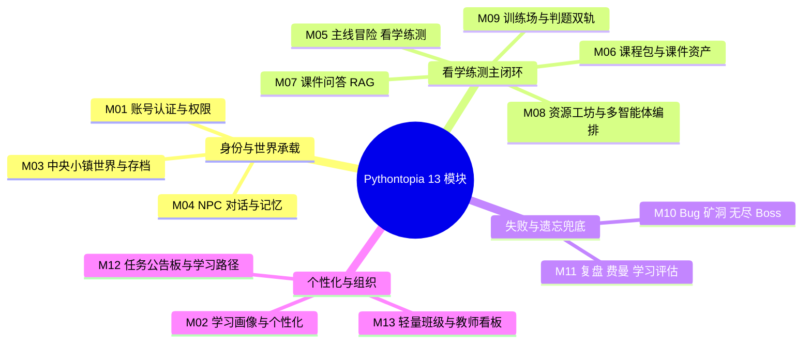

> 图 C05-6　功能模块划分思维导图（13 模块按「身份承载 / 主闭环 / 兜底 / 个性化与组织」四簇）

| 模块 | 名称 | 后端包 `com.pythontopia.*` | 代表前端页面 | 关联 Agent / 服务 | 详细设计 |
| --- | --- | --- | --- | --- | --- |
| M01 | 账号认证与权限 | `auth.controller` `auth.security` | LoginPage / RegisterPage | — | §8.1 |
| M02 | 学习画像与个性化 | `learner.profile/decision/oracle/twin/memory/probe/recommendation/event/mastery` | ProfilePage / ProfileRoomPage | profile_agent · personalization | §8.2 |
| M03 | 中央小镇世界与存档 | `world` `world.calendar/save/skill` | WorldPage / WorldCanvas | — | §8.3 |
| M04 | NPC 对话与记忆 | `npc` `dialog` `world.npc` | DialogTree / CompanionDock | npc_dialog_agent | §8.4 |
| M05 | 主线冒险·看学练测 | `mainline` `mainline.practice/test` | MainlineMapPage / StageLearnPage / ChapterTestPage | curriculum_mapper · reading_agent | §8.5 |
| M06 | 课程包与课件资产 | `coursepack` `courseware` `video` `media` | LibraryPage / LecturePage | video_insight_agent | §8.6 |
| M07 | 课件问答与导师答疑(RAG) | `tutor` `rag` + `pythontopia-rag` | TutorPanel / CoursewareEvidence | tutor_agent · tutor_workflow_cards | §8.7 |
| M08 | 资源工坊与多智能体编排 | `workshop` `orchestrator` `agent.run` `browse` `loop` `intent` + `pythontopia-graph` | WorkshopPage / WorkshopChat | orchestrator_agent · 六类资源 Agent · intent_router | §8.8 |
| M09 | 训练场与判题·双轨 | `submission` `mainline.practice` | TrainingPage / PythonCodeEditor | practice_agent · debug_agent | §8.9 |
| M10 | Bug 矿洞·无尽·Boss | `bugmine` `world.boss` | BugMinePage / EndlessExpeditionPage / BossPage | boss/* · expedition_selector | §8.10 |
| M11 | 复盘·费曼·学习评估 | `feynman` `learner.reflection/evaluation` | ReviewHallPage / FeynmanPage | feynman_tutee · reflection · evaluation_narrative | §8.11 |
| M12 | 任务公告板与学习路径 | `learner.quest` `learner.path` | BoardPage / PathTreeTab | path_planner_agent | §8.12 |
| M13 | 轻量班级与教师看板 | `classroom` `classroom.dashboard/quest/remediation/live` | TeacherPage / ClassroomDetail | — | §8.13 |

> 表 C05-2　13 功能模块与后端包/前端页面/Agent 映射（过程设计指向第 8 章）

---

## 5.4 数据流转设计

数据流转以「看→学→练→测」主链路为主轴，用数据流图（DFD）刻画外部实体、加工、数据存储与数据流。核心设计是**学习行为统一汇聚为事件流再扇出**：各学习动作产生的领域数据各自入库的同时，统一向 `LearningEvent` 事件流写一笔，事件流被画像被动演化与掌握度结算消费，结算结果又回流影响后续的资源生成与路径重排。课件素材自成一条只读供给链（课程包 → RAG 索引 → 证据），AI 生成链则以 RAG 证据为输入、以防幻觉三审为出口，绝不脱离课件凭空生成。

这里有两条值得在设计阶段明确的数据一致性约定。第一，**领域数据入库与画像/掌握度结算是「最终一致」而非强一致**：判题结果 `judge_result` 一旦落库即为权威，掌握度 `kc_mastery` 的变更经由事件驱动结算，二者在极短窗口内收敛，从而把「写判题」这条高频热路径与「算画像」这条聚合路径解耦，避免一次提交背负全部统计计算。第二，**课件供给链是单向只读的**：课程包种子（7 文档/561 页/65 KC/46 示例/39 题）由 Flyway 迁移一次性落库后，rag 服务在启动 lifespan 中从库内拉页构建索引（pgvector + BM25），若启动早于种子落库则由后台轮询自愈重建——任何 AI 链路读课件都只经这条供给链取「带页码的证据」，不存在 AI 反向写课件的数据流，从结构上杜绝了「污染课程底座」的可能。班级看板则是另一条**只读聚合流**：教师视角的 KC 热力、完成率、高频误区均由学生侧已落库数据聚合而来，不产生新的学习权威数据。

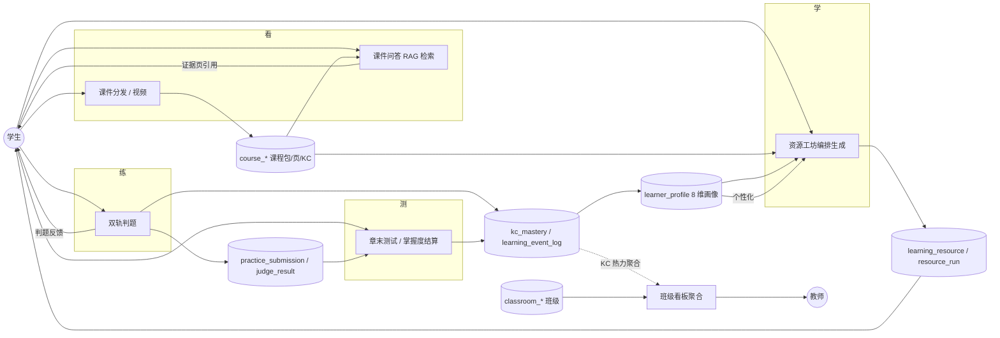

> 图 C05-7　数据流转 DFD（看→学→练→测主链路 + 事件回流画像 + 班级聚合）

---

## 5.5 用户界面总体设计

Web 端是功能最完整、含像素小镇的主端，界面总体采用「**像素世界为壳、学习面板为核**」的双层结构：底层是 Phaser 3 渲染的 `town_hub` 像素世界与 HUD（移动、对话、快捷入口），上层是各学习场景的 Vue 页面（课件、工坊、训练场、复盘、教师看板等）。导航由 `vue-router` 统一管理，根路径 `/` 重定向至 `/world`，未登录访问受 `requiresAuth` 守卫拦截回 `/login`；章末大测试进行中由全局守卫拦截跳转到 AI/答疑类页面以防作弊。界面设计遵循三条原则：游戏画布之外的学习内容必须**可读、可复制、可引用**；考试态禁挂随身助教；像素素材仅用 CC0/CC-BY/CC-BY-SA/OFL 审计资产。

| 路由 | 页面 | 角色 | 说明 |
| --- | --- | --- | --- |
| `/login` `/register` | LoginPage / RegisterPage | 游客 | 登录注册（`guestOnly`） |
| `/world` | WorldPage | 学生 | 中央小镇主玩图（`fullscreen`） |
| `/library` `/lecture/:chapter` | LibraryPage / LecturePage | 学生 | 看：课件阅读 / 章节视频 |
| `/workshop` | WorkshopPage | 学生 | 学：资源工坊 + AI 答疑（合并 `/tutor`） |
| `/training` `/problems` | TrainingPage / ProblemListPage | 学生 | 练：训练场双轨判题 |
| `/mainline-map` `/mainline/stage/:id` `/chapter-test/:chapter` | 主线地图/三件套/章末测试 | 学生 | 主线看学练测与测 |
| `/review-hall` `/feynman` | ReviewHallPage / FeynmanPage | 学生 | 复盘与费曼自测 |
| `/bug-mine` `/expedition` `/boss/:chapter` | 矿洞/无尽远征/Boss | 学生 | 失败兜底与挑战支线 |
| `/teacher` `/teacher/classroom/:id` | TeacherPage / ClassroomDetail | 教师 | 班级与 KC 热力看板 |

> 表 C05-3　主要页面路由与角色（取自 `frontend/src/app/router.ts`）

界面总体效果以下列 5 处关键画面的截图占位呈现（动态渲染，无法用源码画出），覆盖登录、世界、工坊、训练、教师看板五条主链路：

> 【截图占位 SC-C05-1】
> - 访问：http://localhost:5173/login（容器态 http://localhost:8080/login）
> - 登录角色：游客（无需登录）
> - 操作步骤：1. 打开登录页 2. 观察账号/密码表单与「注册」入口 3. 不提交
> - 截取对象：登录卡片整体（标题、表单、注册链接）
> - 期望画面：像素风登录卡居中，含用户名、密码输入框与登录按钮

> 【截图占位 SC-C05-2】
> - 访问：http://localhost:5173/world（容器态 http://localhost:8080/world）
> - 登录角色：学生（需登录）
> - 操作步骤：1. 以学生账号登录 2. 等待 town_hub 像素世界加载 3. 观察 HUD 与 NPC
> - 截取对象：像素小镇全景 + 底部/侧边 HUD 快捷入口
> - 期望画面：中央小镇像素地图渲染完成，角色立于 hub，HUD 显示学习入口

> 【截图占位 SC-C05-3】
> - 访问：http://localhost:5173/workshop（容器态 http://localhost:8080/workshop）
> - 登录角色：学生（需登录）
> - 操作步骤：1. 进入工坊 2. 输入一个学习诉求并发送 3. 观察 SSE 流式生成与工具调用时间线
> - 截取对象：工坊对话区 + 资源预览区 + 工具调用时间线
> - 期望画面：左侧对话流式输出，右侧出现思维导图/讲义等资源卡，底部显示工具调用步骤

> 【截图占位 SC-C05-4】
> - 访问：http://localhost:5173/training（容器态 http://localhost:8080/training）
> - 登录角色：学生（需登录）
> - 操作步骤：1. 进入训练场选一题 2. 在 CodeMirror 编辑器写 Python 代码 3. 先「即时预览」再「正式提交」
> - 截取对象：题面 + 代码编辑器 + 双轨执行结果面板
> - 期望画面：左题面右编辑器，下方判题结果显示 PASSED/FAILED 与用例反馈（隐藏用例不展示）

> 【截图占位 SC-C05-5】
> - 访问：http://localhost:5173/teacher（容器态 http://localhost:8080/teacher）
> - 登录角色：教师（需登录）
> - 操作步骤：1. 以教师账号登录 2. 进入某班级详情 3. 查看 KC 热力图与完成率
> - 截取对象：班级 KC 热力图 + 任务完成率/高频误区面板
> - 期望画面：热力网格按 KC 掌握度着色，旁附完成率与资源使用统计

---

## 5.6 数据结构设计

数据结构总体采用「**关系型为主、向量为辅**」：业务实体落 PostgreSQL，命名统一 `snake_case`，由 Flyway 版本化迁移管理（迁移版本号 V001 起，RPG 存档域 V100–V110 等无 `pyt_` 前缀，沿用项目约定）；课件检索的向量与全文索引落 pgvector + 内存 BM25。本节只给出**核心域概念 ER**，用于表达模块间最关键的实体关系；每张表的**完整字段字典（字段/类型/约束/索引/来源 migration）唯一权威在第 6 章（D1–D4）**，本章引用表名时不再列全字段。

关系型为主、向量为辅的取舍来自数据本身的形态：学习态（账号、进度、提交、掌握度、班级）是强结构、强一致、需事务与外键约束的关系数据，天然适合 PostgreSQL；课件检索需要语义近邻，故由 pgvector 承载向量、再叠加内存 BM25 与 KC 前置图做混合召回。值得在概要层固定的两条结构约定是：其一，**8 维画像聚合在 `learner_profile.dimensions`（JSONB）单列**而非拆成 8 张表——8 个英文 snake_case key（专业背景/知识基础/学习目标/认知风格/学习偏好/易错模式/实践能力/情绪与坚持度）随画像演进频繁、结构半开放，用 JSONB 既能整体读写又便于演化；其二，**全库 `snake_case` 命名 + Flyway 版本化迁移**，每个迁移须说明目的、影响表与不可逆风险，RPG 存档域（V100–V110 等）沿用无 `pyt_` 前缀的项目约定。概念 ER 选取八条主链关键实体：用户 `users`（M01）、画像 `learner_profile`（M02）、课程包/知识点 `course_pack`·`course_kc`（M06）、掌握度 `kc_mastery`（M02）、主线进度 `mainline_stage_progress`·`chapter_test`（M05）、提交与判题 `practice_submission`·`judge_result`（M09）、学习资源 `learning_resource`（M08）、任务 `quest`（M12）、班级 `classrooms`·`classroom_members`（M13）。

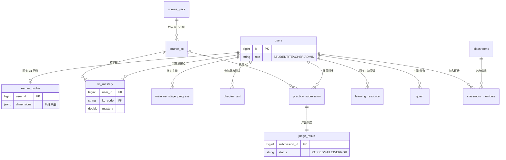

> 图 C05-8　核心域概念 ER（简版；完整字段字典见第 6 章 §6.5 D1–D4，本图仅示意主关系）

---

## 5.7 接口设计

接口设计遵循统一规约：**统一前缀 `/api` + 资源式 REST 命名 + JWT Bearer 鉴权 + 统一错误信封 + AI 流式经 SSE 中继**。鉴权上，后端 STATELESS（`SessionCreationPolicy.STATELESS`），由 `JwtAuthenticationFilter` 从 `Authorization: Bearer <token>` 解析主体并注入 `SecurityContext`，方法级用 `@EnableMethodSecurity` 与控制器内 `requireStudent` 等显式校验角色；`/api/auth/**`、`/api/course/**`、`/api/media/assets/**`、`/api/internal/**`、`/api/downloads/**`、`/healthz` 放行，其余一律需有效 JWT。前端 axios 以 `baseURL: '/'`、请求拦截器统一附加 Bearer、响应拦截器在 401 时触发重登并把后端 `code` 本地化为中文提示。

REST 命名上一律用**资源名而非动作式路径**（如 `/api/submissions` 而非 `/api/doSubmit`），用 HTTP 方法表达语义：`GET` 查询（列表统一以 `limit`/`offset` 分页、可选 `status`/`problemId` 等过滤）、`POST` 创建/触发、`PUT`/`PATCH` 更新、`DELETE` 删除；查询类天然幂等，写类则在服务端以业务校验保证不产生脏数据（如 `QuestService` 对任务领取做强证据校验）。新增 API 一律配 DTO、`@Valid` 校验、统一错误返回与测试，DTO 字段明确不散装。接口契约由 springdoc-openapi 自动产出 `/v3/api-docs`（dev 默认开放、生产可经 `expose-api-docs=false` 关闭），作为多端对齐 DTO 的单一真理源。AI 类接口之所以选 **SSE 而非 WebSocket 或轮询**：生成是「服务端单向逐字推送、客户端只读」的场景，SSE 基于 HTTP/1.1、天然过反代、实现与降级都更简单，且与「后端中继 graph 流式帧」的架构完全契合（无需在后端额外维护双向连接状态）。

统一错误信封是所有非 2xx 响应的唯一形态，由 `ApiError` 记录承载、`GlobalExceptionHandler`（`@RestControllerAdvice`）集中产出，字段如下：

| 字段 | 类型 | 说明 |
| --- | --- | --- |
| `code` | string | 机器可判错误码（如 `VALIDATION_ERROR` / `UNAUTHORIZED` / `FORBIDDEN` / `INTERNAL_ERROR`） |
| `message` | string | 人类可读简述（前端按 `code` 映射中文友好提示） |
| `details` | string[] | 字段级校验明细（如 `字段: 原因`），无则空数组 |
| `traceId` | string | 链路追踪 id（取请求 `traceId` 属性或请求 id），便于定位 |
| `timestamp` | ISO-8601 | 服务端生成时间 |

> 表 C05-4　统一错误信封 `ApiError` 字段（取自 `common.error.ApiError`）

AI 类接口因生成耗时长、需逐字回放，统一采用 **SSE 中继**而非一次性返回：业务层控制器返回 `SseEmitter`，由 `SseRelayExecutor`（有界线程池 + `CallerRunsPolicy` 回压）提交中继任务，`GraphSseConsumer`（JDK `HttpClient` 强制 HTTP/1.1）以 POST 打开到 graph 的 `text/event-stream` 连接、解析 `event:`/`data:` 帧并逐帧回放给客户端。线上事件语义已迁至 AG-UI（`TEXT_MESSAGE_CONTENT.delta` 拼答案、`STEP_*` 为思考链、`RUN_FINISHED` 为终态、`RUN_ERROR` 为错误），客户端按此归一。代表性 SSE 中继端点如下：

| 端点 | 方法 | 角色 | 用途 |
| --- | --- | --- | --- |
| `/api/tutor/ask` | POST(SSE) | 学生/教师 | 课件问答与导师答疑（教师带 `classroomId` 触发 copilot） |
| `/api/orchestrator/turn/stream` | POST(SSE) | 学生 | 学习总管编排回合 |
| `/api/orchestrator/tool-loop/stream` | POST(SSE) | 学生 | 混合工具编排（有界工具循环） |

> 表 C05-5　典型 SSE 中继端点（取自 `TutorController` / `OrchestratorController`）

以「课件问答」为例给出端到端时序：前端发起带 JWT 的 SSE 请求，经鉴权后控制器返回 `SseEmitter`，中继线程消费 graph 流式事件，graph 先向 rag 取证据再生成、末端三审，逐帧回放至前端拼接显示。

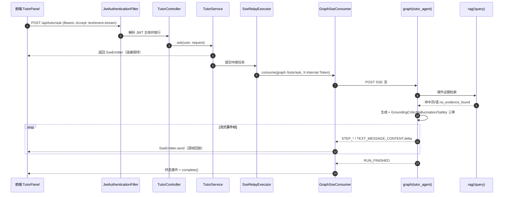

> 图 C05-9　课件问答 SSE 端到端时序（鉴权 → 中继 → RAG 证据 → 三审 → 逐帧回放）

以「训练场提交判题」为例给出双轨执行时序：前端 Pyodide 即时预览**仅本地、不入库**；正式提交走服务端沙箱判题并入库，隐藏用例不下发，判题结果回流掌握度，失败可触发 Bug 矿洞。

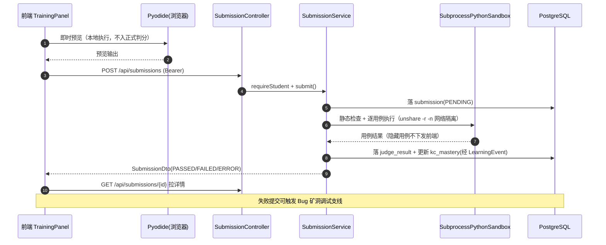

> 图 C05-10　训练场提交判题双轨时序（Pyodide 预览不入库；服务端沙箱判题入库回流掌握度）

提交在服务端的生命周期是一个有限状态机，状态取自 `SubmissionStatus` 枚举，设计上保证「预览态」不进入该状态机：

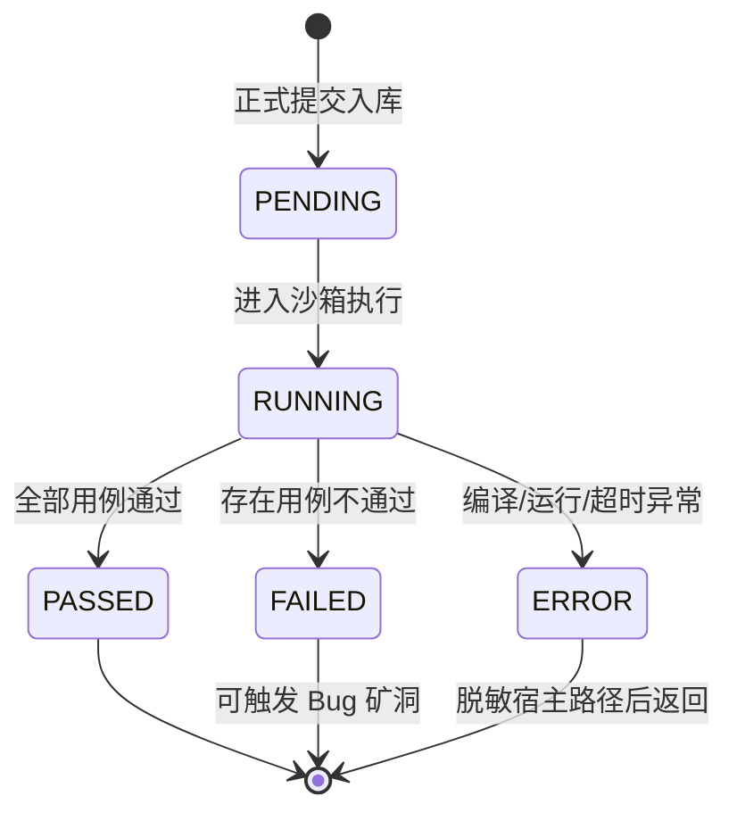

> 图 C05-11　提交判题状态机（取自 `SubmissionStatus`：PENDING/RUNNING/PASSED/FAILED/ERROR）

---

## 5.8 异常与容错设计

异常与容错分两条线：**同步请求线**走「统一异常 → 错误信封」，**异步生成线**走「fail-soft 降级」。同步线由 `GlobalExceptionHandler` 集中拦截各类异常并映射为合适的 HTTP 状态与稳定错误码：业务异常 `BusinessException` 自带 `status`+`code`；参数校验失败映射 `400 VALIDATION_ERROR` 并带字段明细；鉴权/越权分别映射 `401 UNAUTHORIZED` / `403 FORBIDDEN`；路径不存在映射 `404 NOT_FOUND`（含 Spring Boot 3.2+ 的 `NoResourceFoundException`）；方法/媒体类型错误映射 405/415/406；其余未捕获异常统一 `500 INTERNAL_ERROR` 并记录日志，绝不把堆栈泄露给前端。

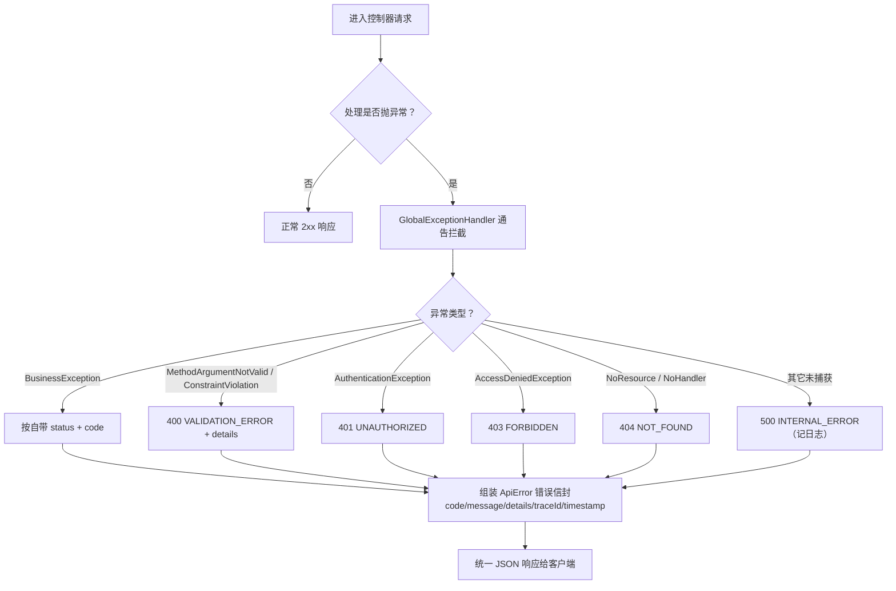

> 图 C05-12　统一异常处理流程（各类异常 → GlobalExceptionHandler → 统一错误信封）

| 异常类别 | HTTP | code | 触发场景 |
| --- | --- | --- | --- |
| 业务异常 | 由异常自带 | 自带（如 `FORBIDDEN`） | 领域规则不满足（如非学生访问判题接口） |
| 参数校验 | 400 | `VALIDATION_ERROR` / `BAD_REQUEST` | 请求体/参数不合法 |
| 未认证 | 401 | `UNAUTHORIZED` | 缺失/失效 JWT |
| 越权 | 403 | `FORBIDDEN` | 角色不匹配/跨班级越权 |
| 资源不存在 | 404 | `NOT_FOUND` / `COURSE_PACK_NOT_FOUND` | 路径或资源缺失 |
| 服务器异常 | 500 | `INTERNAL_ERROR` | 未捕获异常（脱敏后返回） |

> 表 C05-6　异常分类与 HTTP/错误码映射（取自 `GlobalExceptionHandler`）

异步生成线遵循 **fail-soft（缺失即降级，不阻塞主链路）**：LLM Provider 缺密钥或不可达时自动降级 golden 兜底；讯飞多模态（TTI/TTS/IAT/图片理解）任一凭据缺失则降级本地占位或纯文本回退；RAG 命中分低于阈值或触发敏感词时返回 `no_evidence_found=true, hits=[]` 而非编造引用；rag 服务启动早于课程种子落库时由 lifespan 后台轮询自愈重建索引；graph 对下游的调用超时由 `graphRestTemplate` 在阈值内 fail-fast，避免占满 Tomcat 线程；SSE 中继线程池有界并以 `CallerRunsPolicy` 回压突发流量。判题安全上，沙箱默认以 `unshare -r -n` 切断网络（容器内被 seccomp 拦截时回退无隔离并记 WARN），隐藏用例不下发、失败统一脱敏宿主路径。

两条线的设计取向其实是同一条原则的两面：**对用户直面的同步请求，要「错得清楚」**——把异常收敛成稳定错误码与可读信息，让前端能按 `code` 决定重登、提示或重试；**对耗时且依赖外部不可控因素的异步生成，要「坏得安静」**——单点失败就地降级、记录可观测信号，绝不把「AI 不可用」放大成「整个学习闭环不可用」。这一取向有一个明确的例外边界：凡涉及**学术诚信与教育正确性**的失败一律不做「假装成功」的降级——RAG 无证据时宁可显式告知「未命中」也不编造页码，Agent 故障时 fail fast 而非静默降级成普通聊天，章末测试态禁止任何 AI 协助。即「可用性可以降级，诚信与正确性不可降级」。

---

## 5.9 配置项设计

配置遵循「**代码零硬编码、外置环境变量、内置安全默认**」：所有可变项在 `application.yml` 以 `${ENV:default}` 形式声明，容器经 `deploy/docker-compose.yml` 注入，缺省时回落安全默认值（如演示态 LLM 走 `dryrun`、判题隔离 `auto`、API 文档默认开放而生产可关）。配置分为「连接与端口、鉴权与安全、判题与沙箱、AI 与中继、限额与节流、多模态凭据、媒体与课件路径」七类。关键配置项如下：

| 配置键 | 默认值 | 作用 |
| --- | --- | --- |
| `server.port` | `18080` | 后端监听端口 |
| `pythontopia.judge.python` | `python3` | 判题用 Python 解释器 |
| `pythontopia.judge.isolation` | `auto` | 沙箱网络隔离（auto=`unshare -r -n` / none） |
| `pythontopia.services.graphUrl` / `ragUrl` | `:18091` / `:18092` | AI 微服务地址 |
| `pythontopia.http.graph.connect/read-timeout-ms` | `3000` / `30000` | graph 调用超时 fail-fast |
| `pythontopia.http.chapter-test.read-timeout-ms` | `600000` | 章末测试生成长超时 |
| `pythontopia.sse.relay.core/max/queue` | `4` / `16` / `200` | SSE 中继有界线程池 |
| `pythontopia.security.jwt.secret` / `ttlMinutes` | 外置 / `720` | JWT 密钥与有效期（12h） |
| `pythontopia.security.expose-api-docs` | `true` | 是否公开 OpenAPI/Swagger（生产可关） |
| `pythontopia.security.cors.allowed-origin-patterns` | 本地 5173/8080 | CORS 放行来源（生产覆盖真实域名） |
| `pythontopia.mastery.halfLifeDays` | `14` | 掌握度衰减半衰期 |
| `pythontopia.workshop.maxResourcesPerHour` / `masteryDailyCapPerKc` | `10` / `0.15` | 工坊限额与每 KC 日掌握度上限 |
| `pythontopia.tts/image/asr.dailyLimitPerUser` | `100`/`50`/`100` | 多模态每用户日配额 |
| `pythontopia.coursepack.pdfDir/videoDir` | `./data/...` | 课件 PDF/视频本地目录 |

> 表 C05-7　关键配置项（取自 `application.yml` 与 `docker-compose.yml`）

---

## 5.10 部署架构设计

部署在第 2 章「容器拓扑（图 C02-1）」给出运行视图的基础上，本节做**设计层展开**：聚焦「网络暴露面收敛、可降级边界、数据持久化、外网出口」四项部署决策，不重复罗列服务清单。线上演示部署在阿里云 ECS（公网 `47.120.29.62`，2C4G），由 **Nginx 反向代理 `:80` → 后端 `:18080`** 并直出前端静态资源；六个核心服务由 `docker compose up -d` 一并拉起，可观测性 Langfuse 全家桶挂在可选 `observability` profile，默认不启动且全部加 `langfuse-` 前缀与业务服务隔离。

部署的安全设计要点有三：其一，**暴露面最小化**——后端、rag、Langfuse-web 均绑回环 `127.0.0.1`，仅前端容器 `8080:80` 与 Nginx `:80` 对外，公网只见 Web 与经反代的 `/api`；其二，**graph 走 host 网络**——因其需经宿主代理（默认 `7892`）访问外网检索（B 站），而 backend 访问讯飞经 `host.docker.internal` 代理并以 `nonProxyHosts` 排除容器内服务名直连；其三，**数据可重建分层**——`pytopia_pg` 数据卷持久化业务库，PDF/视频/生成媒体走本地卷（不入 git、可重生），Langfuse 数据卷与业务库物理隔离。

把这三点合起来看，部署架构实际上贯彻了「**单一入口 + 内网默契**」的边界策略：对外世界只有 Nginx 一个收口，所有业务服务在 Docker 内网用服务名互相寻址、不对公网开端口，因此即便后端开放了 Swagger 也只在内网可达（生产再以 `expose-api-docs=false` 兜底）。一键演示链路也据此固化为可复现脚本序列：`docker compose up -d --build` 起六服务 → `init_rag_index.sh` 构建课件向量索引 → `seed_demo_classroom.sh` 幂等创建 demo 教师与学生班级 → `demo_smoke.sh` 做健康检查与课程包可读性验证。一个必须在部署设计中提示的已知踩坑是：**Postgres 数据卷密码与 `deploy/.env` 不一致会导致 Flyway 启动失败**，处置以 `docs/dev-startup.md` 备忘为准（核对密码或清卷重建）；这类「环境一致性」问题在容器化部署中比代码缺陷更常见，故纳入部署纪律而非临场排查。

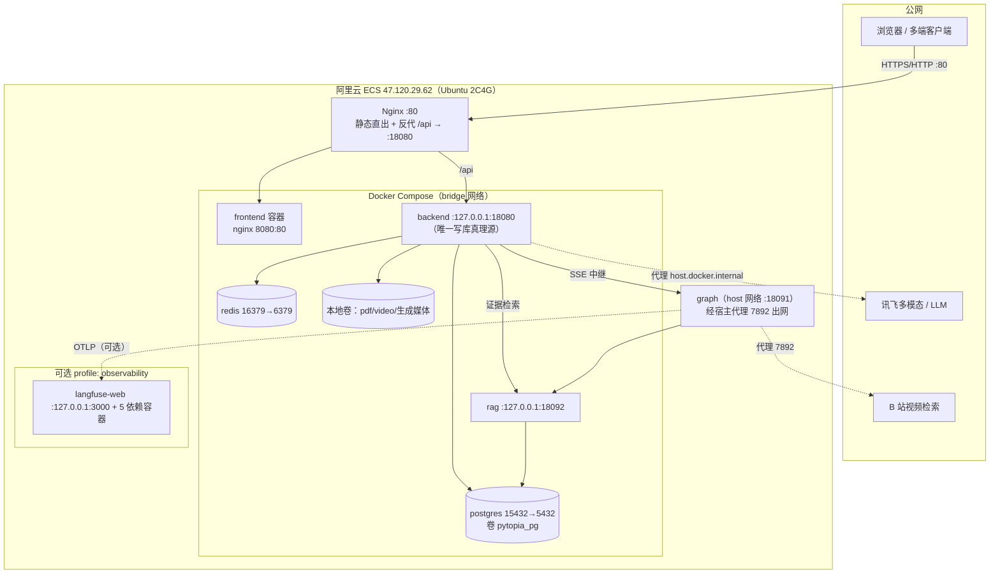

> 图 C05-13　部署架构（设计层视角）：Nginx 反代 + 暴露面收敛 + graph host 网络出网 + 可选 Langfuse

---

## 5.11 跨端（多客户端）架构

跨端架构的总原则是「**一套后端，多端共享；客户端只做表现层；能力边界完全对齐**」。Web、Android、Windows、微信小程序、微信小游戏五个客户端工程共用同一套后端（`:18080`，前缀 `/api`，JWT Bearer），客户端之间互不依赖，接入后端的**唯一权威契约是 `docs/clients/api-contract.md`**（base URL/端口、JWT、错误信封、端点表、SSE、CORS、不存在的能力都以它为准）。设计上各端**不复用** Web 的 Phaser/`tilemap.ts`/`api/*.ts`，各自用平台原生技术栈渲染像素世界（微信小程序为「学习陪伴」无像素小镇），但都通过 OpenAPI（后端 springdoc `/v3/api-docs`）对齐 DTO 形态，避免多端字段漂移。能力边界上，自 R-14「世界收缩」起全项目**没有背包/货币/商店**三类能力，任何客户端都不得为其建 UI 或调端点。多端落地细节（构建产物、凭据安全、生成器策略）见**第 7 章**。

跨端设计中最大的风险是**多端 DTO 漂移**与**SSE 事件协议不一致**，二者都靠「契约先行」化解：DTO 以后端 OpenAPI schema 为单一真理源，规划用 OpenAPI Generator 从 schema 生成各端 client（当前 Android 仍为手写、生成器待引入），并以 `openapi-diff` 在 CI 检测 schema 变更；SSE 则要求所有端按统一的 AG-UI 语义事件归一（`TEXT_MESSAGE_CONTENT.delta` 拼答案、`STEP_*` 当思考链、`RUN_FINISHED` 为终态、`RUN_ERROR` 为错误），历史事件名不再作为判定依据。凭据安全按端落地：Android 用 `EncryptedSharedPreferences` + Keystore + BiometricPrompt（OWASP MASVS-L1），Windows 用 DPAPI 加密落盘，Web 则依赖 HTTPS 与同源策略。这样五端在「数据、协议、能力、安全」四个维度上都对齐到同一份后端契约，新增一个端的边际成本仅是「实现表现层 + 接契约」，而非重做一套业务。

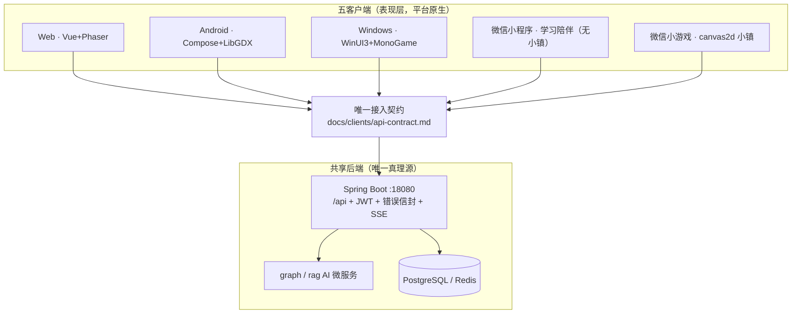

> 图 C05-14　跨端共享后端架构（五端表现层 + 唯一契约 + 共享后端真理源）

| 客户端 | 技术栈 | 像素小镇 | 接入方式 |
| --- | --- | --- | --- |
| Web | Vue 3 + Phaser 3 | 有 | 浏览器，`/api` 同源/反代 |
| Android | Kotlin + Compose + LibGDX | 有 | Retrofit + JWT，OpenAPI 生成 DTO |
| Windows | .NET 8 + WinUI 3 + MonoGame | 有 | HttpClient + JWT，DPAPI 加密落盘 |
| 微信小程序 | 原生 TS（WXML/WXSS） | 无（学习陪伴） | wx.request + JWT |
| 微信小游戏 | 原生 TS + canvas2d | 有 | wx.request + JWT |

> 表 C05-8　五客户端跨端能力矩阵（共享后端；无背包/货币/商店；详见第 7 章）

---

## 5.12 其他设计考量

**安全与合规**：演示账号统一 `demo-` 前缀虚构身份，提交包不含真实学生 PII 与真实 LLM 密钥（`.env` 已 gitignore）；JWT 密钥外置、有效期 12h；判题沙箱网络隔离防 SSRF/数据外传；隐藏测试用例不下发前端 DTO。像素素材仅用 CC0/CC-BY/CC-BY-SA/OFL 审计资产，授权与 `LICENSE-ART.md` 一致（LPC CC-BY-SA 3.0 传染已接受，包装作品同以 CC-BY-SA 3.0+ 发布，代码层 MIT 分层授权）。

**防幻觉与教育底线**：所有生成资源末端经 GroundingCritic / Hallucination / Safety 三审；RAG 回答必须带课件页码/出处引用，来自通识知识而非课件须明确标注；不伪造课件页码/章节/题目/作者；不输出隐藏测试；不直接给可复制提交的完整答案（除非任务类型明确允许且受教师视角限制）；AI 决策对学生以「决策玻璃盒」可解释呈现。

**可观测性与可演进**：可选 Langfuse 以 OTLP-native 接收 graph 既有 OTel span 做决策对账，默认 no-op 不影响主链路；版本演进遵循「小步迭代 + 单独 PR」，数据库以 Flyway 版本化迁移、迁移文件须说明目的/影响表/不可逆风险。

**性能与稳定**：业务层 `open-in-view: false` 避免视图层持库连接；下游 AI 调用超时 fail-fast；SSE 中继有界线程池回压；NPC 寒暄支持每日预生成缓存使进对话零等待；前端对懒加载分块失效做整页自愈、对后台/可选请求抑制全局网络 toast。

**已知局限与取舍**：Android DTO 当前仍为手写（OpenAPI 生成器待引入）；演示态默认单 worker 以避免进程内状态错乱；多模态在无真实密钥时恒走降级占位——这些取舍均服务于「演示链路稳定、教育目标不被技术不确定性拖累」的总体目标。

---

## 附：本章图表索引

| 编号 | 名称 | 类型 |
| --- | --- | --- |
| 图 C05-1 | 总体处理流程（看→学→练→测） | flowchart |
| 图 C05-2 | 学生学习旅程图 | journey |
| 图 C05-3 | 总体五层架构图 | flowchart |
| 图 C05-4 | 系统上下文图（C4-Context） | flowchart |
| 图 C05-5 | 业务层横切协作骨架类图 | classDiagram |
| 图 C05-6 | 功能模块划分思维导图 | mindmap |
| 图 C05-7 | 数据流转 DFD | flowchart |
| 图 C05-8 | 核心域概念 ER | erDiagram |
| 图 C05-9 | 课件问答 SSE 端到端时序 | sequenceDiagram |
| 图 C05-10 | 训练场提交判题双轨时序 | sequenceDiagram |
| 图 C05-11 | 提交判题状态机 | stateDiagram-v2 |
| 图 C05-12 | 统一异常处理流程 | flowchart |
| 图 C05-13 | 部署架构（设计层视角） | flowchart |
| 图 C05-14 | 跨端共享后端架构 | flowchart |
| 表 C05-1 | 五层职责与代表组件 | 表 |
| 表 C05-2 | 13 功能模块与包/页面/Agent 映射 | 表 |
| 表 C05-3 | 主要页面路由与角色 | 表 |
| 表 C05-4 | 统一错误信封字段 | 表 |
| 表 C05-5 | 典型 SSE 中继端点 | 表 |
| 表 C05-6 | 异常分类与 HTTP/错误码映射 | 表 |
| 表 C05-7 | 关键配置项 | 表 |
| 表 C05-8 | 五客户端跨端能力矩阵 | 表 |
| 截图 SC-C05-1..5 | 登录 / 世界 / 工坊 / 训练 / 教师看板 | 截图占位 |

---

> 执笔人：成员 A ｜ 完成人（签名）：成员 A ｜ 审查人：成员 C ｜ 完成日期：2026-06-14
