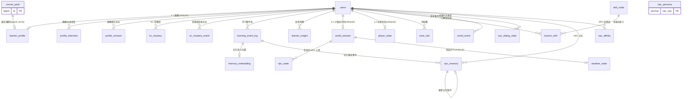
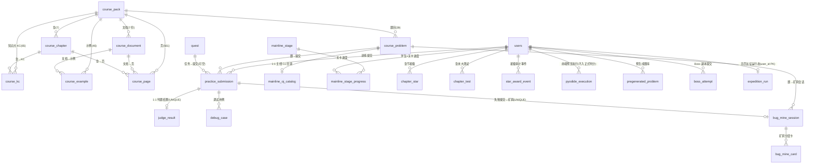
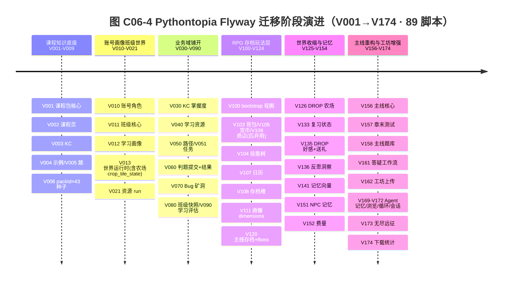
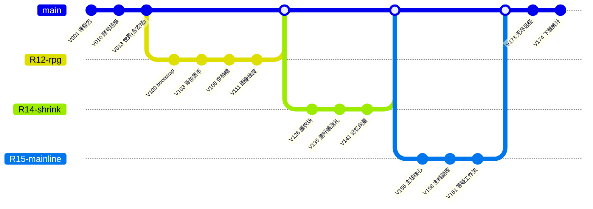

<!-- filecode: C06 -->

# 第 6 章　数据库设计（规范与总览）

> filecode **C06** ｜ 对应课程报告 **第 6 章 数据库设计**的 §6.1–§6.4「总览」部分 ｜ 文档编号 PYT-CR
> 本章承接 §5 概要设计的概念 ER（见 C05），向下统领 §6.5 完整字段字典（文件 `06-01…06-04`，filecode D1–D4）。
> **职责边界**：本文只给出命名规范、概念 ER 总图、模块↔表归组矩阵、索引/约束总览与已弃用表登记；**每张表的完整字段字典只在 §6.5（D1–D4）出现一次，本文一律不重复字段**。引用某表字段时只写「详见 §6.5 表 xxx」。

## 6.0 数据层概况

Pythontopia 的持久层是一座 **PostgreSQL 16 + pgvector**（容器镜像 `pgvector/pgvector:pg16`，库名 `pythontopia`）单库，所有结构变更经 **Flyway** 版本化管理，迁移脚本集中于 `backend/src/main/resources/db/migration/`，共 **89 个脚本**，版本号自 `V001` 递增到 `V174`（非连续，留段以便分支并行）。这 89 个脚本累计建过 **87 张物理表**：其中 **79 张为当前活跃业务表**，**8 张为已弃用/历史遗留表**（3 张已被 `DROP TABLE` 物理移除、5 张建表后未删而沦为「孤儿表」），另含 **1 个只读聚合视图 `game_bootstrap_view`**（V100 建、V107 重建），把 `world_session + player_state + learner_profile` 三张 1:1 表合并成像素小镇一次性水合（hydrate）的单 GET 投影。

整个 schema 以 `users` 为唯一身份锚点呈「星形 + 链式」拓扑：绝大多数业务表挂一根 `user_id` 外键到 `users(id)` 且 `ON DELETE CASCADE`，删账号即级联清空个人学习数据；课程侧则以 `course_pack` 为根向 `course_document → course_page`、`course_kc / course_example / course_problem` 链式展开，并通过 `pack_id = 43` 的 `CHECK` 约束把全库锁定在唯一课程包《Python 语言基础》上。本文 §6.2 用三张子域 ER 图把这套拓扑画清，§6.3 给出可检索的模块↔表矩阵，§6.4 登记 R-14「世界收缩」退役的农场/经济/商店残留表。

需要说明数据职责边界：本库只承载**需要事务一致性与长期留存的业务事实**；Redis 7 仅作缓存/限流的易失层、不建模实体，故不入本章；判题「双轨执行」中 Pyodide 前端即时预览结果**不入正式判分**，只有服务端沙箱判题落 `practice_submission`/`judge_result`，前端预览另以 `pyodide_execution` 留痕做分析，二者在表设计上严格区分。RAG 课件检索所需的向量既复用本库 pgvector（如 `memory_embedding`、`workshop_upload_chunk`），也有独立微服务侧索引，本章只登记落在 PostgreSQL 内的部分。

---

## 6.1 命名规范

数据库命名是「写库的人」与「读报告的人」之间的契约。Pythontopia 后端遵循 `AGENTS.md` 硬约束「数据库表名和字段名使用 `snake_case`；迁移文件必须说明目的、影响表和不可逆风险」，并在此基础上沉淀出一套贯穿 89 个脚本的稳定约定。核心规则可一句话概括：**全小写 `snake_case`、单库无表前缀、主键统一 `id`、外键统一「被引用表单数名 + `_id`」、时间统一 `TIMESTAMPTZ DEFAULT now()`、枚举用内联 `CHECK`、索引用 `idx_` 前缀**。表 C06-1 给出对象级对照与真实示例。

**表 C06-1　全局命名规范对照表**

| 对象 | 命名规范 | 仓库真实示例 |
| --- | --- | --- |
| 数据库 | 全小写单词 | `pythontopia` |
| 表名 | `snake_case`，按业务语义取单/复数 | `users`、`learner_profile`、`kc_mastery_event`、`classrooms` |
| 字段名 | `snake_case` | `user_id`、`password_hash`、`created_at`、`pack_id` |
| 主键 | `id BIGSERIAL`（自增 `BIGINT`）；少数静态配置/1:1 表用业务键或 `user_id` 直作 PK | `users.id`；`skill_node.skill_key`、`npc_persona.npc_key`、`mainline_oj_catalog.problem_id`、`player_currency.user_id` |
| 外键列 | 「被引用表单数名 + `_id`」 | `user_id`、`pack_id`、`problem_id`、`session_id`、`stage_id`、`classroom_id` |
| 时间列 | `TIMESTAMPTZ`，默认 `now()` | `created_at`、`updated_at`、`given_at`、`last_active_at` |
| 半结构化数据 | `JSONB`（按等值查询配 GIN） | `learner_profile.dimensions`、`save_slot.snapshot`、`world_event.payload` |
| 向量数据 | pgvector `vector(n)`（余弦距离配 ivfflat/hnsw 索引） | `memory_embedding`（512 维）、`workshop_upload_chunk` |
| 普通索引 | `idx_<表>_<列>[_<列>]` | `idx_users_role_status`、`idx_kc_mastery_user`、`idx_practice_submission_quest` |
| 唯一索引/约束 | `uq_/uniq_/ux_/uniq` 前缀并存（历史不一致，见正文） | `uq_save_slot_active`、`uniq_quest_classroom_user`、`ux_agent_memory_ref_provider_external` |
| 枚举值 | 不另建字典表，内联 `CHECK (col IN (...))` | `users_role_check`、`world_session_season_check`、`boss_attempt_chapter_range` |
| 迁移文件 | `V<三位序号>__<英文描述>.sql`（双下划线） | `V010__auth_users_roles.sql`、`V156__mainline_core.sql` |

**主键与外键。** 主键以 `id BIGSERIAL` 为压倒性默认，少数场景刻意改用业务键以表达「天然一对一」或「静态配置」语义：技能树定义表 `skill_node` 以 `skill_key` 作 PK、NPC 人格表 `npc_persona` 以 `npc_key` 作 PK、主线 OJ 目录 `mainline_oj_catalog` 直接以 `problem_id` 作 PK（与 `course_problem` 1:1），玩家货币 `player_currency`、记忆向量 `memory_embedding`、无尽远征运行态 `expedition_run` 则用 `user_id`/`event_id` 直作 PK 表达「一人一行/一事件一向量」。外键统一写成 `<父表单数>_id`，并显式声明删除策略：与账号强绑定的个人数据用 `ON DELETE CASCADE`（删账号即清理），可空的弱关联用 `ON DELETE SET NULL`（如 `practice_submission.quest_id`、`feynman_session.problem_id`、`learning_resource.created_by_run_id`），而对课程包这类「不能因子表存在就被删」的根表用 `ON DELETE RESTRICT`（`learner_profile.pack_id`、`classrooms.pack_id`）。

**索引与唯一约束。** 普通索引一律 `idx_` 前缀并把高频过滤列前置（如 `idx_learning_event_log_user_type(user_id, event_type)`、`idx_chapter_test_user_ch(user_id, chapter, created_at DESC)`）；部分索引用 `WHERE` 子句压缩体积（`idx_world_event_unprocessed ... WHERE is_processed = false`、`idx_loop_run_trace ... WHERE trace_id <> ''`）；JSONB 与向量列分别配 GIN（`idx_save_slot_snapshot_gin USING GIN`）与余弦索引（`idx_memory_embedding_cos`）。**唯一约束前缀存在历史不一致**——早期 RPG 层用 `uq_`（`uq_save_slot_active`、`uq_inventory_user_item`），班级/任务模块用 `uniq_`（`uniq_quest_classroom_user`），新近 Agent 模块用 `ux_`（`ux_agent_memory_ref_provider_external`）、画像维度索引用 `ix_`（`ix_learner_profile_dimensions_gin`）。本报告如实登记该差异，作为后续重构可统一收敛的技术债。

**Flyway 迁移约定。** 文件名为 `V<序号>__<英文描述>.sql`，版本号**单调递增、永不重排、永不回填**——已应用的脚本即视为不可变历史，任何修正都另开新版本（例如 `users` 角色枚举的放宽不是改 V010，而是新增 `V112__users_role_admin.sql`）。每个脚本头部强制写明 `Purpose`（目的）、`Tables affected`（影响表）与 `Irreversible risk`（不可逆风险）三段注释；凡含数据删除的迁移必须把风险写在脚本头，例如 `V126` 注明「`crop_tile_state` 行数据将永久删除；掌握度本身存于 `kc_mastery_event`，不受影响」。版本号分段规划见表 C06-2。

**表 C06-2　Flyway 迁移版本段规划**

| 版本段 | 阶段主题 | 代表迁移 |
| --- | --- | --- |
| `V001`–`V009` | 课程知识底座（`packId=43`） | `V001` 课程包核心、`V002` 页、`V003` KC、`V006` 种子 |
| `V010`–`V021` | 账号 / 班级 / 画像 / 世界 / 资源运行 | `V010` 账号、`V011` 班级、`V012` 画像、`V013` 世界 |
| `V030`–`V090` | 掌握度 / 资源 / 路径 / 任务 / 判题 / 矿洞 / 评估 | `V060` 判题、`V070` Bug 矿洞、`V090` 学习评估 |
| `V100`–`V124` | RPG 存档玩法层（**无 `pyt_` 前缀**） | `V100` bootstrap 视图、`V108` 存档槽、`V111` 画像 `dimensions` |
| `V125`–`V154` | R-14 世界收缩 + 记忆 / 复习 | `V126`/`V135` DROP 残留、`V133` 复习状态、`V141` 记忆向量 |
| `V156`–`V174` | R-15 主线重构 + 工坊 / Agent 增强 | `V156` 主线核心、`V161` 答疑工作流、`V173` 无尽远征 |

**无 `pyt_` 前缀的历史约定。** 本项目自 Alethicode 抽取重构而来，单库单服务，因此**全库表均不加业务前缀**。`AGENTS.md` 特别记录：R-12 引入 RPG 存档层时（`V100`–`V110`：`game_bootstrap_view`、`npc_dialog_state`、`npc_gift_log`、`inventory`、`skill_tree`、`currency`、`shop_listing`、`world_calendar`、`save_slot` 等），曾考虑给新玩法表加 `pyt_` 前缀以与课程核心表区隔，最终**决定沿用无前缀约定**，保持 `users`/`save_slot`/`skill_node` 等命名风格统一。这条约定是理解「为什么 RPG 表和课程表混在一个无前缀命名空间里」的关键。

---

## 6.2 概念 ER 总图

为避免单张 ER 因表过多而不可读，本节按数据域拆成三张子域 ER 图：**身份·画像·世界·NPC（图 C06-1）**、**课程包·主线·训练判题（图 C06-2）**、**答疑·工坊·复盘·任务·班级（图 C06-3）**。三图共享 `users` 与 `course_pack` 两个跨域根实体——前者是几乎所有个人数据表的外键父表，后者是全部课程内容表的外键父表，二者像两根主轴把三张子域 ER 缝合成同一张全局图；为控制图幅，跨域外键（如 `learner_profile.pack_id → course_pack`）在哪张图首次出现就在哪张图标注，另一张图以脚注回指，不重复连线。关系基数严格依据真实外键的 `NOT NULL`/`UNIQUE`/可空性标注：`||--o{` 表示「一对零或多」，`||--o|` 表示「一对零或一」（FK 带 `UNIQUE` 的 1:1 可选关系），自反关系用于 `npc_memory` 的「被取代」链。凡 seed/静态配置表（如 `npc_persona`、`mainline_practice_question`、`agent_strategy`）以业务键关联而无库级外键的，按真实情况标为「逻辑关联」并在脚注说明，绝不臆造数据库约束。

### 6.2.1 身份·画像·世界·NPC 域（M01–M04）

`users` 是全库的「根」：`learner_profile`/`world_session`/`player_state` 各以 `UNIQUE` 外键与其构成 1:1，承载「一人一档/一人一运行态」；`learning_event_log` 是被动画像演化与记忆流的统一事件源，向下扇出 `memory_embedding`（`event_id` 作 PK 的 1:0..1 语义向量）与 `npc_memory`（NPC 个性化记忆锚到事件）。

> 图 C06-1　身份·画像·世界·NPC 域 ER（`npc_persona` 为静态人格定义表，与 `npc_memory`/`npc_affinity` 通过业务键 `npc_key` 逻辑关联，不设数据库级外键；`course_pack` 详见图 C06-2）

### 6.2.2 课程包·主线·训练判题域（M05、M06、M09、M10）

课程域以 `course_pack` 为根链式展开：`course_document → course_page`、`course_chapter → course_kc/course_page`，外加 `course_example`、`course_problem`，全部以 `pack_id` 外键回挂并受 `pack_id = 43` 约束。`course_problem` 是「练」的中枢——既被 `practice_submission` 引用（提交→ `judge_result` 1:1 结果 + `debug_case` 调试用例），又被主线 OJ 目录 `mainline_oj_catalog`（1:1）、Bug 矿洞 `bug_mine_session`、费曼会话 `feynman_session` 复用。主线侧 `mainline_stage` 定义关卡，向下扇出 `mainline_stage_progress`、并与 `chapter_star`/`chapter_test`/`star_award_event` 共同支撑「看→学→练→测」与章末大测试。

> 图 C06-2　课程包·主线·训练判题域 ER（`mainline_practice_question` 为按 `chapter/stage_index` 组织的 seed 题库表，与关卡逻辑关联无库级外键，未入图；`boss_attempt.problem_id` 为 `VARCHAR` 标识非外键）

### 6.2.3 答疑·工坊·复盘·任务·班级域（M07、M08、M11、M12、M13）

此域是「学」与「测」之后的增值与组织层。答疑分两套：轻量 `tutor_session` 与结构化 `tutor_workflow_session`（向下扇出 `tutor_workflow_card`/`agent_state`/`action_event`）。工坊围绕 `resource_run`（生成运行）→ `learning_resource`（六类资源）展开，并配 `prevention_pack`、`workshop_upload(_chunk)`、`browse_run(_step)`、`loop_run` 等 Agent 运行态表。复盘域 `feynman_session(_turn)`、`learner_evaluation(_metric)`、`kc_review_state` 支撑费曼自测与 FSRS-lite 复习。任务/路径域 `quest(_progress)`、`learning_path(_node)` 由 `learner_evaluation` 引用其 `draft/active_path`。班级域 `classrooms` 向下扇出成员、班级任务与 KC 快照。

```mermaid
erDiagram
  users ||--o{ tutor_session : "答疑会话"
  users ||--o{ tutor_workflow_session : "结构化答疑工作流"
  tutor_workflow_session ||--o{ tutor_workflow_card : "卡片"
  tutor_workflow_session ||--o{ tutor_workflow_agent_state : "Agent 状态"
  tutor_workflow_session ||--o{ tutor_workflow_action_event : "动作事件"
  users ||--o{ resource_run : "资源生成运行"
  resource_run ||--o{ learning_resource : "run→资源"
  course_pack ||--o{ learning_resource : "包→资源"
  users ||--o{ learning_resource : "用户→资源"
  learning_resource ||--o{ prevention_pack : "防错锦囊"
  users ||--o{ workshop_upload : "工坊上传"
  workshop_upload ||--o{ workshop_upload_chunk : "切块+向量"
  users ||--o{ workshop_chat_turn : "工坊会话轮"
  users ||--o{ loop_run : "工具调用循环"
  users ||--o{ browse_run : "浏览运行"
  browse_run ||--o{ browse_step : "浏览步"
  users ||--o{ feynman_session : "费曼会话"
  feynman_session ||--o{ feynman_turn : "费曼轮次"
  course_problem ||--o| feynman_session : "题→费曼(可空)"
  users ||--o{ kc_review_state : "FSRS 复习状态"
  users ||--o{ learner_evaluation : "学习评估"
  learner_evaluation ||--o{ learner_evaluation_metric : "评估指标"
  learning_path ||--o{ learner_evaluation : "评估引用草稿/活跃路径"
  users ||--o{ learning_path : "学习路径"
  course_pack ||--o{ learning_path : "包→路径"
  learning_path ||--o{ learning_path_node : "路径节点(按天)"
  users ||--o{ quest : "任务"
  quest ||--o{ quest_progress : "任务进度+证据"
  users ||--o{ classrooms : "教师建班"
  classrooms ||--o{ classroom_members : "班级成员"
  classrooms ||--o{ classroom_quest : "班级任务"
  classrooms ||--o{ classroom_kc_snapshot : "班级 KC 热力快照"
  users ||--o{ classroom_members : "学生加入"
```

> 图 C06-3　答疑·工坊·复盘·任务·班级域 ER（`agent_strategy`、`resource_feedback` 为按 `agent_name` 组织的策略/反馈表，无强外键，未入图）

---

## 6.3 模块↔表归组矩阵与索引/约束总览

### 6.3.1 模块↔表归组矩阵

表 C06-3 把 **79 张活跃业务表**按写作总纲 §6.1 的 M01–M13 + 杂项归组，是 §6.5 数据字典分片（D1–D4）的「索引页」：每张表都能在此定位到所属模块与对应数据字典文件。统计口径与真实 `CREATE TABLE` 一一对应（不含视图、不含已弃用表）。

**表 C06-3　模块↔表归组矩阵（79 张活跃表）**

| 模块 | 表数 | 表名（→ 数据字典分片） |
| --- | --- | --- |
| **M01** 账号认证 | 1 | `users` → D1 |
| **M02** 学习画像 | 8 | `learner_profile`、`profile_interview`、`profile_revision`、`kc_mastery`、`kc_mastery_event`、`learning_event_log`、`learner_insight`、`memory_embedding` → D1 |
| **M03** 中央小镇世界与存档 | 10 | `world_session`、`player_state`、`npc_state`、`weather_state`、`save_slot`、`skill_node`、`learner_skill`、`world_event`、`world_festival`、`fast_travel_route` → D1 |
| **M04** NPC 对话与记忆 | 4 | `npc_dialog_state`、`npc_memory`、`npc_persona`、`npc_affinity` → D1 |
| **M05** 主线冒险·看学练测 | 7 | `mainline_stage`、`mainline_stage_progress`、`chapter_star`、`star_award_event`、`mainline_practice_question`、`mainline_oj_catalog`、`chapter_test` → D2 |
| **M06** 课程包与课件资产 | 9 | `course_pack`、`course_document`、`course_chapter`、`course_page`、`course_kc`、`course_example`、`course_problem`、`media_asset`、`media_job` → D2 |
| **M07** 课件问答与答疑（RAG） | 5 | `tutor_session`、`tutor_workflow_session`、`tutor_workflow_card`、`tutor_workflow_agent_state`、`tutor_workflow_action_event` → D2 |
| **M08** 资源工坊与多智能体编排 | 12 | `learning_resource`、`resource_run`、`resource_feedback`、`prevention_pack`、`workshop_upload`、`workshop_upload_chunk`、`workshop_chat_turn`、`agent_strategy`、`loop_run`、`agent_memory_ref`、`browse_run`、`browse_step` → D3 |
| **M09** 训练场与判题·双轨 | 5 | `practice_submission`、`judge_result`、`debug_case`、`pyodide_execution`、`pregenerated_problem` → D3 |
| **M10** Bug 矿洞·无尽·Boss | 4 | `bug_mine_session`、`bug_mine_card`、`expedition_run`、`boss_attempt` → D3 |
| **M11** 复盘·费曼·学习评估 | 5 | `feynman_session`、`feynman_turn`、`kc_review_state`、`learner_evaluation`、`learner_evaluation_metric` → D4 |
| **M12** 任务公告板与学习路径 | 4 | `quest`、`quest_progress`、`learning_path`、`learning_path_node` → D4 |
| **M13** 轻量班级与教师看板 | 4 | `classrooms`、`classroom_members`、`classroom_quest`、`classroom_kc_snapshot` → D4 |
| **杂项** | 1 | `app_download_stat` → D4 |
| **聚合视图** | （1 视图） | `game_bootstrap_view`（V100 建 / V107 重建，非表） |

> 合计 79 张活跃表 + 1 个只读视图。已弃用的 8 张表见 §6.4，不计入本矩阵。

从分布看，表数最多的三个模块恰好对应系统最复杂的三块能力：**M08 资源工坊与多智能体编排（12 张）**——`resource_run`/`loop_run`/`browse_run`/`agent_memory_ref` 等大量「Agent 运行态」表反映了多智能体编排对可观测性与可回放的高要求；**M03 中央小镇世界与存档（10 张）**——运行时、存档、技能、日历、节日、快速旅行共同支撑像素世界；**M06 课程包与课件资产（9 张）**——课程知识底座的链式结构（包/文档/章/页/KC/示例/题）加媒体资产。其余多为 4–5 张的中等模块，以及 M01 仅 `users` 一张的「单表根」。这种「头部重、长尾轻」的分布与 §6.2 ER 图的扇出形态一致，也指引了 §6.5 数据字典四分片（D1–D4）的均衡切分。

### 6.3.2 关键索引与唯一约束总览

索引策略服务三类高频访问：① 按用户取个人数据（几乎每张挂 `user_id` 的表都有 `idx_*_user*`）；② 按时间倒序取最近 N 条（`created_at DESC` 复合索引）；③ 按 JSONB/向量做语义或属性检索。表 C06-4 摘录跨模块最具代表性的索引与唯一约束（完整清单随各表字段字典见 §6.5）。

**表 C06-4　关键索引与唯一约束总览（摘录）**

| 类别 | 名称 | 表（列） | 作用 |
| --- | --- | --- | --- |
| 1:1 唯一外键 | `world_session.user_id` / `player_state.user_id` / `learner_profile.user_id` `UNIQUE` | 三表(user_id) | 强制「一人一运行态/一档案」 |
| 1:1 唯一外键 | `judge_result.submission_id` `UNIQUE` | `judge_result` | 一次提交一份判题结果 |
| 业务唯一约束 | `uq_save_slot_active` | `save_slot` | 每人仅一个活跃存档槽 |
| 业务唯一约束 | `uniq_quest_classroom_user` | `quest` | 班级任务对每学生只派一份 |
| 业务唯一约束 | `uq_inventory_user_item` | `inventory_item`（已弃用） | （历史）每人每物品一行 |
| 业务唯一约束 | `ux_agent_memory_ref_provider_external` | `agent_memory_ref` | 外部记忆 provider+外部 id 去重 |
| 业务唯一约束 | `idx_oj_catalog_display_no` `UNIQUE` | `mainline_oj_catalog(display_no)` | 主线 OJ 展示序号唯一 |
| 复合时序索引 | `idx_chapter_test_user_ch` | `chapter_test(user_id, chapter, created_at DESC)` | 取某人某章最近测试 |
| 复合时序索引 | `idx_learning_event_log_user_type` | `learning_event_log(user_id, event_type)` | 按事件类型回放学习流 |
| 部分索引 | `idx_world_event_unprocessed ... WHERE is_processed=false` | `world_event` | 仅索引未处理世界事件 |
| 部分索引 | `idx_loop_run_trace ... WHERE trace_id<>''` | `loop_run` | 仅索引带链路追踪的循环 |
| JSONB GIN | `idx_save_slot_snapshot_gin USING GIN(snapshot jsonb_path_ops)` | `save_slot` | 按 `snapshot.mainQuest` 章节/Boss 等值查 |
| JSONB GIN | `ix_learner_profile_dimensions_gin` | `learner_profile(dimensions)` | 8 维画像 JSONB 检索 |
| 向量索引 | `idx_memory_embedding_cos` | `memory_embedding` | pgvector 余弦近邻（记忆召回） |
| 枚举 CHECK | `users_role_check IN ('STUDENT','TEACHER','ADMIN')` | `users(role)` | 角色枚举（`ADMIN` 由 V112 增补） |
| 范围 CHECK | `world_session_energy_range CHECK (energy BETWEEN 0 AND 100)` | `world_session` | 能量值域护栏 |
| 课程包锁定 CHECK | `CHECK (pack_id = 43)` | `learner_profile`/`classrooms`/`learner_evaluation` | 全库锁定唯一课程包 |

---

## 6.4 已弃用 / 历史遗留表登记

R-14「世界收缩（方案 A）」把「5 图分块大世界 + 农场/经济/商店」收敛为单一中央小镇 `town_hub`，并移除 KC 作物种植、NPC 好感/送礼与货币/商店玩法。这些玩法的后端表分两种退役方式，**经 `rg "DROP TABLE"` 逐条复核真实状态**：一类已被 `DROP TABLE` **物理删除**（3 张），另一类**建表后从未 `DROP`、但端点与 UI 已下线**，沦为不再被业务读写的「孤儿表」（5 张），保留以备审计回溯与潜在数据回迁。表 C06-5 登记全部 8 张，注明引入版本、退役/DROP 版本与当前物理状态。

**表 C06-5　已弃用 / 历史遗留表登记（共 8 张）**

| 表名 | 引入版本 | 退役/DROP 版本 | 当前物理状态 | 退役原因 |
| --- | --- | --- | --- | --- |
| `crop_tile_state` | V013（建）/ V031（扩列+唯一约束） | **V126 `DROP TABLE`** | **已物理删除** | R-14 移除 KC 作物/播种/浇水（农场）玩法；掌握度本身存于 `kc_mastery_event` 不受影响 |
| `npc_relationship` | V117 | **V135 `DROP TABLE`** | **已物理删除** | R-14 移除 NPC 好感度（0–100 心动值）门控对话玩法 |
| `npc_gift_log` | V102（建）/ V117（幂等重声明） | **V135 `DROP TABLE`** | **已物理删除** | 与好感度耦合的送礼日志，随好感玩法一并移除（同时 `npc_dialog_state` 删除 `friendship` 列） |
| `item_catalog` | V103 | 未 DROP | **孤儿表（仍在库）** | 物品图鉴；R-14 后背包/商店/送礼端点下线，无业务读写 |
| `inventory_item` | V103 | 未 DROP | **孤儿表（仍在库）** | 玩家背包；同上，FK→`item_catalog` 仍存在但不再写入 |
| `player_currency` | V105 | 未 DROP | **孤儿表（仍在库）** | 玩家金币/宝石余额；R-14 移除货币玩法后停用 |
| `currency_transaction` | V105 | 未 DROP | **孤儿表（仍在库）** | 货币流水（append-only）；同上停用 |
| `shop_listing` | V106（建）/ V123（再 seed） | 未 DROP | **孤儿表（仍在库）** | 商店 SKU；R-14 移除商店后停用，FK→`item_catalog` |

**为何「孤儿」而非「删除」。** 三张作物/好感表被显式 `DROP` 是因为它们的列已侵入活跃表（`crop_tile_state` 关联 KC、`friendship` 列原本嵌在 `npc_dialog_state` 上），不清理会拖累活跃 schema；而经济/商店五表是自包含的独立子图（`item_catalog → inventory_item/shop_listing`、`player_currency → currency_transaction`），下线端点即足以让其「静默退役」，保留物理表既不影响主线，又为「日后是否恢复轻量经济」留出回旋余地。这是一个**有意识的工程取舍**，而非遗漏：本报告如实登记其当前仍在库的事实，建议在正式发布前以一支 `DROP` 迁移收尾清理。

---

## 6.5 数据表字典（指引）

**本章不重复任何表的字段定义。** Pythontopia 全部 79 张活跃表的完整字段字典（每表一张 `字段 | 类型 | 约束/默认 | 说明` 三线表，并附「PK / FK / 索引 / 唯一约束 + 来源 migration」小节）集中在 **§6.5 的四个分片文件**中，按本章 §6.3 矩阵归组：

- **§6.5.1（文件 `06-01`，D1）**：M01 账号 · M02 画像 · M03 世界存档 · M04 NPC。
- **§6.5.2（文件 `06-02`，D2）**：M05 主线 · M06 课程包课件 · M07 答疑（RAG）。
- **§6.5.3（文件 `06-03`，D3）**：M08 工坊编排 · M09 训练判题 · M10 矿洞无尽 Boss。
- **§6.5.4（文件 `06-04`，D4）**：M11 复盘评估 · M12 任务路径 · M13 班级看板 + 杂项，并对本章 §6.4 已弃用表作一句话回指。

---

## 附：本章图表索引

**图**

| 图号 | 标题 | 类型 |
| --- | --- | --- |
| 图 C06-1 | 身份·画像·世界·NPC 域 ER | `erDiagram` |
| 图 C06-2 | 课程包·主线·训练判题域 ER | `erDiagram` |
| 图 C06-3 | 答疑·工坊·复盘·任务·班级域 ER | `erDiagram` |
| 图 C06-4 | Flyway 迁移阶段演进（V001→V174） | `timeline` |
| 图 C06-5 | 数据库迭代版本分支（R-12/R-14/R-15） | `gitGraph` |

**表**

| 表号 | 标题 |
| --- | --- |
| 表 C06-1 | 全局命名规范对照表 |
| 表 C06-2 | Flyway 迁移版本段规划 |
| 表 C06-3 | 模块↔表归组矩阵（79 张活跃表） |
| 表 C06-4 | 关键索引与唯一约束总览（摘录） |
| 表 C06-5 | 已弃用 / 历史遗留表登记（共 8 张） |

### 图 C06-4　Flyway 迁移阶段演进

### 图 C06-5　数据库迭代版本分支

---

> 执笔人：成员 A ｜ 完成人（签名）：成员 A ｜ 审查人：成员 C ｜ 完成日期：2026-06-15
