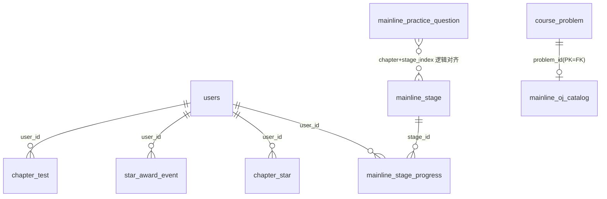
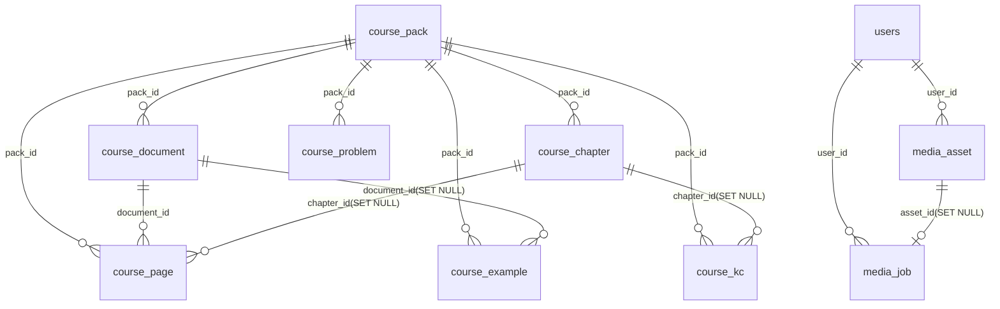
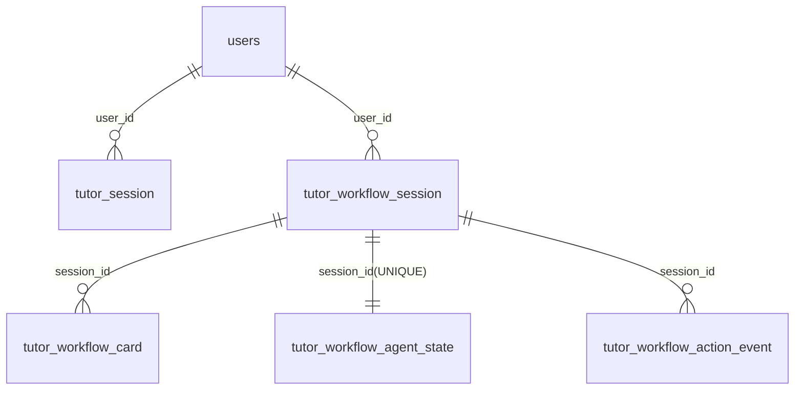

# 6.5 数据库数据字典（D2）：课程主线 · 课程包资产 · 答疑 RAG

> 本文件 `filecode = D2`，是 §6.5「完整字段字典」的第 2 个分片，承接 D1（§6.5.1–§6.5.4，覆盖 M01–M04），向下覆盖 **M05 主线冒险·看学练测、M06 课程包与课件资产、M07 课件问答与导师答疑(RAG)** 三个模块的全部活跃表。
> 编号约定：模块 MXX 的字段字典落 §6.5.XX，故本片为 §6.5.5 / §6.5.6 / §6.5.7。字典表统一编号「表 D2-n」，关系图统一编号「图 D2-n」。
> 事实纪律：所有表名、字段名、类型、约束、索引、默认值**逐字取自仓库真实 Flyway 迁移**（`backend/src/main/resources/db/migration/`），不照抄 `docs/` 旧文档，不编造字段。后续 `ALTER` 新增的列直接并入对应表，并在「说明」列与「来源 migration」标注引入版本。

---

## 6.5.0 覆盖范围与本片表清单总览

本片共收录 **21 张活跃表、222 个字段**，按模块归组如下：

- **M05（7 张）**：`mainline_stage`、`mainline_stage_progress`、`chapter_star`、`star_award_event`、`mainline_practice_question`、`mainline_oj_catalog`、`chapter_test`——主线「看(视频)/学(课件)/练(客观题+OJ)/测(章末大测试)」闭环的后端权威存档与题库。
- **M06（9 张）**：`course_pack`、`course_document`、`course_chapter`、`course_page`、`course_kc`、`course_example`、`course_problem`、`media_asset`、`media_job`——`packId=43`《Python 语言基础》课程包静态资产（7 文档/561 页/7 章/65 KC/46 例/39 题）与多模态媒体资产/合成作业。
- **M07（5 张）**：`tutor_session`、`tutor_workflow_session`、`tutor_workflow_card`、`tutor_workflow_agent_state`、`tutor_workflow_action_event`——课件问答（RAG，带证据页锚定）与训练场「6 阶段导学工作流」的会话/卡片/Agent 状态投影。

命名遵循 §6.1 规范：业务表 `snake_case`、主键统一 `id`、时间列 `*_at`/`*_time` 为 `TIMESTAMPTZ`。RPG/主线域表（V100+ 引入）沿用项目「无 `pyt_` 前缀」约定；课程包域表（V001–V005）由 Alethicode 课程包结构抽取重建，主键为外部指定 `BIGINT`（非 `BIGSERIAL`），随种子 `V006` 一并灌入。三类 ID 策略并存：课程包静态资产用外部固定 `BIGINT`、主线/答疑运行期表用 `BIGSERIAL`、`mainline_oj_catalog` 复用 `course_problem.id` 作主键。

**表 D2-1　本片表清单总览**

| # | 表名 | 模块 | 字段数 | 主键 | 来源迁移（含 ALTER） | 一句话职责 |
| --- | --- | --- | --- | --- | --- | --- |
| 1 | `mainline_stage` | M05 | 11 | `id` | V156（V159 回填数据） | 24 个小节静态定义（seed），覆盖 65 KC |
| 2 | `mainline_stage_progress` | M05 | 9 | `id` | V156，+V158 | 每学生×小节「看/学/练」三件套打点 |
| 3 | `chapter_star` | M05 | 7 | `id` | V156 | 每学生×章 0–3★ 唯一权威 |
| 4 | `star_award_event` | M05 | 7 | `id` | V156 | 星级变更审计 + 教师端聚合源 |
| 5 | `mainline_practice_question` | M05 | 12 | `id` | V158，+V159 seed | 主线「练」客观题库（96 题） |
| 6 | `mainline_oj_catalog` | M05 | 6 | `problem_id` | V159 | OJ 编程题覆盖层（39 题编号/归属） |
| 7 | `chapter_test` | M05 | 17 | `id` | V157，+V164 | 章末大测试/章节小测试卷与判分 |
| 8 | `course_pack` | M06 | 18 | `id` | V001 | 课程包根（packId=43） |
| 9 | `course_document` | M06 | 13 | `id` | V001 | 课程包内源文档（PDF/PPT） |
| 10 | `course_chapter` | M06 | 7 | `id` | V001 | 章节目录 |
| 11 | `course_page` | M06 | 12 | `id` | V002 | 页级课件（RAG 检索/证据锚定单元） |
| 12 | `course_kc` | M06 | 13 | `id` | V003（V125 seed 先修） | 知识点（65 KC） |
| 13 | `course_example` | M06 | 14 | `id` | V004，+V109 索引 | 课件示例（46 例） |
| 14 | `course_problem` | M06 | 18 | `id` | V005 | 课程题目（39 题，含隐藏用例） |
| 15 | `media_asset` | M06 | 11 | `id` | V124 | 多模态媒体资产（图/音/视频） |
| 16 | `media_job` | M06 | 11 | `id` | V160 | 异步媒体合成作业（故事板短视频） |
| 17 | `tutor_session` | M07 | 8 | `id` | V122，+V127 | 课件问答问答对（证据页锚定） |
| 18 | `tutor_workflow_session` | M07 | 9 | `id` | V161 | 导学工作流会话（6 阶段） |
| 19 | `tutor_workflow_card` | M07 | 7 | `id` | V161 | 工作流时间线卡片 |
| 20 | `tutor_workflow_agent_state` | M07 | 5 | `id` | V165 | 工作流 Agent 运行状态投影 |
| 21 | `tutor_workflow_action_event` | M07 | 7 | `id` | V165 | 工作流动作事件审计 |

---

## 6.5.5 M05 主线冒险·看学练测

主线域是「后端权威重构旧前端 mainQuest 存档」的结果：小节静态定义（`mainline_stage`）与学生进度（`mainline_stage_progress`）分离，章级星级（`chapter_star`）由公式聚合并留审计（`star_award_event`）；「练」拆成客观题库（`mainline_practice_question`）与 OJ 编程题覆盖层（`mainline_oj_catalog`，不改 `course_problem` 主体）；「测」由 `chapter_test` 承载「预生成入库、考试期间零 AI 调用、绝不下发答案」的章末大测试与章节小测。

**图 D2-1　M05 主线域实体关系（ER）**

### 6.5.5.1 `mainline_stage`（小节静态定义 · seed）

**表 D2-2　`mainline_stage` 字段字典**

| 字段 | 类型 | 约束/默认 | 说明 |
| --- | --- | --- | --- |
| `id` | BIGSERIAL | PK | 小节主键 |
| `chapter` | INT | NOT NULL，CHECK 1–7 | 所属章 |
| `stage_index` | INT | NOT NULL | 章内序号 1..5 |
| `title` | VARCHAR(128) | NOT NULL | 小节标题 |
| `kc_codes` | TEXT[] | NOT NULL | 覆盖的 KC 编码集（`PY43-KC-NNN`） |
| `video_keyword` | VARCHAR(120) | NOT NULL | 「看」B 站检索词（Python 前缀） |
| `courseware_page_ids` | BIGINT[] | NOT NULL，DEFAULT `'{}'` | 「学」课件页 id 集（防幻觉，seed 暂空待回填） |
| `example_problem_ids` | BIGINT[] | NOT NULL，DEFAULT `'{}'` | 「练」绑定的 OJ 题 id 集；V159 按章节回填 |
| `required_video_sec` | INT | NOT NULL，DEFAULT 240 | 过线所需观看秒数 |
| `required_pages` | INT | NOT NULL，DEFAULT 0 | 过线所需读页数（0=全读 `courseware_page_ids`） |
| `required_example_count` | INT | NOT NULL，DEFAULT 2 | 过线所需完成例题数；V159 回填为 0/1 |

- **PK**：`id`　**FK**：无（`example_problem_ids` 逻辑引用 `course_problem.id`，数组列不建外键）
- **唯一约束**：`UNIQUE (chapter, stage_index)`
- **来源 migration**：建表 `V156`；`V159` 仅 `UPDATE` 回填 `example_problem_ids` 与 `required_example_count`（数据回填，非加列）。

### 6.5.5.2 `mainline_stage_progress`（学生×小节进度打点）

**表 D2-3　`mainline_stage_progress` 字段字典**

| 字段 | 类型 | 约束/默认 | 说明 |
| --- | --- | --- | --- |
| `id` | BIGSERIAL | PK | 进度主键 |
| `user_id` | BIGINT | NOT NULL，FK→`users(id)` ON DELETE CASCADE | 学生 |
| `stage_id` | BIGINT | NOT NULL，FK→`mainline_stage(id)` | 小节 |
| `video_watched_sec` | INT | NOT NULL，DEFAULT 0 | 已观看秒数（看） |
| `pages_read` | BIGINT[] | NOT NULL，DEFAULT `'{}'` | 已读课件页 id 集（学，并集去重幂等） |
| `examples_done` | BIGINT[] | NOT NULL，DEFAULT `'{}'` | 已完成 OJ 例题 id 集（练-编程） |
| `completed_at` | TIMESTAMPTZ | 可空 | 三件套达标时间（未达标为空） |
| `updated_at` | TIMESTAMPTZ | NOT NULL，DEFAULT `now()` | 最近更新时间 |
| `questions_correct` | BIGINT[] | NOT NULL，DEFAULT `'{}'`（**V158 新增**） | 已答对客观题 id 集（练-客观题） |

- **PK**：`id`　**FK**：`user_id`→`users(id)` CASCADE、`stage_id`→`mainline_stage(id)`
- **唯一约束**：`UNIQUE (user_id, stage_id)`（一学生一小节单行）
- **来源 migration**：`V156`；`V158` 追加 `questions_correct` 列。

### 6.5.5.3 `chapter_star`（章级星级唯一权威）

**表 D2-4　`chapter_star` 字段字典**

| 字段 | 类型 | 约束/默认 | 说明 |
| --- | --- | --- | --- |
| `id` | BIGSERIAL | PK | 主键 |
| `user_id` | BIGINT | NOT NULL，FK→`users(id)` ON DELETE CASCADE | 学生 |
| `chapter` | INT | NOT NULL，CHECK 1–7 | 章号 |
| `stars` | SMALLINT | NOT NULL，DEFAULT 0，CHECK 0–3 | 当前星级 |
| `best_test_score` | INT | 可空 | 章末测试历史最高分 |
| `breakdown` | JSONB | NOT NULL，DEFAULT `'{}'` | 星级构成 `{test,stage,mastery,recovered:[...]}` |
| `updated_at` | TIMESTAMPTZ | NOT NULL，DEFAULT `now()` | 更新时间 |

- **PK**：`id`　**FK**：`user_id`→`users(id)` CASCADE
- **唯一约束**：`UNIQUE (user_id, chapter)`（一学生一章单行权威）
- **来源 migration**：`V156`。

### 6.5.5.4 `star_award_event`（星级变更审计）

**表 D2-5　`star_award_event` 字段字典**

| 字段 | 类型 | 约束/默认 | 说明 |
| --- | --- | --- | --- |
| `id` | BIGSERIAL | PK | 主键 |
| `user_id` | BIGINT | NOT NULL，FK→`users(id)` ON DELETE CASCADE | 学生 |
| `chapter` | INT | NOT NULL | 章号 |
| `delta` | SMALLINT | NOT NULL | 星级增量（±） |
| `source` | VARCHAR(24) | NOT NULL，CHECK ∈{`TEST`,`STAGE_COMPLETE`,`MASTERY`,`ERRORBOOK_RECOVERY`,`ENDLESS_RECOVERY`,`ADMIN`} | 变更来源 |
| `reason` | VARCHAR(256) | 可空 | 变更说明 |
| `created_at` | TIMESTAMPTZ | NOT NULL，DEFAULT `now()` | 发生时间 |

- **PK**：`id`　**FK**：`user_id`→`users(id)` CASCADE
- **索引**：`idx_star_award_event_user_ch (user_id, chapter, created_at DESC)`（教师端按学生×章×时间聚合）
- **来源 migration**：`V156`。

### 6.5.5.5 `mainline_practice_question`（主线「练」客观题库 · seed）

**表 D2-6　`mainline_practice_question` 字段字典**

| 字段 | 类型 | 约束/默认 | 说明 |
| --- | --- | --- | --- |
| `id` | BIGSERIAL | PK | 题目主键 |
| `chapter` | INT | NOT NULL，CHECK 1–7 | 所属章 |
| `stage_index` | INT | NOT NULL | 章内小节序号（对齐 `mainline_stage.stage_index`） |
| `ordinal` | INT | NOT NULL | 小节内题序 1..4 |
| `kc_code` | VARCHAR(32) | NOT NULL | 关联 KC（`PY43-KC-NNN`，逻辑关联） |
| `type` | VARCHAR(8) | NOT NULL，CHECK ∈{`CHOICE`,`JUDGE`,`FILL`} | 题型 |
| `stem` | TEXT | NOT NULL | 题干 |
| `options_json` | JSONB | NOT NULL，DEFAULT `'[]'` | 选项文本数组（`CHOICE`）；判断/填空为 `[]` |
| `answer_json` | JSONB | NOT NULL | 正确答案数组 |
| `blank_count` | INT | NOT NULL，DEFAULT 0 | 填空空数；选择/判断为 0 |
| `explanation` | TEXT | NOT NULL，DEFAULT `''` | 讲解（作答后下发） |
| `source_label` | VARCHAR(64) | NOT NULL，DEFAULT `'通识题（非课件原题）'` | 来源标注（防幻觉：不引课件页码） |

- **PK**：`id`　**FK**：无（`kc_code` 逻辑关联 `course_kc.kc_code`）
- **唯一约束**：`UNIQUE (chapter, stage_index, ordinal)`
- **索引**：`idx_practice_question_stage (chapter, stage_index, ordinal)`
- **来源 migration**：建表 `V158`；`V159` seed 96 行（24 小节 × 4：选/选/判/填）。

### 6.5.5.6 `mainline_oj_catalog`（OJ 编程题覆盖层 · seed）

**表 D2-7　`mainline_oj_catalog` 字段字典**

| 字段 | 类型 | 约束/默认 | 说明 |
| --- | --- | --- | --- |
| `problem_id` | BIGINT | PK，FK→`course_problem(id)` | 复用课程题 id 作主键（safe，不改 `course_problem`） |
| `display_no` | VARCHAR(16) | NOT NULL | 稳定编号 `OJ-01..OJ-39` |
| `display_name` | VARCHAR(128) | NOT NULL | 规范化题名 |
| `kc_code` | VARCHAR(32) | NOT NULL | 关联 KC（`PY43-KC-NNN`） |
| `chapter` | INT | NOT NULL | 归属章 |
| `stage_index` | INT | NOT NULL | 归属小节（对齐 `mainline_stage`） |

- **PK**：`problem_id`　**FK**：`problem_id`→`course_problem(id)`
- **唯一约束/索引**：`idx_oj_catalog_display_no (display_no)` UNIQUE；`idx_oj_catalog_stage (chapter, stage_index)`
- **来源 migration**：建表 + seed 39 行均在 `V159`。

### 6.5.5.7 `chapter_test`（章末大测试 / 章节小测）

**表 D2-8　`chapter_test` 字段字典**

| 字段 | 类型 | 约束/默认 | 说明 |
| --- | --- | --- | --- |
| `id` | BIGSERIAL | PK | 试卷主键 |
| `user_id` | BIGINT | NOT NULL，FK→`users(id)` ON DELETE CASCADE | 学生 |
| `chapter` | INT | NOT NULL，CHECK 1–7 | 章号 |
| `status` | VARCHAR(16) | NOT NULL，DEFAULT `'PENDING'`，CHECK ∈{`PENDING`,`GENERATING`,`READY`,`IN_PROGRESS`,`SUBMITTED`,`EXPIRED`,`FAILED`} | 试卷生命周期 |
| `attempt_no` | INT | NOT NULL，DEFAULT 1 | 第几次尝试 |
| `questions` | JSONB | 可空 | 完整题面+答案+解析+证据页 id（**仅服务端持有，绝不下发答案**） |
| `profile_snapshot` | JSONB | 可空 | 生成时画像摘要（个性化可追溯） |
| `generator_meta` | JSONB | 可空 | run_id/agent/grounding/safety 审计 |
| `time_limit_sec` | INT | NOT NULL，DEFAULT 1800 | 限时（秒） |
| `started_at` | TIMESTAMPTZ | 可空 | 开始时间 |
| `deadline_at` | TIMESTAMPTZ | 可空 | 截止时间 |
| `submitted_at` | TIMESTAMPTZ | 可空 | 提交时间 |
| `score` | INT | 可空 | 总分 |
| `detail` | JSONB | 可空 | 每题判分明细 |
| `integrity` | JSONB | NOT NULL，DEFAULT `'{}'` | 防作弊 `{paste_blocked,blur_events,overtime}` |
| `created_at` | TIMESTAMPTZ | NOT NULL，DEFAULT `now()` | 创建时间 |
| `assessment_kind` | VARCHAR(16) | NOT NULL，DEFAULT `'FINAL'`，CHECK ∈{`QUIZ`,`FINAL`}（**V164 新增**） | 小测 / 章末，隔离两类尝试 |

- **PK**：`id`　**FK**：`user_id`→`users(id)` CASCADE
- **索引**：`idx_chapter_test_user_ch (user_id, chapter, created_at DESC)`；`idx_chapter_test_user_ch_kind (user_id, chapter, assessment_kind, created_at DESC)`（**V164**）
- **来源 migration**：`V157`；`V164` 追加 `assessment_kind` 列与 kind 复合索引。

---

## 6.5.6 M06 课程包与课件资产

课程包域是 Pythontopia 唯一课程知识底座（`packId=43`《Python 语言基础》），由 Alethicode 课程包结构抽取重建：`course_pack` 为根，下挂文档（`course_document`）、章节（`course_chapter`）、页（`course_page`，RAG 与证据锚定的最小单元）、知识点（`course_kc`）、示例（`course_example`）、题目（`course_problem`）。这些表主键为外部固定 `BIGINT`，数据随种子 `V006` 灌入，验收口径恒为 7 文档/561 页/7 章/65 KC/46 例/39 题。`media_asset`/`media_job` 承载工坊与故事板产出的多模态媒体（讯飞文生图/TTS、FFmpeg 合成短视频）及其异步合成作业，含降级审计。

**图 D2-2　M06 课程包域实体关系（ER）**

### 6.5.6.1 `course_pack`（课程包根）

**表 D2-9　`course_pack` 字段字典**

| 字段 | 类型 | 约束/默认 | 说明 |
| --- | --- | --- | --- |
| `id` | BIGINT | PK | 课程包 id（packId=43，外部固定） |
| `slug` | VARCHAR(128) | NOT NULL | 课程包标识串 |
| `version` | INTEGER | NOT NULL | 版本号 |
| `name` | VARCHAR(256) | NOT NULL | 课程名（《Python 语言基础》） |
| `primary_language` | VARCHAR(64) | NOT NULL | 主语言（python） |
| `description` | TEXT | NOT NULL，DEFAULT `''` | 描述 |
| `status` | VARCHAR(32) | NOT NULL | 发布状态 |
| `document_count` | INTEGER | NOT NULL，DEFAULT 0 | 文档数（7） |
| `page_count` | INTEGER | NOT NULL，DEFAULT 0 | 页数（561） |
| `chapter_count` | INTEGER | NOT NULL，DEFAULT 0 | 章数（7） |
| `kc_count` | INTEGER | NOT NULL，DEFAULT 0 | KC 数（65） |
| `example_count` | INTEGER | NOT NULL，DEFAULT 0 | 示例数（46） |
| `problem_count` | INTEGER | NOT NULL，DEFAULT 0 | 题目数（39） |
| `course_objective` | TEXT | 可空 | 课程目标 |
| `target_audience` | TEXT | 可空 | 目标受众 |
| `total_hours` | INTEGER | 可空 | 总课时 |
| `create_time` | TIMESTAMPTZ | NOT NULL，DEFAULT `now()` | 创建时间 |
| `update_time` | TIMESTAMPTZ | NOT NULL，DEFAULT `now()` | 更新时间 |

- **PK**：`id`　**FK**：无（被下游各表引用）
- **唯一约束**：`UNIQUE (slug, version)`
- **来源 migration**：`V001`（数据种子 `V006`）。

### 6.5.6.2 `course_document`（课程文档）

**表 D2-10　`course_document` 字段字典**

| 字段 | 类型 | 约束/默认 | 说明 |
| --- | --- | --- | --- |
| `id` | BIGINT | PK | 文档 id |
| `pack_id` | BIGINT | NOT NULL，FK→`course_pack(id)` ON DELETE CASCADE | 所属课程包 |
| `original_filename` | VARCHAR(512) | NOT NULL | 原始文件名 |
| `original_path` | TEXT | NOT NULL | 原始路径 |
| `canonical_path` | TEXT | 可空 | 规范化路径 |
| `preview_pdf_path` | TEXT | 可空 | 预览 PDF 路径 |
| `file_hash` | VARCHAR(128) | NOT NULL | 文件哈希（去重） |
| `file_size_bytes` | BIGINT | NOT NULL，DEFAULT 0 | 文件字节数 |
| `page_count` | INTEGER | NOT NULL，DEFAULT 0 | 文档页数 |
| `status` | VARCHAR(32) | NOT NULL | 处理状态 |
| `sort_order` | INTEGER | NOT NULL，DEFAULT 0 | 排序序号 |
| `create_time` | TIMESTAMPTZ | NOT NULL，DEFAULT `now()` | 创建时间 |
| `update_time` | TIMESTAMPTZ | NOT NULL，DEFAULT `now()` | 更新时间 |

- **PK**：`id`　**FK**：`pack_id`→`course_pack(id)` CASCADE
- **索引**：`idx_course_document_pack (pack_id)`
- **来源 migration**：`V001`。

### 6.5.6.3 `course_chapter`（章节目录）

**表 D2-11　`course_chapter` 字段字典**

| 字段 | 类型 | 约束/默认 | 说明 |
| --- | --- | --- | --- |
| `id` | BIGINT | PK | 章节 id |
| `pack_id` | BIGINT | NOT NULL，FK→`course_pack(id)` ON DELETE CASCADE | 所属课程包 |
| `order_index` | INTEGER | NOT NULL | 章序 |
| `title` | VARCHAR(512) | NOT NULL | 章标题 |
| `summary_markdown` | TEXT | 可空 | 章摘要（Markdown） |
| `learning_objectives` | TEXT | 可空 | 学习目标 |
| `create_time` | TIMESTAMPTZ | NOT NULL，DEFAULT `now()` | 创建时间 |

- **PK**：`id`　**FK**：`pack_id`→`course_pack(id)` CASCADE
- **唯一约束**：`UNIQUE (pack_id, order_index)`
- **索引**：`idx_course_chapter_pack (pack_id)`
- **来源 migration**：`V001`。

### 6.5.6.4 `course_page`（页级课件 · RAG 单元）

**表 D2-12　`course_page` 字段字典**

| 字段 | 类型 | 约束/默认 | 说明 |
| --- | --- | --- | --- |
| `id` | BIGINT | PK | 页 id（证据锚定主键） |
| `pack_id` | BIGINT | NOT NULL，FK→`course_pack(id)` ON DELETE CASCADE | 所属课程包 |
| `document_id` | BIGINT | NOT NULL，FK→`course_document(id)` ON DELETE CASCADE | 所属文档 |
| `chapter_id` | BIGINT | 可空，FK→`course_chapter(id)` ON DELETE SET NULL | 所属章（可空） |
| `page_no` | INTEGER | NOT NULL | 页码 |
| `chunk_index` | INTEGER | NOT NULL，DEFAULT 0 | 页内分块序号 |
| `title` | VARCHAR(512) | NOT NULL，DEFAULT `''` | 页标题 |
| `content_markdown` | TEXT | NOT NULL，DEFAULT `''` | 页正文（Markdown） |
| `text_hash` | VARCHAR(128) | NOT NULL，DEFAULT `''` | 正文哈希 |
| `preview_asset_path` | TEXT | NOT NULL，DEFAULT `''` | 页预览图路径 |
| `excerpt` | TEXT | NOT NULL，DEFAULT `''` | 摘要片段 |
| `create_time` | TIMESTAMPTZ | NOT NULL，DEFAULT `now()` | 创建时间 |

- **PK**：`id`　**FK**：`pack_id`→`course_pack` CASCADE、`document_id`→`course_document` CASCADE、`chapter_id`→`course_chapter` SET NULL
- **唯一约束**：`UNIQUE (document_id, page_no, chunk_index)`
- **索引**：`idx_course_page_pack`、`idx_course_page_document`、`idx_course_page_chapter`
- **来源 migration**：`V002`。

### 6.5.6.5 `course_kc`（知识点 · 65 KC）

**表 D2-13　`course_kc` 字段字典**

| 字段 | 类型 | 约束/默认 | 说明 |
| --- | --- | --- | --- |
| `id` | BIGINT | PK | KC id |
| `pack_id` | BIGINT | NOT NULL，FK→`course_pack(id)` ON DELETE CASCADE | 所属课程包 |
| `kc_code` | VARCHAR(64) | NOT NULL | KC 编码（`PY43-KC-NNN`） |
| `kc_name` | VARCHAR(256) | NOT NULL | KC 名称 |
| `name_normalized` | VARCHAR(256) | NOT NULL | 归一化名称（去重/匹配） |
| `name_en` | VARCHAR(256) | NOT NULL，DEFAULT `''` | 英文名 |
| `chapter_id` | BIGINT | 可空，FK→`course_chapter(id)` ON DELETE SET NULL | 所属章 |
| `chapter_order` | INTEGER | NOT NULL | 章内顺序 |
| `difficulty` | VARCHAR(32) | NOT NULL，DEFAULT `'basic'` | 难度 |
| `prerequisite_codes` | TEXT[] | NOT NULL，DEFAULT `ARRAY[]::text[]` | 先修 KC 编码集（V125 按教学序 seed） |
| `summary_markdown` | TEXT | NOT NULL，DEFAULT `''` | KC 摘要 |
| `page_refs` | BIGINT[] | NOT NULL，DEFAULT `ARRAY[]::bigint[]` | 关联课件页 id 集 |
| `create_time` | TIMESTAMPTZ | NOT NULL，DEFAULT `now()` | 创建时间 |

- **PK**：`id`　**FK**：`pack_id`→`course_pack` CASCADE、`chapter_id`→`course_chapter` SET NULL
- **唯一约束**：`UNIQUE (pack_id, kc_code)`、`UNIQUE (pack_id, name_normalized)`
- **索引**：`idx_course_kc_pack`、`idx_course_kc_chapter`、`idx_course_kc_code`
- **来源 migration**：建表 `V003`；`V125` 仅 `UPDATE` 回填 `prerequisite_codes`（按 `kc_code` 教学序生成最小 DAG，供 PathPlanner 拓扑排序；非加列、不增减行）。

### 6.5.6.6 `course_example`（课件示例 · 46 例）

**表 D2-14　`course_example` 字段字典**

| 字段 | 类型 | 约束/默认 | 说明 |
| --- | --- | --- | --- |
| `id` | BIGINT | PK | 示例 id |
| `pack_id` | BIGINT | NOT NULL，FK→`course_pack(id)` ON DELETE CASCADE | 所属课程包 |
| `document_id` | BIGINT | 可空，FK→`course_document(id)` ON DELETE SET NULL | 来源文档 |
| `kc_code` | VARCHAR(64) | NOT NULL，DEFAULT `''` | 关联 KC（单值，非数组） |
| `title` | TEXT | NOT NULL | 示例标题 |
| `code` | TEXT | NOT NULL，DEFAULT `''` | 示例代码 |
| `explanation_markdown` | TEXT | NOT NULL，DEFAULT `''` | 讲解（Markdown） |
| `input_description` | TEXT | NOT NULL，DEFAULT `''` | 输入说明 |
| `output_description` | TEXT | NOT NULL，DEFAULT `''` | 输出说明 |
| `unit_type` | VARCHAR(32) | NOT NULL，DEFAULT `'demo'` | 示例类型 |
| `oj_convertible` | BOOLEAN | NOT NULL，DEFAULT false | 是否可转 OJ 题 |
| `oj_block_reason` | TEXT | NOT NULL，DEFAULT `''` | 不可转原因 |
| `page_refs` | BIGINT[] | NOT NULL，DEFAULT `ARRAY[]::bigint[]` | 关联课件页 id 集 |
| `create_time` | TIMESTAMPTZ | NOT NULL，DEFAULT `now()` | 创建时间 |

- **PK**：`id`　**FK**：`pack_id`→`course_pack` CASCADE、`document_id`→`course_document` SET NULL
- **索引**：`idx_course_example_pack`、`idx_course_example_kc`（`V004`）；`V109` 追加 `idx_course_example_pack_kc (pack_id,kc_code)`、`idx_course_example_unit_type`、`idx_course_example_document`、`idx_course_example_oj_convertible`（部分索引 `WHERE oj_convertible=true`）
- **来源 migration**：建表 `V004`；`V109` 仅补充索引（无字段变更）。

### 6.5.6.7 `course_problem`（课程题目 · 39 题）

**表 D2-15　`course_problem` 字段字典**

| 字段 | 类型 | 约束/默认 | 说明 |
| --- | --- | --- | --- |
| `id` | BIGINT | PK | 题目 id |
| `pack_id` | BIGINT | NOT NULL，FK→`course_pack(id)` ON DELETE CASCADE | 所属课程包 |
| `kc_code` | VARCHAR(64) | NOT NULL，DEFAULT `''` | 关联 KC |
| `title` | TEXT | NOT NULL | 题目标题 |
| `statement_markdown` | TEXT | NOT NULL，DEFAULT `''` | 题面（Markdown） |
| `input_description` | TEXT | NOT NULL，DEFAULT `''` | 输入说明 |
| `output_description` | TEXT | NOT NULL，DEFAULT `''` | 输出说明 |
| `difficulty` | VARCHAR(32) | NOT NULL，DEFAULT `'Low'` | 难度 |
| `samples` | JSONB | NOT NULL，DEFAULT `'[]'` | 样例输入输出 |
| `expected_output_pattern` | TEXT | NOT NULL，DEFAULT `''` | 期望输出模式 |
| `hidden_test_cases` | JSONB | NOT NULL，DEFAULT `'[]'` | 隐藏判题用例（不下发） |
| `page_refs` | JSONB | NOT NULL，DEFAULT `'[]'` | 关联课件页引用 |
| `source_label` | TEXT | 可空 | 来源标注 |
| `reference_solution_language` | TEXT | 可空 | 参考解语言 |
| `reference_solution_code` | TEXT | 可空 | 参考解代码 |
| `teaching_explanation` | TEXT | NOT NULL，DEFAULT `''` | 教学讲解 |
| `common_mistakes` | JSONB | NOT NULL，DEFAULT `'[]'` | 常见错误集 |
| `create_time` | TIMESTAMPTZ | NOT NULL，DEFAULT `now()` | 创建时间 |

- **PK**：`id`　**FK**：`pack_id`→`course_pack(id)` CASCADE（被 `mainline_oj_catalog.problem_id` 引用）
- **索引**：`idx_course_problem_pack`、`idx_course_problem_kc`
- **来源 migration**：`V005`。

### 6.5.6.8 `media_asset`（多模态媒体资产）

**表 D2-16　`media_asset` 字段字典**

| 字段 | 类型 | 约束/默认 | 说明 |
| --- | --- | --- | --- |
| `id` | BIGSERIAL | PK | 资产主键 |
| `user_id` | BIGINT | 可空，FK→`users(id)` ON DELETE CASCADE | 归属用户 |
| `kind` | VARCHAR(16) | NOT NULL，CHECK ∈{`IMAGE`,`AUDIO`,`VIDEO`} | 资产类型 |
| `prompt` | TEXT | 可空 | 生成提示词 |
| `file_path` | VARCHAR(512) | NOT NULL | 文件路径 |
| `mime_type` | VARCHAR(64) | NOT NULL | MIME 类型 |
| `degraded` | BOOLEAN | NOT NULL，DEFAULT false | 是否为占位降级资产（缺密钥/上游失败） |
| `source` | VARCHAR(16) | NOT NULL，DEFAULT `'XFYUN'`，CHECK ∈{`XFYUN`,`PLACEHOLDER`,`FFMPEG`} | 资产来源 |
| `kc_codes` | TEXT[] | NOT NULL，DEFAULT `ARRAY[]::TEXT[]` | 关联 KC 集 |
| `meta` | JSONB | NOT NULL，DEFAULT `'{}'` | 附加元数据 |
| `created_at` | TIMESTAMPTZ | NOT NULL，DEFAULT `now()` | 创建时间 |

- **PK**：`id`　**FK**：`user_id`→`users(id)` CASCADE（可空）
- **索引**：`idx_media_asset_user_kind (user_id,kind)`、`idx_media_asset_user_created (user_id,created_at DESC)`、`idx_media_asset_kc` GIN(`kc_codes`)
- **来源 migration**：`V124`。

### 6.5.6.9 `media_job`（异步媒体合成作业）

**表 D2-17　`media_job` 字段字典**

| 字段 | 类型 | 约束/默认 | 说明 |
| --- | --- | --- | --- |
| `id` | BIGSERIAL | PK | 作业主键 |
| `user_id` | BIGINT | 可空，FK→`users(id)` ON DELETE CASCADE | 提交用户 |
| `kind` | VARCHAR(32) | NOT NULL，CHECK ∈{`STORYBOARD_VIDEO`} | 作业类型（当前仅故事板短视频） |
| `status` | VARCHAR(16) | NOT NULL，DEFAULT `'PENDING'`，CHECK ∈{`PENDING`,`RUNNING`,`SUCCESS`,`FAILED`} | 作业生命周期 |
| `fingerprint` | VARCHAR(64) | NOT NULL | 规格指纹（sha-256，幂等去重） |
| `spec_json` | JSONB | NOT NULL，DEFAULT `'{}'` | 分镜规格快照 |
| `progress_json` | JSONB | NOT NULL，DEFAULT `'{}'` | 实时进度（供 SSE/轮询） |
| `asset_id` | BIGINT | 可空，FK→`media_asset(id)` ON DELETE SET NULL | 成片媒资（成功后指向） |
| `error_code` | VARCHAR(64) | 可空 | 失败码 |
| `created_at` | TIMESTAMPTZ | NOT NULL，DEFAULT `now()` | 创建时间 |
| `updated_at` | TIMESTAMPTZ | NOT NULL，DEFAULT `now()` | 更新时间 |

- **PK**：`id`　**FK**：`user_id`→`users(id)` CASCADE（可空）、`asset_id`→`media_asset(id)` SET NULL
- **索引**：`idx_media_job_user_created (user_id,created_at DESC)`、`idx_media_job_status (status)`、`idx_media_job_fingerprint (user_id,fingerprint)`（幂等命中）
- **来源 migration**：`V160`。

---

## 6.5.7 M07 课件问答与导师答疑（RAG）

M07 含两条线：一是轻量「课件问答」`tutor_session`，记录学生提问、RAG 回答（Markdown）、证据页 id 与 grounding 状态，V127 起以 `conversation_id` 把多次提问聚成「会话窗口」；二是训练场「6 阶段导学工作流」（审题→思路→编码→错因→复盘→迁移），由 `tutor_workflow_session` 持权威阶段、`tutor_workflow_card` 持时间线卡片、`tutor_workflow_agent_state` 持 graph 运行期状态投影、`tutor_workflow_action_event` 留动作审计——graph 进程重启或前端刷新后由这些投影恢复阶段与时间线。

**图 D2-3　M07 答疑/导学工作流实体关系（ER）**

### 6.5.7.1 `tutor_session`（课件问答问答对）

**表 D2-18　`tutor_session` 字段字典**

| 字段 | 类型 | 约束/默认 | 说明 |
| --- | --- | --- | --- |
| `id` | BIGSERIAL | PK | 问答对主键 |
| `user_id` | BIGINT | NOT NULL，FK→`users(id)` | 提问学生 |
| `question` | TEXT | NOT NULL | 学生问题 |
| `answer_md` | TEXT | 可空 | RAG 回答（Markdown） |
| `evidence_page_ids` | INTEGER[] | 可空 | 证据课件页 id 集（证据锚定） |
| `grounding_status` | VARCHAR(30) | 可空 | 防幻觉 grounding 结果 |
| `created_at` | TIMESTAMPTZ | NOT NULL，DEFAULT `NOW()` | 创建时间 |
| `conversation_id` | VARCHAR(64) | 可空（**V127 新增**） | 会话窗口分组标识（NULL 回退为每条独立） |

- **PK**：`id`　**FK**：`user_id`→`users(id)`
- **索引**：`idx_tutor_session_user (user_id, created_at DESC)`；`idx_tutor_session_conversation (user_id, conversation_id, created_at)`（**V127**）
- **来源 migration**：`V122`；`V127` 追加 `conversation_id` 列与会话分组索引。

### 6.5.7.2 `tutor_workflow_session`（导学工作流会话）

**表 D2-19　`tutor_workflow_session` 字段字典**

| 字段 | 类型 | 约束/默认 | 说明 |
| --- | --- | --- | --- |
| `id` | BIGSERIAL | PK | 会话主键 |
| `user_id` | BIGINT | NOT NULL，FK→`users(id)` ON DELETE CASCADE | 学生 |
| `problem_id` | BIGINT | NOT NULL | 关联题目（逻辑关联，无外键） |
| `session_key` | VARCHAR(80) | NOT NULL，UNIQUE | graph 侧会话标识（`wf-{userId}-{problemId}-{nonce}`） |
| `phase` | VARCHAR(20) | NOT NULL，DEFAULT `'READING'` | 当前阶段（6 阶段之一） |
| `seq` | INT | NOT NULL，DEFAULT 0 | 时间线递增序号 |
| `status` | VARCHAR(16) | NOT NULL，DEFAULT `'ACTIVE'` | 会话状态 |
| `created_at` | TIMESTAMPTZ | NOT NULL，DEFAULT `now()` | 创建时间 |
| `updated_at` | TIMESTAMPTZ | NOT NULL，DEFAULT `now()` | 更新时间 |

- **PK**：`id`　**FK**：`user_id`→`users(id)` CASCADE
- **唯一约束**：`session_key` UNIQUE；`uq_tutor_workflow_session_active (user_id, problem_id) WHERE status='ACTIVE'`（部分唯一索引：一学生一题同时仅一个活跃会话）
- **来源 migration**：`V161`。

### 6.5.7.3 `tutor_workflow_card`（工作流时间线卡片）

**表 D2-20　`tutor_workflow_card` 字段字典**

| 字段 | 类型 | 约束/默认 | 说明 |
| --- | --- | --- | --- |
| `id` | BIGSERIAL | PK | 卡片主键 |
| `session_id` | BIGINT | NOT NULL，FK→`tutor_workflow_session(id)` ON DELETE CASCADE | 所属会话 |
| `seq` | INT | NOT NULL | 卡片时间线序号 |
| `event` | VARCHAR(20) | NOT NULL | 事件类型 |
| `card_key` | VARCHAR(40) | NOT NULL | 卡片键 |
| `payload` | JSONB | NOT NULL | 整卡 JSON（含 card_id，`ai_reply` 带 `user_message` 回放学生气泡） |
| `created_at` | TIMESTAMPTZ | NOT NULL，DEFAULT `now()` | 创建时间 |

- **PK**：`id`　**FK**：`session_id`→`tutor_workflow_session(id)` CASCADE
- **索引**：`idx_tutor_workflow_card_session (session_id, seq, id)`
- **来源 migration**：`V161`。

### 6.5.7.4 `tutor_workflow_agent_state`（工作流 Agent 状态投影）

**表 D2-21　`tutor_workflow_agent_state` 字段字典**

| 字段 | 类型 | 约束/默认 | 说明 |
| --- | --- | --- | --- |
| `id` | BIGSERIAL | PK | 主键 |
| `session_id` | BIGINT | NOT NULL，FK→`tutor_workflow_session(id)` ON DELETE CASCADE | 所属会话 |
| `state_json` | JSONB | NOT NULL，DEFAULT `'{}'` | Agent 运行期状态快照 |
| `latest_decision_json` | JSONB | NOT NULL，DEFAULT `'{}'` | 最近一次决策 |
| `updated_at` | TIMESTAMPTZ | NOT NULL，DEFAULT `now()` | 更新时间 |

- **PK**：`id`　**FK**：`session_id`→`tutor_workflow_session(id)` CASCADE
- **唯一约束**：`tutor_workflow_agent_state_session_unique UNIQUE (session_id)`（一会话单行状态）
- **来源 migration**：`V165`。

### 6.5.7.5 `tutor_workflow_action_event`（工作流动作事件审计）

**表 D2-22　`tutor_workflow_action_event` 字段字典**

| 字段 | 类型 | 约束/默认 | 说明 |
| --- | --- | --- | --- |
| `id` | BIGSERIAL | PK | 主键 |
| `session_id` | BIGINT | NOT NULL，FK→`tutor_workflow_session(id)` ON DELETE CASCADE | 所属会话 |
| `seq` | INTEGER | NOT NULL | 事件序号 |
| `event_type` | VARCHAR(64) | NOT NULL | 事件类型 |
| `action_key` | VARCHAR(64) | NOT NULL | 动作键 |
| `payload` | JSONB | NOT NULL，DEFAULT `'{}'` | 事件负载 |
| `created_at` | TIMESTAMPTZ | NOT NULL，DEFAULT `now()` | 创建时间 |

- **PK**：`id`　**FK**：`session_id`→`tutor_workflow_session(id)` CASCADE
- **索引**：`idx_tutor_workflow_action_event_session_seq (session_id, seq DESC)`
- **来源 migration**：`V165`。

---

## 6.5.8 本片小结与约定

- **ALTER 并入说明**：本片已将后续迁移新增的列直接并入对应表并标注版本——`mainline_stage_progress.questions_correct`（V158）、`chapter_test.assessment_kind`（V164）、`tutor_session.conversation_id`（V127）；纯数据回填（不加列）的 `mainline_stage.example_problem_ids/required_example_count`（V159）、`course_kc.prerequisite_codes`（V125）与纯索引补充 `course_example`（V109）均在对应「来源 migration」处注明。
- **外键纪律**：跨域弱关联（`mainline_practice_question.kc_code`、`mainline_stage.example_problem_ids`、`tutor_workflow_session.problem_id`）按真实 SQL 为**逻辑关联、未建数据库外键**，本字典如实标注，未臆造约束。
- **引用方式**：§4/§5/§8 等其它章节引用以上表时只写「详见 §6.5 表 D2-n」，不再重复列字段（§0 不重复定义）。物理总 ER 大图见 §6（C06 `06-00`）。

---

> **执笔人：成员 A ｜ 完成人（签名）：成员 A ｜ 审查人：成员 C ｜ 完成日期：2026-06**
