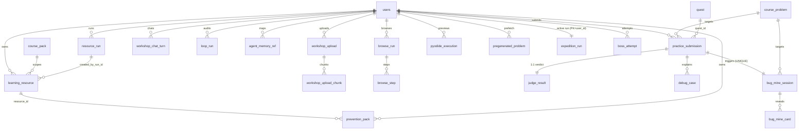

# 6.5 数据表字典分片 D3 · 工坊 / 判题 / 挑战

> 本文件 `filecode = D3`，属课程报告 §6.5「数据库设计·完整字段字典」第 3 分片，承接 D1（账号·画像·世界·NPC）、D2（课程·主线·答疑），向后衔接 D4（复盘·任务·班级·杂项·已弃用）。
> 命名规范、概念 ER 总览与全库表索引见 §6.1–§6.4（`06-00-数据库设计-规范与总览.md`，filecode C06），本分片不重复定义命名规则，仅展开本片各表的**真实字段字典**。
> 所有字段、类型、约束、索引均逐字取自 `backend/src/main/resources/db/migration/` 下真实 `Vxxx__*.sql`，不含编造。

## D3.1 覆盖范围

本分片覆盖「资源工坊与多智能体编排（M08）」「训练场与判题·双轨（M09）」「Bug 矿洞·无尽·Boss（M10）」三个模块共 **21 张活跃表、约 210 个字段**。三者在系统中构成一条「学（工坊生成资源）→ 练（训练场真题判题）→ 挑战（矿洞调试 / 无尽远征 / Boss 副本）」的闭环：M08 由 `pythontopia-graph` 多智能体编排，将课件证据落成六类学习资源并全程留痕；M09 以「Pyodide 前端即时预览 + 服务端沙箱正式判题」的**双轨执行**为核心，正式提交结果入库；M10 在失败提交触发的调试支线、无尽远征与 Boss 副本上展开，复用 M09 的 `practice_submission` 作为判题底座。

按写作总纲 §0.3「不重复定义」约束，凡其它章节（§4 需求、§5 概要设计、§8 详细设计）引用本片表名时，只写「详见 §6.5 表 D3-x」，不再重列字段。表内 `users`、`course_pack`、`course_problem`、`quest` 等外部被引用表的字段字典分别在 D1/D2 展开，本片仅标注外键指向。

## D3.2 本片表清单总览

| 序号 | 表名 | 所属模块 | 主要职责 | 字段数 | 来源迁移 |
| --- | --- | --- | --- | --- | --- |
| 表 D3-1 | `learning_resource` | M08 | 工坊生成的六类学习资源本体（带证据锚定 + 三审结论） | 17 | V040（+V041 经 FK 关联） |
| 表 D3-2 | `resource_run` | M08 | Agent 资源生成 / 画像访谈 run 审计 | 13 | V021，+V041 |
| 表 D3-3 | `resource_feedback` | M08 | 学生对资源 / Agent 的评分与采纳信号 | 7 | V139 |
| 表 D3-4 | `prevention_pack` | M08 | 预言家「高风险 KC 预防包」可溯源记录 | 6 | V140 |
| 表 D3-5 | `workshop_upload` | M08 | 学生上传文件解析后的纯文本与状态 | 11 | V162 |
| 表 D3-6 | `workshop_upload_chunk` | M08 | 上传语料分块 + 512 维向量（scoped 检索） | 8 | V163 |
| 表 D3-7 | `workshop_chat_turn` | M08 | 工坊聊天逐轮记录（覆盖全部工具结果） | 10 | V172 |
| 表 D3-8 | `agent_strategy` | M08 | Agent 自进化策略参数 + 版本 + 审计理由 | 6 | V137 |
| 表 D3-9 | `loop_run` | M08 | 有界 Agentic Loop 闭环 run 审计 | 14 | V171 |
| 表 D3-10 | `agent_memory_ref` | M08 | 外部记忆 provider id 映射审计 | 6 | V169 |
| 表 D3-11 | `browse_run` | M08 | 联网查证（BROWSE）自主导学会话 | 8 | V170 |
| 表 D3-12 | `browse_step` | M08 | BROWSE 会话逐步骤轨迹与命中 url | 6 | V170 |
| 表 D3-13 | `practice_submission` | M09 | 学生练习提交（判题底座，多来源） | 12 | V060，+V130/V132 枚举 |
| 表 D3-14 | `judge_result` | M09 | 服务端判题结论（verdict + 用例统计） | 8 | V060 |
| 表 D3-15 | `debug_case` | M09 | 失败提交的结构化调试线索 | 5 | V060 |
| 表 D3-16 | `pyodide_execution` | M09 | Pyodide 前端预览执行审计（配额口径） | 6 | V116 |
| 表 D3-17 | `pregenerated_problem` | M09 | Endless/Boss 题目预生成 + 判题兜底 | 12 | V150 |
| 表 D3-18 | `bug_mine_session` | M10 | Bug 矿洞调试会话（含分层深度 / 变式确认） | 14 | V070，+V128/V129 |
| 表 D3-19 | `bug_mine_card` | M10 | 矿洞结构化调试卡（反例 / 变量追踪 / 三层提示） | 6 | V070 |
| 表 D3-20 | `expedition_run` | M10 | 无尽远征（Roguelike）单活跃 run 进度 | 17 | V173 |
| 表 D3-21 | `boss_attempt` | M10 | Boss 副本每次提交 + 评测历史 | 18 | V120 |

### 本片表间关系（ER 概览）

---

## D3.3 M08 资源工坊与多智能体编排（12 表）

M08 是 Pythontopia「学」环节的生成中枢：`orchestrator_agent` 调度 `mind_map / practice / code_lab / storyboard / handout / reading` 六个内容 Agent，配合 `intent_router_agent`、`guide_guardrail_critic` 与防幻觉三审，把 `packId=43` 课件证据编排成结构化资源。本模块表分为三层——**资源产物层**（`learning_resource`、`resource_feedback`、`prevention_pack`）、**运行审计层**（`resource_run`、`loop_run`、`agent_strategy`、`agent_memory_ref`）、**输入与工具层**（`workshop_upload`、`workshop_upload_chunk`、`workshop_chat_turn`、`browse_run`、`browse_step`）。所有外部内容（上传文件、联网抓取）一律以带标签 citation 注入，**绝不混入 `packId=43` 课件证据链**，这是防幻觉红线在数据层的落地。

### 表 D3-1 `learning_resource` — 学习资源本体

工坊产出的六类资源（讲义 / 思维导图 / 练习 / 代码实验 / 阅读 / 分镜）统一落此表，每条资源都携带证据页 id 与安全 / 锚定双审结论，杜绝「无出处生成」。

| 字段 | 类型 | 约束/默认 | 说明 |
| --- | --- | --- | --- |
| `id` | BIGSERIAL | PK | 资源主键 |
| `user_id` | BIGINT | NOT NULL，FK→users(id) ON DELETE CASCADE | 资源归属学生，删用户级联清理 |
| `pack_id` | BIGINT | NOT NULL，FK→course_pack(id) ON DELETE CASCADE | 所属课程包（packId=43） |
| `kc_codes` | TEXT[] | NOT NULL DEFAULT `ARRAY[]::TEXT[]` | 覆盖的 KC 编码数组（GIN 索引检索） |
| `chapter_id` | BIGINT | 可空 | 关联章节；跨章资源可不绑定 |
| `type` | VARCHAR(16) | NOT NULL，CHECK ∈ {HANDOUT, MINDMAP, PRACTICE, CODE_LAB, READING, STORYBOARD} | 六类资源类型 |
| `title` | VARCHAR(256) | NOT NULL | 资源标题 |
| `content_format` | VARCHAR(16) | NOT NULL，CHECK ∈ {MARKDOWN, MERMAID, STRUCT_JSON} | 内容载体格式 |
| `content` | JSONB | NOT NULL DEFAULT `'{}'` | 资源正文（结构化主体） |
| `evidence_page_ids` | BIGINT[] | NOT NULL DEFAULT `ARRAY[]::BIGINT[]` | 证据锚定的课件页 id 数组 |
| `summary` | VARCHAR(512) | 可空 | 一句话摘要 |
| `safety_status` | VARCHAR(16) | NOT NULL DEFAULT `'PASSED'`，CHECK ∈ {PASSED, FAILED, NO_EVIDENCE} | 安全审查结论 |
| `grounding_status` | VARCHAR(16) | NOT NULL DEFAULT `'PASSED'`，CHECK ∈ {PASSED, FAILED, NO_EVIDENCE} | 证据锚定审查结论 |
| `created_at` | TIMESTAMPTZ | NOT NULL DEFAULT `now()` | 生成时间 |
| `created_by_run_id` | BIGINT | FK→resource_run(id) ON DELETE SET NULL | 生成该资源的 run，审计回链 |
| `feedback_status` | VARCHAR(16) | NOT NULL DEFAULT `'NONE'`，CHECK ∈ {NONE, LIKED, DISLIKED} | 学生反馈态 |
| `feedback_note` | VARCHAR(512) | 可空 | 反馈文字备注 |

- **PK**：`id`
- **FK**：`user_id`→`users(id)` CASCADE；`pack_id`→`course_pack(id)` CASCADE；`created_by_run_id`→`resource_run(id)` SET NULL
- **索引**：`idx_learning_resource_user_type(user_id,type)`；`idx_learning_resource_user_created(user_id,created_at DESC)`；`idx_learning_resource_user_kc` GIN(`kc_codes`)
- **唯一约束**：无
- **来源 migration**：`V040__learning_resource.sql`

### 表 D3-2 `resource_run` — 资源生成 run 审计

记录每次 Agent 资源生成 / 画像访谈 run，承载输入摘要、输出工件、证据页、安全 / 锚定结果与 graph trace，是「资源可问责」的核心审计表。`correlation_id`、`graph_trace` 由 V041 扩展并入。

| 字段 | 类型 | 约束/默认 | 说明 |
| --- | --- | --- | --- |
| `id` | BIGSERIAL | PK | run 主键 |
| `user_id` | BIGINT | NOT NULL，FK→users(id) ON DELETE CASCADE | run 归属学生 |
| `agent_name` | VARCHAR(64) | NOT NULL | 执行 Agent 名 |
| `scenario` | VARCHAR(64) | NOT NULL | run 场景标识 |
| `input_summary` | JSONB | NOT NULL DEFAULT `'{}'` | 输入摘要 |
| `output_artifact` | JSONB | NOT NULL DEFAULT `'{}'` | 输出工件 |
| `evidence_page_ids` | BIGINT[] | NOT NULL DEFAULT `ARRAY[]::BIGINT[]` | 证据课件页 id |
| `safety_result` | JSONB | NOT NULL DEFAULT `'{}'` | 安全审查结果 |
| `grounding_result` | JSONB | NOT NULL DEFAULT `'{}'` | 证据锚定结果 |
| `status` | VARCHAR(16) | NOT NULL，CHECK ∈ {SUCCESS, PARTIAL, FAILED} | run 状态 |
| `created_at` | TIMESTAMPTZ | NOT NULL DEFAULT `now()` | 创建时间 |
| `correlation_id` | UUID | 可空（**V041 新增**） | 跨 run 关联 id |
| `graph_trace` | JSONB | NOT NULL DEFAULT `'{}'`（**V041 新增**） | graph 执行链路 trace |

- **PK**：`id`
- **FK**：`user_id`→`users(id)` CASCADE
- **索引**：`idx_resource_run_user_created(user_id,created_at DESC)`；`idx_resource_run_agent_status(agent_name,status)`；`idx_resource_run_correlation(correlation_id)`（V041）；`idx_resource_run_user_scenario(user_id,scenario)`（V041）
- **唯一约束**：无
- **来源 migration**：`V021__resource_run.sql`，扩展于 `V041__resource_run_extend.sql`（新增 `correlation_id`、`graph_trace` 两列、重建 status CHECK、补两索引）

### 表 D3-3 `resource_feedback` — 资源反馈信号

采集学生对资源 / Agent 的评分与采纳信号，供元反思与 Agent 自进化使用。`user_id`、`resource_id` 仅为业务关联列，**未声明数据库外键**，关系由应用层维护。

| 字段 | 类型 | 约束/默认 | 说明 |
| --- | --- | --- | --- |
| `id` | BIGSERIAL | PK | 反馈主键 |
| `user_id` | BIGINT | NOT NULL | 反馈学生（无 DB 外键） |
| `resource_id` | BIGINT | 可空 | 关联资源（无 DB 外键） |
| `agent_name` | VARCHAR(64) | NOT NULL | 关联 Agent 名 |
| `rating` | SMALLINT | CHECK 1≤rating≤5 | 1–5 分评分 |
| `adopted` | BOOLEAN | NOT NULL DEFAULT `false` | 是否被采纳 |
| `created_at` | TIMESTAMPTZ | NOT NULL DEFAULT `now()` | 反馈时间 |

- **PK**：`id`
- **FK**：无（`user_id`/`resource_id` 未声明外键约束）
- **索引**：`idx_rf_agent(agent_name,created_at)`
- **唯一约束**：无
- **来源 migration**：`V139__resource_feedback.sql`

### 表 D3-4 `prevention_pack` — 预防包

P5.1「预言家」据真实学情预测高风险 KC 后，异步预生成的预防资源记录；绑定 `evidence`（真实 event id + 先修路径 + 风险理由），全程可溯源。

| 字段 | 类型 | 约束/默认 | 说明 |
| --- | --- | --- | --- |
| `id` | BIGSERIAL | PK | 预防包主键 |
| `user_id` | BIGINT | NOT NULL，FK→users(id) ON DELETE CASCADE | 归属学生 |
| `kc_code` | VARCHAR(64) | NOT NULL | 高风险 KC 编码 |
| `resource_id` | BIGINT | FK→learning_resource(id) ON DELETE SET NULL | 预生成的资源本体 |
| `evidence` | JSONB | NOT NULL DEFAULT `'{}'` | 预测证据（event id / 先修 / 风险理由） |
| `created_at` | TIMESTAMPTZ | NOT NULL DEFAULT `now()` | 生成时间 |

- **PK**：`id`
- **FK**：`user_id`→`users(id)` CASCADE；`resource_id`→`learning_resource(id)` SET NULL
- **索引**：`idx_prevention_pack_user_kc(user_id,kc_code,created_at DESC)`
- **唯一约束**：无
- **来源 migration**：`V140__prevention_pack.sql`

### 表 D3-5 `workshop_upload` — 上传文件解析

学生在工坊上传的个人文件（.py/.txt/.md/.csv/.pdf/.docx）解析后的纯文本与状态；原始文件不落盘，仅以「【你上传的《filename》】」标签注入 context。

| 字段 | 类型 | 约束/默认 | 说明 |
| --- | --- | --- | --- |
| `id` | BIGSERIAL | PK | 上传主键 |
| `user_id` | BIGINT | NOT NULL，FK→users(id) ON DELETE CASCADE | 上传学生 |
| `filename` | VARCHAR(255) | NOT NULL | 原始文件名（含扩展名） |
| `ext` | VARCHAR(16) | NOT NULL | 规范化小写扩展名（白名单之一） |
| `byte_size` | BIGINT | NOT NULL | 原始字节数（≤5MB 核对） |
| `extracted_text` | TEXT | NOT NULL DEFAULT `''` | 解析出的纯文本 |
| `char_count` | INTEGER | NOT NULL DEFAULT 0 | 解析文本字符数 |
| `line_count` | INTEGER | NOT NULL DEFAULT 0 | 解析文本行数 |
| `status` | VARCHAR(16) | NOT NULL DEFAULT `'PENDING'`，CHECK ∈ {PENDING, READY, FAILED} | 解析生命周期 |
| `error` | VARCHAR(512) | 可空 | 失败原因（FAILED 时填） |
| `created_at` | TIMESTAMPTZ | NOT NULL DEFAULT `now()` | 上传时间 |

- **PK**：`id`
- **FK**：`user_id`→`users(id)` CASCADE
- **索引**：`idx_workshop_upload_user_created(user_id,created_at DESC)`
- **唯一约束**：无
- **来源 migration**：`V162__workshop_upload.sql`

### 表 D3-6 `workshop_upload_chunk` — 上传语料分块向量

文件解析 B 通路：个人语料分块 + 512 维向量（对齐 BgeSmallEmbedder），支撑强制 `user_id` scoped 的语义检索；`embedding` 可空，向量化失败时回退字面匹配。

| 字段 | 类型 | 约束/默认 | 说明 |
| --- | --- | --- | --- |
| `id` | BIGSERIAL | PK | 分块主键 |
| `upload_id` | BIGINT | NOT NULL，FK→workshop_upload(id) ON DELETE CASCADE | 所属上传 |
| `user_id` | BIGINT | NOT NULL，FK→users(id) ON DELETE CASCADE | 归属学生（scoped 检索） |
| `chunk_index` | INTEGER | NOT NULL | 分块序号 |
| `text` | TEXT | NOT NULL | 分块文本 |
| `embedding` | vector(512) | 可空 | 512 维向量（失败留空） |
| `model` | VARCHAR(64) | 可空 | 向量化模型名 |
| `created_at` | TIMESTAMPTZ | NOT NULL DEFAULT `now()` | 创建时间 |

- **PK**：`id`
- **FK**：`upload_id`→`workshop_upload(id)` CASCADE；`user_id`→`users(id)` CASCADE
- **索引**：`idx_workshop_upload_chunk_upload(upload_id)`；`idx_workshop_upload_chunk_user(user_id)`；`idx_workshop_upload_chunk_cos` ivfflat(`embedding` vector_cosine_ops, lists=100)
- **唯一约束**：`UNIQUE(upload_id, chunk_index)`
- **来源 migration**：`V163__workshop_upload_chunk.sql`（依赖 V162，复用 `vector` 扩展）

### 表 D3-7 `workshop_chat_turn` — 工坊聊天逐轮记录

让「百晓工坊」历史问答覆盖所有聊天工具结果，不只依赖 `tutor_session`；历史查询由应用层 UNION 兼容旧记录。

| 字段 | 类型 | 约束/默认 | 说明 |
| --- | --- | --- | --- |
| `id` | BIGSERIAL | PK | 轮次主键 |
| `user_id` | BIGINT | NOT NULL，FK→users(id) | 对话学生 |
| `conversation_id` | VARCHAR(64) | NOT NULL | 会话标识 |
| `user_text` | TEXT | NOT NULL | 用户输入文本 |
| `intent` | VARCHAR(32) | NOT NULL | 意图分类 |
| `response_kind` | VARCHAR(32) | NOT NULL | 响应类型 |
| `tool_label` | VARCHAR(64) | 可空 | 命中工具标签 |
| `response_text` | TEXT | 可空 | 文本响应 |
| `response_payload` | JSONB | NOT NULL DEFAULT `'{}'` | 结构化响应载荷 |
| `created_at` | TIMESTAMPTZ | NOT NULL DEFAULT `NOW()` | 创建时间 |

- **PK**：`id`
- **FK**：`user_id`→`users(id)`
- **索引**：`idx_workshop_chat_turn_user_created(user_id,created_at DESC)`；`idx_workshop_chat_turn_conversation(user_id,conversation_id,created_at)`
- **唯一约束**：无
- **来源 migration**：`V172__workshop_chat_turn.sql`

### 表 D3-8 `agent_strategy` — Agent 自进化策略

每个 Agent 的可调策略参数 + 版本 + 审计理由，支撑 Agent 自我进化与回溯。

| 字段 | 类型 | 约束/默认 | 说明 |
| --- | --- | --- | --- |
| `id` | BIGSERIAL | PK | 策略主键 |
| `agent_name` | VARCHAR(64) | NOT NULL | Agent 名 |
| `strategy_params` | JSONB | NOT NULL DEFAULT `'{}'` | 可调策略参数 |
| `version` | INT | NOT NULL DEFAULT 1 | 策略版本号 |
| `reason` | TEXT | NOT NULL DEFAULT `''` | 调整理由（审计） |
| `created_at` | TIMESTAMPTZ | NOT NULL DEFAULT `now()` | 创建时间 |

- **PK**：`id`
- **FK**：无
- **索引**：`idx_agent_strategy_latest(agent_name, version DESC)`（**唯一索引**）
- **唯一约束**：`(agent_name, version)`（经唯一索引 `idx_agent_strategy_latest` 实现，取最新版本）
- **来源 migration**：`V137__agent_strategy.sql`

### 表 D3-9 `loop_run` — 有界 Agentic Loop 审计

graph S1 在每轮「有界闭环」（understand→plan→dispatch→reflect→replan→compose）结束后回写一条审计，承载 plan 规模、命中工具链、critic 闸门结论、有界重试、token 用量与 trace id；`max_steps` 受 [1,8] 约束（镜像 Pydantic le=8），非自由 ReAct。

| 字段 | 类型 | 约束/默认 | 说明 |
| --- | --- | --- | --- |
| `id` | BIGSERIAL | PK | run 主键 |
| `user_id` | BIGINT | NOT NULL，FK→users(id) ON DELETE CASCADE | 归属学生 |
| `session_id` | VARCHAR(120) | NOT NULL | 闭环会话标识 |
| `turn` | INT | NOT NULL DEFAULT 0，CHECK ≥0 | 同会话轮次 |
| `max_steps` | INT | NOT NULL DEFAULT 4，CHECK 1≤max_steps≤8 | 有界步数上限 |
| `steps_used` | INT | NOT NULL DEFAULT 0，CHECK ≥0 且 ≤max_steps | 实际消耗步数 |
| `replan_count` | INT | NOT NULL DEFAULT 0，CHECK ≥0 | 有界 replan 触发次数 |
| `tools_used` | TEXT[] | NOT NULL DEFAULT `'{}'` | 本轮命中工具链 |
| `grounding_pass` | BOOLEAN | NOT NULL DEFAULT TRUE | 锚定闸门结论 |
| `safety_pass` | BOOLEAN | NOT NULL DEFAULT TRUE | 安全闸门结论 |
| `input_tokens` | INT | NOT NULL DEFAULT 0，CHECK ≥0 | 输入 token 数 |
| `output_tokens` | INT | NOT NULL DEFAULT 0，CHECK ≥0 | 输出 token 数 |
| `trace_id` | VARCHAR(128) | NOT NULL DEFAULT `''` | Langfuse / OTel trace id |
| `created_at` | TIMESTAMPTZ | NOT NULL DEFAULT `now()` | 创建时间 |

- **PK**：`id`
- **FK**：`user_id`→`users(id)` CASCADE
- **索引**：`idx_loop_run_user_session(user_id,session_id,turn DESC)`；`idx_loop_run_trace(trace_id)` WHERE `trace_id <> ''`（部分索引）
- **唯一约束**：无
- **CHECK 约束**：`loop_run_turn_non_negative`、`loop_run_max_steps_bounds`、`loop_run_steps_used_non_negative`、`loop_run_steps_used_bounded`、`loop_run_replan_count_non_negative`、`loop_run_input_tokens_non_negative`、`loop_run_output_tokens_non_negative`
- **来源 migration**：`V171__agent_loop_run.sql`

### 表 D3-10 `agent_memory_ref` — 外部记忆映射

把外部记忆服务（Mem0 / Zep）remember 后返回的记忆 id 映射到本地 user，使闭环可审计「记忆来自哪个 provider / 外部 id / 何时写入」；local provider 仍复用既有 `memory_embedding` / `learning_event_log`。

| 字段 | 类型 | 约束/默认 | 说明 |
| --- | --- | --- | --- |
| `id` | BIGSERIAL | PK | 映射主键 |
| `user_id` | BIGINT | NOT NULL，FK→users(id) ON DELETE CASCADE | 归属学生 |
| `provider` | VARCHAR(16) | NOT NULL，CHECK ∈ {local, mem0, zep} | 记忆 provider |
| `external_id` | VARCHAR(128) | NOT NULL | provider 侧记忆主键 |
| `kind` | VARCHAR(64) | NOT NULL DEFAULT `'fact'` | 记忆类别（fact/preference/weak_kc…） |
| `created_at` | TIMESTAMPTZ | NOT NULL DEFAULT `now()` | 写入时间 |

- **PK**：`id`
- **FK**：`user_id`→`users(id)` CASCADE
- **索引**：`idx_agent_memory_ref_user(user_id)`；`ux_agent_memory_ref_provider_external(provider,external_id)`（唯一）
- **唯一约束**：`(provider, external_id)`（幂等 upsert，ON CONFLICT DO NOTHING）
- **来源 migration**：`V169__agent_memory_provider.sql`

### 表 D3-11 `browse_run` — 联网查证会话

学生发起 goal，服务端在安全墙白名单域内有界浏览官方文档 / 判题站并回带可引用摘要；抓取的外部 url 是「外部内容，非课件」，仅以带标签 citation 呈现。

| 字段 | 类型 | 约束/默认 | 说明 |
| --- | --- | --- | --- |
| `id` | BIGSERIAL | PK | 会话主键 |
| `user_id` | BIGINT | NOT NULL，FK→users(id) ON DELETE CASCADE | 归属学生 |
| `goal` | VARCHAR(500) | NOT NULL | 查证目标（自然语言） |
| `status` | VARCHAR(16) | NOT NULL DEFAULT `'PENDING'`，CHECK ∈ {PENDING, SUCCESS, TRUNCATED, FAILED} | 会话生命周期 |
| `final_summary` | TEXT | NOT NULL DEFAULT `''` | 全程可读终摘要 |
| `truncated` | BOOLEAN | NOT NULL DEFAULT FALSE | 是否触上限被截断 |
| `error` | VARCHAR(512) | 可空 | fail-fast 原因（FAILED 时填） |
| `created_at` | TIMESTAMPTZ | NOT NULL DEFAULT `now()` | 创建时间 |

- **PK**：`id`
- **FK**：`user_id`→`users(id)` CASCADE
- **索引**：`idx_browse_run_user_created(user_id,created_at DESC)`
- **唯一约束**：无
- **来源 migration**：`V170__browse_run.sql`

### 表 D3-12 `browse_step` — 联网查证步骤轨迹

`browse_run` 会话内逐步骤轨迹，记录只读浏览动作与命中 url / 去敏摘要，是 §8.6「可问责」的明细数据。

| 字段 | 类型 | 约束/默认 | 说明 |
| --- | --- | --- | --- |
| `id` | BIGSERIAL | PK | 步骤主键 |
| `run_id` | BIGINT | NOT NULL，FK→browse_run(id) ON DELETE CASCADE | 所属会话 |
| `idx` | INTEGER | NOT NULL | 步骤序号（0-based） |
| `action` | VARCHAR(16) | NOT NULL，CHECK ∈ {navigate, read, search, stop} | 只读浏览动作 |
| `url` | VARCHAR(1024) | NOT NULL DEFAULT `''` | 命中 url（外部 citation 来源） |
| `summary` | TEXT | NOT NULL DEFAULT `''` | 去敏可读摘要 |

- **PK**：`id`
- **FK**：`run_id`→`browse_run(id)` CASCADE
- **索引**：`uq_browse_step_run_idx(run_id,idx)`（唯一）
- **唯一约束**：`(run_id, idx)`（杜绝重复步骤）
- **来源 migration**：`V170__browse_run.sql`

---

## D3.4 M09 训练场与判题·双轨（5 表）

M09 是「练」与「测」的判分底座，核心是**双轨执行**：Pyodide 在前端做即时预览（`pyodide_execution` 仅作配额 / 审计，**预览结果不入正式判分**），正式提交走服务端沙箱判题，结果落 `practice_submission` + `judge_result`，失败时 `debug_case` 给结构化线索。`pregenerated_problem` 为 Endless/Boss 的题目预生成与判题兜底（payload 含 hidden testCases，永不序列化返前端）。`practice_submission.source` 是连接 M09→M10 的关键枚举，随矿洞玩法演进多次扩容。

### 表 D3-13 `practice_submission` — 练习提交

判题底座表，承载多来源提交（训练 / 路径任务 / 矿洞重试 / 遗忘回声 / 矿洞变式 / 班级）。`source` 枚举经 V130、V132 两次 ALTER 扩容。

| 字段 | 类型 | 约束/默认 | 说明 |
| --- | --- | --- | --- |
| `id` | BIGSERIAL | PK | 提交主键 |
| `user_id` | BIGINT | NOT NULL，FK→users(id) ON DELETE CASCADE | 提交学生 |
| `problem_id` | BIGINT | NOT NULL，FK→course_problem(id) ON DELETE CASCADE | 关联题目 |
| `quest_id` | BIGINT | FK→quest(id) ON DELETE SET NULL | 关联任务（可空） |
| `source` | VARCHAR(24) | NOT NULL DEFAULT `'TRAINING'`，CHECK ∈ {TRAINING, PATH_QUEST, BUG_MINE_RETRY, **BUG_MINE_ECHO**(V132), **BUG_MINE_VARIANT**(V130), CLASSROOM} | 提交来源（枚举随 V130/V132 扩容） |
| `language` | VARCHAR(16) | NOT NULL DEFAULT `'PYTHON_3_11'` | 提交语言 |
| `code` | TEXT | NOT NULL | 提交代码 |
| `submitted_at` | TIMESTAMPTZ | NOT NULL DEFAULT `now()` | 提交时间 |
| `status` | VARCHAR(16) | NOT NULL DEFAULT `'PENDING'`，CHECK ∈ {PENDING, RUNNING, PASSED, FAILED, ERROR} | 提交状态 |
| `runtime_ms` | INT | 可空 | 运行耗时（毫秒） |
| `memory_kb` | INT | 可空 | 内存占用（KB） |
| `updated_at` | TIMESTAMPTZ | NOT NULL DEFAULT `now()` | 更新时间 |

- **PK**：`id`
- **FK**：`user_id`→`users(id)` CASCADE；`problem_id`→`course_problem(id)` CASCADE；`quest_id`→`quest(id)` SET NULL
- **索引**：`idx_practice_submission_user(user_id,submitted_at DESC)`；`idx_practice_submission_problem(problem_id)`；`idx_practice_submission_quest(quest_id)`
- **唯一约束**：无
- **来源 migration**：`V060__practice_submission.sql`；`source` CHECK 经 `V130__bug_mine_variant_submission_source.sql`（+BUG_MINE_VARIANT）、`V132__bug_mine_echo_submission_source.sql`（+BUG_MINE_ECHO）两次重建

### 表 D3-14 `judge_result` — 判题结论

服务端判题结论，与 `practice_submission` 一对一（`submission_id` 唯一），记录 verdict 与用例统计、失败原因、trace。

| 字段 | 类型 | 约束/默认 | 说明 |
| --- | --- | --- | --- |
| `id` | BIGSERIAL | PK | 判题主键 |
| `submission_id` | BIGINT | NOT NULL UNIQUE，FK→practice_submission(id) ON DELETE CASCADE | 关联提交（1:1） |
| `verdict` | VARCHAR(16) | NOT NULL，CHECK ∈ {AC, WA, RE, TLE, CE, MLE, SYSTEM_ERROR} | 判题裁定 |
| `passed_cases` | INT | NOT NULL DEFAULT 0 | 通过用例数 |
| `total_cases` | INT | NOT NULL DEFAULT 0 | 总用例数 |
| `failure_reason` | TEXT | 可空 | 失败原因 |
| `trace` | JSONB | NOT NULL DEFAULT `'{}'` | 判题轨迹 |
| `created_at` | TIMESTAMPTZ | NOT NULL DEFAULT `now()` | 创建时间 |

- **PK**：`id`
- **FK**：`submission_id`→`practice_submission(id)` CASCADE
- **索引**：`idx_judge_result_verdict(verdict)`
- **唯一约束**：`submission_id`（保证一次提交一条判题）
- **来源 migration**：`V060__practice_submission.sql`

### 表 D3-15 `debug_case` — 调试线索

失败提交的结构化调试线索（反例 / 变量追踪 / 错误假设 / 提示层），是矿洞调试卡的上游数据。

| 字段 | 类型 | 约束/默认 | 说明 |
| --- | --- | --- | --- |
| `id` | BIGSERIAL | PK | 线索主键 |
| `submission_id` | BIGINT | NOT NULL，FK→practice_submission(id) ON DELETE CASCADE | 关联提交 |
| `kind` | VARCHAR(24) | NOT NULL，CHECK ∈ {COUNTER_EXAMPLE, VARIABLE_TRACE, WRONG_ASSUMPTION, HINT_LAYER} | 线索类型 |
| `payload` | JSONB | NOT NULL DEFAULT `'{}'` | 线索载荷 |
| `created_at` | TIMESTAMPTZ | NOT NULL DEFAULT `now()` | 创建时间 |

- **PK**：`id`
- **FK**：`submission_id`→`practice_submission(id)` CASCADE
- **索引**：`idx_debug_case_submission(submission_id)`
- **唯一约束**：无
- **来源 migration**：`V060__practice_submission.sql`

### 表 D3-16 `pyodide_execution` — 预览执行审计

每次浏览器端 Pyodide 预览运行写一行，供按分钟 / 按天配额核对与教师 dashboard 单一真相；**预览不入正式判分**。

| 字段 | 类型 | 约束/默认 | 说明 |
| --- | --- | --- | --- |
| `id` | BIGSERIAL | PK | 执行主键 |
| `user_id` | BIGINT | NOT NULL，FK→users(id) ON DELETE CASCADE | 执行者 |
| `started_at` | TIMESTAMPTZ | NOT NULL DEFAULT `now()` | 执行起始时刻 |
| `duration_ms` | INTEGER | NOT NULL DEFAULT 0，CHECK ≥0 | 执行耗时（BLOCKED 写 0） |
| `status` | VARCHAR(16) | NOT NULL，CHECK ∈ {OK, TIMEOUT, OOM, WORKER_CRASH, BLOCKED, TRUNCATED, CANCELLED} | 执行状态机 |
| `error_type` | VARCHAR(64) | 可空 | Python 异常类名或扫描规则 ID |

- **PK**：`id`
- **FK**：`user_id`→`users(id)` CASCADE
- **索引**：`idx_pyodide_execution_user_started(user_id,started_at DESC)`
- **唯一约束**：无
- **CHECK 约束**：`pyodide_execution_status_chk`、`pyodide_execution_duration_chk`
- **来源 migration**：`V116__pyodide_execution.sql`（含表 / 列 COMMENT）

### 表 D3-17 `pregenerated_problem` — 题目预生成与判题兜底

做当前题时后台预生成「下一题」落库（READY），退出后按维度命中复用（原子标 CONSUMED）；`payload` 存完整 `BossInternalProblem`（含 hidden testCases + referenceSolution），仅后端内部使用。

| 字段 | 类型 | 约束/默认 | 说明 |
| --- | --- | --- | --- |
| `id` | BIGSERIAL | PK | 预生成主键（行唯一键） |
| `user_id` | BIGINT | NOT NULL，FK→users(id) ON DELETE CASCADE | 归属学生 |
| `chapter` | INT | NOT NULL | 章节 |
| `kc_code` | VARCHAR(64) | 可空 | KC 编码 |
| `kind` | VARCHAR(32) | 可空 | 题目类型 |
| `arena_level` | VARCHAR(16) | 可空 | 竞技场层级 |
| `difficulty` | INT | 可空 | 难度 |
| `problem_id` | VARCHAR(256) | 可空 | 确定式题 id（同维度会撞号，仅作检索列） |
| `payload` | JSONB | NOT NULL | 完整内部题（hidden testCases，永不返前端） |
| `status` | VARCHAR(16) | NOT NULL DEFAULT `'READY'`，CHECK ∈ {READY, CONSUMED} | 复用状态 |
| `created_at` | TIMESTAMPTZ | NOT NULL DEFAULT `now()` | 生成时间 |
| `consumed_at` | TIMESTAMPTZ | 可空 | 消费时间 |

- **PK**：`id`
- **FK**：`user_id`→`users(id)` CASCADE
- **索引**：`idx_pregenerated_problem_dims(user_id,chapter,kc_code,kind,arena_level,status,created_at DESC)`；`idx_pregenerated_problem_lookup(user_id,problem_id,created_at DESC)`
- **唯一约束**：无（`problem_id` 同维度会撞号，故不可作唯一键）
- **来源 migration**：`V150__pregenerated_problem.sql`

---

## D3.5 M10 Bug 矿洞 · 无尽 · Boss（4 表）

M10 是「挑战」支线，承接 M09 的失败提交：`bug_mine_session` 由失败的 `practice_submission` 唯一触发，按 `depth_layer`（L1–L5）渐进下探，最终以 `mastery_confirmed` + 变式提交确认掌握；`bug_mine_card` 提供反例 / 变量追踪 / 三层提示等结构化调试卡；`expedition_run` 以 `user_id` 为主键实现「单活跃远征 run」的跨会话续局；`boss_attempt` 记录 Boss 副本每次提交 + 评测，供教师审核与自适应难度。本模块的 `bug_mine_session` 历经 V128（分层深度）、V129（变式掌握确认）两次 ALTER，下表已将这些列**并入主表并标注引入版本**。

### 表 D3-18 `bug_mine_session` — 矿洞调试会话（含 V128/V129 并入）

由失败提交唯一触发的调试会话。原始 9 列见 V070；`depth_layer`（V128）、`variant_*`/`mastery_confirmed`/`profile_depth_target`（V129）为后续 ALTER 并入，**说明列已标注版本**。

| 字段 | 类型 | 约束/默认 | 说明 |
| --- | --- | --- | --- |
| `id` | BIGSERIAL | PK | 会话主键 |
| `user_id` | BIGINT | NOT NULL，FK→users(id) ON DELETE CASCADE | 调试学生 |
| `submission_id` | BIGINT | NOT NULL UNIQUE，FK→practice_submission(id) ON DELETE CASCADE | 触发会话的失败提交（1:1） |
| `problem_id` | BIGINT | NOT NULL，FK→course_problem(id) ON DELETE CASCADE | 关联题目 |
| `quest_id` | BIGINT | FK→quest(id) ON DELETE SET NULL | 关联任务（可空） |
| `status` | VARCHAR(16) | NOT NULL DEFAULT `'OPEN'`，CHECK ∈ {OPEN, RESOLVED, ABANDONED} | 会话状态 |
| `retry_count` | INT | NOT NULL DEFAULT 0 | 重试次数 |
| `opened_at` | TIMESTAMPTZ | NOT NULL DEFAULT `now()` | 开启时间 |
| `closed_at` | TIMESTAMPTZ | 可空 | 关闭时间 |
| `depth_layer` | INT | NOT NULL DEFAULT 1，CHECK 1≤depth_layer≤5（**V128 新增**） | 渐进调试深度层（L1–L5） |
| `variant_problem_id` | BIGINT | FK→course_problem(id) ON DELETE SET NULL（**V129 新增**） | L5 变式题 id |
| `variant_submission_id` | BIGINT | FK→practice_submission(id) ON DELETE SET NULL（**V129 新增**） | L5 变式提交 id |
| `mastery_confirmed` | BOOLEAN | NOT NULL DEFAULT FALSE（**V129 新增**） | 是否已确认掌握 |
| `profile_depth_target` | INT | NOT NULL DEFAULT 3，CHECK 1≤profile_depth_target≤5（**V129 新增**） | 画像驱动的目标深度 |

- **PK**：`id`
- **FK**：`user_id`→`users(id)` CASCADE；`submission_id`→`practice_submission(id)` CASCADE；`problem_id`→`course_problem(id)` CASCADE；`quest_id`→`quest(id)` SET NULL；`variant_problem_id`→`course_problem(id)` SET NULL（V129）；`variant_submission_id`→`practice_submission(id)` SET NULL（V129）
- **索引**：`idx_bug_mine_session_user_status(user_id,status)`（V070）；`idx_bug_mine_session_user_status_depth(user_id,status,depth_layer)`（V128）；`idx_bug_mine_session_variant_problem(variant_problem_id)` WHERE `variant_problem_id IS NOT NULL`（V129，部分索引）
- **唯一约束**：`submission_id`（一个失败提交至多一个矿洞会话）
- **CHECK 约束**：`chk_bug_mine_session_depth_layer`（V128）；`chk_bug_mine_session_profile_depth_target`（V129）
- **来源 migration**：`V070__bug_mine.sql`（建表）；`V128__bug_mine_errorbook_depth.sql`（+`depth_layer`+CHECK+索引）；`V129__bug_mine_variant_mastery.sql`（+`variant_problem_id`/`variant_submission_id`/`mastery_confirmed`/`profile_depth_target`+CHECK+部分索引）

### 表 D3-19 `bug_mine_card` — 矿洞调试卡

会话内的结构化调试卡（反例 / 变量追踪 / 错误假设 / 三层提示），逐张 reveal，按 `(session_id, card_type)` 唯一去重。

| 字段 | 类型 | 约束/默认 | 说明 |
| --- | --- | --- | --- |
| `id` | BIGSERIAL | PK | 卡片主键 |
| `session_id` | BIGINT | NOT NULL，FK→bug_mine_session(id) ON DELETE CASCADE | 所属会话 |
| `card_type` | VARCHAR(32) | NOT NULL，CHECK ∈ {COUNTER_EXAMPLE, VARIABLE_TRACE, WRONG_ASSUMPTION, HINT_LAYER_1, HINT_LAYER_2, HINT_LAYER_3} | 卡片类型 |
| `payload` | JSONB | NOT NULL DEFAULT `'{}'` | 卡片载荷 |
| `revealed` | BOOLEAN | NOT NULL DEFAULT FALSE | 是否已揭示 |
| `created_at` | TIMESTAMPTZ | NOT NULL DEFAULT `now()` | 创建时间 |

- **PK**：`id`
- **FK**：`session_id`→`bug_mine_session(id)` CASCADE
- **索引**：`idx_bug_mine_card_session(session_id)`
- **唯一约束**：`(session_id, card_type)`（每会话每类卡至多一张）
- **来源 migration**：`V070__bug_mine.sql`

### 表 D3-20 `expedition_run` — 无尽远征 run

无尽远征（Roguelike）单局过程进度的后端权威存档；`user_id` 作主键 → 每用户至多一条活跃 run（UPSERT 覆盖，弃局 / 结束 DELETE）。掌握度仍由权威表负责，本表只存「过程进度」。

| 字段 | 类型 | 约束/默认 | 说明 |
| --- | --- | --- | --- |
| `user_id` | BIGINT | PK，FK→users(id) ON DELETE CASCADE | 主键 = 用户（单活跃 run） |
| `phase` | VARCHAR(16) | NOT NULL | 远征阶段 |
| `focus_chapter` | INT | 可空 | 聚焦章节 |
| `hp` | INT | NOT NULL | 当前生命值 |
| `max_hp` | INT | NOT NULL | 最大生命值 |
| `momentum` | INT | NOT NULL DEFAULT 0 | 当前气势 |
| `best_momentum` | INT | NOT NULL DEFAULT 0 | 最高气势 |
| `score` | INT | NOT NULL DEFAULT 0 | 当前得分 |
| `layers` | INT | NOT NULL DEFAULT 0 | 已下探层数 |
| `current_node_id` | VARCHAR(32) | 可空 | 当前节点 id |
| `is_daily` | BOOLEAN | NOT NULL DEFAULT FALSE | 是否每日挑战 |
| `nodes` | JSONB | NOT NULL DEFAULT `'[]'` | 分支地图节点（RogueNode[]） |
| `relics` | JSONB | NOT NULL DEFAULT `'[]'` | 学习增益 / 圣物（string[]） |
| `history` | JSONB | NOT NULL DEFAULT `'[]'` | 历史轨迹（RogueHistoryEntry[]） |
| `status` | VARCHAR(16) | NOT NULL DEFAULT `'ACTIVE'`，CHECK ∈ {ACTIVE} | run 状态（仅活跃局入库） |
| `created_at` | TIMESTAMPTZ | NOT NULL DEFAULT `now()` | 开局时间 |
| `updated_at` | TIMESTAMPTZ | NOT NULL DEFAULT `now()` | 更新时间 |

- **PK**：`user_id`（无独立 `id`，单活跃 run 设计）
- **FK**：`user_id`→`users(id)` CASCADE
- **索引**：`idx_expedition_run_active(user_id,status)`
- **唯一约束**：`user_id`（主键天然唯一，每用户一条活跃 run）
- **来源 migration**：`V173__expedition_run.sql`

### 表 D3-21 `boss_attempt` — Boss 副本提交评测

记录玩家每次 Boss 副本提交 + 评测结果，供教师审核、自适应难度与班级 KC 热力图查询；仅存玩家代码与统计，不存 reference solution。

| 字段 | 类型 | 约束/默认 | 说明 |
| --- | --- | --- | --- |
| `id` | BIGSERIAL | PK | 提交主键 |
| `user_id` | BIGINT | NOT NULL，FK→users(id) ON DELETE CASCADE | 玩家 |
| `problem_id` | VARCHAR(128) | NOT NULL | Boss 题 id |
| `chapter` | INTEGER | NOT NULL，CHECK 1≤chapter≤7 | 章节 |
| `stage` | INTEGER | NOT NULL，CHECK 1≤stage≤4 | 阶段 |
| `kc_code` | VARCHAR(32) | NOT NULL | KC 编码 |
| `difficulty` | INTEGER | NOT NULL，CHECK 1≤difficulty≤5 | 难度 |
| `code` | TEXT | NOT NULL | 玩家提交代码 |
| `passed` | BOOLEAN | NOT NULL DEFAULT false | 是否通过 |
| `passed_test_cases` | INTEGER | NOT NULL DEFAULT 0，CHECK ≥0 | 通过用例数 |
| `total_test_cases` | INTEGER | NOT NULL DEFAULT 0，CHECK ≥0 | 总用例数 |
| `score` | INTEGER | NOT NULL DEFAULT 0，CHECK 0≤score≤100 | 得分（全过 ≥80） |
| `elapsed_sec` | INTEGER | NOT NULL DEFAULT 0，CHECK ≥0 | 耗时（秒） |
| `failure_first_hint` | VARCHAR(512) | 可空 | 失败首条 hint |
| `runtime_error` | VARCHAR(512) | 可空 | 非用例级错误（forbidden_imports 等） |
| `ai_generated` | BOOLEAN | NOT NULL DEFAULT false | 是否 AI 出题（教师重点审） |
| `reviewed` | BOOLEAN | NOT NULL DEFAULT false | 是否过 5 重审查链 |
| `created_at` | TIMESTAMPTZ | NOT NULL DEFAULT `now()` | 提交时间 |

- **PK**：`id`
- **FK**：`user_id`→`users(id)` CASCADE
- **索引**：`idx_boss_attempt_user_chapter(user_id,chapter,stage)`；`idx_boss_attempt_kc_passed(kc_code,passed,created_at DESC)`
- **唯一约束**：无
- **CHECK 约束**：`boss_attempt_chapter_range`、`boss_attempt_stage_range`、`boss_attempt_diff_range`、`boss_attempt_passed_nonneg`、`boss_attempt_total_nonneg`、`boss_attempt_score_range`、`boss_attempt_elapsed_nonneg`
- **来源 migration**：`V120__main_quest_save_state.sql`（同迁移另对 `save_slot` 增 GIN 索引 `idx_save_slot_snapshot_gin`，`save_slot` 字典见 D1 / M03）

---

## D3.6 本片设计要点小结

- **防幻觉在数据层落地**：`learning_resource` 与 `resource_run` 均强制 `evidence_page_ids` + `safety_status` / `grounding_status`（或对应 JSONB result），`loop_run` 进一步把 critic 闸门（`grounding_pass` / `safety_pass`）与达上界降级写成可审计列；外部内容（`workshop_upload*`、`browse_*`）从结构到注释都明确「非课件证据」，对齐写作总纲 §0.1 红线。
- **双轨判题的「不混轨」**：`pyodide_execution` 只承担配额 / 审计角色，正式判分严格走 `practice_submission`→`judge_result`，二者表结构完全独立，从物理设计上杜绝「预览冒充判分」。
- **演进式枚举与外科式 ALTER**：`practice_submission.source` 经 V130 / V132 两次扩容以接入矿洞变式与遗忘回声；`bug_mine_session` 经 V128 / V129 增列实现 L1–L5 分层与变式掌握确认——均用 `ADD COLUMN IF NOT EXISTS` + `DROP/ADD CONSTRAINT` 幂等改表，未破坏既有数据。
- **审计与可问责贯穿**：`resource_run`（+`graph_trace`/`correlation_id`）、`loop_run`（+`trace_id`）、`browse_step`、`boss_attempt`（`reviewed`/`ai_generated`）共同构成「谁、何时、用什么策略、经哪些工具、是否过审」的全链路留痕。
- **单活跃 run 的极简设计**：`expedition_run` 以 `user_id` 作主键，天然保证「每用户至多一条活跃远征」，UPSERT 覆盖、弃局即删，避免冗余历史行；过程进度入 JSONB、掌握度归权威表，职责清晰。

---

**执笔人：成员 A ｜ 完成人（签名）：成员 A ｜ 审查人：成员 C ｜ 完成日期：2026-06-15**
