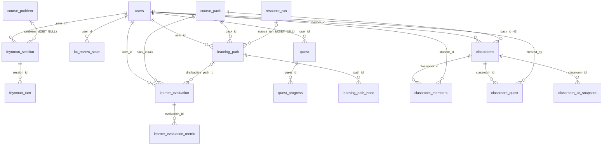

## 6.5 数据表字典（四）· 复盘 / 任务 / 班级 + 杂项 + 已弃用登记（filecode：D4）

### 覆盖范围

本片是 §6.5「完整字段字典」的第四分片（D4），承接 D1–D3，覆盖「看→学→练→测」闭环末端的**复盘巩固、任务路径与班级教学**三组模块，以及一张独立杂项表与全部历史遗留表登记。具体为：

- **M11 复盘·费曼·学习评估**：`feynman_session`、`feynman_turn`、`kc_review_state`、`learner_evaluation`、`learner_evaluation_metric`（5 张）。
- **M12 任务公告板与学习路径**：`quest`、`quest_progress`、`learning_path`、`learning_path_node`（4 张）。
- **M13 轻量班级与教师看板**：`classrooms`、`classroom_members`、`classroom_quest`、`classroom_kc_snapshot`（4 张）。
- **杂项**：`app_download_stat`（1 张）。
- **已弃用 / 历史遗留表登记**：R-14「世界收缩（方案 A）」移除农场 / 经济 / 商店 / NPC 好感度玩法后退役的 8 张表，仅登记不展开字段。

按本报告 §6 唯一权威约定，每张活跃表只在本片展开一次完整字段字典；其余章节（§4 / §5 / §8）引用这些表时仅写「详见 §6 表 xxx」。本片所有字段、类型、约束、索引均逐字取自 `backend/src/main/resources/db/migration/` 真实迁移脚本，**无编造**。跨片引用的外部表（`users` 见 D1 / M01，`course_pack`、`course_problem` 见 D2 / M06，`resource_run` 见 D3 / M08）在本片仅作外键目标出现，不重复展开。

### 本片实体关系总览（图 D4-1）

> 说明：图中 `||--o{` 表示一对多强制外键，`|o--o{` 表示可空外键（`ON DELETE SET NULL`）。`app_download_stat` 为无外键的独立计数表，未入图。`learner_evaluation` 既属 M11 复盘，又通过 `draft_path_id` / `active_path_id` 两条外键回指 M12 的 `learning_path`，是本片复盘与路径两组模块的衔接点。

### 本片活跃表清单总览（表 D4-1）

| # | 表名 | 模块 | 用途 | 来源迁移 |
| --- | --- | --- | --- | --- |
| 1 | `feynman_session` | M11 | 费曼反演会话（学生教一个镜像其真实错误的 AI 学弟） | V152（+V153） |
| 2 | `feynman_turn` | M11 | 费曼会话逐轮对话与「所教订正」记录 | V152 |
| 3 | `kc_review_state` | M11 | FSRS-lite 间隔复习状态（每 user×KC 一行） | V133 |
| 4 | `learner_evaluation` | M11 | 复盘大厅学习评估快照（含路径差异叙述） | V090 |
| 5 | `learner_evaluation_metric` | M11 | 评估快照下的数值指标明细 | V090 |
| 6 | `quest` | M12 | 公告板可执行任务（路径 / 班级 / 系统三源） | V051（+V110） |
| 7 | `quest_progress` | M12 | 任务状态流转审计流水 | V051 |
| 8 | `learning_path` | M12 | PathPlannerAgent 生成的 7 天个性化路径 | V050 |
| 9 | `learning_path_node` | M12 | 路径内按「日 × 序」排布的学习节点 | V050 |
| 10 | `classrooms` | M13 | 教师创建的轻量班级（绑定 packId=43） | V011 |
| 11 | `classroom_members` | M13 | 学生加入班级的成员关系 | V011 |
| 12 | `classroom_quest` | M13 | 教师发布的班级任务 | V052 |
| 13 | `classroom_kc_snapshot` | M13 | 班级 KC 掌握度热力快照缓存 | V080 |
| 14 | `app_download_stat` | 杂项 | 客户端安装包下载次数统计 | V174 |

---

### 6.5.11 M11 复盘 · 费曼 · 学习评估（5 表）

M11 是闭环的「再巩固」一环，对应前端复盘大厅 `ReviewHallPage` 与费曼挑战 `FeynmanPage`。`feynman_session` / `feynman_turn` 落地「费曼反演」：学生扮演老师去教一个**镜像其本人真实错误**的 AI 学弟，会话绑定一道代表题（`problem_id`）以复用题目隐藏用例做真实输出比对；`kc_review_state` 是「遗忘回声」的引擎数据，按 FSRS-lite 记忆稳定度个性化排程；`learner_evaluation` / `learner_evaluation_metric` 持久化复盘大厅的周期性评估快照及其量化指标。

#### 表 D4-2 `feynman_session`（费曼反演会话）

| 字段 | 类型 | 约束/默认 | 说明 |
| --- | --- | --- | --- |
| `id` | BIGSERIAL | PK | 会话主键 |
| `user_id` | BIGINT | NOT NULL，FK→`users(id)` ON DELETE CASCADE | 发起会话的学生 |
| `kc_code` | VARCHAR(40) | NOT NULL | 本次费曼教学针对的知识点编码 |
| `tutee_state` | JSONB | NOT NULL DEFAULT `'{}'` | AI 学弟（tutee）当前心智状态：镜像的错误、被纠正进度等 |
| `status` | VARCHAR(16) | NOT NULL DEFAULT `'OPEN'` | 会话状态（OPEN 等） |
| `created_at` | TIMESTAMPTZ | NOT NULL DEFAULT `now()` | 创建时间 |
| `problem_id` | BIGINT | FK→`course_problem(id)` ON DELETE SET NULL | 代表题（V153 新增并回填，用于复用 hidden_test_cases 判题） |

- **PK**：`id`
- **FK**：`user_id`→`users(id)`（CASCADE）；`problem_id`→`course_problem(id)`（SET NULL）
- **索引**：`idx_feynman_session_user(user_id, created_at DESC)`；`idx_feynman_session_problem(problem_id)`（V153）
- **来源迁移**：V152（建表）、V153（增列 `problem_id` + 回填 + 索引）

#### 表 D4-3 `feynman_turn`（费曼会话轮次）

| 字段 | 类型 | 约束/默认 | 说明 |
| --- | --- | --- | --- |
| `id` | BIGSERIAL | PK | 轮次主键 |
| `session_id` | BIGINT | NOT NULL，FK→`feynman_session(id)` ON DELETE CASCADE | 所属会话 |
| `role` | VARCHAR(8) | NOT NULL | 发言角色（学生 / AI 学弟） |
| `content` | TEXT | NOT NULL | 本轮对话正文 |
| `taught_fix` | TEXT | NULL | 学生本轮所教的订正点（教学证据） |
| `created_at` | TIMESTAMPTZ | NOT NULL DEFAULT `now()` | 发言时间 |

- **PK**：`id`
- **FK**：`session_id`→`feynman_session(id)`（CASCADE）
- **索引**：除主键外无额外索引（按 `session_id` 顺序读取）
- **来源迁移**：V152

#### 表 D4-4 `kc_review_state`（FSRS-lite 复习状态）

| 字段 | 类型 | 约束/默认 | 说明 |
| --- | --- | --- | --- |
| `id` | BIGSERIAL | PK | 主键 |
| `user_id` | BIGINT | NOT NULL，FK→`users(id)` ON DELETE CASCADE | 学生 |
| `kc_code` | VARCHAR(64) | NOT NULL | 知识点编码 |
| `stability` | NUMERIC(9,3) | NOT NULL DEFAULT `1.000`，CHECK `stability > 0` | 记忆稳定度 S：可提取性 R 从 1.0 衰减到 0.9 所需天数 |
| `difficulty` | NUMERIC(4,3) | NOT NULL DEFAULT `0.300`，CHECK `0.0–1.0` | FSRS 难度代理，用于稳定度增量微调 |
| `reps` | INTEGER | NOT NULL DEFAULT `0`，CHECK `reps>=0` | 成功召回次数 |
| `lapses` | INTEGER | NOT NULL DEFAULT `0`，CHECK `lapses>=0` | 失败（lapse）次数 |
| `last_review_at` | TIMESTAMPTZ | NULL | 最近一次复习（成功 / 失败 / 重学）时间 |
| `due_at` | TIMESTAMPTZ | NULL | 可提取性跌破目标留存率的到期时刻 |
| `created_at` | TIMESTAMPTZ | NOT NULL DEFAULT `now()` | 创建时间 |
| `updated_at` | TIMESTAMPTZ | NOT NULL DEFAULT `now()` | 更新时间 |

- **PK**：`id`
- **FK**：`user_id`→`users(id)`（CASCADE）
- **唯一约束**：`UNIQUE(user_id, kc_code)`（每 user×KC 一行）
- **CHECK**：`kc_review_state_stability_pos`、`kc_review_state_difficulty_range`、`kc_review_state_reps_nonneg`
- **索引**：`idx_kc_review_state_user(user_id)`；`idx_kc_review_state_due(user_id, due_at)`
- **来源迁移**：V133（建表 + 从 `kc_mastery` 播种初始稳定度回填）

#### 表 D4-5 `learner_evaluation`（复盘评估快照）

| 字段 | 类型 | 约束/默认 | 说明 |
| --- | --- | --- | --- |
| `id` | BIGSERIAL | PK | 评估主键 |
| `user_id` | BIGINT | NOT NULL，FK→`users(id)` ON DELETE CASCADE | 被评估学生 |
| `pack_id` | BIGINT | NOT NULL DEFAULT `43`，FK→`course_pack(id)` ON DELETE RESTRICT，CHECK `pack_id=43` | 课程包（固定 43） |
| `period_start` | TIMESTAMPTZ | NOT NULL | 评估周期起 |
| `period_end` | TIMESTAMPTZ | NOT NULL | 评估周期止 |
| `narrative_summary` | TEXT | NOT NULL DEFAULT `''` | 叙事化评估总结（EvaluationNarrativeAgent 产出） |
| `path_diff_summary` | TEXT | NOT NULL DEFAULT `''` | 路径调整差异叙述 |
| `draft_path_id` | BIGINT | FK→`learning_path(id)` ON DELETE SET NULL | 建议的新草稿路径 |
| `active_path_id` | BIGINT | FK→`learning_path(id)` ON DELETE SET NULL | 评估时生效路径 |
| `created_at` | TIMESTAMPTZ | NOT NULL DEFAULT `now()` | 生成时间 |
| `acted_status` | VARCHAR(16) | NOT NULL DEFAULT `'PENDING'`，CHECK IN(`PENDING`,`ACCEPTED`,`KEPT_OLD`,`PARTIAL`) | 学生对路径建议的处置状态 |

- **PK**：`id`
- **FK**：`user_id`→`users`（CASCADE）；`pack_id`→`course_pack`（RESTRICT）；`draft_path_id` / `active_path_id`→`learning_path`（均 SET NULL）
- **索引**：`idx_learner_evaluation_user_created(user_id, created_at DESC)`
- **来源迁移**：V090

#### 表 D4-6 `learner_evaluation_metric`（评估指标明细）

| 字段 | 类型 | 约束/默认 | 说明 |
| --- | --- | --- | --- |
| `id` | BIGSERIAL | PK | 指标行主键 |
| `evaluation_id` | BIGINT | NOT NULL，FK→`learner_evaluation(id)` ON DELETE CASCADE | 所属评估快照 |
| `metric_key` | VARCHAR(64) | NOT NULL | 指标键（如通过率、平均用时等） |
| `numerator` | NUMERIC(10,4) | NOT NULL DEFAULT `0` | 分子 |
| `denominator` | NUMERIC(10,4) | NOT NULL DEFAULT `0` | 分母 |
| `value` | NUMERIC(10,4) | NOT NULL DEFAULT `0` | 计算后取值 |
| `display_unit` | VARCHAR(16) | NOT NULL DEFAULT `''` | 展示单位（%、秒等） |
| `notes` | VARCHAR(512) | NULL | 备注 |

- **PK**：`id`
- **FK**：`evaluation_id`→`learner_evaluation(id)`（CASCADE）
- **索引**：`idx_learner_evaluation_metric_eval(evaluation_id)`
- **来源迁移**：V090

---

### 6.5.12 M12 任务公告板与学习路径（4 表）

M12 把个性化学习落到「今天该做什么」。`learning_path` / `learning_path_node` 是 PathPlannerAgent 生成的 7 天路径（每天若干节点，按 `day_index × order_in_day` 排布）；`quest` / `quest_progress` 是公告板上的可执行任务，来源含路径规划、班级派发与系统默认三类，并通过 V110 引入的**证据闸门**（`required_evidence_type` 等）强制学生以真实 submission / resource / page_read / kc_mastery 证据完成任务，杜绝「误点完成」绕过练习。

#### 表 D4-7 `quest`（公告板任务）

| 字段 | 类型 | 约束/默认 | 说明 |
| --- | --- | --- | --- |
| `id` | BIGSERIAL | PK | 任务主键 |
| `user_id` | BIGINT | NOT NULL，FK→`users(id)` ON DELETE CASCADE | 任务归属学生 |
| `source` | VARCHAR(24) | NOT NULL，CHECK IN(`PATH_PLANNER`,`CLASSROOM`,`SYSTEM_DEFAULT`) | 任务来源 |
| `source_ref_id` | BIGINT | NULL | 来源引用 id（如路径节点 / 班级任务 id） |
| `title` | VARCHAR(256) | NOT NULL | 任务标题 |
| `description` | VARCHAR(1024) | NULL | 任务描述 |
| `kc_code` | VARCHAR(64) | NULL | 关联知识点 |
| `node_type` | VARCHAR(24) | NOT NULL，CHECK IN(`READ_RESOURCE`,`SOLVE_PROBLEM`,`FIX_BUG`,`PLANT_KC`,`PROFILE_UPDATE`) | 任务动作类型 |
| `payload` | JSONB | NOT NULL DEFAULT `'{}'` | 任务附加载荷 |
| `due_date` | DATE | NOT NULL | 截止日 |
| `priority` | INT | NOT NULL DEFAULT `5`，CHECK `0–9` | 优先级 |
| `status` | VARCHAR(16) | NOT NULL DEFAULT `'OPEN'`，CHECK IN(`OPEN`,`IN_PROGRESS`,`COMPLETED`,`SKIPPED`,`EXPIRED`) | 任务状态 |
| `created_at` | TIMESTAMPTZ | NOT NULL DEFAULT `now()` | 创建时间 |
| `updated_at` | TIMESTAMPTZ | NOT NULL DEFAULT `now()` | 更新时间 |
| `required_evidence_type` | VARCHAR(32) | CHECK NULL OR IN(`submission`,`resource`,`page_read`,`kc_mastery`) | 完成所需证据类型（V110；NULL=不强校验） |
| `required_mastery_delta` | NUMERIC(5,2) | NULL | kc_mastery 证据下要求的最低掌握度增量（V110） |
| `target_problem_ids` | BIGINT[] | NOT NULL DEFAULT `ARRAY[]` | submission 证据允许的题目白名单，空=任意（V110） |
| `target_resource_id` | BIGINT | NULL | resource 证据指定的 `learning_resource.id`（V110） |
| `deep_link_route` | VARCHAR(128) | NULL | 前端「去做」按钮目标路由（V110） |
| `deep_link_params` | JSONB | NOT NULL DEFAULT `'{}'` | 「去做」按钮附带 query 参数（V110） |

- **PK**：`id`
- **FK**：`user_id`→`users(id)`（CASCADE）
- **CHECK**：`source`、`node_type`、`priority`、`status`，以及 V110 的 `chk_quest_required_evidence_type`
- **索引**：`idx_quest_user_status_due(user_id, status, due_date)`；`idx_quest_user_source(user_id, source)`；`idx_quest_source_ref(source, source_ref_id)`；`idx_quest_required_evidence_type(required_evidence_type) WHERE NOT NULL`（V110 部分索引）
- **来源迁移**：V051（建表）、V110（证据闸门 + 深链 6 列与索引）

#### 表 D4-8 `quest_progress`（任务进度流水）

| 字段 | 类型 | 约束/默认 | 说明 |
| --- | --- | --- | --- |
| `id` | BIGSERIAL | PK | 主键 |
| `quest_id` | BIGINT | NOT NULL，FK→`quest(id)` ON DELETE CASCADE | 所属任务 |
| `event_type` | VARCHAR(16) | NOT NULL，CHECK IN(`STARTED`,`STEP_DONE`,`COMPLETED`,`SKIPPED`,`EXPIRED`) | 进度事件类型 |
| `note` | VARCHAR(512) | NULL | 事件备注 |
| `created_at` | TIMESTAMPTZ | NOT NULL DEFAULT `now()` | 事件时间 |

- **PK**：`id`
- **FK**：`quest_id`→`quest(id)`（CASCADE）
- **索引**：`idx_quest_progress_quest_created(quest_id, created_at DESC)`
- **来源迁移**：V051

#### 表 D4-9 `learning_path`（7 天个性化路径）

| 字段 | 类型 | 约束/默认 | 说明 |
| --- | --- | --- | --- |
| `id` | BIGSERIAL | PK | 路径主键 |
| `user_id` | BIGINT | NOT NULL，FK→`users(id)` ON DELETE CASCADE | 学生 |
| `pack_id` | BIGINT | NOT NULL，FK→`course_pack(id)` ON DELETE CASCADE | 课程包 |
| `version` | INT | NOT NULL，CHECK `version>=1` | 路径版本号 |
| `status` | VARCHAR(16) | NOT NULL DEFAULT `'ACTIVE'`，CHECK IN(`ACTIVE`,`ARCHIVED`) | 路径状态 |
| `goal_summary` | VARCHAR(512) | NULL | 目标摘要 |
| `generated_at` | TIMESTAMPTZ | NOT NULL DEFAULT `now()` | 生成时间 |
| `next_review_at` | TIMESTAMPTZ | NULL | 下次复盘 / 重排时间 |
| `source_run_id` | BIGINT | FK→`resource_run(id)` ON DELETE SET NULL | 生成该路径的 Agent run |

- **PK**：`id`
- **FK**：`user_id`→`users`（CASCADE）；`pack_id`→`course_pack`（CASCADE）；`source_run_id`→`resource_run`（SET NULL）
- **唯一约束**：`UNIQUE(user_id, pack_id, version)`
- **索引**：`idx_learning_path_user_status(user_id, status)`；`idx_learning_path_user_generated(user_id, generated_at DESC)`
- **来源迁移**：V050

#### 表 D4-10 `learning_path_node`（路径节点）

| 字段 | 类型 | 约束/默认 | 说明 |
| --- | --- | --- | --- |
| `id` | BIGSERIAL | PK | 节点主键 |
| `path_id` | BIGINT | NOT NULL，FK→`learning_path(id)` ON DELETE CASCADE | 所属路径 |
| `day_index` | INT | NOT NULL，CHECK `1–7` | 第几天 |
| `order_in_day` | INT | NOT NULL，CHECK `>=1` | 当天内顺序 |
| `kc_code` | VARCHAR(64) | NOT NULL | 目标知识点 |
| `node_type` | VARCHAR(24) | NOT NULL，CHECK IN(`READ_RESOURCE`,`SOLVE_PROBLEM`,`FIX_BUG`,`PLANT_KC`,`PROFILE_UPDATE`) | 节点动作类型 |
| `reason_summary` | VARCHAR(512) | NULL | 安排该节点的理由（决策可解释） |
| `evidence_summary` | VARCHAR(512) | NULL | 支撑证据摘要 |
| `suggested_resource_type` | VARCHAR(16) | NULL | 建议资源类型 |
| `suggested_problem_id` | BIGINT | NULL | 建议题目 id |
| `payload` | JSONB | NOT NULL DEFAULT `'{}'` | 节点附加载荷 |

- **PK**：`id`
- **FK**：`path_id`→`learning_path(id)`（CASCADE）
- **唯一约束**：`UNIQUE(path_id, day_index, order_in_day)`
- **索引**：`idx_learning_path_node_path_day(path_id, day_index, order_in_day)`；`idx_learning_path_node_kc(kc_code)`
- **来源迁移**：V050

---

### 6.5.13 M13 轻量班级与教师看板（4 表）

M13 提供「教师建班 → 学生加入 → 发布班级任务 → 看 KC 热力」的轻量班级能力，全部绑定唯一课程包 `packId=43`。`classrooms` / `classroom_members` 是班级与成员主体；`classroom_quest` 是教师派发、最终落到学生 `quest`（source=`CLASSROOM`）的班级任务；`classroom_kc_snapshot` 是教师看板的 KC 掌握度热力**缓存**，可由 `kc_mastery` / `kc_mastery_event` 按需重算，删除仅失效缓存。

#### 表 D4-11 `classrooms`（班级）

| 字段 | 类型 | 约束/默认 | 说明 |
| --- | --- | --- | --- |
| `id` | BIGSERIAL | PK | 班级主键 |
| `name` | VARCHAR(128) | NOT NULL | 班级名称 |
| `description` | TEXT | NOT NULL DEFAULT `''` | 班级描述 |
| `teacher_id` | BIGINT | NOT NULL，FK→`users(id)` ON DELETE CASCADE | 创建教师 |
| `pack_id` | BIGINT | NOT NULL DEFAULT `43`，FK→`course_pack(id)` ON DELETE RESTRICT，CHECK `pack_id=43` | 绑定课程包（固定 43） |
| `join_code` | VARCHAR(6) | NOT NULL UNIQUE | 6 位入班邀请码 |
| `status` | VARCHAR(16) | NOT NULL DEFAULT `'ACTIVE'`，CHECK IN(`ACTIVE`,`ARCHIVED`) | 班级状态 |
| `created_at` | TIMESTAMPTZ | NOT NULL DEFAULT `now()` | 创建时间 |

- **PK**：`id`
- **FK**：`teacher_id`→`users`（CASCADE）；`pack_id`→`course_pack`（RESTRICT）
- **唯一约束**：`join_code` 全局唯一
- **索引**：`idx_classrooms_teacher(teacher_id)`
- **来源迁移**：V011

#### 表 D4-12 `classroom_members`（班级成员）

| 字段 | 类型 | 约束/默认 | 说明 |
| --- | --- | --- | --- |
| `id` | BIGSERIAL | PK | 主键 |
| `classroom_id` | BIGINT | NOT NULL，FK→`classrooms(id)` ON DELETE CASCADE | 所属班级 |
| `student_id` | BIGINT | NOT NULL，FK→`users(id)` ON DELETE CASCADE | 成员学生 |
| `status` | VARCHAR(16) | NOT NULL DEFAULT `'ACTIVE'`，CHECK IN(`ACTIVE`,`REMOVED`) | 成员状态 |
| `joined_at` | TIMESTAMPTZ | NOT NULL DEFAULT `now()` | 加入时间 |

- **PK**：`id`
- **FK**：`classroom_id`→`classrooms`（CASCADE）；`student_id`→`users`（CASCADE）
- **唯一约束**：`UNIQUE(classroom_id, student_id)`
- **索引**：`idx_classroom_members_student(student_id, status)`
- **来源迁移**：V011

#### 表 D4-13 `classroom_quest`（班级任务）

| 字段 | 类型 | 约束/默认 | 说明 |
| --- | --- | --- | --- |
| `id` | BIGSERIAL | PK | 主键 |
| `classroom_id` | BIGINT | NOT NULL，FK→`classrooms(id)` ON DELETE CASCADE | 所属班级 |
| `title` | VARCHAR(256) | NOT NULL | 任务标题 |
| `description` | VARCHAR(1024) | NULL | 任务描述 |
| `kc_codes` | TEXT[] | NOT NULL DEFAULT `ARRAY[]` | 关联知识点编码数组 |
| `node_type` | VARCHAR(24) | NOT NULL，CHECK IN(`READ_RESOURCE`,`SOLVE_PROBLEM`,`FIX_BUG`,`PLANT_KC`,`PROFILE_UPDATE`) | 任务动作类型 |
| `payload` | JSONB | NOT NULL DEFAULT `'{}'` | 任务附加载荷 |
| `due_date` | DATE | NOT NULL | 截止日 |
| `created_by` | BIGINT | NOT NULL，FK→`users(id)` ON DELETE RESTRICT | 发布教师 |
| `created_at` | TIMESTAMPTZ | NOT NULL DEFAULT `now()` | 发布时间 |
| `status` | VARCHAR(16) | NOT NULL DEFAULT `'ACTIVE'`，CHECK IN(`ACTIVE`,`ARCHIVED`) | 任务状态 |

- **PK**：`id`
- **FK**：`classroom_id`→`classrooms`（CASCADE）；`created_by`→`users`（RESTRICT）
- **索引**：`idx_classroom_quest_classroom_status(classroom_id, status, due_date)`；`idx_classroom_quest_kc` GIN(`kc_codes`)
- **来源迁移**：V052

#### 表 D4-14 `classroom_kc_snapshot`（班级 KC 热力快照）

| 字段 | 类型 | 约束/默认 | 说明 |
| --- | --- | --- | --- |
| `id` | BIGSERIAL | PK | 主键 |
| `classroom_id` | BIGINT | NOT NULL，FK→`classrooms(id)` ON DELETE CASCADE | 所属班级 |
| `kc_code` | VARCHAR(64) | NOT NULL | 知识点编码 |
| `avg_mastery` | NUMERIC(4,3) | NOT NULL DEFAULT `0` | 班级平均掌握度 |
| `student_count` | INT | NOT NULL DEFAULT `0` | 统计学生数 |
| `passed_count` | INT | NOT NULL DEFAULT `0` | 已通过人数 |
| `failed_count` | INT | NOT NULL DEFAULT `0` | 未通过人数 |
| `top_error_categories` | JSONB | NOT NULL DEFAULT `'[]'` | 高频错误类别（用于教师看板误区分析） |
| `computed_at` | TIMESTAMPTZ | NOT NULL DEFAULT `now()` | 快照计算时间 |

- **PK**：`id`
- **FK**：`classroom_id`→`classrooms`（CASCADE）
- **唯一约束**：`UNIQUE(classroom_id, kc_code)`
- **索引**：`idx_classroom_kc_snapshot_classroom(classroom_id)`
- **来源迁移**：V080

---

### 6.5.14 杂项（1 表）

#### 表 D4-15 `app_download_stat`（安装包下载计数）

下载计数表服务于 guide 页「下载 Android App」按钮，与任何业务表无外键，随 `/api/downloads/**` 匿名放行可读写，以 `stat_key` 为主键做原子自增。删表仅丢失下载统计，不影响任何学习 / 判题 / 存档数据。

| 字段 | 类型 | 约束/默认 | 说明 |
| --- | --- | --- | --- |
| `stat_key` | VARCHAR(64) | PK | 统计键（如 `android_apk`） |
| `hit_count` | BIGINT | NOT NULL DEFAULT `0` | 累计下载次数（原子自增） |
| `updated_at` | TIMESTAMPTZ | NOT NULL DEFAULT `now()` | 最近更新时间 |

- **PK**：`stat_key`
- **FK**：无（与业务解耦，匿名可读写）
- **索引**：除主键外无额外索引
- **来源迁移**：V174（建表 + 预置 `android_apk` 计数行，幂等）

---

### 6.5.15 已弃用 / 历史遗留表登记

R-14「世界收缩（方案 A）」将五图分块大世界收敛为单一中央小镇 `town_hub`，随之移除农场 / 作物、NPC 好感度与送礼、背包物品、货币经济与商店等非教育核心玩法。相关存储表分两类退役：一类已由专门迁移 `DROP TABLE`（经 `rg "DROP TABLE" backend/src/main/resources/db/migration` 复核，真实 DROP 仅出现在 **V126** 与 **V135**）；另一类（背包 / 货币 / 商店）在迁移层**未被显式 DROP，物理结构仍残留**于库中，但已无任何 controller / service 业务调用，属历史遗留死表。下表仅登记，不展开字段。

#### 表 D4-16 已弃用 / 历史遗留表登记

| 表名 | 引入版本 | DROP 版本 | 弃用原因（R-14 世界收缩等） |
| --- | --- | --- | --- |
| `crop_tile_state` | V013（V031 扩展列与约束） | **V126**（已 DROP） | R-14 方案 A 收缩为单中央小镇，移除 KC 作物 / 播种 / 浇水（农场）玩法；掌握度本身存于 `kc_mastery_event`，不受影响 |
| `npc_relationship` | V117 | **V135**（已 DROP） | R-14 后续移除 NPC 好感度（friendship 0–100）gating 玩法，退役好感度缓存表 |
| `npc_gift_log` | V102（V117 幂等重声明） | **V135**（已 DROP） | 同上，送礼 / 好感度闭环移除，退役送礼审计流水 |
| `item_catalog` | V103 | —（未 DROP，物理保留） | R-14 移除背包 / 物品玩法；物品目录表残留，无业务调用 |
| `inventory_item` | V103 | —（未 DROP，物理保留） | 同上，玩家背包退役，表残留 |
| `player_currency` | V105 | —（未 DROP，物理保留） | R-14 移除货币 / 经济系统；金币 / 宝石余额表残留 |
| `currency_transaction` | V105 | —（未 DROP，物理保留） | 同上，货币变动流水退役，表残留 |
| `shop_listing` | V106 | —（未 DROP，物理保留） | R-14 移除商店玩法；商品 SKU 表残留 |

> 说明：`crop_tile_state`、`npc_relationship`、`npc_gift_log` 三表已被迁移真实删除（前者 V126，后两者 V135，且 V135 同时 `ALTER TABLE npc_dialog_state DROP COLUMN friendship`）；`item_catalog` / `inventory_item`（V103）、`player_currency` / `currency_transaction`（V105）、`shop_listing`（V106）五表至今未在任何迁移中 `DROP`，仍以空表形态残留于 schema，仅作历史登记，后续可在专门清理迁移中一并退役。本登记同时收录于 §6 已弃用表附录（见 C06），两处口径一致。

---

> 执笔人：成员 A ｜ 完成人（签名）：成员 A ｜ 审查人：成员 C ｜ 完成日期：2026-06-15
