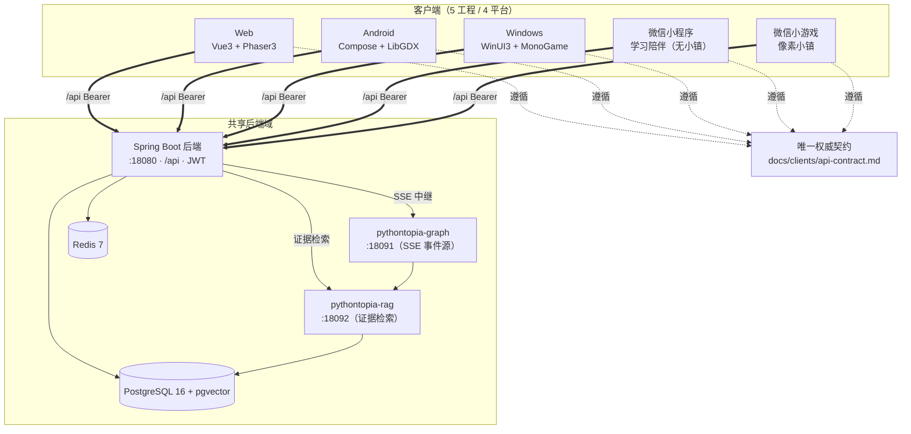
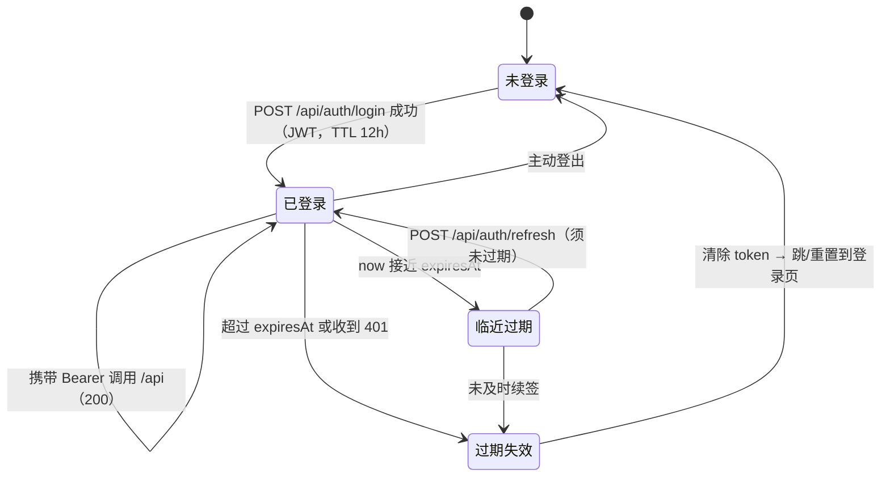
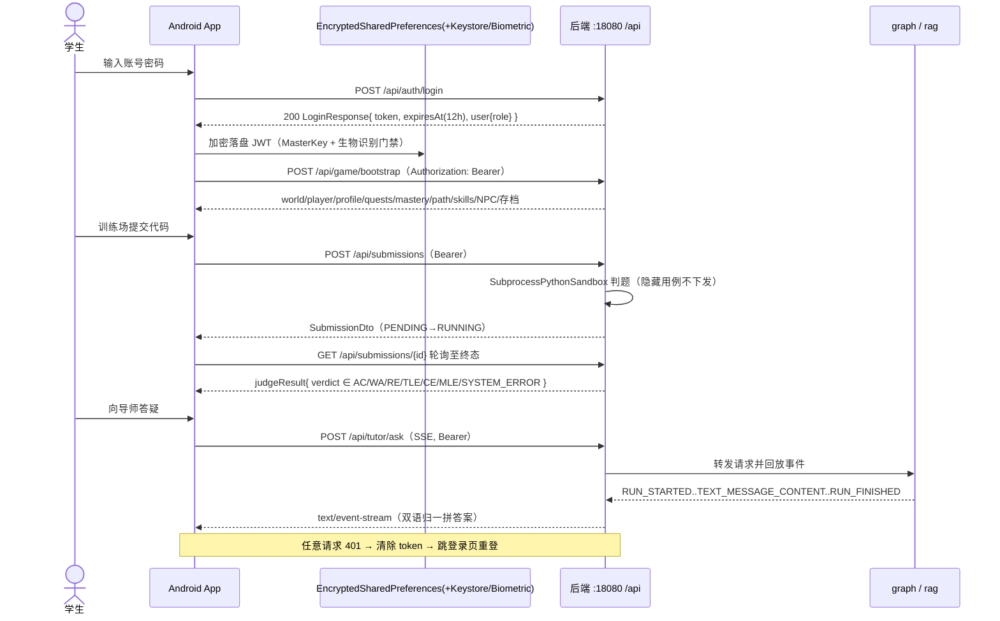
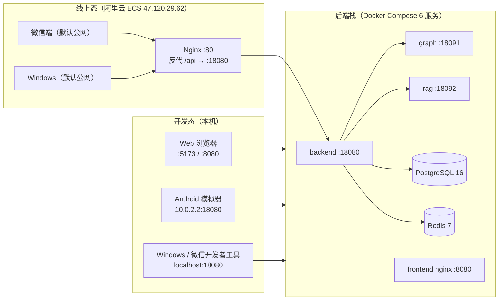

# 7 多端 / 手机端侧部署设计

> 文档编号：`PYT-CR` · 文件代号（filecode）：**C07** · 对应实训报告第 7 章
> 本章图表统一以 `C07-` 前缀编号；端口/版本/术语一律采用《写作总纲》§1 项目事实卡与 §2 术语表。

本章给出 Pythontopia 的多端（含手机端）部署设计：先界定**多端总览与共享后端**，再给出**各端技术栈与部署形态**、**多端架构**、**客户端接入契约一致性**，随后聚焦 **Android 端侧部署**（最完整的手机端），最后说明**部署拓扑**、**能力收敛**与其余客户端的端侧要点。核心约束只有一句：**一套后端、多端接入、契约统一、能力一致**。

---

## 7.1 多端总览与共享后端

自 R-14 起，Pythontopia 从「Web + Android 双端」演进为面向 **4 类平台（Web / Android / Windows / 微信）共用同一套 Spring Boot 后端**的多端产品。微信端拆成**小程序**（学习陪伴，无像素小镇）与**小游戏**（像素小镇）两个独立工程，故物理上是 **5 个客户端目录**。

共享后端的对外形态固定为：

- **Base URL 端口**：后端单进程对外 `:18080`，所有业务路径统一前缀 `/api`。
- **鉴权**：无状态 **JWT Bearer**，不使用 Cookie/Session；除少数匿名端点外都须带 `Authorization: Bearer <token>`。
- **数据格式**：默认 `application/json; charset=utf-8`；例外为课件页图片 `image/png`、视频 `video/mp4`（支持 Range）、SSE `text/event-stream`；时间字段 ISO-8601。
- **错误信封**：统一 `{ code, message, details[], traceId, timestamp }`，HTTP 状态码与 `code` 对应（如 `UNAUTHORIZED(401)`、`FORBIDDEN(403)`、`*_NOT_FOUND(404)`、字段校验 `BAD_REQUEST(400)`）。

各客户端**不复用** Web 端 Phaser 代码 / `tilemap.ts` / `frontend/src/api/*.ts`：每端用各自平台的原生技术重写表现层与 API client，仅以后端契约为公约数。这样既隔离了 Web 冻结基线（多端拓展不破坏 Web 回归），又让每端发挥各自平台特性（原生渲染、原生网络栈、原生安全存储）。

把判题、AI 出题、防幻觉审查、隐藏用例、画像演化、主线进度判定全部收在后端，还带来一个安全副产物：**反编译任一客户端只暴露 API 调用形状，没有可窃取的业务机密、答案或隐藏用例**——这是「破解无收益」的根本设计。客户端越「薄」，跨端一致性与安全性越好；后端越「厚」，越能保证五端学习态连续、判分口径统一。

---

## 7.2 各端技术栈与部署形态

| 平台 | 目录 | 技术栈 | 像素小镇 | 部署 / 交付形态 | 默认后端地址 |
| --- | --- | --- | --- | --- | --- |
| Web | `frontend/` | Vue 3.5 + Vite 5 + TS strict + Pinia + Phaser 3.87 + Pyodide | **有** | 浏览器：开发 `:5173`，容器 nginx `8080:80`，线上经 ECS Nginx | `http://localhost:18080`（线上经反代） |
| Android | `android/` | Kotlin 2.2 + Jetpack Compose（M3）+ LibGDX 1.13.1 + Hilt | **有** | debug APK（GitHub Releases pre-release） | 模拟器 `http://10.0.2.2:18080`；真机局域网 `http://<IP>:18080` |
| Windows | `windows/` | .NET 8 + WinUI 3（Windows App SDK）+ MonoGame DesktopGL | **有**（建设中） | 自包含 `.exe`（单文件 ~64 MB / 目录 zip ~74 MB），已上传 ECS 直出 | 默认公网 `http://47.120.29.62`，`PYT_BACKEND_URL` 可覆盖 |
| 微信小程序 | `wechat-miniprogram/` | 原生小程序（TS + WXML/WXSS） | **无**（学习陪伴） | 微信开发者工具导入 → 体验版/正式版 | 默认公网 `http://47.120.29.62`，本机联调改回 `:18080` |
| 微信小游戏 | `wechat-minigame/` | 原生小游戏（TS + canvas2d，无 DOM） | **有** | 微信开发者工具（小游戏）导入 | 默认公网 `http://47.120.29.62`（`src/config.ts` 配置） |

> 表 C07-1　各端技术栈与部署形态。原生客户端不经浏览器同源策略，CORS 配置与它们无关；微信端受「服务器域名」白名单约束（见 §7.4）。

---

## 7.3 多端架构

> 图 C07-1　多端架构：五客户端经统一契约接入同一后端域；生成式能力由后端中继 graph/rag。

要点：客户端永远只和后端 `:18080` 对话，不直接访问 graph/rag/数据库；多智能体 SSE 由后端转发 graph 事件并原样回放（SSE 中继），RAG 证据检索也经后端代理。任一客户端要新增能力，必须先在后端有端点、并写入 `api-contract.md`，再由各端按契约接入——不允许客户端凭空发明端点或字段。

---

## 7.4 客户端接入契约一致性

`docs/clients/api-contract.md` 是四端接入后端的**唯一权威契约**，随后端演进同步更新。契约一致性体现在五个方面：

1. **端点表统一**：客户端可见端点（bootstrap、画像/掌握度、任务、课程包、训练场题目、提交判题、Bug 矿洞、班级、主线地图与章末测试、NPC 寒暄、SSE 流）在契约中集中列出，含方法/路径/鉴权/说明。例如进入小镇统一调 `POST /api/game/bootstrap` 一次聚合返回 world/player/profile/quests/mastery/path/skills/NPC/存档槽/日历事件。
2. **鉴权与令牌一致**：JWT **TTL = 12 小时**；**没有真正的 refresh token**——`/api/auth/refresh` 把未过期的 access token 兼作续签源，必须回传未过期 token 才能换新，一旦过期 `refresh` 也返回 `401`。客户端统一策略：**收到 `401` 一律跳登录页重登**，不要静默刷新过期令牌。
3. **错误处理一致**：所有客户端基于 `code` 分支处理、基于 `message` 兜底展示；字段校验失败时 `details` 非空。
4. **SSE「双语归一」一致**：三个长流式端点（`/api/tutor/ask`、`/api/orchestrator/turn/stream`、`/api/workshop/resources/stream`）均为 `POST + text/event-stream + 仅 STUDENT`。线上已迁移到 **AG-UI 语义事件协议**（`RUN_STARTED / STEP_* / TEXT_MESSAGE_CONTENT / RUN_FINISHED / RUN_ERROR …`），历史名 `plan/trace/token/result/error` 仅作兼容。各端统一做归一：`TEXT_MESSAGE_CONTENT.delta` 拼答案、`STEP_*` 当思考链、`RUN_FINISHED` 为终态、`RUN_ERROR` 为错误。由于这些流是 `POST` 且需自定义 `Authorization` 头，浏览器原生 `EventSource` 不适用：Web 用 `fetch + ReadableStream`、Android/Windows 用 OkHttp/`HttpClient` 流式按行解析、微信端用 `wx.request({ enableChunked: true })` 分块再切帧。
5. **CORS 与域名一致性**：CORS 仅对本机 Web 源放行（`localhost:8080/5173/5174` 及对应 `127.0.0.1`，允许凭据、暴露 `Authorization` 头）；原生客户端不受 CORS 限制；微信端自行配置「服务器域名」白名单（开发勾选「不校验合法域名」，线上须备案 HTTPS 域名）。全部客户端走 Bearer token，不依赖 Cookie。

### Token 生命周期状态

> 图 C07-2　JWT 令牌/会话状态机（四端统一遵循：401 即重登，不静默刷新过期令牌）。

### 端到端最小链路（各端参照实现）

各端落地时以契约给出的最小链路为骨架，再按平台补 UI：① `POST /api/auth/login` 存 token（12h）；② `POST /api/game/bootstrap`（Bearer）拉小镇与学习态；③ 浏览课程 `/api/course/pack → /chapters → /kcs → /pages?kcCode=...`（证据页图 `/api/course/pages/{id}/image`，`/api/course/**` 匿名放行）；④ 答疑 `POST /api/tutor/ask`（SSE）；⑤ 练习 `GET /api/problems/{id}/public → POST /api/submissions →` 轮询 `GET /api/submissions/{id}` 至终态；⑥ 任务/班级 `/api/quests/today`、`/api/classrooms/mine`、`/api/classroom/quests/mine`；⑦ 任意请求 `401` → 回到第①步重登。判题轮询模型统一为 `status: PENDING → RUNNING → {PASSED, FAILED, ERROR}`，终态后读 `judgeResult.verdict`。

---

## 7.5 Android 端侧部署（手机端）

Android 端是项目最完整的原生手机端，技术决策见 `android/docs/ADR-001-tech-selection.md`（以 `gradle/libs.versions.toml` 实锁版本为准）。

### 7.5.1 技术栈与构建

| 维度 | 选型（实锁） |
| --- | --- |
| 语言 / UI | Kotlin 2.2.0 + Jetpack Compose（Material 3）+ Compose BOM 2025.04.00 |
| 构建 | Gradle 8.11.1 + Kotlin DSL + `gradle/libs.versions.toml` 版本目录；AGP 8.7.3 |
| SDK | **minSdk 26（Android 8.0）** / targetSdk 35（Android 15）/ compileSdk 35 / JVM Toolchain 17 |
| 像素渲染 | LibGDX 1.13.1（主渲染，`AndroidView { GameSurface }` 嵌入）+ Compose Canvas（教学面板挂件） |
| 地图 | Tiled **JSON**（`town_hub.json` 等，`WorldMapData`/`TiledMapVisual` 加载），与 Web `pixelArt` 范式一致 |
| 依赖注入 | Hilt 2.57.1 + KSP（不用 KAPT）+ `hilt-navigation-compose 1.2.0` |
| 网络 | Retrofit 2.11.0 + OkHttp 4.12.0 + `kotlinx-serialization-json 1.7.3` + 协程 1.9.0 |
| 安全存储 | `EncryptedSharedPreferences`（`security-crypto 1.1.0-alpha06`）+ Keystore + BiometricPrompt 1.1.0 |
| 测试 | JUnit 5 + MockK + Turbine + Robolectric + Compose UI Test + MockWebServer + Kover |

> 表 C07-2　Android 端技术栈选型（实锁版本以 `gradle/libs.versions.toml` 为准）。

模块拓扑为多模块物理隔离：`:app + :core:{common,data,design,network} + :game + :feature:*`。ADR 决策表最初列了 8 个 feature 模块（profile/fields/workshop/arena/mine/retro/path/classroom），落地后实际扩张为 16 个（另含 auth/hub/dialog/tutor/library/boss/endless/lecture，见 ADR-001 §8.3）。

状态管理按页面复杂度分流：复杂页（Training / BugMine / Evaluation / ProfileInterview）用 MVI（sealed Intent + sealed UiState + Reducer），简单页（Session / Dialog / Toast）用 MVVM + StateFlow，分界线为「可变字段 ≥ 4 走 MVI」，目的是消除「loading=true 但 phase=done」这类不一致。ViewModel 切分上，把 Web 端体量过大的单一 store（`learning.ts`，含 9 个子状态）拆成 8 个独立 ViewModel（Profile / Field / Workshop / Path / Quests / Training / BugMine / Evaluation），全端共约 12 个 ViewModel，使单测可写、职责单一。这套「物理隔离 + 单一 UiState」的端侧结构是 Android 部署能稳定迭代的工程基础。

构建与交付：PR 跑 `lintDebug + testDebugUnitTest + assembleDebug`；演示阶段直接发 **debug APK**（GitHub Releases pre-release），**不上架 Google Play**（留到 Beta+1，需补隐私政策与权限说明）。

### 7.5.2 JWT 安全存储（端侧部署关键）

Android 端按 OWASP MASVS-L1 落地令牌安全：登录拿到 JWT 后，用 `EncryptedSharedPreferences`（底层 `MasterKey` 落 Android Keystore）加密落盘，并以 BiometricPrompt（`BIOMETRIC_STRONG` + `CryptoObject`）做生物识别门禁；API 与普通 `SharedPreferences` 同源，迁移成本最低。这与 Windows 端用 DPAPI（CurrentUser + 应用熵）加密落盘 `session.json` 是同一安全意图的平台等价实现。

关于 refresh token：ADR 早期判断后端无 refresh 接口；以契约为准，后端**存在** `/api/auth/refresh` 但**不是真正的 refresh token**（用未过期 access token 重签，过期即 401 重登）。客户端策略统一为「过期重登」，可选地在临近 `expiresAt` 时主动续命一次。

### 7.5.3 DTO 对齐（契约驱动）

设计决策（ADR 决策 14）：以后端 springdoc 2.6.0 `/v3/api-docs` 为单一真理源，用 **OpenAPI Generator 7.22** 自动生成 Kotlin Retrofit2 client，少量 sealed union（如 `WorkshopContent`）走手工补丁层 `core/api/manual/` + `.openapi-generator-ignore`，并在 CI 用 `openapi-diff` 自动检测 schema drift，消灭「三套 DTO 漂移」。

当前实现状态（如实标注，ADR-001 §8.2/§8.3）：OpenAPI Generator **尚未接入构建**，版本目录与构建脚本中暂无该插件，Android 端 DTO/API **目前以手写为主**（仓库保留 `android/openapi/` 契约工件为后续生成做准备）。即设计方向已锁定为「生成式 DTO + 契约单一真理源」，落地为「先手写、后切生成器」的渐进路径。

### 7.5.4 判题部署边界：Beta 仅服务端判题

Android 端 **Beta 首发仅服务端判题**：所有提交走 `POST /api/submissions` → 后端 `SubprocessPythonSandbox` 沙箱判题（静态检查 + 限频 + 隐藏用例不下发）→ 调试 trace 经 `GET /api/bug-mine/sessions/{id}` 取回，与 Web 端判题 **100% 一致**。端上**不运行 Python**：Chaquopy 仅作为 Beta+1 可选预览插件（UI 明确区分预览与正式判题），首发不集成，以控制 APK 体积并避免「端侧预览被误当正式结果」。这与全局「Pyodide 预览不入正式判分」是同一约束在 Android 上的体现。

### 7.5.5 Android 登录 → JWT → 调用后端时序

> 图 C07-3　Android 登录 → JWT 加密存储 → 携 Bearer 调用后端（bootstrap / 判题轮询 / 答疑 SSE）。

---

## 7.6 部署拓扑

部署分**开发态**（本机 Docker Compose）与**线上态**（阿里云 ECS + Nginx 反代）两种，后端栈相同，仅入口地址不同。

> 图 C07-4　部署拓扑：开发态直连 `:18080`（Android 模拟器经 `10.0.2.2`）；线上态经 ECS Nginx `:80` 反代到后端栈。

各客户端运行环境对应的 Base URL（取自契约 §1）：

| 运行环境 | Base URL |
| --- | --- |
| Web（浏览器，本机） | `http://localhost:18080`（线上经 ECS Nginx 反代） |
| Windows 原生（本机） | `http://localhost:18080`（默认公网 `http://47.120.29.62`） |
| Android 模拟器（AVD） | `http://10.0.2.2:18080`（`10.0.2.2` = 模拟器回环到宿主机） |
| Android 真机 / 局域网 | `http://<后端局域网 IP>:18080` |
| 微信开发者工具 | `http://localhost:18080`（需勾选「不校验合法域名」） |
| 微信线上 | `https://<已备案 HTTPS 域名>`（须加入服务器域名白名单） |

> 表 C07-3　各运行环境 Base URL。线上微信端必须走**已备案 HTTPS 域名**，明文 `http`/`localhost` 线上不可用。

---

## 7.7 能力收敛（多端一致的功能边界）

R-14「世界收缩」后，全项目**没有**以下能力，**任一客户端都不得为其建 UI 或调用端点**：

- ❌ **背包 / 物品（inventory）**
- ❌ **货币 / 经济（currency）**
- ❌ **商店 / 购买（shop）**

游戏化语义统一收敛为「看 → 学 → 练 → 测」学习闭环（课件/视频/RAG → 资源工坊 → 训练场判题 → 掌握度达阈值），Bug 矿洞为支线。任何「商店/金币/道具」均无后端支撑。能力收敛保证五端在功能边界上**完全对齐**：微信小程序聚焦学习陪伴（无像素小镇），微信小游戏/Windows/Android/Web 含像素小镇，但都不引入收敛掉的旧玩法。主线进度自 R-15 起为**后端权威 mainline 域**，客户端只读 `GET /api/mainline/overview` 渲染冒险地图并通过打点接口上报，星级/解锁/补星判定全在后端——客户端不再实现 mainQuest 子任务 / 任务面板 / 背包 / 货币 / 商店。

---

## 7.8 其余客户端端侧要点

- **Windows（`windows/`）**：`.NET 8 + WinUI 3 + MonoGame`，非 Electron/WebView，纯 C# 原生。Core/Game 为跨平台 `net8.0`（WSL 互操作可构建/测试，133 个 xUnit 全绿），App 的 XAML 编译依赖 Windows 工具链。JWT 以 DPAPI 加密落盘；像素小镇以独立窗口（独立进程）启动，经 `PYT_TOKEN` 环境变量接收令牌叠加真实世界快照。默认连公网后端，`PYT_BACKEND_URL` 可覆盖为 `:18080`。自包含产物（单文件 `.exe` / 目录 zip）已上传 ECS Nginx 直出目录供下载。
- **微信小程序（`wechat-miniprogram/`）**：原生小程序（TS + WXML/WXSS），聚焦学习陪伴（主线地图首页 + 看/学/练小节 + 章末测试 + 任务 + 课程 + 训练场 + 工坊 + 8 维画像 + Bug 矿洞 + 班级），**不含**像素小镇。`utils/request.ts` 统一注入 JWT、解析错误信封、`401` 清 token 并 `wx.reLaunch` 回登录页。上线前须替换真实 AppID、配置已备案 HTTPS 域名白名单。
- **微信小游戏（`wechat-minigame/`）**：原生小游戏（TS + canvas2d，无 DOM），只渲染像素小镇 `town_hub`；后端联动可选且非阻塞（`POST /api/game/bootstrap` 取落点、`GET /api/mainline/overview` 点亮 HUD「⭐N 星」，任何失败安静回退）。学习面板在配套学习小程序中，经 `wx.navigateToMiniProgram` deep-link 跳转。

---

## 7.9 多端测试与持续集成

各端维护**独立**的测试与 CI，互不阻塞，且都以「不破坏 Web 冻结基线」为前提：

| 平台 | 测试栈 | CI 触发 / 范围 |
| --- | --- | --- |
| Android | JUnit 5 + MockK + Turbine + Robolectric + Compose UI Test + MockWebServer + Kover | GitHub Actions（Temurin 21）：PR 跑 `lintDebug + testDebugUnitTest + assembleDebug`，release 事件签名 APK |
| Windows | xUnit（`Pythontopia.Core.Tests`，133 测试全绿；覆盖 SSE 帧解析 / 错误信封 / 配置 / ApiClient / SessionService） | `.github/workflows/windows.yml` 在 `windows-latest` 构建 Core/Game/App（x64）并跑测试，仅 `windows/**` 变更触发 |
| 微信小程序/小游戏 | `tsc --noEmit` 类型校验（strict，无 `any`）+ `miniprogram-api-typings` | 本地/工具内类型校验；运行时无第三方依赖 |

> 表 C07-4　多端测试与持续集成。

多端共同的质量约束：业务层禁 `any`（平台等价物上同样适用）、API client 用明确 DTO 类型、判题只认服务端结果（无 Pyodide 当正式判分）、仅真实接口无前端假数据。原生客户端的安全加固还包括 Release 剥离符号（Windows `DebugType=none`）、ReadyToRun 原生预编译、JWT 加密落盘等，进一步降低反编译收益。

---

## 附：本章图表索引

| 编号 | 名称 | 类型 |
| --- | --- | --- |
| 图 C07-1 | 多端架构 | flowchart |
| 图 C07-2 | JWT 令牌/会话状态机 | stateDiagram-v2 |
| 图 C07-3 | Android 登录→JWT→调用后端时序 | sequenceDiagram |
| 图 C07-4 | 部署拓扑（开发态/线上态） | flowchart |
| 表 C07-1 | 各端技术栈与部署形态 | 表 |
| 表 C07-2 | Android 端技术栈选型 | 表 |
| 表 C07-3 | 各运行环境 Base URL | 表 |
| 表 C07-4 | 多端测试与持续集成 | 表 |

---

> 执笔人：成员 A ｜ 完成人（签名）：成员 A ｜ 审查人：成员 C ｜ 完成日期：2026-06-20
