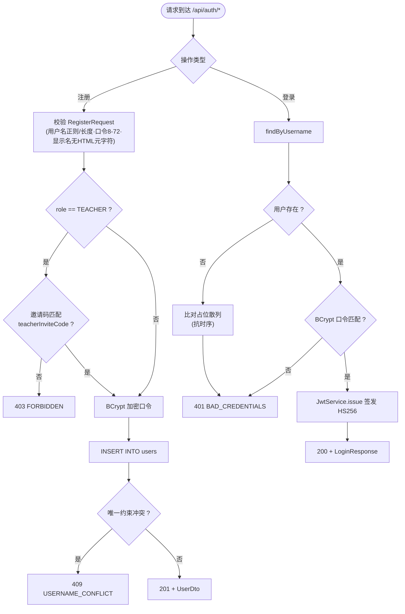
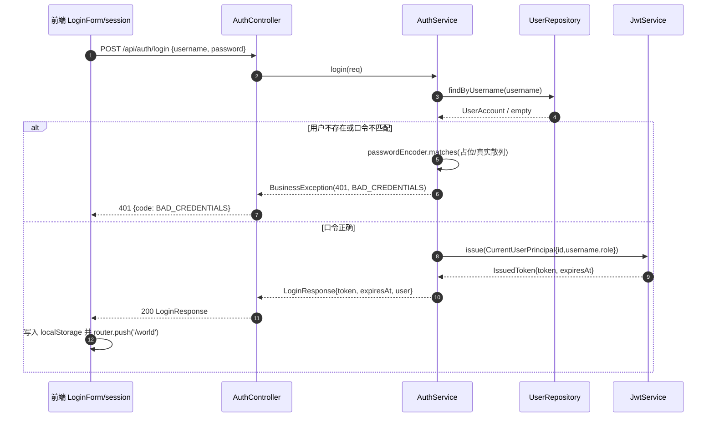
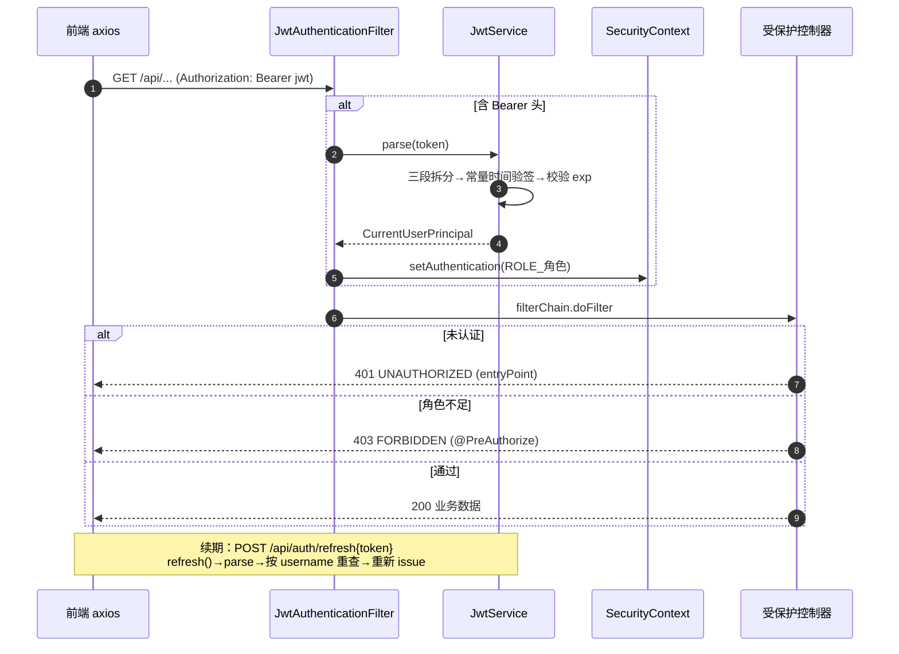
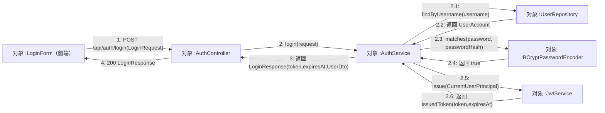
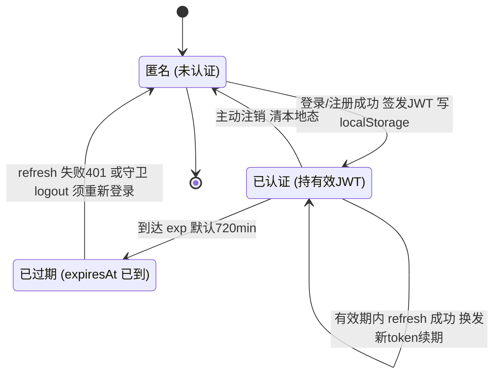
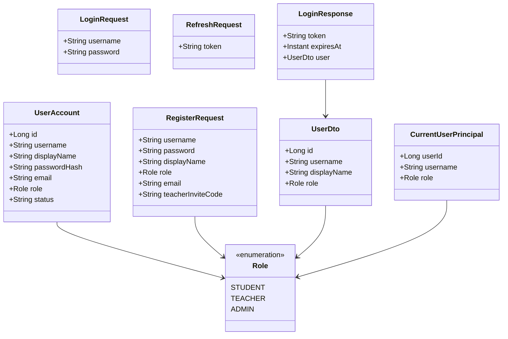

# 8 详细设计

## 8.1 账号认证与权限 · 详细设计

### 8.1.1 功能描述

M01 实现 Pythontopia 全站统一的身份认证与授权底座，对应后端包 `com.pythontopia.auth`，由四个子包构成：`controller`（`AuthController`）、`service`（`AuthService`）、`repository`（`UserRepository`）、`domain`（`UserAccount`）、`dto`（请求/响应记录）、`security`（JWT 与 Spring Security 配置）。系统采用**无状态 JWT**：登录/注册成功后由 `JwtService` 自签 HS256 令牌返回客户端，后续请求经 `JwtAuthenticationFilter` 解析令牌并把主体写入 `SecurityContext`，方法级再以 `@PreAuthorize` 做角色门。账号持久化于 `users` 表（字段字典见 §6 / D1 表 `users`），口令以 `BCryptPasswordEncoder(10)` 散列存储。三类角色 `STUDENT / TEACHER / ADMIN` 由枚举 `Role` 统一表达。

模块对外的用户入口是两张「访客专用」页面：登录页 `LoginPage`（内嵌 `LoginForm`）与注册页 `RegisterPage`，二者路由 `meta.guestOnly=true`，已认证用户访问时被路由守卫 `beforeEach` 跳回 `/world`。

> 【截图占位 SC-S01-1】
> - 访问：`http://localhost:5173/login` 与 `http://localhost:5173/register`（容器态 `http://localhost:8080/login`、`http://localhost:8080/register`）
> - 登录角色：无需登录（两页 `meta.guestOnly=true`；除 `/login`、`/register` 外其余页面均需登录）
> - 操作步骤：1. 打开 `/login` 查看 `LoginForm` 登录卡片（用户名、密码、登录按钮）；2. 经页内 `RouterLink` 切换到 `/register`；3. 在注册页把角色由「学生」切到「教师」，观察教师邀请码输入框随之出现
> - 截取对象：`LoginPage` 的 `LoginForm` 登录卡片，与 `RegisterPage` 注册表单（`username / password / displayName / role / email / teacherInviteCode` 六字段）
> - 期望画面：登录页呈「用户名 + 密码 + 登录按钮」；注册页呈六字段表单，选「教师」时显示邀请码字段；输入非法时字段下方出现中文校验提示（由 `http.ts` 把 `VALIDATION_ERROR` 本地化）

### 8.1.2 性能描述

- 令牌为自包含 JWT，校验在内存完成（HMAC-SHA256 + 常量时间比较），不查库、不访 Redis，单次校验为微秒级；STATELESS 设计无服务端会话，水平扩展无需会话同步。
- 登录每次执行一次 BCrypt（cost=10）口令比对（约 50–100ms 量级），是该路径主要耗时；**用户不存在时仍比对一份「占位散列」**（`loginTimingDummyHash`），消除「用户是否存在」的时序侧信道。
- 注册每次执行一次 BCrypt 加密 + 一条 `INSERT`；唯一约束冲突由数据库保证，应用层只捕获并转译。
- 令牌默认有效期 `ttlMinutes=720`（12 小时，见 `application.yml`）；前端在页面加载/路由切换时本地判定 `expiresAt`，未过期则后台静默刷新续期，减少重复登录。

### 8.1.3 输入

对外三端点（前缀 `/api/auth`，均 `POST`、`application/json`，处于 Security 白名单 `permitAll`）：

| 端点 | 入参 DTO | 关键校验（Bean Validation 概述） |
| --- | --- | --- |
| `POST /api/auth/register` | `RegisterRequest` | username 非空、长 3–64、仅字母数字与 `_ . -`；password 非空、长 8–72；displayName 非空、≤128、禁含 HTML 元字符；role 非空；email 邮箱格式、≤128；teacherInviteCode 可空 |
| `POST /api/auth/login` | `LoginRequest` | username 非空；password 非空 |
| `POST /api/auth/refresh` | `RefreshRequest` | token 非空（须为未过期的 access token） |

> 表 S01-1：M01 输入端点与校验。受保护请求的输入还包括 HTTP 头 `Authorization: Bearer <jwt>`，由前端 axios 拦截器自动附加。`RegisterRequest` 的精确注解如下：

```java
record RegisterRequest(
    @NotBlank @Size(min = 3, max = 64)
    @Pattern(regexp = "^[A-Za-z0-9_.-]+$") String username,
    @NotBlank @Size(min = 8, max = 72) String password,
    @NotBlank @Size(max = 128)
    @Pattern(regexp = "^[^<>&\"'`]+$") String displayName,  // 禁含 < > & " ' ` 防跨端 XSS
    @NotNull Role role,
    @Email @Size(max = 128) String email,
    String teacherInviteCode) {}
```

### 8.1.4 输出

- 注册：`201 Created` + `UserDto(id, username, displayName, role)`（刻意不含 `passwordHash / email`）。
- 登录 / 刷新：`200 OK` + `LoginResponse(token, expiresAt, user)`，`expiresAt` 为 `Instant`。
- 统一错误体 `ApiError(code, message, details, traceId, timestamp)`，由 `GlobalExceptionHandler` 兜底。M01 主要错误码见下表：

| HTTP | code | 触发条件 |
| --- | --- | --- |
| 400 | `VALIDATION_ERROR` | 入参违反 Bean Validation，`details` 列字段 |
| 401 | `BAD_CREDENTIALS` | 登录用户不存在或口令不匹配 |
| 401 | `REFRESH_TOKEN_INVALID` | 刷新令牌非法/过期，或令牌主体已不存在 |
| 401 | `UNAUTHORIZED` | 未携带/无效令牌访问受保护端点（`authenticationEntryPoint`） |
| 403 | `FORBIDDEN` | 教师邀请码无效；或角色不足（`accessDeniedHandler` / `@PreAuthorize`） |
| 409 | `USERNAME_CONFLICT` | 用户名或邮箱唯一约束冲突 |

> 表 S01-2：M01 输出与错误码。前端 `http.ts` 把这些英文 code 本地化为中文 toast（如 `BAD_CREDENTIALS → 用户名或密码错误`）。

### 8.1.5 程序逻辑

#### 图 S01-1 注册 / 登录处理流程（flowchart）



#### 图 S01-2 登录签发 JWT（sequenceDiagram）



#### 图 S01-3 受保护请求的 JWT 校验与刷新（sequenceDiagram）



#### 图 S01-6 登录鉴权通信图（UML 协作图）

与图 S01-2 时序图同源、视角不同：协作图不画生命线、不强调时间先后，而是突出**对象之间的链接拓扑**与调用归属——`AuthService` 是交互中枢，分别与 `UserRepository`、`BCryptPasswordEncoder`、`JwtService` 建立协作链接；消息按 `1 / 2 / 2.1 …` 嵌套编号表达调用层级（`2.x` 全部嵌套在 `AuthController → AuthService` 的消息 2 之内）。主链路：`LoginForm → AuthController → AuthService → UserRepository → JwtService → 返回 LoginResponse`。



> 图 S01-6：登录主链路协作图。当 `2.1` 查无此人时，`2.3` 改为对 `loginTimingDummyHash` 做一次 `matches` 以抹平时序侧信道，随后在消息 3 之前以 `BusinessException(401, BAD_CREDENTIALS)` 中止；教师注册链路另在 `AuthService` 与 `TeacherInviteProperties` 间存在一条「比对邀请码」协作链接（其分支结构见图 S01-7）。

#### PDL S01-1 JWT 签发与校验（关键算法）

下列伪代码覆盖**口令校验 → claims 组装 → 签名/验签 → 过期校验 → 角色鉴权**全链路，变量与方法名取自 `AuthService` / `JwtService` / `JwtAuthenticationFilter` / `SecurityConfig` 真实实现：

```text
PDL S01-1  JWT 签发与校验

PROCEDURE login(req: LoginRequest) -> LoginResponse              // 口令校验 + 触发签发
  INPUT : req.username, req.password
  OUTPUT: LoginResponse(token, expiresAt, user) | BusinessException
  user <- UserRepository.findByUsername(req.username).orElse(null)
  IF user IS NULL THEN
      passwordEncoder.matches(req.password, loginTimingDummyHash)   // 抗时序：照算一次 BCrypt
      RAISE BusinessException(401, "BAD_CREDENTIALS")
  ENDIF
  IF NOT passwordEncoder.matches(req.password, user.passwordHash) THEN   // BCrypt cost=10
      RAISE BusinessException(401, "BAD_CREDENTIALS")
  ENDIF
  issued <- JwtService.issue( new CurrentUserPrincipal(user.id, user.username, user.role) )
  RETURN new LoginResponse(issued.token, issued.expiresAt, toDto(user))
END

PROCEDURE issue(principal: CurrentUserPrincipal) -> IssuedToken  // claims 组装 + HS256 签名
  expiresAt <- Instant.now(clock) PLUS properties.ttlMinutes MINUTES     // 默认 720 分钟
  header    <- { "alg":"HS256", "typ":"JWT" }
  payload   <- { "sub": principal.userId.toString(),
                 "username": principal.username,
                 "role": principal.role.name(),                  // STUDENT | TEACHER | ADMIN
                 "exp": expiresAt.getEpochSecond() }
  signingInput <- base64UrlNoPad(header) + "." + base64UrlNoPad(payload)
  signature    <- base64UrlNoPad( HmacSHA256(properties.secret, signingInput) )
  RETURN new IssuedToken(signingInput + "." + signature, expiresAt)
END

PROCEDURE parse(token: String) -> CurrentUserPrincipal          // 验签 + 过期校验
  parts <- token.split(".")
  IF parts.length != 3 THEN RAISE JwtValidationException("Malformed token") ENDIF
  signingInput <- parts[0] + "." + parts[1]
  IF NOT constantTimeEquals( sign(signingInput), parts[2] ) THEN  // MessageDigest.isEqual 常量时间
      RAISE JwtValidationException("Invalid token signature")
  ENDIF
  payload <- jsonDecode( base64UrlDecode(parts[1]) )
  IF Instant.ofEpochSecond(payload.exp) IS BEFORE Instant.now(clock) THEN
      RAISE JwtValidationException("Token expired")               // refresh 调用处转译为 401 REFRESH_TOKEN_INVALID
  ENDIF
  RETURN new CurrentUserPrincipal( Long(payload.sub), payload.username, Role.valueOf(payload.role) )
END

PROCEDURE authorize(request)                                    // 角色鉴权：过滤链 + 方法门
  authHeader <- request.getHeader("Authorization")
  IF authHeader != null AND authHeader STARTS_WITH "Bearer " THEN
      principal <- parse( authHeader.substring(7) )
      SecurityContext.authentication <- principal WITH authority ("ROLE_" + principal.role.name())
  ENDIF
  IF endpoint MATCHES 白名单(/api/auth/**, /api/course/**, /healthz, ...) THEN
      PERMIT
  ELSE IF SecurityContext 未认证 THEN
      RAISE 401 "UNAUTHORIZED"           // authenticationEntryPoint
  ELSE IF @PreAuthorize / hasRole 不满足 THEN
      RAISE 403 "FORBIDDEN"              // accessDeniedHandler
  ELSE
      PERMIT
  ENDIF
END
```

#### 图 S01-7 注册参数校验 NS 盒图（关键算法）

描述 `AuthService.register` 的结构化校验过程：①–⑤ 为 `RegisterRequest` 的 Bean Validation 字段约束（运行期由 `@Valid` 一次性聚合校验、违规字段汇总进 `ApiError.details`，盒图按惯例逐项展开以示分支），⑥ 为教师邀请码嵌套分支，⑦–⑧ 为落库与唯一约束冲突兜底。

<table border="1" cellspacing="0" cellpadding="6" style="border-collapse:collapse;text-align:center;width:100%">
  <tr><td colspan="2"><b>顺序</b>：接收 RegisterRequest{username, password, displayName, role, email, teacherInviteCode}</td></tr>
  <tr><td colspan="2">① username：@NotBlank ∧ 长度∈[3,64] ∧ 匹配 ^[A-Za-z0-9_.-]+$ ？</td></tr>
  <tr><td style="width:50%">T：进入 ②</td><td style="width:50%">F：400 VALIDATION_ERROR(username)</td></tr>
  <tr><td colspan="2">② password：@NotBlank ∧ 长度∈[8,72]（受 BCrypt 72B 上限约束）？</td></tr>
  <tr><td>T：进入 ③</td><td>F：400 VALIDATION_ERROR(password)</td></tr>
  <tr><td colspan="2">③ displayName：@NotBlank ∧ 长度≤128 ∧ 匹配 ^[^&lt;&gt;&amp;"'`]+$（禁 HTML 元字符）？</td></tr>
  <tr><td>T：进入 ④</td><td>F：400 VALIDATION_ERROR(displayName)</td></tr>
  <tr><td colspan="2">④ role：@NotNull ∧ ∈ {STUDENT, TEACHER, ADMIN}？</td></tr>
  <tr><td>T：进入 ⑤</td><td>F：400 VALIDATION_ERROR(role)</td></tr>
  <tr><td colspan="2">⑤ email：为空（可选）∨（@Email ∧ 长度≤128）？</td></tr>
  <tr><td>T：进入 ⑥</td><td>F：400 VALIDATION_ERROR(email)</td></tr>
  <tr><td colspan="2">⑥ 分支：role == TEACHER ？</td></tr>
  <tr>
    <td style="vertical-align:top">
      T：教师注册 —— 嵌套校验邀请码
      <table border="1" cellspacing="0" cellpadding="4" style="border-collapse:collapse;width:100%">
        <tr><td colspan="2">teacherInviteCode == teacherInviteProperties.teacherInviteCode()（PYT_TEACHER_INVITE_CODE，非空）？</td></tr>
        <tr><td style="width:50%">T：邀请码通过 → 进入 ⑦</td><td style="width:50%">F：403 FORBIDDEN</td></tr>
      </table>
    </td>
    <td style="vertical-align:top">F：STUDENT / ADMIN —— 跳过邀请码 → 进入 ⑦</td>
  </tr>
  <tr><td colspan="2"><b>顺序</b>：⑦ passwordEncoder.encode(password) → userRepository.save(...) 执行 INSERT INTO users</td></tr>
  <tr><td colspan="2">⑧ 捕获 DuplicateKeyException（username / email 唯一约束冲突）？</td></tr>
  <tr><td>T：409 USERNAME_CONFLICT</td><td>F：201 Created + UserDto{id, username, displayName, role}</td></tr>
</table>

> 图 S01-7：注册参数校验盒图。与登录路径（图 S01-6）的「中枢分发」拓扑不同，注册是「逐项字段校验 → 角色嵌套分支 → 落库 → 冲突兜底」的串行结构，四类出口分别对应 `400 VALIDATION_ERROR / 403 FORBIDDEN / 409 USERNAME_CONFLICT / 201 Created`。

### 8.1.6 数据结构与状态

#### 图 S01-4 令牌 / 会话状态（stateDiagram-v2）



> 前端 `isAuthenticated` 以 `expiresAt > now` 判定；路由守卫 `beforeEach` 对 `meta.requiresAuth` 路由在未认证时跳转 `/login?redirect=...`，对 `meta.guestOnly`（登录/注册页）在已认证时跳回 `/world`。

#### 图 S01-5 实体与 DTO 类图（classDiagram）



JWT 结构：`header{alg:HS256, typ:JWT}.payload{sub, username, role, exp}.signature`，三段均 URL-safe Base64 无填充；`JwtService.issue` 用 `Clock` 计算 `expiresAt = now + ttlMinutes`，`parse` 先验签再校 `exp`。

### 8.1.7 限制条件

1. 密钥 `pythontopia.security.jwt.secret`（环境变量 `PYT_JWT_SECRET`）必须配置，`JwtProperties` 构造期对空值/非正 `ttlMinutes` 直接抛 `IllegalStateException`，避免弱密钥误上生产。
2. 当前**无独立 refresh token**：access token 兼作刷新来源，令牌一旦过期不可续期，需重新登录；亦**无服务端吊销/黑名单**，登出仅清前端本地态。
3. 教师注册依赖单一全局邀请码 `PYT_TEACHER_INVITE_CODE`（部署默认 `pytopia-teacher`）；`ADMIN` 不经公开注册，由种子/后台落库。
4. CORS 允许来源经 `PYT_CORS_ALLOWED_ORIGINS` 外置（默认本地 dev 入口），`allowCredentials=true`；OpenAPI 文档默认放行，生产应置 `PYT_EXPOSE_API_DOCS=false`。
5. 口令长度受 BCrypt 72 字节上限约束；未实现找回口令/改密/账户禁用端点（`users.status` 字段已预留 `ACTIVE/DISABLED`）。

---

执笔人：成员 A ｜ 完成人（签名）：成员 A ｜ 审查人：成员 C ｜ 完成日期：2026-06-16
