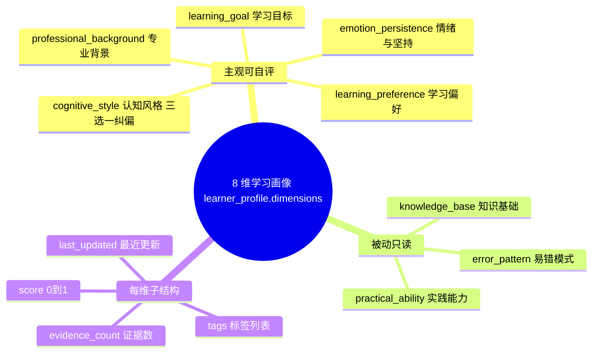
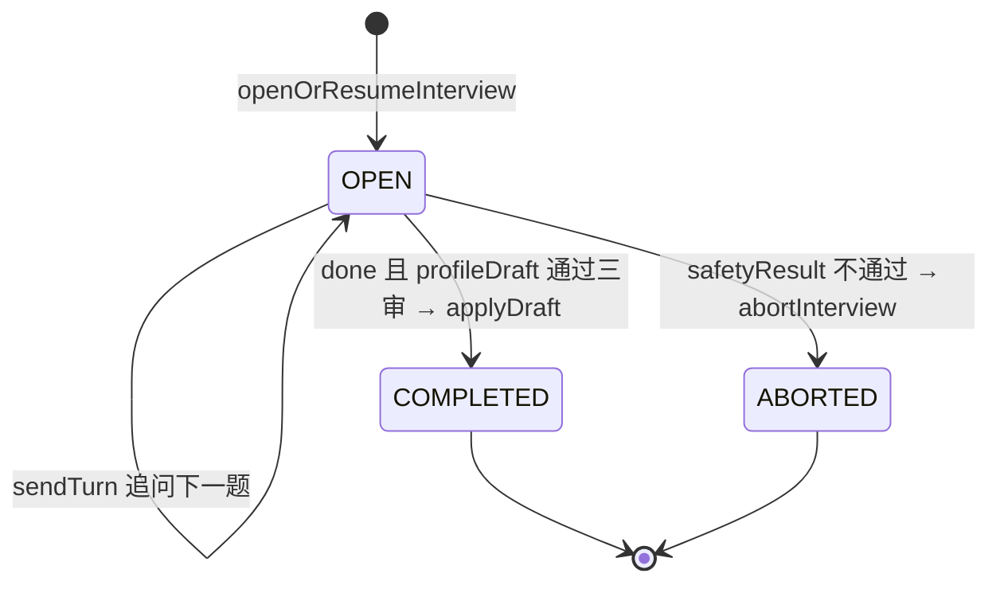
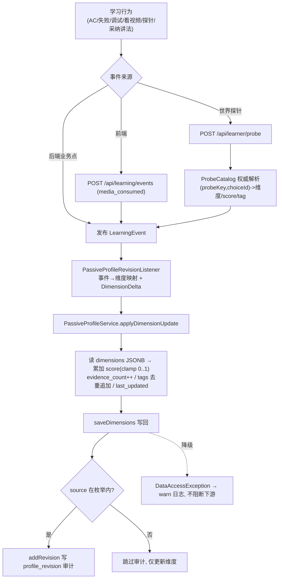
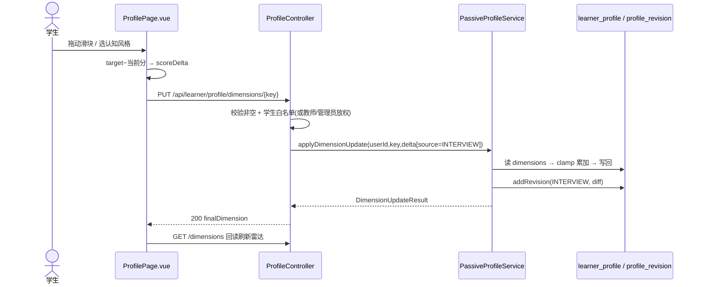
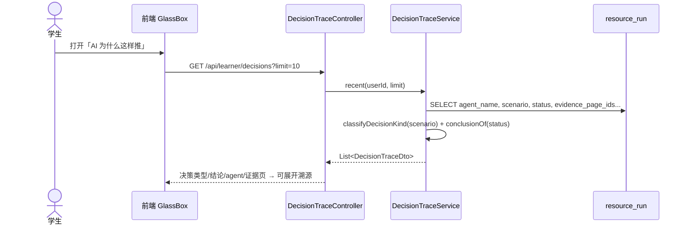
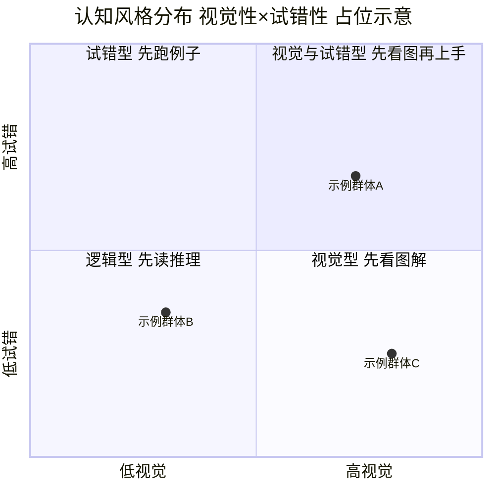

## 8.2 学习画像与个性化引擎 · 详细设计

> filecode：S02 ｜ 模块：M02 学习画像与个性化 ｜ 章节：报告 §8
> 图表编号统一以 `S02-` 前缀；数据表只引用表名并指向「详见 §6 数据库设计」，不展开字段字典。
> 本节按六要素组织：① 模块职责与边界 → ② 总体结构与组件 → ③ 数据结构与存储 → ④ 处理流程与关键算法 → ⑤ 接口设计 → ⑥ 异常处理与降级。

### 8.2.1 要素一：模块职责与边界

M02 负责「认识这名学生、并据此个性化」。职责包括：(1) 维护 8 维学习画像统一聚合 `learner_profile.dimensions`；(2) 入学访谈冷启动画像（`ProfileAgent` 经 `pythontopia-graph` 结构化抽取）；(3) 被动演化——把真实学习行为映射为维度增量并留审计；(4) 派生掌握度（`kc_mastery`）、个性化推送（`LearnerRecommendationService`）、风险预言（`OracleService`）、数字孪生周报（`WeeklyReportService`）与决策玻璃盒（`DecisionTraceService`）。边界之外：判题本身属 M09、资源生成属 M08、班级热力图属 M13，本模块只**消费**这些产物的事件信号或**提供**画像底座，不重复实现。设计目标对齐总纲红线：一切更新可溯源、信号不足不贴标签、缺数据降级不阻塞。

本模块对学生最直观的载体是 `/profile` 画像页（8 维画像雷达 + 8 张维度卡 + 主观维度自评 / 认知风格纠偏入口；像素「画像房」另见 `/profile-room`），主界面见下方截图占位。

> 【截图占位 SC-S02-2】
> - 访问：http://localhost:5173/profile （容器态 http://localhost:8080/profile）
> - 登录角色：学生
> - 操作步骤：1. 学生登录 → 顶栏「我的画像」进入 `/profile`；2. 等待左侧「8 维画像雷达」与右侧 8 张维度卡加载；3. 在「认知风格」卡用三选一（先看图解 / 先读推理 / 先跑例子）纠偏。
> - 截取对象：`/profile` 画像页整页（左：8 维画像雷达 + 主观维度自评滑块；右：专业背景 / 知识基础 /…/ 情绪与坚持 8 张维度卡 + 认知风格三选一 + 综合总结）
> - 期望画面：雷达呈 8 轴形状；右侧 8 张维度卡显示各维当前值；认知风格卡含 3 个可点选项且当前主导风格高亮。

### 8.2.2 要素二：总体结构与组件

后端按子域分包：`profile`（访谈 + 8 维直写/被动）、`event`（领域事件 + 前端事件落库）、`probe`（世界探针权威目录）、`mastery`（KC 掌握度权威写入）、`recommendation`（今日推送）、`oracle`（风险预言 + 预防包）、`twin`（周报）、`memory`（记忆流检索）、`decision`（玻璃盒）。核心写入方 `PassiveProfileService` 被 `ProfileController`（自评/直写）与 `PassiveProfileRevisionListener`（事件回流）共用，保证「读改写 + clamp + 审计」单点实现。

**图 S02-1　8 维学习画像构成（mindmap）**



**图 S02-2　画像访谈会话状态（stateDiagram-v2）**



**图 S02-7　被动回流 + 自评直写 通信图（协作图）**

下图以协作图视角展示「事件回流」与「学生自评」两条写入链路如何在 `PassiveProfileService.applyDimensionUpdate` 单点汇聚（无生命线，强调对象间链接拓扑）：前端多模态消费经 `LearningEventController` 审计落库并 `publishEvent(MediaConsumed)`，其余练习 / 调试 / 逆袭等领域事件由后端真实业务点直接 `publishEvent`；二者经 `PassiveProfileRevisionListener` 落到同一服务方法，与旁挂的 `ProfileController.selfUpdate`（PUT 自评，消息 5'）共享「读 JSONB → clamp 累加 → 写回 → 审计」实现。

```mermaid
flowchart LR
  FE["对象: 前端 ProfilePage / 学习页"]
  LEC["对象: LearningEventController"]
  LELR["对象: LearningEventLogRepository"]
  BIZ["对象: 后端业务点 (Submission / BugMine / Tutor...)"]
  EVT(("LearningEvent 进程内领域事件"))
  LIS["对象: PassiveProfileRevisionListener"]
  PPS["对象: PassiveProfileService"]
  PC["对象: ProfileController"]
  REPO["对象: ProfileRepository"]
  DB[("learner_profile.dimensions / profile_revision")]

  FE -->|"1: POST /api/learning/events (media_consumed)"| LEC
  LEC -->|"2: insert() 审计落库"| LELR
  LEC -->|"3: publishEvent(MediaConsumed)"| EVT
  BIZ -->|"3': publishEvent(PracticeSucceeded/Failed/DebugResolved/Comeback...)"| EVT
  EVT -->|"4: onXxx(event) @EventListener"| LIS
  LIS -->|"5: applyDimensionUpdate(userId, dimKey, delta)"| PPS
  PC -->|"5': selfUpdate -> applyDimensionUpdate(..., source=INTERVIEW)"| PPS
  PPS -->|"6: findDimensions(userId) 读 dimensions JSONB"| REPO
  REPO -->|"6.1: JsonNode dimensions"| PPS
  PPS -->|"7: saveDimensions(userId, obj) 写回 JSONB"| REPO
  PPS -->|"8: addRevision(source, diff) 审计"| REPO
  REPO -->|"9: UPDATE learner_profile / INSERT profile_revision"| DB
```



> 与图 S02-4（时序图）互补：协作图不画生命线与时间轴，而是凸显对象链接与消息序号，直观体现「被动回流(5) / 自评直写(5')」两入口在 `applyDimensionUpdate` 的汇聚拓扑，以及 `LearningEventController` 把「审计落库(2)」与「领域事件发布(3)」一分为二的设计。

### 8.2.3 要素三：数据结构与存储

- 画像主表 `learner_profile`：在 V012 的逐维列基础上，V111 追加统一聚合列 `dimensions JSONB`（GIN 索引 `ix_learner_profile_dimensions_gin`），作为被动演化的唯一真源；旧逐维列保留给访谈 upsert。每个维度子对象形如 `{score, evidence_count, tags[], last_updated, ...metadata}`。
- 审计 `profile_revision`：每次更新追加一行 `(source, diff)`，`source` 受 CHECK 约束（V136 放宽至含 `PRACTICE_PASS/PRACTICE_FAIL/DEBUG_FIX/REFLECTION` 等）。
- 访谈 `profile_interview`：`status ∈ {OPEN, COMPLETED, ABORTED}`。
- 掌握度 `kc_mastery` / 事件 `kc_mastery_event`：`mastery_score`、`confidence` 均 NUMERIC(4,3)，`UNIQUE(user_id, kc_code)`。
- 事件流 `learning_event_log`（V121，V134 加 `importance` 1–5）、洞察 `learner_insight`（V136，强制 `evidence_event_ids`）。
- 以上各表完整字段字典详见 §6（数据字典分片 D1）。

### 8.2.4 要素四：处理流程与关键算法

**被动演化主流程**：领域事件 → 监听器选维度与增量 → service 局部读改写 → 落库 + 审计。

**图 S02-3　LearningEvent → 被动画像演化（flowchart）**



事件→维度映射（节选，步长为经验常量）：`PracticeSucceeded→practical_ability +0.02`、`PracticeFailed→error_pattern +0.02`（tag=failureKind）、`DebugResolved→error_pattern −0.02`、`ResourceConsumed→knowledge_base +0.005`、`MediaConsumed→learning_preference +0.01`（tag=mediaType）、`TutorStyleEngaged→cognitive_style +0.01`（tag=style）、`PracticeRetried→emotion_persistence +0.02`、`PracticeAbandoned→emotion_persistence −0.03`、`ComebackSolved→emotion_persistence +0.04`。

**关键派生算法**：① 置信度 `confidence = min(1, evidence_count / 8)`；② 读时半衰期衰减——`effectiveScore = 0.5 + (score − 0.5) × 0.5^(Δdays/14)`，raw 分不回写；③ `profile_brief` 注入门槛：常规维 `confidence ≥ 0.3`、情绪维 `≥ 0.25`，每维取最近 ≤3 个 tag；④ 认知风格自评把所选 tag 移到数组末尾，使「纠偏覆盖旧推断」（下游取末尾 tag）。掌握度由 `MasteryEvaluator` 权威写入：难题通过增益 ×1.5、易题失败惩罚 ÷0.7，失败/挫折（负 delta）时 confidence 下降，`DECAY` 按半衰期回落，前端不得本地计算掌握度。

**自评写入时序**：

**图 S02-4　学生自评维度写入（sequenceDiagram）**



**决策玻璃盒读取时序**：把 `resource_run` 归一为可解释的决策卡。

**图 S02-5　决策玻璃盒读取（sequenceDiagram）**



**认知风格分布**（用于群体洞察/教师视角，运行期由后端聚合，设计阶段占位）：

**图 S02-6　认知风格分布（quadrantChart，占位示意）**



> 【截图占位 SC-S02-1】
> - 访问：http://localhost:5173/profile （容器态 http://localhost:8080/profile）
> - 登录角色：学生
> - 操作步骤：1. 登录 → 进入 `/profile`；2. 等待雷达加载；3. 拖动一条主观维度滑块并保存。
> - 截取对象：8 维画像雷达 + 自评滑块区
> - 期望画面：雷达呈 8 轴形状，主观维度可滑动并提示「已更新」。

### 8.2.5 要素五：接口设计

| 方法 / 路径 | 控制器 | 说明 |
| --- | --- | --- |
| `GET /api/learner/profile` | ProfileController | 结构化画像；无则 204 |
| `GET /api/learner/profile/dimensions` | ProfileController | 8 维快照（雷达数据源） |
| `PUT /api/learner/profile/dimensions/{key}` | ProfileController | 自评/特权直写，返回 `DimensionUpdateResult` |
| `GET /api/learner/profile/revisions?limit` | ProfileController | 画像修订审计 |
| `POST /api/learner/profile/interview`、`/{id}/turn`、`/turn/stream`、`/finish` | ProfileInterviewController | 访谈开/续、单轮、SSE 流、收尾 |
| `POST /api/learner/probe` | ProbeController | 世界探针上报（204；非法 400 `PROBE_INVALID`） |
| `POST /api/learning/events`、`/batch`、`GET` | LearningEventController | 前端事件落库（仅学生） |
| `GET /api/learner/mastery` | MasteryController | KC 掌握度快照 |
| `GET /api/learner/decisions?limit` | DecisionTraceController | 决策玻璃盒 |
| `GET /api/learner/insights?limit` | InsightController | 学情洞察（可溯源） |
| `GET /api/learner/oracle/risk`、`GET /api/learner/twin/weekly`、`GET /api/learner/world-state` | Oracle/Twin/WorldState | 风险预言 / 周报 / 小镇心情 |

请求/响应 DTO（`ProfileDimensionDto`、`SelfDimensionRequest`、`DimensionDelta`、`DimensionUpdateResult`、`DecisionTraceDto`、`MasterySnapshotDto`、`LearnerInsightDto` 等）取自真实代码；个性化指令由 `pythontopia-graph` 的 `resource_personalization_directive` 据认知风格（visual/logical/trial）+ 易错点 + 最新洞察 + 记忆要点折叠为单条 system 提示，注入「学」阶段 6 个资源 Agent。

**接口背后的关键处理逻辑（被动演化 PDL + 自评写入 NS 盒图）**

上表两个写入型端点——`POST /api/learning/events`（多模态消费触发被动回流）与 `PUT /api/learner/profile/dimensions/{key}`（学生 / 教师自评直写）——最终都落到 `PassiveProfileService.applyDimensionUpdate` 的同一套「读 JSONB → 应用 delta → clamp → 写回 → 审计」实现。下文以 PDL 描述被动演化算法、以 NS 盒图描述自评写入分支。

**PDL S02-1　画像维度被动演化（按事件类型加权 → clamp[0,1] 写回 JSONB → 读时半衰期衰减）**

```text
PROCEDURE evolveProfileOnEvent(event)      // 被动演化：领域事件 → 维度增量 → 写回 dimensions JSONB
  INPUT : event  // PracticeSucceeded/PracticeFailed/DebugResolved/MediaConsumed/TutorStyleEngaged/
                 // ProbeChoiceMade/PracticeRetried/PracticeAbandoned/ComebackSolved/TaughtAi*
  OUTPUT: 更新后的 dimension 子对象 | 降级(无写入)

  // (1) 按事件类型加权：PassiveProfileRevisionListener 选定 目标维度 dimKey、经验步长 scoreDelta(权重)、tag、source
  (dimKey, delta) <- mapEventToDimension(event)
  //   PracticeSucceeded -> (practical_ability,  +0.02, src=PRACTICE_PASS)
  //   PracticeFailed    -> (error_pattern,       +0.02, tag=failureKind, src=PRACTICE_FAIL)
  //   DebugResolved     -> (error_pattern,       -0.02, src=DEBUG_FIX)
  //   MediaConsumed     -> (learning_preference, +0.01, tag=mediaType,  src=RESOURCE_FEEDBACK)
  //   TutorStyleEngaged -> (cognitive_style,     +0.01, tag=style)
  //   ProbeChoiceMade   -> ProbeCatalog.lookup(probeKey, choiceId) 权威解析出 (dimKey, delta, tag)
  //   PracticeAbandoned -> (emotion_persistence, -0.03);  ComebackSolved -> (emotion_persistence, +0.04)
  IF dimKey IS NULL THEN RETURN             // 如探针 choiceId 不在目录：跳过(防伪造信号)

  TRY                                        // safeApply：降级边界
    // (2) 局部读改写（applyDimensionUpdate，@Transactional）
    IF dimKey NOT IN DIMENSION_KEYS THEN RAISE BusinessException(PROFILE_DIMENSION_INVALID) ENDIF
    dims <- ProfileRepository.findDimensions(userId)        // 读 learner_profile.dimensions JSONB
    IF dims IS EMPTY THEN dims <- {} ENDIF
    d <- dims[dimKey]  OR  {}
    IF delta.scoreDelta != NULL THEN
        d.score <- CLAMP(COALESCE(d.score, 0.5) + delta.scoreDelta, 0.0, 1.0)   // 裁剪到 [0,1]
    ENDIF
    IF delta.evidenceIncrement != NULL THEN
        d.evidence_count <- d.evidence_count + delta.evidenceIncrement
    ENDIF
    FOR EACH tag IN delta.tagsAdd DO
        IF delta.source = "INTERVIEW" AND tag 已存在 THEN 移到 tags 末尾   // 自评纠偏 = 主导信号
        ELSE IF tag 不存在 THEN 追加到 tags
        ENDIF
    ENDFOR
    d.last_updated <- now()
    dims[dimKey] <- d
    ProfileRepository.saveDimensions(userId, dims)          // 写回 8 维 JSONB
    // (3) 审计：source 在 profile_revision 枚举内才写
    IF delta.source IN ALLOWED_REVISION_SOURCES THEN
        ProfileRepository.addRevision(userId, delta.source, diff)
    ELSE log.warn("skip revision: non-enum source") ENDIF
    RETURN d
  CATCH DataAccessException | RuntimeException
    log.warn("degrade")                      // dimensions 列缺失等 → 仅告警，不阻断 mastery / 复习态
    RETURN
  ENDTRY
END

PROCEDURE effectiveDimension(dimKey)         // 读时派生（getDimensions）：时间衰减 + 置信度，raw 不回写
  raw <- dims[dimKey].score            OR 0.5
  ec  <- dims[dimKey].evidence_count   OR 0
  confidence <- MIN(1.0, ec / 8)                             // EVIDENCE_SATURATION = 8
  IF last_updated 可解析 AND Δdays > 0 THEN
      factor    <- 0.5 ^ (Δdays / 14)                        // DECAY_HALF_LIFE_DAYS = 14
      effective <- 0.5 + (raw - 0.5) * factor                // 久未更新 → 向中性 0.5 回归
  ELSE
      effective <- raw
  ENDIF
  RETURN { score: effective, confidence }
END
```

**图 S02-8　NS 盒图（4 维主观自评 PUT /dimensions/{key} 写入分支）**

学生侧可直写的主观维度共 5 个 key：`professional_background / learning_goal / learning_preference / emotion_persistence`（画像房滑块「4 维自评」）与 `cognitive_style`（三选一纠偏）；教师 / 管理员对**自身**画像放权全部 8 维。盒图描述该 PUT 端点「校验 → 合并」全过程（key 合法性、取值范围、与被动维度合并策略）：

<table border="1" cellspacing="0" cellpadding="6" style="border-collapse:collapse;text-align:center;width:100%">
  <tr><td colspan="2">入参：dimensionKey、SelfDimensionRequest{scoreDelta∈[-1,1]、evidenceIncrement、tagsAdd(≤16,每≤64)、metadata}、调用者 role（@Valid 先校验取值范围）</td></tr>
  <tr><td colspan="2"><b>分支①</b> request.isEmpty()？（无任何有效字段）</td></tr>
  <tr>
    <td style="width:50%">T：抛 400 PROFILE_DELTA_EMPTY</td>
    <td style="width:50%">F：继续 ↓</td>
  </tr>
  <tr><td colspan="2"><b>分支②</b> role ∈ {TEACHER, ADMIN}（privileged）？</td></tr>
  <tr>
    <td>T：放权——可直写自身全部 8 维</td>
    <td>
      F（STUDENT）：
      <table border="1" cellspacing="0" cellpadding="4" style="border-collapse:collapse;width:100%">
        <tr><td colspan="2"><b>分支②.1</b> isSelfEditable(key)？（key ∈ 5 个主观维度）</td></tr>
        <tr><td style="width:50%">T：允许</td><td style="width:50%">F：抛 403 PROFILE_DIMENSION_NOT_SELF_EDITABLE</td></tr>
      </table>
    </td>
  </tr>
  <tr><td colspan="2">applyDimensionUpdate(userId, key, delta[source="INTERVIEW"])</td></tr>
  <tr><td colspan="2"><b>分支③</b> key ∈ DIMENSION_KEYS（8 维白名单）？</td></tr>
  <tr>
    <td>T：继续 ↓</td>
    <td>F：抛 400 PROFILE_DIMENSION_INVALID</td>
  </tr>
  <tr><td colspan="2">读 learner_profile.dimensions JSONB → d ← dims[key] 或 {}</td></tr>
  <tr><td colspan="2">合并 score ← CLAMP(d.score(默认0.5) + scoreDelta, 0, 1)（与被动维度同字段、同 clamp 规则）</td></tr>
  <tr><td colspan="2"><b>分支④</b> source = "INTERVIEW"（自评恒为 T；被动累积走 F）？</td></tr>
  <tr>
    <td>T：所选 tag 移到 tags 末尾（纠偏覆盖旧推断，下游取末尾 tag）</td>
    <td>F：首见去重追加（被动累积，不扰动既有排序）</td>
  </tr>
  <tr><td colspan="2">evidence_count += evidenceIncrement（非空才累加）；last_updated ← now()</td></tr>
  <tr><td colspan="2">saveDimensions 写回同一 JSONB；addRevision("INTERVIEW", diff) 审计</td></tr>
  <tr><td colspan="2">返回 DimensionUpdateResult(userId, key, finalDimension)</td></tr>
</table>

### 8.2.6 要素六：异常处理与降级

- 被动更新：`PassiveProfileRevisionListener.safeApply` 捕获 `DataAccessException`（如 `dimensions` 列缺失）与其它 `RuntimeException`，仅记 warn，不阻断掌握度/复习态等链路。
- 非法 source：不在 `profile_revision` 枚举时跳过审计、仍更新维度（避免约束冲突丢失信号）。
- 访谈三审：`safetyResult` 不过判 FAILED 并 `abortInterview`；`groundingResult` 不过判 PARTIAL；ProfileAgent 不可达返回 502 `PROFILE_AGENT_UNAVAILABLE`；SSE 失败回退非流式。
- 冷启动/无信号：`getDimensions` 缺维度按 0.5 兜底（恒返 8 维）；推荐无薄弱 KC 时走 `buildColdStartRecommendations`；`world-state` 降级晴天；`profileBrief` 异常返回空串。
- 防幻觉：洞察必须带 `evidence_event_ids`，决策结论由 run 状态映射（SUCCESS→已完成并通过审查 / FAILED→已拦截）而非自由生成。

---

执笔人：成员 A ｜ 完成人（签名）：成员 A ｜ 审查人：成员 C ｜ 完成日期：2026-06-16
