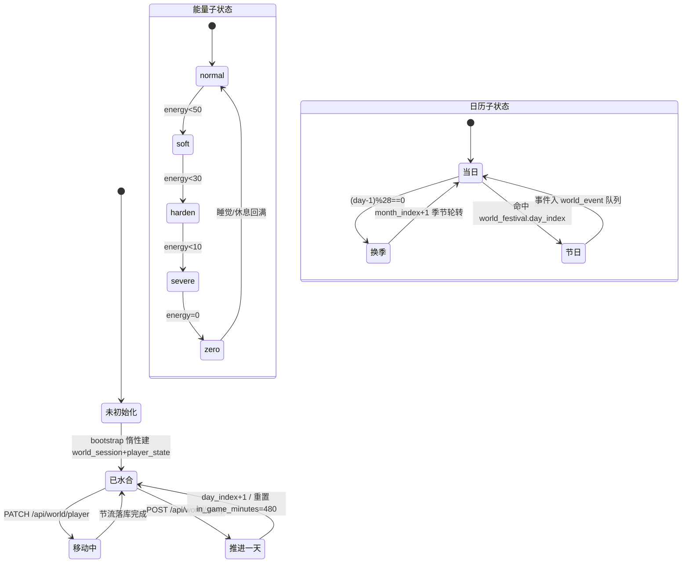
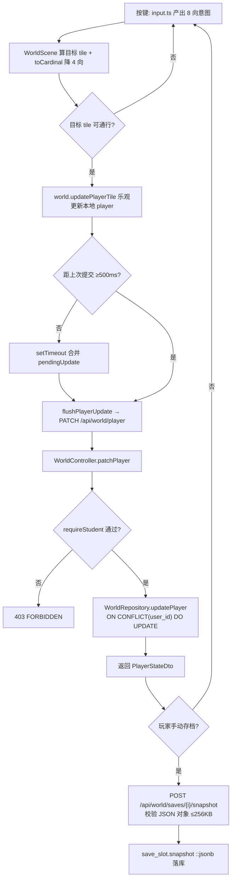
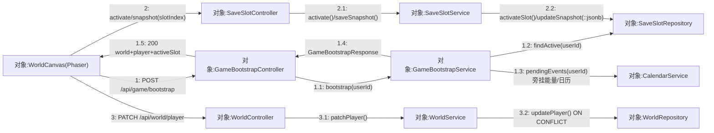
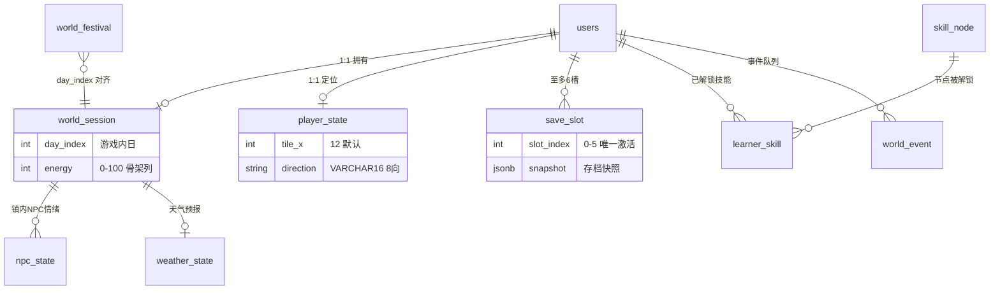
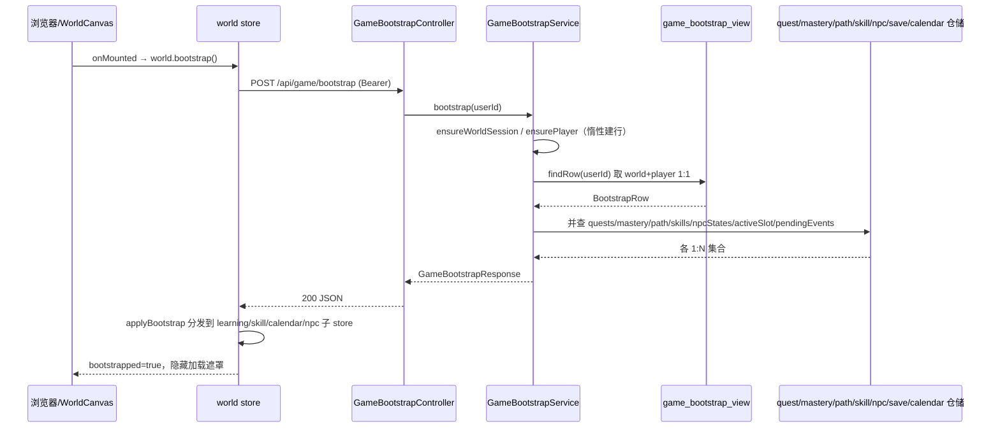

## 8.3 中央小镇世界与存档 · 详细设计

本章按「职责边界 → 处理流程 → 数据结构 → 接口设计 → 关键算法 → 异常与边界」六个要素，给出 M03 在 Pythontopia 真实代码中的详细设计。M03 把「单一中央小镇 `town_hub`（R-14 收缩）+ 世界时钟 + 玩家定位 + 存档/技能/日历」收敛成一组围绕 `com.pythontopia.world` 包的薄端点 + JDBC 仓储，前端以唯一 `Phaser.Game` 实例渲染、Pinia 分域托管状态。

### 8.3.1 要素一：模块职责与边界

M03 只负责「世界容器」与「持久化进度」，不承载学习内容本身（看/学/练/测分别归 M05–M09）。职责清单：(1) 进入小镇的聚合水合（`GameBootstrapService`）；(2) 世界时钟推进（`WorldAdvanceService.sleep`）；(3) 玩家会话与移动（`WorldService`）；(4) 存档槽生命周期（`SaveSlotService`）；(5) 技能树查询/解锁（`SkillService`）；(6) 日历只读与事件处理（`CalendarService`）。边界约束：`requireStudent` 只放行 `STUDENT/ADMIN`；快速旅行的后端 `FastTravelService` 仅为纯校验工具（无 Controller，`fast_travel_route` 已被 V131/V154 清空），现网快速旅行为前端静态实现；能量为前端 `energyTuning.config.ts` 权威、后端 `world_session` 仅存列骨架。

M03 的对外形态是「唯一 `Phaser.Game` 画布 + Vue HUD 覆盖层」的 `WorldPage`（路由 `/world`），所有学习入口与 NPC 收敛进单一中央小镇 `town_hub`（R-14 收缩），其主界面如 SC-S03-1。

> 【截图占位 SC-S03-1】
> - 访问：http://localhost:5173/world（容器态 http://localhost:8080/world）
> - 登录角色：学生
> - 操作步骤：1. 学生登录后由首页进入小镇，路由跳转 `/world`；2. 等待 `WorldCanvas` 调 `world.bootstrap()` 完成水合（`bootstrapped=true`，加载遮罩消失）；3. 角色立于 `town_hub` 出生点，顶/底 HUD 完整渲染。
> - 截取对象：`WorldCanvas` 的 Phaser 世界画布（`town_hub`）+ 顶部 HUD（天/季节/天气/能量）+ 底部快捷栏（任务/对话/地图/技能 四 `HudQuickSlot`）。
> - 期望画面：单一中央小镇地图居中铺满，学生像素角色立于出生点；顶部状态条显示「第 N 天 / 季节 / 天气 / 能量 0–100」，底部四个快捷槽可见且可点。

### 8.3.2 要素二：处理流程与控制逻辑

**世界会话生命周期**横跨「未建行 → 已水合 → 推进中」三态，能量与日历是其内部并行子状态。

#### 图 S03-1 世界会话 / 能量 / 日历推进状态机（stateDiagram-v2）



**移动→服务端校验→存档**是镇内最高频的写链路，强调乐观更新 + 节流 + UPSERT。

#### 图 S03-2 移动到服务端校验再到存档（flowchart）



进入小镇、移动落库与存档读写横跨多组对象。下面的通信图（协作图）与 图 S03-4 时序图互补：时序图强调消息的时间先后，协作图则去掉生命线、突出**对象间的链接拓扑**——可见 `SaveSlotRepository` 同时被聚合水合链路（`GameBootstrapService.findActive`）与存档读写链路（`SaveSlotService`）复用，`CalendarService` 作为日历/能量旁挂分支接在水合主链上。

#### 图 S03-5 进入小镇·存档读写·移动落库 通信图（协作图）



> 链路读法：消息 `1.x` 是登录水合（`GameBootstrapService` 单事务并查 `findActive` + `pendingEvents` 等 1:N 集合）；`2.x` 是存档槽生命周期（建/激活/写快照，经 `SaveSlotController→SaveSlotService→SaveSlotRepository`，激活在事务内先清零其余槽）；`3.x` 是高频移动节流落库（`WorldService.patchPlayer` → `WorldRepository` 的 `ON CONFLICT(user_id) DO UPDATE`）。

### 8.3.3 要素三：数据结构与持久化

M03 子域围绕 `users` 一对一/一对多展开。`game_bootstrap_view` 把 `world_session`+`player_state`+`learner_profile` 的 1:1 切片合并成单次查询；1:N 集合（技能、NPC、存档、事件）由服务层分别查。各表完整字段字典见 §6 / D1，此处只画关系，不重复列字段。

#### 图 S03-3 world 子域实体关系（erDiagram）



> 关键不变量：(1) `world_session.user_id`/`player_state.user_id` 唯一（1:1）；(2) `uq_save_slot_active` 分区唯一索引保证每用户仅一行 `is_active=true`；(3) `learner_skill` 以 `uq_learner_skill(user_id, skill_key)` 防重复解锁；(4) `world_event` 部分索引 `WHERE is_processed=false` 加速待处理队列查询。

### 8.3.4 要素四：接口设计

#### 表 S03-1 REST 端点（取自真实 controller）

| 方法·路径 | 控制器 | 入参 | 出参 | 关键约束 |
| --- | --- | --- | --- | --- |
| POST `/api/game/bootstrap` | GameBootstrapController | （JWT 主体） | GameBootstrapResponse | 单事务惰性建行 |
| POST `/api/world/sleep` | WorldAdvanceController | （JWT 主体） | WorldAdvanceResponse | 会话缺失抛 409 |
| GET `/api/world/session` | WorldController | （JWT 主体） | WorldSessionDto | requireStudent |
| PATCH `/api/world/player` | WorldController | PlayerStatePatch | PlayerStateDto | direction @Pattern 8 向 |
| GET `/api/world/saves` | SaveSlotController | （JWT 主体） | List&lt;SaveSlotDto&gt; | — |
| POST `/api/world/saves/{i}` | SaveSlotController | SaveSlotCreateRequest | SaveSlotDto | i∈[0,5] |
| POST `/api/world/saves/{i}/activate` | SaveSlotController | — | SaveSlotDto | 唯一激活槽 |
| POST `/api/world/saves/{i}/snapshot` | SaveSlotController | String(JSON) | SaveSlotDto | ≤256KB 且为对象 |
| GET `/api/world/skills` | SkillController | （JWT 主体） | SkillsResponse | nodes+unlocked |
| POST `/api/world/skills/{key}/unlock` | SkillController | — | LearnerSkillDto | 404/409 |
| GET `/api/world/calendar/today` | CalendarController | （JWT 主体） | CalendarTodayResponse | 会话缺失抛 409 |
| GET `/api/world/calendar/events` | CalendarController | （JWT 主体） | List&lt;WorldEventDto&gt; | 仅未处理 |
| POST `/api/world/calendar/events/{id}/process` | CalendarController | — | WorldEventDto | 标记已处理 |

前端 adapter 隔离：业务层禁止直接 `import phaser`，统一经 `game/adapters/phaserGame.ts` 单例（`createPhaserGame`/`getPhaserGame`/`pause`/`resume`/`destroy`），输入经 `game/adapters/input.ts`（`ExtendedDirection`/`Direction8` + `toServerDirection` 四向降级 + `gamepad>keyboard>touch` 组合 adapter），API 经 `api/world.ts`、`api/game.ts`、`api/saveSlot.ts`、`api/worldSkill.ts`、`api/worldCalendar.ts`。

#### 图 S03-4 进入小镇 bootstrap 加载（sequenceDiagram）



### 8.3.5 要素五：关键算法与规则

- **季节/星期轮转**（`CalendarMath`）：`sleep` 时 `nextWeekday` 以 7 元素环推进；`advanceSeason` 每 28 个游戏内日换季（spring→summer→autumn→winter），换季时 `month_index+1`（>12 回绕 1）。
- **能量曲线**（`energyTuning.config.ts`）：`applyDelta` 把任意 delta 取整并 clamp 到 [0,100]；walk −2/30s、run −5/30s、提交判题 −8、读课件 −2/页；`getStateForEnergy` 五档、`getPyodideMultiplierByEnergy`（<30→1.5、<50→1.3）、`getMovementSpeedMultiplier`（<10→0.7）驱动功能性递降；过劳阈值 warn=120/capDown=240/forceQuit=360 真实分钟。
- **技能解锁条件求值**（`SkillService.evaluate`）：递归解释 `unlock_condition` JSONB——`KC_MASTERY` 比较 `kc_mastery≥min`、`ALL`/`ANY` 组合子条件、`ANY_TIME`/空恒真；命中才 `INSERT learner_skill`，幂等返回既有行。
- **移动节流**（`world store`）：500ms 窗口合并 `pendingUpdate`，`flushPlayerUpdate` 提交时保留当前 `mapKey`，避免快速旅行换图被服务端旧坐标覆盖。
- **唯一激活槽**：`activate` 在事务内先清零其余槽再置目标槽，配合分区唯一索引兜底并发。

下面用 PDL 与 NS 盒图细化 M03 两段最具结构化特征的过程：存档槽**加载/合并**与能量**结算/跨天重置**。

**PDL S03-1 存档槽加载与合并（多槽位选择 + 版本兼容 + 状态恢复冲突合并）**

```text
PROCEDURE loadAndMergeSave(userId, requestedSlot)        // requestedSlot 可空(0..5)
  INPUT : userId:Long, requestedSlot:Int?
  OUTPUT: GameBootstrapResponse 应用到各子 store | error

  // —— 阶段1：多槽位选择 ——
  slots <- SaveSlotRepository.findAll(userId)            // 按 slot_index 升序，至多 6 槽
  IF requestedSlot IS NOT NULL THEN
      IF NOT contains(slots, requestedSlot) THEN
          RAISE BusinessException(SAVE_SLOT_NOT_FOUND)   // 404
      ENDIF
      active <- SaveSlotService.activate(userId, requestedSlot)  // 事务内清零其余槽 + 置位目标
  ELSE
      active <- SaveSlotRepository.findActive(userId)    // 取唯一 is_active 槽，新号可能为空
  ENDIF

  // —— 阶段2：聚合水合（GameBootstrapService 单事务） ——
  ensureWorldSession(userId); ensurePlayer(userId)       // 惰性建行
  row <- game_bootstrap_view.findRow(userId)             // world+player 1:1 切片
  IF row IS NULL THEN RAISE BOOTSTRAP_VIEW_EMPTY ENDIF   // 500
  skills      <- SkillRepository.findUnlocked(userId)    // learner_skill
  npcStates   <- NpcDialogStateRepository.findAll(userId)
  pendingEvts <- CalendarService.pendingEvents(userId)   // world_event WHERE is_processed=false

  // —— 阶段3：版本兼容（快照 schema 收敛） ——
  IF active IS NOT NULL THEN
      snap <- active.snapshot
      IF snap.has("mainQuest") THEN                      // R-15 旧字段
          DISCARD snap.mainQuest                         // 主线进度改由后端 mainline 权威表，不回灌
      ENDIF
      // inventoryItems / unlockedBuildings 为 V114 NOT NULL 契约列，R-14 收缩后前端不落 store
  ENDIF

  // —— 阶段4：冲突合并（服务端位置/技能/日历优先于槽内旧快照） ——
  store.player   <- row.player                           // player_state 为坐标/朝向权威
  store.skills   <- merge(skillsCatalog, skills)         // 以 learner_skill 已解锁为准
  store.calendar <- (row.world.day/season/weather, pendingEvts)
  IF active IS NOT NULL THEN
      store.sceneName              <- active.sceneName OR "WorldScene"   // syncFromSlot
      store.accumulatedPlaySeconds <- active.accumulatedPlaySeconds
  ELSE
      store.resetSlotState()                             // 回默认 WorldScene / 0 秒
  ENDIF

  RETURN applyBootstrap(world, player, profile, quests, mastery,
                        path, skills, npcStates, active, pendingEvts)
END
```

> 合并冲突的判定原则：凡是「后端有独立权威表」的维度（玩家位置 `player_state`、技能 `learner_skill`、日历 `world_session`/`world_event`、主线 `mainline_*`）一律以服务端最新行覆盖槽内旧快照；只有「纯客户端 RPG 表现」（`sceneName`、`accumulatedPlaySeconds`）才从激活槽回灌（`syncFromSlot`），无激活槽时退回默认（`resetSlotState`）。

能量并非存档槽快照的一部分（`world_session.energy` 仅留列骨架，前端 `energyTuning.config.ts` 权威），其「同日累计消耗 vs 跨天重满」是另一段独立结构化过程，用 NS 盒图刻画如下：

#### 图 S03-6 NS 盒图（能量结算与跨天重置）

<table border="1" cellspacing="0" cellpadding="6" style="border-collapse:collapse;text-align:center;width:100%">
  <tr><td colspan="2">读取 currentDay, savedDay, energy, delta, sleepHour（基线取 DEFAULT_ENERGY_TUNING）</td></tr>
  <tr><td colspan="2">是否跨天？ currentDay &gt; savedDay</td></tr>
  <tr>
    <td style="width:56%;vertical-align:top">
      T：跨天重置（睡觉/换天后重满）
      <table border="1" cellspacing="0" cellpadding="4" style="border-collapse:collapse;width:100%">
        <tr><td colspan="2">健康作息入睡？ 22:00 ≤ sleepHour 或 sleepHour ≤ 01:00</td></tr>
        <tr>
          <td style="width:50%">T：energy ← morningEnergyFull (100)</td>
          <td style="width:50%">F：energy ← morningEnergyShort (80)</td>
        </tr>
      </table>
      savedDay ← currentDay
    </td>
    <td style="width:44%;vertical-align:top">
      F：同日结算<br/>energy ← applyDelta(energy, delta)<br/>（trunc 取整后 clamp 到 [0, maxEnergy=100]）
    </td>
  </tr>
  <tr><td colspan="2">state ← getStateForEnergy(energy)（normal≥50 / soft&lt;50 / harden&lt;30 / severe&lt;10 / zero=0）</td></tr>
  <tr><td colspan="2">HudStore.syncMeta({ energy, dayIndex }) → 刷新 HUD 颜色、Pyodide 倍率、移动速度</td></tr>
</table>

> 盒图要点：外层是「跨天?」单分支，T 侧再嵌「作息是否健康?」内分支决定重满值（100 或 80），与 M01 注册校验那种「单层多条件」盒图结构刻意不同；F 侧的同日结算复用纯函数 `applyDelta`，保证任何 delta（walk −2、submission −8、休息 +30…）都先 `trunc` 再 clamp 进 [0,100]，不会越上限或跌破 0。

### 8.3.6 要素六：异常处理与边界条件

#### 表 S03-2 异常与边界

| 场景 | 处理 | HTTP/错误码 |
| --- | --- | --- |
| 非学生访问世界 | requireStudent 拦截 | 403 FORBIDDEN |
| bootstrap 视图空 | 惰性建行后仍空则抛 | 500 BOOTSTRAP_VIEW_EMPTY |
| sleep/today 时会话缺失 | 校验 world!=null | 409 WORLD_SESSION_MISSING |
| 快照非 JSON 对象 | validateSnapshot | 400 SAVE_SLOT_SNAPSHOT_INVALID |
| 快照超 256KB | 长度阈值 | 413 SAVE_SLOT_SNAPSHOT_TOO_LARGE |
| slotIndex 越界 | @Min0/@Max5 | 400 校验错误 |
| 技能不存在 | findNode 空 | 404 SKILL_NOT_FOUND |
| 技能条件不满足 | evaluate=false | 409 SKILL_LOCKED |
| sleep 时 decay/画像失败 | try-catch 记 warn，不阻断推进 | 200（降级） |

边界与降级：`mastery decay` 与 `emotion_persistence +0.01` 失败仅记日志、不回滚推进事务；天气仅在变化时入 `world_event`；快速旅行后端校验链（路线存在→解锁阶段→花费→低能量锁→每日上限）虽完整，但因路线表空且无 Controller，现网由前端兜底。与其它模块的接口：`sleep` 触发 M02 画像演化与 M05 掌握度衰减；`activeSlot` 的 `sceneName/accumulatedPlaySeconds` 透传给 `WorldScene`，但 R-14 收缩后 `inventoryItems/unlockedBuildings` 仅作后端 NOT NULL 契约字段、前端不再落 store。

---

执笔人：成员 A ｜ 完成人（签名）：成员 A ｜ 审查人：成员 C ｜ 完成日期：2026-06-16
