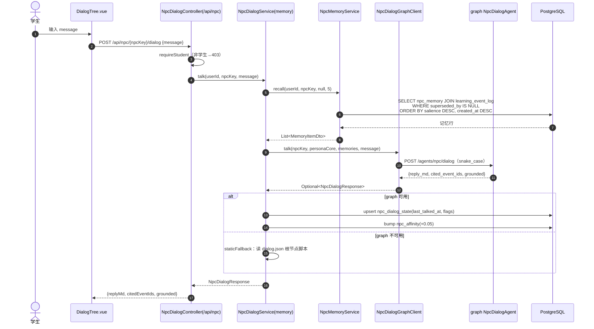
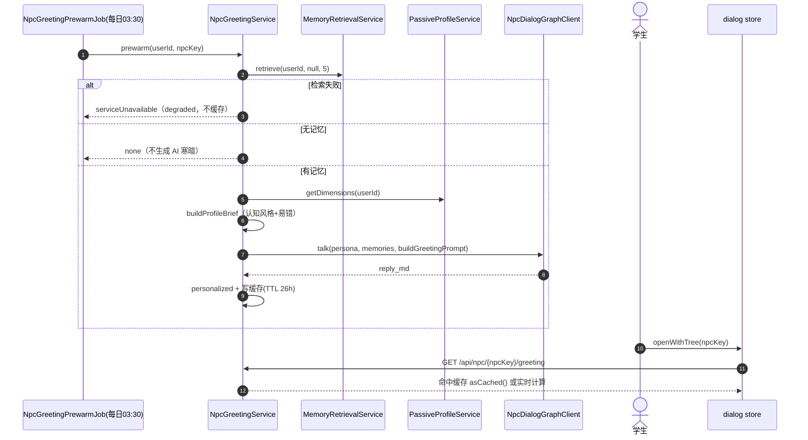
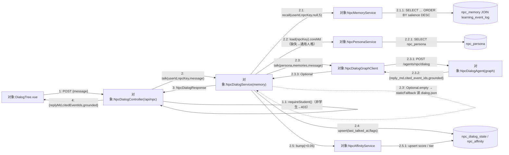
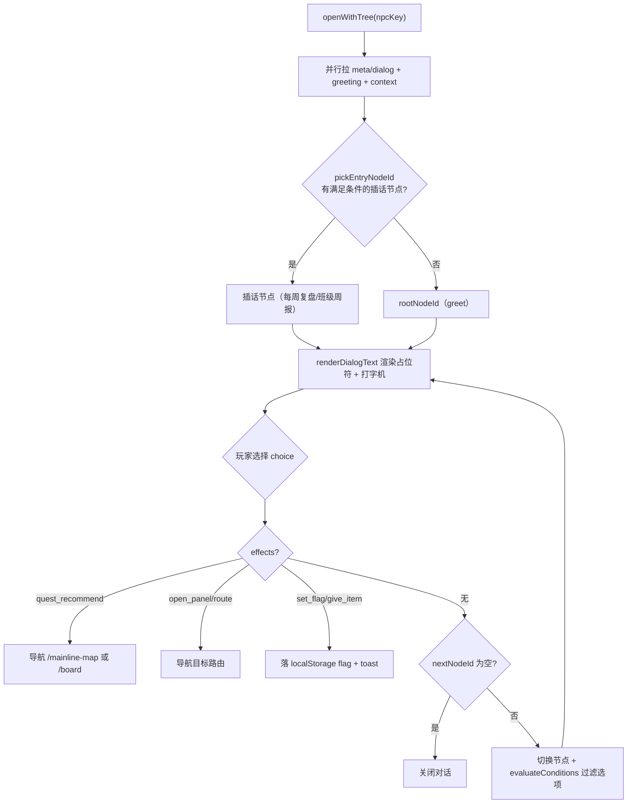
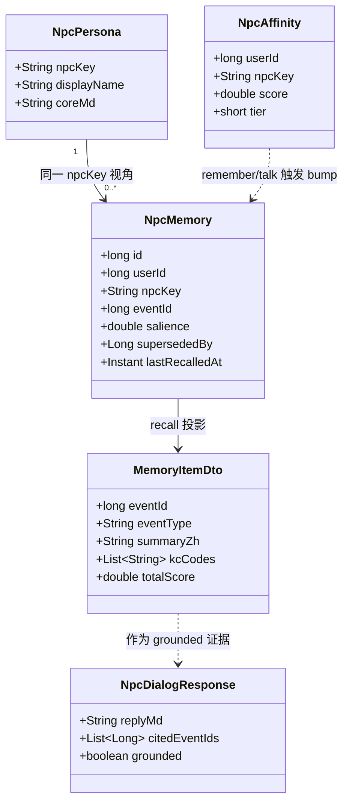
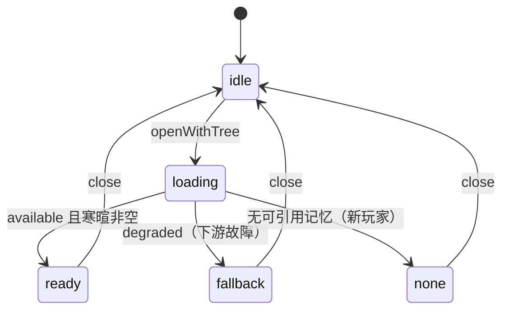

## 8.4 NPC 对话与记忆 · 详细设计

> filecode：**S04**　｜　模块：M04 NPC 对话与记忆　｜　对应 PDF 章：8 详细设计
> 必读代码：`com.pythontopia.npc.*`、`com.pythontopia.dialog.*`、`com.pythontopia.world.npc.*`、graph `agents/npc_dialog_agent.py` 与 `routes/npc_dialog.py`、`frontend/src/stores/dialog.ts`。
> 表只引用，完整字段字典见 §6 数据字典分片 D1（`npc_dialog_state` / `npc_memory` / `npc_persona` / `npc_affinity`）。

本模块详细设计按**六要素**展开：① 模块职责与边界；② 处理流程与时序；③ 接口设计；④ 关键数据结构；⑤ 核心算法与规则；⑥ 异常处理与降级。

### 8.4.1 要素一：模块职责与边界

M04 由三个后端包 + 一个 graph agent + 前端对话域构成，职责严格分离：

> 表 S04-1　M04 组件职责划分

| 组件 | 职责 | 关键类 |
| --- | --- | --- |
| `com.pythontopia.world.npc` | 脚本对话树状态机：节点进度、`completed_node_ids`、`flags` 浅合并、effect 应用 | `NpcDialogController`(`/api/world/npcs`)、`NpcDialogService`、`NpcDialogStateRepository` |
| `com.pythontopia.npc` | 记忆化 AI 对话 + 首句寒暄 + 人格 / 记忆 / 亲和度 | `NpcDialogController`(`memoryNpcDialogController`,`/api/npc`)、`NpcDialogService`(`memoryNpcDialogService`)、`NpcGreetingService`、`NpcMemoryService`、`NpcPersonaService`、`NpcAffinityService`、`NpcDialogGraphClient` |
| `com.pythontopia.dialog` | 对话模板真实数据上下文（`{{stats.*}}` 等占位符填充） | `DialogContextController`、`DialogContextService` |
| graph `pythontopia-graph` | LLM 生成 grounded 回复，防幻觉 + 安全拒答 | `NpcDialogAgent`、`routes/npc_dialog.py` |
| 前端对话域 | 对话面板、寒暄横幅、打字机、分支与 effect 导航 | `DialogTree.vue`、`NpcGreetingBanner.vue`、`CompanionDock.vue`、`stores/dialog.ts` |

> 边界澄清：`/api/npc/**` 与 `/api/world/npcs/**` 是**两套并存**接口，共用 `npc_dialog_state` 表但写入不同列——状态机写 `current_node_id`/`completed_node_ids`，记忆对话写 `last_talked_at`/`flags`，均以 `ON CONFLICT (user_id, npc_key)` 幂等 upsert。记忆流写入（UC-04-02）由 M02 的 `MemoryStreamMirror` 旁路驱动，M04 只消费召回结果。

M04 的设计基调与其它模块不同：寒暄 / 记忆 / 人格全链路一律**安静降级、绝不伪造**——下游不可用时宁可显示「（记忆服务暂不可用）」回落确定式脚本，也不编造「我记得你……」。主界面如下（学生在 `/world` 走到 NPC 触发对话）。

> 【截图占位 SC-S04-1】
> - 访问：http://localhost:5173/world（容器态 http://localhost:8080/world）
> - 登录角色：学生（除 /login 外均需登录）
> - 操作步骤：1. 登录学生账号进入中央小镇 `town_hub`；2. 走到任一 NPC（如 `mayor_py` / `coach_q`）按交互键触发 `dialog store.openWithTree(npcKey)`；3. 等首句寒暄横幅 `NpcGreetingBanner` 渲染后，在输入框发一句自由问答（`POST /api/npc/{npcKey}/dialog`）；4. 观察打字机正文与分支选项
> - 截取对象：`/world` 全屏画布上叠加的 `DialogTree.vue` 对话面板（NPC 立绘 / `NpcGreetingBanner` 寒暄横幅 / 打字机正文 / `branchChoices` 分支按钮）
> - 期望画面：顶部为记忆感知寒暄（或 `fallback` 态「（记忆服务暂不可用）」降级提示），正文为 NPC 口吻回复，底部仅列经 `evaluateConditions` 过滤后的可达分支；全程不出现任何 `{{stats.*}}` 占位符字面量

### 8.4.2 要素二：处理流程与时序

> 图 S04-1　记忆化自由问答时序（对话请求 + 记忆检索 + 生成）



> 图 S04-2　首句寒暄与每日预热时序（缓存 26h）



> 图 S04-6　通信图（协作图）·记忆化自由问答主链路
>
> 与图 S04-1 时序图同源、视角不同：协作图**无生命线**，强调对象间链接拓扑与**带序号消息**（`1` → `2.x` → `3`/`4`）。虚线 `2.3'` 标出 graph 不可达时的**安静降级**回落（`NpcDialogService.staticFallback` 读 `dialog.json` 根节点确定式问候，`grounded=false`、不伪造记忆）；真正的防幻觉约束在 graph 侧——`NpcDialogAgent` 强制 `cited_event_ids ⊆ memories.event_id`。



### 8.4.3 要素三：接口设计

> 路径取自真实 controller 的 `@GetMapping` / `@PostMapping`，不臆测。
>
> 表 S04-2　M04 REST 接口一览

| 方法 / 路径 | 控制器 | 鉴权 | 请求 | 响应 |
| --- | --- | --- | --- | --- |
| `POST /api/npc/{npcKey}/dialog` | `NpcDialogController`(`/api/npc`) | STUDENT | `NpcDialogRequest{message:@NotBlank}` | `NpcDialogResponse{replyMd, citedEventIds, grounded}` |
| `GET /api/npc/{npcKey}/greeting` | `NpcGreetingController` | STUDENT | 路径变量 `npcKey` | `NpcGreetingResponse{greeting, available, grounded, citedEventIds, degraded, cached}` |
| `GET /api/dialog/context` | `DialogContextController` | 登录用户 | — | `DialogContextDto{playerName, profileType, cognitiveStyle, stats}` |
| `GET /api/world/npcs` | `NpcDialogController`(`/api/world/npcs`) | 登录用户 | — | `List<NpcDialogStateDto>` |
| `GET /api/world/npcs/{npcKey}/state` | 同上 | 登录用户 | 路径变量（正则 `[a-z0-9_-]{1,64}`） | `NpcDialogStateDto` |
| `POST /api/world/npcs/{npcKey}/talk` | 同上 | 登录用户 | `NpcTalkRequest{nodeId, nextNodeId, effects[]}` | `NpcDialogStateDto` |

graph 内部契约（后端 → graph，snake_case，详见 `routes/npc_dialog.py`）：

- 入：`POST {graphUrl}/agents/npc/dialog`，`NpcDialogInput{npc_key, persona_core, memories:[{event_id, summary, kc_codes}], user_message, history}`；
- 出：`NpcDialogOutput{reply_md, cited_event_ids, grounded}`；
- 鉴权：复用 `ragAdminToken`（`GraphInternalTokenSupport`，未配 `PYT_RAG_ADMIN_TOKEN` 时不写头）。

`NpcDialogEffectDto.type` 支持 `COMPLETE_NODE`（并入 `completed_node_ids`）与 `SET_FLAG`（写 `flags[key]`），未知类型静默忽略以保持前向兼容。

### 8.4.4 要素四：关键数据结构

> 图 S04-3　对话树 / 分支处理流程（前端 dialog store）



> 图 S04-4　NPC 人格 / 记忆 / 亲和度领域模型（classDiagram）



> 领域对象与数据表对应：`NpcPersona`→`npc_persona`，`NpcMemory`→`npc_memory`，`NpcAffinity`→`npc_affinity`，脚本进度 `NpcDialogState`→`npc_dialog_state`。各表完整字段、PK/FK/索引见 §6 数据字典分片 D1，本节不重复展开。`MemoryItemDto` 额外携带 recency/importance/relevance 分数分解（透明展示「为何被记住」）；NPC 召回路径仅取 `salience`，故 `recall` 中 recency/relevance 置 0。

### 8.4.5 要素五：核心算法与规则

> 图 S04-5　首句寒暄状态机（前端 `GreetingStatus`）



> 表 S04-3　M04 核心算法与业务规则

| 规则 | 设计 |
| --- | --- |
| 记忆召回排序 | `ORDER BY salience DESC, created_at DESC`，过滤 `superseded_by IS NULL`，`LIMIT` 限幅 `1..30`（对话默认取 5） |
| 近重复去重 | 与近 30 条记忆嵌入余弦相似度 `> 0.92`（`NpcMemoryDedup.DEFAULT_THRESHOLD`）即视近重复：不新增，`salience += 0.1` 并刷新 `last_recalled_at` |
| salience 上限 | 插入 `ON CONFLICT` 时 `salience = LEAST(1.0, 现值 + 增量)`，单条不超过 1.0 |
| 亲和度演化 | 每次 `remember` / `talk` 经 `NpcAffinityService.bump(+0.05)`：`score += delta`，`tier = LEAST(4, FLOOR(score))`，`delta` 取 `max(0, ·)` 防回退 |
| 寒暄缓存 | `npc×学生` 维度，TTL 26h，仅缓存「成功寒暄」与「确定无记忆」态；`degraded` 不缓存以便恢复；命中走 `asCached()` 翻 `cached` 标志 |
| 画像 brief | 取 `cognitive_style` 末位 tag（置信度 `≥0.3` 才贴）+ `error_pattern` 最近 ≤3 个 tag，信号不足留空（防幻觉） |
| 防幻觉 | `cited_event_ids` 必须 ⊆ 召回记忆 `event_id`；`grounded = bool(grounded) and bool(cited_event_ids)`；越界 id 一律剔除 |
| 模型分档 | 寒暄 / 对话走 `model_tier="fast"`（如 deepseek-v4-flash）低延迟；其余 agent 用默认档（如 deepseek-v4-pro） |
| 安全拒答 | 用户消息或模型输出命中 `FORBIDDEN_TOKENS`（`answer_key`/`hidden_test`/`完整答案`/`标准答案` 等）→ 返回分层提示拒答 |
| 模板渲染 | `{{playerName}}` / `{{stats.*}}` 直填；`{{profileAdaptive:A|B}}` 由 `profileType`（practical/cautious）二选；`{{styleAdaptive:视|逻|试}}` 由 `cognitiveStyle`（visual/logical/trial/unknown）三选，缺数据回退合理字面值、不泄露占位符 |

记忆→NPC 路由（`MemoryStreamMirror.npcKeyFor`，见 §6/M02 记忆流）：`practice_*`/`guide_*`/`comeback_solved`→`coach_q`；`debug_resolved`→`foreman_bug`；`resource_consumed`/`media_consumed`→`librarian_doc`；`taught_ai_*`→`student_a`；`profile_bootstrapped`→`mayor_py`。

记忆化对话的核心算法是「按 user+npc 取记忆 → persona 注入 → graph 拼装个性化回复 → LLM 失败回落确定式问候」，结构化伪代码如下（此处 fallback 是「确定式问候」而非伪造个性化内容，与寒暄端点 `degraded` 降级互补）。

> PDL S04-1　记忆检索 + 个性化回复拼装（`memoryNpcDialogService.talk`，含 LLM 失败回落确定式问候）

```text
PROCEDURE talk(userId, npcKey, message)
  INPUT : userId:long, npcKey:String, message:String
  OUTPUT: NpcDialogResponse{replyMd, citedEventIds, grounded}

  # 1. 按 user+npc 取该 NPC 视角的长期记忆（salience 优先，过滤已被取代项）
  memories <- NpcMemoryService.recall(userId, npcKey, focusKc=NULL, limit=5)
      # SQL: npc_memory JOIN learning_event_log
      #      WHERE superseded_by IS NULL
      #      ORDER BY salience DESC, created_at DESC
      #      LIMIT clamp(limit, 1, 30)

  # 2. persona 注入；人格缺失安静降级为通用人格，不中断对话
  TRY
      personaCore <- NpcPersonaService.load(npcKey).coreMd
  CATCH RuntimeException
      personaCore <- "- NPC：" + npcKey + "\n- 风格：温和、具体、教育优先。\n"
  ENDTRY

  # 3. 调 graph 个性化拼装；图内强制 cited_event_ids ⊆ memories.event_id（防幻觉）
  reply <- NpcDialogGraphClient.talk(npcKey, personaCore, memories, message)
  IF reply IS EMPTY THEN                        # graph 不可达 / 超时 / 缺 token → Optional.empty
      reply <- staticFallback(npcKey)           # 读 data/npcs/{npcKey}/dialog.json 根节点 greet 文本
      # 文件缺失 / 解析失败 → 确定式问候「我先按旧脚本陪你练…」；grounded=false, citedEventIds=[]
  ENDIF

  # 4. 幂等落状态 + 亲和度累积（旁路，异常吞掉也绝不回退主链路）
  persistDialogState(userId, npcKey, reply)     # ON CONFLICT(user_id,npc_key) upsert last_talked_at, flags
  NpcAffinityService.bump(userId, npcKey, +0.05)  # score += max(0,Δ); tier = LEAST(4, FLOOR(score))
  RETURN reply
END
```

脚本对话树侧的「节点推进」是另一类结构化过程：玩家选定某选项后，先按序应用 effects（可触发任务 / flag），再据 `nextNodeId` 决定推进或终止。其分支与终止结构以 NS 盒图表达（对应前端 `selectChoice`）。

> 图 S04-7　NS 盒图（对话脚本节点推进 · 前端 `selectChoice` 选项分支与终止）

<table border="1" cellspacing="0" cellpadding="6" style="border-collapse:collapse;text-align:center;width:100%">
  <tr><td colspan="4">node ← currentNode；choice ← node.choices[choiceIndex]</td></tr>
  <tr><td colspan="4">node 或 choice 为空？ → return（不推进，防空点击）</td></tr>
  <tr><td colspan="4">routeToNavigate ← null</td></tr>
  <tr><td colspan="4" style="text-align:left">
    <table border="1" cellspacing="0" cellpadding="6" style="border-collapse:collapse;text-align:center;width:100%">
      <tr><td colspan="4">循环：FOR each effect ∈ choice.effects（且 npcKey 存在）</td></tr>
      <tr><td colspan="4">switch(effect.type)</td></tr>
      <tr>
        <td style="width:25%">quest_recommend</td>
        <td style="width:25%">set_flag</td>
        <td style="width:25%">give_item</td>
        <td style="width:25%">route / open_panel</td>
      </tr>
      <tr>
        <td>questKey=claim_class_quest?<br/>T：route=/board?tab=classroom<br/>F：route=/mainline-map<br/>（触发任务）</td>
        <td>setDialogFlag(flagKey)<br/>（落 flag / 解锁后续内容）</td>
        <td>setDialogFlag('item:'+key)<br/>+ toast 反馈</td>
        <td>routeToNavigate ←<br/>route ?? PANEL_ROUTE_MAP[panel]</td>
      </tr>
    </table>
  </td></tr>
  <tr><td colspan="4">routeToNavigate 非空？</td></tr>
  <tr>
    <td colspan="2">T：close() + dispatch 'pythontopia:dialog-navigate' → RETURN（终止·跳面板/任务）</td>
    <td colspan="2">F：进入下一步判定</td>
  </tr>
  <tr><td colspan="4">choice.nextNodeId === null？</td></tr>
  <tr>
    <td colspan="2">T：close()（终止·对话结束）</td>
    <td colspan="2">F：currentNodeId←nextNodeId；history.push；markNodeShown；重置 branchChoices / isTypingDone（推进到下一节点）</td>
  </tr>
</table>

### 8.4.6 要素六：异常处理与降级

> 表 S04-4　M04 失败点与降级策略

| 失败点 | 表现 | 降级策略 |
| --- | --- | --- |
| graph 不可达（自由问答） | `NpcDialogGraphClient.talk` 返回 `Optional.empty` | `staticFallback`：读 `data/npcs/{key}/dialog.json` 根节点文本兜底，`grounded=false` |
| graph 不可达 / 空文本（寒暄） | `compute` 命中空 Optional 或空 `reply_md` | 返回 `serviceUnavailable()`（`degraded=true`），前端横幅「（记忆服务暂不可用）」，照常走脚本 |
| 记忆检索失败 | `MemoryRetrievalService.retrieve` 抛运行时异常 | `serviceUnavailable()` + warn 日志，不写缓存（可恢复） |
| 无可引用记忆 | 记忆为空（新玩家） | `none()`：不寒暄也不报故障，直接脚本 |
| 人格缺失 | `npc_persona` 无该行 | 退化为通用人格 `「- NPC：{key}\n- 风格：温和、具体、教育优先」` |
| 记忆镜像写失败 | 落表 / 嵌入异常（UC-04-02） | 旁路整段吞异常 + warn，绝不影响 mastery / 画像主链路 |
| 画像 brief 失败 | `getDimensions` 抛异常 | brief 退化为空串，不阻断寒暄 |
| `/api/dialog/context` 子聚合缺数据 | 日历 / 班级 / 画像缺失 | 逐字段回退空串或零值，不抛 5xx，不泄露 `{{stats.xxx}}` |
| 前端寒暄请求抖动 | 5xx / 网络错误 | 超时 15s，仅瞬时故障重试 1 次（超时 / 4xx 不重试） |

> 关联表：`npc_dialog_state`（V101）、`npc_memory` / `npc_persona` / `npc_affinity`（V151），字段字典见 §6 D1；记忆流底座 `learning_event_log` / `memory_embedding` 见 §6 / M02。前端随身助教 `CompanionDock` 的答疑提交走 `/api/tutor/ask`（见 M07），本模块仅复用其「洞察气泡 / nudge」承载记忆衍生提示。

---

执笔人：成员 A ｜ 完成人（签名）：成员 A ｜ 审查人：成员 C ｜ 完成日期：2026-06-16
