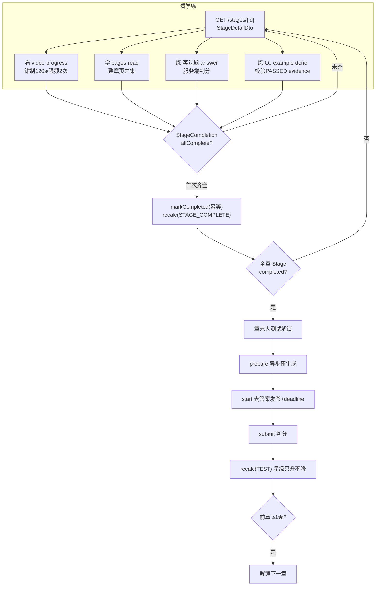
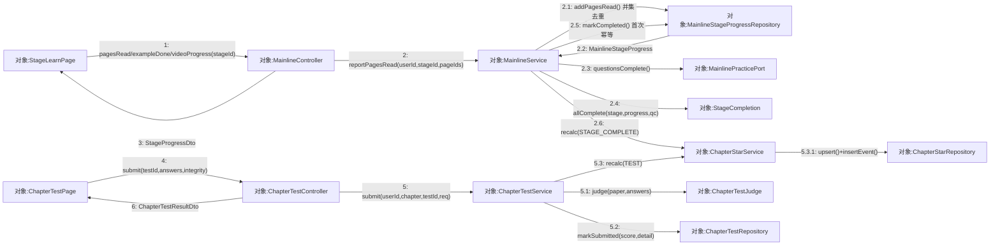
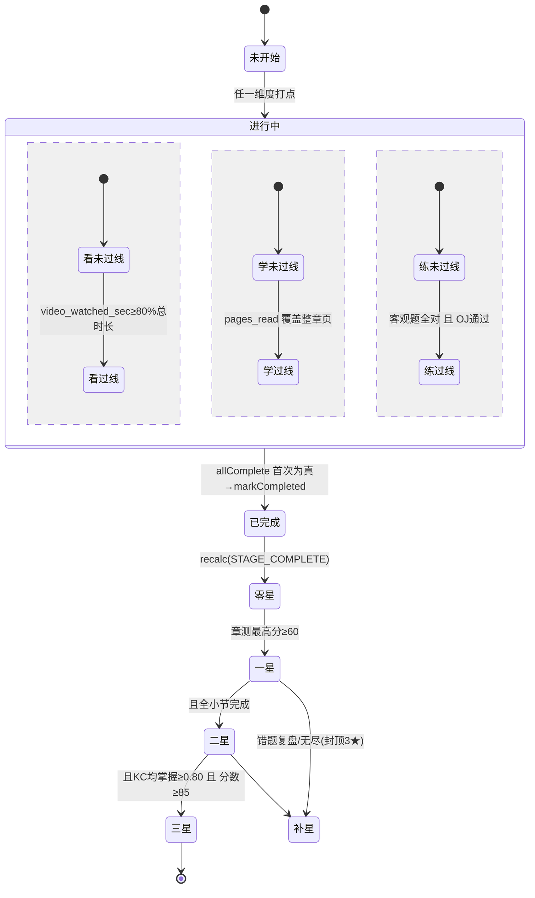
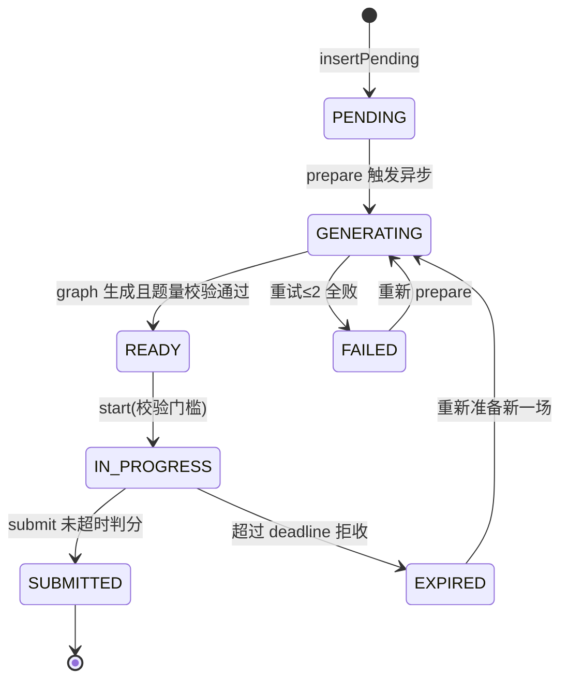
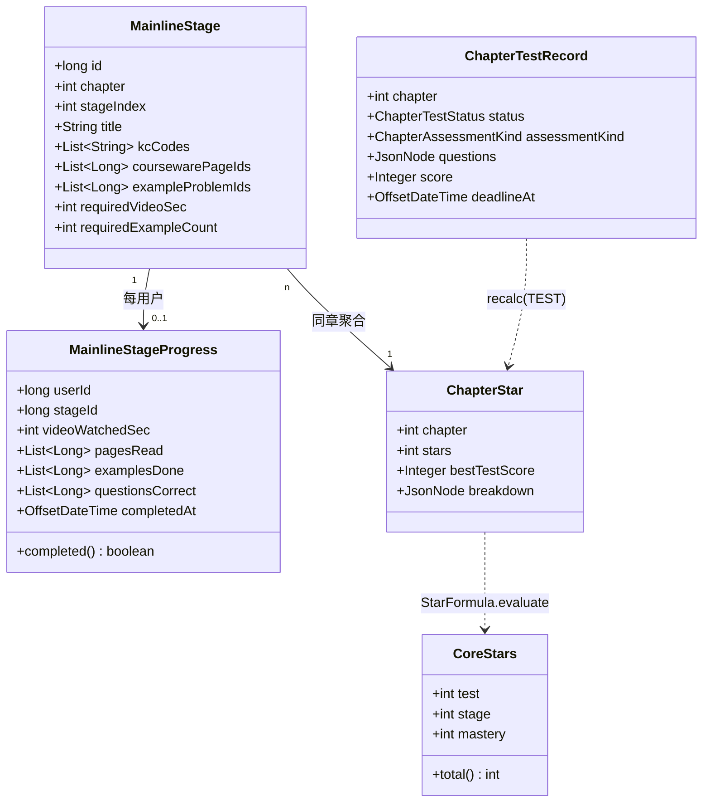
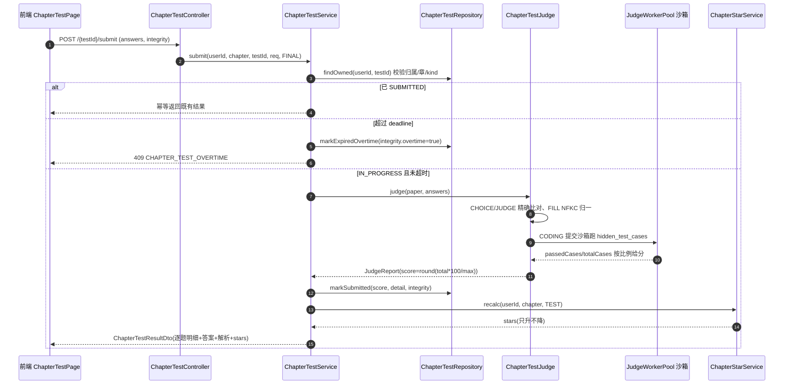
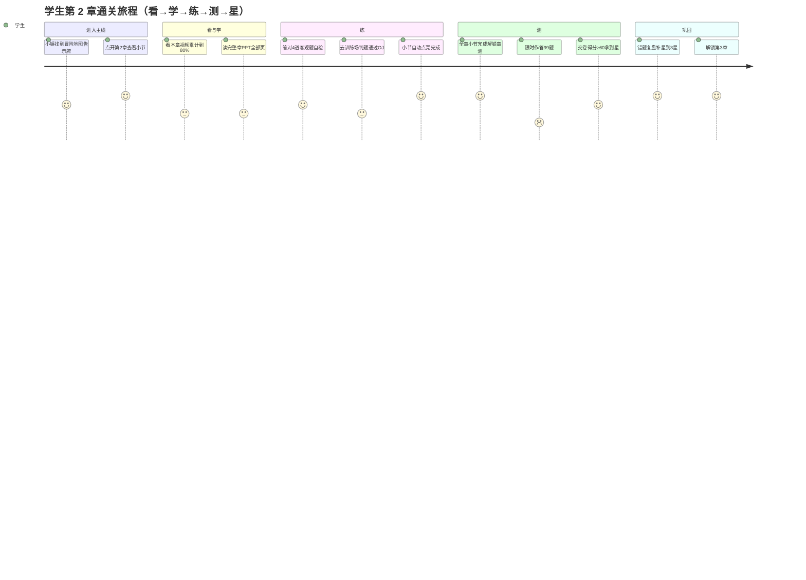

## 8.5 主线冒险·看学练测 · 详细设计

> 文档编号前缀：`PYT-CR` ｜ 本文件 filecode：**S05** ｜ 对应《实训总结报告》第 8 章「详细设计」。
> 本模块是 Pythontopia 的学习闭环核心，内容较其它模块更充实。数据表字段字典统一见 §6（D2 分片），本文引用表名只写「详见 §6」。
> 设计取自真实代码：后端包 `com.pythontopia.mainline.*`、前端页面 `MainlineMapPage / StageLearnPage / LecturePage / ChapterTestPage` 与组件 `StageExamplePractice`、Python 微服务 `pythontopia-graph`。

本章按「**详细设计六要素**」展开：① 模块职责与组成 → ② 处理流程 → ③ 状态与数据结构 → ④ 接口设计 → ⑤ 关键算法 → ⑥ 异常处理与边界，并辅以学生通关旅程图。

### 8.5.1 要素一：模块职责与组成

M05 负责把课程包 `packId=43` 的 7 章 / 65 个 KC 组织为「**看→学→练→测**」可验证学习闭环，并以**后端为唯一权威**维护学生的小节进度、章节星级与解锁关系。模块分三层落地：

| 层 | 组成 | 职责 |
| --- | --- | --- |
| 前端（Vue 3 + Phaser） | `MainlineMapPage`(`/mainline-map`) | 羊皮卷 Phaser `ChapterMapScene` + 可读 Vue 覆盖层；展示章节节点 / 总星数 / 小节抽屉 |
| | `StageLearnPage`(`/mainline/stage/:id`) | 学习通式三件套学习页（看/学/练 三组目录 + 左侧大区） |
| | `LecturePage`(`/lecture/:chapter`) | 独立章节视频讲解页 + AI 助教侧栏（R-15 起不写主线进度） |
| | `ChapterTestPage`(`/chapter-test/:ch`、`/chapter-quiz/:ch`) | 章末大测试 / 章节小测：闸门→开考→限时作答→判分回显 |
| | `StageExamplePractice` 等组件 | 「练」客观题 inline 判分 + OJ 跳训练场 |
| 后端（Spring Boot） | `mainline`（`MainlineController/Service`、`StageCompletion`、`ChapterCatalog`、`MainlineRecoveryService`） | 三件套打点聚合、过线判定、补星校验 |
| | `mainline.practice`（`MainlinePracticeController/Service`） | 客观题题库 + 服务端判分 + 完成回调端口 |
| | `mainline.test`（`ChapterTestController/QuizController/Service/Judge/PregenService/GraphClient`） | 章测预生成、去答案发卷、限时判分 |
| | `mainline.star`（`ChapterStarService`、`StarFormula`） | 星级唯一收口、纯函数公式 |
| Python 微服务 | `pythontopia-graph` `/agents/chapter-test/generate` | 章测题面生成（含 `curriculum_mapper_agent` 确定性 KC 排序、`reading_agent` 拓展阅读） |

后端域内通过两个**端口（Port）接口**解耦循环依赖：`MainlineStageCompletionPort`（练域答对客观题后回调主域重算完成）与 `MainlinePracticePort`（主域聚合时向练域查客观题题面 / 完成状态）。这是本模块设计的关键解耦点（详见要素四）。

> 【截图占位 SC-S05-1】
> - 访问：http://localhost:5173/mainline-map（容器态 http://localhost:8080/mainline-map）
> - 登录角色：学生
> - 操作步骤：1. 学生登录后进入 `town_hub` 中央小镇 2. 走到「冒险地图」告示牌按 E（或点 HUD「冒险地图」按钮）进入 `/mainline-map` 3. 等待 `GET /api/mainline/overview` 回流，羊皮卷地图渲染 7 章节点
> - 截取对象：`MainlineMapPage` 的 `ChapterMapScene` 羊皮卷地图 + 顶部累计总星数 + 点开某章后的小节抽屉
> - 期望画面：7 个章节节点按「锁定 / 解锁 / 0–3★」着色，已解锁章可展开看/学/练小节列表，顶部显示 `totalStars` 累计总星数（前章满 ≥1★ 才解锁后一章）

### 8.5.2 要素二：处理流程（看→学→练→测闭环）



> 图 S05-1　M05 看→学→练→测 处理流程（含完成回调与星级重算）

#### 对象协作拓扑（通信图）

同一处理流程换用**通信图（UML 协作图）**呈现对象间的链接拓扑：与时序图（图 S05-5）不同，它无生命线，强调对象间静态链接与**带序号消息**。主链路是「三件套打点 → 完成回调」（`StageLearnPage → MainlineController → MainlineService → 进度仓储`），旁挂「章末测试 → 星级评定」（`ChapterTestPage → ChapterTestController → ChapterTestService`），两条链在唯一星级收口 `ChapterStarService` 处汇聚。



> 图 S05-7　M05 通信图（协作图）：三件套打点主链路 + 章末测试旁链，汇聚于 `ChapterStarService`（星级唯一收口）

> 【截图占位 SC-S05-2】
> - 访问：http://localhost:5173/chapter-test/2（容器态 http://localhost:8080/chapter-test/2）
> - 登录角色：学生
> - 操作步骤：1. 先完成第 2 章全部小节的看/学/练三件套 2. 在 `/mainline-map` 点「章末大测试」触发 `POST /api/mainline/chapters/2/test/prepare` 预生成，轮询至 `READY` 3. 点「开考」`POST .../test/start` 进入限时作答，作答后「交卷」`POST .../test/{testId}/submit`
> - 截取对象：`ChapterTestPage` 的开考闸门 / 限时作答区 + 顶部 `deadline` 倒计时 + 交卷后逐题判分明细与星级回显
> - 期望画面：限时倒计时、去答案题面（选择/判断/填空/编程四类），交卷后显示百分制得分、逐题对错+解析、本章 0–3★（只升不降）

### 8.5.3 要素三：状态与数据结构设计

#### Stage 进度与章级星级状态



> 图 S05-2　Stage 三件套进度与章节 0–3★ 星级状态机

#### 章末测试状态机



> 图 S05-3　`chapter_test.status` 状态机（对齐 V157 CHECK 约束）

#### 核心数据结构（领域模型，JdbcTemplate 行映射，零 JPA 实体）



> 图 S05-4　M05 核心领域模型（字段字典完整版见 §6 D2）

设计要点：进度三集合 `pages_read / examples_done / questions_correct` 均为 `BIGINT[]`，并集去重幂等累加，天然支持「重复打点不重复计」；`MainlineStage` 的 `required_video_sec / required_pages` 为 seed 占位列，运行期由 `withChapterStandards` 用**动态章级标准**覆盖（视频 80%、整章页），故星级 / 过线不依赖 seed 数值，避免 seed 漂移导致口径错乱。

### 8.5.4 要素四：接口设计

#### 外部 REST 端点

外部端点清单（真实路径 / 请求体 / 响应）已在 §4.2 表 R05-1 完整列出，本文不重复；要点：全部 `/api` 前缀、JWT、STUDENT 角色，`stageId` 用 `@Positive`、`chapter` 用 `@Min(1)@Max(7)` 校验，三件套打点统一回 `StageProgressDto`，章测分 `test` / `quiz` 两套同构端点（kind 区分）。

#### 内部端口（关键解耦）

| 端口 | 实现 | 调用方 | 解耦目的 |
| --- | --- | --- | --- |
| `MainlinePracticePort` | `MainlinePracticeService` | `MainlineService`（`Optional` 注入） | 主域聚合时查客观题题面 / 数量 / 已答对 id / 是否全对；题库 bean 缺失时降级（`questionsComplete` 返回 true） |
| `MainlineStageCompletionPort` | `MainlineService` | `MainlinePracticeService`（`ObjectProvider` 惰性获取） | 答对客观题后回调主域 `recheckCompletion`，避免与 `Optional<MainlinePracticePort>` 形成双向构造注入循环 |
| `ChapterTestGraphClient` | RestTemplate（snake_case 线缆） | `ChapterTestPregenService` | 调 graph `/agents/chapter-test/generate`，传输错误 fail-fast 抛 `ChapterTestGenerationException` |

`MainlineService.overview` 一次性取齐 `stage / 进度 / 星级 / 章测状态`，在内存按章拼装（§11.4 避免 N+1），章级标准（视频时长 / 页 id）按章缓存于局部 `Map`；前端 `mainline` store 与 `api/mainline.ts`、`api/chapterTest.ts` 做「typed DTO + thin fetch」，不做业务判定。前端 `chapterTest.ts` 含**线格式适配层**：把后端 `awardedScore/maxScore/correctAnswer/stars` 映射回组件层判别联合 DTO，组件不感知差异。

### 8.5.5 要素五：关键算法

#### 章末测试判分时序



> 图 S05-5　章末大测试服务端判分时序（考试期间零 LLM）

**① 三件套过线判定（`StageCompletion`，纯函数便于单测）**：`videoComplete = video_watched_sec ≥ requiredVideoSec`；`pagesComplete`——`required_pages>0` 按去重页数，否则需 `pages_read` 覆盖全部 `courseware_page_ids`（空集占位视为已读）；`examplesComplete = 去重例题数 ≥ requiredExampleCount`；`allComplete = 看 ∧ 学 ∧ 练（OJ）∧ 客观题全对`。

**② 星级公式（`StarFormula.evaluate`，8 分支纯函数）**：`1★ = bestTestScore ≥ 60`；`2★ = 1★ ∧ 全小节完成`；`3★ = 2★ ∧ avgMastery ≥ 0.80 ∧ bestTestScore ≥ 85`。核心星 `total = test + stage + mastery`，叠加 `recovered`（补星）后 `min(3, …)`，且与既有星 `GREATEST` 取最大（**只升不降、幂等**）。`recalc` 是唯一写 `chapter_star` 的入口，保留既有 `recovered` 不被覆盖。

**③ 判分归一化（`ChapterTestJudge` / `MainlinePracticeService`）**：`CHOICE` 先比对选项标识（A/B/C/D 大小写空白不敏感），失败再按字母索引取选项原文比对；`JUDGE` 解析 true/false、1/0、对/错、yes/no；`FILL` NFKC（全/半角统一）+ 去空白 + 小写 + 去成对引号（直引号 / 中英弯引号 / 中文书名号）；`CODING` 走 `JudgeCaseEvaluator` 沙箱（经 `JudgeWorkerPool` 并发池，最多取 20 个隐藏用例）按通过比例给分。整卷 `score = round(总得分 × 100 / 总满分)` 归一为百分制。

**④ 异步预生成与防作弊（`ChapterTestPregenService`）**：`prepare` 投递 `@Async` 预生成，信号量限制 backend→graph 并发（默认 2）削峰；失败重试 ≤ 2，全败置 `FAILED`，**绝不向调用线程抛异常**（考试 `start` 永不等 LLM）；校验生成题量严格等于约定（QUIZ 10/10/10/3，FINAL 30/30/30/9），FINAL 排除本章 QUIZ 已出题面签名（防重复）。考试期防作弊：去答案下发、`deadline` 硬校验拒收超时、编程题禁粘贴计数、切屏失焦计数、路由守卫禁止考试中跳 AI 页面——`integrity` 仅供教师参考，不自动判零。

**⑤ 时长防刷（`VideoProgressThrottle`）**：单次 `deltaSec` 钳制到 `videoDeltaMaxSec`（默认 120s），每分钟限 2 次，超频幂等 no-op，杜绝挂机刷时长。

#### PDL S05-1　章末大测试判分 + 星级评定

下列结构化伪代码取自 `ChapterTestService.submit` → `ChapterTestJudge.judge` → `ChapterStarService.recalc` 的真实调用链，覆盖**得分聚合 → 1–3★ 阈值映射 → 首次/刷新星级（只升不降）→ `star_award_event` 审计**全过程；变量 / 方法名与阈值（60 / 85 / 0.80 / 封顶 3★）均取自真实代码。

```text
PROCEDURE submitAndAward(userId, chapter, testId, req)
  INPUT : userId:long, chapter:int(1..7), testId:long, req:{answers, integrity}
  OUTPUT: ChapterTestResultDto

  record <- repository.findOwned(userId, testId) FILTER chapter 与 kind 一致
  IF record IS NULL                THEN RAISE 404 CHAPTER_TEST_NOT_FOUND ENDIF
  IF record.status == SUBMITTED    THEN RETURN 幂等既有结果(currentStars) ENDIF
  IF record.status == EXPIRED      THEN RAISE 409 CHAPTER_TEST_OVERTIME  ENDIF
  IF record.status <> IN_PROGRESS  THEN RAISE 409 NOT_IN_PROGRESS        ENDIF
  IF now() AFTER record.deadlineAt THEN
      repository.markExpiredOvertime(testId, integrity{overtime:true})   // 先落审计再抛
      RAISE 409 CHAPTER_TEST_OVERTIME
  ENDIF

  // —— ① 得分聚合（逐题判分，考试期零 LLM）——
  paper <- parsePaper(record);  total <- 0;  max <- 0
  FOR EACH q IN paper.items DO
      max <- max + q.points
      SWITCH q.type
        CASE CHOICE / JUDGE : got <- exactMatch(answer, q.key)            ? q.points : 0
        CASE FILL           : got <- nfkcNorm(answer) == nfkcNorm(q.key)  ? q.points : 0
        CASE CODING         : passed <- sandbox.run(answer, q.hiddenCases[0..20])
                              got    <- round(q.points * passed / totalCases)
      ENDSWITCH
      total <- total + got
  ENDFOR
  score <- round(total * 100 / max)                      // 归一为百分制
  repository.markSubmitted(testId, score, detail, integrity, now())

  // —— ② 星级评定：仅 FINAL 触发 recalc(TEST)，QUIZ 不改星级 ——
  IF record.kind == FINAL THEN stars <- recalc(userId, chapter, TEST)
  ELSE                         stars <- currentStars(userId, chapter)
  ENDIF
  RETURN ChapterTestResultDto(逐题明细 + 答案 + 解析 + stars)
END

PROCEDURE recalc(userId, chapter, source)                // 唯一写 chapter_star 的入口
  best        <- chapterTestRepository.findBestScore(userId, chapter)   // null -> 0
  allComplete <- allStagesComplete(userId, chapter)
  avgMastery  <- averageMastery(userId, chapter)         // 本章 KC 均掌握度(缺失计 0)

  testStar    <- (best >= 60)                                   ? 1 : 0   // 1★  PASS_SCORE
  stageStar   <- (testStar == 1 AND allComplete)               ? 1 : 0   // 2★
  masteryStar <- (stageStar == 1 AND avgMastery >= 0.80 AND best >= 85) ? 1 : 0  // 3★
  core        <- testStar + stageStar + masteryStar      // 0..3

  existing    <- starRepository.find(userId, chapter)
  recovered   <- existing.breakdown.recovered            // 去重，封顶 2 途径(ERRORBOOK/ENDLESS)
  computed    <- min(MAX_STARS=3, core + size(recovered))  // 叠加补星后封顶
  finalStars  <- max(existing.stars, computed)           // 只升不降

  starRepository.upsert(userId, chapter, finalStars, best, breakdown)   // GREATEST 幂等
  IF finalStars > existing.stars THEN                    // 仅真实升星才记审计
      starRepository.insertEvent(userId, chapter, finalStars - existing.stars,
                                 source, "recalc core=...")              // -> star_award_event
  ENDIF
  RETURN finalStars
END
```

#### NS 盒图：看/学/练三件套推进

下盒图描述学生在 `StageLearnPage` 三件套打点后，后端 `StageCompletion.allComplete` 的**短路合取判定**（看 → 学 → 练 OJ → 练客观题），及首次完成的解锁链：`markCompleted`（幂等）→ `recalc(STAGE_COMPLETE)` → 全章 stage 完成后解锁章末大测试、前章 ≥1★ 解锁下一章。三件套打点本身为并集去重、幂等累加，故重复上报不重复计。

<table border="1" cellspacing="0" cellpadding="6" style="border-collapse:collapse;text-align:center;width:100%">
  <tr><td colspan="2">读取 stage 与当前 progress；withChapterStandards 套用动态章级标准（视频 80% / 整章页）</td></tr>
  <tr><td colspan="2">「看」是否过线？ video_watched_sec ≥ requiredVideoSec</td></tr>
  <tr>
    <td style="width:16%">F：看未过线<br/>completed=false 回包</td>
    <td style="width:84%">
      <table border="1" cellspacing="0" cellpadding="6" style="border-collapse:collapse;text-align:center;width:100%">
        <tr><td colspan="2">T：「学」是否过线？ pages_read ⊇ 整章 courseware_page_ids（空集占位视为已读）</td></tr>
        <tr>
          <td style="width:18%">F：学未过线<br/>completed=false</td>
          <td style="width:82%">
            <table border="1" cellspacing="0" cellpadding="6" style="border-collapse:collapse;text-align:center;width:100%">
              <tr><td colspan="2">T：「练」是否过线？ 去重例题数 ≥ requiredExampleCount 且 客观题全对(questionsComplete)</td></tr>
              <tr>
                <td style="width:20%">F：练未过线<br/>completed=false</td>
                <td style="width:80%">
                  <table border="1" cellspacing="0" cellpadding="6" style="border-collapse:collapse;text-align:center;width:100%">
                    <tr><td colspan="2">T：allComplete=true → markCompleted(userId,stageId) 是否首次置完成？</td></tr>
                    <tr>
                      <td style="width:34%">F：已完成过<br/>幂等返回，不重算</td>
                      <td style="width:66%">T：recalc(userId,chapter,STAGE_COMPLETE) 重算章级星级</td>
                    </tr>
                    <tr><td colspan="2">本章所有 stage 是否均 completed？</td></tr>
                    <tr>
                      <td style="width:34%">F：留在本章<br/>继续其它小节</td>
                      <td style="width:66%">T：解锁章末大测试；若前章 ≥1★ 则解锁下一章</td>
                    </tr>
                  </table>
                </td>
              </tr>
            </table>
          </td>
        </tr>
      </table>
    </td>
  </tr>
</table>

> 图 S05-8　NS 盒图：看/学/练三件套短路合取与首次完成解锁（打点并集去重、幂等累加）

### 8.5.6 要素六：异常处理与边界

| 场景 | 错误码 / 行为 | 设计意图 |
| --- | --- | --- |
| 未登录 | 401 `UNAUTHORIZED` | `requireUserId` 统一拦截 |
| Stage 不存在 | 404 `ResourceNotFoundException` | 防御非法 stageId |
| OJ 无 PASSED 提交即标记完成 | 400 `EXAMPLE_EVIDENCE_REQUIRED` | 任务完成必须有 evidence |
| 提交非本人 / 未通过 | 400 `EXAMPLE_SUBMISSION_INVALID/NOT_PASSED` | 防伪造完成 |
| 客观题不属于该 Stage | 400 `PRACTICE_QUESTION_STAGE_MISMATCH` | 归属校验 |
| 章测未就绪开考 | 409 `CHAPTER_ASSESSMENT_NOT_READY` | 不用旧题兜底避免题量缩水 |
| FINAL 尚有小节未完成 | 409 `CHAPTER_FINAL_LOCKED` | 强制先学满再考 |
| 超时提交 | 409 `CHAPTER_TEST_OVERTIME` + 落 EXPIRED | 先持久化审计再抛，防回滚丢审计 |
| 章号越界 | 400 `MAINLINE_CHAPTER_INVALID` | `chapter ∈ 1..7` |
| 时长上报超频 | 幂等 no-op | 软节流不打断学习 |
| 题库 bean 缺失 | 客观题维度降级 true | 优雅降级不阻塞 |

> 表 S05-1　M05 异常处理与边界口径

边界说明：`completed` 在前端可由三件套客户端推导乐观展示，但**服务端值为权威**，下次 `overview` 拉取回流；星级补星与核心星解耦，最多 2 条补星途径、封顶 3★、无尽补星每日每章限 1 次防刷。

### 8.5.7 学生通关旅程



> 图 S05-6　学生通关旅程（满意度 1–5，反映难点在限时大测试）

---

> 执笔人：成员 A ｜ 完成人（签名）：成员 A ｜ 审查人：成员 C ｜ 完成日期：2026-06-16
