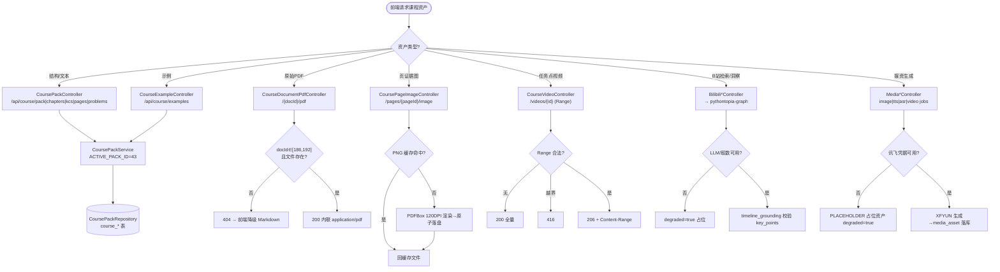
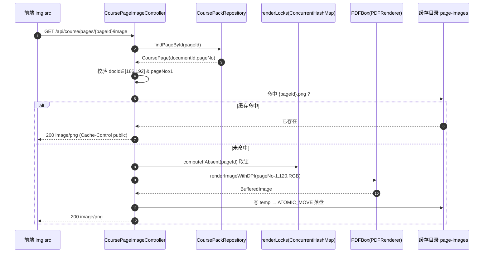
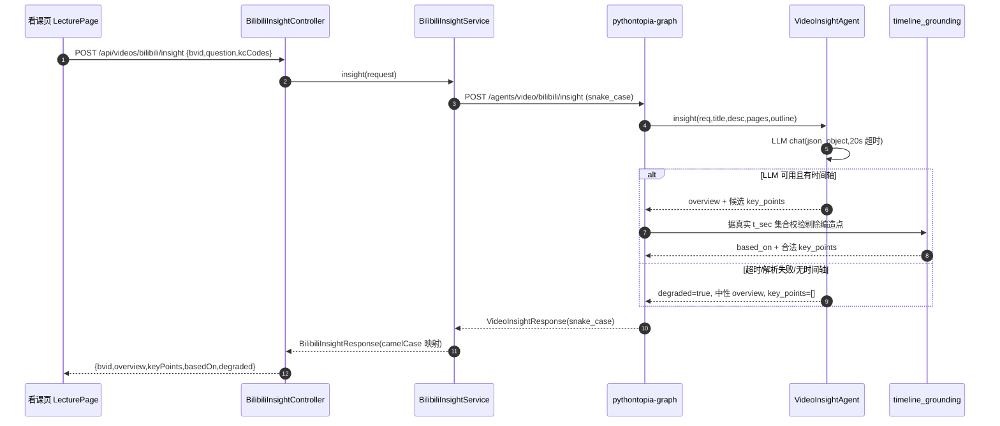
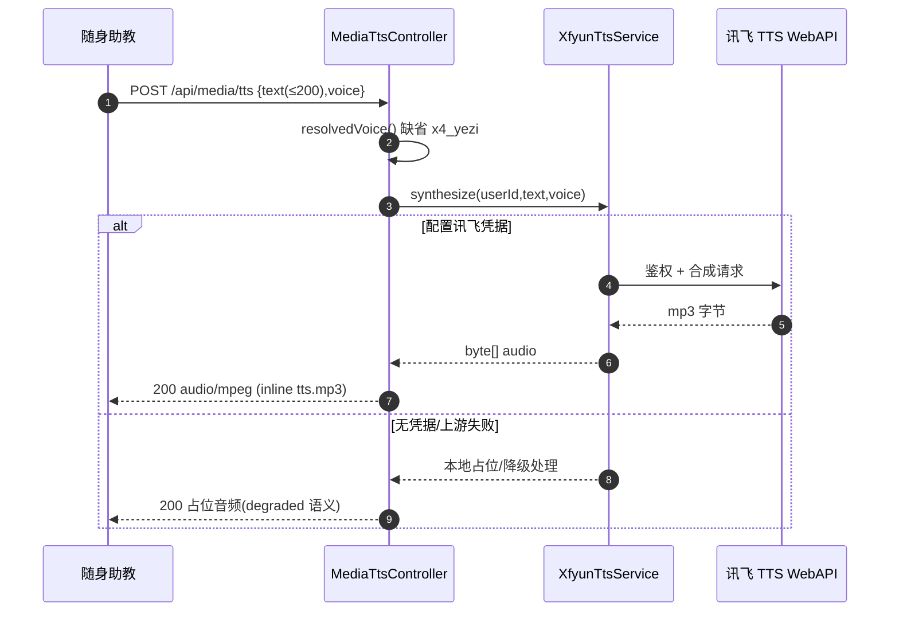
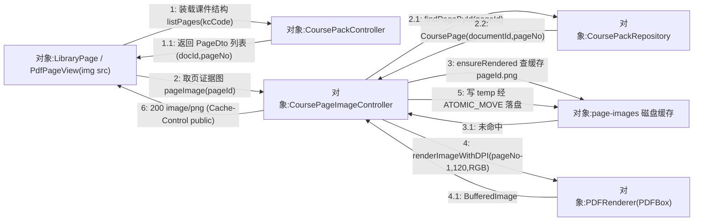
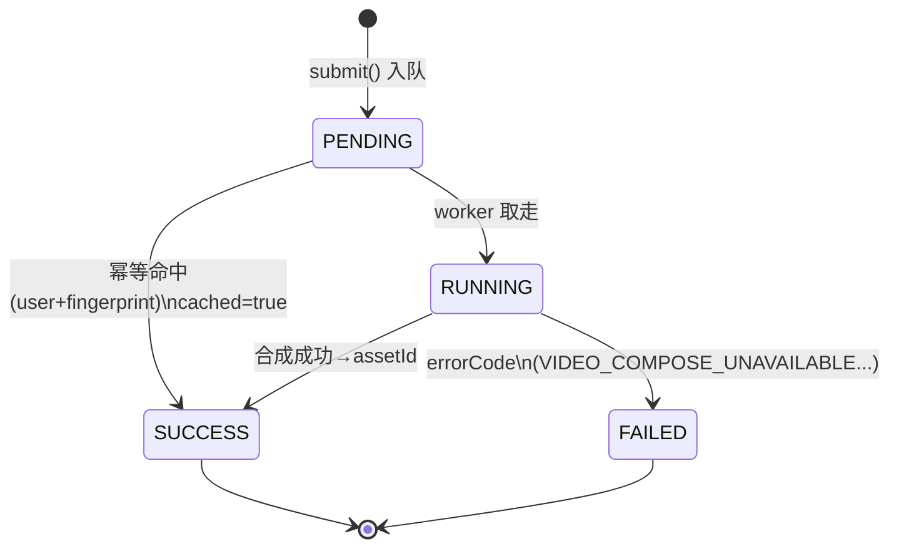
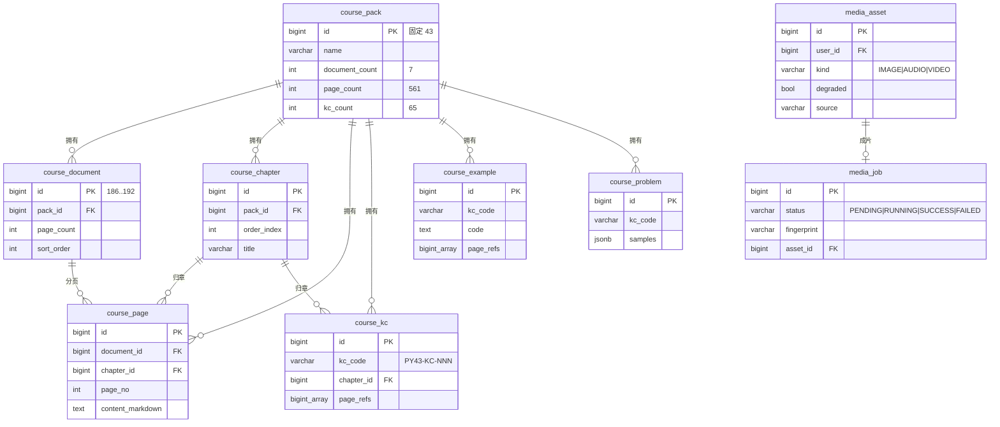

## 8.6 课程包与课件资产 · 详细设计

> 本模块详细设计按「六要素」组织：① 功能职责 ② 处理流程 ③ 模块结构与类设计 ④ 接口设计 ⑤ 数据结构与存储 ⑥ 异常处理与降级。表字段完整字典只在 §6（M06 数据字典 D2）展开，本文引用表名。

### 一、功能职责

M06 是课程知识底座 `packId=43` 的服务化封装，职责边界为「课程结构只读查询 + 课件重资产按需渲染 + 视频检索与 AI 洞察 + 多模态媒资生成」。它把四个后端子域内聚为一个模块：`coursepack`（结构 / PDF / 页图 / 视频流）、`courseware`（学生侧课件问答代理）、`video`（B 站检索与视频洞察代理）、`media`（文生图 / TTS / ASR / 故事板短视频）。设计目标有三：一是事实唯一，结构与统计口径恒等于 `course_pack` 种子（7 文档 · 561 页 · 7 章 · 65 KC · 46 示例 · 39 题），`CoursePackService.ACTIVE_PACK_ID=43` 强制生效包；二是字节流可被无 Authorization 头的 ``/`<video>` 直接消费，故 PDF / 页图 / 视频 / 媒资端点在 `SecurityConfig` 匿名放行并以 id 白名单 + path-traversal 双重收口；三是 AI / 第三方一律 fail-soft，降级产物带 `degraded=true` 标识，链路绝不中断。模块面向学生的旗舰界面是 `/library` 课件阅读器（三栏：左章 / KC 导航 · 中 PDF 页图阅读 · 右 RAG 课件问答），主界面见截图占位 SC-S06-1。

> 【截图占位 SC-S06-1】
> - 访问：http://localhost:5173/library（容器态 http://localhost:8080/library）
> - 登录角色：学生（除 /login 外均需登录；路由 `meta.requiresAuth=true`）
> - 操作步骤：1. 学生登录后由小镇「图书馆」NPC 或顶部导航进入课件库；2. 左栏选择某章 / KC（URL 同步 `?docId=&page=&kcCode=`，默认 `docId=186`、`page=1`）；3. 中栏保持「原 PDF」视图等待 PDFBox 页图加载；4. 右栏输入「input 函数」发起课件问答。
> - 截取对象：课件阅读器三栏布局（左：章 / KC 导航树；中：`PdfPageView` 单页 PNG；右：RAG 检索 / 课件问答结果含页码引用）。
> - 期望画面：中栏显示由 `/api/course/pages/{pageId}/image` 渲染的清晰单页 PNG，右栏给出带「第 N 页」可跳转引用的 AI 作答。

### 二、处理流程

模块的核心运行时是「课件资产装载」：前端按当前章 / 页 / KC 决定要装载哪一类资产，后端据请求类型分流到结构查询、PDF 流、页图渲染、视频流、AI 洞察或媒资生成。整体装载决策见图 S06-1。

#### 图 S06-1 课件资产装载流程（flowchart）



PDF 页渲染是吞吐敏感路径，单份课件最大 ~80MB，若每次证据回链都下载整份 PDF 不可接受；模块用 PDFBox 把命中页渲染成单页 PNG 并落盘缓存，首渲后走缓存，见图 S06-2。

#### 图 S06-2 PDFBox 页渲染缓存时序（sequenceDiagram）



视频 AI 洞察经 Spring 控制器代理到 Python 微服务，由 `VideoInsightAgent` 产出概述与候选时间点，再由 `timeline_grounding` 据真实时间集合裁定，见图 S06-3。

#### 图 S06-3 B 站视频洞察时序（sequenceDiagram）



TTS 是典型「缺密钥即降级」的媒资合成，朗读链路同步返回字节，见图 S06-4。

#### 图 S06-4 TTS 语音合成时序（sequenceDiagram）



图 S06-2 已从时间维度刻画页图渲染与缓存；若改从对象协作拓扑看，「页证据图」主链路由前端 `LibraryPage`（中栏 `PdfPageView` 的 ``）发起，经 `CoursePackController` 装载课件结构、`CoursePageImageController` 取页图：命中即回缓存文件，未命中才唤起 `PDFRenderer(PDFBox)` 渲染并原子落盘回缓存目录。该协作图（无生命线、强调对象间链接拓扑，区别于时序图）见图 S06-7；因 `` 不带 Authorization 头，页图与原始 PDF 端点在 `SecurityConfig` 匿名放行，并以 `docId∈[186,192]` 白名单 + path-traversal 双重收口。

#### 图 S06-7 课件页图主链路通信图（协作图）



课件示例的浏览入口见截图占位 SC-S06-2——R-14「世界收缩」方案 C 下独立「示例库」画廊已收敛进题目列表，故 `/examples` 经 `beforeEnter` 重定向到 `/problems` 并保留 `kcCode` 过滤。

> 【截图占位 SC-S06-2】
> - 访问：http://localhost:5173/examples?kcCode=PY43-KC-012（容器态 http://localhost:8080/examples）
> - 登录角色：学生（路由 `meta.requiresAuth=true`）
> - 操作步骤：1. 学生携 `kcCode` 访问 `/examples`；2. 路由 `beforeEnter` 以 `replace` 跳转 `/problems`（沿用 `kcCode` query），地址栏由 `/examples` 变为 `/problems?kcCode=PY43-KC-012`；3. 在题目 / 示例列表查看该 KC 关联的示例代码与练习。
> - 截取对象：重定向落地后的 `/problems` 列表（按 `kcCode` 过滤），含「示例库已并入题目列表」的实际呈现。
> - 期望画面：列表展示该 KC（PY43-KC-012）下的示例 / 题目卡片，复用 `/api/course/examples`、`/api/course/problems` 数据。

### 三、模块结构与类设计

模块采用「Controller（薄）→ Service（业务 / 代理）→ Repository / 外部」的分层。`coursepack` 子域中 `CoursePackController`/`CourseExampleController` 仅做 DTO 映射，业务在 `CoursePackService`（固定 `ACTIVE_PACK_ID=43`）经 `CoursePackRepository` 读 `course_*` 表；`CourseDocumentPdfController` 与 `CoursePageImageController` 直接操作文件系统并自带白名单 / 守卫，`CoursePageImageController` 用 `ConcurrentHashMap<Long,Object> renderLocks` 对同一 `pageId` 串行渲染；`CourseVideoController` 经 `CourseVideoService` 读 `video_manifest.json`（按 mtime+size 轻量缓存）并手写 `Range` 解析（`parseRange` 返回闭区间 / null / `NOT_SATISFIABLE` 三态）。`courseware` 子域 `CoursewareController` 经 `CoursewareGraphClient` 代理学生侧问答。`video` 子域 `BilibiliVideoController`/`BilibiliInsightController` 经各自 Service 代理 graph，`BilibiliVideoDto`/`BilibiliInsightResponse` 用 `@JsonProperty`+`@JsonAlias` 完成 snake↔camel 双向映射。`media` 子域 `MediaAssetController`（文生图 / 同步合片 / 匿名取字节）、`MediaJobController`（异步作业 + 轮询 + SSE）、`MediaTtsController`、`MediaAsrController`，落库经 `MediaAssetRepository`/`MediaJobRepository`，字节读取统一走 `ByteRangeResponder`，降级占位由 `MediaPlaceholderFactory` 产出，SSE 帧由 `MediaJobStreamRegistry` 管理。

`media_job` 的生命周期是模块唯一的有状态对象，状态机见图 S06-5。

#### 图 S06-5 媒体合成作业状态机（stateDiagram-v2）



### 四、接口设计

模块对外 REST 端点（真实路径，鉴权列：A=匿名放行，J=需 JWT）：

| 端点 | 方法 | 鉴权 | 请求 → 响应 |
| --- | --- | --- | --- |
| `/api/course/pack` | GET | J | — → CoursePackDto |
| `/api/course/chapters` | GET | J | — → List&lt;ChapterDto&gt; |
| `/api/course/kcs` | GET | J | `chapterId?` → List&lt;KcDto&gt; |
| `/api/course/pages` | GET | J | `kcCode` → List&lt;PageDto&gt; |
| `/api/course/problems` / `/{id}` | GET | J | `kcCode?` / `id` → ProblemDto(s) |
| `/api/course/examples` / `/{exampleId}` | GET | J | `packId?,kcCode?` → CourseExampleDto(s) |
| `/api/course/documents/{docId}/pdf` | GET | A | docId∈[186,192] → application/pdf |
| `/api/course/pages/{pageId}/image` | GET | A | pageId → image/png |
| `/api/course/videos` / `/{id}` | GET | A | `chapterId?` / Range → List&lt;CourseVideoDto&gt; / mp4(206) |
| `/api/courseware/answer` | POST | J | CoursewareAnswerRequestDto → CoursewareAnswerResponseDto |
| `/api/videos/bilibili` | GET | J | `keyword,limit=8` → List&lt;BilibiliVideoDto&gt; |
| `/api/videos/bilibili/insight` | POST | J | BilibiliInsightRequest → BilibiliInsightResponse |
| `/api/media/image` | POST | J | ImageGenerationRequest → MediaAssetDto |
| `/api/media/tts` | POST | J | TtsRequest → audio/mpeg |
| `/api/media/asr` | POST | J | multipart `audio` → AsrResponse |
| `/api/media/storyboard/video` | POST | J | StoryboardVideoRequest → MediaAssetDto |
| `/api/media/storyboard/video/jobs` | POST | J | StoryboardVideoRequest → 202 JobSubmitResponse |
| `/api/media/jobs/{id}` / `/stream` | GET | J | id → JobStatusResponse / SSE |
| `/api/media/assets/{id}` | GET | A | id, Range → 媒资字节(206) |

校验约束：`kcCode` 必须匹配 `^PY43-KC-[0-9]{3}$`；`docId`/`pageId`/`id` 为 `@Positive`；`CoursewareAnswerRequestDto.query` `@NotBlank @Size(max=512)`；`TtsRequest.text` `@NotBlank @Size(max=200)`；`BilibiliInsightRequest.bvid` `@NotBlank @Size(max=32)`、`kcCodes` ≤10；`StoryboardVideoRequest.scenes` `@NotEmpty @Size(max=8)`。DTO 字段清单见 R06 用例「字段列表」。

### 五、数据结构与存储

模块持久化对象共 9 张表，关系总览见图 S06-6，完整字段字典见 §6（M06 数据字典 D2）。`course_*` 七表以 `course_pack(id=43)` 为根聚合，`course_page`/`course_kc`/`course_example`/`course_problem` 经 `pack_id` 外键挂载；`course_page` 还经 `document_id`/`chapter_id` 关联文档与章；KC 与页 / 示例的关联以 `page_refs`（数组）软引用而非外键。`media_asset` 与 `media_job` 通过 `asset_id` 关联，均以 `user_id` 关联 `users`（M01）。原始 PDF、页图 PNG、视频 mp4、生成媒资字节均落文件系统（不入 git、可重生），库内仅存元数据与相对路径。

#### 图 S06-6 course_* 与 media_* 关系（erDiagram）



页图磁盘缓存是本模块最具代表性的「存储即算法」：库内仅存 `course_page` 元数据与相对路径，PNG 字节落 `pythontopia.coursepack.pageImageDir`（默认 `./data/course-pack-43/page-images`）、按 `pageId` 命名、不入 git 且可重生。其「PDF 指定页渲染 + 磁盘缓存」的命中判断、PDFBox 渲染、原子落盘与并发去重见 PDL S06-1。

#### PDL S06-1 PDF 指定页渲染 + 磁盘缓存

```text
PROCEDURE pageImage(pageId)                       // CoursePageImageController
  INPUT : pageId : Long (@Positive)
  OUTPUT: 200 image/png | 404 | 500
  page <- CoursePackRepository.findPageById(pageId)
  IF page IS NULL OR page.documentId IS NULL OR page.pageNo IS NULL THEN
      RETURN 404
  ENDIF
  docId <- page.documentId ; pageNo <- page.pageNo
  IF docId < 186 OR docId > 192 OR pageNo < 1 THEN            // 仅放行包 43 的 7 份文档
      RETURN 404
  ENDIF
  pdf <- pdfDir.resolve(docId + ".pdf").normalize()
  IF NOT pdf.startsWith(pdfDir) OR NOT isRegularFile(pdf) THEN  // path-traversal + 缺文件
      WARN ; RETURN 404
  ENDIF
  TRY
      png <- ensureRendered(pageId, pdf, pageNo)
  CATCH IOException
      RETURN 500
  ENDTRY
  IF png IS NULL THEN RETURN 404 ENDIF
  RETURN 200 image/png  WITH Cache-Control = "public, max-age=86400"
END

PROCEDURE ensureRendered(pageId, pdf, pageNo)
  INPUT : pageId:Long, pdf:Path, pageNo:int
  OUTPUT: Path(缓存 PNG) | NULL
  target <- cacheDir.resolve(pageId + ".png").normalize()
  IF NOT target.startsWith(cacheDir) THEN RETURN NULL ENDIF    // 缓存目录越界防护
  IF isRegularFile(target) AND size(target) > 0 THEN
      RETURN target                                            // 快路径：缓存命中，免渲染
  ENDIF
  lock <- renderLocks.computeIfAbsent(pageId, k -> new Object())  // 同 pageId 取对象锁
  SYNCHRONIZED (lock)
      IF isRegularFile(target) AND size(target) > 0 THEN
          RETURN target                                        // 双重检查：并发去重
      ENDIF
      createDirectories(cacheDir)
      WITH doc <- PDFBox.Loader.loadPDF(pdf)                    // try-with-resources
          IF pageNo > doc.getNumberOfPages() THEN WARN ; RETURN NULL ENDIF
          image <- new PDFRenderer(doc).renderImageWithDPI(pageNo - 1, 120, RGB)
          tmp <- createTempFile(cacheDir, pageId + "-", ".png.tmp")
          TRY
              IF NOT ImageIO.write(image, "png", tmp) THEN
                  RAISE IOException("no PNG ImageWriter")
              ENDIF
              Files.move(tmp, target, REPLACE_EXISTING, ATOMIC_MOVE)  // 原子落盘
          FINALLY
              deleteIfExists(tmp)
          ENDTRY
      ENDWITH
  END SYNCHRONIZED
  RETURN target
END
```

`course_*` 七表的存储口径必须恒等于 §一 所述事实唯一基线。课件装载完成后，模块以「计数校验」守门：`getActivePack()` 命中 `packId=43` 后，对 `course_*` 六表逐一 `COUNT(*) WHERE pack_id = 43` 并与验收基线（文档 7 / 页 561 / 章 7 / KC 65 / 示例 46 / 题 39）比对，任一不符即判 seed 缺失或不完整。该校验由集成回归 `CoursePackServiceIntegrationTest.seedCountsMatchPack43AcceptanceNumbers()` 在 Testcontainers 真库上常驻守门，结构化过程（顺序 → 存在分支 → 六维计数循环 → 汇总分支）见图 S06-8。

#### 图 S06-8 NS 盒图（课件装载与计数校验）

<table border="1" cellspacing="0" cellpadding="6" style="border-collapse:collapse;text-align:center;width:100%">
  <tr><td colspan="2">pack ← CoursePackRepository.findPack(43)</td></tr>
  <tr><td colspan="2">pack 是否存在？</td></tr>
  <tr>
    <td style="width:50%">T：进入计数校验</td>
    <td style="width:50%">F：抛 CoursePackNotFoundException(43)，装载中止</td>
  </tr>
  <tr><td colspan="2">expected ← {document:7, page:561, chapter:7, kc:65, example:46, problem:39}；mismatch ← []</td></tr>
  <tr>
    <td colspan="2" style="text-align:left">
      FOR each (table, exp) in expected：
      <table border="1" cellspacing="0" cellpadding="6" style="border-collapse:collapse;text-align:center;width:100%;margin-top:4px">
        <tr><td colspan="2">actual ← SELECT COUNT(*) FROM course_&lt;table&gt; WHERE pack_id = 43</td></tr>
        <tr><td colspan="2">actual == exp ？</td></tr>
        <tr>
          <td style="width:50%">T：该维通过</td>
          <td style="width:50%">F：mismatch.add(table, exp, actual)</td>
        </tr>
      </table>
    </td>
  </tr>
  <tr><td colspan="2">mismatch 是否为空？</td></tr>
  <tr>
    <td style="width:50%">T：课件装载就绪（结构口径恒等 7/561/7/65/46/39）</td>
    <td style="width:50%">F：计数校验失败 → seed 缺失/不完整，阻断装载并告警</td>
  </tr>
</table>

### 六、异常处理与降级

模块异常处理遵循「资源类回 HTTP 语义、AI/媒资类回降级标识」两分策略。资源类：原始文档 id 越界或文件缺失 → 404（前端「原 PDF」自动降级到 Markdown 文字视图）；`pageId` 不存在或文档无该页 → 404；视频 `Range` 非法 → 200 全量、越界 → 416 并回 `Content-Range: bytes */total`；所有文件解析以 `candidate.startsWith(baseDir)` 阻断 path-traversal，可疑路径记 `warn` 日志并按 404 处理。AI / 媒资类：视频洞察在 LLM 超时（20s）、解析失败或无时间轴时由 `build_degraded_response` 统一产出 `degraded=true` 的中性占位（绝不编造秒数）；文生图 / 短视频在无讯飞凭据时由 `MediaPlaceholderFactory` 产出 `source=PLACEHOLDER, degraded=true` 占位资产；ASR 不可用回 `AsrResponse.unavailable()`（空文本 + `degraded=true`，前端提示改用键盘）；异步短视频作业失败置 `status=FAILED` 并带 `error_code`。并发与一致性：页图渲染对同一 `pageId` 用对象锁串行 + 临时文件原子落盘，避免并发重复写脏文件；`media_job` 以 `user+fingerprint` 幂等命中已成片避免重复合成。

---

> 执笔人：成员 A ｜ 完成人（签名）：成员 A ｜ 审查人：成员 C ｜ 完成日期：2026-06-16
