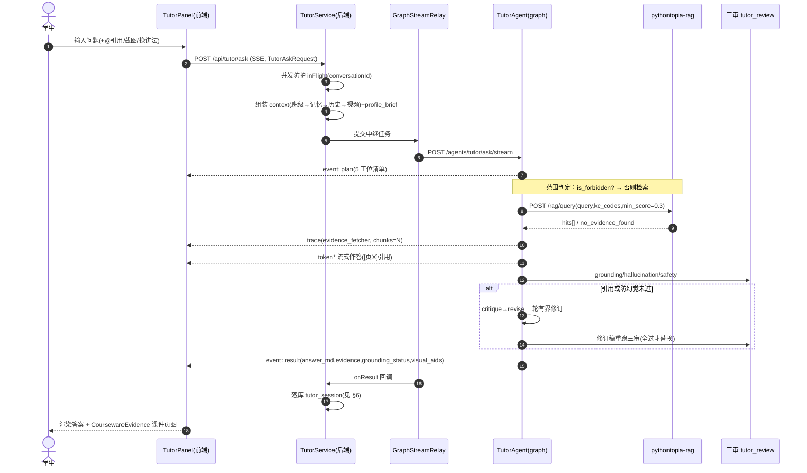
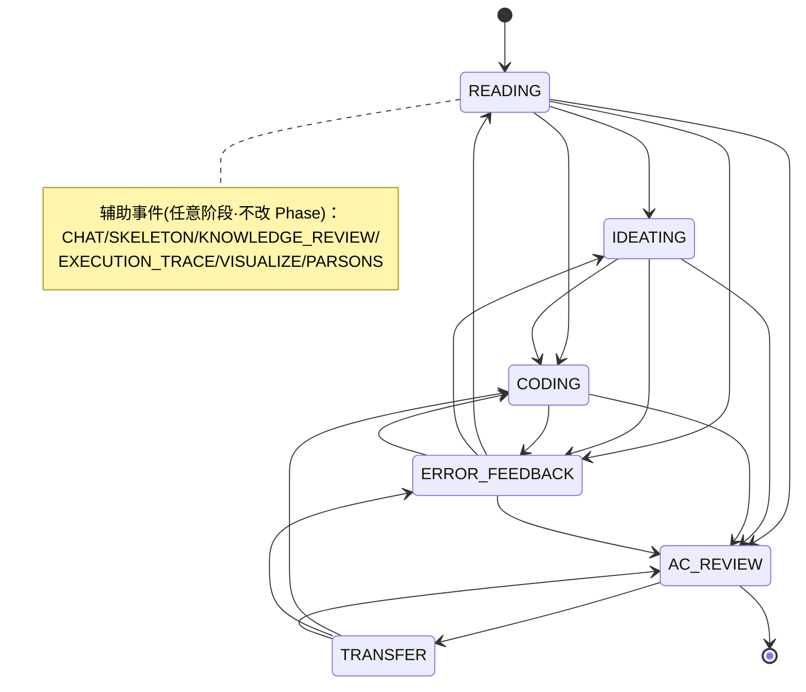
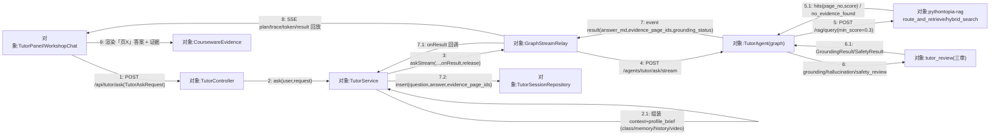
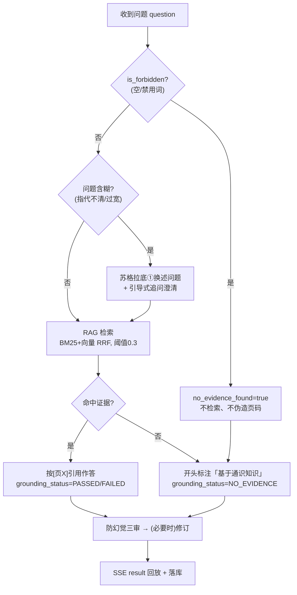
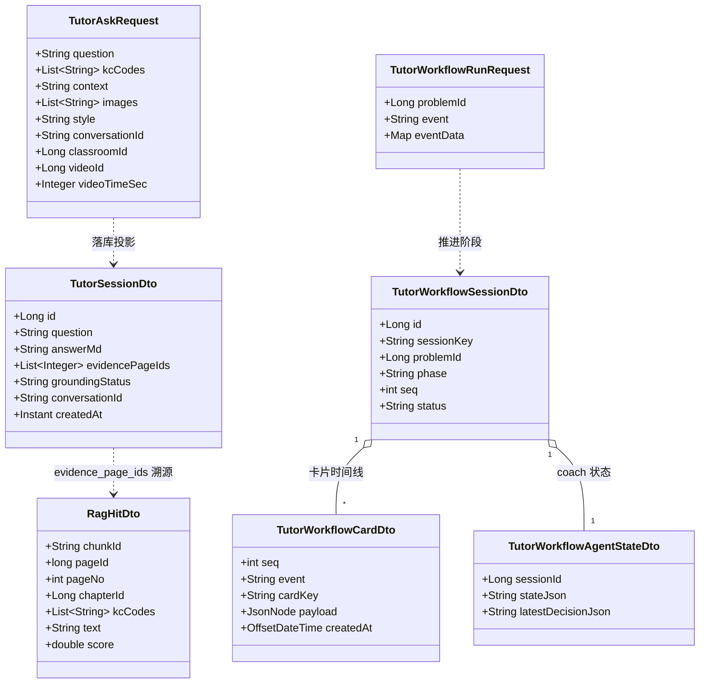

## 8.7 课件问答与导师答疑(RAG) · 详细设计

> 模块代号：M07 ｜ filecode：S07 ｜ 对应 PDF 章：8 详细设计
> 后端包：`com.pythontopia.tutor`（TutorController / TutorWorkflowController / TutorService / TutorWorkflowService / GraphStreamRelay / TutorGraphClient / TutorWorkflowGraphClient）、`com.pythontopia.rag`（RagController / RagFacade / RagClient）
> Python：`pythontopia-graph`（`agents/tutor_agent.py`、`agents/tutor_workflow_cards.py`、`graph/tutor_workflow_graph.py`、`nodes/tutor_review.py`、`routes/tutor.py`、`routes/tutor_workflow.py`）、`pythontopia-rag`（`routes/query.py`、`graph/router.py`、`index/fusion.py`、`safety/forbidden.py`）

本章按详细设计**六要素**展开：① 模块职责与边界、② 处理流程与时序、③ 关键算法与策略、④ 数据结构、⑤ 接口设计、⑥ 异常处理与降级。表名字段全字典统一见 §6 数据库设计（D2 课程主线答疑分片），本章引用时只写「见 §6 表 xxx」。

### 8.7.1 要素一：模块职责与边界

M07 把「课件问答」拆为三条链路，分层清晰、职责单一：

| 链路 | 入口 | 后端编排 | graph 端点 | 证据 |
| --- | --- | --- | --- | --- |
| 课件答疑（SSE） | `POST /api/tutor/ask` | `TutorService` → `TutorGraphClient` → `GraphStreamRelay` | `/agents/tutor/ask/stream` | 课件 RAG |
| 题内导学工作流（SSE） | `POST /api/tutor/workflow/runs` | `TutorWorkflowService` → `TutorWorkflowGraphClient` | `/agents/tutor-workflow/run/stream` | 课件 RAG + 判题诊断 |
| 课件证据直查 | `POST /api/rag/query` | `RagFacade` → `RagClient` | （rag 服务）`/rag/query` | 课件 RAG |

边界约定（强约束）：① 答疑/导学**graph 零回调 Java**——题面、判题诊断、画像 `profile_brief` 随请求体一次性下传，课件证据由 graph 自取；② 阶段状态机权威在 graph（进程内单 worker），Java 持久化投影负责跨重启恢复（请求随附 `restore_phase`/`restore_seq`）；③ 防幻觉红线在 RAG（`no_evidence_found`）与三审（`tutor_review`）双层兜底。

为便于「看图说话」，先给出 M07 主界面截图占位（融入要素一，展示本模块对外呈现的「提问—作答—证据」面，区别于其它模块：答案旁恒有可溯源的课件证据栏）。

> 【截图占位 SC-S07-1】
> - 访问：http://localhost:5173/workshop（容器态 http://localhost:8080/workshop）
> - 登录角色：学生（除 /login 外均需登录）
> - 操作步骤：1. 学生登录后进入「百晓工坊」`/workshop`；2. 在课件问答输入框提问（示例「input 函数怎么用？」）并发送；3. 待 SSE 流式作答结束，展开答案下方「课件证据」面板。
> - 截取对象：课件问答答疑面板（`WorkshopChat`，与 `TutorPanel` 同源 `/api/tutor/ask`）+ 证据引用面板 `CoursewareEvidence`（页码 + 课件原文片段 + 课件页图缩略）
> - 期望画面：导师答案中出现 `[页 X]` 引用，`CoursewareEvidence` 同步列出对应课件页码、原文片段与页图；命中证据时显示页码来源，无证据时答案开头显示「基于通识知识」标注（绝不出现伪造页码）

### 8.7.2 要素二：处理流程与时序

#### 8.7.2.1 课件答疑全链路时序

图 S07-1 给出一次课件答疑从「提问→范围判定→检索→证据→生成→防幻觉三审→SSE 回放」的完整时序，涵盖修订闭环与降级。



> 图 S07-1　课件答疑链路时序（提问→范围判定→RAG 检索→证据→流式生成→三审→修订→SSE 结果落库）

#### 8.7.2.2 导学工作流阶段状态机

图 S07-2 给出 6 阶段导学工作流的状态迁移（移植 Alethicode `transitions.py`，由 graph `validate_transition` 权威判定；辅助事件不改变阶段）。



> 图 S07-2　导学工作流 6 阶段状态机（非法迁移 → TRANSITION_VIOLATION；TRANSFER 入口仅在已有 AC 复盘方向时给出）

#### 8.7.2.3 课件答疑通信图（协作图）

图 S07-6 以 UML 协作图视角给出同一次答疑的**对象链接拓扑**：节点是真实类/组件，边是带序号的消息，无生命线，强调「谁持有谁的引用、消息如何编号传递」，与图 S07-1 时序图互补（时序图看「先后」、通信图看「连接」）。主链路 `TutorPanel → TutorController → RAG 检索 → 三审`，**证据页码沿 5.1→7→9 号消息单向回流**，落库（7.2）与 SSE 回放（8）在中继处分叉。这是 M07 区别于其它模块的关键拓扑：检索（rag）与三审（tutor_review）是答案出账前的两道强制中转对象，缺一不可。



> 图 S07-6　课件答疑通信图（协作图：对象链接 + 序号消息；2.1 为 TutorService 自组装上下文的自消息，证据页码 5.1→7→9 单向回流，落库 7.2 与回放 8 在 GraphStreamRelay 分叉）

### 8.7.3 要素三：关键算法与策略

#### 8.7.3.1 范围判定与澄清分支

图 S07-3 给出答疑入口的「范围判定—澄清—降级」决策流：先过安全禁用词，再判检索证据是否命中，含糊问题走苏格拉底式①换述问题澄清，范围外/无证据走通识标注，绝不伪造页码。



> 图 S07-3　范围判定与澄清分支决策流（安全门 → 含糊澄清 → 检索 → 证据/通识双路 → 三审）

**超时退化阶梯（ASCII 字符图）**：RAG 检索（15s 超时 + 1 次重试 + `rag` 熔断）、provider 子调用（预算 `_MAX_LLM_CALLS=6`）、图解（mermaid→ascii→svg 选型，非法回退确定式 mermaid）逐级优雅退化，主答案永不因尾部增强失败而丢弃。

```text
 RAG 命中证据 ──超时/熔断──> 空证据(通识标注) ──仍可作答
       │
 图解 svg ──消毒失败/非法──> ascii 字符画 ──失败──> 确定式 mermaid(永远可渲染)
       │
 三审未过 ──> 一轮 critique→revise ──仍未过──> 保留原答案 + 标 FAILED(答案优先)
       │
 子调用预算不足 ──> 图解/证据注先被砍(trace 标 budget_skipped)，主作答不受影响
```

> 图 S07-4　答疑增强能力的超时/失败退化阶梯（ASCII；体现「答案优先、绝不空收尾」）

#### 8.7.3.2 课件 RAG 混合检索与图扩展

`pythontopia-rag` 的 `route_and_retrieve`（`graph/router.py`）在既有混合检索之上叠自适应路由：`graph_mode=None` 为旧调用零行为漂移路径；`auto` 由 `classify_query` 判别（多 KC 锚点或命中多跳提示词「为什么/区别/先学…」→ 走图扩展，否则纯向量）。`hybrid_search`（`index/fusion.py`）：向量 top-50 与 BM25 top-50 并行召回 + RRF（k=60）融合取 `top_k`；向量候选沿用 `min_score=0.3` 过滤、BM25 候选要求正分；KC 前置扩展路权重 0.5、配额 `top_k//3`，命中页标 `via_prerequisite=True`；BM25 缺失自动退回 `vector_only`。两路皆空 → `no_evidence_found=true`。

#### 8.7.3.3 防幻觉三审与修订闭环

三审为确定式规则（零 LLM 成本，`nodes/tutor_review.py`）：① **引用审查** `grounding_review`——答案中 `[页 X]` 必须落在检索证据页内，命中外页判编造（无证据则放行并标 `NO_EVIDENCE`）；② **防幻觉核查** `hallucination_review`——统计型数字（百分比 / 4 位以上整数）须出现在证据文本中；③ **安全审查** `safety_review`——拦泄答关键词（`answer_key`/`hidden_test`/`完整答案`…）、歧视、PII（手机号/身份证/邮箱）、危险代码（`os.system`/`rm -rf`/`shutil.rmtree`）。引用或防幻觉未过则注入审查意见做**一轮**有界修订，修订稿重跑三审全过才替换，否则保留原答案并标 `grounding_status=FAILED`。

#### 8.7.3.4 导学卡片生成与防泄答 guardrail

`TutorWorkflowCardAgent`（`agents/tutor_workflow_cards.py`）按事件分派到各阶段卡片生成（`problem_guide`/`ideate`/`skeleton`/`error_diagnosis`/`post_ac`/`transfer`/`chat` + 辅助 `knowledge_review`/`execution_trace`/`visualize`/`parsons`），prompt 逐条保留防泄答硬约束（不给完整答案、骨架卡至少 2 处 TODO、迁移题不物化判题）。产出经 pydantic 模型强校验（`CARD_KEY_TO_MODEL`），违规带审查意见重试一次仍失败抛 `SCHEMA_VIOLATION`；再经 `GuideGuardrailCritic` 防泄答复核（最多 2 次），失败 `GUIDE_GUARDRAIL_FAILED`，fail fast 不打补丁。挫败度（low/moderate/severe）由服务端按连错次数推导注入，不交 LLM 自评。

#### 8.7.3.5 上下文组装与多模态/工具增强

答疑上下文由 `TutorService` 按固定优先级合并后再下传 graph：**班级学情（仅教师 copilot）→ 个人近期记忆（`MemoryRetrievalService` 取至多 5 条要点）→ 本会话历史（同 `conversationId` 最近 6 轮，单轮答案截断 240 字控 token）→ 视频上下文（看课页回传 `videoId` + 播放时刻，按 ±30s 锚定，真字幕转写检索为占位 seam）→ 学生原始 `context`**；`conversationId` 仅供后端取历史分组，不下传 graph。多模态与工具增强在 graph 侧按需触发：① **看图答疑**——`images` 非空时逐张（至多 3 张）经讯飞「图片理解」转**客观描述**（中性识别 prompt 严禁解题），并入 context 再交导师作答，绝不据图直接解题；② **代码运行验证**——问题含 Python 围栏代码块且在追问「为什么/报错/不对」时，于受限沙箱实跑一次（`run_python`），把真实 stdout/stderr/exit_code 作为 system 提示注入，引导导师据实定位，属辅助定位非正式判题；③ **辩论复核**——命中「严谨/证明/推导/权衡/哪个更…」触发词时路由进 `DebateGraph`（求解者→质疑者→仲裁者三方），产出非空定稿才采用，否则回退普通答疑，绝不让难题崩答疑；④ **考考我（ASKME）**——`context` 含 `QUIZ_TURN_<n>` 走出题、含 `QUIZ_JUDGE` 走评卷，评卷仅在 RAG 命中且点评含合法 `[页 X]` 时才引用 PPT。以上增强均 best-effort：任一失败自动跳过、低优先级步骤（图解 / 证据注）在子调用预算（`_MAX_LLM_CALLS=6`）不足时先被砍，主答疑链路恒不受影响。

#### 8.7.3.6 因材施教与 coach 决策

答疑按 8 维学习画像 `profile_brief` 个性化：`resolveProfileBrief` 取富化画像，学生显式「换讲法」（`style ∈ visual/logical/trial`）时无视画像置信度门槛、即时改写认知风格段；graph 侧 `_personalization_directives` 按 brief 实际信号逐条注入 system 指令（认知风格→首屏讲法、知识基础→难度调节、目标→举例贴场景、偏好→媒介倾向、易错→主动预警、情绪→先肯定再纠错），并确定性拼接「为你定制」`personalization_note`（零 LLM 成本）。导学工作流由 `GuideCoachAgent` 做 manager 式决策：在阶段动作白名单内给出 `next_event` / `tool_name` / `hint_level`，把推荐动作排到首位（不强插非法按钮）；其学生状态与决策投影到 `tutor_workflow_agent_state`（按 `session_id` upsert），跨重启由 Java 还原 `student_state` 回灌 graph，使「百晓」的辅导在刷新与重启后仍连续。

#### 8.7.3.7 PDL：检索—打分—三审主算法

PDL S07-1 用结构化伪代码刻画 M07 最核心的「证据闭环」算法：安全门 → 混合召回 → RRF 打分阈值 → 据证据分流作答 → 末端三审 → 诚实出账。方法/变量名取自 `safety/forbidden.py`、`graph/router.py`、`index/fusion.py`、`nodes/tutor_review.py`。该算法是 M07 与其它模块差异化的核心：**唯一一处「检索证据决定能不能引用页码、三审决定能不能出账」的防幻觉主链**。

```text
PROCEDURE answerWithEvidence(question, kc_codes, top_k, min_score=0.3)
  INPUT : question:String, kc_codes:List<String>, top_k:int, min_score:double
  OUTPUT: { answer_md, evidence_page_ids:int[], grounding_status }

  // —— 1. RAG 检索（rag 服务 /rag/query：安全门 → 混合召回 → RRF 打分）——
  hits <- retrieveEvidence(question, kc_codes, top_k, min_score)

  // —— 2. 据证据分流作答（红线：无证据绝不伪造页码）——
  IF hits = ∅ THEN
      answer_md <- generate(question, ctx, profile_brief, NO_EVIDENCE_DIRECTIVE) // 开头标「基于通识知识」
      RETURN { answer_md, evidence_page_ids: [], grounding_status: "NO_EVIDENCE" }
  ENDIF
  answer_md <- generate(question, ctx, profile_brief, hits)        // 有证据必须按 [页 X] 引用

  // —— 3. 末端确定式三审（零 LLM 成本）——
  g <- grounding_review(answer_md, hits)        // 答案 [页X] 须 ⊆ {hit.page_no}，命中外页=编造
  h <- hallucination_review(answer_md, hits)    // 统计型数字（%/4 位+整数）须见于证据文本
  s <- safety_review(answer_md)                 // 泄答/歧视/PII/危险代码

  // —— 4. 引用或防幻觉未过 → 一轮有界修订，重跑三审全过才替换 ——
  IF (NOT g.passed) OR (NOT h.passed) THEN
      revised <- revise(answer_md, reasons(g, h))
      IF grounding_review(revised, hits).passed
         AND hallucination_review(revised, hits).passed
         AND safety_review(revised).passed THEN
          answer_md <- revised ;  grounding_status <- "PASSED"
      ELSE
          grounding_status <- "FAILED"          // 答案优先：保留原答，诚实标失败
      ENDIF
  ELSE
      grounding_status <- "PASSED"
  ENDIF

  RETURN { answer_md,
           evidence_page_ids: [hit.page_no FOR hit IN hits],
           grounding_status }
END

PROCEDURE retrieveEvidence(question, kc_codes, top_k, min_score)   // rag 服务，命中证据才有页码
  IF is_forbidden(question) THEN RETURN ∅ ENDIF                    // 空查询/禁用词 → 无证据
  route <- (graph_mode = "auto") ? classify_query(question, kc_codes) : "vector"
  vector_hits <- store.search(embed(question), 50, kc_codes) WHERE score >= min_score
  IF (bm25 IS NULL) OR (bm25.built_chunks = 0) THEN
      RETURN vector_hits[0 : top_k]                               // vector_only 退化，位级兼容
  ENDIF
  bm25_pairs <- bm25.search(question, 50, kc_codes) WHERE score > 0      // BM25 候选要求正分
  IF (route = "graph") AND (kc_codes ≠ ∅) THEN                    // KC 前置扩展（补充证据）
      prereq <- kc_graph.prerequisites_of(kc_codes)
      加入低权重前置召回路(prereq, weight = PREREQ_WEIGHT = 0.5, 配额 = top_k // 3)
  ENDIF
  fused <- weighted_rrf_scores(rankings, k = RRF_K = 60)          // score(d) = Σ w / (k + rank_d)
  RETURN 归一化排序(fused)[0 : top_k]   // 前置命中标 via_prerequisite=TRUE；两路皆空 → ∅
END
```

> PDL S07-1　课件答疑核心算法（安全门 → 混合召回 + RRF 打分 → 前置扩展 → 据证据分流 → 末端三审 + 一轮有界修订；无证据/失败均诚实出账，绝不伪造页码）

#### 8.7.3.8 NS 盒图：问题澄清与无证据分支

图 S07-7 用 NS 盒图刻画答疑入口的**三层嵌套结构化过程**——安全门、含糊澄清、命中/无证据双路，对应「问题是否清晰 → 澄清」「命中分是否达阈值 → 无证据回退」两处关键决策。盒图层数（2 层嵌套）与分支数（3 个条件）刻意区别于其它模块的单层校验盒图，凸显 M07「先问清、再检索、宁可说无也不编造」的取舍。

<table border="1" cellspacing="0" cellpadding="6" style="border-collapse:collapse;text-align:center;font-size:13px">
  <tr><td colspan="2"><b>读取 question / kc_codes（/api/tutor/ask 答疑入口）</b></td></tr>
  <tr><td colspan="2">is_forbidden(question)？（空查询 / 命中禁用词）</td></tr>
  <tr>
    <td style="width:36%;vertical-align:top">T：no_evidence_found=true；hits=∅<br/>不检索、不伪造页码<br/>grounding_status=NO_EVIDENCE</td>
    <td style="width:64%;vertical-align:top">
      F：
      <table border="1" cellspacing="0" cellpadding="6" style="border-collapse:collapse;width:100%;text-align:center">
        <tr><td colspan="2">问题是否清晰？（指代明确 ∧ 范围适中）</td></tr>
        <tr>
          <td style="width:50%">T：直接进入检索</td>
          <td style="width:50%">F：苏格拉底①换述问题<br/>+ 引导式追问澄清，再检索</td>
        </tr>
        <tr><td colspan="2">route_and_retrieve / hybrid_search：<br/>向量 top50(score≥min_score=0.3) + BM25 top50(正分)<br/>→ RRF(k=60) 融合，前置扩展配额 top_k//3</td></tr>
        <tr><td colspan="2">命中证据？（hits ≠ ∅，融合分达阈值）</td></tr>
        <tr>
          <td style="width:50%">T：按 [页 X] 引用作答<br/>→ 末端三审<br/>→ grounding_status=PASSED/FAILED</td>
          <td style="width:50%">F：无证据回退<br/>开头标「基于通识知识」<br/>grounding_status=NO_EVIDENCE<br/>绝不伪造页码</td>
        </tr>
      </table>
    </td>
  </tr>
</table>

> 图 S07-7　NS 盒图（问题澄清与无证据分支：安全门 → 含糊澄清 → 检索 → 命中/无证据双路，三处分支两层嵌套，体现「证据诚实、绝不伪造」）

### 8.7.4 要素四：数据结构

图 S07-5 给出 M07 会话 / 消息 / 卡片的类关系（DTO 与持久化投影）。完整字段字典见 §6 数据库设计 D2（`tutor_session`、`tutor_workflow_session`、`tutor_workflow_card`、`tutor_workflow_agent_state`、`tutor_workflow_action_event`），此处只表达对象关系与关键字段。



> 图 S07-5　M07 会话/消息/卡片类图（请求 DTO ↔ 持久化投影 ↔ RAG 证据；字段全字典见 §6 D2）

数据要点：① `tutor_session.evidence_page_ids` 为 `INTEGER[]`，与答案 `[页 X]` 引用同源同序；② `tutor_workflow_session` 有 `(user_id, problem_id) WHERE status='ACTIVE'` 唯一活跃约束；③ `tutor_workflow_card.payload` 为整卡 JSONB（含 `card_id`，`ai_reply` 另带 `user_message` 供时间线回放）；④ `tutor_workflow_agent_state` 按 `session_id` 唯一 upsert，保存 `student_state` 与 `coach_decision`。

### 8.7.5 要素五：接口设计

#### 8.7.5.1 对外 REST（前缀 `/api`，JWT Bearer）

| 方法·路径 | 角色 | 请求/响应 | 说明 |
| --- | --- | --- | --- |
| `POST /api/tutor/ask` | 学生 / 教师·管理员 | `TutorAskRequest` → SSE | 流式答疑；教师带 `classroomId` 触发 copilot |
| `POST /api/tutor/style-engaged` | 学生 | `StyleEngagedRequest` → 204 | 采纳讲法回流画像 |
| `GET /api/tutor/sessions` | 当前用户 | `?limit=20` → `TutorSessionDto[]` | 历史会话列表 |
| `GET /api/tutor/conversations/{conversationId}` | 当前用户 | → `TutorSessionDto[]` | 某会话窗口多轮 thread（按 user 过滤防越权） |
| `POST /api/tutor/workflow/runs` | 学生 | `TutorWorkflowRunRequest` → SSE | 一次工作流事件 |
| `GET /api/tutor/workflow/sessions/active` | 学生 | `?problemId=` → 快照+卡片 | 前端刷新恢复 |
| `POST /api/tutor/workflow/sessions/{sessionKey}/feedback` | 学生 | `TutorWorkflowFeedbackRequest` | 导学行为反馈 |
| `POST /api/rag/query` | 教师 / 管理员 | `RagQueryRequestDto` → `RagQueryResponseDto` | 课件证据直查（`@PreAuthorize`） |

#### 8.7.5.2 内部 graph / rag 端点

- graph（`:18091`）：`POST /agents/tutor/ask/stream`（答疑）、`POST /agents/tutor-workflow/run/stream`（导学）；
- rag（`:18092`）：`POST /rag/query`、`POST /rag/index/rebuild`（`X-Internal-Token`）、`GET /rag/index/status`。

#### 8.7.5.3 SSE 事件协议

后端 `GraphStreamRelay` 逐帧透传 graph SSE，并统一终态语义：`plan`（工位清单）、`trace`（节点 start/finish 进度）、`token`（流式增量 `{delta}`）、`result`（终值，兼容 AG-UI `RUN_FINISHED` 的 `{"result":{...}}` 与裸结果两形）、`error`（`{code,message}`）。终态事件集 = `{result, error, RUN_FINISHED, RUN_ERROR}`，收到即触发 `onResult` 落库。

### 8.7.6 要素六：异常处理与降级

| 场景 | 处理 | 错误码 / 状态 |
| --- | --- | --- |
| graph 不可用 / HTTP≥400 | 发一条终止性 error，内部细节只进日志 | `AI_SERVICE_UNAVAILABLE` |
| 上游读超时 | 按 read-timeout 切断 | `AI_SERVICE_TIMEOUT` |
| 流在终态前断（坏损/截断） | 补一条终止性 error，绝不静默当成功 | `AI_STREAM_INTERRUPTED` |
| 同会话并发提问 | 上一问未结束快速拒绝 | `409 SESSION_BUSY` |
| RAG 检索失败 | 15s 超时 + 1 次重试 + 熔断，回空证据走通识标注 | trace 标 retry |
| 非法阶段迁移 | graph `validate_transition` 拦截 | `TRANSITION_VIOLATION` |
| 卡片不合规 / 防泄答失败 | 重试 1 次仍失败 fail fast | `SCHEMA_VIOLATION` / `GUIDE_GUARDRAIL_FAILED` |
| 缺判题证据 | 错因/复盘缺 `submission_id` 或不匹配 | `INSUFFICIENT_EVIDENCE` / `400` |
| 子调用预算不足 | 图解/证据注先被砍 | trace 标 `budget_skipped` |
| 客户端断开 | emitter 写失败即停消费、关连接 | `CLIENT_GONE`（内部） |

资源释放：所有路径汇聚同一 finally——关上游连接、`complete()` 一次、`onFinished` 释放回调一次（并发锁 `inFlightConversations` 恰好释放一次）。降级总原则：**答案优先、证据诚实、绝不伪造、绝不空收尾**。

> 表 S07-1　M07 异常与降级对照（错误码与 `GraphStreamRelay` / graph failure bucket 一致）

---

执笔人：成员 A ｜ 完成人（签名）：成员 A ｜ 审查人：成员 C ｜ 完成日期：2026-06-16
