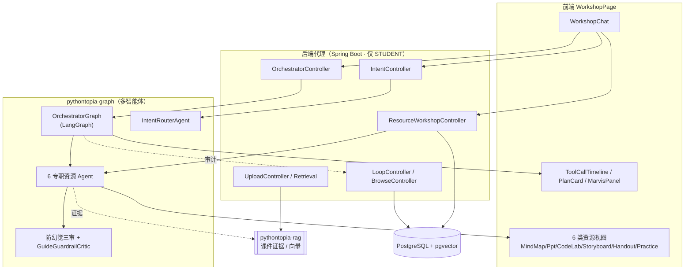
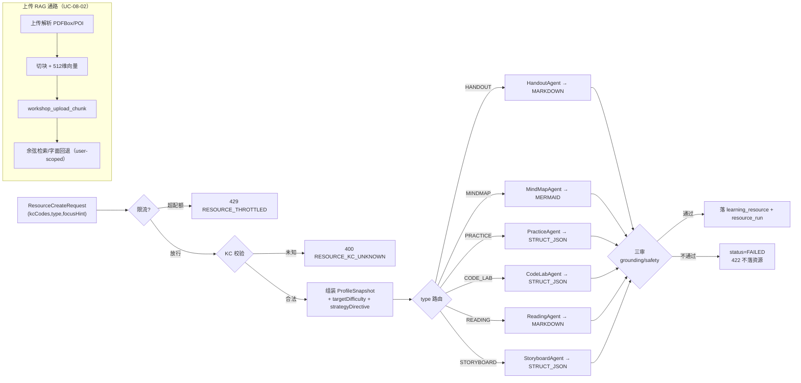
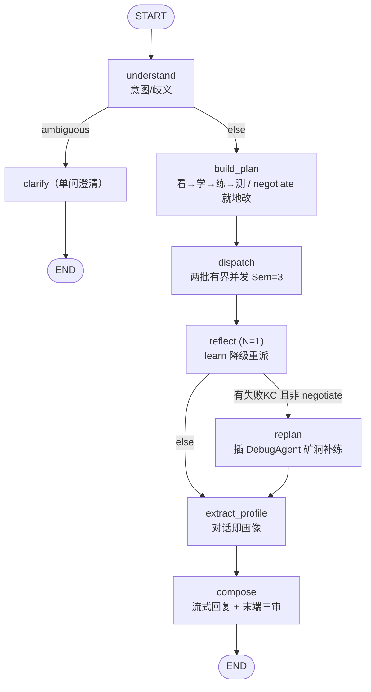
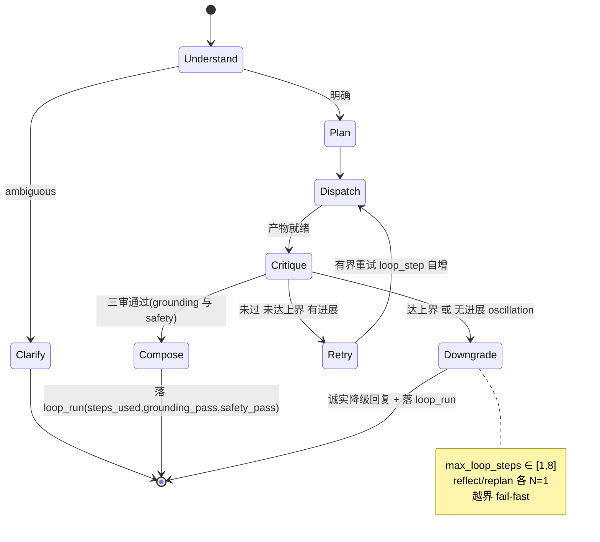
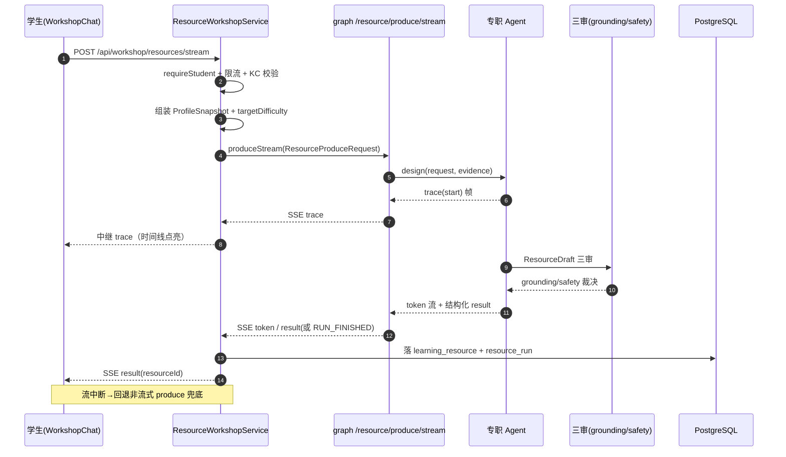
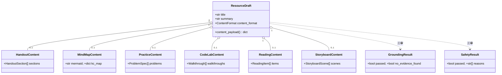
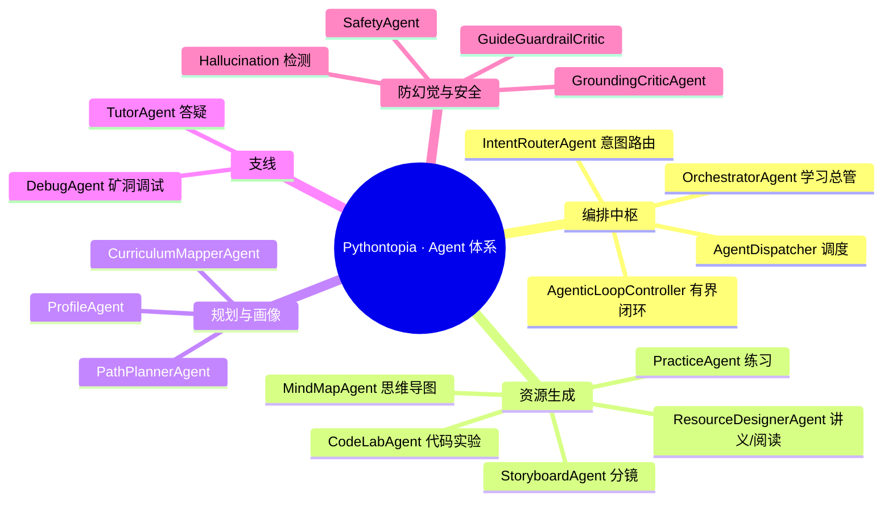

## 8.8 资源工坊与多智能体编排 · 详细设计

> 本文 filecode = **S08**；图编号 `图 S08-n`、表编号 `表 S08-n`。
> 数据表完整字段字典只在 §6（D3）出现一次，本文引用表名时写「详见 §6」。术语见总纲 §2。
> 本模块为多智能体编排核心，按**六要素**展开：①模块职责与结构 ②处理流程与算法 ③数据结构与持久化 ④接口设计 ⑤类与 Agent 体系 ⑥异常处理·安全·降级。

### 8.8.1 要素一 · 模块职责与总体结构

资源工坊在架构上分三层，前端 Vue + 后端 Spring Boot 代理 + Python graph 智能体服务，后端**不做内容生成**，只承担鉴权、限流、画像/难度组装、SSE 中继与落库；真正的多智能体编排与 LLM 调用全部在 `pythontopia-graph`。

- **前端层**：`WorkshopPage` 单页（顶部传送栏 + 居中对话流 + 左历史 + 右书房/调用抽屉）。`WorkshopChat` 是输入与流式渲染中枢，按意图把结果分派到 `MindMapView`/`PptView`/`CodeLabView`/`StoryboardView`/`HandoutView`/`PracticeList`；`MarvisPanel`+`ToolCallTimeline` 渲染工具调用链路，`PlanCard` 渲染「看→学→练→测」计划，`BrowseTimeline` 渲染联网查证步骤。
- **后端代理层**：`workshop`（`ResourceWorkshopController`/`ResourceWorkshopService`、`history`、`upload`）、`orchestrator`、`intent`、`browse`、`loop`、`agent.run`。统一 `requireStudent` 鉴权与按 owner 隔离。
- **Python 智能体层**：`OrchestratorGraph`（LangGraph StateGraph）统筹；专职 Agent `MindMapAgent`/`PracticeAgent`/`CodeLabAgent`/`StoryboardAgent`/`HandoutAgent`/`ReadingAgent`，加 `IntentRouterAgent`、`AgentDispatcher`、`AgenticLoopController`、`GuideGuardrailCritic` 与防幻觉三审节点。

> 图 S08-1：M08 总体结构与三层调用（flowchart）。



> 图 S08-1 的三层结构在运行期收敛为单页路由 `/workshop`（`WorkshopPage`），其真实界面见下方截图占位（作为要素一总体结构的可视佐证）。

> 【截图占位 SC-S08-1】
> - 访问：http://localhost:5173/workshop（容器态 http://localhost:8080）
> - 登录角色：学生（除 /login 外均需登录）
> - 操作步骤：1. 学生登录后从中央小镇导航/传送进入「百晓资源工坊」`/workshop`；2. 在 `WorkshopChat` 输入「帮我把 for 循环整理成思维导图」并发送，触发意图路由与工坊 SSE 生成；3. 观察右侧 `MarvisPanel` / `ToolCallTimeline` 工具调用流逐条点亮，居中 `MindMapView` 渲染出导图。
> - 截取对象：`WorkshopPage` 整页（左侧历史 + 居中对话流与六类资源视图 + 右侧 `MarvisPanel` / `ToolCallTimeline` 调用时间线）。
> - 期望画面：对话流出现一张 MERMAID 思维导图资源卡（`MindMapView` 已渲染），右侧时间线按 understand→dispatch.MindMapAgent→三审 顺序显示各步状态，`PlanCard` 同步呈现看/学/练/测计划。

### 8.8.2 要素二 · 处理流程与核心算法

#### 8.8.2.1 六类资源生成与分发

`ResourceWorkshopService.createStream` 是生成主流程：限流 → KC 校验 → 组装 `ProfileSnapshot`（画像折叠：major 归一、自评等级、媒介偏好、认知风格按置信度门控 0.3、易错点取最近 3、最新洞察、近期记忆 topK=5）→ 算 `targetDifficulty`（`difficultyBand(score, confidence)`：score<0.4→basic、<0.7→medium、否则 hard；低置信降一档、高置信逼近上沿升一档）→ 取最新 Agent 策略 directive → 调 graph 流式 `produce` → SSE 中继 → 落 `learning_resource`+`resource_run`。graph 侧按 `ResourceType` 路由到专职 Agent，每个 Agent 都「LLM 产出→结构化校验→不合格回落确定式兜底（golden）」。

> 图 S08-2：六类资源分发与上传 RAG 通路（flowchart）。



#### 8.8.2.2 学习总管编排 DAG

`OrchestratorGraph` 用 LangGraph 把对话拆成有向图，条件边控制流；trace/dispatch_results 经 `operator.add` reducer 累加，每轮独立 checkpoint thread（防跨轮污染）。

> 图 S08-3：学习总管编排 DAG（flowchart）——节点即 graph 实节点，条件边即真实路由。



派发批次：`first_batch`=watch/learn/assess（无依赖，信号量 3 并发），`second_batch`=practice（依赖 learn 讲义 title/summary 注入 `focus_hint` 实现步骤间协作）。`reflect` 仅对 learn 阶段「执行类失败」（`artifact.kind=="dispatch_failure"`）按 `CODE_LAB→HANDOUT→READING` 降一档重派一次，严格 N=1。

#### 8.8.2.3 有界闭环状态机

`AgenticLoopController.run` 驱动「一轮 dispatch+critic」的有界循环：通过即 compose；未过且达上界或两轮失败原因等价（无进展/oscillation）则诚实降级；否则有界重试。这是 `loop_run` 审计落库的语义来源。

> 图 S08-4：有界 Agentic Loop 状态机（stateDiagram-v2）——非自由 ReAct，步数有显式上限。



辅助状态机：上传生命周期 `PENDING→READY|FAILED`（`workshop_upload.status`）；联网查证 `PENDING→SUCCESS|TRUNCATED|FAILED`（`browse_run.status`）；闭环步骤 `pending→active→done|failed`（`LoopStep.status`），均落库或经 `CUSTOM(loop_step)` 事件可见。

#### 8.8.2.4 学习总管协作通信图

编排链路的**对象协作拓扑**与时序图（图 S08-5 偏一次资源生成）互补：通信图不画生命线，只强调对象间链接与**带序号消息**的传递方向，凸显「前端 → Spring 代理 → graph 编排 → 专职 Agent → SSE 中继 → 前端拼装」这一真实调用骨架（类名取自 `OrchestratorController`/`OrchestratorService`/`OrchestratorGraphClient`/`GraphStreamRelay`/`OrchestratorGraph`/`AgentDispatcher`）。

> 图 S08-8：学习总管一轮对话协作通信图（flowchart LR，带序号消息）——对应 `/api/orchestrator/turn/stream` 主链路。

```mermaid
flowchart LR
  WC["对象:WorkshopChat（前端）"]
  OCtl["对象:OrchestratorController"]
  OSvc["对象:OrchestratorService"]
  OGC["对象:OrchestratorGraphClient"]
  REL["对象:GraphStreamRelay（SSE 中继）"]
  OG["对象:OrchestratorGraph（LangGraph）"]
  OA["对象:OrchestratorAgent"]
  AD["对象:AgentDispatcher"]
  SUB["对象:专职 Agent（资源/Tutor/Debug）"]
  USS["对象:useSseStream / ToolCallTimeline"]

  WC -->|"1: turnStream(OrchestratorTurnRequest)"| OCtl
  OCtl -->|"1.1: requireStudent + turn(userId,req)"| OSvc
  OSvc -->|"1.2: turnStream(+decayingKcs, SseEmitter)"| OGC
  OGC -->|"1.3: relay(/agents/orchestrator/turn/stream, X-Internal-Token)"| REL
  REL -->|"2: run_streaming(req, emit)"| OG
  OG -->|"2.1: understand()/decompose()"| OA
  OG -->|"2.2: dispatch(PlanStep) · Sem=3 两批"| AD
  AD -->|"2.3: design()/ask()"| SUB
  SUB -->|"2.4: DispatchResult"| OG
  OG -->|"3: emit(trace/plan/STATE_DELTA/token/result)"| REL
  REL -->|"3.1: SSE 事件帧逐条回放"| WC
  WC -->|"4: 拼装渲染（计划卡/工具时间线/资源视图）"| USS
```



消息 1.1 的 `requireStudent` 越权即 403；1.2 在同会话上一轮流未结束时触发 409 `SESSION_BUSY`；2.2 的两批有界并发（`first_batch` 看/学/测、`second_batch` 练）共享 `Semaphore(3)`，`second_batch` 注入 learn 工件摘要实现步骤间协作；3 的 `step_error` 为非终止帧（单 Agent 失败不截断整流），唯有 `error` 帧整轮终止。

### 8.8.3 要素三 · 数据结构与持久化

M08 共 12 张活跃表，完整字段字典见 §6（D3 工坊判题挑战分片），此处只列职责与关键关系。

> 表 S08-1：M08 数据表职责一览（字段详见 §6）。

| 表（migration） | 职责 | 关键关系 |
| --- | --- | --- |
| `learning_resource`(V040) | 六类生成资源本体（内容 JSONB + 三审状态 + 反馈） | FK user/pack；`created_by_run_id`→resource_run |
| `resource_run`(V021) | Agent 运行审计（input/output/evidence/safety/grounding/status） | FK user |
| `resource_feedback`(V139) | 采纳/评分信号（按 agent_name 归类，供 meta-reflection） | FK user/resource |
| `prevention_pack`(V140) | 预言家预防包（高风险 KC 预生成资源 + 证据） | FK user；resource_id→learning_resource |
| `workshop_upload`(V162) | 上传文件解析文本 + 状态（A 通路 context 源） | FK user |
| `workshop_upload_chunk`(V163) | 上传分块 + 512 维向量（B 通路检索） | FK upload/user；ivfflat 余弦索引 |
| `workshop_chat_turn`(V172) | 工坊聊天历史（覆盖所有工具结果） | FK user；按 conversation_id 聚合 |
| `agent_strategy`(V137) | Agent 版本化可调策略参数 + 理由 | 唯一 (agent_name,version) |
| `loop_run`(V171) | 有界闭环每轮审计（max/steps/replan/critic/trace_id） | FK user；CHECK 有界约束 |
| `agent_memory_ref`(V169) | 外部记忆 provider id 映射（local/mem0/zep） | FK user |
| `browse_run`/`browse_step`(V170) | 联网查证会话与步骤轨迹（外部内容，非课件） | step FK run |

核心内容结构 `learning_resource.content` 为 JSONB，按 `content_format`（MARKDOWN/MERMAID/STRUCT_JSON）承载六类产物的 `content_payload()`；三审状态 `safety_status`/`grounding_status` ∈ {PASSED, FAILED, NO_EVIDENCE}。`loop_run` 以 CHECK 约束强制有界：`max_steps BETWEEN 1 AND 8`、`steps_used<=max_steps`，是「非自由 ReAct」在数据库层的兜底。

### 8.8.4 要素四 · 接口设计

#### 8.8.4.1 REST 端点

后端端点见 R08 表 R08-2；graph 内部端点：`POST /agents/resource/produce(/stream)`（六类生成）、`POST /agents/orchestrator/turn(/stream)`（学习总管）、`POST /agents/orchestrator/tool-loop(/stream)`（混合工具循环，flag `PYT_TOOL_LOOP`，默认 404）、`POST /agents/intent/route` 与 `GET /agents/intent/tools`、`GET /agents/harness/stats`。后端经 `WorkshopGraphClient`/`OrchestratorGraphClient` 调用，携 `X-Internal-Token`，SSE 经 `GraphSseConsumer` 消费再 `SseEmitter` 回放。

#### 8.8.4.2 SSE 事件契约

资源生成与编排都走 SSE，前端 `useSseStream` 消费统一契约；终态历史名 `result` 与 AG-UI `RUN_FINISHED` 归一。

> 表 S08-2：M08 SSE 事件契约（取自 graph routes 与 `WorkshopGraphClient`）。

| 事件 | 载荷 | 前端消费 |
| --- | --- | --- |
| `trace` | 节点名/step_id/phase(start/finish)/status/elapsed_ms/agent_label/note | ToolCallTimeline 逐工具配对 |
| `token` | `{delta}` 流式文本片段 | 答案区增量渲染 |
| `plan` | `{type, nodes[]}` 编排节点列表 | PlanCard / MarvisPanel |
| `STATE_DELTA` | `{delta:{plan_steps[]}}` 步骤状态快照 | 计划卡实时点亮 |
| `CUSTOM` | `loop_plan`/`loop_step`（camelCase） | LoopProgress 有界计划 |
| `step_error` | `{code,agent,step_id,message}`（非终止） | 单步失败提示，不截断流 |
| `result`/`RUN_FINISHED` | 裸 graph 结果（落库后回传 resourceId） | 渲染最终产物 |
| `error` | `{code,message}` 整轮终止 | 错误兜底 |

> 图 S08-5：SSE 流式工具调用时序（sequenceDiagram）——以一次资源生成为例。



### 8.8.5 要素五 · 类与 Agent 体系设计

六类资源统一收敛到 `ResourceDraft`（恰好一个内容体，`@model_validator` 校验），各内容体 Pydantic 强约束（如 `PracticeContent` 禁泄答 key、`StoryboardContent` 3–5 幕、`MindMapContent.mermaid` 须合法）。

> 图 S08-6：六类资源内容模型与产物聚合（classDiagram）。



Agent 体系：`OrchestratorGraph` 经 `AgentDispatcher` 把 `PlanStep` 路由到专职子 Agent；资源类 Agent 共享「design(request, evidence)→ResourceDraft」契约；`AgenticLoopController` 提供 critic 闸门、有界决策、BROWSE 闸门与审计记录。

> 图 S08-7：默认 Agent 清单（mindmap）——按职能分组，含防幻觉与安全岗。



#### 8.8.5.1 关键算法 PDL · 意图路由 + 编排 DAG 调度

下列伪代码合并「百晓工坊意图分类（`IntentRouterAgent.route`）」与「学习总管编排 DAG（`OrchestratorGraph._invoke`）」两段真实控制流：先把单句路由到工具 / 资源类型，再对规划类意图按看→学→练→测分解、按依赖编排、流式产出并末端三审。

> PDL S08-1：意图路由 + 编排 DAG 调度（intent 分类 → 选 Agent → 依赖编排 → SSE 流式 → 防幻觉末审）。

```text
PROCEDURE orchestrateTurn(req)            // IntentRouterAgent.route + OrchestratorGraph._invoke
  INPUT : req{user_message, history, profile_brief, course_kc_index, decaying_kcs, recent_failures}
  OUTPUT: SSE 事件流(trace/plan/STATE_DELTA/token/result) + OrchestratorResponse

  // 0. 意图分类（确定性预判 → 受治理 LLM → 关键词兜底 → 能力/scope 收缩）
  IF 含代码围栏 AND 命中报错特征 THEN tool <- FIX_BUG            // 零 LLM 预判，confidence=0.95
  ELSE tool <- run_with_governance(LLM 路由, timeout=20s, retry=1, fallback=关键词路由)
  tool <- clampToScope(clampToCapability(tool))                 // 越界一律回退 ASK

  // 1. understand：编排意图 ∈ {plan, negotiate, continue, chitchat} 与歧义判定
  u <- OrchestratorAgent.understand(req);  emit("trace", "understand")
  IF u.ambiguous THEN
      stream(单个澄清问题);  emit("token", reply)
      RETURN needs_user_input                                   // 只问一个，不连环追问
  ENDIF

  // 2. build_plan：看→学→练→测分解，KC 必须锚定课程目录
  IF u.intent == negotiate THEN plan <- negotiate(已存 plan)    // 就地改难度/换例/跳过
  ELSE plan <- OrchestratorAgent.decompose(req, u.goal)         // _ground_kcs 过滤非法 KC
  emit("plan", plan);  emit("CUSTOM", loop_plan)

  // 3. dispatch：选 Agent + 按依赖两批有界并发
  first_batch  <- [s IN plan | s.phase != practice]             // 看/学/测：无依赖
  second_batch <- [s IN plan | s.phase == practice]             // 练：依赖 learn 工件
  sem <- Semaphore(3)
  PARALLEL FOR s IN first_batch  WITH sem: results[s] <- AgentDispatcher.dispatch(s)
  learn_hint <- learn 工件 title/summary                        // 步骤间协作注入 focus_hint
  PARALLEL FOR s IN second_batch WITH sem: results[s] <- dispatch(s, focus_hint += learn_hint)
  每步 emit(start/finish trace, STATE_DELTA, loop_step)

  // 4. reflect：有界反思 N=1（learn 执行类失败降一档重派一次）
  FOR s IN learn 步 WHERE results[s].failed AND artifact.kind == "dispatch_failure":
      s2 <- downgraded_learn_step(s)                            // CODE_LAB→HANDOUT→READING
      IF s2 != NULL THEN results[s] <- dispatch(s2)             // 链尾 READING 不再降级

  // 5. replan：近期失败 KC 插 DebugAgent 矿洞补练（非 negotiate）
  IF recent_failures != EMPTY AND plan 无 DebugAgent THEN
      于 assess 前插入 DebugStep;  dispatch(DebugStep)

  // 6. compose：对话即画像 + 流式回复 + 防幻觉末审
  extract_profile(req)
  reply <- stream(OrchestratorAgent.reply_stream)               // provider 不可用→确定性兜底
  verdict <- CriticVerdict(grounding=KC 接地, safety=泄答扫描)
  IF NOT verdict.passed THEN reply <- downgrade_reply()         // 诚实降级，不臆造页码
  emit("result", response);  落 loop_run(steps_used, grounding_pass, safety_pass)
  RETURN response
END
```

#### 8.8.5.2 工具调用循环 NS 盒图

混合工具编排（Phase F，`OrchestratorController.toolLoopStream` → graph `/agents/orchestrator/tool-loop/stream`，flag `PYT_TOOL_LOOP`）的运行时心脏是 `ToolCallingLoop.run`：让模型在**有界**循环里自主「计划→调工具→观察结果→再决策」，直到模型不再调工具（`end_turn`）或触达上限（`max_steps`/`budget`），其轮次与工具轨迹回写 `loop_run` 审计。下盒图描述该结构化过程与四类退出分支。

> 图 S08-9：工具调用循环 NS 盒图（`ToolCallingLoop.run`，对应 loop_run 审计）。

<table border="1" cellspacing="0" cellpadding="6" style="border-collapse:collapse;text-align:center;width:100%">
  <tr><td colspan="2">进入 ToolCallingLoop.run(system_prompt, user_message, executor, forced_first_tool, on_step)</td></tr>
  <tr><td colspan="2">provider 是否支持 function calling？</td></tr>
  <tr>
    <td style="width:50%">F：return stop_reason="no_tool_calling"<br/>（调用方回落既有意图分类器路由，零回归）</td>
    <td style="width:50%">T：初始化 messages=[system,user]、BudgetGuard(LLM 次数/token/墙钟)、steps=[]、trail=[]、rounds=0</td>
  </tr>
  <tr><td colspan="2">是否传入 forced_first_tool 种子（混合架构）？</td></tr>
  <tr>
    <td style="width:50%">T：确定性执行种子工具一步 → 回喂 tool_result → on_step（种子不计模型预算）</td>
    <td style="width:50%">F：不放种子，直接进循环</td>
  </tr>
  <tr>
    <td colspan="2" style="text-align:left">
      <b>WHILE 已用步数 &lt; max_steps（有界，非自由 ReAct）：</b>
      <table border="1" cellspacing="0" cellpadding="6" style="border-collapse:collapse;text-align:center;width:100%;margin-top:4px">
        <tr><td colspan="2">预算是否耗尽？（deadline_exceeded() 或 try_acquire 失败）</td></tr>
        <tr>
          <td style="width:50%">T：return stop_reason="budget"（诚实停止）</td>
          <td style="width:50%">F：rounds+=1；response ← provider.chat(messages, tools)；calls ← coerce_tool_calls(白名单 TOOLS)</td>
        </tr>
        <tr><td colspan="2">模型本轮是否仍调用工具（calls 非空）？</td></tr>
        <tr>
          <td style="width:50%">F：return stop_reason="end_turn"，final_text = 模型答复（正常收敛）</td>
          <td style="width:50%">T：回填 assistant(tool_calls)；FOR each call：run_with_governance 执行（超时/退避/熔断）→ 治理失败回喂结构化 error → 回喂 tool_result → on_step</td>
        </tr>
      </table>
    </td>
  </tr>
  <tr><td colspan="2">循环触达 max_steps：return stop_reason="max_steps"（诚实停止文案，不再调工具）</td></tr>
</table>

### 8.8.6 要素六 · 异常处理、安全与降级

- **限流与配额**：`enforceThrottle` 按 1 小时窗口限生成次数（allowlist 豁免）；消费掌握度奖励每 KC 每日封顶防刷。
- **鉴权与越权**：全端点 `requireStudent`；`loop`/`browse`/`upload` 按 owner 隔离，跨用户读一律 404（隐藏存在性）；内部策略端点用 `MessageDigest.isEqual` 常量时间比对 `X-Internal-Token`。
- **防幻觉三审**：生成产物末端经 grounding（引用接地，KC/页码必须真实）、hallucination、safety（泄答关键词扫描）裁决，落 `safety_status`/`grounding_status`；`GuideGuardrailCritic` 对导学卡片做高置信教育安全检查（骨架码须留空、错误诊断不得给完整修正码、迁移题不得含 reference_solution）。
- **诚实降级（不编造）**：编排达有界上限/critic 拒绝 → `downgrade_reply` 明示「未达课件证据标准」并给安全下一步，绝不臆造页码；provider 不可用 → 各 Agent 确定性兜底（golden）、`compose` 走结构化教学兜底，不退化为自由聊天。
- **有界 fail-fast**：`max_loop_steps∈[1,8]`、`steps_used<=max_steps`（Pydantic + DB CHECK 双重），越界拒绝；BROWSE 考核 scope/空 allowlist/未接线 executor 一律拒派回退 VIDEO。
- **fail-soft 旁路**：画像/记忆/洞察读取失败降级为空不阻断生成；上传向量化失败 chunk 仍入库、检索回退字面匹配；观测（OTel/eval span）失败一律 no-op。
- **外部内容隔离**：上传内容与 BROWSE 抓取内容只进「带标签 context 通道」（标签「外部内容，非课件」），绝不混入 `packId=43` 课件 evidence/引用。

> 表 S08-3：M08 主要错误码（取自各 Service `BusinessException`）。

| 错误码 | HTTP | 触发 |
| --- | --- | --- |
| RESOURCE_KC_UNKNOWN / RESOURCE_KC_EMPTY | 400 | KC 不在课程目录 / 为空 |
| RESOURCE_THROTTLED | 429 | 1 小时生成超配额 |
| RESOURCE_GENERATION_FAILED | 422 | 三审不通过，不落资源 |
| RESOURCE_GRAPH_EMPTY / NO_ARTIFACT | 502 | graph 空响应/缺 artifact |
| UPLOAD_EXT_NOT_ALLOWED / UPLOAD_TOO_LARGE | 415 / 413 | 类型不支持 / 超 5MB |
| SESSION_BUSY | 409 | 同会话上一轮流未结束 |
| LOOP_RUN_FORBIDDEN / STEPS_EXCEED_MAX | 403 / 400 | 越权 / 违反有界语义 |
| FORBIDDEN | 403 | 非 STUDENT 调用 |

---

执笔人：成员 A ｜ 完成人（签名）：成员 A ｜ 审查人：成员 C ｜ 完成日期：2026-06-16
