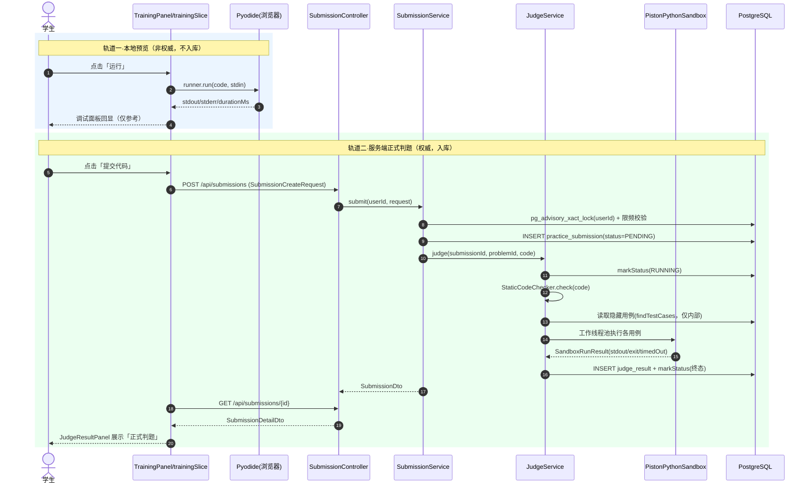
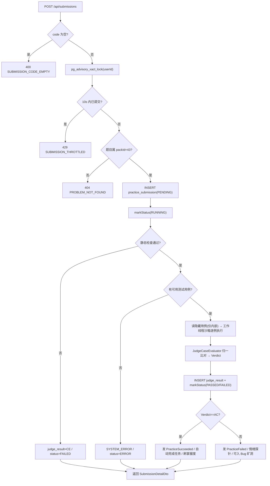
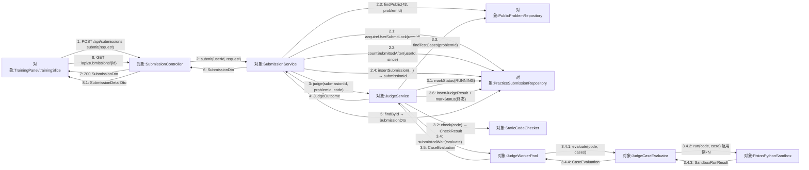
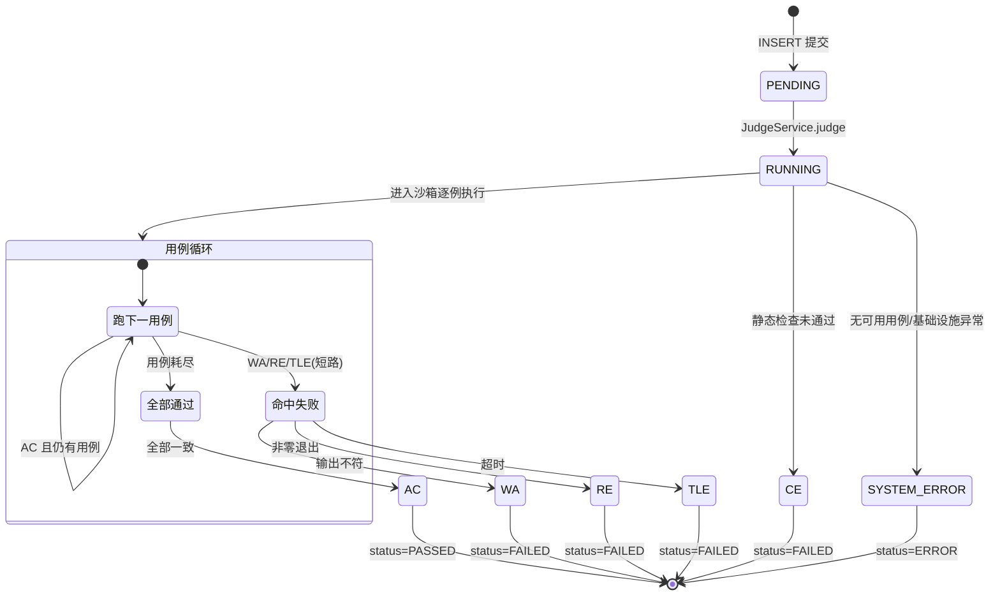
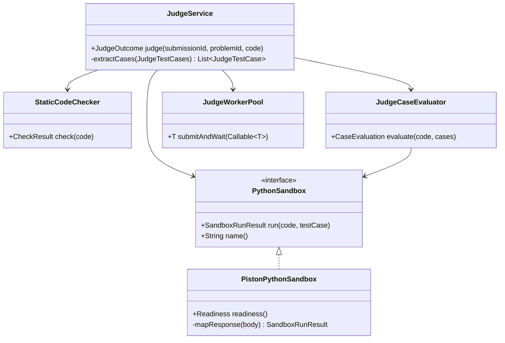

## 8.9 训练场与判题·双轨 · 详细设计

> 本文件 filecode：**S09**。图编号 `图 S09-n`、表编号 `表 S09-n`。
> 数据表完整字段字典见 §6（D3 文件），本文引用表名时只标「见 §6 表 xxx」，不再展开字段。
> 本模块需求见 M09 需求（R09）。

本节按详细设计**六要素**展开：① 功能与职责、② 处理流程、③ 接口设计、④ 数据结构与存储、⑤ 关键算法与逻辑、⑥ 异常处理与限制条件。两条贯穿全篇的红线：**Pyodide 预览不入正式判分**、**隐藏测试用例不下发前端**。

### 8.9.1 要素一·功能与职责

模块实现训练场「练」环的双轨执行与权威判题。组件职责见 表 S09-1。

### 表 S09-1 关键组件职责

| 组件（真实类/文件） | 层 | 职责 |
| --- | --- | --- |
| `SubmissionController` | 后端·控制器 | `/api/submissions` 提交/详情/列表，强制 `Role.STUDENT` |
| `PublicProblemController` | 后端·控制器 | `/api/problems/{id}/public` 仅返回题面 + 公开样例 |
| `SubmissionService` | 后端·服务 | 咨询锁串行化、限频、写库、判题编排、学习流联动 |
| `JudgeService` | 后端·判题 | 静态检查 → 取用例 → 工作线程调用独立沙箱 → 判定入库 |
| `StaticCodeChecker` | 后端·判题 | 正则黑名单 + AST 白名单两阶段安全检查（CE 闸门） |
| `PistonPythonSandbox` | 后端·判题 | 将提交交给独立 Piston 服务，配置运行时与资源限制；失败时不本地回退 |
| `JudgeCaseEvaluator` | 后端·判题 | 逐用例比对输出，归一化并产判定与 trace |
| `JudgeWorkerPool` | 后端·判题 | 有界线程池限制并发子进程（core2/max4/queue100） |
| `PracticeSubmissionRepository` | 后端·仓储 | `practice_submission` / `judge_result` 读写、咨询锁、限频计数 |
| `PublicProblemRepository` | 后端·仓储 | 题面公开视图与隐藏用例分离读取（隐藏仅内部用） |
| `trainingSlice.ts` | 前端·状态 | 双轨状态机：`runPyodidePreview` / `submitToServer` |
| `game/adapters/pyodide.ts` | 前端·适配 | Pyodide 单例运行器（预览结果不回传后端） |
| `pyodideBudget.ts` | 前端·逻辑 | 预览本地节流与静态扫描（教育提示） |
| `PracticeAgent` / `DebugAgent` | Python 微服务 | 出题（禁泄答 token）/ 三层调试提示（禁可粘贴代码） |

#### 8.9.1.1 训练场主界面（截图）

「练」环主界面由 `TrainingPage → TrainingPanel` 渲染（缺省题 `DEFAULT_PROBLEM_ID=476`）：左栏题面、右栏 `solution-pane`（编辑器卡片 + 调试面板）。双轨在**同一面板内联**呈现——调试面板 `Output`（轨道一·本地预览）与提交结果区 `submission-result`（轨道二·正式判题），二者分区独立，是「Pyodide 预览不入正式判分」红线的界面侧落点。见 截图占位 SC-S09-1。

> 【截图占位 SC-S09-1】
> - 访问：http://localhost:5173/training?problemId=476（容器态 http://localhost:8080）
> - 登录角色：学生（非学生访问 `/api/submissions`、`/api/problems/{id}/public` 一律 403）
> - 操作步骤：1. 学生登录 2. 打开 `/training?problemId=476` 等题面加载 3. 在 `PythonCodeEditor`（`main.py` · Python 3.11）写解答 4. 点「运行」(`preview-button`) 走 Pyodide 本地预览 5. 点「提交代码」(`submit-button`) 走服务端正式判题
> - 截取对象：右栏 `solution-pane`——`PythonCodeEditor` 编辑器卡片 + 调试面板（`debug-input` / `preview-output`，含 stdout/stderr/耗时 ms）+ 提交结果区 `submission-result`（verdict 徽章、`通过 passedCases/totalCases`、`failureReason`；失败时含 `bug-mine-button`）
> - 期望画面：同屏可见「本地预览 Output」与「正式判题结果」两块且数值彼此独立，直观印证预览不入判分

### 8.9.2 要素二·处理流程

#### 8.9.2.1 双轨执行时序

正式判题与本地预览**两条轨道完全解耦**：预览只走浏览器内 Pyodide，结果停留在前端 `training.preview`，永不 `POST` 回后端；正式提交才进入服务端沙箱并入库。见 图 S09-1。

### 图 S09-1 双轨判题时序（sequenceDiagram）



#### 8.9.2.2 提交到学习流主流程

正式提交的完整处理链：参数与限频校验 → 写库 → 静态检查 → 沙箱判题 → 判定入库 → 同步学习流（任务证据、掌握度、情绪探针、矿洞入口）。见 图 S09-2。

### 图 S09-2 提交→校验→沙箱→入库→学习流（flowchart）



#### 8.9.2.3 通信图（协作图）

通信图与 图 S09-1 时序图同源、视角不同：时序图强调消息的**时间先后**（含生命线），协作图强调对象间的**链接拓扑**与消息归属，序号 `n / n.n / n.n.n` 表达调用层级。图 S09-5 给出一次正式提交在真实对象间的消息流——`JudgeWorkerPool` 线程执行 `JudgeCaseEvaluator.evaluate`，由它**逐用例**调用 `PistonPythonSandbox.run`；代码在独立 Piston 服务运行，DB 写入留在调用线程事务内（见 图 S09-1 说明），故落库消息 `2.x / 3.1 / 3.6 / 5` 都指向 `PracticeSubmissionRepository`。

### 图 S09-5 主判题链路通信图（协作图）



#### 8.9.2.4 题库公开视图入口（截图）

学生从题库页 `ProblemListPage`（`/problems`）按 KC / 难度 / 状态筛题再进训练场；该页只消费 `PublicProblemController` 的公开视图（`/api/problems/{id}/public` 与列表接口），SQL 仅 `SELECT ... samples`，**不含 `hidden_test_cases`**，是「隐藏测试用例不下发前端」红线的入口侧体现。见 截图占位 SC-S09-2。

> 【截图占位 SC-S09-2】
> - 访问：http://localhost:5173/problems（容器态 http://localhost:8080）
> - 登录角色：学生
> - 操作步骤：1. 学生登录 2. 打开 `/problems` 待题库加载 3. 用筛选栏按 KC / 难度（简单/中等/困难）/ 状态（未做/已通过/失败）过滤 4. 点某题进入 `/training`
> - 截取对象：`Pythontopia 题库` 页头（`packId=43 · 共 N 题 · 已筛 M 题`）+ 筛选栏 + 题目卡片列表（题号 / 标题 / 难度 / KC / 完成状态）
> - 期望画面：列表仅呈现题面与公开样例（无隐藏用例字段），点击题目跳转 `/training?problemId=...`

### 8.9.3 要素三·接口设计

REST 接口清单见 R09 表 R09-2（取自真实 `@PostMapping/@GetMapping`），此处补充关键契约约束：

- `SubmissionCreateRequest`：`problemId @NotNull`、`code @NotBlank @Size(max=8192)`、`questId?`、`source?`（缺省 `TRAINING`）。
- 鉴权：`SubmissionController` / `PublicProblemController` 均显式校验 `user.role() == STUDENT`，否则 `403 FORBIDDEN`。
- 公开视图 `PublicProblemDto` **不含** `hidden_test_cases` 字段；`PublicProblemRepository.findPublic` 的 SQL 仅 `SELECT ... samples`，从源头杜绝隐藏用例外泄。
- 前端契约 `ChallengeMode = 'preview' | 'judge'`：`preview` 为本地非权威，`judge` 为后端权威；`JudgeResultPanel` 以「本地预览 / 正式判题」文案区分两轨。
- 内部判题契约 `JudgeOutcome(verdict, passedCases, totalCases, failureReason)`；落库经 `insertJudgeResult(...)`。

### 8.9.4 要素四·数据结构与存储

落库表三张（字段字典见 §6 表 `practice_submission` / `judge_result` / `debug_case`，V060），预览审计见 §6 表 `pyodide_execution`（V116），M10 预生成兜底见 §6 表 `pregenerated_problem`（V150）。核心运行期数据结构：

- `judge_result.trace`（JSONB）结构见 表 S09-2，用于复现判题过程与教师诊断。
- `practice_submission.status`（`PENDING/RUNNING/PASSED/FAILED/ERROR`）与 `judge_result.verdict`（七态）映射见 表 S09-3。

### 表 S09-2 judge_result.trace JSON 结构（由 JudgeCaseEvaluator 产出）

| 键 | 类型 | 说明 |
| --- | --- | --- |
| `sandbox` | string | 沙箱标识：`piston:<python-version>` |
| `checker` | string | 静态拦截场景：`static` / `no_test_cases`（CE/SYSTEM_ERROR 时） |
| `totalRuntimeMs` | int | 各用例耗时之和 |
| `cases[]` | array | 逐用例条目 |
| `cases[].index` | int | 用例序号（0 起） |
| `cases[].durationMs` | long | 单例耗时 |
| `cases[].timedOut` | bool | 是否超时 |
| `cases[].exitCode` | int | 子进程退出码 |
| `cases[].stdoutBytes` / `stderrBytes` | int | 输出字节数（不存原文，防泄露） |
| `cases[].verdict` | string | 单例判定 |

### 表 S09-3 状态 / 判定映射

| `Verdict` | 触发条件 | 终态 `status` |
| --- | --- | --- |
| `AC` | 全部用例归一后输出一致 | `PASSED` |
| `WA` | 某用例输出与期望不符 | `FAILED` |
| `RE` | 子进程非零退出 | `FAILED` |
| `TLE` | 超过单例 `timeoutMs`（兜底 5s） | `FAILED` |
| `CE` | 静态检查未通过 / 超长 / 空 | `FAILED` |
| `MLE` | 内存超限（枚举预留） | `FAILED` |
| `SYSTEM_ERROR` | 无可用用例 / 沙箱基础设施异常 | `ERROR` |

### 判题状态机

### 图 S09-3 判题状态机（stateDiagram-v2）



### 8.9.5 要素五·关键算法与逻辑

- **限频 TOCTOU 消除**：`SubmissionService.submit` 先 `pg_advisory_xact_lock(userId)` 取每用户事务咨询锁，再「count + insert」整体原子，锁随事务提交/回滚释放，消除「先查后插」竞态（10s 内仅一次正式提交）。
- **两阶段静态检查**：`StaticCodeChecker` 先跑正则黑名单（禁 `os/subprocess/socket/sys/...` 导入、`eval/exec/open/__import__/compile`、`__builtins__/__subclasses__/__class__` 等绕过、hex/unicode 转义、`os.system` 调用），再跑 AST 白名单子进程（3s 超时）；二者任一拦截判 CE。解释器自身缺模块的故障被识别为基础设施错误（不误判学生为 CE）。
- **隔离沙箱执行**：`PistonPythonSandbox` 将代码、单个测试输入及运行时限/内存上限发送到独立 Piston 服务。当前固定 API v3 的执行路径以低权 uid 启动子进程、使用 `prlimit` 限制进程数/文件数/单文件大小，并在禁网配置下用 `nosocket`；它本身不提供容器级 cgroup 或 namespace 隔离，生产部署必须在服务边界额外施加网络和资源限制。超时映射为 TLE，stdout/stderr 有界截断（64KB/16KB），服务错误映射为系统错误；缺少服务配置、运行时或连接失败时 fail closed，不在后端进程内运行代码。`StaticCodeChecker` 本地启动的 Python 只解析受信任的 AST 检查脚本，不执行提交代码。
- **逐用例短路判定**：`JudgeCaseEvaluator.evaluate` 串行跑用例，`verdictFor` 优先级为 `timedOut→TLE`、`SYSTEM_ERROR`、`exitCode≠0→RE`、归一比对（`CRLF→LF` + `stripTrailing`）`相等→AC` 否则 `WA`；遇首个非 AC 即 `break`，记 `failureReason`。
- **用例取数优先级**：`findTestCases` 优先取 `hidden_test_cases`（非空数组），否则退回 `samples`，上限 `MAX_CASES=10`；隐藏用例仅此内部路径可达。
- **并发回压**：`JudgeWorkerPool` 有界（core2/max4/queue100）+ `CallerRunsPolicy`，突发提交时回压调用线程，避免无限 fork 子进程拖垮宿主。
- **泄答防线（智能体侧）**：`PracticeAgent` 输出含 `hidden_test_cases/answer_key/标准答案` 等 token 即回落确定式兜底题；`DebugAgent` 三层提示经 `_safety_review`，检测到 ≥3 连续可运行代码行即降级第 3 层为脱敏文案。

### 图 S09-4 判题包结构（classDiagram）



### PDL S09-1 逐用例短路判定（JudgeCaseEvaluator.evaluate）

前文 S09.5 已用文字描述短路与归一规则，此处以 PDL 形式化。判定优先级在 `verdictFor` 中编码为 `TLE > SYSTEM_ERROR > RE > (AC|WA)`；用例上限 `MAX_CASES=10` 已由 `JudgeService.extractCases` 截断后传入。

```text
PROCEDURE evaluate(code, cases)                 // JudgeCaseEvaluator；cases 已截断至 ≤ MAX_CASES(10)
  INPUT : code:String, cases:List<JudgeTestCase>
  OUTPUT: CaseEvaluation(finalVerdict, passedCases, totalRuntimeMs, failureReason, trace)
  passed        <- 0
  finalVerdict  <- AC
  failureReason <- NULL
  totalRuntime  <- 0
  caseTrace     <- []
  FOR i <- 0 TO cases.size - 1 DO
      result <- sandbox.run(code, cases[i])      // 远程隔离运行；单例墙钟 timeoutMs（兜底 5s）
      totalRuntime <- totalRuntime + result.durationMs
      APPEND {index:i, durationMs, timedOut, exitCode, stdoutBytes, stderrBytes} TO caseTrace
      verdict <- verdictFor(result, cases[i])
      caseTrace[i].verdict <- verdict            // 仅存字节数与判定，不存输出原文（防泄露）
      IF verdict == AC THEN
          passed <- passed + 1                   // 累计通过，继续跑下一用例
      ELSE
          finalVerdict  <- verdict
          failureReason <- summariseFailure(verdict, result, cases[i])
          BREAK                                   // 首个非 AC 立即短路，剩余用例不再执行
      ENDIF
  ENDFOR
  trace <- {sandbox: sandbox.name(), totalRuntimeMs: totalRuntime, cases: caseTrace}
  RETURN CaseEvaluation(finalVerdict, passed, totalRuntime, failureReason, trace)
END

FUNCTION verdictFor(result, testCase)            // 判定优先级：TLE > SYSTEM_ERROR > RE > (AC|WA)
  IF result.timedOut THEN RETURN TLE ENDIF
  IF result.errorKind == "SYSTEM_ERROR" THEN RETURN SYSTEM_ERROR ENDIF
  IF result.exitCode != 0 THEN RETURN RE ENDIF
  expected <- normalise(testCase.expectedOutput)
  actual   <- normalise(result.stdout)
  RETURN (expected == actual) ? AC : WA          // 归一后逐字符比对
END

FUNCTION normalise(text)                          // 输出归一：CRLF→LF、残余 CR→LF、再 stripTrailing
  IF text IS NULL THEN RETURN "" ENDIF
  RETURN text.replace("\r\n","\n").replace("\r","\n").stripTrailing()
END
```

### 图 S09-6 NS 盒图（两阶段静态检查 StaticCodeChecker.check）

`StaticCodeChecker.check(code)` 是进沙箱前的 CE 闸门：长度/空值前置校验 → Phase 1 正则黑名单（16+ 规则，命中即短路判 CE）→ Phase 2 AST 白名单子进程（3s 超时）。关键在 Phase 2 的失败归因二分：学生违规判 **CE**，而解释器自身缺模块 / 子进程无法启动走 `infraError` 分支——`passed=false`（**fail-closed** 仍拦截）且 `systemError=true`（记 `SYSTEM_ERROR` 信号），既不把环境故障误判成学生 CE，也绝不放行不安全代码。（部署退化：classpath 缺 `ast_whitelist.py` 时 Phase 2 跳过、仅留 Phase 1，本图不展开该旁路。）

<table border="1" cellspacing="0" cellpadding="6" style="border-collapse:collapse;text-align:center;width:100%;font-size:13px">
  <tr><td colspan="2"><b>StaticCodeChecker.check(code) → CheckResult(passed, failureReason, systemError)</b></td></tr>
  <tr><td colspan="2">code == null 或 code.length &gt; 8192(MAX_CODE_LENGTH) ?</td></tr>
  <tr>
    <td style="width:32%;vertical-align:top">T：return rejected(EMPTY_CODE / CODE_TOO_LONG)<br/>→ 上层判 <b>CE</b></td>
    <td style="width:68%;vertical-align:top">F：进入两阶段检查
      <table border="1" cellspacing="0" cellpadding="5" style="border-collapse:collapse;text-align:center;width:100%">
        <tr><td colspan="2"><b>Phase 1</b> 正则黑名单（顺序扫描）</td></tr>
        <tr>
          <td style="width:16%;vertical-align:middle">循环<br/>FOR rule ∈ RULES<br/>（16+ 条）</td>
          <td style="vertical-align:top">
            <table border="1" cellspacing="0" cellpadding="4" style="border-collapse:collapse;text-align:center;width:100%">
              <tr><td colspan="2">rule.pattern 命中 code ?</td></tr>
              <tr>
                <td style="width:58%">T：return rejected(label:match) → <b>CE</b>（短路退出循环）</td>
                <td style="width:42%">F：检查下一条规则</td>
              </tr>
            </table>
          </td>
        </tr>
        <tr><td colspan="2"><b>Phase 2</b> AST 白名单子进程 runAstWhitelist(code)（python3 ast_whitelist.py，code 经 stdin）</td></tr>
        <tr><td colspan="2">子进程 ProcessBuilder.start() 成功？</td></tr>
        <tr>
          <td style="width:42%;vertical-align:top">F：IOException → infraError(<br/>"SYSTEM_ERROR:ast_whitelist_launch_failed")<br/><b>fail-closed</b>：passed=false 且 systemError=true</td>
          <td style="width:58%;vertical-align:top">T：写入 code → process.waitFor(3s)
            <table border="1" cellspacing="0" cellpadding="4" style="border-collapse:collapse;text-align:center;width:100%">
              <tr><td colspan="2">3s 内完成？</td></tr>
              <tr>
                <td style="width:40%;vertical-align:top">F：destroyForcibly → rejected("AST_CHECK_TIMEOUT") → <b>CE</b></td>
                <td style="width:60%;vertical-align:top">T：读 exitValue 与合并 output
                  <table border="1" cellspacing="0" cellpadding="4" style="border-collapse:collapse;text-align:center;width:100%">
                    <tr><td colspan="2">exitValue == 0 ?</td></tr>
                    <tr>
                      <td style="width:38%;vertical-align:top">T：return accepted()<br/>→ 放行进沙箱判题</td>
                      <td style="width:62%;vertical-align:top">F：output 含 ModuleNotFoundError / No module named / ImportError / Traceback ?
                        <table border="1" cellspacing="0" cellpadding="4" style="border-collapse:collapse;text-align:center;width:100%">
                          <tr>
                            <td style="width:52%">T：infraError("SYSTEM_ERROR:ast_whitelist_interpreter")<br/><b>fail-closed</b> + 记 SYSTEM_ERROR 信号</td>
                            <td style="width:48%">F：rejected(banned_* 标签) → <b>CE</b></td>
                          </tr>
                        </table>
                      </td>
                    </tr>
                  </table>
                </td>
              </tr>
            </table>
          </td>
        </tr>
      </table>
    </td>
  </tr>
</table>

### 8.9.6 要素六·异常处理与限制条件

- **异常归口**：业务异常用 `BusinessException` + HTTP 状态码（`400/404/429/403/500`）统一返回；空代码 `SUBMISSION_CODE_EMPTY`、限频 `SUBMISSION_THROTTLED`、题目缺失 `PROBLEM_NOT_FOUND`、回读失败 `SUBMISSION_PERSIST_FAILED`。
- **fail-closed 原则**：静态检查子进程无法启动 / 解释器缺模块时，结果不放行（记 `SYSTEM_ERROR` 信号并日志告警），绝不把不安全代码当通过。
- **预览侧降级**：Pyodide 自托管资源缺失回退 CDN；加载失败仅 toast 提示，不阻断正式提交链路；预览异常不写库。
- **限制条件**：① 代码 ≤ 8192 字符；② 每用例运行时限和内存上限随 Piston 请求发送，Piston 服务端配置负责封顶；③ 每题最多判 10 个用例；④ 旧 `subprocess` provider 已禁用，沙箱未配置或不可用时 fail closed；⑤ 本模块无运行期题库 CRUD 端点，题库经课程包 seed 维护。
- **关键不变式**：`Pyodide 预览结果 ∉ 正式判分输入`；`hidden_test_cases ∉ 任何下发前端的 DTO`。两者由「前端不回传预览 + 公开视图 SQL 不查隐藏列」双重保证，是本模块最高优先约束。

---

执笔人：成员 A ｜ 完成人（签名）：成员 A ｜ 审查人：成员 C ｜ 完成日期：2026-06-16
