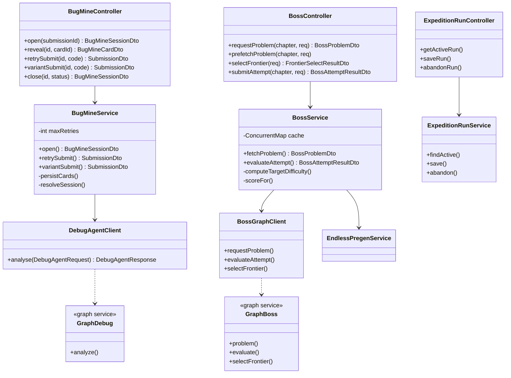
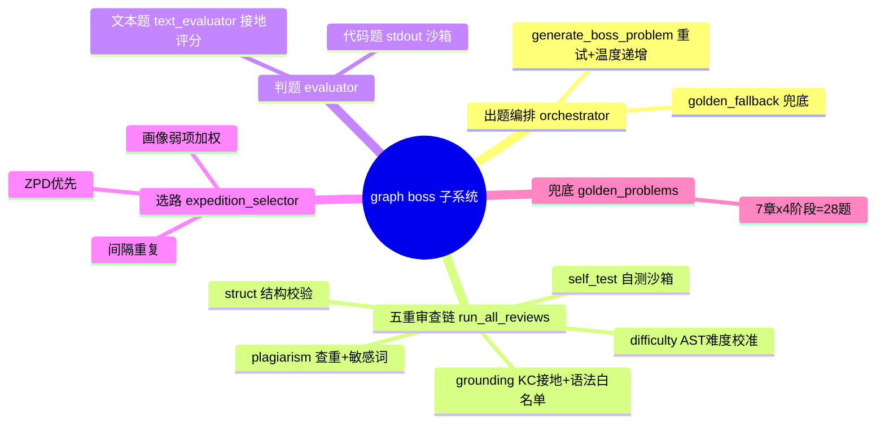
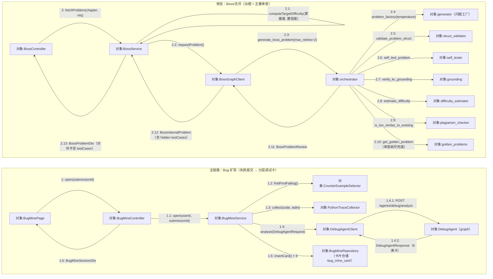
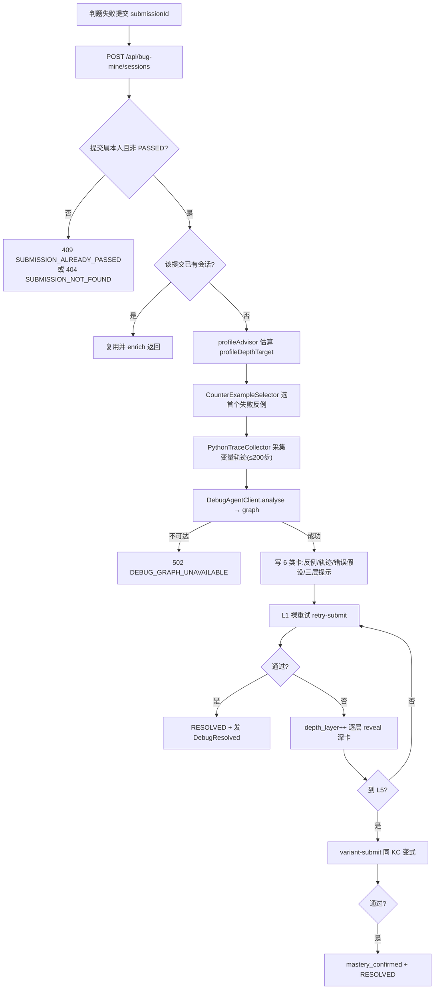
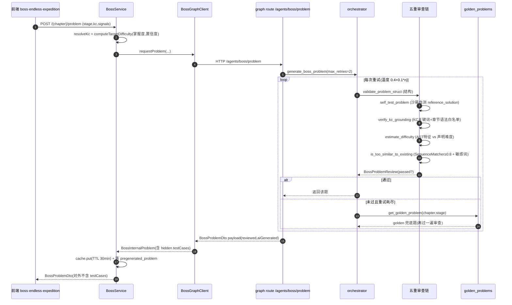
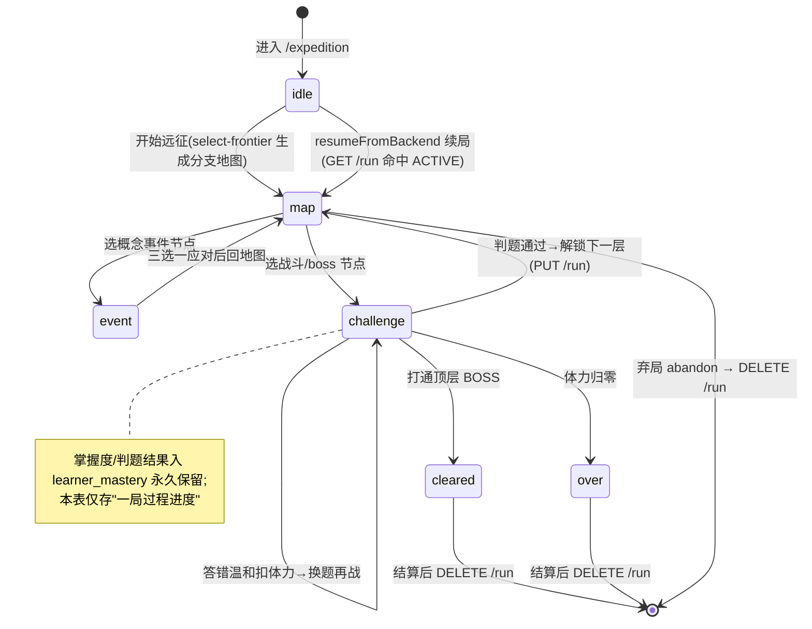

## 8.10 Bug 矿洞·无尽·Boss · 详细设计

本模块详细设计按**六要素**展开：① 模块职责与边界；② 总体结构与组件划分；③ 处理流程设计；④ 数据结构与存储设计；⑤ 接口设计；⑥ 关键算法、异常与降级。涉及的数据表完整字段字典只在 §6 出现一次，本章引用表名并标注「见 §6」。

### 8.10.1 要素一：模块职责与边界

M10 把「真判题失败」与「自适应挑战」收敛为三条子链，共享 AI 出题与服务端沙箱判题底座：

- **Bug 矿洞**（`com.pythontopia.bugmine`）：以失败提交为入口，维护 `OPEN → RESOLVED/ABANDONED` 状态机，按 L1~L5 渐进下探，提示卡分层解锁、不直给答案；修复后经 `LearningEvent` 回流掌握度。
- **无尽 / 无尽远征**（`com.pythontopia.world.boss` 远征 run 持久化 + `pythontopia-graph` 出题）：知识前沿选择器据掌握度+画像生成分支地图，一局过程进度后端权威持久化，跨会话续局；判题结果入库且永不回滚。
- **章末 Boss**（`com.pythontopia.world.boss`）：4 阶段 AI 出题对战，难度按章节学情自适应，提交历史落 `boss_attempt` 供教师审核与自适应难度。

边界约束：Bug 矿洞与远征 run 仅 STUDENT 可用（教师/管理员 403）；本模块不直接写 KC 掌握度，只发学习事件由 M02/M09 的监听器统一更新（防止非判题路径污染学情）。

三条子链虽入口与玩法不同，却共用同一条「生成—审查—判题—回流」主干：题目统一由 `pythontopia-graph` 的 `boss/*` 智能体产出并过五重审查链，玩家代码统一进服务端 stdout 沙箱（文本题走接地评分），判题结论统一以 `LearningEvent` 广播给 M02 画像与 M09 掌握度的监听器。这种「薄编排层 + 可替换 graph 智能体 + 单一事件出口」的设计，使本模块对 LLM 供应商可插拔、对 graph 故障可降级、对学情数据零旁路写入，既满足比赛演示的稳定性，又守住防幻觉与单一事实源两条红线。本模块的核心价值并非「再做一套刷题系统」，而是把学习链路里最高频、最有教学价值的「失败」与「弱项」重新组织成有节奏、有梯度、可解释的巩固场景。

为直观呈现本模块主入口形态，先给出两处主界面截图占位（无尽远征 `/expedition` 形态见 8.10.4 状态机说明）：

> 【截图占位 SC-S10-1】
> - 访问：http://localhost:5173/bug-mine（容器态 http://localhost:8080/bug-mine）
> - 登录角色：学生（路由含鉴权 meta，未登录自动重定向 /login；教师/管理员访问后端 403）
> - 操作步骤：1. 学生登录后由小镇 `town_hub` 的「Bug 矿洞」入口或工坊练习列表 `PracticeList` 点击进入 `/bug-mine`；2. 在「错题本」标签查看按 `minePriority` 降序排列的待修复错题；3. 点开任一错题进入会话，观察 L1~L5 分层卡（裸重试 / 反例 / 变量轨迹 / 分层提示 / 同 KC 变式）的解锁状态。
> - 截取对象：`BugMinePage` 的「错题本列表 + 当前会话分层卡区」整屏。
> - 期望画面：左栏错题本按入矿优先级排序并标注「掌握薄弱 / 遗忘回声 / 画像命中 · 建议目标 L?」推荐理由；右栏当前会话显示当前深度 L 与逐层门控的提示卡，未达深度的深卡呈锁定态（点开触发 `BUG_MINE_DEPTH_LOCKED`）。

> 【截图占位 SC-S10-2】
> - 访问：http://localhost:5173/endless（容器态 http://localhost:8080/endless）
> - 登录角色：学生
> - 操作步骤：1. 登录后由主线地图章节入口（`MainlineMapPage`）或暂停菜单进入 `/endless` 无尽模式；2. 系统连续出题（`useEndlessRun` 经后端调用 graph `/agents/boss/problem`，无尽/远征只接受审查通过的 AI 题）；3. 连答冲连胜与积分，借可查询的 `prefetch` 状态机预生成下一题降低等待。
> - 截取对象：`EndlessPage` 的「题干 + 连胜/积分 HUD + 代码编辑器」区域。
> - 期望画面：顶部显示当前连胜与累计积分，主区为审查通过的 AI 题干与作答编辑器，提交后即时给出判定并切入下一题；出题不可用时明确提示重试，不展示伪造题。

### 8.10.2 要素二：总体结构与组件划分（图 S10-1）

模块按「后端编排 + graph 智能体」两层组织，前端页面 `/bug-mine`、`/boss/:chapter`、`/endless`、`/expedition` 为入口。后端编排层刻意保持「薄」：`BugMineService` 只负责状态机流转、卡片落库与事件发布，真正的提示生成下沉到 graph 的 `DebugAgent`；`BossService` 只负责章节→KC 解析、自适应难度计算、题目缓存与评分，出题与判题下沉到 graph 的 `boss/*`。`BossService` 内置一个进程内 `ConcurrentMap` 缓存（TTL 30 分钟）持有含隐藏用例的完整题，配合 `EndlessPregenService` 把「下一题」异步预生成落 `pregenerated_problem`（READY），玩家做题时后台备题、命中即原子标 CONSUMED，既降低现场等 LLM 的时延，又支撑「退出后再登入复用已生成未做的题」。`ExpeditionRunService` 用 `user_id` 主键 UPSERT 实现「单用户单活跃 run」，过程进度后端权威，掌握度仍由 `learner_mastery` 等权威表负责。关键类与 DTO 关系见下（节选自真实代码）：



graph 侧 `boss/*` 子模块职责思维导图（图 S10-2）：



graph 侧把「出题 / 审查 / 判题 / 选路 / 兜底」拆成高内聚的纯函数模块，便于离线单测与替换：审查链各环统一返回 `ReviewVerdict`（含 `passed` / `issues` / `metadata`），由 `BossProblemReview.passed` 聚合，只有全绿才允许入库或返回前端。这一「确定性审查 + 纯函数选路 + 可插拔出题」的拆分，让绝大多数教学正确性逻辑（结构、自测、接地、难度、查重、选路、兜底）脱离 LLM 的不确定性，既可被 `tests/agents/boss/` 全量回归，又能在 LLM 失灵时由 golden 兜底无缝顶上。

**通信图（图 S10-6 协作图）**：与图 S10-4 时序图不同，协作图不画生命线，强调对象间的链接拓扑与带序号消息。主链路为 Bug 矿洞「失败提交 → 分层调试卡」，旁挂为 Boss/无尽「出题 + 五重审查」两簇对象（同模块、两类入口，二者不互调）。序号沿真实调用顺序编排，审查链顺序严格遵循 `orchestrator.run_all_reviews`。



需说明的是：矿洞「卡片仓储」即 `BugMineRepository`（落 `bug_mine_card`，由 `DebugAgentClient` 经 graph `DebugAgent` 产出 6 类卡后写入），与「费曼反演·代码找茬」的离线 bug 样本库 `agents/feynman/bug_bank.py`（见 M11）是两套独立资产，本主链路不互引，避免把找茬题库误当矿洞证据源。

> 【截图占位 SC-S10-3】
> - 访问：http://localhost:5173/boss/1（容器态 http://localhost:8080/boss/1；chapter 取 1..7，路由 `/boss/:chapter(\d+)`）
> - 登录角色：学生
> - 操作步骤：1. 登录后由主线某章「章末 Boss」入口进入 `/boss/{chapter}`；2. 后端 `computeTargetDifficulty` 据该章掌握度/置信度定难度，graph 出题并过五重审查（失败回落 golden）；3. 在 4 阶段对战中作答提交，服务端 graph 评测，结果落 `boss_attempt`。
> - 截取对象：`BossPage` 的「Boss 对战面板（阶段进度 + 题干 + 代码编辑器 + 血条/评分）」。
> - 期望画面：显示当前 chapter 与 stage（1..4）、AI 出题或 golden 兜底标记，提交后给出 score（通过取 `max(80, 通过率×100)`）并推进下一阶段。

### 8.10.3 要素三：处理流程设计

**（1）Bug 矿洞「失败→分层卡」处理流程（图 S10-3）**



提示卡的深度门控由 `depthForCard` 决定：`COUNTER_EXAMPLE`→需 L2、`VARIABLE_TRACE`→需 L3、`WRONG_ASSUMPTION`/`HINT_LAYER_1/2/3`→需 L4；当前 `depthLayer` 不足解锁则返回 `BUG_MINE_DEPTH_LOCKED`，强制循序下探、杜绝跳层抄答案。每次重试失败会推进深度层，逐步开放更深的提示，呼应「先自己想、再看反例、再看轨迹、最后才看思路」的认知阶梯。

反例与轨迹的取材是矿洞「证据优先」的关键：`CounterExampleSelector` 从该题隐藏用例里挑出第一条让玩家代码失败的输入，`PythonTraceCollector` 在受限环境重放该输入、采集逐行变量取值（按 200 步截断防爆量），两者连同判题 verdict 一起组装成 `DebugAgentRequest` 交给 DebugAgent。DebugAgent 是**确定性**生成器：不调 LLM、按 verdict（WA/RE/TLE/CE）模板产出反例卡、错误假设卡与三层渐进提示，且第 3 层经 safety 审查——一旦检测到连续可粘贴代码即 `_downgrade_layer3` 脱敏，仅保留思路，落实「不直给完整答案」的教学约束。到 L5 时系统给出同 KC 变式题（`variant_problem_id`），通过即 `mastery_confirmed`，确认能力是否真正迁移而非记住单题答案。

**（2）Boss/无尽出题五重审查链时序（图 S10-4）**

> 说明：审查链真实执行顺序见 `orchestrator.run_all_reviews`，为「结构校验→自测→KC 接地→难度估计→查重/敏感词」；任一环 error 即中止本次并重试，重试耗尽回落 golden。



提交评测时：`BossService.evaluateAttempt` 先从缓存/`pregenerated_problem` 取回完整题，调 graph `/agents/boss/evaluate` 进 stdout 沙箱（或文本题接地评分），算分后**仅在真实判完路径**发 `PracticeSucceeded`/`PracticeFailed`。

出题侧的鲁棒性来自三重设计：① `generate_boss_problem` 按 `temperature = 0.4 + 0.1×(重试序号-1)` 递增温度重试，前一次因撞题/超纲被拒后下一次更可能产出新题；② graph route 把 `max_retries` 收敛为 2，章末 Boss 仍可使用 golden 保底，但无尽/远征客户端只接收 `aiGenerated && reviewed` 的题，避免静态题冒充画像自适应；③ `prefetch` 先同步落 `PENDING` 并返回 job id，后台成功后转 `READY`、失败转 `FAILED`，同维度可重试且严格包含 difficulty。所有 AI 现场题也会 best-effort 落 `pregenerated_problem`（CONSUMED），用于内存缓存过期 / 进程重启后取回隐藏用例。正式评测不可用时只提示重试，绝不把公开样例预览当正式判定。难度以地图纵深为递进主轴，再由章节掌握度、置信度和 learner profile readiness 上下校准一档。

**（3）无尽远征 run 状态（见 8.10.4 图 S10-5）**：前端 run 阶段流转 + 后端 `expedition_run` 持久化。

### 8.10.4 要素四：数据结构与存储设计

本模块持久化表（完整字段字典见 §6 数据字典 D3「工坊判题挑战」分片，表 `bug_mine_session`、`bug_mine_card`、`expedition_run`、`boss_attempt`）：

- `bug_mine_session`（V070；V128 增 `depth_layer`；V129 增 `variant_problem_id`/`variant_submission_id`/`mastery_confirmed`/`profile_depth_target`）：`submission_id` 唯一约束 → 一次失败提交至多一会话；`status` CHECK `OPEN/RESOLVED/ABANDONED`；`depth_layer` CHECK 1..5。
- `bug_mine_card`（V070）：`card_type` CHECK 六类卡；`UNIQUE(session_id, card_type)` 防重复；`payload` JSONB。
- `practice_submission.source`（V130 增 `BUG_MINE_VARIANT`、V132 增 `BUG_MINE_ECHO`）：标记矿洞重试/变式/遗忘回声三类来源。
- `expedition_run`（V173）：`user_id` 主键 → 单用户单活跃 run；标量列 `phase/focus_chapter/hp/max_hp/momentum/best_momentum/score/layers/current_node_id/is_daily`，`nodes/relics/history` 为 JSONB 整体存取；`status` CHECK 仅 `ACTIVE`。
- `boss_attempt`（V120）：`chapter` 1..7、`stage` 1..4、`difficulty` 1..5、`score` 0..100 等 CHECK 约束；`ai_generated` 区分 AI 题/golden；`reviewed` 标记审查链结论。
- `pregenerated_problem`（V150；V185 增强）：预加载状态为 `PENDING/READY/FAILED/CONSUMED`，记录 attempts、失败原因和更新时间；活动任务按 user + chapter + KC + kind + arena level + difficulty 唯一，payload 在 PENDING/FAILED 时允许为空。

存储设计遵循两条原则：**权威与过程分离**、**结构化与弹性兼顾**。掌握度、判题结果等「学情真值」永远落 `learner_mastery`/`practice_submission` 等权威表，永不随一局远征的弃局而回滚；`expedition_run` 只承载「一局过程进度」，故可安全地以 `user_id` 主键单行覆盖、弃局即整行删除。对节点地图这类 schema 易演进的数据，用 `nodes`/`relics`/`history` 三个 JSONB 列整体存取、后端不解释其内部结构，避免每次前端调整节点形状都要改表；而 `phase`/`hp`/`score` 等需要观测与统计的标量则单列存储并加约束。Bug 矿洞侧用 `submission_id` 唯一约束与 `UNIQUE(session_id, card_type)` 双重去重，保证「一次失败一会话、一会话一类卡至多一张」；`depth_layer`/`profile_depth_target` 的 1..5 CHECK 则把五层下探的取值空间约束在数据库层。`practice_submission.source` 通过迁移增补 `BUG_MINE_RETRY`/`BUG_MINE_VARIANT`/`BUG_MINE_ECHO` 枚举，让矿洞产生的每次提交都能被来源标识、回流统计时可区分。

无尽远征 run 阶段状态机（图 S10-5）——前端 `phase` 流转，每步 `PUT /run` 落 `expedition_run`，弃局/结束 `DELETE`：



### 8.10.5 要素五：接口设计

REST 端点（路径取自真实 controller；详细字段见 R10 §4.2.4 与 §6）：

| 端点 | 方法 | 鉴权 | 说明 |
| --- | --- | --- | --- |
| `/api/bug-mine/sessions` | POST | STUDENT | 开矿洞会话（仅非 PASSED 提交） |
| `/api/bug-mine/sessions/{id}` | GET | STUDENT | 读会话（含卡片与题干） |
| `/api/bug-mine/errorbook` | GET | STUDENT | 错题本（按 minePriority 降序） |
| `/api/bug-mine/echoes` | GET/POST | STUDENT | 遗忘回声候选 / 入矿 |
| `/api/bug-mine/sessions/{id}/cards/{cardId}/reveal` | POST | STUDENT | 深度门控解锁卡片 |
| `/api/bug-mine/sessions/{id}/retry-submit` | POST | STUDENT | L1~L4 重试（上限 3） |
| `/api/bug-mine/sessions/{id}/variant-submit` | POST | STUDENT | L5 同 KC 变式确认 |
| `/api/bug-mine/sessions/{id}/close` | POST | STUDENT | 置 RESOLVED/ABANDONED |
| `/api/world/boss/{chapter}/problem` | POST | 登录 | 取 Boss/无尽题（chapter 1..7） |
| `/api/world/boss/{chapter}/prefetch` | POST | 登录 | 创建/重试预加载任务（202 + PENDING/READY/FAILED） |
| `/api/world/boss/{chapter}/prefetch` | GET | 登录 | 按完整维度查询预加载状态 |
| `/api/world/boss/select-frontier` | POST | 登录 | 知识前沿候选 KC |
| `/api/world/boss/{chapter}/attempt` | POST | 登录 | 提交评测 |
| `/api/world/expedition/run` | GET/PUT/DELETE | STUDENT | 远征 run 取/存/弃 |

鉴权与幂等约定：Bug 矿洞与远征 run 端点强制 STUDENT 角色（教师/管理员 403），Boss 出题/评测端点仅需登录；矿洞会话的私有 id（`submissionId`/`sessionId`）不经 URL、由前端 store 承载并经后端归属双键校验。单次 Boss `attempt` 仅在真实判完发一次事件；远征 `PUT /run` 为覆盖式 UPSERT；`prefetch` 返回可查询 job id，重复 PENDING/READY 不重复生成，FAILED 原行增加 attempts 后重试。所有对外 DTO 都不含隐藏用例。

graph 内部端点（`X-Internal-Token` 鉴权）：`POST /agents/boss/problem`、`POST /agents/boss/evaluate`、`POST /agents/boss/select-frontier`、`POST /agents/debug/analyze`。后端经 `BossGraphClient`/`DebugAgentClient` 调用并带 `GraphClientRetryHelper` 重试；任一调用失败都收敛为前述降级路径，绝不把 5xx 透传给玩家。

### 8.10.6 要素六：关键算法、异常与降级

- **自适应难度**（`BossService.computeTargetDifficulty`）：客户端地图纵深给出 1..5 的递进主轴；服务端综合章节掌握度/置信度与 learner profile 的基础水平、成功率、平均尝试和坚持度形成 readiness，并只在当前纵深上下校准一档；无学情时保持纵深值。
- **难度校准**（`difficulty_estimator`）：以 `reference_solution` 的 AST 特征（语句长度、行数、深度、循环/分支/函数计数）估算难度，与声明值偏差 ≤1 通过、=2 自动覆盖、>2 reject。
- **查重与安全**（`plagiarism_checker`）：`SequenceMatcher` 相似度 ≥0.8 视为撞题 reject；命中敏感词 reject。
- **接地防超纲**（`grounding`）：题面+解答须命中 KC/章节关键词，且 `reference_solution` 的 AST 节点须落在该章语法白名单内（如第 1 章禁循环/分支），超纲 reject。
- **自测自洽**（`self_tester`）：沙箱内跑 `reference_solution` 须在 5s 内通过全部 test_cases；扫描 `FORBIDDEN_IMPORTS`（socket/subprocess/requests 等），POSIX 下 `setrlimit` 限 CPU 5s、内存 256MB。
- **错题入矿优先级**（`BugMineService.minePriority`）：`0.35·(1-掌握度)+0.20·遗忘风险+0.20·近期失败+0.15·画像命中+0.10·(1-置信度)`，遗忘风险取 FSRS-lite `1-可提取性R`。
- **评分**（`BossService.scoreFor`）：通过取 `max(80, 通过率×100)`，未过取 `通过率×60`。

**PDL S10-1 矿洞卡分层与入矿优先级**（对应 `BugMineService.errorBook / minePriority / depthForCard`；主题：按失败提交 / 易错 KC / 掌握度生成调试卡、分层难度、优先级排序）：

```text
PROCEDURE rankErrorBook(userId)                 // 错题本：入矿优先级排序 + L1~L5 分层
  INPUT : userId : Long
  OUTPUT: List<ErrorBookItem>，按 minePriority 降序
  rows   <- BugMineRepository.findOpenErrorBook(userId)         // 仅 OPEN 会话
  scored <- []
  FOR each row IN rows DO
      signal     <- ReviewStateService.evaluate(row.kc, row.stability,
                                                 row.lastReviewAt, row.dueAt,
                                                 row.mastery, row.lastEventAt, now)   // FSRS-lite
      decayRisk  <- clamp(1 - signal.retrievability)             // 遗忘风险 = 1 - 可提取性 R
      recentFail <- recentFailWeight(row.openedAt)
      mastery    <- clamp(row.masteryScore)
      conf       <- clamp(row.confidence)
      priority   <- clamp( 0.35*(1 - mastery)
                         + 0.20*decayRisk
                         + 0.20*recentFail
                         + 0.15*(row.patternMatched ? 1 : 0)
                         + 0.10*(1 - conf) )
      scored.append( {row, signal, priority} )
  ENDFOR
  SORT scored BY priority DESC, THEN row.openedAt DESC (nulls last)
  result <- []
  FOR each s IN scored DO
      steps <- buildDepthSteps(s.row.depthLayer)                 // L1..L5，done = (layer <= depthLayer)
      result.append( toErrorBookItem(s.row, s.signal, s.priority, steps) )
  ENDFOR
  RETURN result
END

FUNCTION recentFailWeight(openedAt)             // 近期失败时间衰减
  IF openedAt IS NULL THEN RETURN 0.0 ENDIF
  hours <- minutesBetween(openedAt, now) / 60
  IF hours <= 24  THEN RETURN 1.0 ENDIF          // 24h 内满权重
  IF hours >= 168 THEN RETURN 0.0 ENDIF          // 超 7 天清零
  RETURN clamp( 1 - (hours - 24) / 144 )         // 24h~168h 线性衰减
END

PROCEDURE revealCard(session, cardId)           // 分层门控：杜绝跳层抄答案
  required <- depthForCard(card.type)            // 反例→L2, 变量轨迹→L3, 错误假设/三层提示→L4
  IF session.depthLayer < required THEN
      RAISE BUG_MINE_DEPTH_LOCKED
  ENDIF
  BugMineRepository.revealCard(session, cardId)
  bumpDepthLayer(session, required)              // 重试失败 advanceDepthLayer，逐层开放深卡
END
```

优先级把「最该补」的错题顶到错题本最前，分层门控把「怎么补」约束成 L1→L5 的认知阶梯；下探到 L5 后再以同 KC 变式（`variantSubmit`，要求 `depthLayer ≥ 5`）通过才置 `mastery_confirmed`，确认迁移而非记题。

**图 S10-7 NS 盒图（Boss 出题校验 + 自测）**：刻画 `orchestrator.generate_boss_problem` 的结构化控制流——升温重试循环内，五重审查链顺序短路，任一不过即本次 reject；重试耗尽则回落 golden 再过一遍审查。它与图 S10-4 时序图互补：时序图强调跨进程消息往返，盒图强调「循环 + 顺序短路 + 兜底分支」的结构化控制流。

<table border="1" cellspacing="0" cellpadding="6" style="border-collapse:collapse;text-align:center">
  <tr><td>PROCEDURE generate_boss_problem(chapter, stage, kc, difficulty)　//　last_review ← null</td></tr>
  <tr><td align="left">
    <table border="1" cellspacing="0" cellpadding="6" style="border-collapse:collapse;width:100%;text-align:center">
      <tr><td colspan="2">循环　FOR attempt = 1 … max_retries（temperature = 0.4 + 0.1×(attempt−1)）</td></tr>
      <tr><td colspan="2">problem ← problem_factory(chapter, stage, kc, difficulty, temperature)</td></tr>
      <tr><td colspan="2">problem_factory 抛异常？</td></tr>
      <tr><td style="width:50%">T：continue（进入下一次升温重试）</td><td style="width:50%">F：进入五重审查链 run_all_reviews</td></tr>
      <tr><td colspan="2">① validate_problem_struct 通过？（字段非空 / KC=PY43-KC-NNN / 难度 1-5 / ≥3 test_cases）</td></tr>
      <tr><td>T：继续 ↓</td><td>F：reject → 跳出本次重试</td></tr>
      <tr><td colspan="2">② self_test_problem 通过？（沙箱跑 reference_solution，5s 内全 test_cases AC，无 FORBIDDEN_IMPORTS）</td></tr>
      <tr><td>T：继续 ↓</td><td>F：reject → 跳出本次重试</td></tr>
      <tr><td colspan="2">③ verify_kc_grounding 通过？（命中 KC/章节关键词 + AST 落该章语法白名单）</td></tr>
      <tr><td>T：继续 ↓</td><td>F：reject → 跳出本次重试</td></tr>
      <tr><td colspan="2">④ estimate_difficulty：|估算 − 声明| ≤ 2？（=2 时以估算值覆盖）</td></tr>
      <tr><td>T：继续 ↓</td><td>F：>2 reject → 跳出本次重试</td></tr>
      <tr><td colspan="2">⑤ is_too_similar_to_existing 通过？（SequenceMatcher &lt; 0.8 且无敏感词）</td></tr>
      <tr><td>T：继续 ↓</td><td>F：reject → 跳出本次重试</td></tr>
      <tr><td colspan="2">review.passed？</td></tr>
      <tr><td>T：RETURN review（accept；入缓存 TTL 30min + 落 pregenerated_problem）</td><td>F：last_review ← review，继续重试</td></tr>
    </table>
  </td></tr>
  <tr><td colspan="2">重试耗尽：golden_fallback ≠ null？</td></tr>
  <tr><td style="width:50%">T：review ← run_all_reviews(golden_fallback)；RETURN review</td><td style="width:50%">F：RETURN last_review（failed，前端走 Pyodide 兜底）</td></tr>
</table>

异常与降级策略（NFR-FB / NFR-AIH 落地）：

| 故障点 | 表现 | 降级 |
| --- | --- | --- |
| LLM provider 不可用 | `LlmProviderError` | route 直接返回 golden 兜底题 |
| 审查链耗尽重试 | 多次 reject | 回落 golden（再过一遍审查） |
| graph 评测不可达 | `RestClientException` | 提示前端 Pyodide 校验，**不发学习事件** |
| 题目缓存过期且无持久化 | 取不到 testCases | 返回 Pyodide-only 兜底提示 |
| 选路器 graph 不可达或无证据候选 | `503 EXPEDITION_ADAPTATION_UNAVAILABLE` | 保持 idle 并提示稍后重试；禁止本地默认 KC 冒充画像结果 |
| DebugAgent 不可达 | `BAD_GATEWAY` | 提示稍后再试，不落半截会话 |
| 第 3 层提示含可粘贴代码 | safety 命中 | `_downgrade_layer3` 脱敏，仅给思路 |

---

> 执笔人：成员 A ｜ 完成人（签名）：成员 A ｜ 审查人：成员 C ｜ 完成日期：2026-06-16
