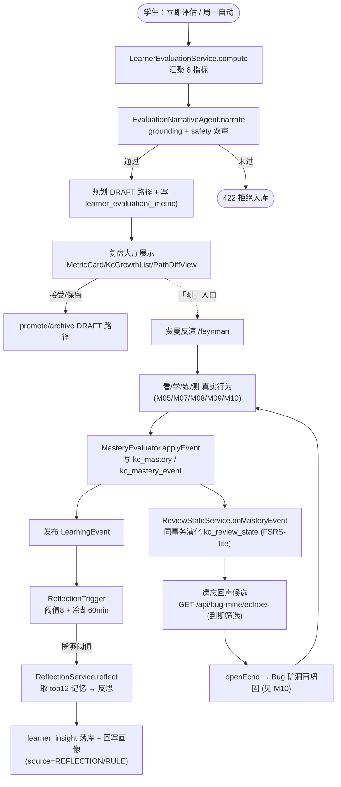
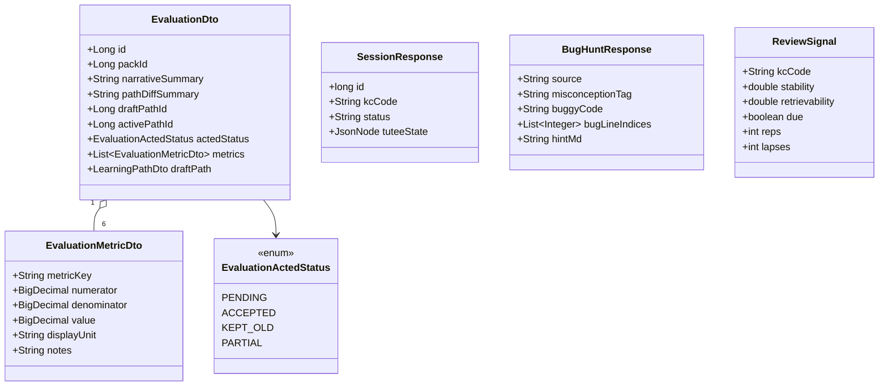
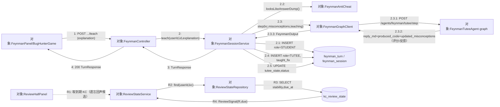
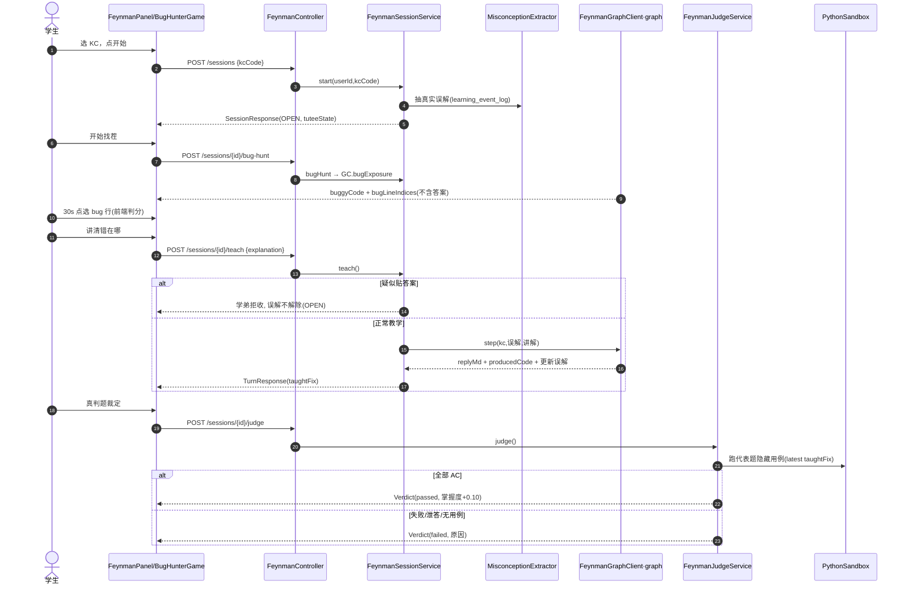
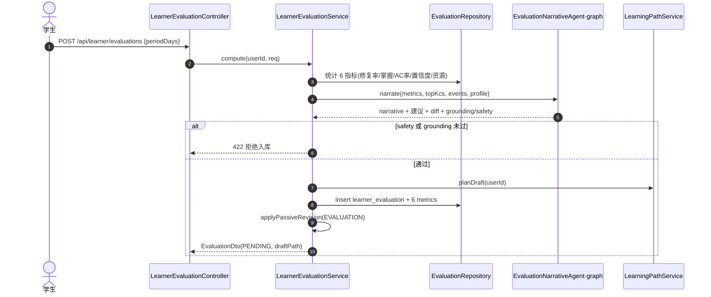
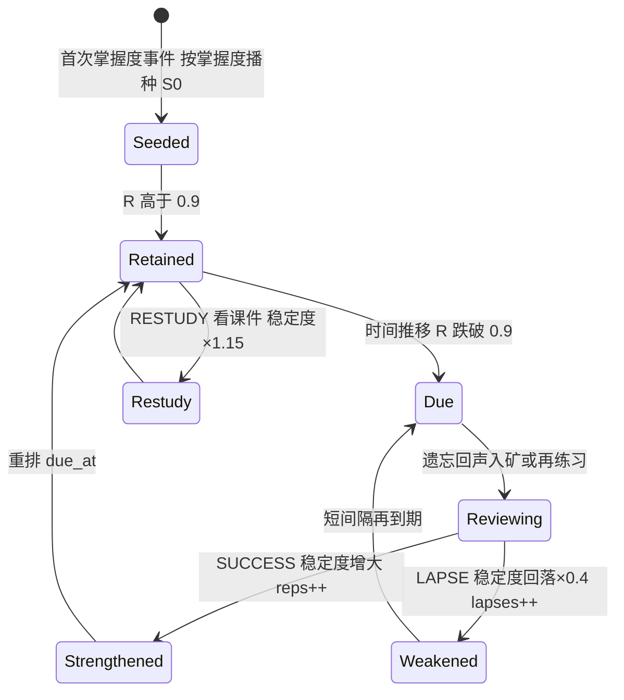
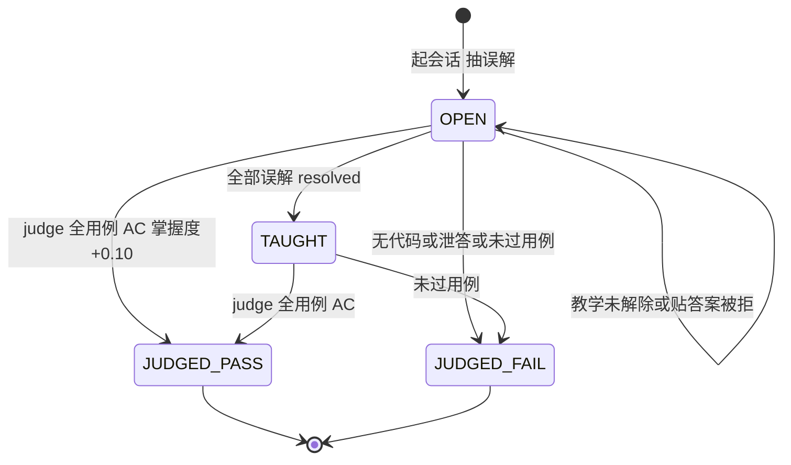
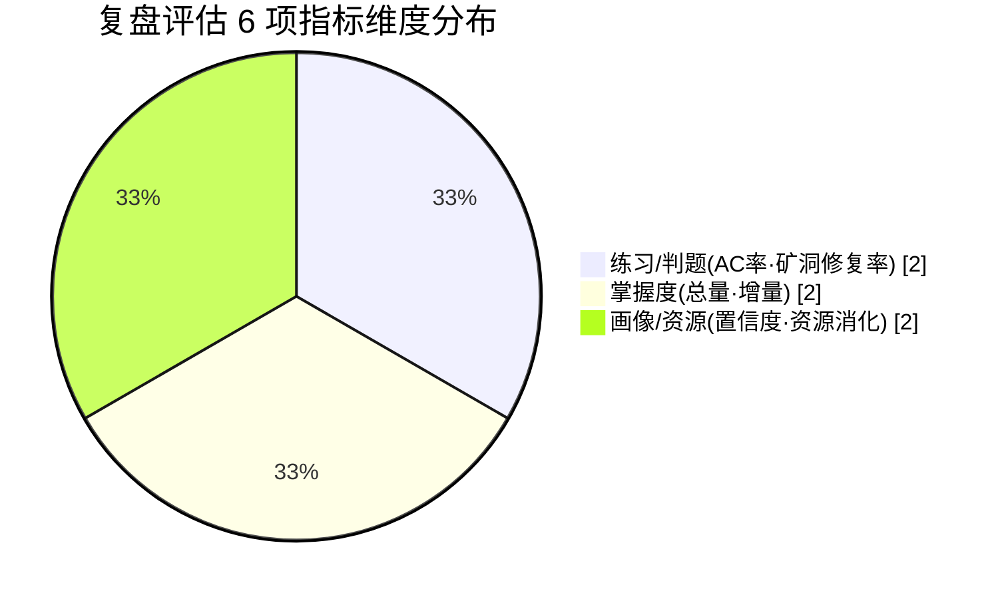
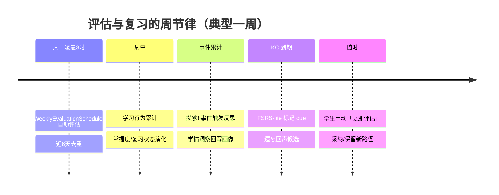

## 8.11 复盘·费曼·学习评估 · 详细设计

> 本文 `filecode = S11`。图编号 `图 S11-n`、表编号 `表 S11-n`。表完整字段字典见 §6 D4；本文按「处理流程 / 模块结构 / 接口设计 / 关键时序 / 数据结构与状态 / 算法与异常」六要素展开，引用表名只标「见 §6 D4」。需求见 M11 需求（R11）。

### 8.11.1 处理流程（复盘闭环）

M11 是「测·复盘」收口：上游 M05 主线、M09 训练判题、M10 矿洞产生的真实事件，经 `MasteryEvaluator` 沉淀掌握度与复习状态，被动触发学情反思，最终在复盘大厅汇成评估、规划新路径，并把到期 KC 以遗忘回声推回练习入口，形成闭环。



<center>图 S11-1　M11 复盘闭环处理流程</center>

该流程的核心设计取向是**事件驱动的弱耦合**：上游各学习场景并不直接调用复盘/反思/复习逻辑，而是统一通过 `MasteryEvaluator.applyEvent` 沉淀掌握度并发布进程内 `LearningEvent`；复习状态演化挂在同一事务内（保证「掌握度变了、复习排程必然同步变」的强一致），而成本较高的学情反思则改由 `ReflectionTrigger` 监听事件、按阈值与冷却异步提交到线程池执行，使主链路（答题、判题）不被 LLM 调用拖慢。评估生成则是显式触发（学生手动或调度器周期），把一段时期的散点数据收敛成结论。这样三条副链路（复习排程、学情反思、周期评估）各自独立失败、互不阻塞，符合「教育优先、主链路稳定」的工程取舍。

> 【截图占位 SC-S11-1】
> - 访问：http://localhost:5173/review-hall（容器态 http://localhost:8080/review-hall）
> - 登录角色：学生（除 /login 外均需登录）
> - 操作步骤：1. 学生登录后从中央小镇 `town_hub` 进入「复盘大厅」或直接访问 `/review-hall` 2. 顶部点「立即评估」（POST `/api/learner/evaluations`）生成本周快照 3. 展开任一评估卡查看 `MetricCard` / `KcGrowthList` / `PathDiffView`
> - 截取对象：`ReviewHallPanel` 周分组列表 + 评估详情弹窗（6 指标卡 + KC 成长清单 + DRAFT/ACTIVE 路径差异）
> - 期望画面：按周倒序排列的评估卡；详情含 6 项指标数值、KC 掌握增量清单与路径差异，并提供「采纳新路径 / 保留原路径」两个动作

### 8.11.2 模块结构与类设计

M11 后端落在三个包：`com.pythontopia.feynman`（费曼反演）、`com.pythontopia.learner.evaluation`（复盘评估）、`com.pythontopia.learner.reflection` + `com.pythontopia.learner.mastery.review`（反思与 FSRS-lite）。三者按「能力边界」而非「数据表」划分：费曼包自成一套会话/教学/判题闭环并复用训练场判题器（`JudgeCaseEvaluator` / `PythonSandbox`）；评估包负责把多源指标聚合成快照并衔接学习路径服务（`LearningPathService`）；反思与复习包则寄生在掌握度事件之上，作为画像与遗忘回声的上游。核心类职责见下表。

| 层 | 类 | 职责 |
| --- | --- | --- |
| Controller | `FeynmanController` | `/api/feynman/*` 费曼会话/教学/判题/找茬，强制学生 |
| Controller | `LearnerEvaluationController` | `/api/learner/evaluations/*` 评估生成/查询/采纳/保留 |
| Controller | `InsightController` | `/api/learner/insights` 倒序只读本人学情洞察 |
| Service | `FeynmanSessionService` | 起会话、抽误解、教学落库、找茬编排、状态机演化 |
| Service | `FeynmanJudgeService` | 取最新产出代码跑代表题隐藏用例，回流掌握度、发事件 |
| Service | `MisconceptionExtractor` | 从 `learning_event_log` 抽该生该 KC 的真实误解集合 |
| Util | `FeynmanAntiCheat` | 拦截「贴答案/整段代码」式作弊输入 |
| Client | `FeynmanGraphClient` | 调 graph `/agents/feynman/{tutee/step,bug-exposure}` |
| Service | `LearnerEvaluationService` | 汇聚 6 指标、调叙事、规划 DRAFT、写库、回写画像 |
| Scheduler | `WeeklyEvaluationScheduler` | 周一 03:00(UTC) 为活跃学生批量生成评估 |
| Service | `ReflectionService` / `ReflectionTrigger` | 事件计数触发反思、综合洞察回写画像 |
| Engine | `ReviewStateService` / `ReviewScheduler` | FSRS-lite 复习状态演化与到期信号计算 |

<center>表 S11-1　M11 核心类与职责</center>



<center>图 S11-2　M11 核心 DTO 类图（评估 / 费曼 / 复习信号）</center>

DTO 设计遵循总纲「API client 必须使用明确 DTO 类型、禁 `any`」的约束：`EvaluationDto` 聚合一次评估的全部可读信息（指标列表 + narrative + 路径差异 + DRAFT 路径快照 + 处置状态），前端 `MetricCard` / `KcGrowthList` / `PathDiffView` 各取其一渲染；费曼侧 `BugHuntResponse` 刻意**不含** `fixed_code`（答案），只下发 `bugLineIndices` 供前端判分；`ReviewSignal` 是复习引擎对外的唯一只读出口（可提取性 R、是否到期 due），供遗忘回声排程与错题排序共用，屏蔽 `kc_review_state` 行级细节。

#### 通信图（协作图）：费曼教学主链路

下图以 UML 协作图视角刻画「学生教学一轮」的对象协作：与图 S11-3 时序图互补——省略生命线、强调对象间的链接拓扑与带序号消息（`1`、`2`、`2.x`、`2.3.x` 为主链路嵌套调用，`R1`–`R4` 为旁挂的复习信号读路径）。



<center>图 S11-9　费曼教学主链路通信图（协作图）</center>

主链路上，`FeynmanController` 仅做角色校验后转交 `FeynmanSessionService`：本轮学生讲解先以 `role=STUDENT` 落 `feynman_turn`（消息 2.1）形成证据，再过 `FeynmanAntiCheat` 防作弊门（2.2）；放行后经 `FeynmanGraphClient` 调 graph 端 `FeynmanTuteeAgent` 评估教学是否纠正误解（2.3.x），学弟产物以 `role=TUTEE` 连同 `taught_fix` 落库（2.4）并回写 `tutee_state`/`status`（2.5）。旁挂的复习信号读路径（R1–R4）独立于教学事务：`ReviewStateService` 经 `ReviewStateRepository` 读 `kc_review_state` 算出 `ReviewSignal`（可提取性 R / 是否到期），供复盘大厅与遗忘回声排序消费（遗忘回声的 HTTP 出口 `GET /api/bug-mine/echoes` 归属 M10）。

> 【截图占位 SC-S11-2】
> - 访问：http://localhost:5173/feynman（容器态 http://localhost:8080/feynman；亦可经复盘大厅「测」入口或 NPC 跳 `/feynman?kc=PY43-KC-xxx`）
> - 登录角色：学生
> - 操作步骤：1. 选一个学过且有失败记录的 KC，点「开始」起会话（POST `/api/feynman/sessions`） 2. 点「代码找茬」限时点选 bug 行（POST `.../bug-hunt`） 3. 在教学框讲清「错在哪、为什么」后点「教学」（POST `.../teach`） 4. 误解全部解除后点「真判题」（POST `.../judge`）
> - 截取对象：`FeynmanPanel` + `BugHunterGame`（AI 学弟对话区、找茬代码区、教学输入框、判题裁定 `Verdict`）
> - 期望画面：左侧 AI 学弟中性陈述含 bug 代码，右侧找茬高亮与判题结果；若粘贴整段代码/答案则学弟拒收且会话保持 OPEN

### 8.11.3 接口设计

下表为本模块真实 REST 端点（取自三个 controller 的 `@PostMapping/@GetMapping`），均需 JWT 且角色 `STUDENT`；遗忘回声两个端点归属 `bugmine` 包，在此一并列出以呈现 UC-11-03 的完整出口。

| 方法 | 路径 | 入参 | 出参 | 说明 |
| --- | --- | --- | --- | --- |
| POST | `/api/feynman/sessions` | `StartRequest{kcCode}` | `SessionResponse` | 起会话，抽误解、挑代表题 |
| POST | `/api/feynman/sessions/{id}/teach` | `TeachRequest{explanation}` | `TurnResponse` | 教学一轮，含防作弊 |
| POST | `/api/feynman/sessions/{id}/bug-hunt` | — | `BugHuntResponse` | 学弟出含 bug 代码 + bug 行号 |
| POST | `/api/feynman/sessions/{id}/judge` | — | `Verdict` | 真判题裁定出师 |
| POST | `/api/learner/evaluations` | `EvaluationRequest{periodDays?}` | `EvaluationDto` | 立即评估（默认 7 天） |
| GET | `/api/learner/evaluations` | `limit?` | `List<EvaluationDto>` | 历史评估列表 |
| GET | `/api/learner/evaluations/{id}` | — | `EvaluationDto` | 单次评估详情（含 DRAFT） |
| POST | `/api/learner/evaluations/{id}/accept-new-path` | — | `EvaluationDto` | 采纳 DRAFT→ACTIVE，旧路径归档 |
| POST | `/api/learner/evaluations/{id}/keep-old` | — | `EvaluationDto` | 归档 DRAFT，保留原路径 |
| GET | `/api/learner/insights` | `limit=10`(≤50) | `List<LearnerInsightDto>` | 倒序学情洞察（可溯源） |
| GET | `/api/bug-mine/echoes` | — | `List<BugMineEchoCandidateDto>` | 遗忘回声到期候选（见 M10） |
| POST | `/api/bug-mine/echoes` | `{kcCode}` | `BugMineSessionDto` | 进入回声再巩固（见 M10） |

<center>表 S11-2　M11 REST 接口一览</center>

### 8.11.4 关键时序

#### 费曼自测：找茬 → 教学 → 真判题



<center>图 S11-3　费曼自测时序（学生讲解 → AI 学弟产出 → 服务端真判题评估）</center>

这条时序的关键约束在于「**教学过程可溯源、出师标准不放水**」：每一轮学生教学先以 `STUDENT` 角色落 `feynman_turn`，学弟回复与产出代码以 `TUTEE` 角色落库，形成「误解→你的教学→学弟产物→判题」的玻璃盒证据链；学弟是否「真的被教会」由 `step` 的 `updated_misconceptions` 决定，但**最终掌握度回流只认服务端判题**——`FeynmanJudgeService` 取最近一条非空 `taught_fix` 代码跑代表题隐藏用例，仅在终判 AC 时才 `applyEvent(PRACTICE_PASS, +0.10)` 并发 `TaughtAiSucceeded`。graph 不可达时 `step` 退化为「解释足够具体才算讲清」的离线规则，保证演示环境无密钥也能跑通主流程。

#### 评估生成：汇聚指标 → 叙事双审 → 写库



<center>图 S11-4　学习评估生成时序（防幻觉双审门）</center>

评估生成把六个口径的统计（矿洞修复率、KC 掌握总量与增量、练习 AC 率、画像置信度增量、资源消化数）打包交给确定性叙事 Agent，再由「双审门」决定能否落库：`safetyResult` 与 `groundingResult` 任一不通过，后端立刻抛 `422`（`EVALUATION_NARRATIVE_SAFETY_FAILED` / `EVALUATION_NARRATIVE_GROUNDING_FAILED`）并放弃写库；通过后才规划 DRAFT 路径、写入 `learner_evaluation` 及 6 条 metric，并以 `EVALUATION` 来源记一次画像被动修订。路径规划失败被刻意降级为「在 `path_diff_summary` 注明」，不连累评估本体，体现「评估必出、建议可缺」的容错分层。

### 8.11.5 数据结构与状态

本模块持久化于 `feynman_session` / `feynman_turn`、`kc_review_state`、`learner_evaluation` / `learner_evaluation_metric`、`learner_insight`（字段字典见 §6 D4 / D1）。其中 `feynman_session.tutee_state` 以 JSONB 保存误解数组（形如 `{misconceptions:[{tag,evidenceEventIds,resolved}]}`），便于学弟状态随教学逐轮演化而不需额外建表；`kc_review_state` 对每个 `user×kc` 唯一一行，承载 FSRS-lite 的稳定度/难度/复习计数与到期时间。两条关键状态机如下。

#### FSRS-lite 复习状态（kc_review_state）

掌握度事件被翻译为一次「复习结果」：`PRACTICE_PASS`/`DEBUG_FIX`→SUCCESS（稳定度增大）、`PRACTICE_FAIL`→LAPSE（回落）、`RESOURCE_READ`→RESTUDY（温和增长）；`DECAY`/`BOOTSTRAP`/`MANUAL_OVERRIDE` 不计为复习。可提取性 R 随时间幂律衰减，跌破目标留存率 0.9 即「到期（due）」，进入遗忘回声候选。



<center>图 S11-5　FSRS-lite 复习状态机（kc_review_state）</center>

下列 PDL 给出 FSRS-lite 间隔复习的完整调度过程（`ReviewStateService.onMasteryEvent` 驱动、`ReviewScheduler` 纯函数演化），覆盖「按上次复习与正确率算稳定度、定下次到期日、判遗忘回声触发」三段：

```text
PROCEDURE onMasteryEvent(userId, kcCode, source, now)
  INPUT : userId:Long, kcCode:String, source:MasterySource, now:OffsetDateTime
  OUTPUT: 无（副作用：upsert 一行 kc_review_state）
  outcome <- outcomeFor(source)            // PRACTICE_PASS/DEBUG_FIX→SUCCESS；PRACTICE_FAIL→LAPSE；RESOURCE_READ→RESTUDY
  IF outcome IS NULL OR kcCode 为空 THEN
      RETURN                               // DECAY/BOOTSTRAP/MANUAL_OVERRIDE 不计为一次复习
  ENDIF
  state <- ReviewStateRepository.find(userId, kcCode)
  S <- state.stability  OR 0.0             // ≤0 视为无历史
  D <- state.difficulty OR 0.30
  reps <- state.reps OR 0 ;  lapses <- state.lapses OR 0
  elapsedDays <- (state.lastReviewAt IS NULL) ? 0 : minutesBetween(lastReviewAt, now) / 1440

  IF outcome = SUCCESS THEN                 // 间隔效应：越接近遗忘成功召回，稳定度增长越多
      IF S <= 0 THEN S' <- SEED_SUCCESS(3.0)
      ELSE
          R   <- (1 + FACTOR * elapsedDays / S) ^ (-DECAY)
          S'  <- max(S, S * (1 + W_SUCCESS*(1-R)*(1 - 0.3*D)))
      ENDIF
      D'   <- D + (DIFFICULTY_BASELINE(0.30) - D) * 0.10   // 难度向基线均值回归
      reps <- reps + 1
  ELSE IF outcome = LAPSE THEN
      S'     <- (S <= 0) ? SEED_LAPSE(1.0) : S * LAPSE_MULT(0.4)
      D'     <- clamp01(D + 0.15) ;  lapses <- lapses + 1
  ELSE  // RESTUDY（看课件温和增长）
      S' <- (S <= 0) ? SEED_RESTUDY(1.5) : max(S, S * 1.15)
      D' <- D
  ENDIF
  S' <- clamp(S', 0.5, 365.0)

  interval <- S' * (0.9 ^ (-1/DECAY) - 1) / FACTOR         // target=0.9 时 interval == S'
  dueAt    <- now + interval 天
  ReviewStateRepository.upsert(userId, kcCode, round3(S'), round3(D'), reps, lapses, now, dueAt)
END

FUNCTION isDue(userId, kcCode, now) RETURNS boolean        // 遗忘回声触发（读路径 signal/evaluate）
  state <- ReviewStateRepository.find(userId, kcCode)
  RETURN state.dueAt <> NULL AND now > state.dueAt          // due=true → 进入 GET /api/bug-mine/echoes 候选
END
```

<center>PDL S11-1　FSRS-lite 间隔复习调度（onMasteryEvent + 到期判定）</center>

其中 `DECAY=0.5`、`FACTOR=0.9^(-1/DECAY)-1≈0.2346` 取自 `ReviewScheduler` 常量，使幂律遗忘曲线恒满足 `R(S)=0.9`；稳定度被 `clamp` 在 `[0.5, 365]` 天、难度恒在 `[0,1]`。该过程与掌握度写库同事务、确定性可单测、不触 LLM，是「掌握度一变、复习排程必同步」强一致的落点。

#### 费曼会话状态（feynman_session.status）



<center>图 S11-6　费曼会话状态机</center>

费曼自测的评分判定本质是一个「教学循环 + 终局判题」的结构化过程：每一轮讲解先过防作弊门，放行后由 AI 学弟评估覆盖度/正确性（是否解除该误解），未解除则继续「再讲」；学生择机进入真判题，仅当代表题隐藏用例全 AC 才出师并回流掌握度。下方 NS 盒图刻画该分支结构。

<table border="1" cellspacing="0" cellpadding="6" style="border-collapse:collapse;text-align:center;width:100%">
  <tr><td colspan="2">起会话：MisconceptionExtractor 抽真实误解 → 选代表题 problem_id → status = OPEN</td></tr>
  <tr><td colspan="2" style="text-align:left">
    <table border="1" cellspacing="0" cellpadding="6" style="border-collapse:collapse;text-align:center;width:100%">
      <tr><td colspan="2" style="background:#eef">WHILE 会话未判定（status ∈ {OPEN, TAUGHT}）且学生继续讲解：</td></tr>
      <tr><td colspan="2">读取本轮 explanation；feynman_turn ← (role=STUDENT, content=explanation)</td></tr>
      <tr><td colspan="2">FeynmanAntiCheat.looksLikeAnswerDump(explanation) ?</td></tr>
      <tr>
        <td style="width:46%;vertical-align:top">T：学弟拒收；误解保持未解除；status=OPEN<br/>（提示「讲为什么，别贴答案」）</td>
        <td style="width:54%;vertical-align:top">F：graphClient.step → FeynmanTuteeAgent 评估覆盖度/正确性<br/>feynman_turn ← (role=TUTEE, taught_fix=produced_code)
          <table border="1" cellspacing="0" cellpadding="6" style="border-collapse:collapse;text-align:center;width:100%">
            <tr><td colspan="2">allResolved(updatedMisconceptions) ?</td></tr>
            <tr>
              <td style="width:50%">T：status=TAUGHT（可去判题）</td>
              <td style="width:50%">F：status=OPEN（继续再讲）</td>
            </tr>
          </table>
        </td>
      </tr>
    </table>
  </td></tr>
  <tr><td colspan="2">真判题：code ← latestProducedCode（最近非空 taught_fix）</td></tr>
  <tr><td colspan="2">code 为空 ｜ looksLikeAnswerDump(code) ｜ 无隐藏用例 ｜ caseEvaluator.evaluate ≠ AC ?</td></tr>
  <tr>
    <td style="width:46%;vertical-align:top">T：status=JUDGED_FAIL<br/>发 LearningEvent.TaughtAiFailed（可再讲/换思路）</td>
    <td style="width:54%;vertical-align:top">F：status=JUDGED_PASS<br/>applyEvent(PRACTICE_PASS, +0.10) → 发 TaughtAiSucceeded</td>
  </tr>
</table>

<center>图 S11-10　NS 盒图（费曼自测评分分支：教学循环 + 终局判题）</center>

该盒图与图 S11-6 状态机同源而视角互补：状态机看「会话整体停在哪个 status」，盒图看「单轮评分如何在防作弊、覆盖度判定、隐藏用例三道关上分流」。两处「再讲」分支（防作弊拒收、误解未全解除）回到循环顶端，对应 `status=OPEN`；只有判题全 AC 这一条出口才触发掌握度 `+0.10` 回流，确保「出师标准不放水」。

### 8.11.6 评估指标与生成节律

复盘评估固定产出 6 项指标（`metricKey` 见 §8.11.3 接口与需求 R11），按维度大致均衡分布：练习/判题类、掌握度类、画像/资源类各两项。



<center>图 S11-7　复盘评估指标维度分布</center>



<center>图 S11-8　评估与复习周节律时间线</center>

### 8.11.7 关键算法与异常处理

- **FSRS-lite 排程算法**（`ReviewScheduler`，纯函数确定性）：遗忘曲线 `R(t)=(1+FACTOR·t/S)^(-DECAY)`，`DECAY=0.5`，`FACTOR=0.9^(-1/DECAY)-1` 使 `R(S)=0.9` 恒成立；成功召回时按「越接近遗忘、增长越多」演化稳定度（间隔效应），失败回落、难度向基线 0.30 均值回归避免「难度地狱」；下次到期 `due_at = now + intervalDays(S, 0.9)`。
- **误解抽取**：`MisconceptionExtractor` 仅从 `learning_event_log` 的 `practice_failed` 事件按 `failureKind` 聚合该 KC 的真实误解，无错误史返回空，**不合成**。
- **防作弊**：`FeynmanAntiCheat.looksLikeAnswerDump` 命中 `answer_key` / 三反引号围栏 / `def|class|import` 整段程序定义即判作弊；教学被拒时误解不解除、状态保持 OPEN。
- **防幻觉双审**：评估 narrative 经 graph 端 grounding（数字与 `PY43-KC-\d{3}` 必须在 metrics/topKcs 白名单内）与 safety（禁用词）校验，任一失败后端转 `422` 拒绝入库；`bug_line_indices` 一律由 buggy/fixed 行级 diff 得出，且不下发 `fixed_code`。
- **反思限频与降级**：`ReflectionTrigger` 进程内按用户计数，阈值 8 + 冷却 60 分钟（`pythontopia.reflection.threshold/cooldownMinutes` 可配）；graph 不可达则规则兜底（最高频失败 KC → `error_pattern`，`source=RULE`），全程 best-effort 不阻塞事件主链路。
- **路径采纳幂等**：`accept-new-path` / `keep-old` 对非 `PENDING` 评估返回 `409 EVALUATION_ALREADY_ACTED`；无 DRAFT 时采纳返回 `409 EVALUATION_NO_DRAFT`。
- **会话归属校验**：`loadSession(userId, sessionId)` 强制 `user_id` 匹配，越权访问 `404 FEYNMAN_SESSION_NOT_FOUND`。

### 8.11.8 配置项

| 配置键 | 默认 | 含义 |
| --- | --- | --- |
| `pythontopia.reflection.threshold` | 8 | 触发反思的累计事件阈值 |
| `pythontopia.reflection.cooldownMinutes` | 60 | 反思冷却窗口 |
| `pyt.evaluation.weekly-auto-enabled` | true | 每周自动评估总开关 |
| `pyt.evaluation.weekly-cron` | `0 0 3 * * MON` | 自动评估 cron（UTC） |
| `pythontopia.bugMine.maxRetriesPerSession` | 3 | 矿洞（含回声）单会话重试上限（见 M10） |

<center>表 S11-3　M11 关键配置项</center>

> 前端实现：复盘大厅 `ReviewHallPage`/`ReviewHallPanel`（周分组 + 详情弹窗 + `MetricCard`/`KcGrowthList`/`PathDiffView`），费曼 `FeynmanPage`/`FeynmanPanel`/`BugHunterGame`/`KcPicker`；状态管理 `stores/learning`（evaluation 子状态）与 `stores/feynman`。截图占位与界面验证见 M11 功能测试（T11）。

---

执笔人：成员 A ｜ 完成人（签名）：成员 A ｜ 审查人：成员 C ｜ 完成日期：2026-06-16
