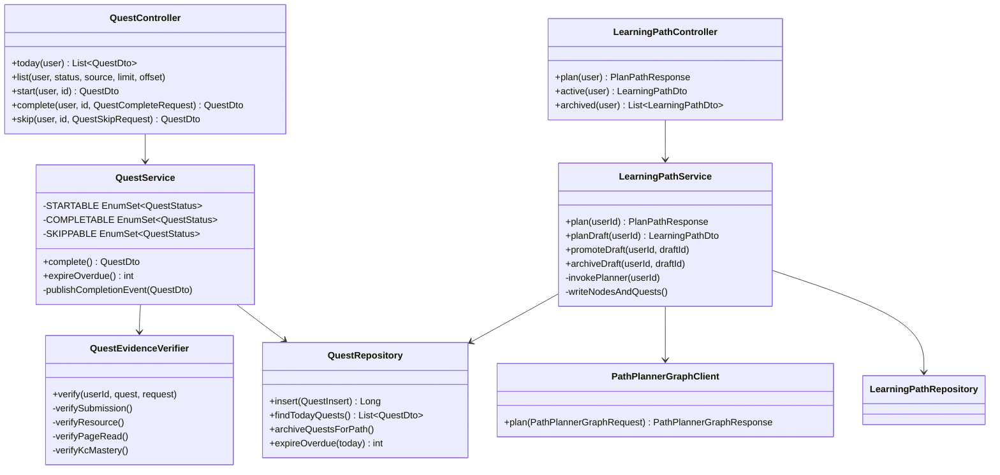
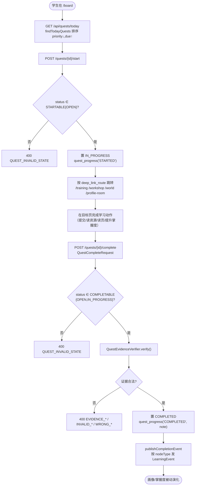
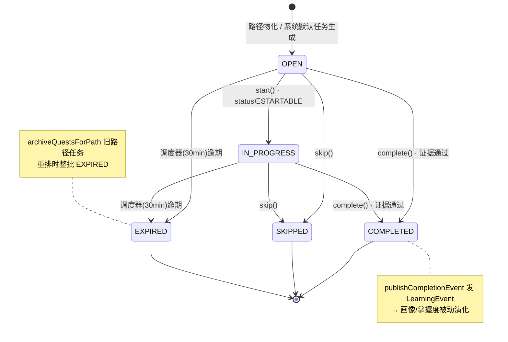
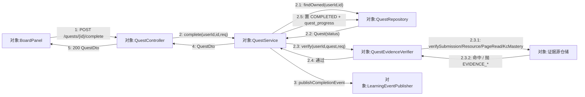
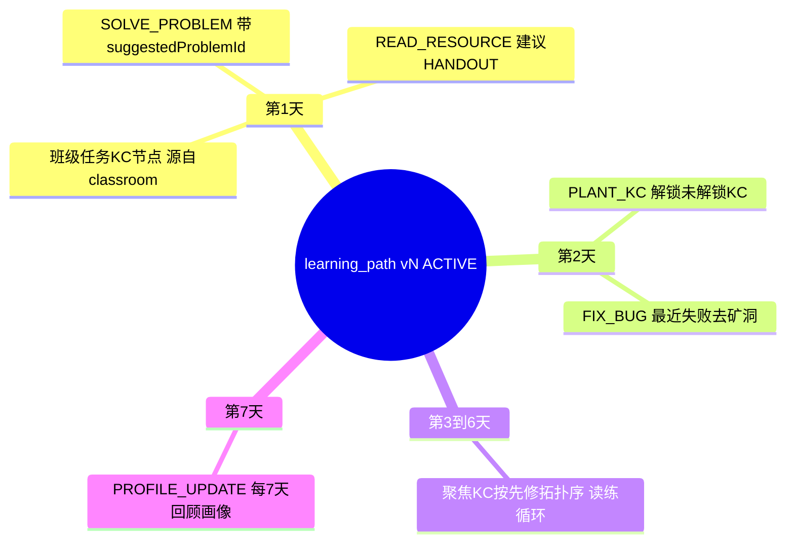
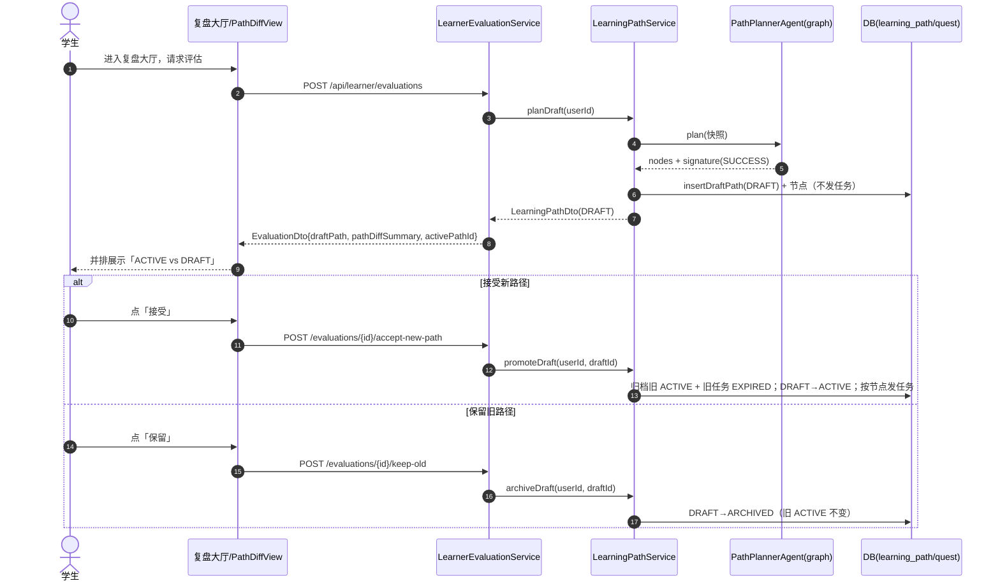

## 8.12 任务公告板与学习路径 · 详细设计

> 文档编号：PYT-CR · filecode：**S12** ｜ 模块：M12 任务公告板与学习路径
> 必读代码：`learner.quest.controller.QuestController`、`learner.quest.service.QuestService`、`learner.quest.evidence.QuestEvidenceVerifier`、`learner.quest.repository.QuestRepository`、`learner.path.controller.LearningPathController`、`learner.path.service.LearningPathService`、`services/pythontopia-graph/.../agents/path_planner_agent.py`
> 数据表字段字典统一见 §6 数据库设计 D4（`quest`/`quest_progress`/`learning_path`/`learning_path_node`），本文仅引用表名与关键列。

本模块详细设计按**六要素**展开：①功能与职责结构 ②处理流程 ③接口设计 ④数据结构与存储 ⑤关键算法/逻辑 ⑥异常、并发与配置。

### 8.12.1 要素一：功能与职责结构

M12 分两条纵向链路，共用 `quest` 物化层：

- **公告板链路**（`learner.quest`）：`QuestController` 暴露领取/完成/跳过/查询端点 → `QuestService` 管状态机与事件发布 → `QuestEvidenceVerifier` 做证据门控 → `QuestRepository` 落 `quest`/`quest_progress`。`QuestExpirationScheduler` 旁路定时清理逾期任务。
- **学习路径链路**（`learner.path`）：`LearningPathController` 暴露规划/查询端点 → `LearningPathService` 编排「取画像/掌握度 → 调 graph → 归档旧路径 → 写新路径与任务」→ `PathPlannerGraphClient` 远程调用 graph `PathPlannerAgent`，结果经 `LearningPathRepository` 落 `learning_path`/`learning_path_node`，并通过 `QuestRepository.insert` 物化为 `PATH_PLANNER` 任务。

两链路通过 `quest.source = PATH_PLANNER` 与 `quest.source_ref_id = learning_path_node.id` 建立软外键关联；复盘大厅（M11）的 `LearnerEvaluationService` 复用 `LearningPathService.planDraft/promoteDraft/archiveDraft` 完成「草稿→对比→接受」的动态重排。

**图 S12-1　M12 组件与依赖类图**



公告板是学生侧的"今日待办"入口，前端 `BoardPanel` 以三标签组织：今日任务、学习路径树、班级任务。界面占位如下。

> 【截图占位 SC-S12-1】
> - 访问：`http://localhost:5173/board`（容器态 `http://localhost:8080/board`）
> - 登录角色：学生
> - 操作步骤：1. 登录后进入公告板 `/board`；2. 默认「今日任务」标签查看按 `priority↓, due↑` 排序的任务卡；3. 切到「学习路径」标签查看 `PathTreeTab` 的 7 天节点树；4. 切到「班级任务」标签查看 `source=CLASSROOM` 的任务。
> - 截取对象：`BoardPanel` 三标签（今日任务 `TodayQuestsTab` / 学习路径树 `PathTreeTab` / 班级任务 `ClassroomQuestsTab`）整体
> - 期望画面：今日任务卡显示领取/完成按钮与深链入口；路径树按第 1..7 天分组展示 `READ_RESOURCE`/`SOLVE_PROBLEM`/`PLANT_KC`/`FIX_BUG`/`PROFILE_UPDATE` 节点

### 8.12.2 要素二：处理流程（任务领取→执行→证据校验→发放）

公告板任务从领取到完成的主流程如下；「发放」指完成后向画像/掌握度系统发布学习事件。

**图 S12-2　任务领取→执行→证据校验→事件发放主流程**



`publishCompletionEvent` 的映射（仅当 `kc_code` 非空）：`READ_RESOURCE → ResourceConsumed`、`SOLVE_PROBLEM → PracticeSucceeded`、`FIX_BUG → DebugResolved`；`PLANT_KC`/`PROFILE_UPDATE` 不直接加掌握度（留待复盘大厅处理）。`extractProblemId` 从 `payload.suggestedProblemId` 取题号。

#### 8.12.2.1 任务状态机

`quest.status` 的合法迁移由 `QuestService` 的三个状态集合 `STARTABLE{OPEN}`、`COMPLETABLE{OPEN, IN_PROGRESS}`、`SKIPPABLE{OPEN, IN_PROGRESS}` 约束，逾期由 `QuestExpirationScheduler` 旁路驱动；学习路径版本另有 `DRAFT → ACTIVE → ARCHIVED` 一组状态（见 8.6 动态重排）。任务状态机见 图 S12-5。

**图 S12-5　公告板任务状态机（stateDiagram-v2）**



> 非法迁移（如对 `COMPLETED` 再 `start`）一律 `400 QUEST_INVALID_STATE`；状态判定在写库前完成，保证状态集合与持久层一致。

#### 8.12.2.2 任务完成协作（通信图）

与 图 S12-2 流程图（强调控制流）互补，图 S12-6 用通信图（协作图）刻画"完成任务"时各对象间的**消息拓扑**：以 `QuestService` 为交互中枢，证据校验、状态落库、事件发布三条链路从它分叉，`QuestRepository` 被状态读取与写入两次复用。

**图 S12-6　任务完成通信图（协作图 · flowchart LR + 序号消息）**



> 通信图无生命线，强调对象间链接与序号消息（`2.3.1` 为证据子校验、`2.5` 与 `2.2` 复用同一仓储对象），便于审查"证据未过则绝不写 COMPLETED"这一不变式。

### 8.12.3 要素三：接口设计

下表为 M12 两个 REST 控制器的真实端点（前缀 `/api`，JWT Bearer，均限 `STUDENT`）。

| 方法 | 路径 | 入参 | 出参 | 关键错误码 |
| --- | --- | --- | --- | --- |
| GET | `/api/quests/today` | — | `List<QuestDto>` | 403 FORBIDDEN |
| GET | `/api/quests` | `status?, source?, limit=30, offset=0` | `List<QuestDto>` | 403 |
| POST | `/api/quests/{id}/start` | path `id` | `QuestDto` | 400 QUEST_INVALID_STATE / 404 QUEST_NOT_FOUND |
| POST | `/api/quests/{id}/complete` | `QuestCompleteRequest`（可空） | `QuestDto` | 400 EVIDENCE_*/INVALID_*/WRONG_*/QUEST_INVALID_STATE |
| POST | `/api/quests/{id}/skip` | `QuestSkipRequest`（可空） | `QuestDto` | 400 / 404 |
| POST | `/api/learner/path/plan` | — | `PlanPathResponse` | 409 PROFILE_REQUIRED / 422 PATH_PLANNING_FAILED·PATH_EMPTY_NODES / 502 PATH_GRAPH_EMPTY |
| GET | `/api/learner/path/active` | — | `LearningPathDto` | 404 PATH_NOT_FOUND |
| GET | `/api/learner/path/archived` | — | `List<LearningPathDto>`（≤10） | 403 |
| GET | `/api/learner/path/{id}` | path `id` | `LearningPathDto` | 404 PATH_NOT_FOUND |

> 表 S12-1　M12 REST 接口一览（DTO 字段见 §4 R12 用例字段列表，表字段见 §6 D4）。
> 动态重排的「接受/保留」复用 M11 端点 `POST /api/learner/evaluations/{id}/accept-new-path`（→ `promoteDraft`）与 `.../keep-old`（→ `archiveDraft`）。

### 8.12.4 要素四：数据结构与存储（学习路径节点树）

学习路径是一棵「路径 → 天 → 节点」三层树：`learning_path` 为根（带 `version`/`status`/`goal_summary`），按 `day_index(1..7)` 分组，组内按 `order_in_day` 排序，叶子是 `learning_path_node`（含 `kc_code`、`node_type`、`reason_summary`、`suggested_resource_type`、`suggested_problem_id`）。前端 `PathTreeTab` 即按此结构 `dayIndex` 分组渲染。

**图 S12-3　学习路径节点结构（mindmap）**



存储约束（详见 §6 D4）：`learning_path` 唯一约束 `(user_id, pack_id, version)`；`learning_path_node` 唯一约束 `(path_id, day_index, order_in_day)`；`quest` 通过 `source_ref_id` 指向 `learning_path_node.id`，`payload` JSONB 冗余 `dayIndex/orderInDay/suggestedProblemId` 便于深链与展示。

### 8.12.5 要素五：关键算法/逻辑

**（1）`PathPlannerAgent` 确定式 7 日排程**（graph 端，可复现、可审计）：

- 常量：`MAX_DAYS=7`、`MAX_NODES_PER_DAY=4`、`TARGET_FOCUS_KCS=5`、`LOW_MASTERY_THRESHOLD=0.4`。
- 聚焦 KC 打分键（升序）：`(-error_boost, -mastery_distance, -(classroom_boost+recent_failed), hash(kc_code), kc_code)`——`error_pattern` 命中最高优先，其次掌握度缺口，再次班级/最近失败，最后用 KC 码哈希做稳定 tie-break。
- 聚焦集合再做**先修拓扑排序**（DFS 后序 + 临时标记防环），保证「先学先修、再学依赖」。
- 每个聚焦 KC：未读过则产 `READ_RESOURCE(HANDOUT)`；最近失败产 `FIX_BUG` 否则 `SOLVE_PROBLEM`（带 `suggested_problem_id`）。未解锁 KC 产 `PLANT_KC`（第 2 天），最后第 7 天产 `PROFILE_UPDATE`。
- `_append_node` 用环形找天：从目标天起顺延找第一个未满 4 节点的天，满则丢弃，保证每天 ≤ 4。
- 产出 `deterministic_signature = sha256(user_id, pack_id, nodes[day,order,kc,type])`；`grounding` 校验所有节点 KC 均在 KC 索引内，否则 `UNKNOWN_KC`；`status = SUCCESS`（grounding 通过）/`PARTIAL`。

**（2）后端归档与物化**（`LearningPathService.plan`）：先 `invokePlanner`（含 `graphMajor` 专业名归一），成功后 `archiveActivePaths` 返回被归档路径 id 列表，逐个 `archiveQuestsForPath(EXPIRED)` 并 `archiveSystemDefaults(SKIPPED)`；再 `nextVersion` → `insertPath` → `writeNodesAndQuests` 把节点逐条 `QuestRepository.insert`，`due_date = today + (dayIndex-1)`，`priority = 班级?9 : min(9, max(1, 8-dayIndex))`，深链由 `deepLinkRouteFor/deepLinkParamsFor` 计算。

**（3）证据门控**（`QuestEvidenceVerifier`，见 §4 图 R12-3）：依 `required_evidence_type` 分派四类校验；`NULL` 走兼容路径。

上述「确定式 7 日排程 + 归档物化」的关键过程以 PDL S12-1 形式化；证据门控的分支结构以 图 S12-7 NS 盒图表达。

**PDL S12-1　学习路径规划与重排（`LearningPathService.plan` + graph 端确定式排程）**

```text
PROCEDURE planLearningPath(userId)                 // 单事务：保证同一时刻仅一条 ACTIVE
  INPUT : userId
  OUTPUT: PlanPathResponse | error
  profile <- ProfileRepository.find(userId)
  IF profile IS NULL THEN RAISE BusinessException(PROFILE_REQUIRED, 409)
  snapshot <- buildSnapshot(profile, masteryOf(userId), recentFails(userId), classroomKcs(userId))
  result   <- PathPlannerGraphClient.plan(snapshot)        // graph 确定式、可复现
  IF result.nodes IS EMPTY THEN RAISE BusinessException(PATH_GRAPH_EMPTY, 502)

  // —— graph 端确定式 7 日排程（MAX_DAYS=7, MAX_NODES_PER_DAY=4, TARGET_FOCUS_KCS=5）——
  focus <- selectFocusKcs(snapshot)        // 排序键 (-error_boost, -mastery_gap, -(classroom+recent), hash(kc))
  focus <- prerequisiteTopoSort(focus)     // DFS 后序 + 临时标记防环：先修在前
  nodes <- []
  FOR EACH kc IN focus DO
      IF NOT hasRead(kc)    THEN appendNode(READ_RESOURCE, kc, HANDOUT)
      IF recentlyFailed(kc) THEN appendNode(FIX_BUG, kc)
      ELSE                       appendNode(SOLVE_PROBLEM, kc, suggestedProblemId(kc))
  appendNode(PLANT_KC, firstLockedKc, day:=2)
  appendNode(PROFILE_UPDATE, day:=MAX_DAYS)
  // appendNode：从目标天环形顺延到首个 < MAX_NODES_PER_DAY 的天，满则丢弃（每天≤4）
  status <- (nodes ⊆ kcIndex) ? SUCCESS : PARTIAL          // grounding 校验，未知 KC 标 PARTIAL

  // —— 后端归档与物化 ——
  archived <- archiveActivePaths(userId)
  FOR EACH p IN archived DO archiveQuestsForPath(p, EXPIRED)
  v      <- nextVersion(userId, packId=DEFAULT_PACK_ID)
  pathId <- insertPath(userId, v, ACTIVE, status)
  FOR EACH n IN nodes DO
      insertNode(pathId, n)
      QuestRepository.insert( materialize(n) )             // due=today+(day-1); priority=班级?9:min(9,8-day)
  RETURN PlanPathResponse(pathId, v, size(nodes), status)
END
```

> 动态重排（复盘大厅触发）走 `planDraft → promoteDraft/archiveDraft`：先以 `DRAFT` 落草稿不发任务，学生确认后 `promoteDraft` 才执行上面的"归档旧 ACTIVE + 物化任务"（见 8.6 图 S12-4）。

**图 S12-7　任务证据强校验分支（NS 盒图）**

`QuestEvidenceVerifier.verify` 按 `required_evidence_type` 分派四类校验，任一失败立即 `400` 且**在写 COMPLETED 之前**拦截、绝不改库：

<table border="1" cellspacing="0" cellpadding="6" style="border-collapse:collapse;text-align:center;width:100%">
  <tr><td colspan="4">读取 quest.required_evidence_type 与 QuestCompleteRequest（含 submissionId/resourceId/pageReadId/kcMasteryDelta）</td></tr>
  <tr><td colspan="4">按 required_evidence_type 分派（CASE）</td></tr>
  <tr>
    <td style="width:25%">SUBMISSION</td>
    <td style="width:25%">RESOURCE</td>
    <td style="width:25%">PAGE_READ</td>
    <td style="width:25%">KC_MASTERY</td>
  </tr>
  <tr>
    <td>submissionId 属本人<br/>且 verdict=AC？<br/>否→EVIDENCE_SUBMISSION_*</td>
    <td>resourceId 已被本人消费？<br/>否→EVIDENCE_RESOURCE_*</td>
    <td>pageReadId 命中目标页？<br/>否→WRONG_PAGE</td>
    <td>kc_mastery_delta≥阈值？<br/>否→INVALID_MASTERY</td>
  </tr>
  <tr><td colspan="4">required_evidence_type = NULL（兼容旧任务）：走宽松路径，仅记 note，不强制证据</td></tr>
  <tr><td colspan="4">全部通过 → 置 COMPLETED + quest_progress('COMPLETED', note) → publishCompletionEvent；任一失败 → 400 且不改库</td></tr>
</table>

### 8.12.6 要素六：动态重排时序、异常、并发与配置

复盘大厅触发的「草稿路径 → PathDiff 对比 → 接受/保留」是动态重排的核心交互：

**图 S12-4　学习路径动态重排（PathDiff）时序图**



**异常处理**：状态非法 `QUEST_INVALID_STATE`、越权 `QUEST_FORBIDDEN`、不存在 `QUEST_NOT_FOUND`；证据类异常一律 400 且不改库（在写 `COMPLETED` 之前拦截）；规划失败按 `PROFILE_REQUIRED(409)`/`PATH_PLANNING_FAILED(422)`/`PATH_EMPTY_NODES(422)`/`PATH_GRAPH_EMPTY(502)` 分级返回；`error_pattern` KC 提取失败降级为空集（不阻断规划）。

**并发与事务**：`start/complete/skip/plan/promoteDraft/archiveDraft` 均 `@Transactional`，`today/list/active/archived/findById` 为 `@Transactional(readOnly=true)`；归档与写新路径在同一事务内保证「同一时刻仅一条 ACTIVE」。

**配置与调度**：`QuestExpirationScheduler` `@Scheduled(fixedDelay=1_800_000, initialDelay=60_000)` 每 30 分钟把逾期 `OPEN/IN_PROGRESS` 任务置 `EXPIRED`，异常仅告警、下次重试；默认课程包 `DEFAULT_PACK_ID=43`，归档历史上限 `ARCHIVED_HISTORY_LIMIT=10`，`next_review_at` 取生成后 7 天。

| 设计点 | 取值 | 代码实体 |
| --- | --- | --- |
| 可完成状态 | {OPEN, IN_PROGRESS} | `QuestService.COMPLETABLE` |
| 逾期扫描周期 | 30 分钟 | `QuestExpirationScheduler` |
| 路径默认包 | 43 | `LearningPathService.DEFAULT_PACK_ID` |
| 每日节点上限 | 4 | `PathPlannerAgent.MAX_NODES_PER_DAY` |
| 任务优先级 | 班级 9 / 其余 min(9,8-day) | `LearningPathService.questPriority` |

> 表 S12-2　M12 关键设计参数（数据字典见 §6 D4）。

---

> 执笔人：成员 A ｜ 完成人（签名）：成员 A ｜ 审查人：成员 C ｜ 完成日期：2026-06-16
