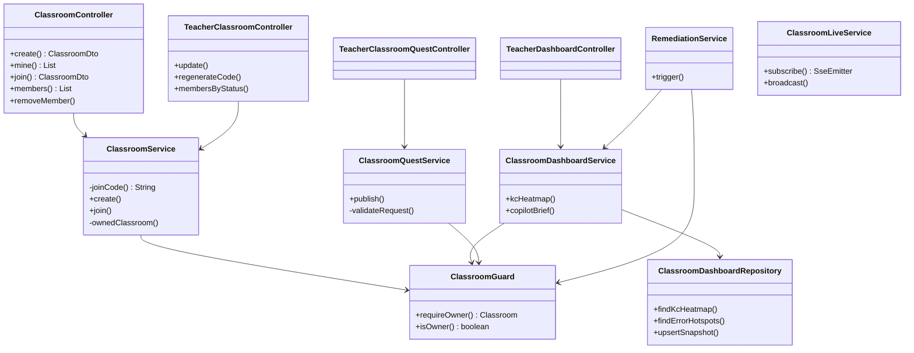
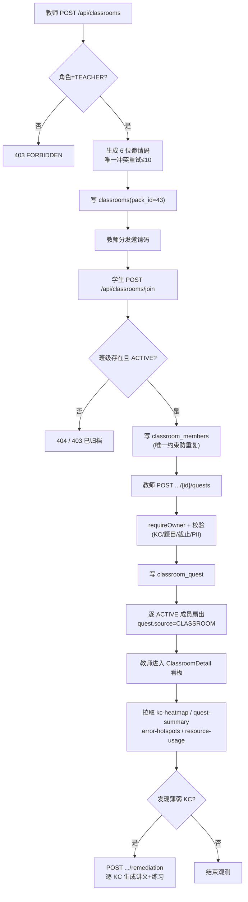
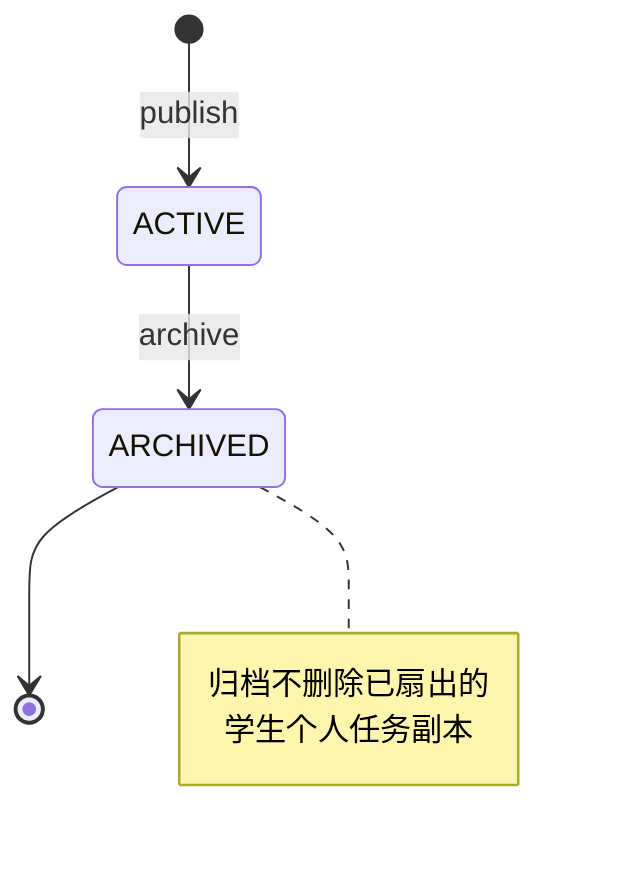
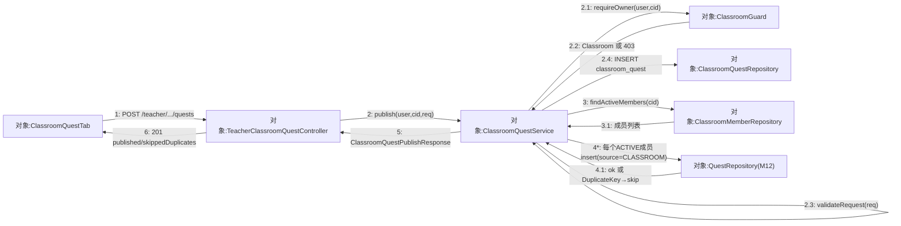
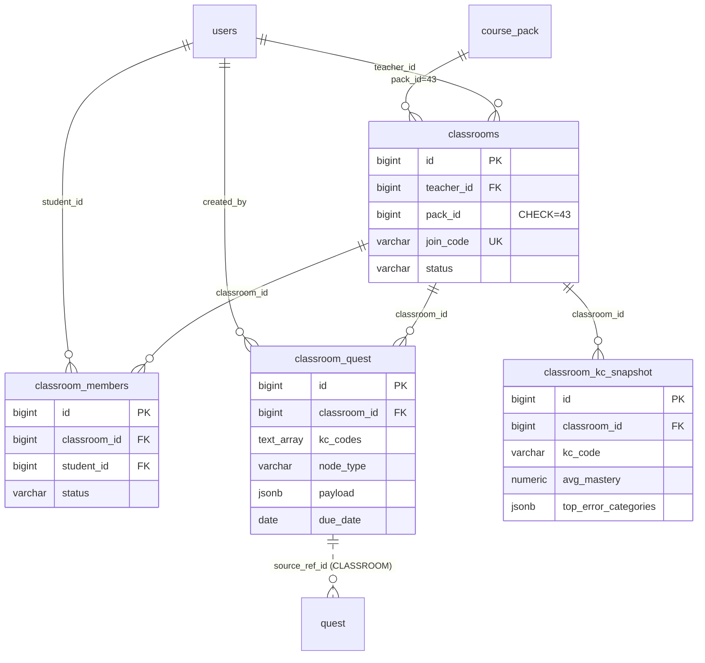
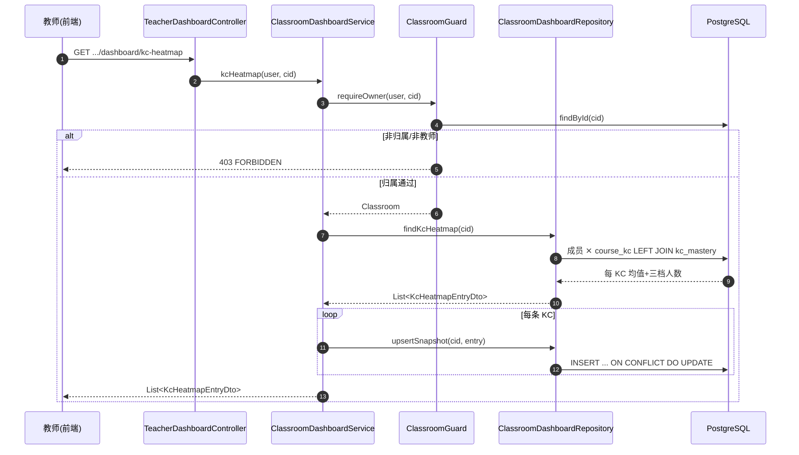

## 8.13 轻量班级与教师看板 · 详细设计

> 本文是 Pythontopia 课程报告 §8 详细设计的 M13 分片，编号前缀 `S13`。设计以仓库真实代码为准：后端包 `com.pythontopia.classroom.*`，前端 `pages/teacher/*`、`components/teacher/*` 与公告板 `components/board/ClassroomQuestsTab.vue`。数据库字段字典统一「见 §6」，本文只画关系不展开字段。本文按**六要素**组织：模块结构、处理流程、接口设计、数据结构、关键算法、异常与安全。

### 8.13.1 要素一：模块结构与职责

M13 后端按「归属域 / 看板域 / 任务域 / 补救域 / 直播域」分包，公共鉴权由 `ClassroomGuard` 横切；前端教师端为单页多 Tab 容器 `ClassroomDetail.vue`，学生端复用公告板。各类职责见图 S13-1。



<small>图 S13-1 M13 后端类结构（classDiagram，方法名取自真实源码）</small>

职责要点：`ClassroomService` 持有邀请码生成与归属判定（私有 `ownedClassroom`）；`ClassroomGuard` 既作 `@PreAuthorize` SpEL bean（`isOwner`）又供 service 直接调用（`requireOwner`），统一归属红线；看板的实时聚合 SQL 全部下沉到 `ClassroomDashboardRepository`，service 只负责鉴权、缓存写入与 copilot 文案拼接；`ClassroomQuestService.publish` 在写班级任务后，循环调用 M12 `QuestRepository.insert` 扇出个人副本；`RemediationService` 复用看板的误区聚合再调资源工坊（M08）`ResourceWorkshopService.create` 生成补救资源。这种「薄归属表 + 复用事实表 + 一处鉴权」的切分，使 M13 自身代码量极小，绝大多数学情逻辑通过 JOIN 复用 M02/M08/M09/M12 的既有数据，避免了重复建模与数据不一致。

前端侧采用「列表页 + 单页多 Tab 容器」结构：教师入口 `TeacherPage.vue` 仅转发到 `TeacherHome.vue`（班级总览 + 新建班级表单 + 班级卡片，展示邀请码并跳转看板）；班级详情 `ClassroomDetail.vue` 是看板主体，左侧侧边栏在「概览 / 直播 / 任务 / KC 热力图 / 高频误区 / 资源使用 / 成员 / 主线星级 / 章测成绩 / 无尽活跃 / 主线进度」十一个 Tab 间切换，并在底部提供「重置加入码」与「一键生成补救包」两个动作。各 Tab 拆为独立子组件（`ClassroomOverviewTab` 统计卡片与活跃流、`ClassroomQuestTab` 发任务表单 + 完成率进度条、`KcHeatmap` 按章分组热力卡片、`ClassroomHotspotsTab` 误区表、`ClassroomMembersTab` 成员表、`ResourceUsageChart` 七天 SVG 折线），数据经 `useTeacherStore`（Pinia）统一加载。学生侧不新增页面，班级任务的领取与提交完全复用 M12 公告板的 `ClassroomQuestsTab.vue`（深链跳转 + 证据选择 + 提交完成）。前端不做硬鉴权，越权防线完全由后端双层守卫兜底。

### 8.13.2 要素二：处理流程

M13 端到端主流程「建班 → 邀请码加入 → 发任务（扇出）→ 看板观测 → 一键补救」见图 S13-2。



<small>图 S13-2 M13 建班→加入→发任务→看板→补救主流程（flowchart）</small>

班级与班级任务均有状态机：班级 `status ∈ {ACTIVE, ARCHIVED}`，成员 `status ∈ {ACTIVE, REMOVED}`，班级任务 `status ∈ {ACTIVE, ARCHIVED}`。学生个人任务副本状态由 M12 维护（OPEN→IN_PROGRESS→COMPLETED/SKIPPED/EXPIRED）。班级任务状态流转见图 S13-3。



<small>图 S13-3 班级任务状态机（stateDiagram-v2）</small>

主流程之外还有两条辅助流程。其一是**成员治理**：教师可 `GET /api/classrooms/{id}/members` 查看成员，或 `GET /api/teacher/classrooms/{id}/members?status=` 按 ACTIVE/REMOVED 过滤；移除成员 `DELETE .../members/{studentId}` 不做物理删除而是置为 REMOVED 软状态，学生的提交、画像、掌握度数据一概保留，仅从后续看板的「ACTIVE 成员」聚合口径中剔除，保证数据可追溯且可恢复。其二是**课堂直播**：教师 `GET /api/classroom/{id}/live` 建立 SSE 长连接，`ClassroomLiveService` 以 `Map<classroomId, CopyOnWriteArrayList<SseEmitter>>` 维护订阅者，连接建立时即推一条 `connected` 事件确认，学生在小镇中的动作事件经 `broadcast` 实时回放给在线教师；emitter 设 10 分钟超时，并在 completion/timeout/error 三种回调里统一清理，防止内存泄漏。班级任务发布的**扇出**是主流程的关键一步：`publish` 在同一事务内先写 `classroom_quest` 模板，再遍历全部 ACTIVE 成员逐个 `insert` 个人副本，命中唯一约束的重复副本被 `DuplicateKeyException` 静默吞掉并计入 `skippedDuplicates`，从而支持「补发」语义——对新加入或漏发的学生重复点发布不会报错也不会重复布置。

M13 写侧最关键的交互是「发布班级任务并扇出个人副本」，其对象间消息拓扑见图 S13-6。该通信图与图 S13-5（看板读时序）互补：此处刻画**写扇出**，无生命线、强调对象链接与序号消息，其中 `4*:` 为对每个 ACTIVE 成员的迭代扇出（命中唯一约束即静默跳过、计入 `skippedDuplicates`）。



<small>图 S13-6 发布班级任务并扇出个人副本通信图（协作图，flowchart LR + 序号消息；`4*` 为对成员的迭代扇出，`2.3` 为自消息校验）</small>

### 8.13.3 要素三：接口设计

M13 真实 REST 端点见表 S13-1，路径与方法逐一对应 controller 源码的 `@RequestMapping/@GetMapping/@PostMapping`。统一前缀 `/api`，JWT Bearer 鉴权。

| 端点 | 方法 | 角色门 | 入参 | 出参 |
| --- | --- | --- | --- | --- |
| `/api/classrooms` | POST | TEACHER | CreateClassroomRequest | ClassroomDto(201) |
| `/api/classrooms/mine` | GET | 师/生 | — | List&lt;ClassroomDto&gt; |
| `/api/classrooms/join` | POST | STUDENT | JoinClassroomRequest | ClassroomDto |
| `/api/classrooms/{id}/members` | GET | 归属教师 | id | List&lt;ClassroomMemberDto&gt; |
| `/api/classrooms/{id}/members/{studentId}` | DELETE | 归属教师 | id, studentId | 204 |
| `/api/teacher/classrooms/{id}` | PUT | TEACHER/ADMIN | UpdateClassroomRequest | ClassroomDto |
| `/api/teacher/classrooms/{id}/regenerate-code` | POST | TEACHER/ADMIN | id | ClassroomDto |
| `/api/teacher/classrooms/{id}/members?status=` | GET | TEACHER/ADMIN | status(ACTIVE/REMOVED) | List&lt;ClassroomMemberDto&gt; |
| `/api/teacher/classrooms/{cid}/quests` | POST | TEACHER/ADMIN | ClassroomQuestCreateRequest | ClassroomQuestPublishResponse(201) |
| `/api/teacher/classrooms/{cid}/quests` | GET | TEACHER/ADMIN | cid | List&lt;ClassroomQuestDto&gt; |
| `/api/teacher/classrooms/{cid}/quests/{qid}/archive` | POST | TEACHER/ADMIN | cid, qid | ClassroomQuestDto |
| `/api/classroom/quests/mine` | GET | STUDENT | — | List&lt;ClassroomQuestDto&gt; |
| `/api/teacher/classrooms/{cid}/dashboard/kc-heatmap` | GET | TEACHER/ADMIN | cid | List&lt;KcHeatmapEntryDto&gt; |
| `/api/teacher/classrooms/{cid}/dashboard/quest-summary` | GET | TEACHER/ADMIN | cid | List&lt;QuestCompletionDto&gt; |
| `/api/teacher/classrooms/{cid}/dashboard/error-hotspots` | GET | TEACHER/ADMIN | cid | List&lt;ErrorHotspotDto&gt; |
| `/api/teacher/classrooms/{cid}/dashboard/resource-usage` | GET | TEACHER/ADMIN | cid | ResourceUsageDto |
| `/api/teacher/classrooms/{cid}/dashboard/recent-activity?limit=` | GET | TEACHER/ADMIN | cid, limit | List&lt;RecentActivityDto&gt; |
| `/api/teacher/classrooms/{cid}/dashboard/mainline-stars` 等 4 端点 | GET | TEACHER/ADMIN | cid | 主线看板 DTO（R-15） |
| `/api/teacher/classrooms/{cid}/remediation` | POST | TEACHER/ADMIN | cid | RemediationResultDto |
| `/api/classroom/{cid}/live` | GET(SSE) | TEACHER/ADMIN | cid | text/event-stream |

<small>表 S13-1 M13 REST 接口一览（DTO 字段见 §6 / R13）</small>

### 8.13.4 要素四：数据结构与存储

M13 物理数据模型见图 S13-4，字段字典统一见 §6（D4）。`classrooms` 以 `pack_id` 列约束 `CHECK (pack_id = 43)` 锁定单课程；成员、任务、快照均以 `classroom_id` 外键 `ON DELETE CASCADE` 挂接，删班级即级联清理。



<small>图 S13-4 M13 数据关系（erDiagram；字段见 §6 表 classrooms/classroom_members/classroom_quest/classroom_kc_snapshot）</small>

存储设计要点：①`classroom_members` 与 `classroom_kc_snapshot` 均建 `UNIQUE` 约束保证幂等（成员唯一、班级×KC 唯一）；②`classroom_quest.kc_codes` 用 `TEXT[]` + GIN 索引支持按 KC 检索；③`classroom_quest` 与 M12 `quest` 表是「模板—副本」关系，副本以 `source='CLASSROOM'` + `source_ref_id=班级任务id` 回指，看板完成率由此 JOIN 聚合。

### 8.13.5 要素五：关键算法与聚合

**(1) 邀请码生成**：从无歧义字符集 `ABCDEFGHJKLMNPQRSTUVWXYZ23456789`（剔除 0/O/1/I/L）用 `SecureRandom` 取 6 位，写入命中 `UNIQUE(join_code)` 冲突则重试，最多 10 次仍冲突抛 `JOIN_CODE_CONFLICT`。

**(2) KC 热力图聚合与快照**：以班级 ACTIVE 成员 `CROSS JOIN` 课程包 43 的全部 `course_kc`，再 `LEFT JOIN kc_mastery` 求每 KC 的 `AVG(mastery_score)` 与三档人数（已掌握 ≥0.8、学习中 0.3–0.8、挣扎 <0.3）；service 读取后逐行 `upsertSnapshot` 落 `classroom_kc_snapshot`（`ON CONFLICT DO UPDATE`）。聚合时序见图 S13-5。



<small>图 S13-5 KC 热力图聚合与快照写入时序（sequenceDiagram）</small>

**(3) 完成率统计**：`classroom_quest LEFT JOIN quest`（CLASSROOM 来源）按状态 `FILTER` 计数，完成率 = `completed / max(1,total)` 保留 3 位小数。**(4) 高频误区**：近 7 天 `practice_submission JOIN judge_result`（`verdict != 'AC'`）按 KC + verdict 分组，内存再聚合为 `categories` 并按失败数取 Top10。**(5) 一键补救**：对误区 Top KC 逐个调工坊生成 `HANDOUT + PRACTICE`，聚合各资源 `evidence_page_ids` 去重返回。**(6) copilot 学情摘要**：取挣扎人数最多、掌握度最低的前 3 个 KC 与失败最多的前 3 个误区，拼成「只读 + 严禁泄题」文案注入答疑，让教师答疑时回答贴合本班真实学情。**(7) 资源使用**：以近 7 天为窗口，`learning_resource JOIN classroom_members` 同时产出「按类型汇总」与「按天 × 类型」两份桶数据，供前端 `ResourceUsageChart` 画多条折线。**(8) 最近活跃流**：将 `kc_mastery_event`（掌握）、`practice_submission`+`judge_result`（提交）、`learning_resource`（资源）三类事件 `UNION ALL` 后按时间倒序取 limit（默认 20、上限 50），形成统一的班级活动时间线。

上述聚合的口径统一为「班级 ACTIVE 成员」，被移除成员的历史数据自动不计入；除热力图主动落 `classroom_kc_snapshot` 缓存外，其余端点均为请求时实时计算，保证看板「所见即当前」。前端渲染上，`KcHeatmap` 按 `chapterId` 分组，掌握度映射到四档语义色（红 <0.2 → 橙 → 黄 → 绿 ≥0.8）并以卡片 + 进度条呈现，`ClassroomQuestTab` 用进度条与「完成数/总数」直观展示每个任务完成率，`ResourceUsageChart` 用纯 SVG `polyline` 绘制七天趋势，均为无第三方图表库的轻量实现。KC 热力图为动态渲染，给出截图占位：

> 【截图占位 SC-S13-1】
> - 访问：http://localhost:5173/teacher/classroom/{id} （容器态 http://localhost:8080/teacher/classroom/{id}）
> - 登录角色：教师（归属该班）
> - 操作步骤：1. 登录教师账号；2. 进入任一班级看板；3. 左侧切到「KC 热力图」Tab。
> - 截取对象：`KcHeatmap.vue` 渲染的按章 KC 卡片网格与图例
> - 期望画面：每章一组 KC 卡片，掌握度由红(<0.2)→橙→黄→绿(≥0.8)着色，并显示「已掌握/总数」。

KC 热力图聚合（上文 (2)）的关键过程以 PDL S13-1 形式化；发布班级任务前的校验分支（对应 (1) 邀请码外的另一处写校验）以图 S13-7 NS 盒图表达。

**PDL S13-1　KC 热力图聚合与快照写入（`ClassroomDashboardService.kcHeatmap`）**

```text
PROCEDURE kcHeatmap(user, classroomId)             // 读写事务
  INPUT : user, classroomId
  OUTPUT: List<KcHeatmapEntryDto>
  classroom <- ClassroomGuard.requireOwner(user, classroomId)   // 非归属/非教师 → 403 FORBIDDEN
  rows <- ClassroomDashboardRepository.findKcHeatmap(classroomId)
        // SQL: ACTIVE 成员 CROSS JOIN course_kc(pack_id=43) LEFT JOIN kc_mastery
        //      GROUP BY kc_code → AVG(mastery_score) 与三档人数
  result <- []
  FOR EACH r IN rows DO
      mastered   <- countMembers(r, mastery >= 0.8)
      learning   <- countMembers(r, 0.3 <= mastery AND mastery < 0.8)
      struggling <- countMembers(r, mastery < 0.3)
      entry <- KcHeatmapEntryDto(r.kc_code, r.chapter_id, r.avg_mastery, mastered, learning, struggling)
      ClassroomDashboardRepository.upsertSnapshot(classroomId, entry)   // INSERT ... ON CONFLICT DO UPDATE
      result.append(entry)
  RETURN result          // classroom_kc_snapshot 仅作渲染缓存，丢失可由 kc_mastery/kc_mastery_event 即时重算
END
```

**图 S13-7　发布班级任务校验分支（NS 盒图）**

`ClassroomQuestService.validateRequest` 在 `requireOwner` 之后顺序执行四道校验，任一失败立即抛 `BusinessException(400)` 且**不写库**：

<table border="1" cellspacing="0" cellpadding="6" style="border-collapse:collapse;text-align:center;width:100%">
  <tr><td colspan="2">requireOwner(user, cid) 通过（否则 403 FORBIDDEN）</td></tr>
  <tr><td colspan="2">绑定锚点？（problemId 非空 或 resourceId 非空）</td></tr>
  <tr><td style="width:50%">是：继续</td><td style="width:50%">否 → 400 CLASSROOM_QUEST_ANCHOR_REQUIRED</td></tr>
  <tr><td colspan="2">kc_codes 全部已知且无重复？</td></tr>
  <tr><td>是：继续</td><td>否 → 400 KC_UNKNOWN / KC_DUPLICATE</td></tr>
  <tr><td colspan="2">due_date ≥ 今天？</td></tr>
  <tr><td>是：继续</td><td>否 → 400 DUE_DATE_INVALID</td></tr>
  <tr><td colspan="2">标题/描述不含手机号或身份证（PII 正则）？</td></tr>
  <tr><td>是 → 写 classroom_quest 并向 ACTIVE 成员扇出</td><td>否 → 400 CLASSROOM_QUEST_PII_BLOCKED</td></tr>
</table>

### 8.13.6 要素六：异常处理与安全

M13 安全核心是**双重防线**：教师端 controller 用 `@PreAuthorize("hasAnyRole('TEACHER','ADMIN')")` 做角色门，service 内再经 `ClassroomGuard.requireOwner` 做班级归属门（admin 可越归属，用于运维）。`ClassroomService` 对学生侧入口用 `requireRole` 单独把关（join 仅 STUDENT、create 仅 TEACHER）。主要错误码见表 S13-2。

| 错误码 | HTTP | 触发场景 |
| --- | --- | --- |
| FORBIDDEN | 401/403 | 未登录 / 角色不符 / 班级非归属 |
| Classroom not found | 404 | 邀请码或班级 id 不存在 |
| Classroom is archived | 403 | 加入已归档班级 |
| CLASSROOM_ALREADY_JOINED | 409 | 学生重复加入 |
| JOIN_CODE_CONFLICT | 409 | 邀请码 10 次重试仍冲突 |
| CLASSROOM_QUEST_ANCHOR_REQUIRED | 400 | 任务既未绑题目也未绑资源 |
| CLASSROOM_QUEST_KC_UNKNOWN / _DUPLICATE | 400 | KC 未知 / 重复 |
| CLASSROOM_QUEST_DUE_DATE_INVALID | 400 | 截止日早于今天 |
| CLASSROOM_QUEST_PII_BLOCKED | 400 | 标题/描述疑似含手机号或身份证 |

<small>表 S13-2 M13 主要错误码（取自 BusinessException 真实常量）</small>

安全补充：①扇出个人任务时 `DuplicateKeyException` 静默计入 `skippedDuplicates`，避免重复发任务报错；②SSE 直播仅教师/管理员可订阅，`ClassroomLiveController` 内显式校验角色，emitter 10 分钟超时并在完成/超时/错误时清理；③补救资源归属触发教师本人账号，修复了旧实现传 `null` user 致生产 401 的缺陷；④copilot 摘要只读、显式声明禁止输出可直接提交的完整答案，落实防泄题红线。

事务与一致性方面：`publish` 标注 `@Transactional`，班级任务模板与全部个人副本要么一起成功要么一起回滚，杜绝「模板已写但学生没收到」的半成品；热力图端点 `kcHeatmap` 用读写事务，先聚合再逐行 `upsertSnapshot`，快照表只作渲染加速缓存，丢失或过期不影响正确性——`ClassroomDashboardRepository` 始终能从 `kc_mastery`/`kc_mastery_event` 即时重算，这一点也写进了 V080 迁移的注释。归属校验对 `admin` 角色放行越权访问（仅运维/演示用途），但学生加入、个人任务等学生侧动作严格限定 `Role.STUDENT`，三类角色边界清晰，配合数据库层 `CHECK (pack_id = 43)`、`UNIQUE(join_code)`、`UNIQUE(classroom_id, student_id)` 等约束形成「应用校验 + 数据库约束」的纵深防御。

---

执笔人：成员 A ｜ 完成人（签名）：成员 A ｜ 审查人：成员 C ｜ 完成日期：2026-06-16
