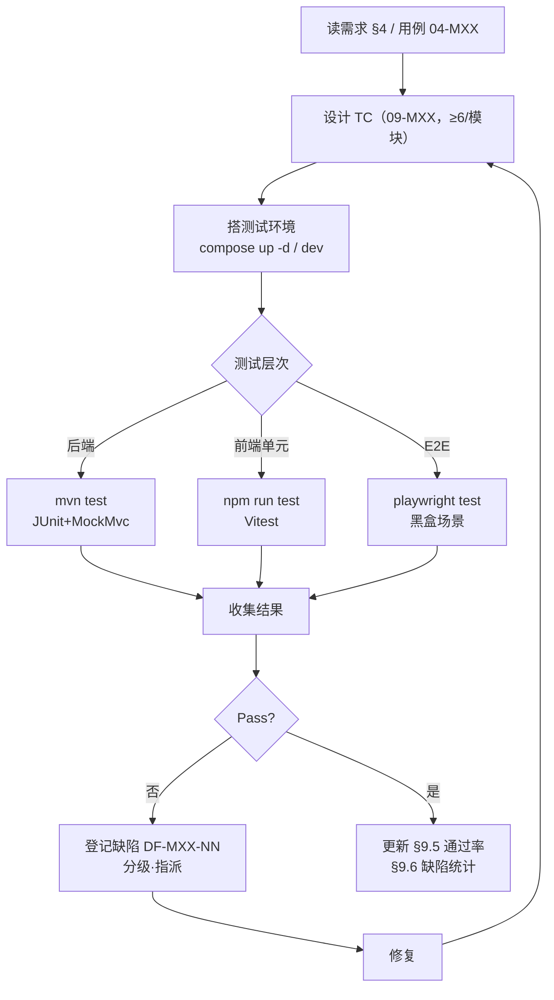
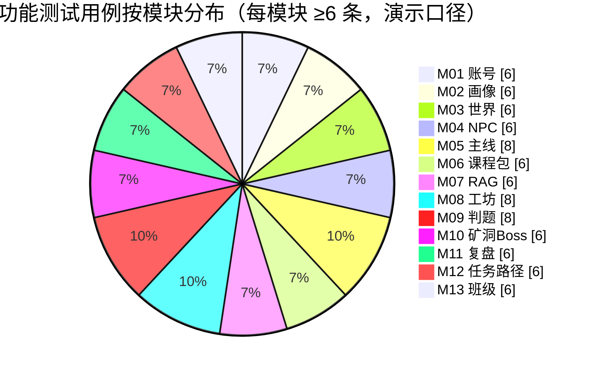
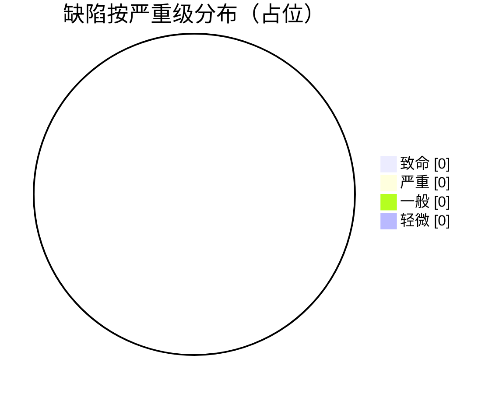

# 9 测试计划与结果分析

> 本章 filecode：**T00**。本文件对应 PDF 报告第 9 章的**总述**，给出测试目标与范围、环境与工具、测试策略、用例索引、结果分析与缺陷统计。
> 各功能模块的**具体功能测试用例（TC）拆分在 `09-MXX` 文件**（filecode T01–T13），本文件只做总体计划与汇总，不重复展开单条 TC。
> 本章聚焦**功能测试（黑盒）**；性能、安全等非功能项以「演示可达」口径在功能用例中附带验证（详见 §4.3）。

---

## 9.1 测试目标与范围

### 9.1.1 测试目标

本测试旨在验证 Pythontopia 作为「面向高校 Python 初学者的多端像素学习小镇第二课堂」是否**功能正确、链路真实、演示可达**，具体目标：

1. **功能正确**：13 个功能模块（M01–M13）的核心用例（UC-01-xx … UC-13-xx）按需求规约正确执行，正常路径与关键异常路径行为符合预期。
2. **链路真实**：AI 答疑 / 工坊编排 / RAG 检索 / 判题为真实后端链路（SSE 流式、服务端沙箱、证据页码），而非前端假数据；正式判题入库，Pyodide 预览不入正式判分。
3. **防幻觉与不泄密**：RAG 回答带课件页码证据；错误渲染面不暴露堆栈、内部主机名、端口、默认口令与 JWT。
4. **个性化可见**：8 维画像可被被动事件与自评驱动更新；任务完成强校验 evidence。
5. **多端契约一致**：4 端共用后端 `/api` 契约行为一致（本章以 Web 端为主验收，多端契约见 §7）。

### 9.1.2 测试范围

**范围内（In-Scope）**：M01–M13 全部模块的功能用例；登录鉴权与守卫；主城 `town_hub` 加载；主线看学练测；图书馆 RAG；工坊六类资源生成与 SSE；训练场双轨判题三态（AC/WA/RE）；复盘与画像页；深链刷新；错误不泄密面。

**范围外（Out-of-Scope，本轮）**：① R-14 已移除的农场 / 作物 / 货币 / 商店玩法（相关表已 DROP，详见 §6 附录）；② 大规模并发压测与长稳测试（仅做演示级时间上限校验）；③ Android / Windows / 微信端的端内 UI 自动化（以后端契约测试覆盖，端内手测见各端 README）；④ 第三方服务（讯飞 / B 站 / 外部 LLM）真实出参的内容质量评测（缺密钥走降级，验证降级不阻塞链路）。

---

## 9.2 测试环境与工具

### 9.2.1 测试工具栈

**表 T00-1 测试工具与层次**

| 层次 | 工具 | 版本 | 用途 | 命令 / 入口 |
| --- | --- | --- | --- | --- |
| 后端单元/集成 | JUnit 5 + Spring Boot Test | Spring Boot 3.3.6 | Service/Repository/Controller 测试 | `cd backend && mvn test` |
| 后端 Web 层 | MockMvc | 同上 | Controller 端点、鉴权、错误返回 | `mvn test` |
| 前端单元 | Vitest + @vue/test-utils + jsdom | Vitest 2.1.8 | 组件/工具/API client 单测 | `cd frontend && npm run test` |
| 前端 E2E | Playwright | @playwright/test ^1.60 | 浏览器端到端验收 | `npm run test:e2e` |
| Python 微服务 | pytest | Python 3.11 | graph / rag 节点与流程 | `python -m pytest -q` |
| 一键起栈 | Docker Compose | — | 起 6 核心服务后验收 | `cd deploy && docker compose up -d` |

> 前端 `npm run test` 即 `vitest run --exclude "e2e/**"`，单测与 E2E 解耦；E2E 用 `playwright test`。后端覆盖 `mvn test`（当前后端测试源文件约 160+ 个）。

### 9.2.2 测试环境与端口

**表 T00-2 测试环境**

| 环境 | 地址 / 端口 | 说明 |
| --- | --- | --- |
| 前端 dev | `http://localhost:5173` | Vite 开发态 |
| 前端容器 | `http://localhost:8080` | compose `frontend` 容器（80→8080） |
| 后端 | `:18080`（容器绑 `127.0.0.1:18080`） | 统一前缀 `/api`、JWT |
| graph | `:18091` | 多智能体（开发态 host 网络） |
| rag | `:18092` | 课件检索（admin token） |
| PostgreSQL+pgvector | `:15432→5432` | 库名 `pythontopia` |
| Redis | `:16379→6379` | 缓存/限流 |
| 公网验收 | `BASE_URL=http://47.120.29.62` | ECS 2C4G 演示机 |

### 9.2.3 测试账号与数据契约

- **演示学生**：登录页「快速体验：演示学生」一键登录（凭证不写死仓库，见登录接口契约）。
- **E2E 账号**：`PYT_E2E_USERNAME`/`PYT_E2E_PASSWORD` 直接登录；或 `PYT_E2E_REGISTER=1` 通过 `POST /api/auth/register` 注册临时 QA 账号（409 容忍并改登录）；三者缺省时登录态用例整组跳过并给中文原因。
- **教师账号**：注册时携带教师邀请码 `PYT_TEACHER_INVITE_CODE`。
- **判题样例题**：训练场默认演示题 `problemId=476`「圆面积计算」（读浮点半径，π=3.1415，保留 4 位小数），三态样例代码：AC=正确公式、WA=输出 `0.0000`、RE=`raise RuntimeError`。
- **RAG 标准查询**：`input函数`、`for循环`、`列表`，三者均须返回带「第 N 页」证据。

---

## 9.3 测试策略

### 9.3.1 总体策略：黑盒功能测试为主

测试以**黑盒功能测试**为主线：从执行者（学生/教师/管理员）视角，按用例（UC）的基本路径与扩展路径设计测试用例（TC），只关注「给定输入与前置条件，系统输出与状态是否符合需求」，不依赖内部实现。配合后端单元/集成测试（白盒补充，验证 Service/Repository/判题沙箱等关键逻辑）与前端组件单测（验证渲染与交互），形成「黑盒为主、白盒兜底」的分层覆盖。

测试方法采用等价类划分与边界值（如判题三态、限流 10s 窗口、画像维度自评 key 合法性）、场景法（看→学→练→测完整旅程）、异常注入（E2E 中 `route.abort` 注入一次网络失败验证失败态与重试）、错误猜测（畸形 JSON、未认证访问、不存在路径）。

### 9.3.2 用例覆盖 13 模块

每个模块至少 6 条功能测试用例（§8.1 模板），覆盖该模块学生侧 + 教师/管理员侧核心用例的正常与异常路径。后端测试现状显示 13 模块均有自动化测试覆盖（示例：M01 `SecurityConfigCorsTest`；M02 `PassiveProfileServiceTest`/`Stage04PassiveDimensionAcceptanceIntegrationTest`；M05 `MainlineServiceTest`/`StageCompletionTest`；M07 `TutorWorkflowServiceTest` 等；M08 `OrchestratorServiceTest`/`Stage07WorkshopAcceptanceIntegrationTest`；M09 `SandboxResourceLimitTest`；M10 `BossServiceTest`/`ExpeditionRunControllerTest`；M11 `LearnerEvaluationServiceTest`；M12 `QuestCompleteWithEvidenceTest`/`LearningPathServiceTest`；M13 `ClassroomQuestServiceTest`）。E2E 由 `frontend/e2e/publicAcceptance.spec.ts` 覆盖认证、主城、主线、向导 SSE、深链、工坊、RAG、判题三态、复盘画像、刷新、不泄密等端到端场景。

**图 T00-1 测试执行流程**

### 9.3.3 用例编号规则

- **功能测试用例**：`TC-MXX-NN`，其中 `MXX` 为模块号（M01–M13），`NN` 为模块内两位序号；每条 TC 在「关联用例」字段回链对应 `UC-XX-NN`。
- **缺陷编号**：`DF-MXX-NN`，与触发它的 TC 同模块号。
- **TC 字段**：套用 §8.1 模板（关联用例 / 测试目标 / 前置条件 / 测试步骤 / 测试数据 / 预期结果 / 实际结果 / 结论 / 缺陷编号）。

---

## 9.4 用例索引

各模块功能测试用例集中在 `09-MXX`（T01–T13），每个文件 ≥6 条 TC（下限 13×6=78 条），本计划排布 **84 条**（主线 M05 / 工坊 M08 / 判题 M09 各 8 条，其余各 6 条）。下表为索引（编号区间为约定起点，最终条数以各模块文件为准）。

**表 T00-3 功能测试用例索引（指向 09-MXX）**

| 模块 | 测试文件 / filecode | TC 编号区间 | 关联用例 | 核心测试点 |
| --- | --- | --- | --- | --- |
| M01 账号认证 | `09-M01` / T01 | TC-M01-01…06+ | UC-01-xx | 注册/登录/刷新、守卫重定向、错误不泄密 |
| M02 学习画像 | `09-M02` / T02 | TC-M02-01…06+ | UC-02-xx | 访谈、被动演化、自评维度、画像页空态 |
| M03 世界存档 | `09-M03` / T03 | TC-M03-01…06+ | UC-03-xx | town_hub 加载、移动存档、能量/日历 |
| M04 NPC 对话 | `09-M04` / T04 | TC-M04-01…06+ | UC-04-xx | 对话树、记忆召回、亲密度 |
| M05 主线看学练测 | `09-M05` / T05 | TC-M05-01…06+ | UC-05-xx | 进入 Stage 无穿透、看学练、章末测试得星 |
| M06 课程包资产 | `09-M06` / T06 | TC-M06-01…06+ | UC-06-xx | 课件/PDF/视频、课程规模校验 |
| M07 课件问答 RAG | `09-M07` / T07 | TC-M07-01…06+ | UC-07-xx | 三标准查询带页码证据、降级回退 |
| M08 资源工坊 | `09-M08` / T08 | TC-M08-01…06+ | UC-08-xx | 六类资源生成、SSE 流式、失败重试 |
| M09 训练判题 | `09-M09` / T09 | TC-M09-01…06+ | UC-09-xx | AC/WA/RE 三态、限流 429、双轨 |
| M10 矿洞 Boss | `09-M10` / T10 | TC-M10-01…06+ | UC-10-xx | 失败触发矿洞、远征、Boss 出题 |
| M11 复盘评估 | `09-M11` / T11 | TC-M11-01…06+ | UC-11-xx | 复盘大厅、费曼自测、周度评估 |
| M12 任务路径 | `09-M12` / T12 | TC-M12-01…06+ | UC-12-xx | 任务 evidence 校验、路径规划/重排 |
| M13 班级看板 | `09-M13` / T13 | TC-M13-01…06+ | UC-13-xx | 建班/发任务、KC 热力图、补救 |

**图 T00-2 功能测试用例按模块覆盖占比**

---

## 9.5 结果分析

测试执行采用「演示环境通过 + 待执行」双口径：自动化用例（后端 `mvn test`、前端 `npm run test`、E2E `playwright test`）在演示环境运行通过；手工/补充 TC 标「待执行」，由各 `09-MXX` 在终稿回填实际结果。

**表 T00-4 按模块通过率汇总（终稿回填）**

| 模块 | 计划 TC 数 | 通过 | 失败 | 阻塞 | 通过率 | 备注 |
| --- | --- | --- | --- | --- | --- | --- |
| M01 账号认证 | 6 | 待回填 | 待回填 | 待回填 | 待回填 | 见 T01 |
| M02 学习画像 | 6 | 待回填 | 待回填 | 待回填 | 待回填 | 见 T02 |
| M03 世界存档 | 6 | 待回填 | 待回填 | 待回填 | 待回填 | 见 T03 |
| M04 NPC 对话 | 6 | 待回填 | 待回填 | 待回填 | 待回填 | 见 T04 |
| M05 主线看学练测 | 8 | 待回填 | 待回填 | 待回填 | 待回填 | 见 T05 |
| M06 课程包资产 | 6 | 待回填 | 待回填 | 待回填 | 待回填 | 见 T06 |
| M07 课件问答 RAG | 6 | 待回填 | 待回填 | 待回填 | 待回填 | 见 T07 |
| M08 资源工坊 | 8 | 待回填 | 待回填 | 待回填 | 待回填 | 见 T08 |
| M09 训练判题 | 8 | 待回填 | 待回填 | 待回填 | 待回填 | 见 T09 |
| M10 矿洞 Boss | 6 | 待回填 | 待回填 | 待回填 | 待回填 | 见 T10 |
| M11 复盘评估 | 6 | 待回填 | 待回填 | 待回填 | 待回填 | 见 T11 |
| M12 任务路径 | 6 | 待回填 | 待回填 | 待回填 | 待回填 | 见 T12 |
| M13 班级看板 | 6 | 待回填 | 待回填 | 待回填 | 待回填 | 见 T13 |
| **合计** | **≥84** | 待回填 | 待回填 | 待回填 | 待回填 | — |

结果分析重点关注三类信号：① **核心闭环可用性**（看学练测、RAG、判题三态、工坊 SSE 是否全通）；② **降级正确性**（缺第三方密钥时是否 fail-soft 而非崩溃）；③ **不泄密回归**（错误面是否命中泄密样式库）。任一核心闭环用例失败即视为演示阻塞，须优先修复。

---

## 9.6 缺陷统计

缺陷按严重级（致命/严重/一般/轻微）与状态（新建/修复中/已修复/已验证/不予修复）登记，编号 `DF-MXX-NN`，与 §10 审查问题清单互为补充（§10 偏阶段评审发现，本节偏执行期测试发现）。

**表 T00-5 缺陷严重级定义**

| 级别 | 定义 | 处理时限 |
| --- | --- | --- |
| 致命（Critical） | 核心闭环不可用 / 数据丢失 / 安全泄密 | 立即修复，阻塞演示 |
| 严重（Major） | 主要功能不可用但有规避 | 演示前修复 |
| 一般（Minor） | 次要功能缺陷 / 体验问题 | 排期修复 |
| 轻微（Trivial） | 文案 / 像素对齐等 | 可延后 |

**表 T00-6 缺陷汇总（终稿回填）**

| 缺陷号 | 关联 TC | 模块 | 严重级 | 现象简述 | 状态 |
| --- | --- | --- | --- | --- | --- |
| DF-Mxx-NN | TC-Mxx-NN | 待回填 | 待回填 | 待回填 | 待回填 |

**图 T00-3 缺陷按严重级分布（占位，终稿回填）**

> 缺陷分布饼图与 §9.5 通过率表在测试执行完成后回填真实数据；当前为计划期占位，不编造结果。

---

> 本文件为第 9 章总述；各模块 TC 详见 `09-MXX`（T01–T13），需求与用例见第 4 章，阶段评审问题见第 10 章。

---

**执笔人：成员 C ｜ 完成人（签名）：成员 C ｜ 审查人：成员 A ｜ 完成日期：2026-06-18**
