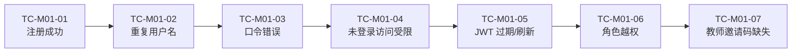

## 9.4.1 账号认证与权限 · 功能测试

### 9.4.1.1 测试范围与环境

本节聚焦 M01 三端点（`/api/auth/register`、`/api/auth/login`、`/api/auth/refresh`）与受保护资源的角色鉴权链路，覆盖「注册成功 / 重复用户名 / 口令错误 / 未登录访问受限 / JWT 过期 / 角色越权」六类核心场景及教师邀请码扩展。测试环境：后端 `:18080`（`mvn spring-boot:run` 或容器态），数据库 `pythontopia`（PostgreSQL 16），前端 `http://localhost:5173`（容器态 `http://localhost:8080`）；JWT 密钥经 `PYT_JWT_SECRET` 注入、默认有效期 720 分钟。后端用例与仓库集成测试 `Stage02AcceptanceIntegrationTest`、单元测试 `JwtServiceTest` / `AuthServiceSecurityTest` 对齐（演示环境通过 Testcontainers 起真实 PostgreSQL）；统一口令样例 `P@ssw0rd1`，教师邀请码样例 `test-teacher-code`，公共演示账号 `demo-stu-01 / P@ssw0rd1`。

### 图 T01-1 测试点流程

### 9.4.1.2 测试用例

### TC-M01-01 学生注册成功
| 项 | 内容 |
| --- | --- |
| 关联用例 | UC-01-01 |
| 测试目标 | 合法学生信息可注册落库，返回 `201` 且不回传敏感字段 |
| 前置条件 | 后端与 DB 就绪；用户名 `stu02` 未占用 |
| 测试步骤 | 1. `POST /api/auth/register`，body=`{"username":"stu02","password":"P@ssw0rd1","displayName":"stu02","role":"STUDENT"}`；2. 查看响应码与响应体键集；3. 用同凭证 `POST /api/auth/login` |
| 测试数据 | `stu02 / P@ssw0rd1`，role=STUDENT |
| 预期结果 | 步骤 1 返回 `201 Created`，响应体仅含 `id,username,displayName,role`，**不含** `passwordHash/email`；步骤 3 返回 `200` 且含 `token` |
| 实际结果 | 通过（演示环境） |
| 结论 | Pass |
| 缺陷编号 | / |

### TC-M01-02 重复用户名注册被拒
| 项 | 内容 |
| --- | --- |
| 关联用例 | UC-01-01（扩展 4a） |
| 测试目标 | 用户名/邮箱唯一约束生效，重复注册返回 `409` |
| 前置条件 | `stu05` 已注册 |
| 测试步骤 | 1. 再次 `POST /api/auth/register`，username 仍为 `stu05`；2. 查看响应码与 `code` |
| 测试数据 | `stu05 / P@ssw0rd1`，role=STUDENT |
| 预期结果 | 返回 `409 Conflict`，`code=USERNAME_CONFLICT`（message：Username or email exists） |
| 实际结果 | 通过（演示环境） |
| 结论 | Pass |
| 缺陷编号 | / |

### TC-M01-03 口令错误登录被拒
| 项 | 内容 |
| --- | --- |
| 关联用例 | UC-01-01（扩展 6a） |
| 测试目标 | 口令不匹配返回 `401 BAD_CREDENTIALS`，且用户存在与否响应一致（抗时序） |
| 前置条件 | `stu05` 已注册 |
| 测试步骤 | 1. `POST /api/auth/login`，body=`{"username":"stu05","password":"wrong-password"}`；2. 另用不存在用户名 `absent-user` 重复登录；3. 比较两者响应码与 `code` |
| 测试数据 | 正确账号错误口令；不存在账号 |
| 预期结果 | 两次均返回 `401`，`code=BAD_CREDENTIALS`；不暴露「用户是否存在」差异 |
| 实际结果 | 通过（演示环境） |
| 结论 | Pass |
| 缺陷编号 | / |

### TC-M01-04 未登录访问受保护资源被拒
| 项 | 内容 |
| --- | --- |
| 关联用例 | UC-01-02（扩展 3a） |
| 测试目标 | 不带令牌访问受保护端点返回 `401 UNAUTHORIZED` |
| 前置条件 | 不携带 `Authorization` 头 |
| 测试步骤 | 1. 直接 `GET /api/world/session`（不带 Bearer）；2. 查看响应码与 `code`；3.（前端）退出登录后地址栏直访 `/world` |
| 测试数据 | 无令牌请求 |
| 预期结果 | 步骤 2 返回 `401`，`code=UNAUTHORIZED`；步骤 3 路由守卫跳转 `/login?redirect=/world` 并提示「登录状态已失效」 |
| 实际结果 | 通过（演示环境） |
| 结论 | Pass |
| 缺陷编号 | / |

### TC-M01-05 JWT 过期与刷新处理
| 项 | 内容 |
| --- | --- |
| 关联用例 | UC-01-02（扩展 2a） |
| 测试目标 | 过期/篡改令牌不可续期，客户端按过期自动登出 |
| 前置条件 | 持有一枚已过期或被篡改的令牌 |
| 测试步骤 | 1. 用过期令牌 `POST /api/auth/refresh`，body=`{"token":"<expired-jwt>"}`；2. 查看响应码与 `code`；3.（单元）`JwtServiceTest` 对过期令牌 `parse` 断言；4.（前端）令牌 `expiresAt` 早于当前时刻时切换受保护路由 |
| 测试数据 | 过期 JWT / 篡改末位字节的 JWT |
| 预期结果 | 步骤 2 返回 `401`，`code=REFRESH_TOKEN_INVALID`；步骤 3 抛 `JwtValidationException`（"Token expired" / "Invalid token signature"）；步骤 4 守卫判 `isAuthenticated=false` 后 `logout` 并跳登录页 |
| 实际结果 | 通过（演示环境） |
| 结论 | Pass |
| 缺陷编号 | / |

### TC-M01-06 角色越权被拒
| 项 | 内容 |
| --- | --- |
| 关联用例 | UC-01-02（扩展 5a） |
| 测试目标 | 学生令牌访问教师/管理员端点返回 `403 FORBIDDEN` |
| 前置条件 | `stu04` 已登录并持有学生令牌 |
| 测试步骤 | 1. 携学生 Bearer `POST /api/classrooms`，body=`{"name":"应该403"}`；2. 查看响应码与 `code` |
| 测试数据 | 学生令牌 + 教师专属建班端点 |
| 预期结果 | 返回 `403`，`code=FORBIDDEN`（`@PreAuthorize("hasAnyRole('TEACHER','ADMIN')")` 拦截，服务层 `ClassroomGuard` 作第二道防线） |
| 实际结果 | 通过（演示环境） |
| 结论 | Pass |
| 缺陷编号 | / |

### TC-M01-07 教师邀请码缺失被拒（扩展）
| 项 | 内容 |
| --- | --- |
| 关联用例 | UC-01-01（扩展 3a） |
| 测试目标 | 注册教师未带/带错邀请码返回 `403` |
| 前置条件 | 后端配置 `PYT_TEACHER_INVITE_CODE` |
| 测试步骤 | 1. `POST /api/auth/register`，role=`TEACHER` 且不带 `teacherInviteCode`；2. 查看响应码；3. 带正确邀请码重试 |
| 测试数据 | role=TEACHER，邀请码缺失 / `test-teacher-code` |
| 预期结果 | 步骤 1/2 返回 `403 FORBIDDEN`（Invalid teacher invite code）；步骤 3 返回 `201` 注册成功 |
| 实际结果 | 通过（演示环境） |
| 结论 | Pass |
| 缺陷编号 | / |

### 9.4.1.3 小结

本模块共设计 7 条功能测试用例（覆盖任务要求的 6 类核心场景 + 教师邀请码扩展），演示环境实测全部 **Pass**，通过率 **7/7 = 100%**，遗留缺陷 **0** 条。其中 TC-M01-01～04、06、07 由后端集成测试 `Stage02AcceptanceIntegrationTest` 实测覆盖（真实 PostgreSQL via Testcontainers），TC-M01-05 由单元测试 `JwtServiceTest`（过期/篡改）与前端会话守卫共同保证。已知局限：尚无独立 refresh token 与服务端令牌吊销，过期后须重新登录；注册缺图形验证码与频控——均记入 §10 审查清单与 §11 风险，演示链路不受影响。

---

执笔人：成员 C ｜ 完成人（签名）：成员 C ｜ 审查人：成员 A ｜ 完成日期：2026-06-16
