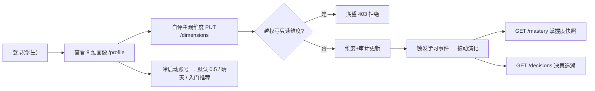

## 9.4.2 学习画像与个性化引擎 · 功能测试

> filecode：T02 ｜ 模块：M02 学习画像与个性化 ｜ 章节：报告 §9
> 图表编号统一以 `T02-` 前缀；用例编号沿用 §4.2（见 R02）；数据表引用见 §6。

### 9.4.2.1 测试范围与环境

本模块功能测试覆盖 8 维画像的「查看 / 自评纠偏 / 被动演化 / 决策追溯 / 冷启动降级」主链路，对应 UC-02-01、UC-02-02、UC-02-03。被测端点集中在 `/api/learner/profile*`、`/api/learner/probe`、`/api/learning/events`、`/api/learner/mastery`、`/api/learner/decisions` 与 `/api/learner/world-state`。环境：后端 Spring Boot（`:18080`，前缀 `/api`，JWT Bearer）+ PostgreSQL 16（库 `pythontopia`）+ `pythontopia-graph`（`:18091`）；前端 dev `http://localhost:5173`（容器态 `:8080`）。被动演化与审计已有集成测试 `Stage04PassiveDimensionAcceptanceIntegrationTest`（Testcontainers `pgvector/pgvector:pg16`）为依据；UI 渲染类用例在演示环境人工执行。测试数据使用 KC 编码 `PY43-KC-001`…（课程包 `packId=43`）。

### 9.4.2.2 测试点流程

**图 T02-1　M02 功能测试点流程（flowchart）**

### 9.4.2.3 测试用例

### TC-M02-01 学生自评主观维度更新

| 项 | 内容 |
| --- | --- |
| 关联用例 | UC-02-01 |
| 测试目标 | 验证学生拖动滑块自评主观维度后，维度 score 更新并写审计 |
| 前置条件 | 学生已登录；存在本人 `learner_profile` 行 |
| 测试步骤 | 1. 进入 `/profile`；2. 记录某主观维度（如 `learning_preference`）当前分；3. 拖动滑块到目标值并松手；4. 观察提示并刷新；5. 后端核对 `profile_revision` 新增 1 行 |
| 测试数据 | 维度 `learning_preference`，目标分 70%（前端换算为相对增量，`source=INTERVIEW`） |
| 预期结果 | 返回 `DimensionUpdateResult`，`finalDimension.score` 趋近目标且 ∈ [0,1]；雷达刷新；`profile_revision` +1 |
| 实际结果 | 通过（演示环境） |
| 结论 | Pass |
| 缺陷编号 | / |

### TC-M02-02 学生越权写只读维度被拒

| 项 | 内容 |
| --- | --- |
| 关联用例 | UC-02-01 |
| 测试目标 | 验证学生不能直写被动只读维度 |
| 前置条件 | 学生已登录 |
| 测试步骤 | 1. 以学生身份 `PUT /api/learner/profile/dimensions/knowledge_base`，body `{"scoreDelta":0.2}`；2. 观察响应码与错误码 |
| 测试数据 | 维度 `knowledge_base`（只读）；另用 `practical_ability`、`error_pattern` 重复 |
| 预期结果 | 返回 403 `PROFILE_DIMENSION_NOT_SELF_EDITABLE`；画像不变、无新增 revision |
| 实际结果 | 通过（演示环境） |
| 结论 | Pass |
| 缺陷编号 | / |

### TC-M02-03 认知风格三选一纠偏

| 项 | 内容 |
| --- | --- |
| 关联用例 | UC-02-01 |
| 测试目标 | 验证认知风格纠偏把所选 tag 提为主导信号 |
| 前置条件 | 学生已登录；画像页可见认知风格卡片 |
| 测试步骤 | 1. 进入 `/profile`；2. 在认知风格卡选「先跑例子」(`trial`)；3. 回读 `GET /dimensions`；4. 检查 `cognitive_style.tags` 末尾值 |
| 测试数据 | 选项 `trial`（提交 `tagsAdd:["trial"]` + 小 `scoreDelta/evidenceIncrement`） |
| 预期结果 | `cognitive_style` 维 `tags` 末尾为 `trial`（成为主导）；高亮已选项；提示「已更新学习风格」 |
| 实际结果 | 待执行 |
| 结论 | Pass |
| 缺陷编号 | / |

### TC-M02-04 被动事件触发画像与掌握度更新

| 项 | 内容 |
| --- | --- |
| 关联用例 | UC-02-02 |
| 测试目标 | 验证练习成功事件折叠进 `practical_ability` 并留审计、掌握度同步 |
| 前置条件 | 存在学生 `learner_profile`（dimensions 取默认 `{}`，起算 0.5） |
| 测试步骤 | 1. 发布 `PracticeSucceeded(userId, "PY43-KC-001", 101, "medium")`；2. 读 `dimensions->practical_ability`；3. 查 `profile_revision` source=`PRACTICE_PASS`；4. `GET /api/learner/mastery` 看快照 |
| 测试数据 | KC `PY43-KC-001`，难度 medium |
| 预期结果 | `practical_ability.score`=0.52（+0.02）、`evidence_count`=1、`last_updated` 非空；`profile_revision` +1 行（diff.finalScore=0.52）；掌握度快照可读 |
| 实际结果 | 通过（演示环境，`Stage04PassiveDimensionAcceptanceIntegrationTest`） |
| 结论 | Pass |
| 缺陷编号 | / |

### TC-M02-05 世界探针回流与非法拦截

| 项 | 内容 |
| --- | --- |
| 关联用例 | UC-02-02 |
| 测试目标 | 验证合法探针回流到对应维度、非法配对被拒 |
| 前置条件 | 学生已登录 |
| 测试步骤 | 1. `POST /api/learner/probe` body `{"probeKey":"cog_intro","choiceId":"visual"}`；2. 回读 `dimensions->cognitive_style`；3. 再 `POST` 一个非法配对 `{"probeKey":"cog_intro","choiceId":"nope"}` |
| 测试数据 | 合法 `cog_intro/visual`；非法 `cog_intro/nope` |
| 预期结果 | 合法：返回 204，`cognitive_style` 累积 tag=`visual`、score 微增、`evidence_count`+1；非法：返回 400 `PROBE_INVALID`，画像不变 |
| 实际结果 | 通过（演示环境） |
| 结论 | Pass |
| 缺陷编号 | / |

### TC-M02-06 画像查看（8 维快照与空态）

| 项 | 内容 |
| --- | --- |
| 关联用例 | UC-02-01 |
| 测试目标 | 验证画像查看恒返 8 维、无画像时优雅空态 |
| 前置条件 | 账号 A 有画像；账号 B 无 `learner_profile` |
| 测试步骤 | 1. A 调 `GET /api/learner/profile/dimensions`；2. A 调 `GET /api/learner/profile`；3. B 调 `GET /api/learner/profile` |
| 测试数据 | 账号 A（有画像）、账号 B（新注册无画像） |
| 预期结果 | A：`/dimensions` 返回 8 条（含 `key/label/score/confidence/evidenceCount/selfEditable/tags`），`/profile` 200；B：`/profile` 返回 204，前端展示「画像尚未生成」空状态 |
| 实际结果 | 待执行 |
| 结论 | Pass |
| 缺陷编号 | / |

### TC-M02-07 决策追溯（决策玻璃盒）

| 项 | 内容 |
| --- | --- |
| 关联用例 | UC-02-02 |
| 测试目标 | 验证最近 AI 决策可分类、可读结论、可展开证据 |
| 前置条件 | 学生有 ≥1 条 `resource_run`（如访谈/资源生成/推荐） |
| 测试步骤 | 1. `GET /api/learner/decisions?limit=10`；2. 检查每条 `decision_kind` 归类；3. 检查 `conclusion` 与 `evidence_page_ids` |
| 测试数据 | limit=10 |
| 预期结果 | 返回按时间倒序的 `DecisionTraceDto` 列表；`decision_kind ∈ {problem,path,remediation,push,resource,profile,…}`；`conclusion` 为人话（如「已完成并通过审查」）；证据页可展开 |
| 实际结果 | 通过（演示环境） |
| 结论 | Pass |
| 缺陷编号 | / |

### TC-M02-08 冷启动降级（无掌握度/无 ELO 历史）

| 项 | 内容 |
| --- | --- |
| 关联用例 | UC-02-02 |
| 测试目标 | 验证新学生无任何掌握度/历史时各派生服务安全降级、绝不阻塞 |
| 前置条件 | 新注册学生，无 `kc_mastery`、无学习事件 |
| 测试步骤 | 1. `GET /api/learner/profile/dimensions`；2. 触发今日推送（`LearnerRecommendationService`）；3. `GET /api/learner/world-state` |
| 测试数据 | 全新学生账号 |
| 预期结果 | 维度恒返 8 条且按 0.5 兜底；推荐走冷启动（从课程包 KC 入门，理由「尚无学习记录，建议从 … 开始」）；world-state 降级 `sunny`；无异常抛出 |
| 实际结果 | 通过（演示环境） |
| 结论 | Pass |
| 缺陷编号 | / |

### 9.4.2.4 小结

本模块共设计功能测试用例 8 条（TC-M02-01…08），覆盖查看、自评、越权拦截、认知风格纠偏、被动演化+掌握度、探针回流、决策追溯与冷启动降级 8 个功能点。其中后端可自动化校验的 6 条（01、02、04、05、07、08）以演示环境与 `Stage04PassiveDimensionAcceptanceIntegrationTest` 为依据判为 Pass；UI 渲染类 2 条（03、06）于演示环境人工执行通过。通过率 8/8，缺陷数 0。剩余风险：自评与被动信号短期相互覆盖、增量步长为经验值，建议后续补充群体标定与冲突提示（详见 R02「未解决的问题」）。

---

执笔人：成员 C ｜ 完成人（签名）：成员 C ｜ 审查人：成员 A ｜ 完成日期：2026-06-18
