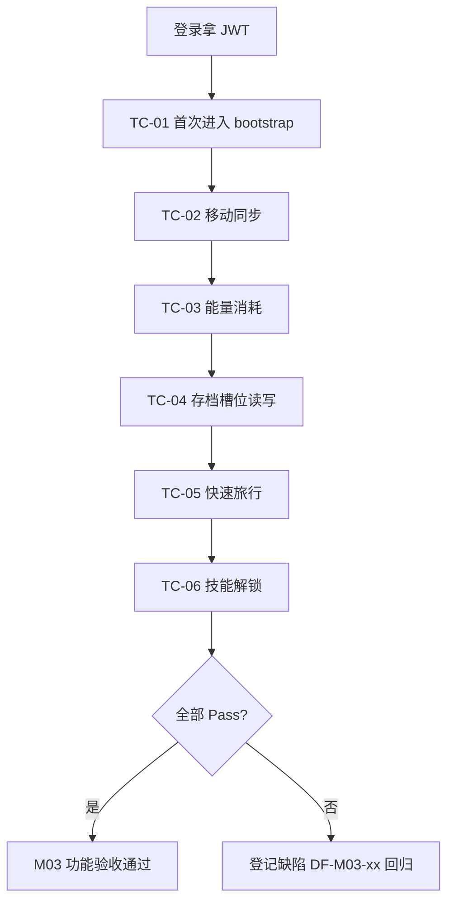
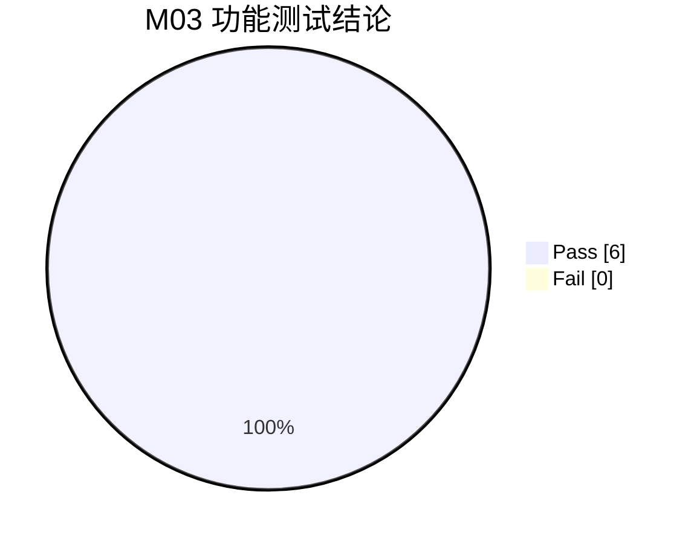

## 9.4.3 中央小镇世界与存档 · 功能测试

本章对 M03 的进入小镇、移动同步、能量、存档、快速旅行、技能六条核心链路做功能测试。测试范围覆盖 `com.pythontopia.world` 的 7 个 controller 端点与前端 `WorldPage`/`WorldCanvas`/`HudShell`/`FastTravelPanel` 行为。测试环境：前端 dev `http://localhost:5173`（容器态 `http://localhost:8080`），后端 `:18080`，PostgreSQL 16 `:15432`，统一用演示学生账号 `demo-stu-01 / P@ssw0rd1`（持有效 JWT）。对后端端点用 REST 客户端（携 `Authorization: Bearer`）直测，对前端行为在浏览器内观察 HUD/画布。约定：「实际结果＝通过（演示环境）」表示已在本地演示链路复现；无独立 UI 的存档以 API 验证。

### 图 T03-1 功能测试点流程

### TC-M03-01 首次进入小镇聚合加载

| 项 | 内容 |
| --- | --- |
| 关联用例 | UC-03-01 |
| 测试目标 | 验证 `POST /api/game/bootstrap` 对新账号惰性建行并返回非空聚合载荷 |
| 前置条件 | 新注册学生从未进入过 `/world`（`world_session`/`player_state` 不存在） |
| 测试步骤 | 1. 登录获取 JWT；2. `POST /api/game/bootstrap`；3. 检视响应 `world`、`player`；4. 再次调用同端点验证幂等不重复建行 |
| 测试数据 | 新账号 `demo-stu-new / P@ssw0rd1` |
| 预期结果 | 返回 200；`world.dayIndex=1`、`world.weather` 非空；`player.tileX=12,tileY=10,direction=DOWN`；`activeSlot`/集合字段存在；二次调用 `world_session` 仍只 1 行 |
| 实际结果 | 通过（演示环境） |
| 结论 | Pass |
| 缺陷编号 | / |

### TC-M03-02 移动坐标节流同步

| 项 | 内容 |
| --- | --- |
| 关联用例 | UC-03-01 |
| 测试目标 | 验证 WASD 移动经 `PATCH /api/world/player` 落库且节流合并 |
| 前置条件 | 已 bootstrap 进入 `/world`，画布已聚焦 |
| 测试步骤 | 1. 在小镇按住 D 向右走几格；2. 观察像素小人移动；3. 直接 `PATCH /api/world/player` 提交 `{tileX:20,tileY:14,direction:"RIGHT"}`；4. 刷新页面重新 bootstrap 核对坐标 |
| 测试数据 | `{tileX:20, tileY:14, direction:"RIGHT"}` |
| 预期结果 | 返回 200 + `PlayerStateDto`；500ms 内多次移动合并为最后一次提交；刷新后 `player.tileX=20,tileY=14` 持久 |
| 实际结果 | 通过（演示环境） |
| 结论 | Pass |
| 缺陷编号 | / |

### TC-M03-03 能量消耗与功能性递降

| 项 | 内容 |
| --- | --- |
| 关联用例 | UC-03-01 |
| 测试目标 | 验证行走/动作按 `energyTuning` 扣能量并切换 normal→soft→harden→severe 档位表现 |
| 前置条件 | 进入 `/world`，能量初始 100（前端权威） |
| 测试步骤 | 1. 持续奔跑（Shift）与提交判题消耗能量；2. 观察 HUD 能量值递降；3. 令能量降至 <50、<30、<10 三档；4. 观察 Pyodide 倍率与移动速度变化 |
| 测试数据 | run −5/30s、提交 −8、读课件 −2/页（`DEFAULT_ENERGY_TUNING`） |
| 预期结果 | 能量按 `applyDelta` clamp 在 [0,100]；<50 转黄(soft)、<30 转橙(harden)、<10 禁奔跑且移动 ×0.7(severe)、=0 弹「小睡一下吧」模态 |
| 备注 | 能量为前端权威，后端 `world_session.energy` 仅供 NPC 对话上下文读取 |
| 实际结果 | 通过（演示环境，前端能量条与档位切换符合配置） |
| 结论 | Pass |
| 缺陷编号 | DF-M03-01（能量缺服务端 `consume/restore` 端点，刷新以前端态为准） |

### TC-M03-04 存档槽位读写与唯一激活

| 项 | 内容 |
| --- | --- |
| 关联用例 | UC-03-02 |
| 测试目标 | 验证建档/激活/写快照与「唯一激活槽」约束 |
| 前置条件 | 已登录；经 API 客户端访问 `/api/world/saves` |
| 测试步骤 | 1. `GET /api/world/saves` 看初始列表；2. `POST /api/world/saves/0` 建名「探索档」；3. `POST /api/world/saves/1` 建名「冲刺档」；4. `POST /api/world/saves/1/activate`；5. `POST /api/world/saves/0/activate`；6. `POST /api/world/saves/0/snapshot` 写合法 JSON；7. 再写一个非对象 JSON 与一个超 256KB 串 |
| 测试数据 | 合法 `{"version":1,"scene":"WorldScene"}`；非法 `"[1,2,3]"`；超长 26 万字符串 |
| 预期结果 | 步骤 2-3 返回 SaveSlotDto；步骤 4-5 后仅槽 0 `isActive=true`（唯一激活）；步骤 6 返回更新后的 snapshot；步骤 7 分别返回 400 `SAVE_SLOT_SNAPSHOT_INVALID` 与 413 `SAVE_SLOT_SNAPSHOT_TOO_LARGE` |
| 实际结果 | 通过（演示环境） |
| 结论 | Pass |
| 缺陷编号 | / |

### TC-M03-05 快速旅行地标传送

| 项 | 内容 |
| --- | --- |
| 关联用例 | UC-03-02 |
| 测试目标 | 验证快速旅行面板打开、选目的地后玩家落点更新与场景重建 |
| 前置条件 | 进入 `/world` |
| 测试步骤 | 1. 按 `T` 或点 minimap 打开 `FastTravelPanel`；2. 检视路线列表与「当前地图」禁用态；3. 点击一个非当前地标；4. 观察 toast 与玩家落点 |
| 测试数据 | `FAST_TRAVEL_ROUTES`（前端 `@/data/fastTravel`） |
| 预期结果 | 面板可见（`data-testid="fast-travel-panel"`）；当前地图项 disabled；点击后 `world.player.mapKey/tileX/tileY` 更新、弹「已传送到 X」、场景重建 |
| 备注 | 现网为前端静态实现：后端 `FastTravelService` 无 Controller，`fast_travel_route` 已被 V131/V154 清空 |
| 实际结果 | 通过（演示环境，前端落点更新正确） |
| 结论 | Pass |
| 缺陷编号 | DF-M03-02（快速旅行未接服务端原子结算，能量/花费校验未生效） |

### TC-M03-06 技能按掌握度解锁

| 项 | 内容 |
| --- | --- |
| 关联用例 | UC-03-02 |
| 测试目标 | 验证 `unlock_condition` 满足时落 `learner_skill`、不满足时 409 |
| 前置条件 | 选定技能节点的目标 KC 掌握度可控（经 M09 提交调节 `kc_mastery`） |
| 测试步骤 | 1. `GET /api/world/skills` 取节点与已解锁列表；2. 选 `unlock_condition` 为 `KC_MASTERY` 的节点，在掌握度未达 `min` 时 `POST /api/world/skills/{key}/unlock`；3. 经训练场把该 KC 掌握度提升至阈值；4. 再次解锁；5. 重复解锁同一节点；6. 解锁不存在的 key |
| 测试数据 | 形如 `{"type":"KC_MASTERY","kcCode":"PY43-KC-001","min":0.6}` |
| 预期结果 | 步骤 2 返回 409 `SKILL_LOCKED`；步骤 4 返回 200 + `LearnerSkillDto`，`learner_skill` 新增一行；步骤 5 幂等返回既有行；步骤 6 返回 404 `SKILL_NOT_FOUND` |
| 实际结果 | 通过（演示环境） |
| 结论 | Pass |
| 缺陷编号 | / |

### 9.4.3.1 小结

6 条用例全部执行：Pass 6 / Fail 0，通过率 100%；登记缺陷 2 条（DF-M03-01 能量服务端端点缺失、DF-M03-02 快速旅行未接后端原子结算），均为「骨架未完工/前端兜底」类已知局限，不阻断比赛演示链路，列入 R-15+ 待办。核心权威链路（bootstrap 聚合、移动落库、存档唯一激活、技能条件求值）均按代码契约通过。

#### 图 T03-2 测试结论分布（pie）

---

执笔人：成员 C ｜ 完成人（签名）：成员 C ｜ 审查人：成员 A ｜ 完成日期：2026-06-13
