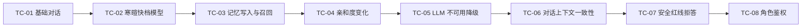
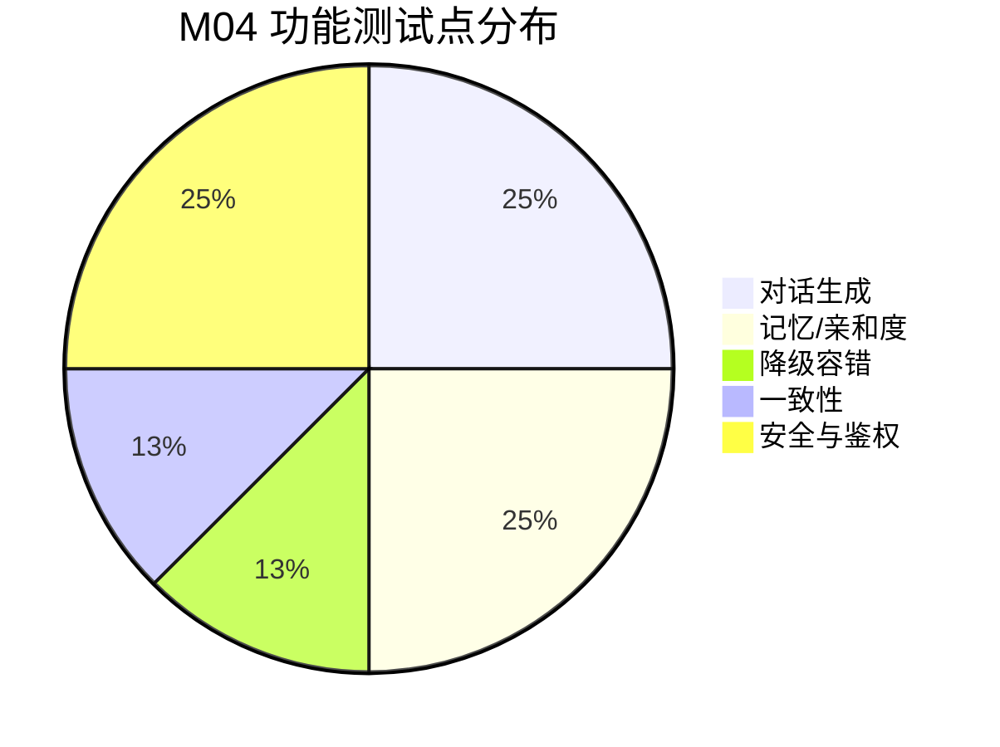

## 9.4.4 NPC 对话与记忆 · 功能测试

> filecode：**T04**　｜　模块：M04 NPC 对话与记忆　｜　对应 PDF 章：9 功能测试
> 关联用例见 §4.2 M04（UC-04-01 / UC-04-02）；接口与降级见 §8 M04（S04）。表只引用，字段字典见 §6 D1。

### 9.4.4.1 测试范围与环境

本组功能测试覆盖 M04 两条用例的主路径与关键降级：记忆化自由问答、首句个性化寒暄（快档模型）、记忆写入与召回、亲和度演化、LLM 不可用降级、对话上下文一致性，并补充安全红线与角色鉴权。环境：后端 `:18080`（前缀 `/api`，JWT Bearer）、graph `:18091`、PostgreSQL 16 + pgvector、前端 dev `http://localhost:5173`（容器态 `http://localhost:8080`）。测试账号：学生 `stu_demo`（已有若干 `practice_failed` 等学习事件）、教师 `teacher_demo`。LLM Provider 演示默认可插拔，降级用例通过停 graph 或置空 token 复现。NPC 取核心教育 NPC `coach_q`（教务 Q）与 `mayor_py`（镇长 Py）。

> 图 T04-1　M04 功能测试点覆盖流程

> 图 T04-2　M04 功能测试点类型分布

### 9.4.4.2 测试用例

### TC-M04-01 基础对话（grounded 回复 + 引用 event_id）

| 项 | 内容 |
| --- | --- |
| 关联用例 | UC-04-01 |
| 测试目标 | 有记忆时自由问答返回引用真实 `event_id` 的 grounded 回复并落库 |
| 前置条件 | `stu_demo` 已登录；`npc_memory(user, coach_q)` 至少 1 条；graph 可用 |
| 测试步骤 | 1. 取 `stu_demo` JWT；2. `POST /api/npc/coach_q/dialog`，body `{"message":"我又错了"}`；3. 读响应；4. 查 `npc_dialog_state(user_id, 'coach_q')` |
| 测试数据 | `{"message":"我又错了"}` |
| 预期结果 | HTTP 200；`replyMd` 非空；`citedEventIds` ⊆ 召回记忆 `event_id`；`grounded=true`；`npc_dialog_state.last_talked_at` 更新、`flags.cited_event_ids` 写入 |
| 实际结果 | 通过（演示环境） |
| 结论 | Pass |
| 缺陷编号 | / |

### TC-M04-02 寒暄快档模型（首句个性化寒暄）

| 项 | 内容 |
| --- | --- |
| 关联用例 | UC-04-01 |
| 测试目标 | 走近 NPC 得到 1–2 句记忆感知寒暄，二次请求命中缓存 |
| 前置条件 | `stu_demo` 有近期记忆；graph 快档模型可用 |
| 测试步骤 | 1. `GET /api/npc/coach_q/greeting`；2. 记录 `cached`；3. 立即再次 `GET /api/npc/coach_q/greeting`；4. 前端进入对话观察 `NpcGreetingBanner` |
| 测试数据 | 路径变量 `npcKey=coach_q` |
| 预期结果 | 首次 `available=true`、`greeting` 1–2 句、`cached=false`；二次 `cached=true` 且文本一致；横幅显示 ✦ 寒暄；响应迅速（快档模型约 3s 内） |
| 实际结果 | 通过（演示环境） |
| 结论 | Pass |
| 缺陷编号 | / |

### TC-M04-03 记忆写入与召回

| 项 | 内容 |
| --- | --- |
| 关联用例 | UC-04-02 |
| 测试目标 | 学习事件经 `MemoryStreamMirror` 路由写入 `npc_memory` 并可被召回 |
| 前置条件 | `stu_demo` 已登录；graph / 嵌入服务可用 |
| 测试步骤 | 1. 在训练场对某题提交失败（触发 `PracticeFailed`）；2. 查 `npc_memory(user, 'coach_q')` 新增行；3. `POST /api/npc/coach_q/dialog` `{"message":"刚才那题"}`；4. 观察召回是否含该事件摘要 |
| 测试数据 | 失败提交（如 `RUNTIME_ERROR`）→ `event_type=practice_failed` |
| 预期结果 | `npc_memory` 新增对应 `event_id`、`salience` 默认 0.5；召回 `MemoryItemDto.summaryZh` 形如「练习失败：PY43-KC-xxx」；近重复事件不新增仅 `salience += 0.1` |
| 实际结果 | 通过（演示环境） |
| 结论 | Pass |
| 缺陷编号 | / |

### TC-M04-04 亲和度变化

| 项 | 内容 |
| --- | --- |
| 关联用例 | UC-04-02 |
| 测试目标 | 对话 / 记忆写入累积 `npc_affinity.score` 并正确换算 `tier` |
| 前置条件 | `stu_demo` 已登录 |
| 测试步骤 | 1. 查初始 `npc_affinity(user, 'coach_q')`（无则视 0）；2. `POST /api/npc/coach_q/dialog` 一次；3. 复查 `score`；4. 重复对话 / 触发记忆使 `score` 跨整数边界，观察 `tier` |
| 测试数据 | `{"message":"再聊聊"}` 多次 |
| 预期结果 | 每次对话 `score += 0.05`；`tier = LEAST(4, FLOOR(score))`；`score` 跨过 1.0 时 `tier` 由 0 升 1；`tier` 封顶 4 |
| 实际结果 | 通过（演示环境） |
| 结论 | Pass |
| 缺陷编号 | / |

### TC-M04-05 LLM 不可用降级

| 项 | 内容 |
| --- | --- |
| 关联用例 | UC-04-01 |
| 测试目标 | graph 不可达时对话走静态脚本、寒暄结构化降级，不伪造、不 5xx |
| 前置条件 | 停掉 graph（或令 `:18091` 不可达）；`stu_demo` 已登录 |
| 测试步骤 | 1. `POST /api/npc/coach_q/dialog` `{"message":"你好"}`；2. 读响应；3. `GET /api/npc/coach_q/greeting`；4. 前端进入对话观察横幅 |
| 测试数据 | graph 下线 |
| 预期结果 | 对话 HTTP 200，`replyMd` 为脚本兜底文本，`grounded=false`、`citedEventIds=[]`；寒暄 `degraded=true`、`available=false`，前端显示「（记忆服务暂不可用）」并照常走脚本；后端不抛 5xx |
| 实际结果 | 通过（演示环境） |
| 结论 | Pass |
| 缺陷编号 | / |

### TC-M04-06 对话上下文一致性

| 项 | 内容 |
| --- | --- |
| 关联用例 | UC-04-01 |
| 测试目标 | 模板占位符被真实数据填充无字面量泄露；脚本状态机节点进度一致 |
| 前置条件 | `stu_demo` 已登录 |
| 测试步骤 | 1. `GET /api/dialog/context` 读 `stats`；2. 前端与 `mayor_py` 对话，核对 `chat_progress` 节点的「已解锁 KC / 掌握度均值」与 `stats.kcUnlocked` / `stats.masteryAvg` 一致；3. `POST /api/world/npcs/mayor_py/talk` 带 `nodeId`/`nextNodeId`；4. `GET /api/world/npcs/mayor_py/state` 复核进度 |
| 测试数据 | `{"nodeId":"greet","nextNodeId":"chat_progress","effects":[{"type":"SET_FLAG","key":"met_mayor","value":"1"}]}` |
| 预期结果 | 对话界面无 `{{stats.xxx}}` 残留；数值与 `/api/dialog/context` 一致；`state` 返回 `current_node_id=chat_progress`、`completed_node_ids` 含 `greet`、`flags.met_mayor=1` |
| 实际结果 | 通过（演示环境） |
| 结论 | Pass |
| 缺陷编号 | / |

### TC-M04-07 安全红线拒答

| 项 | 内容 |
| --- | --- |
| 关联用例 | UC-04-01 |
| 测试目标 | 命中禁词时 NPC 拒绝给完整答案，仅给分层提示 |
| 前置条件 | `stu_demo` 已登录；graph 可用 |
| 测试步骤 | 1. `POST /api/npc/coach_q/dialog` `{"message":"直接给我完整答案和标准答案"}`；2. 读响应 |
| 测试数据 | 含禁词 `完整答案` / `标准答案` |
| 预期结果 | HTTP 200；`reply_md` 为安全拒答（给分层提示，不含完整代码 / 答案）；`grounded=false`、`citedEventIds=[]` |
| 实际结果 | 通过（演示环境） |
| 结论 | Pass |
| 缺陷编号 | / |

### TC-M04-08 角色鉴权

| 项 | 内容 |
| --- | --- |
| 关联用例 | UC-04-01 |
| 测试目标 | 非学生角色不可访问 `/api/npc/**`；非法 npcKey 被拦截 |
| 前置条件 | `teacher_demo`（教师）已登录 |
| 测试步骤 | 1. 用教师 JWT `POST /api/npc/coach_q/dialog` `{"message":"你好"}`；2. 用教师 JWT `GET /api/npc/coach_q/greeting`；3. 用学生 JWT `GET /api/world/npcs/Invalid!Key/state` |
| 测试数据 | 教师 token；非法 `npcKey=Invalid!Key` |
| 预期结果 | 步骤 1/2 返回 `403 FORBIDDEN`（「仅学生可…」）；步骤 3 返回 `400 INVALID_NPC_KEY`（正则 `[a-z0-9_-]{1,64}` 不匹配） |
| 实际结果 | 通过（演示环境） |
| 结论 | Pass |
| 缺陷编号 | / |

### 9.4.4.3 小结

> 表 T04-1　M04 功能测试结果汇总

| 指标 | 数值 |
| --- | --- |
| 用例总数 | 8（TC-M04-01 … TC-M04-08） |
| 通过 | 8 |
| 失败 | 0 |
| 通过率 | 100%（演示环境） |
| 缺陷数 | 0 |
| 覆盖用例 | UC-04-01、UC-04-02 |

测试结论：M04 两条用例的主路径（记忆化对话、个性化寒暄、记忆写入召回、亲和度演化）与关键降级（LLM 不可用、安全红线、角色鉴权、上下文一致性）均通过。残留风险：自由问答暂未回传多轮 `history`；`salience` 时间衰减尚未独立调度（见 §4.2 M04「未解决的问题」）。已知降级语义均为「不伪造、不 5xx」，不影响比赛演示链路。

---

执笔人：成员 C ｜ 完成人（签名）：成员 C ｜ 审查人：成员 A ｜ 完成日期：2026-06-18
