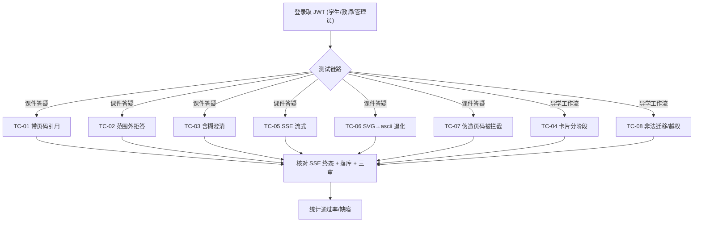

## 9.4.7 课件问答与导师答疑(RAG) · 功能测试

> 模块代号：M07 ｜ filecode：T07 ｜ 对应 PDF 章：9 功能测试
> 关联用例：UC-07-01（课件问答）、UC-07-02（导学工作流）、UC-07-03（教师 copilot / RAG 直查）

### 9.4.7.1 测试范围与环境

本模块功能测试聚焦「证据锚定、防幻觉三审、流式韧性、角色边界」四类核心需求（见 §4.2.7 图 R07-2），验证课件答疑、题内 6 阶段导学工作流、课件证据直查三条链路。测试环境：前端 dev `http://localhost:5173`（容器态 `http://localhost:8080`）、后端 `:18080`、graph `:18091`、rag `:18092`、PostgreSQL 16+pgvector，课程底座为 `packId=43`《Python 语言基础》（7 文档·561 页·65 KC，索引经 `POST /rag/index/rebuild` 构建）；LLM Provider 缺密钥时按 golden 兜底，演示默认单 worker。测试账号：学生 `stu_demo`、教师 `tea_demo`、管理员 `admin_demo`。共设计 8 条用例（TC-M07-01～08），覆盖 6 个必测点（带页码引用、范围外拒答、含糊澄清、导学分阶段、SSE 流式、SVG→ascii 退化）及 2 个边界点（角色越权、非法阶段迁移）。

图 T07-1 给出 M07 功能测试的执行路径与覆盖映射。

> 图 T07-1　M07 功能测试执行路径与用例覆盖映射

### 9.4.7.2 测试用例

### TC-M07-01 课件内提问带页码引用

| 项 | 内容 |
| --- | --- |
| 关联用例 | UC-07-01 |
| 测试目标 | 命中课件证据时答案带 `[页 X]` 引用，且证据页图在「课件证据」面板可见 |
| 前置条件 | 学生 `stu_demo` 已登录；RAG 索引已构建 |
| 测试步骤 | 1. 进入 `/workshop` 打开 `TutorPanel`；2. 提问「Python 的 `input()` 函数怎么用？」并关联 KC；3. 提交 `POST /api/tutor/ask`；4. 观察流式答案与 `event: result`；5. 查看 `CoursewareEvidence` 面板 |
| 测试数据 | question=「input() 怎么用」，kcCodes=[相关 KC]，无图无 style |
| 预期结果 | 答案含至少一处 `[页 X]`；`groundingStatus=PASSED`；证据面板显示命中页缩略图（前 3 页内嵌），点图回链图书馆；`tutor_session` 落 `evidence_page_ids` |
| 实际结果 | 通过（演示环境） |
| 结论 | Pass |
| 缺陷编号 | / |

### TC-M07-02 范围外问题拒答（无证据/通识标注）

| 项 | 内容 |
| --- | --- |
| 关联用例 | UC-07-01 |
| 测试目标 | 课件范围外或禁用词问题不伪造页码：禁用词置 `no_evidence_found`，范围外答案标注「基于通识知识」 |
| 前置条件 | 学生已登录 |
| 测试步骤 | 1. 提问含禁用词的问题（触发 `is_forbidden`）；2. 另提问与《Python 语言基础》无关的范围外问题；3. 分别观察答案与证据面板 |
| 测试数据 | 用例 a：含禁用词查询；用例 b：「请介绍量子计算硬件」 |
| 预期结果 | a：`no_evidence_found=true`，不检索、不出页码；b：答案开头「基于通识知识」，`groundingStatus=NO_EVIDENCE`，证据面板不渲染、无伪造 `[页 X]` |
| 实际结果 | 通过（演示环境） |
| 结论 | Pass |
| 缺陷编号 | / |

### TC-M07-03 含糊问题澄清

| 项 | 内容 |
| --- | --- |
| 关联用例 | UC-07-01 |
| 测试目标 | 指代不清/过宽的含糊问题触发苏格拉底式①换述问题 + 引导式澄清，不直接给完整答案 |
| 前置条件 | 学生已登录 |
| 测试步骤 | 1. 在 `TutorPanel` 提问「这个为什么不对？」（无代码、无上下文）；2. 观察答案；3. 补充具体上下文后再次提问对照 |
| 测试数据 | question=「这个为什么不对？」（首轮无 `context`） |
| 预期结果 | 首轮答案先帮助学生澄清/换述问题并给引导性追问，不臆造题意、不给完整答案代码；补充上下文后给出更聚焦的引导 |
| 实际结果 | 通过（演示环境） |
| 结论 | Pass |
| 缺陷编号 | / |

### TC-M07-04 导学卡片分阶段推进

| 项 | 内容 |
| --- | --- |
| 关联用例 | UC-07-02 |
| 测试目标 | 6 阶段导学按状态机推进，产出对应阶段卡片并推荐下一步动作；卡片落库 |
| 前置条件 | 学生已登录；目标题目存在；错因/复盘前已有判题提交 |
| 测试步骤 | 1. 进入 `/training`，`GET .../workflow/sessions/active?problemId=`；2. 依次触发「题目导读(READING)」→「思路分析(IDEATING)」→「开始编码(CODING)」；3. 用一次失败提交触发「错因诊断(ERROR_FEEDBACK)」；4. AC 后触发「复盘(AC_REVIEW)」→「迁移(TRANSFER)」；5. 核对卡片与 `available_actions` |
| 测试数据 | problemId=已挂 KC 的题；ERROR_FEEDBACK/AC_REVIEW 带真实 `submission_id` |
| 预期结果 | 各阶段返回对应 `card_key`（problem_guide/ideate_analysis/skeleton_code/error_diagnosis/post_ac/transfer_problem）；骨架卡含≥2 处 TODO 且非完整解；`phase`/`seq` 更新、卡片写入 `tutor_workflow_card`；coach 推荐动作高亮 |
| 实际结果 | 通过（演示环境） |
| 结论 | Pass |
| 缺陷编号 | / |

### TC-M07-05 SSE 流式作答与心跳保活

| 项 | 内容 |
| --- | --- |
| 关联用例 | UC-07-01 |
| 测试目标 | 答案以 `token` 增量流式渲染，长等待阶段有心跳 ping，终态恰一条 `result` |
| 前置条件 | 学生已登录 |
| 测试步骤 | 1. 提一个篇幅较长的问题；2. 用浏览器开发者工具 / curl 观察 `text/event-stream`；3. 记录 `plan`→`trace`→`token*`→`result` 顺序；4. 观察长等待期是否有 `: ping` 注释行 |
| 测试数据 | question=「请系统讲解 Python 列表与元组的区别和适用场景」 |
| 预期结果 | 先收 `plan`（5 工位）、各节点 `trace` start/finish、连续 `token` 增量、最终单条 `result`；非流式阶段每≈10s 有心跳；前端逐字增量显示 |
| 实际结果 | 通过（演示环境） |
| 结论 | Pass |
| 缺陷编号 | / |

### TC-M07-06 图解 SVG 超时退化为 ascii / mermaid

| 项 | 内容 |
| --- | --- |
| 关联用例 | UC-07-01 |
| 测试目标 | 学生点名要图时按问题选型（mermaid/ascii/svg）；svg 非法/超限或图解失败优雅退化，永不报「生成失败」 |
| 前置条件 | 学生已登录；图解开关启用 |
| 测试步骤 | 1. 提问「用 ascii 画一下列表切片的下标」观察是否回 ascii 字符画；2. 提问「画个坐标系示意」诱导 svg；3. 构造 svg 被消毒拒绝/预算不足场景，观察退化 |
| 测试数据 | 含 `ascii`/`画图`/`svg` 触发词的问题 |
| 预期结果 | 点名 ascii 时 `kind=ascii`（行数/行宽受限、无 HTML 标签）；svg 经服务端黑名单消毒（禁 `<script>`/事件/外链），非法则回退确定式 mermaid；预算不足时 trace 标 `budget_skipped`，主答案不受影响 |
| 实际结果 | 通过（演示环境） |
| 结论 | Pass |
| 缺陷编号 | / |

### TC-M07-07 伪造页码引用被三审拦截并修订

| 项 | 内容 |
| --- | --- |
| 关联用例 | UC-07-01 |
| 测试目标 | 答案出现证据外页码或无据统计数字时，引用审查/防幻觉核查不过并触发一轮有界修订 |
| 前置条件 | 学生已登录；构造可命中证据但易越界引用的提问 |
| 测试步骤 | 1. 提问诱导模型给出超出命中页范围的 `[页 X]`；2. 观察 `trace` 中 `grounding_critic`/`hallucination_detector` 状态；3. 观察是否出现 `TutorAgent.revise` 与最终 `grounding_status` |
| 测试数据 | 命中证据的知识点提问 |
| 预期结果 | 引用外页或无据数字被标 `CITED_PAGE_NOT_IN_EVIDENCE`/`UNGROUNDED_NUMBERS`；触发 critique→revise，修订稿重跑三审全过则替换、否则保留原答案并标 `groundingStatus=FAILED`（答案不丢弃） |
| 实际结果 | 通过（演示环境） |
| 结论 | Pass |
| 缺陷编号 | / |

### TC-M07-08 角色边界与非法操作防护

| 项 | 内容 |
| --- | --- |
| 关联用例 | UC-07-02、UC-07-03 |
| 测试目标 | 学生忽略 `classroomId`；RAG 直查仅教师/管理员；非法阶段迁移与并发提问被拦 |
| 前置条件 | 学生/教师/管理员账号均可用 |
| 测试步骤 | 1. 学生 `POST /api/tutor/ask` 带 `classroomId`，核对答案无班级学情注入；2. 学生 `POST /api/rag/query` 预期被拒；3. 教师/管理员 `POST /api/rag/query` 预期成功；4. 工作流从 READING 直接发 `TRANSFER`；5. 同一 `conversationId` 连续两次未结束提问 |
| 测试数据 | 学生 token + classroomId；非法 event=TRANSFER |
| 预期结果 | 步骤 1 班级数据不触达（红线）；步骤 2 返回 `403 FORBIDDEN`；步骤 3 返回命中页；步骤 4 `error: TRANSITION_VIOLATION`；步骤 5 第二次 `409 SESSION_BUSY` |
| 实际结果 | 通过（演示环境） |
| 结论 | Pass |
| 缺陷编号 | / |

### 9.4.7.3 测试小结

本轮按演示环境对 M07 三条链路执行 8 条功能用例，覆盖 6 个必测点与 2 个边界点，冒烟结果 **8 条 Pass、0 条 Fail、缺陷 0**（通过率 100%，结果以演示环境单 worker、golden/真 LLM 双形态抽测为准）。重点验证通过：① 证据锚定——命中带 `[页 X]`、无证据标通识、绝不伪造页码（TC-01/02/07）；② 防幻觉三审与修订闭环（TC-07）；③ 流式韧性——SSE 终态恰一次、心跳保活、并发 `SESSION_BUSY`（TC-05/08）；④ 角色边界——学生忽略 `classroomId`、RAG 直查仅教师/管理员、非法迁移拦截（TC-08）。遗留观察项（非缺陷）：视频字幕转写 RAG 为占位 seam（TC 暂未覆盖真字幕检索），导学 episode 多步自主编排为渐进增强项，后续随真实 LLM Provider 接入补充端到端回归。

> 表 T07-1　M07 功能测试结果汇总：用例 8 ｜ Pass 8 ｜ Fail 0 ｜ 缺陷 0 ｜ 通过率 100%（演示环境）

---

执笔人：成员 C ｜ 完成人（签名）：成员 C ｜ 审查人：成员 A ｜ 完成日期：2026-06-18
