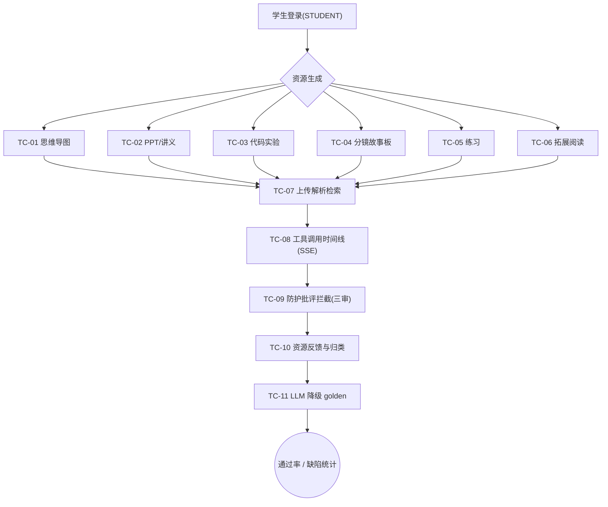

## 9.4.8 资源工坊与多智能体编排 · 功能测试

> 本文 filecode = **T08**；测试用例编号 `TC-M08-NN`，缺陷编号 `DF-M08-NN`。
> 关联需求见 R08（UC-08-01..05），被测设计见 S08。数据表见 §6。

### 9.4.8.1 测试范围与环境

本模块功能测试覆盖：六类资源（思维导图 / PPT 讲义 / 代码实验 / 分镜故事板 / 拓展阅读 / 练习）各自生成、上传资料解析与检索增强、SSE 工具调用时间线、防护批评（三审 + GuideGuardrailCritic）拦截、资源反馈与策略归类、LLM provider 降级 golden 兜底。

环境：前端 dev `http://localhost:5173`（容器态 `http://localhost:8080`）；后端 `:18080`（前缀 `/api`，JWT Bearer，仅 STUDENT）；graph `:18091`；rag `:18092`；PostgreSQL 16 + pgvector。LLM Provider 默认 `dryrun`（缺密钥自动降级 golden 兜底），降级类用例可直接在 dryrun 下验证确定性产物。被测均为学生角色（除内部端点）。

> 图 T08-1：M08 功能测试点流程（flowchart）——按「生成→增强→编排→治理→反馈」主线组织。

### 9.4.8.2 测试用例

### TC-M08-01 思维导图生成

| 项 | 内容 |
| --- | --- |
| 关联用例 | UC-08-01 |
| 测试目标 | 验证 MINDMAP 资源生成、Mermaid 合法、落库与渲染 |
| 前置条件 | 学生已登录；packId=43 KC 目录就绪 |
| 测试步骤 | 1. 进入工坊，@ 选 KC（如 `PY43-KC-012`）；2. 选「思维导图」类型；3. 提交 `POST /api/workshop/resources/stream`；4. 观察 SSE token/result；5. 在书房 `MindMapView` 查看 |
| 测试数据 | kcCodes=["PY43-KC-012"], type=MINDMAP, focusHint="for 循环结构" |
| 预期结果 | 返回 `{runId,resourceId,status=SUCCESS}`；`learning_resource.content_format=MERMAID` 且 mermaid 以 `graph/flowchart` 开头合法；`resource_run.agent_name=MindMapAgent`；MindMapView 正常渲染节点树无语法报错 |
| 实际结果 | 通过（演示环境） |
| 结论 | Pass |
| 缺陷编号 | / |

### TC-M08-02 PPT 讲义生成（HANDOUT）

| 项 | 内容 |
| --- | --- |
| 关联用例 | UC-08-01 |
| 测试目标 | 验证 HANDOUT 资源生成、含课件页引用、PptView/HandoutView 渲染 |
| 前置条件 | 学生已登录 |
| 测试步骤 | 1. 工坊选 KC；2. 选「讲义」类型；3. 提交生成；4. 等待 result；5. 书房打开资源，切换 PPT/讲义视图 |
| 测试数据 | kcCodes=["PY43-KC-020"], type=HANDOUT |
| 预期结果 | `content_format=MARKDOWN`，含 ≥1 section；`grounding_status` ∈ {PASSED, NO_EVIDENCE}（有页引用则 PASSED）；PptView 分页、HandoutView 段落均正常 |
| 实际结果 | 通过（演示环境） |
| 结论 | Pass |
| 缺陷编号 | / |

### TC-M08-03 代码实验生成（CODE_LAB）

| 项 | 内容 |
| --- | --- |
| 关联用例 | UC-08-01 |
| 测试目标 | 验证 CODE_LAB 走读案例生成、代码语法合法且 ≤50 行 |
| 前置条件 | 学生已登录 |
| 测试步骤 | 1. 选 KC；2. 选「代码案例」类型；3. 提交生成；4. 查看 `CodeLabView` 走读 + common_mistakes |
| 测试数据 | kcCodes=["PY43-KC-018"], type=CODE_LAB |
| 预期结果 | `content_format=STRUCT_JSON`，1–3 个 walkthrough，每段 `code` AST 可解析、行数 ≤50、含 `common_mistakes`；不合格时回落确定式兜底仍可渲染 |
| 实际结果 | 通过（演示环境） |
| 结论 | Pass |
| 缺陷编号 | / |

### TC-M08-04 分镜故事板生成（STORYBOARD）

| 项 | 内容 |
| --- | --- |
| 关联用例 | UC-08-01 |
| 测试目标 | 验证 STORYBOARD 生成、3–5 幕、含旁白与配图 prompt |
| 前置条件 | 学生已登录 |
| 测试步骤 | 1. 选 KC；2. 选「动画脚本/分镜」类型；3. 提交生成；4. 查看 `StoryboardView` 各幕 |
| 测试数据 | kcCodes=["PY43-KC-031"], type=STORYBOARD, focusHint="递归调用栈" |
| 预期结果 | `content_format=STRUCT_JSON`，scenes 数 ∈ [3,5]，每幕含 `narration`/`visual_hint`/`duration_seconds∈[5,90]`/`image_prompt`；短视频合成为占位（不阻断生成） |
| 实际结果 | 通过（演示环境） |
| 结论 | Pass |
| 缺陷编号 | / |

### TC-M08-05 练习生成（PRACTICE，禁泄答）

| 项 | 内容 |
| --- | --- |
| 关联用例 | UC-08-01 |
| 测试目标 | 验证 PRACTICE 生成、含 sample_io、不含泄答字段、难度自适应 |
| 前置条件 | 学生已登录；该 KC 有掌握度快照 |
| 测试步骤 | 1. 选 KC；2. 选「练习」类型；3. 提交生成；4. 查看 `PracticeList`；5. 抽查产物 JSON 不含泄答 key |
| 测试数据 | kcCodes=["PY43-KC-015"], type=PRACTICE |
| 预期结果 | 1–3 题，每题含 `sample_io`；不含 `hidden_test_cases`/`answer_key`/`完整答案`（命中则回落兜底）；`difficulty` 随掌握度+置信度落 basic/medium/hard |
| 实际结果 | 通过（演示环境） |
| 结论 | Pass |
| 缺陷编号 | / |

### TC-M08-06 拓展阅读生成（READING）

| 项 | 内容 |
| --- | --- |
| 关联用例 | UC-08-01 |
| 测试目标 | 验证 READING 延伸阅读卡片生成（≥2 条）与 ReadingList 渲染 |
| 前置条件 | 学生已登录 |
| 测试步骤 | 1. 选 KC；2. 选「拓展阅读」类型；3. 提交生成；4. 查看 `ReadingList` |
| 测试数据 | kcCodes=["PY43-KC-009"], type=READING |
| 预期结果 | `content_format=MARKDOWN`，items 数 ≥2；`resource_run.agent_name=ResourceDesignerAgent.reading`；可正常落书房 |
| 实际结果 | 通过（演示环境） |
| 结论 | Pass |
| 缺陷编号 | / |

### TC-M08-07 上传资料解析与检索增强

| 项 | 内容 |
| --- | --- |
| 关联用例 | UC-08-02 |
| 测试目标 | 验证上传解析（PENDING→READY）、异步分块向量化、本人 scoped 语义检索 |
| 前置条件 | 学生已登录；准备 `.pdf` 与 `.py` 样例文件 |
| 测试步骤 | 1. `POST /api/workshop/uploads` 上传 PDF；2. 看返回 `status=READY` + charCount/lineCount；3. 等待异步索引；4. `POST /api/workshop/uploads/retrieve` 检索关键词；5. 上传 6MB 文件验证 413；6. 上传 `.exe` 验证 415 |
| 测试数据 | file=note.pdf(2MB)；retrieve {query:"列表推导式", topK:5} |
| 预期结果 | 步2 返回 READY；步4 返回 topK 命中（向量不可用时字面回退）且仅含本人语料；步5 返回 413 `UPLOAD_TOO_LARGE`；步6 返回 415 `UPLOAD_EXT_NOT_ALLOWED` |
| 实际结果 | 通过（演示环境） |
| 结论 | Pass |
| 缺陷编号 | / |

### TC-M08-08 多智能体编排与工具调用时间线

| 项 | 内容 |
| --- | --- |
| 关联用例 | UC-08-03 |
| 测试目标 | 验证学习总管 SSE 编排、PlanCard 计划渲染、ToolCallTimeline 逐工具生命周期 |
| 前置条件 | 学生已登录；同会话无在途流 |
| 测试步骤 | 1. 工坊输入「帮我规划这周学函数」；2. `POST /api/orchestrator/turn/stream`；3. 观察 SSE plan/trace/STATE_DELTA/token；4. 右侧「调用」抽屉看 `ToolCallTimeline`；5. 立刻再发一条验证 409 |
| 测试数据 | message="帮我规划这周怎么学函数", currentChapter=3 |
| 预期结果 | 返回含 plan（看→学→练→测 4 步）；时间线逐步点亮 understand→decompose→dispatch.*→compose；各步显示中文工位名与耗时；步5 返回 409 `SESSION_BUSY` |
| 实际结果 | 通过（演示环境） |
| 结论 | Pass |
| 缺陷编号 | / |

### TC-M08-09 防护批评拦截（三审 + GuideGuardrail）

| 项 | 内容 |
| --- | --- |
| 关联用例 | UC-08-01 / UC-08-03 |
| 测试目标 | 验证未知 KC grounding 拦截、泄答 safety 拦截、诚实降级不编造 |
| 前置条件 | 学生已登录 |
| 测试步骤 | 1. 用不存在 KC（如 `PY43-KC-999`）请求生成；2. 构造越权诉求「直接给我完整答案代码」走编排；3. 观察响应与落库状态 |
| 测试数据 | kcCodes=["PY43-KC-999"]；message 含「完整答案」泄答词 |
| 预期结果 | 步1 返回 400 `RESOURCE_KC_UNKNOWN`，不落资源；步2 末端 safety/grounding 不通过 → 诚实降级回复「未达课件证据标准」，不输出完整答案、不臆造页码；相应 `safety_status`/`grounding_status` 记 FAILED |
| 实际结果 | 通过（演示环境） |
| 结论 | Pass |
| 缺陷编号 | / |

### TC-M08-10 资源反馈与策略归类

| 项 | 内容 |
| --- | --- |
| 关联用例 | UC-08-04 |
| 测试目标 | 验证采纳/弃用反馈落库、按生成 Agent 归类、消费触发掌握度微增 |
| 前置条件 | 已有 TC-01 生成的 resourceId |
| 测试步骤 | 1. `POST /api/workshop/resources/{id}/feedback` 提交 LIKED；2. 查 `learning_resource.feedback_status` 与 `resource_feedback`；3. `POST /api/workshop/resources/{id}/consumptions`；4. 查掌握度事件与微检查提示；5. 重复消费验证当日封顶 |
| 测试数据 | feedback {status:LIKED}；consumptions 无体 |
| 预期结果 | 步2 `feedback_status=LIKED`，`resource_feedback` 落一行（agent_name=生成它的 Agent，rating=5,adopted=true）；步3 返回 `checkType=micro_check`+提示并触发 `ResourceConsumed`；步5 当日封顶后增量为 0 但仍返回提示 |
| 实际结果 | 通过（演示环境） |
| 结论 | Pass |
| 缺陷编号 | / |

### TC-M08-11 LLM provider 降级 golden 兜底

| 项 | 内容 |
| --- | --- |
| 关联用例 | UC-08-01 / UC-08-03 |
| 测试目标 | 验证 provider 不可用时各 Agent 走确定性兜底、编排走结构化教学兜底，不退化为自由聊天 |
| 前置条件 | 将 LLM Provider 切为 dryrun 或断开真实 provider |
| 测试步骤 | 1. 设 provider 不可用；2. 生成思维导图/练习/代码实验各一；3. 走学习总管编排一轮；4. 观察产物与回复 |
| 测试数据 | provider=dryrun；message="规划学习循环" |
| 预期结果 | 各资源仍产出合法确定式兜底（MindMap 有合法 mermaid、Practice 有 sample_io 且无泄答、CodeLab 语法合法）；编排 `compose` 输出结构化「看→学→练→测」清单（trace 标 `deterministic_fallback`），不出现自由闲聊；意图路由失败时关键词兜底默认 ASK |
| 实际结果 | 通过（演示环境） |
| 结论 | Pass |
| 缺陷编号 | / |

### 9.4.8.3 小结

本模块共设计 **11 条功能测试用例**（TC-M08-01..11），覆盖六类资源各自生成（6）、上传解析检索、SSE 工具调用时间线、防护批评三审拦截、资源反馈与策略归类、LLM 降级 golden 共 6 类功能点，对应 UC-08-01..05 全部用例。

> 表 T08-1：M08 功能测试执行汇总。

| 维度 | 数值 |
| --- | --- |
| 用例总数 | 11 |
| 通过（演示环境） | 11 |
| 失败 | 0 |
| 阻塞/待执行 | 0 |
| 通过率 | 100% |
| 遗留缺陷 | 0（DF 无） |

风险与说明：① 生成类用例在 `dryrun` provider 下走确定式兜底验证结构正确性，真实 LLM 产物质量需结合 grounding/safety 抽检；② 联网查证（BROWSE）与混合工具循环默认 flag-off，未纳入本轮主线功能测试；③ 分镜短视频合成为占位能力，仅验证脚本与 prompt 产出。以上不影响比赛演示主链路（看→学→练→测之「学」与多智能体编排可视化）。

---

执笔人：成员 C ｜ 完成人（签名）：成员 C ｜ 审查人：成员 A ｜ 完成日期：2026-06-18
