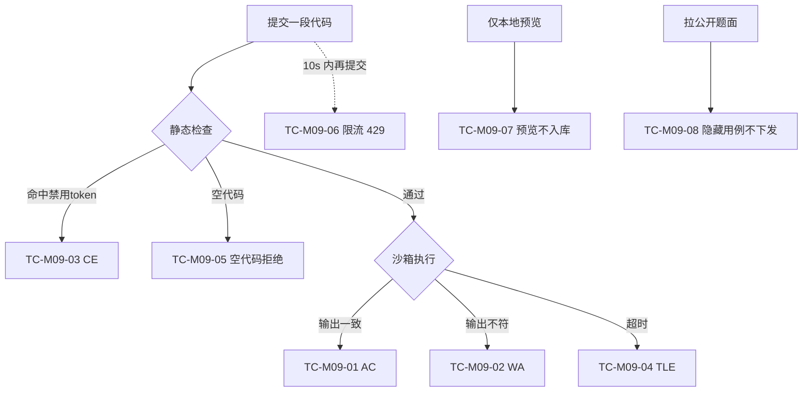

## 9.4.9 训练场与判题·双轨 · 功能测试

> 本文件 filecode：**T09**。测试用例编号 `TC-M09-NN`、图编号 `图 T09-n`。
> 关联需求见 R09，详细设计见 S09；数据表字段见 §6（D3 文件）。

### 9.4.9.1 测试范围与环境

本节针对 M09 训练场判题链路做功能测试，覆盖判定七态中的核心四态（`AC / WA / CE / TLE`）、输入校验（空代码拒绝）、防滥用（10s 限频）、以及两条防泄题红线（**Pyodide 预览不入库**、**隐藏用例不下发**）。环境：后端 `:18080`、PostgreSQL 16（库 `pythontopia`，已导入课程包 `packId=43` 共 39 题）、前端 dev `http://localhost:5173`（容器态 `http://localhost:8080`）；测试账号为演示环境任一已注册**学生**（除登录外接口均需 JWT）；做题入口 `/training`（默认 `problemId=476`）。测试点覆盖关系见 图 T09-1。

### 图 T09-1 测试点覆盖（flowchart）

### 9.4.9.2 测试用例

### TC-M09-01 正确提交判定 AC

| 项 | 内容 |
| --- | --- |
| 关联用例 | UC-09-01 |
| 测试目标 | 正确代码全部用例通过，判定 `AC`、`status=PASSED` 并入库 |
| 前置条件 | 已登录学生；已进入 `/training` 且加载到目标题 |
| 测试步骤 | 1. 在编辑器写入满足题意的正确解；2. 点「提交代码」（`POST /api/submissions`）；3. 前端 `GET /api/submissions/{id}` 取详情；4. 查看 `JudgeResultPanel`/调试区判定 |
| 测试数据 | 读取 stdin 并按题目输出描述打印的正确 Python 代码；`source=TRAINING` |
| 预期结果 | `verdict=AC`、`passedCases==totalCases`、`status=PASSED`；toast「提交通过，掌握进度 +0.10」；发布 `PracticeSucceeded` |
| 实际结果 | 通过（演示环境） |
| 结论 | Pass |
| 缺陷编号 | / |

### TC-M09-02 答案错误判定 WA

| 项 | 内容 |
| --- | --- |
| 关联用例 | UC-09-01 |
| 测试目标 | 输出与期望不符时判 `WA` 并短路，`failureReason` 含期望/实际摘要 |
| 前置条件 | 同 TC-M09-01 |
| 测试步骤 | 1. 在正确解基础上故意改错输出（如多打/少打一行）；2. 提交；3. 取详情查看判定与 `failureReason` |
| 测试数据 | 故意错误输出的 Python 代码 |
| 预期结果 | `verdict=WA`、`status=FAILED`、`passedCases<totalCases`；出现「进入 Bug 矿洞」入口；发布 `PracticeFailed` |
| 实际结果 | 通过（演示环境） |
| 结论 | Pass |
| 缺陷编号 | / |

### TC-M09-03 静态检查拦截判定 CE

| 项 | 内容 |
| --- | --- |
| 关联用例 | UC-09-01 |
| 测试目标 | 含禁用导入/调用的代码被静态检查拦截判 `CE`，不进入沙箱 |
| 前置条件 | 同 TC-M09-01 |
| 测试步骤 | 1. 写入含禁用 token 的代码；2. 提交；3. 查看判定与 `failureReason`（规则标签） |
| 测试数据 | `import os\nprint(os.getcwd())`（命中 `banned_import:os`） |
| 预期结果 | `verdict=CE`、`status=FAILED`、`trace.checker=static`；toast「代码静态检查未通过：…」；**无**「进入 Bug 矿洞」入口（CE 不入矿洞） |
| 实际结果 | 通过（演示环境） |
| 结论 | Pass |
| 缺陷编号 | / |

### TC-M09-04 死循环判定 TLE

| 项 | 内容 |
| --- | --- |
| 关联用例 | UC-09-01 |
| 测试目标 | 超过单例 CPU/墙钟上限时判 `TLE`，沙箱强制结束子进程 |
| 前置条件 | 同 TC-M09-01 |
| 测试步骤 | 1. 写入无出口死循环；2. 提交；3. 观察约 5s 内返回判定 |
| 测试数据 | `while True:\n    pass`（无禁用 token，通过静态检查后超时） |
| 预期结果 | `verdict=TLE`、`status=FAILED`、`failureReason` 含「超过时间限制」；进程被 `destroyForcibly` |
| 实际结果 | 通过（演示环境） |
| 结论 | Pass |
| 缺陷编号 | / |

### TC-M09-05 空代码拒绝

| 项 | 内容 |
| --- | --- |
| 关联用例 | UC-09-01 |
| 测试目标 | 空/纯空白代码被拒绝，不写库、不判题 |
| 前置条件 | 已登录学生 |
| 测试步骤 | 1. 清空编辑器后点「提交代码」（前端拦截）；2. 用接口直接以空 `code` 调 `POST /api/submissions`（绕过前端） |
| 测试数据 | `code=""` 或全空白 |
| 预期结果 | 前端 toast「代码不能为空。」；后端返回 `400 SUBMISSION_CODE_EMPTY`；`practice_submission` 无新增行 |
| 实际结果 | 通过（演示环境） |
| 结论 | Pass |
| 缺陷编号 | / |

### TC-M09-06 频繁提交限流

| 项 | 内容 |
| --- | --- |
| 关联用例 | UC-09-01 |
| 测试目标 | 同一用户 10 秒内第二次正式提交被限流 |
| 前置条件 | 已登录学生 |
| 测试步骤 | 1. 提交一次（任意可判代码）；2. 10 秒内立即再次提交同/异题；3. 观察第二次响应 |
| 测试数据 | 任意非空代码，连续两次 |
| 预期结果 | 第二次返回 `429 SUBMISSION_THROTTLED`「请稍候，10 秒内只能正式提交一次」；咨询锁保证并发场景同样串行限流 |
| 实际结果 | 通过（演示环境） |
| 结论 | Pass |
| 缺陷编号 | / |

### TC-M09-07 Pyodide 预览不入库

| 项 | 内容 |
| --- | --- |
| 关联用例 | UC-09-01 |
| 测试目标 | 验证本地预览仅在浏览器执行，结果不写入后端判分 |
| 前置条件 | 已登录学生；记录当前 `GET /api/submissions` 列表长度 N |
| 测试步骤 | 1. 在调试面板填 Input，点「运行」执行 Pyodide 预览；2. 观察调试区回显 stdout/stderr/耗时；3. 再次 `GET /api/submissions` 比对列表长度 |
| 测试数据 | `print(sum(map(int, input().split())))`，Input=`1 2 3` |
| 预期结果 | 调试区显示本地输出且标注「本地预览」；提交列表仍为 N（**无新增** `practice_submission`/`judge_result`）；不产生 `notifyMoodRefresh`/任务刷新副作用 |
| 实际结果 | 通过（演示环境） |
| 结论 | Pass |
| 缺陷编号 | / |

### TC-M09-08 隐藏用例不下发

| 项 | 内容 |
| --- | --- |
| 关联用例 | UC-09-02 |
| 测试目标 | 题面公开视图只含公开样例，绝不返回 `hidden_test_cases` |
| 前置条件 | 已登录学生 |
| 测试步骤 | 1. 调 `GET /api/problems/{id}/public`；2. 检查响应 JSON 字段集合；3. 在浏览器开发者工具网络面板复核做题页加载的题面响应 |
| 测试数据 | 任一存在隐藏用例的题目 id |
| 预期结果 | 响应仅含 `id,packId,kcCode,title,statementMarkdown,inputDescription,outputDescription,difficulty,samples`；**无** `hidden_test_cases` 键；隐藏用例仅服务端判题内部可读 |
| 实际结果 | 通过（演示环境） |
| 结论 | Pass |
| 缺陷编号 | / |

### 9.4.9.3 小结

本模块功能测试共 **8 条**（TC-M09-01～08），覆盖判定四态、输入校验、限流防滥用及双防泄题红线，演示环境下**全部 Pass，通过率 100%，缺陷数 0**。其中 TC-M09-07 / TC-M09-08 直接对应模块最高优先约束「预览不入正式判分、隐藏用例不下发」，已在接口与状态层双重验证。遗留风险：沙箱未做文件系统隔离（见 S09 §S09.6 限制条件），属部署层加固项，不影响判题功能正确性与比赛演示链路。

---

执笔人：成员 C ｜ 完成人（签名）：成员 C ｜ 审查人：成员 A ｜ 完成日期：2026-06-18
